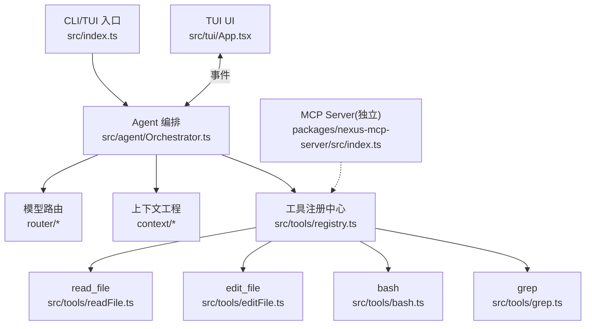
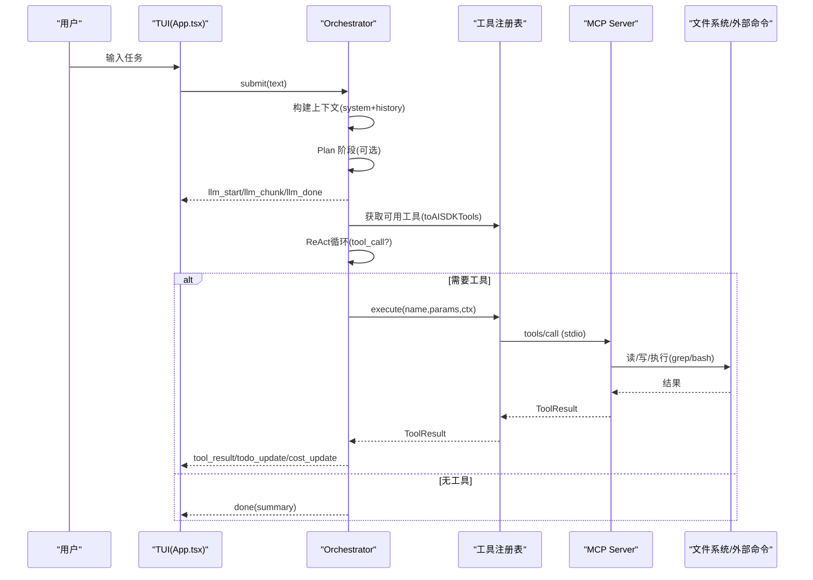
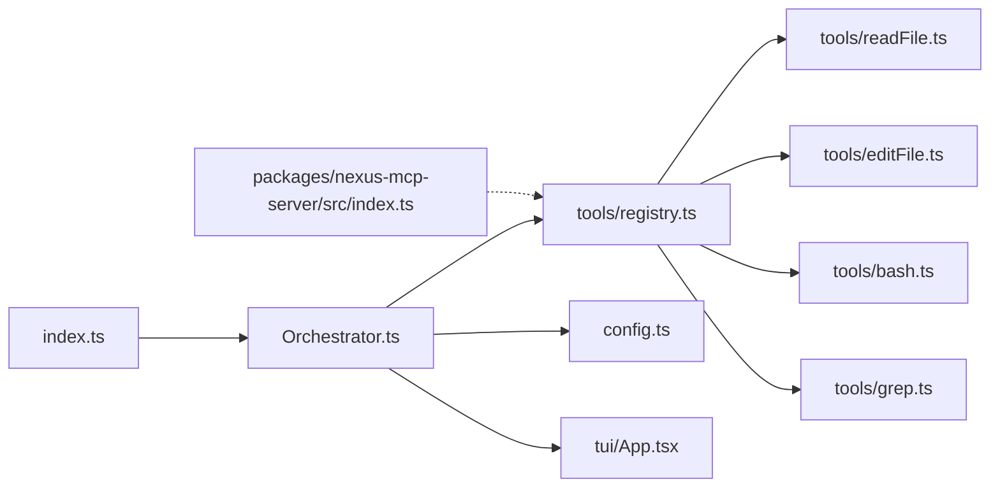

# API 参考

<cite>
**本文引用的文件**   
- [README.md](file://README.md)
- [DESIGN.md](file://DESIGN.md)
- [package.json](file://package.json)
- [src/index.ts](file://src/index.ts)
- [src/agent/types.ts](file://src/agent/types.ts)
- [src/agent/Orchestrator.ts](file://src/agent/Orchestrator.ts)
- [src/tools/registry.ts](file://src/tools/registry.ts)
- [src/tools/schemas.ts](file://src/tools/schemas.ts)
- [src/tools/readFile.ts](file://src/tools/readFile.ts)
- [src/tools/editFile.ts](file://src/tools/editFile.ts)
- [src/tools/bash.ts](file://src/tools/bash.ts)
- [src/tools/grep.ts](file://src/tools/grep.ts)
- [packages/nexus-mcp-server/src/index.ts](file://packages/nexus-mcp-server/src/index.ts)
- [src/tui/App.tsx](file://src/tui/App.tsx)
- [src/config.ts](file://src/config.ts)
- [src/sandbox/CommandGuard.ts](file://src/sandbox/CommandGuard.ts)
- [src/utils/index.ts](file://src/utils/index.ts)
</cite>

## 目录
1. [简介](#简介)
2. [项目结构](#项目结构)
3. [核心组件](#核心组件)
4. [架构总览](#架构总览)
5. [详细组件分析](#详细组件分析)
6. [依赖关系分析](#依赖关系分析)
7. [性能考量](#性能考量)
8. [故障排查指南](#故障排查指南)
9. [结论](#结论)
10. [附录：类型与协议参考](#附录类型与协议参考)

## 简介
本文件为 Nexus 的 API 参考，聚焦以下目标：
- 核心接口定义：ChatMessage、Todo、Plan、NexusEvent 等关键数据结构
- MCP 协议工具调用接口：参数校验、响应格式、错误处理
- 事件系统：消息格式与订阅机制
- 完整类型定义参考：接口规范、字段说明与约束
- 集成示例：如何调用各 API（以路径引用代替代码片段）
- 版本兼容性与迁移指南
- 调试与错误排查方法

## 项目结构
Nexus 采用“TUI + Agent 编排 + 模型路由 + 上下文工程 + MCP 工具层”的分层架构。入口通过 CLI/TUI 启动，内部由 Orchestrator 协调 Plan/Execute 双阶段，工具层以 MCP 原生方式暴露 read_file/edit_file/bash/grep 四个核心工具。

图表来源
- [src/index.ts:1-119](file://src/index.ts#L1-L119)
- [src/agent/Orchestrator.ts:1-260](file://src/agent/Orchestrator.ts#L1-L260)
- [src/tools/registry.ts:1-96](file://src/tools/registry.ts#L1-L96)
- [packages/nexus-mcp-server/src/index.ts:1-383](file://packages/nexus-mcp-server/src/index.ts#L1-L383)
- [src/tui/App.tsx:1-284](file://src/tui/App.tsx#L1-L284)

章节来源
- [README.md:1-174](file://README.md#L1-L174)
- [DESIGN.md:1-774](file://DESIGN.md#L1-L774)
- [package.json:1-43](file://package.json#L1-L43)

## 核心组件
- 事件系统与类型：NexusEvent、ChatMessage、Todo、Plan、ToolDefinition、ToolResult、NexusConfig 等
- 编排器：Orchestrator 负责 Plan/Execute、审批、检查点、成本追踪、上下文组装
- 工具层：registry 统一管理工具注册、阶段可见性、AI SDK 兼容导出、执行分发
- MCP Server：独立进程提供 stdio JSON-RPC 工具服务，供外部 IDE/客户端挂载

章节来源
- [src/agent/types.ts:1-269](file://src/agent/types.ts#L1-L269)
- [src/agent/Orchestrator.ts:1-260](file://src/agent/Orchestrator.ts#L1-L260)
- [src/tools/registry.ts:1-96](file://src/tools/registry.ts#L1-L96)
- [packages/nexus-mcp-server/src/index.ts:1-383](file://packages/nexus-mcp-server/src/index.ts#L1-L383)

## 架构总览
Nexus 的事件流与工具调用时序如下：

图表来源
- [src/tui/App.tsx:1-284](file://src/tui/App.tsx#L1-L284)
- [src/agent/Orchestrator.ts:1-260](file://src/agent/Orchestrator.ts#L1-L260)
- [src/tools/registry.ts:1-96](file://src/tools/registry.ts#L1-L96)
- [packages/nexus-mcp-server/src/index.ts:1-383](file://packages/nexus-mcp-server/src/index.ts#L1-L383)

## 详细组件分析

### 事件系统与类型定义
- NexusEvent：统一事件流，包含 user_input、llm_*、tool_call/approval_request/result、todo_update、checkpoint、cost_update、phase_change、done、error
- ChatMessage：角色(role)、内容(content)、可选 toolCallId/name
- Todo/Plan：任务清单与计划摘要、文件修改列表、预估步骤
- ToolDefinition/ToolInputSchema/ToolProperty：工具元数据与输入 Schema
- ToolCall/ToolResult：工具调用与返回结构
- NexusConfig/ProviderConfig/ProjectRules：配置与规则
- Checkpoint/SubAgent/Session：检查点、子 Agent、会话状态
- SandboxProvider/GraphProvider：可插拔沙箱与图谱提供者接口

章节来源
- [src/agent/types.ts:1-269](file://src/agent/types.ts#L1-L269)

### 编排器 Orchestrator
- 职责：初始化 secrets/rules/上下文组装器；submit 主入口；Plan→Execute 双阶段；权限审批；检查点；成本追踪；模型切换与查询；历史与清理
- 事件：通过 onEvent 回调向 TUI 推送所有生命周期事件
- 工具上下文：projectRoot、callId、maxReadLines、maxOutputBytes、bashTimeout

章节来源
- [src/agent/Orchestrator.ts:1-260](file://src/agent/Orchestrator.ts#L1-L260)

### 工具注册中心 registry
- 注册/查找/按阶段过滤/生成 AI SDK 兼容工具定义
- execute(name,params,context) 分发到具体实现
- 默认内置：read_file、edit_file、bash、grep

章节来源
- [src/tools/registry.ts:1-96](file://src/tools/registry.ts#L1-L96)

### MCP 工具协议与服务端
- 使用 @modelcontextprotocol/sdk 的 McpServer.tool() 注册工具
- 传输：stdio(JSON-RPC over stdin/stdout)
- 工具列表：read_file、edit_file、bash、grep
- 参数校验：zod schema
- 响应格式：{ content:[{type:'text',text}], isError?:boolean }
- 错误处理：结构化 errorResult(errorType,message,suggestion)

章节来源
- [packages/nexus-mcp-server/src/index.ts:1-383](file://packages/nexus-mcp-server/src/index.ts#L1-L383)

### 工具实现与参数校验

#### read_file
- 功能：读取文本文件，支持 start_line/end_line 范围；二进制检测；行号格式化；超长截断
- 安全：路径越界拒绝；非文件拒绝
- 输出：带行号的文本；truncated=true 时提示使用 grep 或指定范围

章节来源
- [src/tools/readFile.ts:1-150](file://src/tools/readFile.ts#L1-L150)
- [src/tools/schemas.ts:1-40](file://src/tools/schemas.ts#L1-L40)

#### edit_file
- 功能：精准替换 old_string→new_string；强制唯一匹配；原子写入(临时文件+rename)；保留 BOM 与行尾风格
- 错误：未找到/多匹配/文件不存在(空 old_string 创建新文件)
- 输出：diff 摘要

章节来源
- [src/tools/editFile.ts:1-170](file://src/tools/editFile.ts#L1-L170)
- [src/tools/schemas.ts:1-40](file://src/tools/schemas.ts#L1-L40)

#### bash
- 功能：执行 shell 命令；超时控制；输出截断；工作目录锁定；进程组管理
- 安全：危险命令检测(正则黑名单)，危险级别强制审批
- 输出：stdout/stderr 清理后拼接，exit code 与超时标记

章节来源
- [src/tools/bash.ts:1-186](file://src/tools/bash.ts#L1-L186)
- [src/sandbox/CommandGuard.ts:1-98](file://src/sandbox/CommandGuard.ts#L1-L98)

#### grep
- 功能：封装 ripgrep；支持正则、文件过滤、上下文行、大小写不敏感
- 回退：rg 不可用时给出安装提示
- 输出：匹配数与结果，过长时截断

章节来源
- [src/tools/grep.ts:1-178](file://src/tools/grep.ts#L1-L178)

### TUI 事件订阅与渲染
- App.tsx 监听 NexusEvent：llm_start/chunk/done、tool_call/result、todo_update、phase_change、done、error
- 全局事件分发：emitToUI(event) 将 Orchestrator 事件推送到 UI
- 审批交互：ApprovalPrompt 组件与 requestApproval Promise 协作

章节来源
- [src/tui/App.tsx:1-284](file://src/tui/App.tsx#L1-L284)
- [src/index.ts:1-119](file://src/index.ts#L1-L119)

### 配置与规则
- loadConfig：从 .nexus/config.toml 加载并合并默认值
- 默认项：models.providers、permissions.mode、limits.*、context.*、checkpoint.*
- ProjectRules：项目约定、风格、约束、always_include

章节来源
- [src/config.ts:1-132](file://src/config.ts#L1-L132)
- [src/agent/types.ts:134-184](file://src/agent/types.ts#L134-L184)

## 依赖关系分析
- index.ts 解析参数、加载配置、创建 Orchestrator、渲染 TUI
- Orchestrator 依赖：Planner/Executor/SubAgent、tools/registry、context/*、router/*、sandbox/*、config-secrets
- tools/* 依赖 types、utils、sandbox/CommandGuard
- MCP Server 独立运行，通过 stdio 与外部客户端通信

图表来源
- [src/index.ts:1-119](file://src/index.ts#L1-L119)
- [src/agent/Orchestrator.ts:1-260](file://src/agent/Orchestrator.ts#L1-L260)
- [src/tools/registry.ts:1-96](file://src/tools/registry.ts#L1-L96)
- [packages/nexus-mcp-server/src/index.ts:1-383](file://packages/nexus-mcp-server/src/index.ts#L1-L383)

章节来源
- [package.json:1-43](file://package.json#L1-L43)

## 性能考量
- 上下文压缩：近期轮次完整保留，早期摘要化；工具结果分级丢弃；Token 预算控制
- 工具输出限制：read_file 行数上限、bash/grep 输出字节上限与尾部截断
- 模型路由：不同阶段选择不同模型，平衡能力与成本
- 异步与超时：bash 命令超时与进程组清理，避免僵尸进程
- 原子写入：edit_file 使用临时文件+rename，降低损坏风险

章节来源
- [DESIGN.md:284-366](file://DESIGN.md#L284-L366)
- [src/tools/readFile.ts:1-150](file://src/tools/readFile.ts#L1-L150)
- [src/tools/bash.ts:1-186](file://src/tools/bash.ts#L1-L186)
- [src/tools/grep.ts:1-178](file://src/tools/grep.ts#L1-L178)
- [src/utils/index.ts:1-211](file://src/utils/index.ts#L1-L211)

## 故障排查指南
- MCP Server 无法启动/连接：检查 stdio 传输与依赖包版本；查看控制台日志
- 工具调用失败：
  - read_file：确认路径在项目根内且为文本文件；注意二进制检测
  - edit_file：确保 old_string 唯一匹配；若文件不存在需空字符串创建
  - bash：检查危险命令拦截、超时、退出码；stderr 通常含错误信息
  - grep：确认 rg 已安装；模式与路径是否正确
- 审批卡不出：确认 TUI 事件分发与 requestApproval Promise 是否被 resolve
- 成本异常：检查 cost_update 事件与 CostTracker 统计
- 上下文爆炸：调整 context.budgetRatio/recentTurnsKeep；减少 L3 注入

章节来源
- [packages/nexus-mcp-server/src/index.ts:1-383](file://packages/nexus-mcp-server/src/index.ts#L1-L383)
- [src/tools/readFile.ts:1-150](file://src/tools/readFile.ts#L1-L150)
- [src/tools/editFile.ts:1-170](file://src/tools/editFile.ts#L1-L170)
- [src/tools/bash.ts:1-186](file://src/tools/bash.ts#L1-L186)
- [src/tools/grep.ts:1-178](file://src/tools/grep.ts#L1-L178)
- [src/tui/App.tsx:1-284](file://src/tui/App.tsx#L1-L284)

## 结论
Nexus 以强类型事件流与 MCP 原生工具为核心，结合 Plan/Execute 双阶段与人在环中的审批机制，提供了生产可用的终端 Coding Agent 能力。通过可插拔的沙箱与图谱提供者接口，未来可平滑迁移至 Go 后端而不改动 Agent loop。

## 附录：类型与协议参考

### 核心类型定义
- NexusEvent：事件联合类型，覆盖用户输入、LLM 流式、工具调用/审批/结果、Todo 更新、检查点、成本、阶段变更、完成与错误
- ChatMessage：role/content/toolCallId/name
- Todo：id/content/status(pending/in_progress/complete/cancelled)
- Plan：summary/todos/filesToModify/estimatedSteps
- ToolDefinition：name/description/inputSchema/requiresApproval/phase(plan|execute|both)
- ToolInputSchema：type/object/properties(required)
- ToolProperty：type(string|number|boolean|array|object)/description/enum/default/items
- ToolCall/ToolResult：callId/tool/params/result/error/truncated
- NexusConfig：models/permissions/limits/context/checkpoint
- ProviderConfig：apiKeyEnv/baseUrl/defaultModel
- ProjectRules：project/style/constraints/context
- Checkpoint/SubAgentTask/SubAgentResult/Session：检查点、子任务、结果与会话
- SandboxProvider/GraphProvider：执行与图谱抽象接口

章节来源
- [src/agent/types.ts:1-269](file://src/agent/types.ts#L1-L269)

### MCP 工具接口规范
- 传输：stdio(JSON-RPC over stdin/stdout)
- 工具注册：server.tool(name, description, zodSchema, handler)
- 参数校验：Zod schema，缺失/类型错误直接返回错误
- 响应格式：{ content:[{type:'text',text}], isError?:boolean }
- 错误处理：errorResult(errorType,message,suggestion)

章节来源
- [packages/nexus-mcp-server/src/index.ts:1-383](file://packages/nexus-mcp-server/src/index.ts#L1-L383)

### 事件订阅与使用示例（路径引用）
- 在 TUI 中订阅事件：见 [src/tui/App.tsx:108-176](file://src/tui/App.tsx#L108-L176)
- 在入口中绑定事件回调：见 [src/index.ts:51-53](file://src/index.ts#L51-L53)
- 自定义处理器：实现 onEvent(event:NexusEvent) 即可消费事件

章节来源
- [src/tui/App.tsx:108-176](file://src/tui/App.tsx#L108-L176)
- [src/index.ts:51-53](file://src/index.ts#L51-L53)

### 工具调用示例（路径引用）
- read_file：见 [src/tools/readFile.ts:54-146](file://src/tools/readFile.ts#L54-L146)
- edit_file：见 [src/tools/editFile.ts:61-156](file://src/tools/editFile.ts#L61-L156)
- bash：见 [src/tools/bash.ts:123-183](file://src/tools/bash.ts#L123-L183)
- grep：见 [src/tools/grep.ts:80-175](file://src/tools/grep.ts#L80-L175)
- MCP 服务端实现：见 [packages/nexus-mcp-server/src/index.ts:119-356](file://packages/nexus-mcp-server/src/index.ts#L119-L356)

章节来源
- [src/tools/readFile.ts:1-150](file://src/tools/readFile.ts#L1-L150)
- [src/tools/editFile.ts:1-170](file://src/tools/editFile.ts#L1-L170)
- [src/tools/bash.ts:1-186](file://src/tools/bash.ts#L1-L186)
- [src/tools/grep.ts:1-178](file://src/tools/grep.ts#L1-L178)
- [packages/nexus-mcp-server/src/index.ts:1-383](file://packages/nexus-mcp-server/src/index.ts#L1-L383)

### 版本兼容性与迁移指南
- MCP SDK 版本：锁定依赖版本，升级前运行测试与评估
- 模型路由：不同 provider 的 tool calling 格式差异由路由层适配
- 沙箱/图谱提供者：通过 SandboxProvider/GraphProvider 接口替换实现，Agent loop 零改动
- 配置键名：TOML 键名与内部字段映射见配置合并逻辑

章节来源
- [DESIGN.md:371-410](file://DESIGN.md#L371-L410)
- [src/agent/types.ts:239-268](file://src/agent/types.ts#L239-L268)
- [src/config.ts:77-131](file://src/config.ts#L77-L131)

### 调试与诊断要点
- 启用 TUI 事件日志：观察 llm_start/chunk/done、tool_call/result、todo_update、cost_update
- 检查危险命令拦截：isDangerousCommand 返回 level(dangerous/caution/safe)
- 输出截断与清理：sanitizeBinaryOutput、truncateTail/Head
- 原子写入与 diff：edit_file 生成 unified diff，便于审查

章节来源
- [src/sandbox/CommandGuard.ts:1-98](file://src/sandbox/CommandGuard.ts#L1-L98)
- [src/utils/index.ts:1-211](file://src/utils/index.ts#L1-L211)
- [src/tools/editFile.ts:158-166](file://src/tools/editFile.ts#L158-L166)