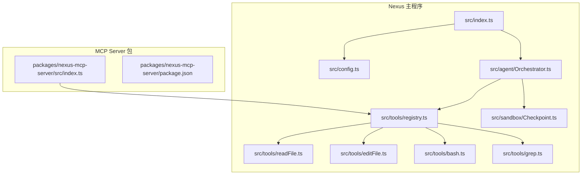
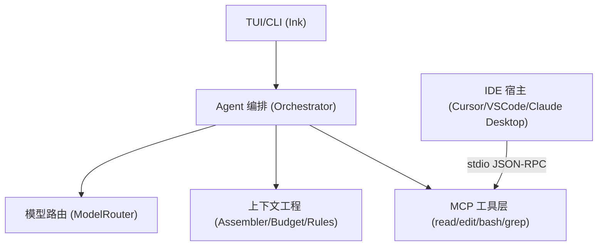
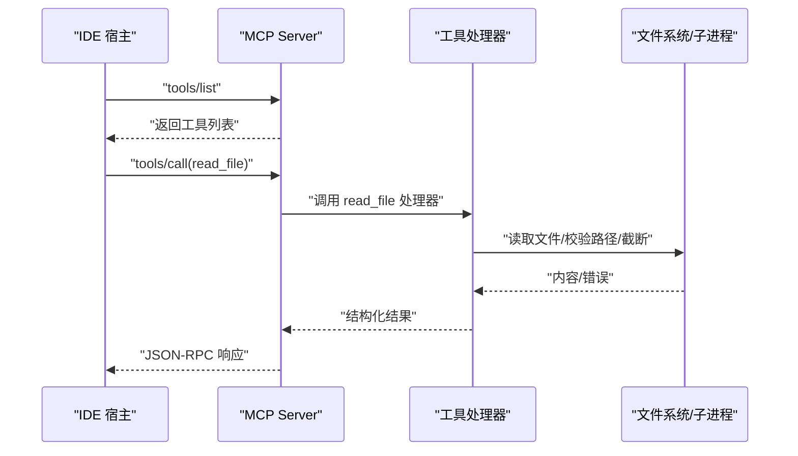
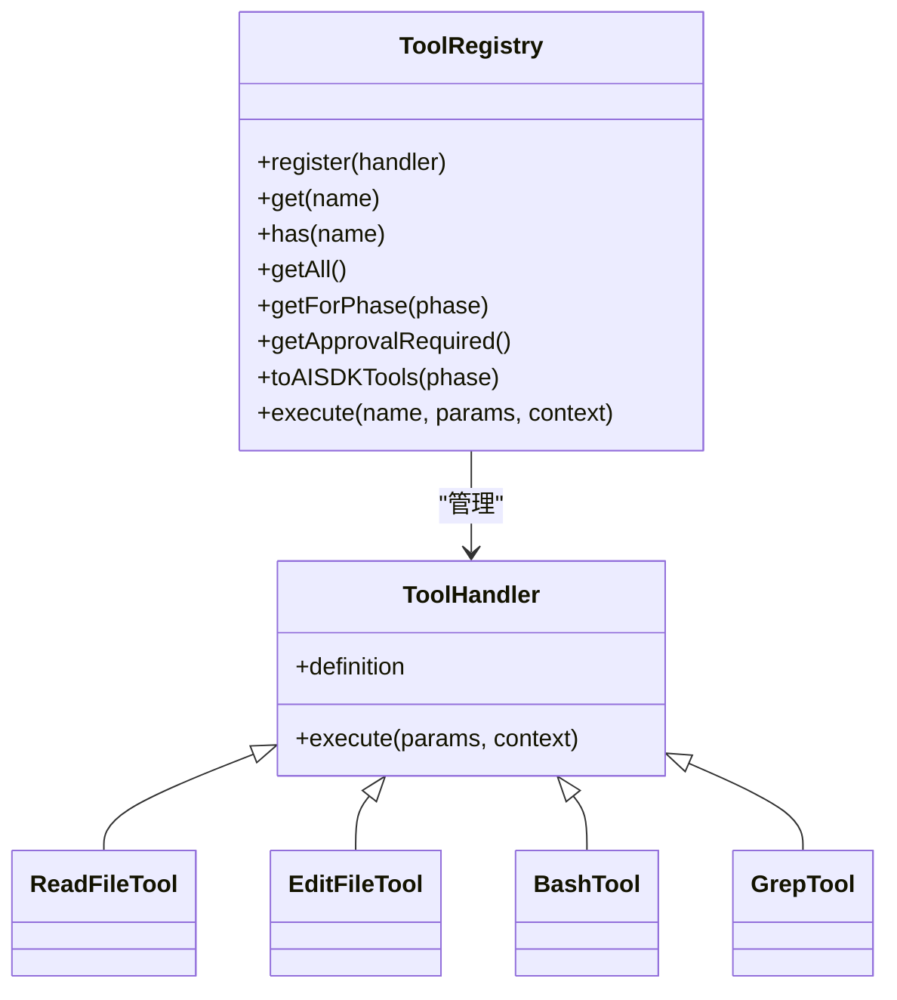
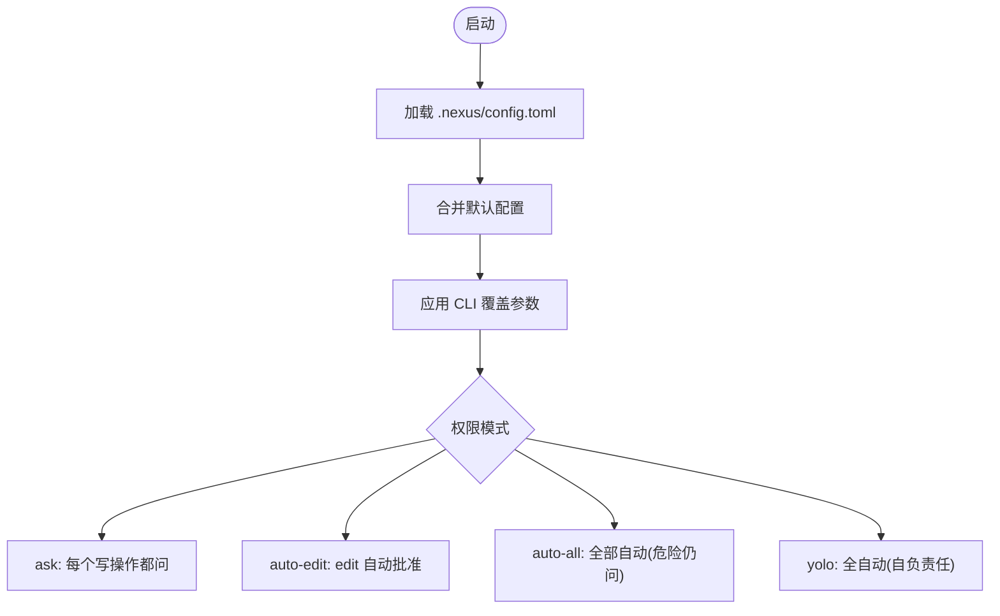
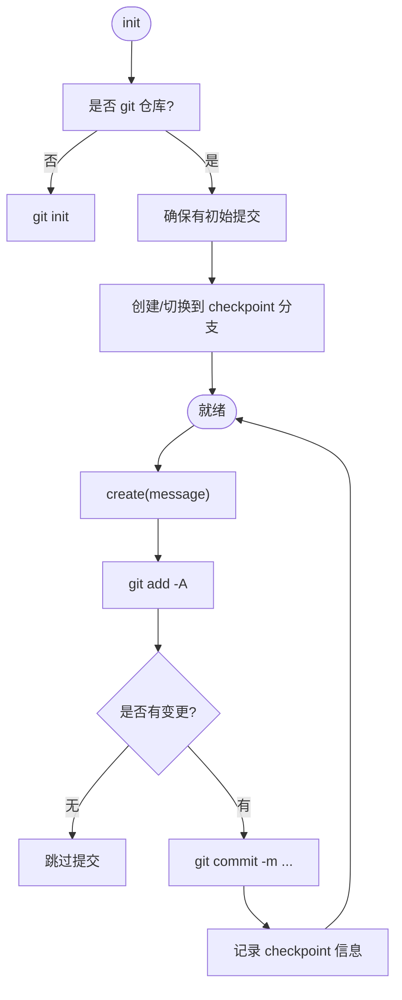
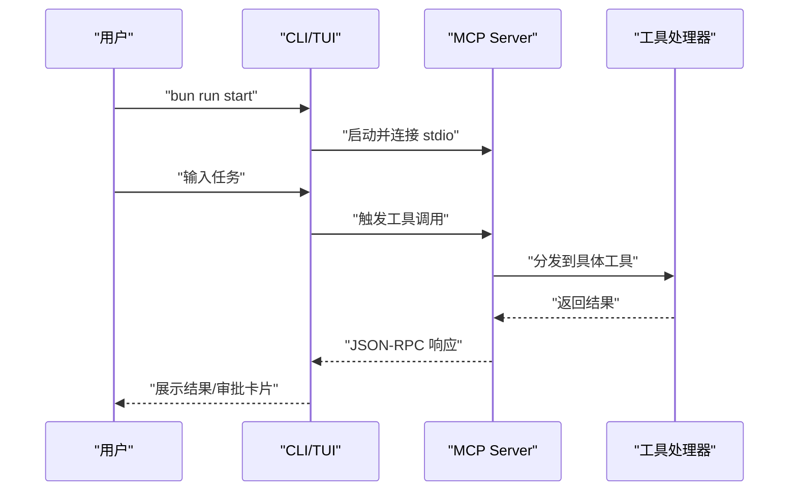
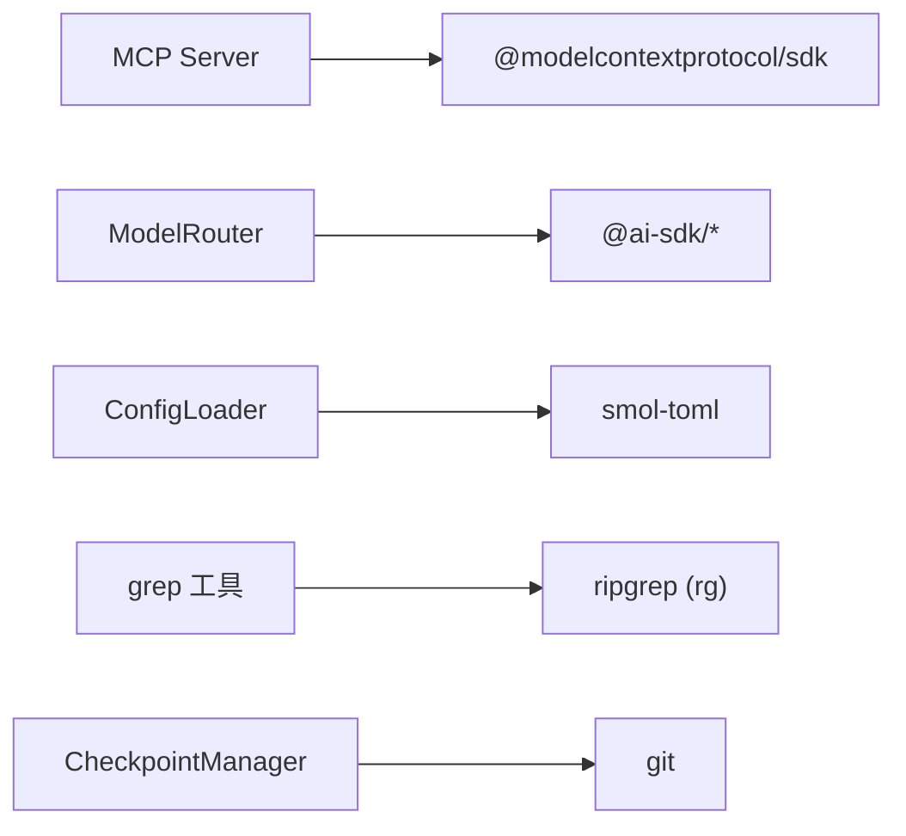

# MCP Server 概述

<cite>
**本文引用的文件**   
- [packages/nexus-mcp-server/src/index.ts](file://packages/nexus-mcp-server/src/index.ts)
- [packages/nexus-mcp-server/package.json](file://packages/nexus-mcp-server/package.json)
- [src/index.ts](file://src/index.ts)
- [src/config.ts](file://src/config.ts)
- [src/agent/Orchestrator.ts](file://src/agent/Orchestrator.ts)
- [src/tools/registry.ts](file://src/tools/registry.ts)
- [src/tools/readFile.ts](file://src/tools/readFile.ts)
- [src/tools/editFile.ts](file://src/tools/editFile.ts)
- [src/tools/bash.ts](file://src/tools/bash.ts)
- [src/tools/grep.ts](file://src/tools/grep.ts)
- [src/sandbox/Checkpoint.ts](file://src/sandbox/Checkpoint.ts)
- [README.md](file://README.md)
- [DESIGN.md](file://DESIGN.md)
</cite>

## 目录
1. [简介](#简介)
2. [项目结构](#项目结构)
3. [核心组件](#核心组件)
4. [架构总览](#架构总览)
5. [详细组件分析](#详细组件分析)
6. [依赖关系分析](#依赖关系分析)
7. [性能考虑](#性能考虑)
8. [故障排查指南](#故障排查指南)
9. [结论](#结论)
10. [附录](#附录)

## 简介
本文件为 Nexus MCP Server 的全面概述文档，聚焦于：
- 架构设计与设计理念
- 使用 @modelcontextprotocol/sdk 构建标准 MCP 服务器的方法（初始化、传输层、生命周期）
- 与 Cursor/VSCode/Claude Desktop 等 IDE 的集成方式
- 完整启动流程与错误处理机制
- 安全考量与性能优化建议

Nexus 将核心工具以 MCP Server 形式暴露，供外部 IDE 挂载调用。MVP 包含四个工具：read_file、edit_file、bash、grep，并通过 stdio JSON-RPC 与宿主通信。

章节来源
- [README.md:1-174](file://README.md#L1-L174)
- [DESIGN.md:219-282](file://DESIGN.md#L219-L282)

## 项目结构
仓库采用“单体起步 + 可插拔”的组织方式：
- packages/nexus-mcp-server：独立发布的 MCP Server 包，对外提供 MCP 能力
- src：Nexus CLI/TUI 主程序与 Agent 编排、上下文工程、模型路由、工具注册等
- .nexus：项目级配置与规则

图表来源
- [packages/nexus-mcp-server/src/index.ts:1-383](file://packages/nexus-mcp-server/src/index.ts#L1-L383)
- [src/index.ts:1-119](file://src/index.ts#L1-L119)
- [src/config.ts:1-132](file://src/config.ts#L1-L132)
- [src/agent/Orchestrator.ts:1-200](file://src/agent/Orchestrator.ts#L1-L200)
- [src/tools/registry.ts:1-96](file://src/tools/registry.ts#L1-L96)
- [src/tools/readFile.ts:1-150](file://src/tools/readFile.ts#L1-L150)
- [src/tools/editFile.ts:1-170](file://src/tools/editFile.ts#L1-L170)
- [src/tools/bash.ts:1-186](file://src/tools/bash.ts#L1-L186)
- [src/tools/grep.ts:1-178](file://src/tools/grep.ts#L1-L178)
- [src/sandbox/Checkpoint.ts:1-182](file://src/sandbox/Checkpoint.ts#L1-L182)

章节来源
- [README.md:148-174](file://README.md#L148-L174)
- [DESIGN.md:575-638](file://DESIGN.md#L575-L638)

## 核心组件
- MCP Server 实例与工具注册：基于 @modelcontextprotocol/sdk 的 McpServer，通过 server.tool() 注册 read_file、edit_file、bash、grep 四个工具，并使用 StdioServerTransport 进行 JSON-RPC over stdin/stdout 通信。
- 工具注册中心：统一管理内置工具的声明、阶段可见性、审批要求与执行入口。
- 配置加载器：从 .nexus/config.toml 合并默认值，控制权限模式、超时、输出大小、上下文预算等。
- 检查点管理：每次编辑后自动提交到 Git 分支，支持回滚与跳转。
- 模型路由与成本追踪：多 Provider 抽象、角色化模型选择、降级与重试、成本统计。

章节来源
- [packages/nexus-mcp-server/src/index.ts:110-116](file://packages/nexus-mcp-server/src/index.ts#L110-L116)
- [src/tools/registry.ts:25-96](file://src/tools/registry.ts#L25-L96)
- [src/config.ts:11-60](file://src/config.ts#L11-L60)
- [src/sandbox/Checkpoint.ts:30-70](file://src/sandbox/Checkpoint.ts#L30-L70)

## 架构总览
Nexus 采用分层设计：TUI/CLI → Agent 编排 → 模型路由/上下文工程 → MCP 工具层。MCP Server 作为工具层的标准化出口，既被内部 Orchestrator 使用，也可被外部 IDE 反向挂载。

图表来源
- [src/index.ts:1-119](file://src/index.ts#L1-L119)
- [src/agent/Orchestrator.ts:1-200](file://src/agent/Orchestrator.ts#L1-L200)
- [packages/nexus-mcp-server/src/index.ts:358-383](file://packages/nexus-mcp-server/src/index.ts#L358-L383)

## 详细组件分析

### MCP Server 实现（@modelcontextprotocol/sdk）
- 服务器初始化：创建 McpServer 实例并设置名称与版本。
- 传输层：使用 StdioServerTransport，通过 stdin/stdout 收发 JSON-RPC。
- 工具注册：server.tool(name, description, schema, handler) 注册四个工具。
- 生命周期：main() 中 connect(transport)，监听 SIGINT/SIGTERM 优雅退出。

图表来源
- [packages/nexus-mcp-server/src/index.ts:110-116](file://packages/nexus-mcp-server/src/index.ts#L110-L116)
- [packages/nexus-mcp-server/src/index.ts:117-163](file://packages/nexus-mcp-server/src/index.ts#L117-L163)
- [packages/nexus-mcp-server/src/index.ts:358-383](file://packages/nexus-mcp-server/src/index.ts#L358-L383)

章节来源
- [packages/nexus-mcp-server/src/index.ts:1-383](file://packages/nexus-mcp-server/src/index.ts#L1-L383)
- [packages/nexus-mcp-server/package.json:1-18](file://packages/nexus-mcp-server/package.json#L1-L18)

### 工具注册中心与工具集
- 注册中心职责：维护工具定义、阶段可见性（plan/execute/both）、是否需要审批、生成 AI SDK 兼容参数、统一执行入口。
- 内置工具：
  - read_file：二进制检测、行数截断、行号格式化、路径越界保护
  - edit_file：唯一匹配校验、BOM/行尾保留、原子写入、diff 输出
  - bash：危险命令检测、超时、输出截断、工作目录锁定、进程组清理
  - grep：封装 ripgrep，支持正则、glob、上下文行、大小写不敏感

图表来源
- [src/tools/registry.ts:25-96](file://src/tools/registry.ts#L25-L96)
- [src/tools/readFile.ts:11-35](file://src/tools/readFile.ts#L11-L35)
- [src/tools/editFile.ts:14-38](file://src/tools/editFile.ts#L14-L38)
- [src/tools/bash.ts:13-33](file://src/tools/bash.ts#L13-L33)
- [src/tools/grep.ts:11-43](file://src/tools/grep.ts#L11-L43)

章节来源
- [src/tools/registry.ts:1-96](file://src/tools/registry.ts#L1-L96)
- [src/tools/readFile.ts:1-150](file://src/tools/readFile.ts#L1-L150)
- [src/tools/editFile.ts:1-170](file://src/tools/editFile.ts#L1-L170)
- [src/tools/bash.ts:1-186](file://src/tools/bash.ts#L1-L186)
- [src/tools/grep.ts:1-178](file://src/tools/grep.ts#L1-L178)

### 配置与权限策略
- 配置来源：.nexus/config.toml 与默认值合并；支持 models、permissions、limits、context、checkpoint 等。
- 权限模式：ask / auto-edit / auto-all / yolo，影响工具审批策略。
- 限制项：bashTimeout、maxReadLines、maxIterations、maxOutputBytes 等。

图表来源
- [src/config.ts:62-132](file://src/config.ts#L62-L132)
- [src/index.ts:31-40](file://src/index.ts#L31-L40)

章节来源
- [src/config.ts:1-132](file://src/config.ts#L1-L132)
- [src/index.ts:18-40](file://src/index.ts#L18-L40)

### 检查点与回滚
- 自动 checkpoint：在专用分支上按步骤提交变更，记录 commit hash、变更文件、消息。
- 回滚与跳转：undo 回到上一步，jumpTo 跳转到指定步骤。
- 会话结束：可选择合并到工作分支。

图表来源
- [src/sandbox/Checkpoint.ts:42-70](file://src/sandbox/Checkpoint.ts#L42-L70)
- [src/sandbox/Checkpoint.ts:72-116](file://src/sandbox/Checkpoint.ts#L72-L116)
- [src/sandbox/Checkpoint.ts:118-155](file://src/sandbox/Checkpoint.ts#L118-L155)

章节来源
- [src/sandbox/Checkpoint.ts:1-182](file://src/sandbox/Checkpoint.ts#L1-L182)

### 编辑器集成与启动流程
- 独立运行：bun run start 或 bun run packages/nexus-mcp-server/src/index.ts
- 环境变量：设置各 Provider API Key（Anthropic/OpenAI/DeepSeek/Custom/Ollama）
- IDE 集成：将 MCP Server 作为外部工具挂载，通过 stdio JSON-RPC 调用工具

图表来源
- [packages/nexus-mcp-server/src/index.ts:358-383](file://packages/nexus-mcp-server/src/index.ts#L358-L383)
- [README.md:95-112](file://README.md#L95-L112)

章节来源
- [README.md:18-112](file://README.md#L18-L112)
- [packages/nexus-mcp-server/package.json:10-13](file://packages/nexus-mcp-server/package.json#L10-L13)

## 依赖关系分析
- 运行时与协议：Bun、@modelcontextprotocol/sdk、ai-sdk（用于模型路由）
- 工具依赖：ripgrep（grep 工具）、git（检查点）
- 配置解析：smol-toml

图表来源
- [packages/nexus-mcp-server/package.json:14-16](file://packages/nexus-mcp-server/package.json#L14-L16)
- [src/config.ts:8](file://src/config.ts#L8)
- [src/tools/grep.ts:46-78](file://src/tools/grep.ts#L46-L78)
- [src/sandbox/Checkpoint.ts:11-28](file://src/sandbox/Checkpoint.ts#L11-L28)

章节来源
- [packages/nexus-mcp-server/package.json:1-18](file://packages/nexus-mcp-server/package.json#L1-L18)
- [src/config.ts:1-132](file://src/config.ts#L1-L132)
- [src/tools/grep.ts:1-178](file://src/tools/grep.ts#L1-L178)
- [src/sandbox/Checkpoint.ts:1-182](file://src/sandbox/Checkpoint.ts#L1-L182)

## 性能考虑
- 输出截断：bash/grep 输出限制最大字节数，避免大输出阻塞管道与内存膨胀
- 行数限制：read_file 对超大文件仅返回头尾，提示使用范围读取或搜索
- 超时控制：bash 命令带超时，超时后终止进程组，防止僵尸进程
- 子进程隔离：spawn argv 数组传递，避免 shell 注入；Windows 下隐藏窗口
- 原子写入：edit_file 先写临时文件再 rename，保证一致性
- 上下文压缩：近期轮次完整保留，早期摘要，工具结果分级存储，Token 预算管理

章节来源
- [src/tools/bash.ts:111-121](file://src/tools/bash.ts#L111-L121)
- [src/tools/readFile.ts:114-130](file://src/tools/readFile.ts#L114-L130)
- [src/tools/editFile.ts:52-59](file://src/tools/editFile.ts#L52-L59)
- [DESIGN.md:325-337](file://DESIGN.md#L325-L337)

## 故障排查指南
- 常见错误类型与处理
  - 路径越界：read_file/edit_file 拒绝访问项目外路径
  - 二进制文件：read_file 检测到 null 字节直接拒绝
  - 匹配不唯一：edit_file 要求 old_string 唯一匹配，否则报错
  - 工具缺失：grep 未安装 rg 时返回明确提示
  - 命令超时/失败：bash 返回退出码与截断后的 stdout/stderr
- 调试建议
  - 查看 stderr 日志与 MCP Server 启动信息
  - 确认环境变量与 Provider 配置
  - 检查 .nexus/config.toml 中的权限模式与限制项
  - 使用 /undo 快速回滚到最近检查点

章节来源
- [src/tools/readFile.ts:60-96](file://src/tools/readFile.ts#L60-L96)
- [src/tools/editFile.ts:112-129](file://src/tools/editFile.ts#L112-L129)
- [src/tools/grep.ts:120-145](file://src/tools/grep.ts#L120-L145)
- [src/tools/bash.ts:123-183](file://src/tools/bash.ts#L123-L183)
- [src/sandbox/Checkpoint.ts:118-155](file://src/sandbox/Checkpoint.ts#L118-L155)

## 结论
Nexus MCP Server 以 MCP 协议为核心，将读/写/执行/检索四类工具标准化暴露，既服务于内部 Agent 编排，也便于外部 IDE 挂载。其设计强调可靠性（唯一匹配、原子写入）、安全性（路径越界、危险命令拦截、超时与输出限制）、可观测性（成本追踪、检查点）与可扩展性（多 Provider、未来 Go 引擎可插拔）。在生产环境中，建议结合权限模式与 Token 预算策略，配合 CI/CD 评估与回归测试，保障稳定性与成本可控。

## 附录
- 启动与运行
  - 独立运行：bun run start 或 bun run packages/nexus-mcp-server/src/index.ts
  - 环境变量：ANTHROPIC_API_KEY、OPENAI_API_KEY、DEEPSEEK_API_KEY、CUSTOM_API_KEY + CUSTOM_BASE_URL
  - 非交互模式：bun run start --non-interactive "任务描述"
- 集成要点
  - 使用 stdio JSON-RPC 与 IDE 通信
  - 在 IDE 中挂载 MCP Server，即可调用 read/edit/bash/grep 工具
  - 通过 .nexus/config.toml 调整权限模式、超时、输出大小等

章节来源
- [README.md:18-112](file://README.md#L18-L112)
- [packages/nexus-mcp-server/src/index.ts:358-383](file://packages/nexus-mcp-server/src/index.ts#L358-L383)