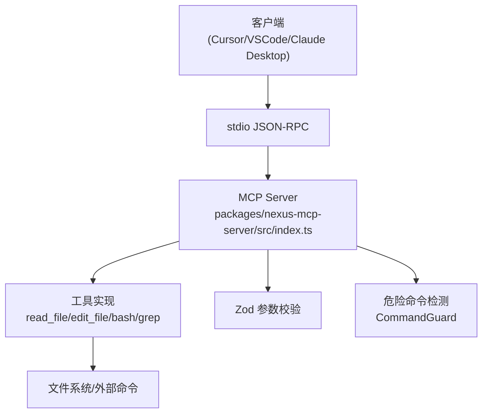
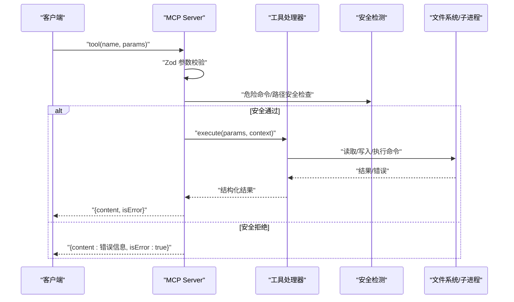
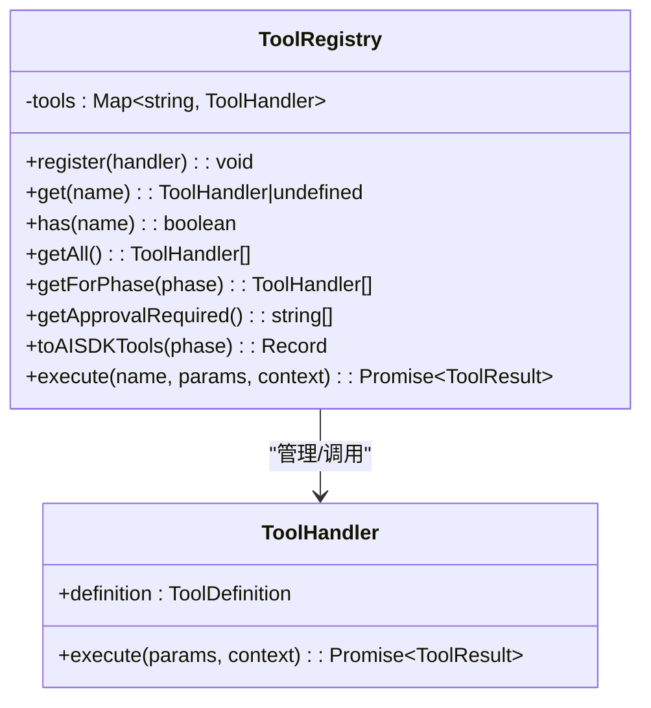
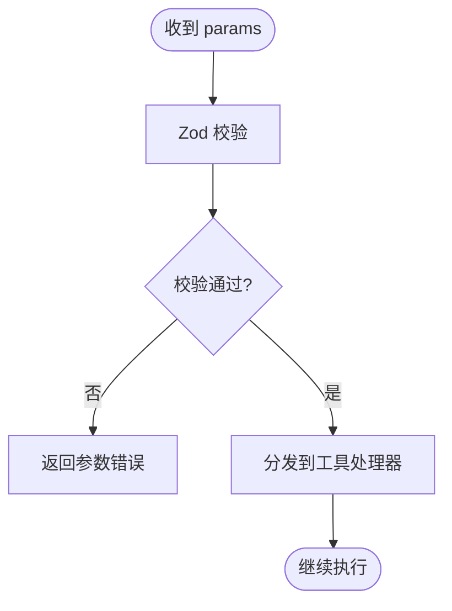
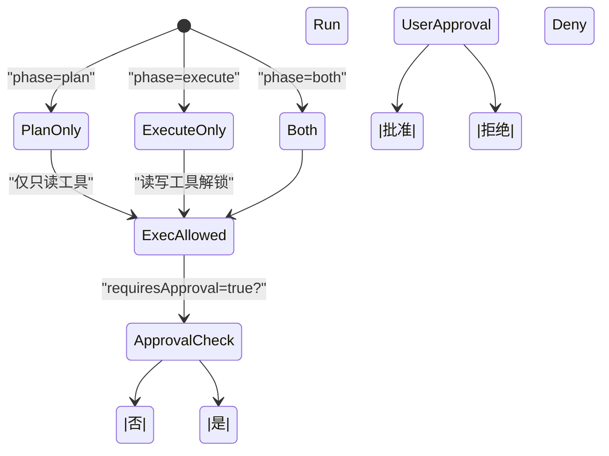
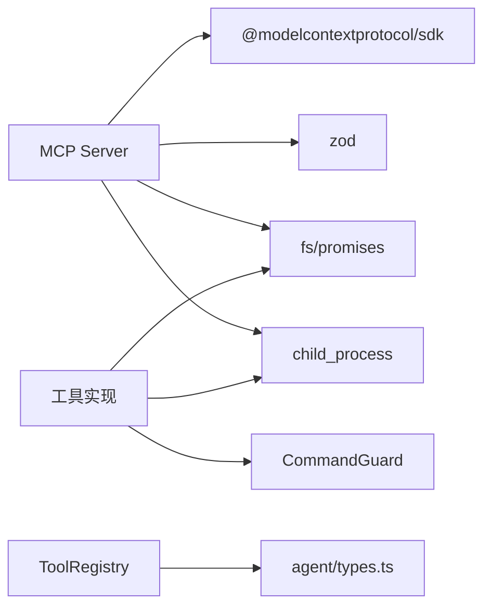

# MCP 协议接口

<cite>
**本文引用的文件**   
- [packages/nexus-mcp-server/src/index.ts](file://packages/nexus-mcp-server/src/index.ts)
- [src/tools/registry.ts](file://src/tools/registry.ts)
- [src/tools/schemas.ts](file://src/tools/schemas.ts)
- [src/tools/readFile.ts](file://src/tools/readFile.ts)
- [src/tools/editFile.ts](file://src/tools/editFile.ts)
- [src/tools/bash.ts](file://src/tools/bash.ts)
- [src/tools/grep.ts](file://src/tools/grep.ts)
- [src/sandbox/CommandGuard.ts](file://src/sandbox/CommandGuard.ts)
- [src/utils/index.ts](file://src/utils/index.ts)
- [src/agent/types.ts](file://src/agent/types.ts)
- [tests/integration/tools.test.ts](file://tests/integration/tools.test.ts)
- [README.md](file://README.md)
- [DESIGN.md](file://DESIGN.md)
</cite>

## 目录
1. [简介](#简介)
2. [项目结构](#项目结构)
3. [核心组件](#核心组件)
4. [架构总览](#架构总览)
5. [详细组件分析](#详细组件分析)
6. [依赖关系分析](#依赖关系分析)
7. [性能与限制](#性能与限制)
8. [错误处理与调试](#错误处理与调试)
9. [工具开发指南](#工具开发指南)
10. [结论](#结论)
11. [附录：API 参考](#附录api-参考)

## 简介
本文件为 Nexus 的 MCP（Model Context Protocol）协议接口提供全面 API 文档。重点覆盖：
- 工具注册机制与生命周期
- 参数验证 Schema（Zod）与 ToolInputSchema 定义方式
- 调用流程、权限控制（requiresApproval）与审批流程
- 响应格式与错误策略
- 自定义工具开发与集成示例
- 调试方法与常见问题排查

MCP Server 通过 stdio JSON-RPC 暴露工具，可被 Cursor/VSCode/Claude Desktop 等客户端挂载使用。内置四个核心工具：read_file、edit_file、bash、grep。

**章节来源**
- [README.md:1-174](file://README.md#L1-L174)
- [DESIGN.md:1-200](file://DESIGN.md#L1-L200)

## 项目结构
- packages/nexus-mcp-server/src/index.ts：MCP Server 入口，注册工具、实现安全校验、输出结构化结果
- src/tools/*：各工具实现与注册中心
  - registry.ts：工具注册表、阶段过滤、AI SDK 兼容导出
  - schemas.ts：Zod Schema 定义与映射
  - readFile.ts / editFile.ts / bash.ts / grep.ts：具体工具实现
- src/sandbox/CommandGuard.ts：危险命令检测
- src/utils/index.ts：通用工具（截断、BOM/行尾处理、二进制清理）
- src/agent/types.ts：核心类型（ToolDefinition、ToolInputSchema、ToolResult 等）
- tests/integration/tools.test.ts：工具层端到端测试

**图表来源**
- [packages/nexus-mcp-server/src/index.ts:112-383](file://packages/nexus-mcp-server/src/index.ts#L112-L383)
- [src/tools/registry.ts:25-96](file://src/tools/registry.ts#L25-L96)
- [src/sandbox/CommandGuard.ts:71-98](file://src/sandbox/CommandGuard.ts#L71-L98)

**章节来源**
- [packages/nexus-mcp-server/src/index.ts:1-383](file://packages/nexus-mcp-server/src/index.ts#L1-L383)
- [src/tools/registry.ts:1-96](file://src/tools/registry.ts#L1-L96)

## 核心组件
- MCP Server：基于 @modelcontextprotocol/sdk 的 McpServer，使用 stdio transport 暴露工具
- 工具注册中心：管理工具定义、执行器、阶段过滤、AI SDK 兼容导出
- 参数验证：Zod Schema 定义并映射到 Vercel AI SDK 的 parameters
- 安全与沙箱：路径越界检查、危险命令检测、超时与输出大小限制
- 统一响应：结构化 content + isError 标记，便于客户端解析

**章节来源**
- [packages/nexus-mcp-server/src/index.ts:112-383](file://packages/nexus-mcp-server/src/index.ts#L112-L383)
- [src/tools/registry.ts:12-96](file://src/tools/registry.ts#L12-L96)
- [src/tools/schemas.ts:1-40](file://src/tools/schemas.ts#L1-L40)

## 架构总览
MCP Server 作为独立进程运行，接收来自客户端的 JSON-RPC 请求，按工具名路由到对应处理器，执行前进行参数校验与安全审查，返回标准化结果。

**图表来源**
- [packages/nexus-mcp-server/src/index.ts:119-356](file://packages/nexus-mcp-server/src/index.ts#L119-L356)
- [src/sandbox/CommandGuard.ts:71-98](file://src/sandbox/CommandGuard.ts#L71-L98)

## 详细组件分析

### 工具注册与调度（ToolRegistry）
- 职责：注册工具、按阶段过滤、生成 AI SDK 兼容定义、执行工具调用
- 关键方法：
  - register(handler)：注册工具处理器
  - getForPhase(phase)：按 plan/execute/both 过滤可用工具
  - toAISDKTools(phase)：导出 {description, parameters} 给 AI SDK
  - execute(name, params, context)：查找并执行工具
- 上下文对象 ToolContext：包含 projectRoot、callId、maxReadLines、maxOutputBytes、bashTimeout

**图表来源**
- [src/tools/registry.ts:12-96](file://src/tools/registry.ts#L12-L96)

**章节来源**
- [src/tools/registry.ts:1-96](file://src/tools/registry.ts#L1-L96)

### 参数验证 Schema（Zod）
- 所有工具的输入参数均通过 Zod 定义，确保类型与约束正确
- 工具名 → Zod Schema 映射在 toolSchemas 中集中维护
- 字段支持可选、默认值、描述信息，便于 LLM 理解与 UI 展示

**图表来源**
- [src/tools/schemas.ts:1-40](file://src/tools/schemas.ts#L1-L40)
- [packages/nexus-mcp-server/src/index.ts:119-356](file://packages/nexus-mcp-server/src/index.ts#L119-L356)

**章节来源**
- [src/tools/schemas.ts:1-40](file://src/tools/schemas.ts#L1-L40)

### 工具定义与权限控制
- ToolDefinition 包含 name、description、inputSchema、requiresApproval、phase
- requiresApproval 标志决定是否需要用户审批（如 edit_file、bash）
- phase 控制工具在 plan/execute 阶段的可用性

**图表来源**
- [src/agent/types.ts:44-78](file://src/agent/types.ts#L44-L78)
- [src/tools/readFile.ts:11-35](file://src/tools/readFile.ts#L11-L35)
- [src/tools/editFile.ts:14-38](file://src/tools/editFile.ts#L14-L38)
- [src/tools/bash.ts:13-33](file://src/tools/bash.ts#L13-L33)

**章节来源**
- [src/agent/types.ts:44-78](file://src/agent/types.ts#L44-L78)

### read_file 工具
- 功能：读取文件内容，支持行数范围、二进制检测、行号格式化
- 安全：路径越界检查、二进制文件拒绝
- 输出：带行号的文本，大文件自动截断并提示使用 start_line/end_line

**章节来源**
- [src/tools/readFile.ts:1-150](file://src/tools/readFile.ts#L1-L150)

### edit_file 工具
- 功能：精准替换字符串，强制唯一匹配，原子写入（临时文件+rename）
- 安全：路径越界检查、BOM/行尾保留、diff 输出便于审计
- 权限：requiresApproval=true，需用户确认

**章节来源**
- [src/tools/editFile.ts:1-170](file://src/tools/editFile.ts#L1-L170)

### bash 工具
- 功能：执行 shell 命令，支持超时、输出截断、工作目录锁定
- 安全：危险命令检测（CommandGuard）、进程组管理、跨平台兼容
- 权限：requiresApproval=true，危险命令强制审批

**章节来源**
- [src/tools/bash.ts:1-186](file://src/tools/bash.ts#L1-L186)
- [src/sandbox/CommandGuard.ts:1-98](file://src/sandbox/CommandGuard.ts#L1-L98)

### grep 工具
- 功能：封装 ripgrep，支持正则、文件过滤、上下文行
- 容错：ripgrep 不可用时返回明确错误提示
- 输出：匹配数统计 + 结果截断保护

**章节来源**
- [src/tools/grep.ts:1-178](file://src/tools/grep.ts#L1-L178)

### MCP Server 工具注册
- 使用 server.tool() 注册工具，参数为 Zod Schema
- 每个工具处理器返回结构化 content 数组与 isError 标记
- 统一错误处理函数 errorResult() 生成友好错误消息

**章节来源**
- [packages/nexus-mcp-server/src/index.ts:112-383](file://packages/nexus-mcp-server/src/index.ts#L112-L383)

## 依赖关系分析
- MCP Server 依赖 @modelcontextprotocol/sdk 和 zod
- 工具实现依赖 Node.js fs/promises、child_process、path
- 安全模块依赖 CommandGuard 的危险命令模式匹配
- 工具注册中心依赖 agent/types.ts 的核心类型定义

**图表来源**
- [packages/nexus-mcp-server/src/index.ts:11-16](file://packages/nexus-mcp-server/src/index.ts#L11-L16)
- [src/tools/readFile.ts:6-9](file://src/tools/readFile.ts#L6-L9)
- [src/tools/bash.ts:6-11](file://src/tools/bash.ts#L6-L11)
- [src/tools/registry.ts:6-10](file://src/tools/registry.ts#L6-L10)

**章节来源**
- [packages/nexus-mcp-server/src/index.ts:1-383](file://packages/nexus-mcp-server/src/index.ts#L1-L383)
- [src/tools/registry.ts:1-96](file://src/tools/registry.ts#L1-L96)

## 性能与限制
- 文件读取：最大行数限制（默认 2000），大文件自动截断
- Bash 输出：最大字节限制（默认 100KB），尾部截断保留错误信息
- 命令超时：默认 30 秒，支持自定义
- 搜索限制：grep 最多返回 100 个匹配，避免过大结果集
- 内存优化：流式处理、二进制清理、UTF-8 长度计算

**章节来源**
- [packages/nexus-mcp-server/src/index.ts:21-24](file://packages/nexus-mcp-server/src/index.ts#L21-L24)
- [src/utils/index.ts:40-55](file://src/utils/index.ts#L40-L55)
- [src/tools/grep.ts:92-116](file://src/tools/grep.ts#L92-L116)

## 错误处理与调试
- 结构化错误：errorResult() 生成统一格式的错误消息
- 分类错误码：PATH_ERROR、READ_ERROR、EDIT_ERROR、DANGEROUS_COMMAND 等
- 调试建议：
  - 启用 verbose 日志查看 JSON-RPC 请求/响应
  - 使用单元测试验证工具行为
  - 检查环境变量和权限配置
  - 验证 ripgrep 安装状态

**章节来源**
- [packages/nexus-mcp-server/src/index.ts:104-108](file://packages/nexus-mcp-server/src/index.ts#L104-L108)
- [tests/integration/tools.test.ts:1-100](file://tests/integration/tools.test.ts#L1-L100)

## 工具开发指南

### 创建自定义 MCP 工具步骤
1. 定义 ToolDefinition：包含 name、description、inputSchema、requiresApproval、phase
2. 实现 execute 函数：接收 params 和 context，返回 ToolResult
3. 注册工具：在 createToolRegistry() 中调用 register()
4. 添加 Zod Schema：在 schemas.ts 中定义并映射到 toolSchemas
5. 编写测试：覆盖正常流程、边界条件、错误场景

### ToolInputSchema 定义规范
- type: 'object'
- properties: 字段定义，支持 string/number/boolean/array/object
- required: 必填字段列表
- 字段属性：type、description、enum、default、items（数组项定义）

### 权限控制机制
- requiresApproval: true 的工具需要用户审批
- phase: 'plan'|'execute'|'both' 控制工具可用性
- 危险命令强制审批（无论权限模式）

### 错误处理最佳实践
- 使用 try/catch 包裹外部调用
- 返回结构化错误信息，包含错误类型和建议
- 区分业务错误和系统错误

### 集成代码示例
- MCP Server 集成：使用 server.tool() 注册工具
- 本地工具集成：通过 ToolRegistry 管理工具
- 测试集成：使用 createToolRegistry() 创建测试环境

**章节来源**
- [src/tools/registry.ts:85-93](file://src/tools/registry.ts#L85-L93)
- [src/tools/schemas.ts:34-39](file://src/tools/schemas.ts#L34-L39)
- [src/agent/types.ts:44-78](file://src/agent/types.ts#L44-L78)

## 结论
Nexus 的 MCP 协议接口提供了生产级的工具管理能力，具备完善的参数验证、权限控制、错误处理和性能优化。通过标准化的 ToolDefinition 和 Zod Schema，开发者可以轻松扩展新的工具能力。MCP Server 的独立进程设计确保了安全性和可扩展性，适合在生产环境中部署。

## 附录：API 参考

### MCP 工具接口
- server.tool(name, description, schema, handler)：注册 MCP 工具
- 参数：
  - name: 工具名称
  - description: 工具描述
  - schema: Zod Schema 定义
  - handler: 异步处理函数，接收 params 和 context

### 工具上下文（ToolContext）
- projectRoot: 项目根目录路径
- callId: 调用 ID，用于追踪
- maxReadLines: 最大读取行数
- maxOutputBytes: 最大输出字节数
- bashTimeout: Bash 命令超时时间（秒）

### 工具结果（ToolResult）
- callId: 调用 ID
- tool: 工具名称
- result: 结果文本
- error: 错误信息（可选）
- truncated: 是否被截断（可选）

### 危险命令检测
- isDangerousCommand(command): 检测命令危险性
- requiresForcedApproval(command): 判断是否需要强制审批

**章节来源**
- [packages/nexus-mcp-server/src/index.ts:112-383](file://packages/nexus-mcp-server/src/index.ts#L112-L383)
- [src/tools/registry.ts:17-23](file://src/tools/registry.ts#L17-L23)
- [src/agent/types.ts:72-78](file://src/agent/types.ts#L72-L78)
- [src/sandbox/CommandGuard.ts:71-98](file://src/sandbox/CommandGuard.ts#L71-L98)