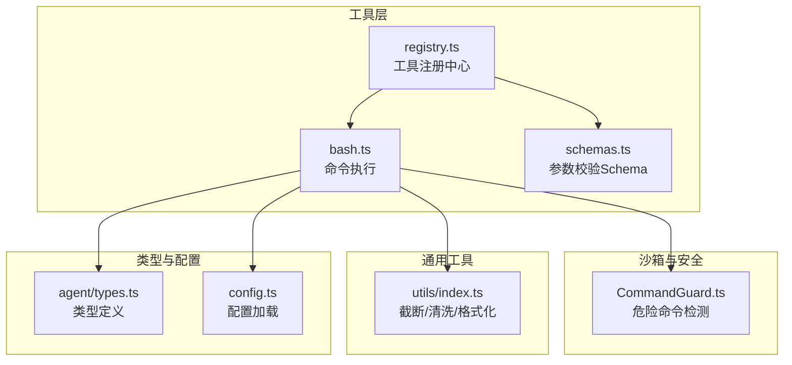
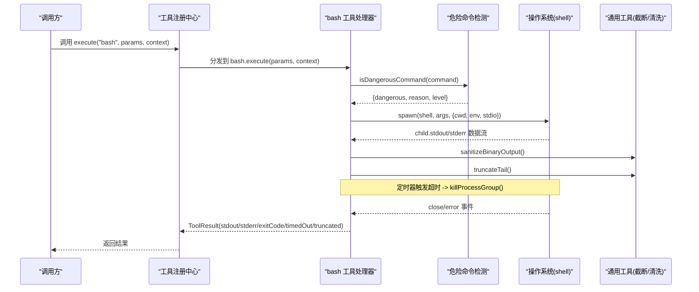
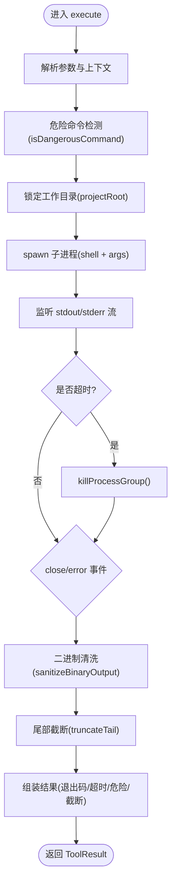
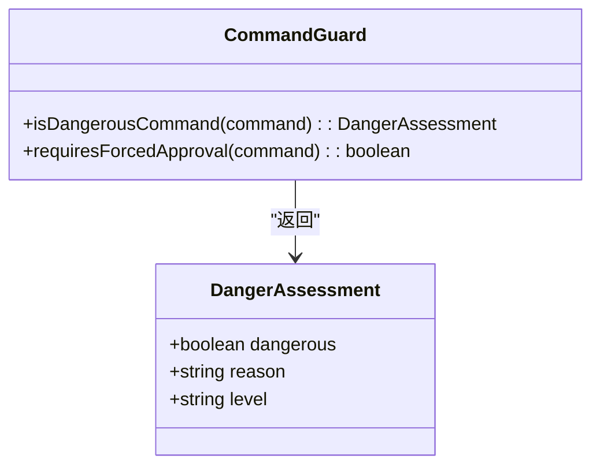
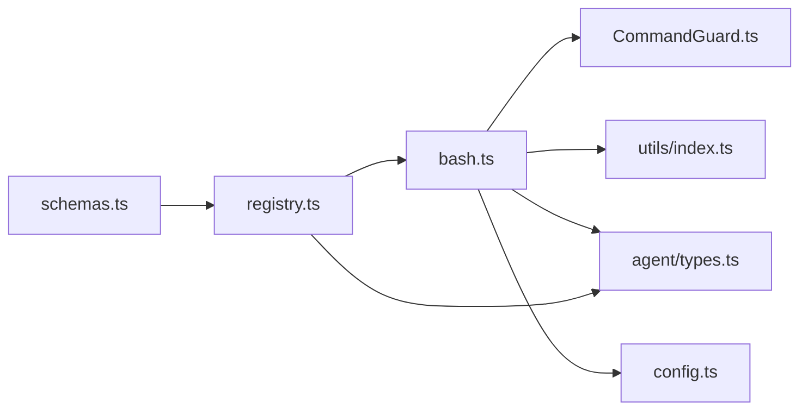

# bash 命令执行工具

<cite>
**本文引用的文件**   
- [src/tools/bash.ts](file://src/tools/bash.ts)
- [src/sandbox/CommandGuard.ts](file://src/sandbox/CommandGuard.ts)
- [src/utils/index.ts](file://src/utils/index.ts)
- [src/tools/registry.ts](file://src/tools/registry.ts)
- [src/tools/schemas.ts](file://src/tools/schemas.ts)
- [src/agent/types.ts](file://src/agent/types.ts)
- [src/config.ts](file://src/config.ts)
- [tests/unit/commandGuard.test.ts](file://tests/unit/commandGuard.test.ts)
</cite>

## 目录
1. [简介](#简介)
2. [项目结构](#项目结构)
3. [核心组件](#核心组件)
4. [架构总览](#架构总览)
5. [详细组件分析](#详细组件分析)
6. [依赖关系分析](#依赖关系分析)
7. [性能考量](#性能考量)
8. [故障排查指南](#故障排查指南)
9. [结论](#结论)
10. [附录：危险命令模式清单与策略](#附录危险命令模式清单与策略)

## 简介
本文件为 Nexus 项目中“bash”命令执行工具的完整实现文档。重点覆盖以下方面：
- 安全机制：危险命令检测（正则黑名单 + 启发式规则）、审批强制、工作目录锁定
- 跨平台差异：Windows PowerShell vs Unix bash 的进程启动与清理策略
- 超时控制与进程组管理：spawn 子进程、进程树终止、资源释放
- 输出处理：stdout/stderr 流式收集、二进制清洗、尾部截断与大小限制
- 配置与约束：默认超时、最大输出字节数等
- 性能优化建议与常见问题排查

## 项目结构
bash 工具位于 tools 层，通过注册中心暴露给上层编排器；安全策略由 sandbox 模块提供；通用工具函数在 utils 中实现；类型定义集中在 agent/types；配置加载在 config.ts 中完成。

图表来源
- [src/tools/bash.ts:1-186](file://src/tools/bash.ts#L1-L186)
- [src/tools/registry.ts:1-96](file://src/tools/registry.ts#L1-L96)
- [src/tools/schemas.ts:1-40](file://src/tools/schemas.ts#L1-L40)
- [src/sandbox/CommandGuard.ts:1-98](file://src/sandbox/CommandGuard.ts#L1-L98)
- [src/utils/index.ts:1-211](file://src/utils/index.ts#L1-L211)
- [src/agent/types.ts:1-269](file://src/agent/types.ts#L1-L269)
- [src/config.ts:1-132](file://src/config.ts#L1-L132)

章节来源
- [src/tools/bash.ts:1-186](file://src/tools/bash.ts#L1-L186)
- [src/tools/registry.ts:1-96](file://src/tools/registry.ts#L1-L96)
- [src/tools/schemas.ts:1-40](file://src/tools/schemas.ts#L1-L40)
- [src/sandbox/CommandGuard.ts:1-98](file://src/sandbox/CommandGuard.ts#L1-L98)
- [src/utils/index.ts:1-211](file://src/utils/index.ts#L1-L211)
- [src/agent/types.ts:1-269](file://src/agent/types.ts#L1-L269)
- [src/config.ts:1-132](file://src/config.ts#L1-L132)

## 核心组件
- bash 工具处理器：负责参数解析、工作目录锁定、跨平台 spawn、超时与进程组清理、输出截断与结果组装。
- 危险命令检测：基于正则黑名单与 caution 列表，返回等级 safe/caution/dangerous，并支持强制审批判断。
- 工具注册中心：统一注册、查找、阶段过滤、AI SDK 兼容导出与调用分发。
- 通用工具：头部/尾部截断、二进制清洗、字节/行数统计、行尾风格处理。
- 类型与配置：统一的 ToolDefinition/ToolResult、SandboxProvider 接口、NexusConfig 中的 limits 字段。

章节来源
- [src/tools/bash.ts:1-186](file://src/tools/bash.ts#L1-L186)
- [src/sandbox/CommandGuard.ts:1-98](file://src/sandbox/CommandGuard.ts#L1-L98)
- [src/tools/registry.ts:1-96](file://src/tools/registry.ts#L1-L96)
- [src/utils/index.ts:1-211](file://src/utils/index.ts#L1-L211)
- [src/agent/types.ts:1-269](file://src/agent/types.ts#L1-L269)
- [src/config.ts:1-132](file://src/config.ts#L1-L132)

## 架构总览
bash 工具的执行流程如下：
- 接收参数与上下文（项目根、超时、最大输出字节）
- 危险命令检测（仅标记，实际拦截在审批层）
- 跨平台选择 shell（Windows PowerShell / Unix bash）
- 使用 spawn 启动子进程，设置工作目录与环境变量
- 监听 stdout/stderr 流，累积输出
- 定时器触发超时后，按平台杀死进程组
- 关闭或错误事件时清理定时器并返回结果
- 对 stdout/stderr 进行二进制清洗与尾部截断
- 组装最终结果（包含退出码、超时标记、危险提示、截断信息）

图表来源
- [src/tools/bash.ts:42-121](file://src/tools/bash.ts#L42-L121)
- [src/sandbox/CommandGuard.ts:71-98](file://src/sandbox/CommandGuard.ts#L71-L98)
- [src/utils/index.ts:116-154](file://src/utils/index.ts#L116-L154)
- [src/tools/registry.ts:70-82](file://src/tools/registry.ts#L70-L82)

## 详细组件分析

### bash 工具处理器（src/tools/bash.ts）
- 输入参数：command（必填）、timeout（可选，秒）
- 上下文：projectRoot、callId、maxReadLines、maxOutputBytes、bashTimeout
- 关键行为：
  - 跨平台 shell 选择：Windows 使用 powershell.exe -Command，Unix 使用 /bin/bash -c
  - 子进程创建：stdio 忽略 stdin，pipe stdout/stderr；Windows 使用 windowsHide，Unix 使用 detached 以便进程组 kill
  - 超时控制：setTimeout 触发 killProcessGroup，标记 timedOut
  - 进程组清理：Windows 用 taskkill /T /F，Unix 用 kill -SIGKILL 负 PID
  - 输出处理：sanitizeBinaryOutput + truncateTail（保留末尾，适合错误信息）
  - 结果组装：包含命令、退出码、超时提示、stdout/stderr、危险标记、截断标志

图表来源
- [src/tools/bash.ts:42-121](file://src/tools/bash.ts#L42-L121)
- [src/tools/bash.ts:123-186](file://src/tools/bash.ts#L123-L186)

章节来源
- [src/tools/bash.ts:1-186](file://src/tools/bash.ts#L1-L186)

### 危险命令检测（src/sandbox/CommandGuard.ts）
- 两类模式：
  - DANGEROUS_PATTERNS：命中即 dangerous，需强制审批
  - CAUTION_PATTERNS：命中为 caution，不强制审批但需关注
- 覆盖场景：文件系统破坏、磁盘/分区操作、Fork 炸弹、管道远程执行、权限提升、系统关键文件覆写、Windows 危险操作、Git 破坏性操作、环境变量泄露
- 返回值：{ dangerous, reason, level }，level 为 safe/caution/dangerous
- 强制审批判定：requiresForcedApproval 仅当 level === 'dangerous'

图表来源
- [src/sandbox/CommandGuard.ts:1-98](file://src/sandbox/CommandGuard.ts#L1-L98)

章节来源
- [src/sandbox/CommandGuard.ts:1-98](file://src/sandbox/CommandGuard.ts#L1-L98)
- [tests/unit/commandGuard.test.ts:1-88](file://tests/unit/commandGuard.test.ts#L1-L88)

### 工具注册中心（src/tools/registry.ts）
- 职责：注册工具、按阶段过滤、生成 AI SDK 兼容定义、执行分发
- bash 工具被注册为可执行工具，requiresApproval 为 true（需要审批）
- 执行路径：execute(name, params, context) -> handler.execute(params, context)

章节来源
- [src/tools/registry.ts:1-96](file://src/tools/registry.ts#L1-L96)

### 参数 Schema（src/tools/schemas.ts）
- bash 工具参数：command（字符串）、timeout（可选数字）
- 用于 Vercel AI SDK 的参数描述与校验

章节来源
- [src/tools/schemas.ts:1-40](file://src/tools/schemas.ts#L1-L40)

### 通用工具（src/utils/index.ts）
- 尾部截断 truncateTail：优先保留末尾行，适合错误信息；支持 maxLines/maxBytes
- 二进制清洗 sanitizeBinaryOutput：去除控制字符，保留换行/制表符
- 格式化 formatSize：人类可读大小
- 行尾处理：detectLineEnding、normalizeToLF、restoreLineEndings、stripBom

章节来源
- [src/utils/index.ts:1-211](file://src/utils/index.ts#L1-L211)

### 类型与配置（src/agent/types.ts, src/config.ts）
- SandboxProvider 接口：抽象命令执行能力，便于替换底层实现
- NexusConfig.limits：bashTimeout、maxOutputBytes 等限制项
- 默认配置：bashTimeout=30s，maxOutputBytes=102400（约 100KB）

章节来源
- [src/agent/types.ts:239-252](file://src/agent/types.ts#L239-L252)
- [src/config.ts:11-60](file://src/config.ts#L11-L60)
- [src/config.ts:106-114](file://src/config.ts#L106-L114)

## 依赖关系分析
- bash.ts 依赖：
  - child_process.spawn（跨平台子进程）
  - path.resolve（工作目录锁定）
  - CommandGuard.isDangerousCommand（危险检测）
  - utils.truncateTail、sanitizeBinaryOutput、formatSize（输出处理）
- registry.ts 依赖：
  - 各工具处理器（包括 bash）
  - ToolDefinition/ToolResult 类型
- types.ts 提供：
  - SandboxProvider 接口（未来可扩展 GoSandbox）
  - NexusConfig 限制项
- config.ts 提供：
  - 默认限制与合并逻辑

图表来源
- [src/tools/bash.ts:1-186](file://src/tools/bash.ts#L1-L186)
- [src/tools/registry.ts:1-96](file://src/tools/registry.ts#L1-L96)
- [src/sandbox/CommandGuard.ts:1-98](file://src/sandbox/CommandGuard.ts#L1-L98)
- [src/utils/index.ts:1-211](file://src/utils/index.ts#L1-L211)
- [src/agent/types.ts:1-269](file://src/agent/types.ts#L1-L269)
- [src/config.ts:1-132](file://src/config.ts#L1-L132)

章节来源
- [src/tools/bash.ts:1-186](file://src/tools/bash.ts#L1-L186)
- [src/tools/registry.ts:1-96](file://src/tools/registry.ts#L1-L96)
- [src/sandbox/CommandGuard.ts:1-98](file://src/sandbox/CommandGuard.ts#L1-L98)
- [src/utils/index.ts:1-211](file://src/utils/index.ts#L1-L211)
- [src/agent/types.ts:1-269](file://src/agent/types.ts#L1-L269)
- [src/config.ts:1-132](file://src/config.ts#L1-L132)

## 性能考量
- 输出截断策略：
  - 使用尾部截断（truncateTail），优先保留末尾行与错误信息，避免长输出阻塞内存与渲染
  - 默认最大字节 100KB，可通过配置调整
- 二进制清洗：
  - 在截断前清洗控制字符，减少终端渲染开销与异常
- 进程组清理：
  - 超时后立即按平台方式终止进程树，防止僵尸进程与资源泄漏
- 流式处理：
  - 使用 pipe 流式收集 stdout/stderr，避免一次性缓冲大对象
- 配置调优建议：
  - 根据任务复杂度调整 bashTimeout（默认 30s）
  - 合理设置 maxOutputBytes，平衡诊断信息与内存占用
  - 对于大量 I/O 的命令，考虑拆分任务或使用日志文件

[本节为通用指导，无需具体文件引用]

## 故障排查指南
- 常见错误与定位：
  - 未知工具：检查 registry 是否正确注册 bash 工具
  - 命令失败：查看 stderr 与 exitCode，确认命令语法与权限
  - 超时：检查 bashTimeout 配置与命令耗时，必要时拆分任务
  - 输出过大：增大 maxOutputBytes 或改用日志文件
  - Windows 清理失败：确认 taskkill 可用且权限足够
- 调试步骤：
  - 启用更详细的日志（可在上层编排器记录 callId 与命令）
  - 使用独立终端验证命令行为
  - 检查危险命令检测是否误报（参考测试用例）
- 恢复策略：
  - 对危险命令，确保审批流程生效
  - 对超时命令，增加超时阈值或优化命令逻辑
  - 对输出过大，采用分页或采样策略

章节来源
- [src/tools/bash.ts:123-186](file://src/tools/bash.ts#L123-L186)
- [tests/unit/commandGuard.test.ts:1-88](file://tests/unit/commandGuard.test.ts#L1-L88)

## 结论
bash 工具通过严格的安全检测、跨平台进程管理、流式输出处理与可配置的超时/大小限制，提供了安全可靠的命令执行能力。其模块化设计与清晰的类型/配置体系，便于扩展与维护。在生产环境中，建议结合审批策略与监控日志，持续优化性能与安全性。

[本节为总结，无需具体文件引用]

## 附录：危险命令模式清单与策略
- 文件系统破坏：删除根目录、用户主目录、递归强制删除
- 磁盘/分区操作：直接写入块设备、格式化、安全擦除、分区操作
- Fork 炸弹：自复制进程爆炸
- 管道远程执行：curl/wget 下载并直接执行脚本
- 权限提升：sudo 递归删除、全开权限
- 系统关键文件：覆写 passwd/shadow/fstab/boot
- Windows 危险操作：format、递归删除驱动器、PowerShell 强制删除
- Git 破坏性操作：强制推送主分支、硬重置
- 环境变量泄露：打印敏感变量名

策略说明：
- 命中 DANGEROUS_PATTERNS：标记为 dangerous，强制审批
- 命中 CAUTION_PATTERNS：标记为 caution，提醒注意但不强制审批
- 未命中：safe，正常执行

章节来源
- [src/sandbox/CommandGuard.ts:13-65](file://src/sandbox/CommandGuard.ts#L13-L65)
- [tests/unit/commandGuard.test.ts:10-71](file://tests/unit/commandGuard.test.ts#L10-L71)