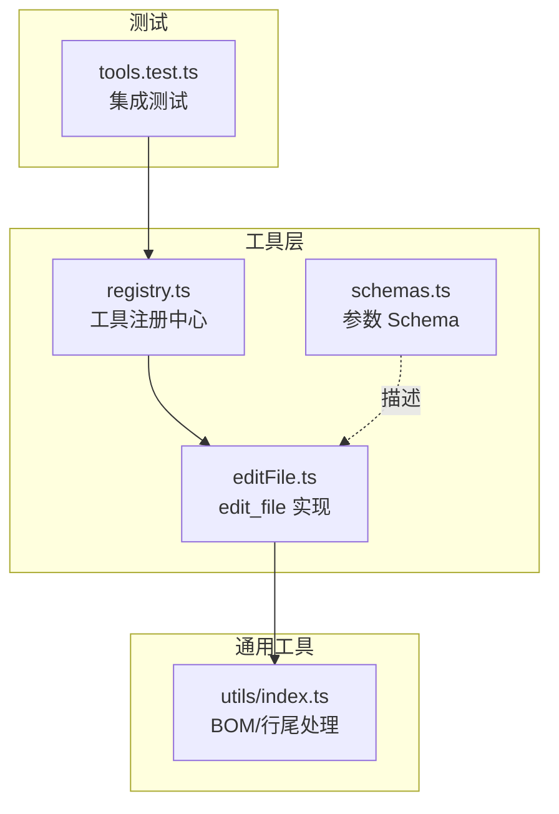
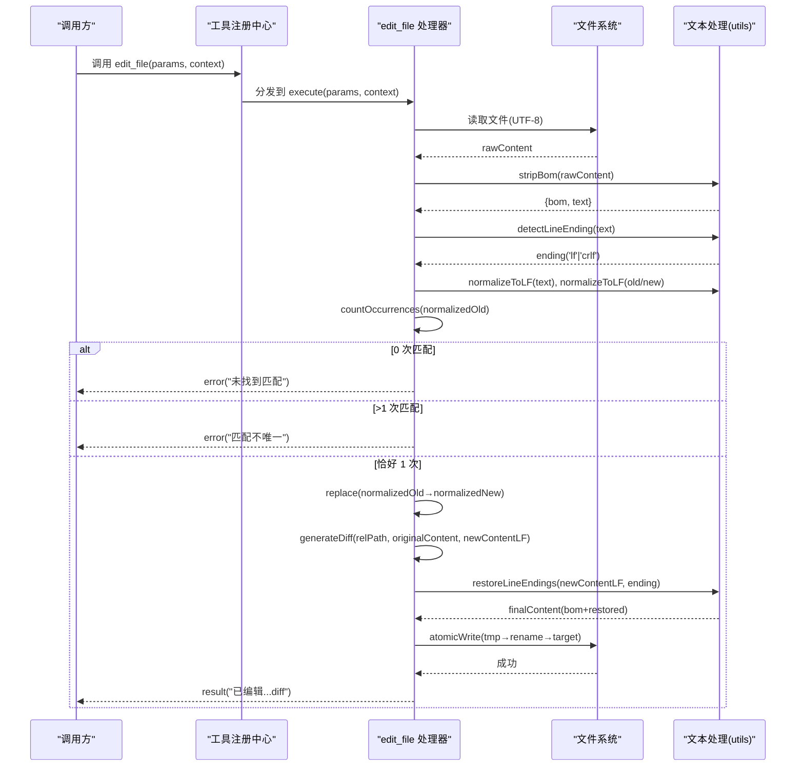
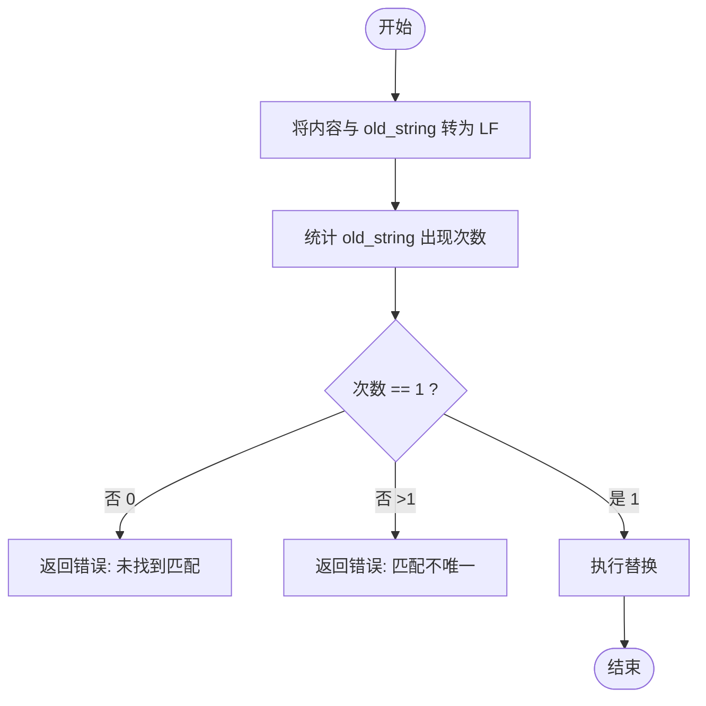
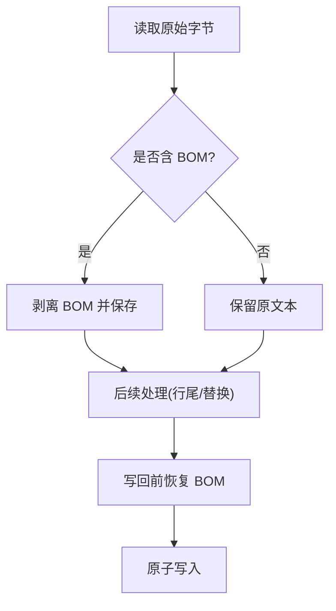
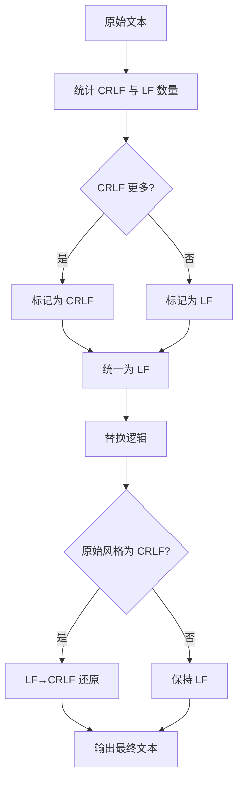
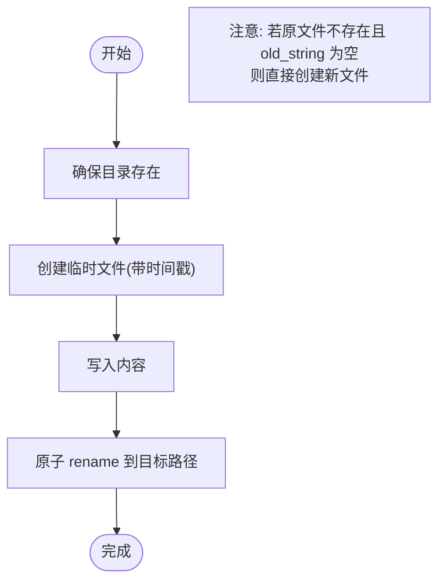
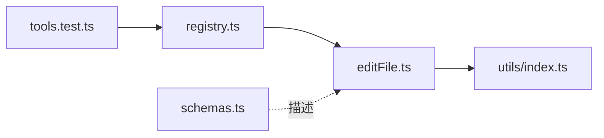

# edit_file 文件编辑工具

<cite>
**本文引用的文件**
- [src/tools/editFile.ts](file://src/tools/editFile.ts)
- [src/utils/index.ts](file://src/utils/index.ts)
- [src/tools/registry.ts](file://src/tools/registry.ts)
- [src/tools/schemas.ts](file://src/tools/schemas.ts)
- [tests/integration/tools.test.ts](file://tests/integration/tools.test.ts)
</cite>

## 目录
1. [简介](#简介)
2. [项目结构](#项目结构)
3. [核心组件](#核心组件)
4. [架构总览](#架构总览)
5. [详细组件分析](#详细组件分析)
6. [依赖关系分析](#依赖关系分析)
7. [性能考量](#性能考量)
8. [故障排查指南](#故障排查指南)
9. [结论](#结论)
10. [附录：使用示例与最佳实践](#附录使用示例与最佳实践)

## 简介
edit_file 是一个面向生产级的精准字符串替换工具，强调“唯一匹配、原子写入、格式保持”。其核心能力包括：
- 唯一性校验：old_string 必须在目标文件中出现且仅出现一次，否则报错。
- BOM 处理：自动检测并剥离 UTF-8 BOM，写回时恢复，避免破坏编码。
- 行尾风格保持：自动识别 CRLF/LF，并在最终输出中恢复原始风格。
- 原子写入：通过临时文件 + rename 实现无竞态的写入，保证一致性。
- 文件创建：当文件不存在且 old_string 为空时，直接创建新文件。
- Diff 输出：生成 unified diff，便于 LLM 或人类审阅变更。

该工具在 Agent 执行阶段被调用，属于需要审批的写操作工具之一。

## 项目结构
edit_file 的实现位于 tools 层，配合 utils 层的文本处理函数完成 BOM 和行尾处理；并通过 registry 注册为可执行的 MCP 工具。测试用例覆盖基本读写、唯一性校验与路径越界等场景。

图表来源
- [src/tools/editFile.ts:1-170](file://src/tools/editFile.ts#L1-L170)
- [src/tools/registry.ts:1-96](file://src/tools/registry.ts#L1-L96)
- [src/tools/schemas.ts:1-40](file://src/tools/schemas.ts#L1-L40)
- [src/utils/index.ts:182-211](file://src/utils/index.ts#L182-L211)
- [tests/integration/tools.test.ts:1-100](file://tests/integration/tools.test.ts#L1-L100)

章节来源
- [src/tools/editFile.ts:1-170](file://src/tools/editFile.ts#L1-L170)
- [src/tools/registry.ts:1-96](file://src/tools/registry.ts#L1-L96)
- [src/tools/schemas.ts:1-40](file://src/tools/schemas.ts#L1-L40)
- [src/utils/index.ts:182-211](file://src/utils/index.ts#L182-L211)
- [tests/integration/tools.test.ts:1-100](file://tests/integration/tools.test.ts#L1-L100)

## 核心组件
- ToolDefinition 与输入 Schema：定义工具名、描述、参数结构与必填项。
- execute 主流程：读取文件 → 去 BOM → 统一行尾 → 唯一性校验 → 替换 → 生成 diff → 恢复行尾+BOM → 原子写入 → 返回结果。
- 原子写入：先写临时文件再 rename，确保并发安全与一致性。
- 文本处理：stripBom/detectLineEnding/normalizeToLF/restoreLineEndings。
- 错误处理：未找到匹配、多匹配、路径越界、IO 异常等。

章节来源
- [src/tools/editFile.ts:14-38](file://src/tools/editFile.ts#L14-L38)
- [src/tools/editFile.ts:61-156](file://src/tools/editFile.ts#L61-L156)
- [src/tools/editFile.ts:52-59](file://src/tools/editFile.ts#L52-L59)
- [src/utils/index.ts:182-211](file://src/utils/index.ts#L182-L211)

## 架构总览
edit_file 作为 MCP 工具被注册到工具注册中心，由上层编排器按阶段（plan/execute）选择并调用。其内部以“读-改-写”流水线为主，关键节点包含安全性检查、唯一性验证与原子写入。

图表来源
- [src/tools/registry.ts:70-82](file://src/tools/registry.ts#L70-L82)
- [src/tools/editFile.ts:61-156](file://src/tools/editFile.ts#L61-L156)
- [src/utils/index.ts:182-211](file://src/utils/index.ts#L182-L211)

## 详细组件分析

### 唯一匹配验证算法
- 计数策略：对 LF 规范化后的内容使用顺序查找统计 old_string 出现次数，时间复杂度 O(n·m)，n 为文本长度，m 为搜索串长度。
- 决策分支：
  - 0 次：返回“未找到匹配”错误，提示重新 read_file。
  - >1 次：返回“匹配不唯一”错误，要求提供更多上下文。
  - 1 次：进入替换流程。
- 设计要点：
  - 在 LF 归一化后匹配，避免 CRLF/LF 差异导致误判。
  - 空搜索串不会触发无限循环，countOccurrences 对空串返回 0。

图表来源
- [src/tools/editFile.ts:40-50](file://src/tools/editFile.ts#L40-L50)
- [src/tools/editFile.ts:110-129](file://src/tools/editFile.ts#L110-L129)

章节来源
- [src/tools/editFile.ts:40-50](file://src/tools/editFile.ts#L40-L50)
- [src/tools/editFile.ts:110-129](file://src/tools/editFile.ts#L110-L129)

### BOM 处理与恢复
- 检测：若首字符为 U+FEFF，则视为 UTF-8 BOM，剥离并记录。
- 恢复：在最终写入前，将之前剥离的 BOM 拼接回内容开头。
- 影响范围：仅在读取与写入前后进行，中间处理均基于无 BOM 文本。

图表来源
- [src/utils/index.ts:204-211](file://src/utils/index.ts#L204-L211)
- [src/tools/editFile.ts:103-108](file://src/tools/editFile.ts#L103-L108)
- [src/tools/editFile.ts:137-139](file://src/tools/editFile.ts#L137-L139)

章节来源
- [src/utils/index.ts:204-211](file://src/utils/index.ts#L204-L211)
- [src/tools/editFile.ts:103-108](file://src/tools/editFile.ts#L103-L108)
- [src/tools/editFile.ts:137-139](file://src/tools/editFile.ts#L137-L139)

### 行尾风格保持机制（CRLF/LF）
- 检测：统计 \r\n 与独立 \n 的数量，多数者决定原始风格。
- 归一化：将所有 \r\n 替换为 \n，便于稳定匹配与替换。
- 恢复：根据检测到的原始风格，将 \n 还原为 \r\n（如为 CRLF）。

图表来源
- [src/utils/index.ts:187-202](file://src/utils/index.ts#L187-L202)
- [src/tools/editFile.ts:104-108](file://src/tools/editFile.ts#L104-L108)
- [src/tools/editFile.ts:137-139](file://src/tools/editFile.ts#L137-L139)

章节来源
- [src/utils/index.ts:187-202](file://src/utils/index.ts#L187-L202)
- [src/tools/editFile.ts:104-108](file://src/tools/editFile.ts#L104-L108)
- [src/tools/editFile.ts:137-139](file://src/tools/editFile.ts#L137-L139)

### 原子写入与文件创建逻辑
- 原子写入：
  - 创建临时文件：文件名后缀带时间戳，避免冲突。
  - 写入完成后，使用 rename 原子替换目标文件，保证并发安全与一致性。
  - 自动创建父目录（递归），避免目录不存在导致的失败。
- 文件创建：
  - 若读取失败且 old_string 为空，则直接将 new_string 写入目标路径，视为创建新文件。
  - 若读取失败且 old_string 非空，返回“文件不存在”错误。

图表来源
- [src/tools/editFile.ts:52-59](file://src/tools/editFile.ts#L52-L59)
- [src/tools/editFile.ts:82-101](file://src/tools/editFile.ts#L82-L101)

章节来源
- [src/tools/editFile.ts:52-59](file://src/tools/editFile.ts#L52-L59)
- [src/tools/editFile.ts:82-101](file://src/tools/editFile.ts#L82-L101)

### 错误处理与边界情况
- 路径越界：解析后的绝对路径必须位于 projectRoot 下，否则拒绝。
- 未找到匹配：返回明确错误信息，建议重新读取最新内容。
- 多匹配：提示增加上下文以确保唯一性。
- IO 异常：捕获并包装为统一错误消息。
- 空搜索串：计数函数对空串返回 0，避免死循环。

章节来源
- [src/tools/editFile.ts:67-79](file://src/tools/editFile.ts#L67-L79)
- [src/tools/editFile.ts:113-129](file://src/tools/editFile.ts#L113-L129)
- [src/tools/editFile.ts:147-155](file://src/tools/editFile.ts#L147-L155)
- [src/tools/editFile.ts:40-50](file://src/tools/editFile.ts#L40-L50)

### Diff 生成
- 使用库函数生成 unified diff，去除头部元数据，仅保留 @@ 开始的主体部分。
- 若无变更，返回“(无变更)”。

章节来源
- [src/tools/editFile.ts:158-166](file://src/tools/editFile.ts#L158-L166)

## 依赖关系分析
- 工具注册：edit_file 通过 registry 注册，暴露 definition 与 execute。
- 参数校验：schemas.ts 提供 Zod schema，用于外部 SDK 的参数描述与校验。
- 文本处理：utils/index.ts 提供 BOM 与行尾处理函数。
- 测试驱动：集成测试覆盖基本替换、唯一性校验与路径越界。

图表来源
- [src/tools/registry.ts:85-93](file://src/tools/registry.ts#L85-L93)
- [src/tools/schemas.ts:14-18](file://src/tools/schemas.ts#L14-L18)
- [src/tools/editFile.ts:168-170](file://src/tools/editFile.ts#L168-L170)
- [src/utils/index.ts:182-211](file://src/utils/index.ts#L182-L211)
- [tests/integration/tools.test.ts:43-76](file://tests/integration/tools.test.ts#L43-L76)

章节来源
- [src/tools/registry.ts:85-93](file://src/tools/registry.ts#L85-L93)
- [src/tools/schemas.ts:14-18](file://src/tools/schemas.ts#L14-L18)
- [src/tools/editFile.ts:168-170](file://src/tools/editFile.ts#L168-L170)
- [src/utils/index.ts:182-211](file://src/utils/index.ts#L182-L211)
- [tests/integration/tools.test.ts:43-76](file://tests/integration/tools.test.ts#L43-L76)

## 性能考量
- 匹配复杂度：O(n·m)，适用于常规代码文件大小；超大文件建议分块或限制最大尺寸。
- I/O 开销：原子写入涉及两次磁盘操作（写临时文件 + rename），但 rename 是原子且低开销。
- 内存占用：整文件读入内存，适合中等规模文本；对极大文件需考虑流式处理。
- 正则与字符串操作：行尾检测与转换均为线性扫描，开销可控。

[本节为通用指导，不直接分析具体文件]

## 故障排查指南
- “未找到匹配”：
  - 确认 old_string 是否足够精确，包含必要上下文。
  - 检查文件是否已被其他进程修改，重新 read_file。
- “匹配不唯一”：
  - 扩大 old_string 上下文，使其唯一。
  - 检查是否存在重复片段或注释中的相同文本。
- “路径越界”：
  - 确保 path 相对于 projectRoot，不要使用相对路径逃逸。
- “文件不存在”：
  - 如需创建新文件，请将 old_string 设为空字符串。
- 行尾/BOM 问题：
  - 工具会自动处理，若仍异常，检查编辑器设置与终端编码。

章节来源
- [src/tools/editFile.ts:113-129](file://src/tools/editFile.ts#L113-L129)
- [src/tools/editFile.ts:82-101](file://src/tools/editFile.ts#L82-L101)
- [src/tools/editFile.ts:67-79](file://src/tools/editFile.ts#L67-L79)

## 结论
edit_file 通过严格唯一性校验、BOM 与行尾风格保持、原子写入等机制，提供了高可靠性的精准替换能力。结合 diff 输出与清晰的错误提示，既适合 LLM 自动化编辑，也便于人工审阅与调试。

[本节为总结，不直接分析具体文件]

## 附录：使用示例与最佳实践

### 典型工作流
- 读取文件 → 确定替换片段 → 构造唯一 old_string → 调用 edit_file → 审阅 diff → 提交变更。

章节来源
- [tests/integration/tools.test.ts:43-56](file://tests/integration/tools.test.ts#L43-L56)

### 最佳实践
- 唯一性：
  - old_string 应包含足够的上下文行，避免多处匹配。
  - 若存在多处相似片段，优先选择更具体的标识符或注释。
- 行尾与编码：
  - 无需手动处理 CRLF/LF 或 BOM，工具会保持原始风格。
- 原子性与一致性：
  - 工具内部已做原子写入，避免部分写入导致的损坏。
- 错误处理：
  - 遇到“未找到匹配”或“匹配不唯一”，先重新读取文件，再调整 old_string。
- 权限与审批：
  - edit_file 属于写操作，默认需要审批；可按策略配置自动批准。

章节来源
- [src/tools/editFile.ts:14-38](file://src/tools/editFile.ts#L14-L38)
- [src/tools/registry.ts:51-56](file://src/tools/registry.ts#L51-L56)
- [tests/integration/tools.test.ts:58-76](file://tests/integration/tools.test.ts#L58-L76)