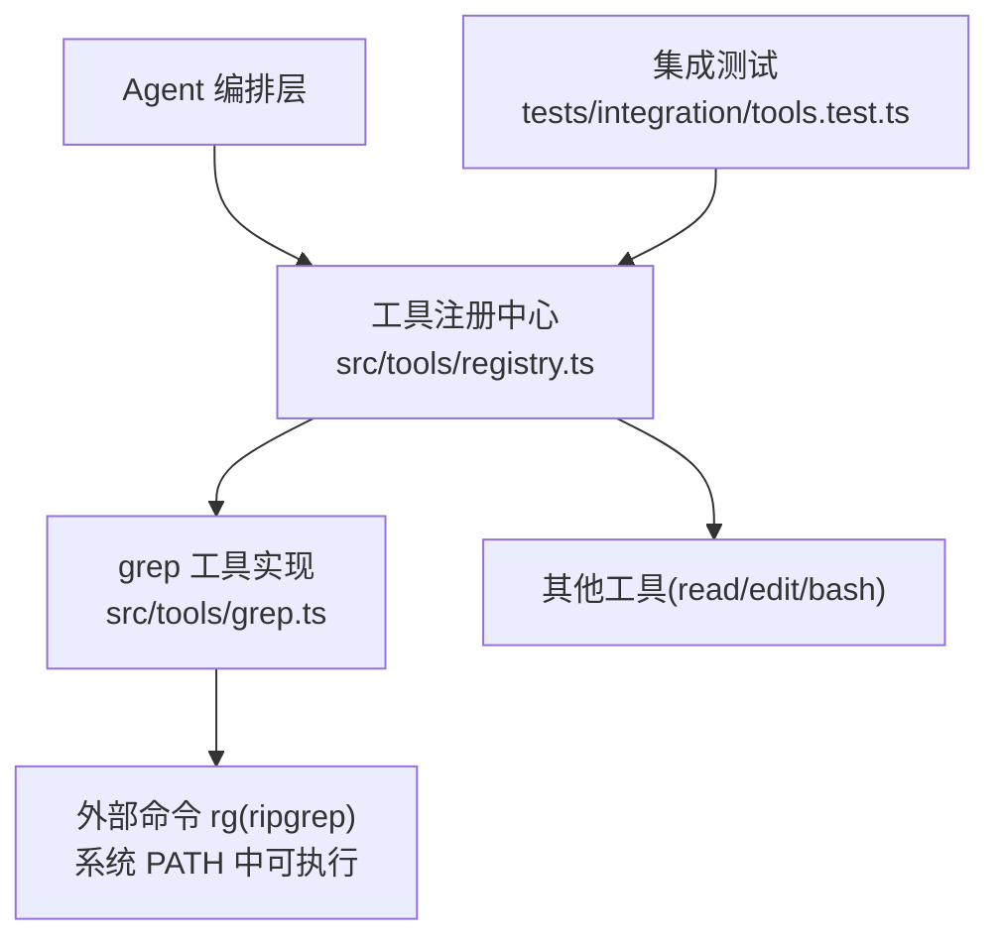
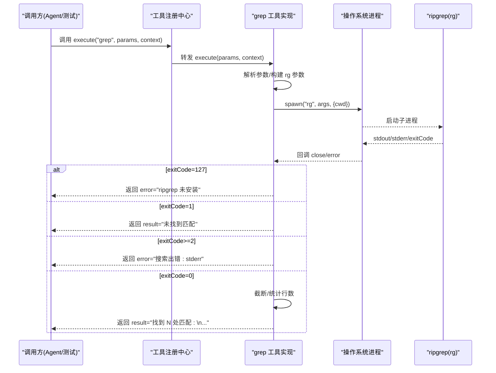
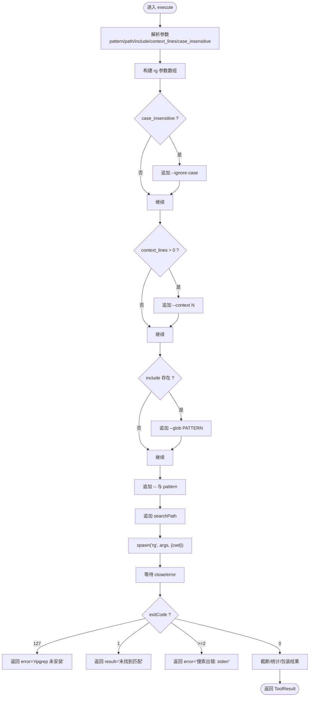
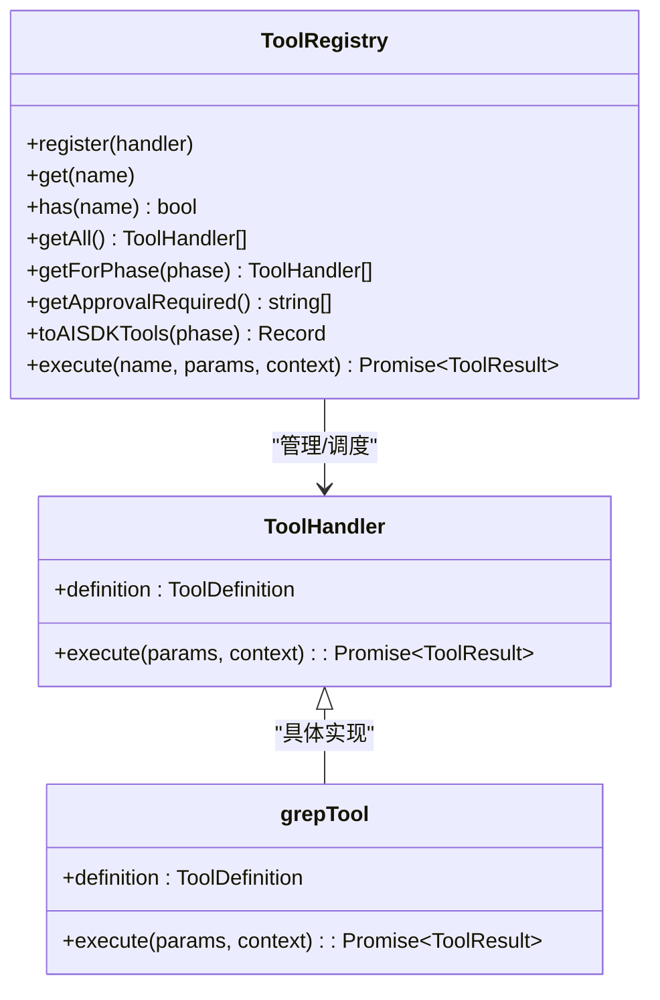
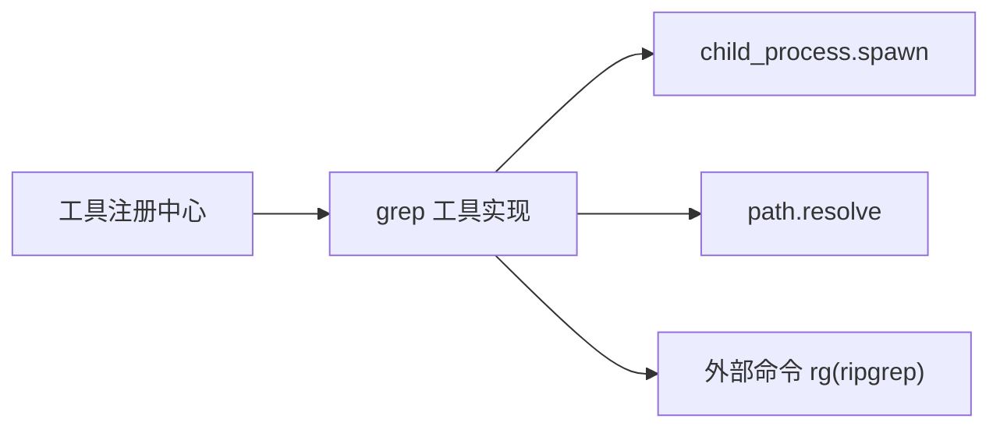

# grep 代码搜索工具

<cite>
**本文引用的文件**   
- [src/tools/grep.ts](file://src/tools/grep.ts)
- [src/tools/registry.ts](file://src/tools/registry.ts)
- [src/agent/types.ts](file://src/agent/types.ts)
- [tests/integration/tools.test.ts](file://tests/integration/tools.test.ts)
- [README.md](file://README.md)
- [package.json](file://package.json)
</cite>

## 目录
1. [简介](#简介)
2. [项目结构](#项目结构)
3. [核心组件](#核心组件)
4. [架构总览](#架构总览)
5. [详细组件分析](#详细组件分析)
6. [依赖关系分析](#依赖关系分析)
7. [性能考量](#性能考量)
8. [故障排查指南](#故障排查指南)
9. [结论](#结论)
10. [附录](#附录)

## 简介
本文件围绕项目中基于 ripgrep（rg）的 grep 代码搜索工具，提供从实现到使用的全景文档。重点覆盖：
- 正则表达式支持、文件类型过滤与上下文行显示
- 搜索参数构建、命令行参数安全与结果格式化
- case_insensitive、include glob 模式与 context_lines 的实现细节
- 完整的搜索模式示例与性能优化技巧
- ripgrep 依赖管理与错误处理策略

## 项目结构
grep 工具位于工具层，通过 MCP 工具注册中心对外暴露，由 Agent 编排层调用。其关键位置如下：
- 工具实现：src/tools/grep.ts
- 工具注册与执行入口：src/tools/registry.ts
- 共享类型定义（ToolDefinition、ToolResult 等）：src/agent/types.ts
- 集成测试用例（验证阶段过滤与基本流程）：tests/integration/tools.test.ts
- 运行前置要求（包含 ripgrep 安装说明）：README.md
- 运行时环境（Bun）与脚本：package.json

图表来源
- [src/tools/registry.ts:1-96](file://src/tools/registry.ts#L1-L96)
- [src/tools/grep.ts:1-178](file://src/tools/grep.ts#L1-L178)
- [tests/integration/tools.test.ts:1-100](file://tests/integration/tools.test.ts#L1-L100)

章节来源
- [src/tools/grep.ts:1-178](file://src/tools/grep.ts#L1-L178)
- [src/tools/registry.ts:1-96](file://src/tools/registry.ts#L1-L96)
- [tests/integration/tools.test.ts:1-100](file://tests/integration/tools.test.ts#L1-L100)
- [README.md:1-174](file://README.md#L1-L174)
- [package.json:1-43](file://package.json#L1-L43)

## 核心组件
- 工具定义与输入模式
  - name/description/inputSchema/phase/requiresApproval 等字段定义了工具的元数据与能力边界。
  - inputSchema 声明了 pattern、path、include、context_lines、case_insensitive 等参数及类型。
- 执行器
  - 负责解析参数、构建 rg 命令行参数、启动子进程、收集输出、截断与统计、返回统一 ToolResult。
- 工具注册中心
  - 维护工具集合、按阶段过滤、生成 AI SDK 兼容的工具描述、分发执行。
- 类型契约
  - ToolDefinition、ToolInputSchema、ToolProperty、ToolResult 等类型确保跨模块一致。

章节来源
- [src/tools/grep.ts:11-43](file://src/tools/grep.ts#L11-L43)
- [src/tools/grep.ts:80-175](file://src/tools/grep.ts#L80-L175)
- [src/tools/registry.ts:12-82](file://src/tools/registry.ts#L12-L82)
- [src/agent/types.ts:44-78](file://src/agent/types.ts#L44-L78)

## 架构总览
下图展示了从上层调用到 rg 执行的端到端流程，以及错误分支的处理路径。

图表来源
- [src/tools/registry.ts:70-82](file://src/tools/registry.ts#L70-L82)
- [src/tools/grep.ts:46-78](file://src/tools/grep.ts#L46-L78)
- [src/tools/grep.ts:80-175](file://src/tools/grep.ts#L80-L175)

## 详细组件分析

### grep 工具实现（src/tools/grep.ts）
- 功能要点
  - 使用 child_process.spawn 直接调用 rg，避免 shell 注入风险。
  - 固定启用 --line-number、--no-heading、--color never、--max-count 100，保证输出稳定且可控。
  - 根据 case_insensitive 追加 --ignore-case；根据 context_lines 追加 --context N；根据 include 追加 --glob PATTERN。
  - 以 -- 分隔选项与搜索模式，防止模式被误解析为选项。
  - 对 stdout 进行 UTF-8 字节长度截断，并附加提示文本；同时统计非空行数作为“匹配数”。
  - 针对 rg 退出码进行语义化映射：0=有匹配、1=无匹配、2+=错误；127 表示 rg 不可用。
- 安全性
  - 不经过 shell，参数以数组形式传入，降低注入风险。
  - 使用 -- 将后续内容视为模式而非选项，避免恶意模式干扰选项解析。
- 输出格式
  - 每行形如 “文件:行号:内容”，便于人类阅读与下游解析。
- 可扩展点
  - 可在参数构建段增加更多 rg 开关（如 -i/--ignore-case、-C/--context、-g/--glob、-m/--max-count）。
  - 可增加超时控制与资源限制（当前未设置）。

图表来源
- [src/tools/grep.ts:80-175](file://src/tools/grep.ts#L80-L175)

章节来源
- [src/tools/grep.ts:46-78](file://src/tools/grep.ts#L46-L78)
- [src/tools/grep.ts:80-175](file://src/tools/grep.ts#L80-L175)

### 工具注册中心（src/tools/registry.ts）
- 职责
  - 注册所有内置工具（read_file/edit_file/bash/grep），并提供 getForPhase 按阶段过滤。
  - 将工具定义转换为 AI SDK 兼容的描述对象，供上层模型选择工具。
  - 统一执行入口 execute(name, params, context)，内部查找处理器并委派执行。
- 与 grep 的关系
  - grep 在初始化时被注册，并在 plan 与 execute 两个阶段均可用（phase='both'）。
  - 集成测试验证了 plan 阶段仅包含只读工具（含 grep），不包含写操作工具。

图表来源
- [src/tools/registry.ts:25-82](file://src/tools/registry.ts#L25-L82)
- [src/tools/grep.ts:177-178](file://src/tools/grep.ts#L177-L178)

章节来源
- [src/tools/registry.ts:1-96](file://src/tools/registry.ts#L1-L96)
- [tests/integration/tools.test.ts:83-98](file://tests/integration/tools.test.ts#L83-L98)

### 类型契约（src/agent/types.ts）
- 关键类型
  - ToolDefinition：工具元信息（名称、描述、输入模式、是否需要审批、可用阶段）。
  - ToolInputSchema/ToolProperty：输入参数的 JSON Schema 风格描述。
  - ToolResult：统一的执行结果（result/error/truncated）。
- 作用
  - 约束 grep 工具的输入输出形态，保障上层调用一致性。

章节来源
- [src/agent/types.ts:44-78](file://src/agent/types.ts#L44-L78)

## 依赖关系分析
- 运行时依赖
  - 外部二进制：ripgrep（rg），需安装在系统 PATH 中。
  - Node/Bun 标准库：child_process.spawn、path.resolve。
- 包管理
  - package.json 指定 Bun 引擎版本与脚本，grep 工具本身不引入额外 npm 包。
- 平台差异
  - Windows 下通过 windowsHide 隐藏控制台窗口，提升体验。

图表来源
- [src/tools/grep.ts:6-8](file://src/tools/grep.ts#L6-L8)
- [src/tools/registry.ts:86-93](file://src/tools/registry.ts#L86-L93)
- [README.md:20-24](file://README.md#L20-L24)
- [package.json:39-41](file://package.json#L39-L41)

章节来源
- [src/tools/grep.ts:6-8](file://src/tools/grep.ts#L6-L8)
- [README.md:20-24](file://README.md#L20-L24)
- [package.json:39-41](file://package.json#L39-L41)

## 性能考量
- 结果量控制
  - 使用 --max-count 100 限制每个文件的匹配数量，避免单文件过大输出。
  - 在应用层按 maxOutputBytes 截断整体输出，防止消息体过大。
- 扫描范围
  - 通过 path 限定搜索目录，减少不必要扫描。
  - 使用 include 的 glob 模式精准匹配目标文件类型，缩小扫描面。
- 忽略大小写
  - 仅在需要时开启 case_insensitive，避免不必要的匹配开销。
- 上下文行
  - context_lines 越大，输出越多，建议按需设置较小值。
- 平台与 I/O
  - 关闭颜色输出(--color never)可减少终端渲染负担。
  - 不使用 shell 执行，避免额外的解析与转义开销。

[本节为通用指导，无需源码引用]

## 故障排查指南
- 常见错误与定位
  - ripgrep 未安装：返回 error 提示安装指引。检查系统 PATH 是否包含 rg。
  - 无匹配：返回 result 明确提示未找到，确认 pattern 与 include 是否正确。
  - 搜索出错：返回 error 包含 stderr 详情，检查 rg 参数或权限问题。
  - 结果被截断：返回 truncated=true，提示缩小搜索范围或提高精确度。
- 调试建议
  - 先在不带 context 的情况下验证基础匹配。
  - 逐步放宽 include 与 path，定位问题范围。
  - 在本地终端直接执行相同 rg 命令，对比输出与退出码。

章节来源
- [src/tools/grep.ts:119-145](file://src/tools/grep.ts#L119-L145)
- [src/tools/grep.ts:147-165](file://src/tools/grep.ts#L147-L165)

## 结论
该 grep 工具以最小依赖、高安全性的方式封装了 ripgrep，提供了稳定的参数构建、安全的命令执行与友好的结果格式化。通过合理的默认参数与可选开关，兼顾易用性与性能。配合工具注册中心与类型契约，能够无缝融入上层 Agent 工作流。

[本节为总结性内容，无需源码引用]

## 附录

### 搜索参数与行为对照
- pattern（必填）：支持正则表达式，最终通过 -- 后传递，避免被当作选项解析。
- path（选填）：相对项目根目录的搜索路径，默认整个项目。
- include（选填）：文件名 glob 过滤，例如 "*.ts"、"*.{js,jsx}"。
- context_lines（选填）：匹配行前后上下文行数，默认 0。
- case_insensitive（选填）：是否忽略大小写，默认 false。

章节来源
- [src/tools/grep.ts:15-40](file://src/tools/grep.ts#L15-L40)
- [src/tools/grep.ts:99-115](file://src/tools/grep.ts#L99-L115)

### 典型搜索模式示例
- 全文搜索关键字
  - 参数：{ pattern: "useState", path: "." }
- 仅 TypeScript 文件中搜索
  - 参数：{ pattern: "useEffect", include: "*.ts" }
- 多扩展名过滤
  - 参数：{ pattern: "fetch", include: "*.{js,jsx,ts,tsx}" }
- 忽略大小写
  - 参数：{ pattern: "error", case_insensitive: true }
- 显示上下文行
  - 参数：{ pattern: "TODO", context_lines: 3 }
- 组合使用
  - 参数：{ pattern: "import.*from", include: "*.ts", case_insensitive: false, context_lines: 2 }

[本节为概念性示例，无需源码引用]

### 依赖管理与安装
- 前置要求
  - 运行环境：Bun >= 1.1.0
  - 外部依赖：ripgrep（rg），需安装至系统 PATH
- 安装指引
  - 参考 README 中的“前置要求”与“安装”部分，确保 rg 可用后再运行工具。

章节来源
- [README.md:20-24](file://README.md#L20-L24)
- [package.json:39-41](file://package.json#L39-L41)