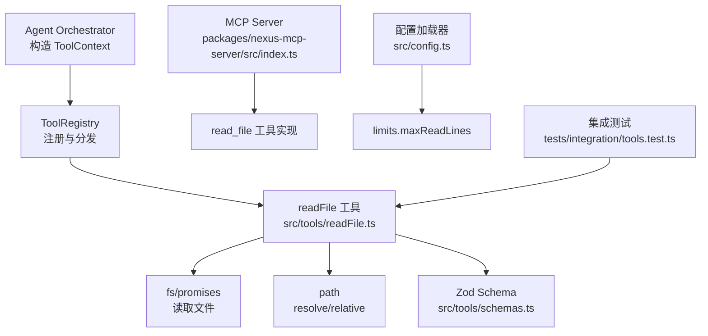
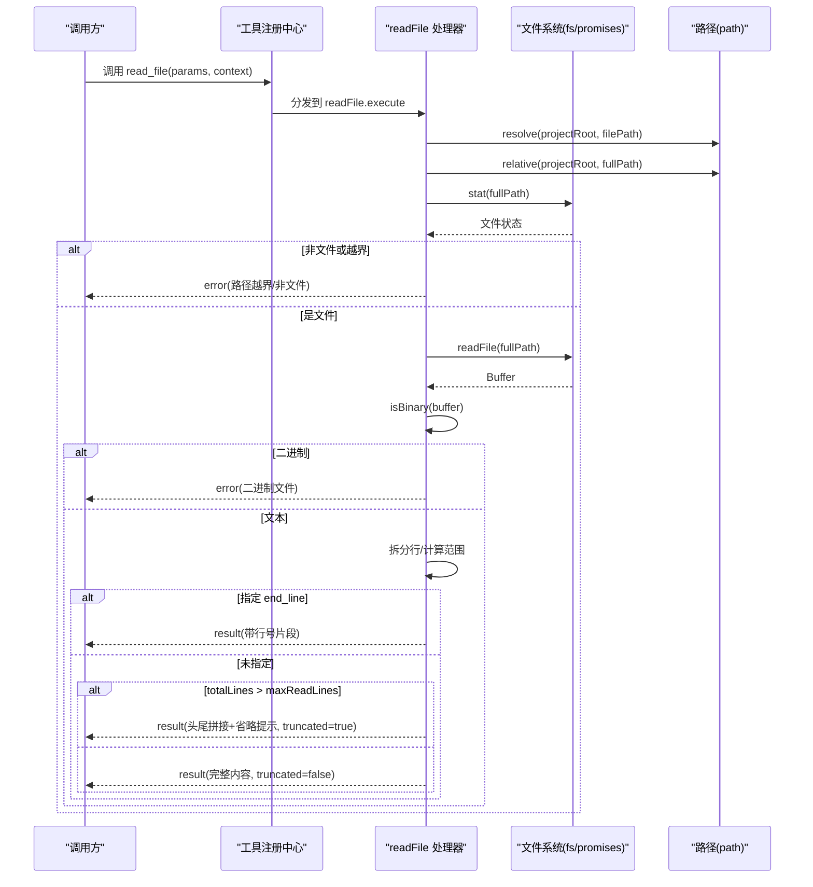
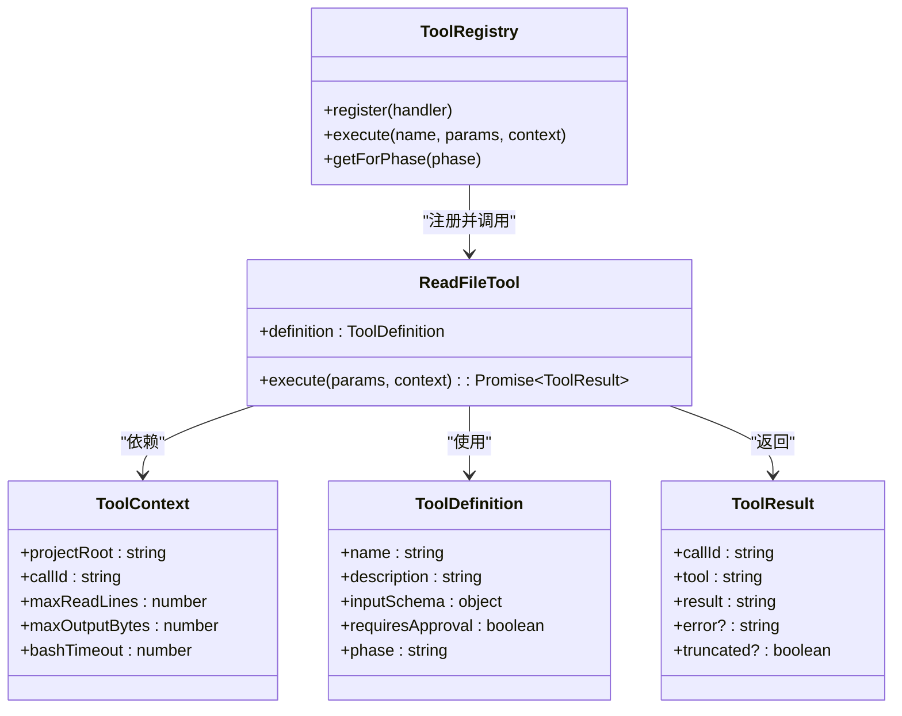

# read_file 文件读取工具

<cite>
**本文引用的文件**   
- [src/tools/readFile.ts](file://src/tools/readFile.ts)
- [src/tools/schemas.ts](file://src/tools/schemas.ts)
- [src/tools/registry.ts](file://src/tools/registry.ts)
- [src/config.ts](file://src/config.ts)
- [src/agent/types.ts](file://src/agent/types.ts)
- [src/agent/Orchestrator.ts](file://src/agent/Orchestrator.ts)
- [packages/nexus-mcp-server/src/index.ts](file://packages/nexus-mcp-server/src/index.ts)
- [tests/integration/tools.test.ts](file://tests/integration/tools.test.ts)
</cite>

## 目录
1. [简介](#简介)
2. [项目结构](#项目结构)
3. [核心组件](#核心组件)
4. [架构总览](#架构总览)
5. [详细组件分析](#详细组件分析)
6. [依赖关系分析](#依赖关系分析)
7. [性能考量](#性能考量)
8. [故障排查指南](#故障排查指南)
9. [结论](#结论)
10. [附录](#附录)

## 简介
read_file 工具用于安全地读取项目内文本文件内容，支持行号格式化、二进制文件检测、按行范围读取以及大文件自动截断。其设计重点包括：
- 路径安全检查：确保仅能访问项目根目录内的文件，防止越权读取。
- 二进制检测：通过前若干字节扫描判断是否为二进制文件并拒绝读取。
- 行号范围读取：支持 start_line/end_line 参数精确截取指定行区间。
- 输出截断机制：当文件行数超过限制时，采用“头尾拼接 + 省略提示”的策略控制输出大小。
- 配置化限制：通过 maxReadLines 控制最大读取行数，默认值来自配置文件。

该工具在两个位置实现：
- 主应用工具层（src/tools/readFile.ts）：面向 Agent 编排与内部调用。
- MCP Server（packages/nexus-mcp-server/src/index.ts）：对外暴露为 MCP 工具，供外部编辑器集成。

## 项目结构
read_file 相关代码分布在以下模块：
- 工具定义与执行逻辑：src/tools/readFile.ts
- 输入校验 Schema：src/tools/schemas.ts
- 工具注册与上下文传递：src/tools/registry.ts
- 配置加载与默认限制：src/config.ts
- 类型定义（ToolContext、ToolResult 等）：src/agent/types.ts
- 上下文注入（maxReadLines 来源）：src/agent/Orchestrator.ts
- MCP Server 中的 read_file 实现：packages/nexus-mcp-server/src/index.ts
- 集成测试用例：tests/integration/tools.test.ts

图表来源
- [src/agent/Orchestrator.ts:240-250](file://src/agent/Orchestrator.ts#L240-L250)
- [src/tools/registry.ts:1-96](file://src/tools/registry.ts#L1-L96)
- [src/tools/readFile.ts:1-150](file://src/tools/readFile.ts#L1-L150)
- [src/tools/schemas.ts:1-40](file://src/tools/schemas.ts#L1-L40)
- [src/config.ts:1-132](file://src/config.ts#L1-L132)
- [packages/nexus-mcp-server/src/index.ts:117-163](file://packages/nexus-mcp-server/src/index.ts#L117-L163)
- [tests/integration/tools.test.ts:1-100](file://tests/integration/tools.test.ts#L1-L100)

章节来源
- [src/tools/readFile.ts:1-150](file://src/tools/readFile.ts#L1-L150)
- [src/tools/schemas.ts:1-40](file://src/tools/schemas.ts#L1-L40)
- [src/tools/registry.ts:1-96](file://src/tools/registry.ts#L1-L96)
- [src/config.ts:1-132](file://src/config.ts#L1-L132)
- [src/agent/types.ts:120-160](file://src/agent/types.ts#L120-L160)
- [src/agent/Orchestrator.ts:240-250](file://src/agent/Orchestrator.ts#L240-L250)
- [packages/nexus-mcp-server/src/index.ts:117-163](file://packages/nexus-mcp-server/src/index.ts#L117-L163)
- [tests/integration/tools.test.ts:1-100](file://tests/integration/tools.test.ts#L1-L100)

## 核心组件
- 工具定义与输入 Schema
  - name/description/phase/requiresApproval 定义工具元信息。
  - inputSchema 描述 path、start_line、end_line 三个参数及必填项。
  - Zod Schema 提供运行时参数校验，确保类型正确。
- 执行器 execute
  - 解析 context.projectRoot 与传入的相对路径，生成绝对路径。
  - 进行路径安全检查，拒绝越界访问。
  - 使用 fs.stat 确认目标为文件。
  - 使用 fs.readFile 读取 Buffer，并进行二进制检测。
  - 将 Buffer 转为 UTF-8 字符串并按行分割。
  - 若指定 end_line，则按 start_line 到 end_line 切片返回。
  - 否则根据 totalLines 与 maxReadLines 决定是否截断，采用“头70% + 尾30%”策略。
  - 统一以带行号的格式输出，并在截断时标记 truncated。
- 上下文与限制
  - ToolContext 包含 projectRoot、callId、maxReadLines 等。
  - maxReadLines 由配置 limits.maxReadLines 注入，默认 2000。

章节来源
- [src/tools/readFile.ts:11-35](file://src/tools/readFile.ts#L11-L35)
- [src/tools/readFile.ts:54-147](file://src/tools/readFile.ts#L54-L147)
- [src/tools/schemas.ts:8-12](file://src/tools/schemas.ts#L8-L12)
- [src/tools/registry.ts:17-23](file://src/tools/registry.ts#L17-L23)
- [src/config.ts:45-51](file://src/config.ts#L45-L51)
- [src/agent/types.ts:145-151](file://src/agent/types.ts#L145-L151)

## 架构总览
read_file 的执行流程从上层编排器注入 ToolContext，经由注册中心分发到具体工具处理器，最终完成文件系统操作与安全校验。

图表来源
- [src/tools/registry.ts:70-82](file://src/tools/registry.ts#L70-L82)
- [src/tools/readFile.ts:54-147](file://src/tools/readFile.ts#L54-L147)
- [src/agent/types.ts:72-78](file://src/agent/types.ts#L72-L78)

## 详细组件分析

### 参数验证规则（path、start_line、end_line）
- path
  - 必须为字符串，表示相对于项目根目录的路径。
  - 运行时通过 resolve(projectRoot, filePath) 生成绝对路径，并进行越界检查。
  - 越界判定条件：fullPath 不以 projectRoot 开头或以 ".." 开头。
- start_line
  - 可选数字，起始行号，从 1 开始。
  - 未指定时默认为 1。
  - 内部切片索引会转换为 0 基索引（start = Math.max(1, startLine) - 1）。
- end_line
  - 可选数字，结束行号（包含）。
  - 未指定时视为读取全部行；若指定，则 end = Math.min(totalLines, endLine)。
- 边界处理
  - start_line < 1 会被修正为 1。
  - end_line 超出 totalLines 会被修正为 totalLines。
  - 若 end_line 小于 start_line，slice 结果为空，返回空内容。

章节来源
- [src/tools/readFile.ts:15-32](file://src/tools/readFile.ts#L15-L32)
- [src/tools/readFile.ts:54-62](file://src/tools/readFile.ts#L54-L62)
- [src/tools/readFile.ts:103-112](file://src/tools/readFile.ts#L103-L112)
- [src/tools/schemas.ts:8-12](file://src/tools/schemas.ts#L8-L12)

### 路径安全检查与项目根目录解析
- 解析机制
  - 使用 path.resolve 将相对路径与 projectRoot 合并为绝对路径。
  - 使用 path.relative 生成便于展示的相对路径 relPath。
- 安全防护
  - 禁止读取项目外文件：fullPath 不以 projectRoot 开头或包含 ".." 直接拒绝。
  - 对 stat 结果进行 isFile() 校验，避免读取目录或其他类型节点。
- 错误反馈
  - 越界时返回 error 字段，包含“路径越界”提示。
  - 非文件时返回 error 字段，提示“不是一个文件”。

章节来源
- [src/tools/readFile.ts:60-83](file://src/tools/readFile.ts#L60-L83)
- [tests/integration/tools.test.ts:78-81](file://tests/integration/tools.test.ts#L78-L81)

### 二进制文件检测
- 检测策略
  - 读取前 8KB 的 Buffer，检查是否包含 null 字节（0x00）。
  - 若存在 null 字节，判定为二进制文件并拒绝读取。
- 原因与影响
  - 文本文件通常不含 null 字节；二进制文件（如图片、编译产物）常含 null 字节。
  - 避免将二进制数据作为文本处理导致乱码或异常。

章节来源
- [src/tools/readFile.ts:37-42](file://src/tools/readFile.ts#L37-L42)
- [src/tools/readFile.ts:88-96](file://src/tools/readFile.ts#L88-L96)

### 行号范围读取与输出截断机制
- 行号格式化
  - 将内容按 '\n' 分割为数组，逐行添加行号前缀，对齐宽度。
- 范围读取
  - 若 end_line 已指定，则 slice(start, end) 返回指定区间。
  - 返回内容包含头部信息（相对路径与行号范围）。
- 大文件截断
  - 当 totalLines > maxReadLines 且未指定 end_line 时启用截断。
  - 策略：headLines = floor(maxReadLines * 0.7)，tailLines = floor(maxReadLines * 0.3)。
  - 输出顺序：头部行 + 省略提示 + 尾部行，并设置 truncated = true。
  - 省略提示建议用户使用 start_line/end_line 或 grep 搜索特定范围。

章节来源
- [src/tools/readFile.ts:44-52](file://src/tools/readFile.ts#L44-L52)
- [src/tools/readFile.ts:103-130](file://src/tools/readFile.ts#L103-L130)

### MAX_READ_LINES 限制的工作原理与最佳使用模式
- 工作原理
  - maxReadLines 来自 ToolContext，由 Orchestrator 注入，来源于配置 limits.maxReadLines。
  - 默认值为 2000，可通过 .nexus/config.toml 的 limits.max_read_lines 覆盖。
  - 当 totalLines > maxReadLines 且未指定 end_line 时触发截断。
- 最佳使用模式
  - 对于超大文件，优先使用 start_line/end_line 精确定位所需片段。
  - 结合 grep 工具进行关键词搜索，减少不必要的内容读取。
  - 合理调整 maxReadLines，平衡输出可读性与资源占用。

章节来源
- [src/agent/Orchestrator.ts:240-250](file://src/agent/Orchestrator.ts#L240-L250)
- [src/config.ts:45-51](file://src/config.ts#L45-L51)
- [src/config.ts:106-114](file://src/config.ts#L106-L114)
- [src/tools/readFile.ts:114-130](file://src/tools/readFile.ts#L114-L130)

### 错误处理策略与边界情况
- 常见错误
  - 路径越界：返回 error 包含“路径越界”提示。
  - 非文件：返回 error 包含“不是一个文件”提示。
  - 二进制文件：返回 error 包含“二进制文件”提示。
  - 读取失败：捕获异常并返回 error，包含原始错误消息。
- 边界情况
  - start_line < 1：修正为 1。
  - end_line > totalLines：修正为 totalLines。
  - end_line < start_line：返回空内容。
  - 未指定 end_line 且 totalLines 极大：触发截断并提示使用范围读取或 grep。

章节来源
- [src/tools/readFile.ts:60-147](file://src/tools/readFile.ts#L60-L147)
- [tests/integration/tools.test.ts:78-81](file://tests/integration/tools.test.ts#L78-L81)

### 与 MCP Server 中 read_file 的差异对比
- 共同点
  - 均进行路径安全检查与二进制检测。
  - 均支持 start_line/end_line 范围读取。
  - 均对大文件进行截断控制。
- 差异点
  - MCP Server 使用常量 MAX_READ_LINES = 2000，未通过 context 注入。
  - MCP Server 的截断策略为“仅显示前 MAX_READ_LINES 行”，而主应用工具为“头70% + 尾30%”。
  - MCP Server 的错误返回结构为 { content, isError }，主应用工具返回 ToolResult。

章节来源
- [packages/nexus-mcp-server/src/index.ts:20-24](file://packages/nexus-mcp-server/src/index.ts#L20-L24)
- [packages/nexus-mcp-server/src/index.ts:117-163](file://packages/nexus-mcp-server/src/index.ts#L117-L163)
- [src/tools/readFile.ts:114-130](file://src/tools/readFile.ts#L114-L130)

## 依赖关系分析
read_file 工具的依赖关系如下：
- 工具定义与执行：src/tools/readFile.ts
- 输入校验：src/tools/schemas.ts（Zod Schema）
- 工具注册与上下文：src/tools/registry.ts（ToolRegistry、ToolContext）
- 配置注入：src/config.ts（limits.maxReadLines）
- 类型定义：src/agent/types.ts（ToolDefinition、ToolResult、ToolContext）
- 上下文构建：src/agent/Orchestrator.ts（getToolContext）
- MCP Server 实现：packages/nexus-mcp-server/src/index.ts
- 集成测试：tests/integration/tools.test.ts

图表来源
- [src/tools/registry.ts:12-23](file://src/tools/registry.ts#L12-L23)
- [src/tools/readFile.ts:11-35](file://src/tools/readFile.ts#L11-L35)
- [src/agent/types.ts:44-78](file://src/agent/types.ts#L44-L78)

章节来源
- [src/tools/registry.ts:1-96](file://src/tools/registry.ts#L1-L96)
- [src/tools/readFile.ts:1-150](file://src/tools/readFile.ts#L1-L150)
- [src/agent/types.ts:44-78](file://src/agent/types.ts#L44-L78)

## 性能考量
- 内存占用
  - 读取整个文件到 Buffer，再转为字符串并按行分割，可能占用较多内存。
  - 对于超大文件，建议使用 start_line/end_line 缩小读取范围。
- I/O 开销
  - stat + readFile 两次系统调用，属于必要开销。
  - 二进制检测仅扫描前 8KB，开销较小。
- 输出控制
  - 截断策略避免一次性输出过大内容，降低下游处理压力。
  - 建议配合 grep 工具进行精准搜索，减少不必要的全文读取。

[本节为通用性能讨论，不直接分析具体文件]

## 故障排查指南
- 常见问题
  - 路径越界：检查 path 是否为相对路径，并确保不在项目根目录之外。
  - 非文件错误：确认目标为普通文件而非目录或符号链接。
  - 二进制文件：确认文件编码为文本，避免读取图片、压缩包等。
  - 读取失败：检查文件权限、磁盘空间、路径拼写等。
- 调试建议
  - 使用 start_line/end_line 逐步定位问题区域。
  - 查看返回的 error 字段获取详细错误信息。
  - 在集成测试中模拟类似场景，复现并修复问题。

章节来源
- [src/tools/readFile.ts:60-147](file://src/tools/readFile.ts#L60-L147)
- [tests/integration/tools.test.ts:78-81](file://tests/integration/tools.test.ts#L78-L81)

## 结论
read_file 工具通过严格的路径安全检查、二进制检测、行号范围读取与大文件截断机制，提供了安全、可控的文件读取能力。其设计兼顾了易用性与性能，适用于 Agent 编排与外部集成场景。合理使用 start_line/end_line 与 grep 工具，可进一步提升效率与准确性。

[本节为总结性内容，不直接分析具体文件]

## 附录
- 使用示例
  - 读取完整文件：{ path: "src/tools/readFile.ts" }
  - 读取指定范围：{ path: "src/tools/readFile.ts", start_line: 10, end_line: 20 }
  - 大文件优化：先使用 grep 搜索关键词，再用 read_file 读取匹配行附近范围。
- 常见错误解决方案
  - 路径越界：确保 path 为相对路径且不包含 ".." 越级。
  - 二进制文件：确认文件为文本编码，必要时转换编码或使用专用工具。
  - 读取失败：检查文件是否存在、权限是否正确、磁盘是否正常。

[本节为概念性说明，不直接分析具体文件]