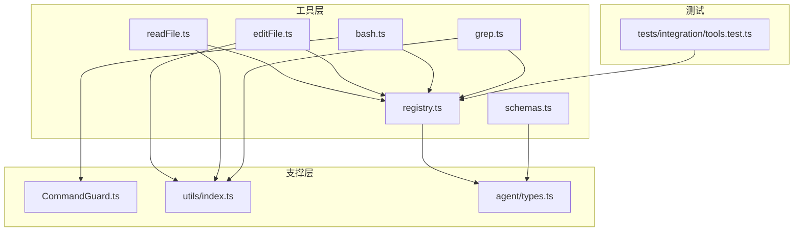
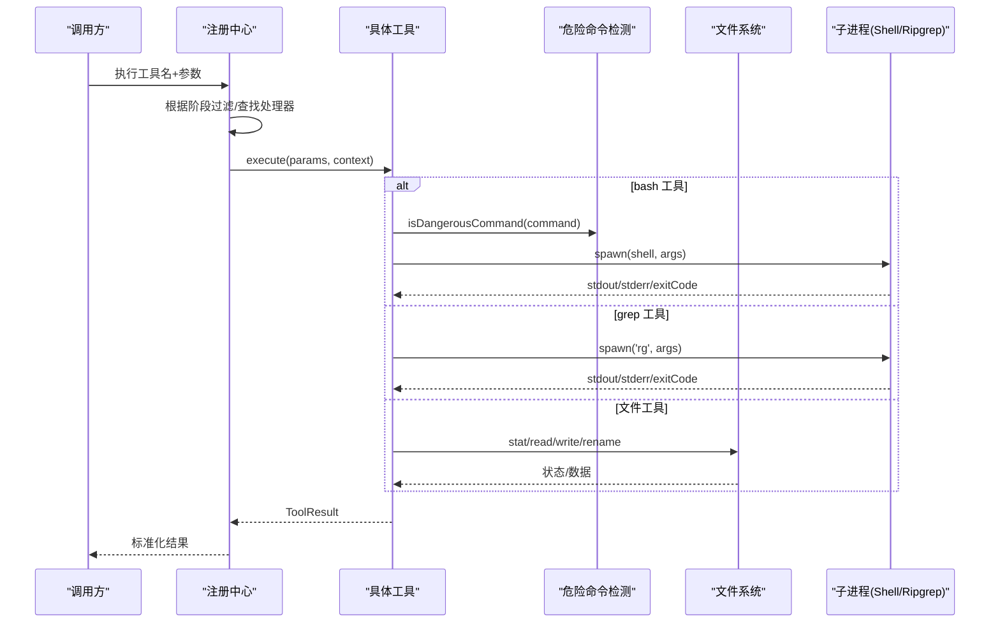
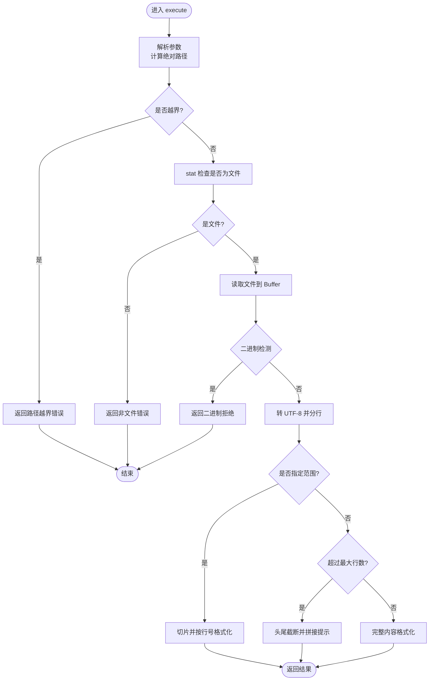
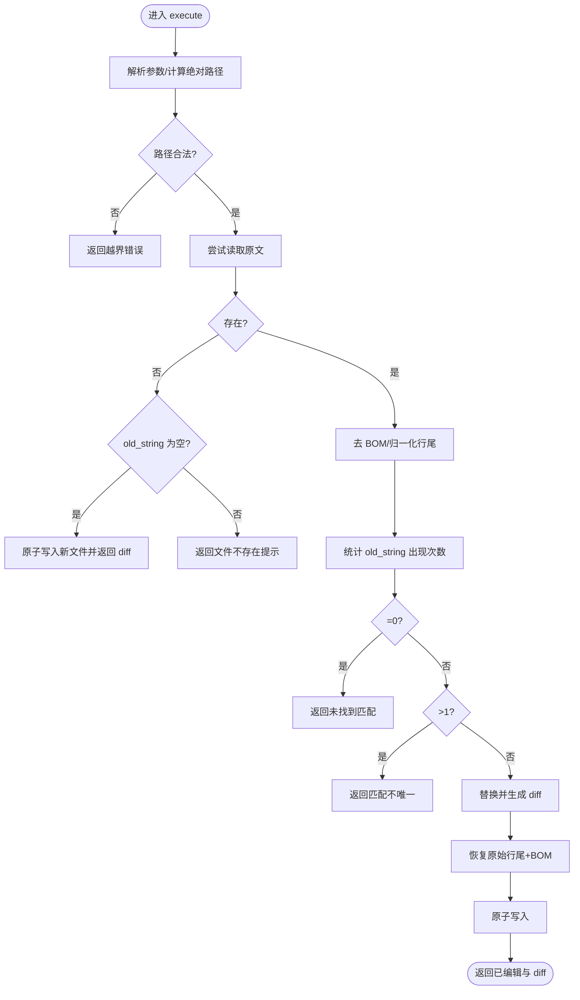
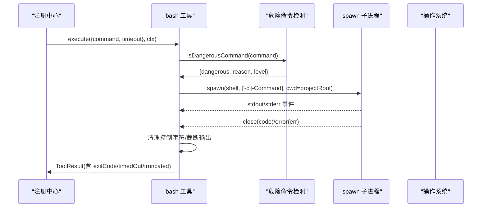
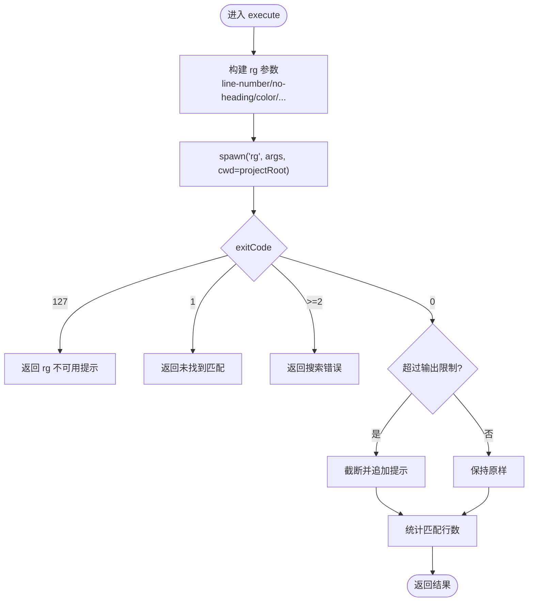
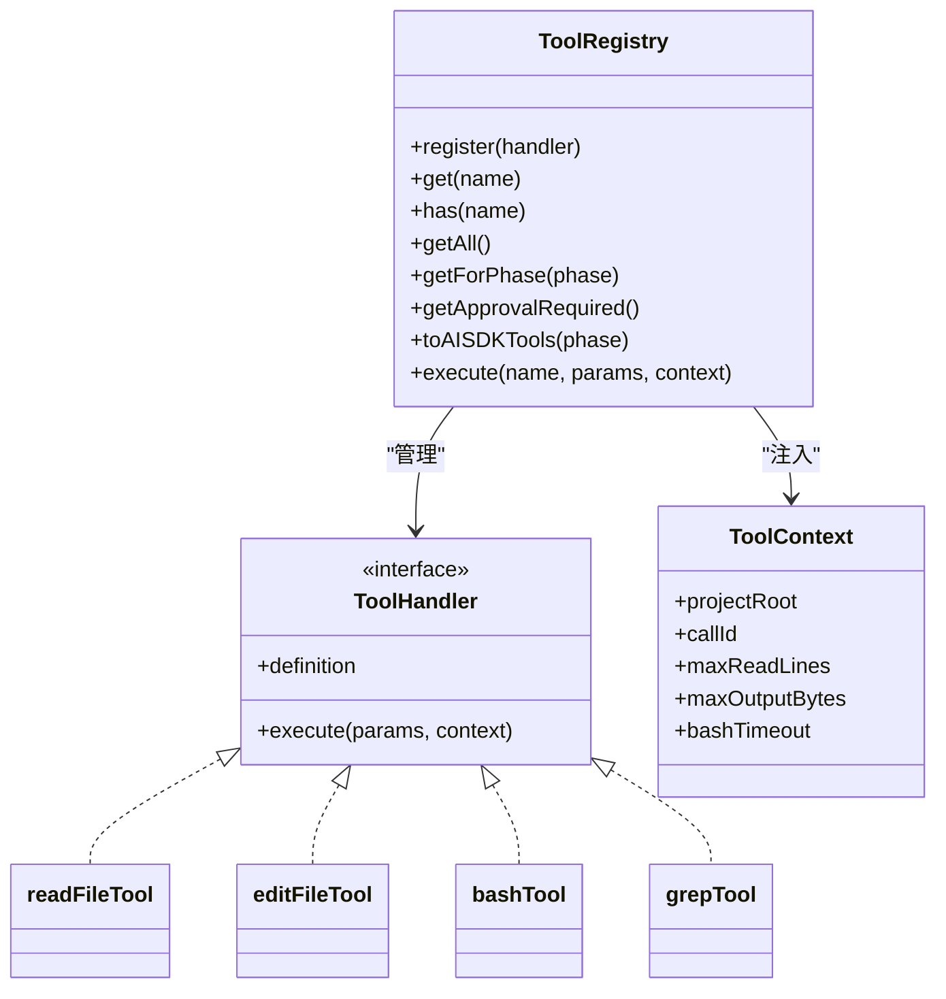

# 内置工具实现

<cite>
**本文引用的文件**   
- [readFile.ts](file://src/tools/readFile.ts)
- [editFile.ts](file://src/tools/editFile.ts)
- [bash.ts](file://src/tools/bash.ts)
- [grep.ts](file://src/tools/grep.ts)
- [registry.ts](file://src/tools/registry.ts)
- [schemas.ts](file://src/tools/schemas.ts)
- [CommandGuard.ts](file://src/sandbox/CommandGuard.ts)
- [index.ts](file://src/utils/index.ts)
- [types.ts](file://src/agent/types.ts)
- [tools.test.ts](file://tests/integration/tools.test.ts)
</cite>

## 目录
1. [简介](#简介)
2. [项目结构](#项目结构)
3. [核心组件](#核心组件)
4. [架构总览](#架构总览)
5. [详细组件分析](#详细组件分析)
6. [依赖关系分析](#依赖关系分析)
7. [性能考量](#性能考量)
8. [故障排查指南](#故障排查指南)
9. [结论](#结论)
10. [附录：使用示例与最佳实践](#附录使用示例与最佳实践)

## 简介
本文件为 MCP Server 的四个内置工具提供深入实现文档，覆盖 read_file、edit_file、bash、grep。内容包含功能特性、参数校验、错误处理、边界情况、安全机制（路径越界检查、危险命令检测、输出大小限制）、工具间协作模式、性能优化与调试技巧，并给出可操作的使用示例与最佳实践。

## 项目结构
工具层位于 src/tools，每个工具一个模块，统一通过注册中心暴露；沙箱命令防护在 src/sandbox；通用工具函数在 src/utils；类型定义在 src/agent/types.ts；集成测试在 tests/integration/tools.test.ts。

图表来源
- [registry.ts:1-96](file://src/tools/registry.ts#L1-L96)
- [readFile.ts:1-150](file://src/tools/readFile.ts#L1-L150)
- [editFile.ts:1-170](file://src/tools/editFile.ts#L1-L170)
- [bash.ts:1-186](file://src/tools/bash.ts#L1-L186)
- [grep.ts:1-178](file://src/tools/grep.ts#L1-L178)
- [CommandGuard.ts:1-98](file://src/sandbox/CommandGuard.ts#L1-L98)
- [index.ts:1-211](file://src/utils/index.ts#L1-L211)
- [types.ts:1-269](file://src/agent/types.ts#L1-L269)
- [tools.test.ts:1-100](file://tests/integration/tools.test.ts#L1-L100)

章节来源
- [registry.ts:1-96](file://src/tools/registry.ts#L1-L96)
- [types.ts:44-78](file://src/agent/types.ts#L44-L78)

## 核心组件
- 工具定义与执行器：每个工具导出 ToolHandler，包含 definition（名称、描述、输入 Schema、是否需要审批、阶段）和 execute（具体逻辑）。
- 注册中心：集中管理工具注册、按阶段过滤、生成 AI SDK 兼容定义、统一执行入口。
- 上下文对象：传入 projectRoot、callId、maxReadLines、maxOutputBytes、bashTimeout 等运行时限制。
- 安全与通用能力：危险命令检测、二进制清理、行尾/BOM 处理、截断策略。

章节来源
- [registry.ts:12-23](file://src/tools/registry.ts#L12-L23)
- [registry.ts:25-93](file://src/tools/registry.ts#L25-L93)
- [types.ts:44-78](file://src/agent/types.ts#L44-L78)

## 架构总览
工具调用流程由注册中心统一调度，各工具内部完成参数解析、安全检查、IO/子进程操作、结果格式化与返回。

图表来源
- [registry.ts:70-82](file://src/tools/registry.ts#L70-L82)
- [bash.ts:123-183](file://src/tools/bash.ts#L123-L183)
- [grep.ts:80-175](file://src/tools/grep.ts#L80-L175)
- [readFile.ts:54-147](file://src/tools/readFile.ts#L54-L147)
- [editFile.ts:61-156](file://src/tools/editFile.ts#L61-L156)
- [CommandGuard.ts:71-98](file://src/sandbox/CommandGuard.ts#L71-L98)

## 详细组件分析

### read_file 工具
- 功能特性
  - 读取相对项目根的文件，支持 start_line/end_line 范围读取。
  - 自动带行号格式化输出。
  - 大文件头部+尾部截断策略，避免一次性加载超大文本。
  - 二进制文件检测并拒绝读取。
- 参数验证
  - path 必填；start_line、end_line 可选且从 1 开始。
- 安全机制
  - 路径越界检查：禁止访问项目根之外的路径。
  - 二进制检测：前 8KB 含 null 字节即判定为二进制。
- 错误处理与边界
  - 非文件路径、不存在、权限不足等异常统一捕获并返回 error。
  - 超出 maxReadLines 时采用“头70% + 尾30%”策略，并提示可用 grep 或指定范围。
- 复杂度与性能
  - 时间 O(N) 用于读取与分行；空间受限于内存中整份内容切片。
  - 大文件优先返回头尾片段，降低内存占用。

图表来源
- [readFile.ts:54-147](file://src/tools/readFile.ts#L54-L147)

章节来源
- [readFile.ts:11-35](file://src/tools/readFile.ts#L11-L35)
- [readFile.ts:37-52](file://src/tools/readFile.ts#L37-L52)
- [readFile.ts:54-147](file://src/tools/readFile.ts#L54-L147)

### edit_file 工具
- 功能特性
  - 精准替换：old_string 必须唯一匹配，否则报错。
  - 原子写入：先写临时文件再 rename，避免部分写入导致损坏。
  - 保留原始格式：BOM 与行尾风格（CRLF/LF）在编辑后恢复。
  - 生成 unified diff 便于 LLM 审阅变更。
- 参数验证
  - path、old_string、new_string 必填。
- 安全机制
  - 路径越界检查：仅允许在项目根内编辑。
  - requiresApproval=true，默认需要人工审批。
- 错误处理与边界
  - 未找到匹配：提示重新读取最新内容。
  - 匹配不唯一：要求提供更多上下文确保唯一性。
  - 文件不存在：若 old_string 为空则创建新文件；否则报错。
- 复杂度与性能
  - 字符串搜索与替换 O(N)，diff 生成 O(N)。
  - 原子写入保证一致性，但会额外一次磁盘 I/O。

图表来源
- [editFile.ts:61-156](file://src/tools/editFile.ts#L61-L156)
- [editFile.ts:158-166](file://src/tools/editFile.ts#L158-L166)

章节来源
- [editFile.ts:14-38](file://src/tools/editFile.ts#L14-L38)
- [editFile.ts:40-59](file://src/tools/editFile.ts#L40-L59)
- [editFile.ts:61-156](file://src/tools/editFile.ts#L61-L156)
- [editFile.ts:158-166](file://src/tools/editFile.ts#L158-L166)

### bash 工具
- 功能特性
  - 在项目根目录下执行 shell 命令，跨平台选择 powershell.exe 或 /bin/bash。
  - 超时控制与进程组终止，防止僵尸进程。
  - 输出截断与二进制控制字符清理，避免终端渲染异常。
  - 危险命令检测标记（实际拦截在审批层）。
- 参数验证
  - command 必填；timeout 可选，默认来自上下文配置。
- 安全机制
  - 工作目录锁定在项目根。
  - 危险命令检测：基于正则黑名单与启发式规则，返回等级与安全原因。
  - 输出大小限制：stdout/stderr 分别按 maxOutputBytes 截断。
- 错误处理与边界
  - 超时：记录超时信息并终止进程树。
  - 退出码非零：作为 error 字段返回。
  - 子进程错误：转换为错误消息返回。
- 复杂度与性能
  - 子进程 IO 流式累积，注意内存上限；截断策略保护峰值内存。

图表来源
- [bash.ts:42-89](file://src/tools/bash.ts#L42-L89)
- [bash.ts:111-121](file://src/tools/bash.ts#L111-L121)
- [bash.ts:123-183](file://src/tools/bash.ts#L123-L183)
- [CommandGuard.ts:71-98](file://src/sandbox/CommandGuard.ts#L71-L98)

章节来源
- [bash.ts:13-33](file://src/tools/bash.ts#L13-L33)
- [bash.ts:42-89](file://src/tools/bash.ts#L42-L89)
- [bash.ts:111-121](file://src/tools/bash.ts#L111-L121)
- [bash.ts:123-183](file://src/tools/bash.ts#L123-L183)
- [CommandGuard.ts:12-55](file://src/sandbox/CommandGuard.ts#L12-L55)

### grep 工具
- 功能特性
  - 封装 ripgrep（rg），支持正则、文件名 glob 过滤、上下文行、忽略大小写。
  - 限制每文件最多匹配数，避免过多结果。
  - 结果按“文件:行号:内容”展示，并统计匹配数量。
- 参数验证
  - pattern 必填；path/include/context_lines/case_insensitive 可选。
- 安全机制
  - 搜索路径限定在项目根下。
  - 结果长度限制：超过 maxOutputBytes 时截断并提示缩小范围。
- 错误处理与边界
  - rg 不可用：返回安装提示。
  - 无匹配：返回友好提示。
  - rg 错误：透传 stderr。
- 复杂度与性能
  - 依赖 rg 的高效搜索算法；本地截断保护内存。

图表来源
- [grep.ts:45-78](file://src/tools/grep.ts#L45-L78)
- [grep.ts:80-175](file://src/tools/grep.ts#L80-L175)

章节来源
- [grep.ts:11-43](file://src/tools/grep.ts#L11-L43)
- [grep.ts:45-78](file://src/tools/grep.ts#L45-L78)
- [grep.ts:80-175](file://src/tools/grep.ts#L80-L175)

## 依赖关系分析
- 工具与注册中心
  - 所有工具通过 registry.register 注册，getForPhase 按阶段过滤，execute 统一分发。
- 工具与沙箱
  - bash 工具依赖 CommandGuard 进行危险命令评估。
- 工具与通用工具
  - edit_file 使用 utils 的 stripBom/detectLineEnding/normalizeToLF/restoreLineEndings。
  - bash/grep 使用 truncateTail/sanitizeBinaryOutput/formatSize。
- 类型契约
  - ToolDefinition/ToolResult/ToolContext 等类型在 agent/types.ts 统一定义。

图表来源
- [registry.ts:12-23](file://src/tools/registry.ts#L12-L23)
- [registry.ts:25-93](file://src/tools/registry.ts#L25-L93)
- [readFile.ts:149-150](file://src/tools/readFile.ts#L149-L150)
- [editFile.ts:168-170](file://src/tools/editFile.ts#L168-L170)
- [bash.ts:185-186](file://src/tools/bash.ts#L185-L186)
- [grep.ts:177-178](file://src/tools/grep.ts#L177-L178)

章节来源
- [registry.ts:1-96](file://src/tools/registry.ts#L1-L96)
- [types.ts:44-78](file://src/agent/types.ts#L44-L78)

## 性能考量
- 读文件
  - 大文件采用头尾截断，减少内存峰值；建议配合 grep 定位关键片段后再精确读取。
- 编辑文件
  - 原子写入带来额外 I/O，但保证一致性；diff 生成开销与文件大小线性相关。
- 命令执行
  - 子进程输出流式累积，需设置合理的 maxOutputBytes；必要时缩短 timeout。
- 搜索
  - 使用 rg 的高性能搜索；结合 include 与 context_lines 控制结果规模。

[本节为通用指导，无需源码引用]

## 故障排查指南
- read_file
  - 路径越界：确认 path 相对于 projectRoot 正确，不要使用 .. 逃逸。
  - 二进制文件：该工具不支持二进制，改用其他专用工具或转换。
  - 行数过多：使用 start_line/end_line 或 grep 缩小范围。
- edit_file
  - 未找到匹配：可能文件已被外部修改，先 read_file 获取最新内容。
  - 匹配不唯一：增加上下文行使 old_string 唯一。
  - 文件不存在：如需新建，将 old_string 设为空字符串。
- bash
  - 超时：增大 timeout 或拆分命令；检查是否存在长时间运行的任务。
  - 输出过大：合理设置 maxOutputBytes；关注 stderr 中的错误信息。
  - 危险命令：被标记的命令需在审批层确认。
- grep
  - rg 不可用：安装 ripgrep 或使用系统自带替代方案。
  - 结果过多：使用 include 过滤文件类型，或提高模式精确度。

章节来源
- [readFile.ts:64-96](file://src/tools/readFile.ts#L64-L96)
- [editFile.ts:113-129](file://src/tools/editFile.ts#L113-L129)
- [bash.ts:123-183](file://src/tools/bash.ts#L123-L183)
- [grep.ts:120-145](file://src/tools/grep.ts#L120-L145)

## 结论
四个内置工具围绕“安全、可靠、可控”的设计目标展开：严格的目录边界、原子写入、危险命令检测、输出大小限制与大文件截断策略共同保障了稳定性与安全性。通过注册中心的阶段化暴露与统一的上下文注入，工具既易于扩展又便于治理。

[本节为总结，无需源码引用]

## 附录：使用示例与最佳实践

- read_file
  - 读取特定范围：使用 start_line/end_line 精确定位。
  - 大文件阅读：先 grep 定位关键位置，再用 read_file 读取片段。
- edit_file
  - 构造唯一 old_string：包含足够上下文行，避免误替换。
  - 新建文件：将 old_string 置空，new_string 写入初始内容。
  - 行尾与编码：工具会自动保留 BOM 与行尾风格，无需手动处理。
- bash
  - 控制输出：使用管道重定向到文件，再 read_file 查看结果。
  - 超时与资源：对耗时任务设置合适 timeout，避免阻塞。
  - 危险命令：遵循最小权限原则，谨慎使用 rm、sudo、格式化等命令。
- grep
  - 快速定位：使用 include 过滤语言后缀，context_lines 查看上下文。
  - 结果控制：利用 max-count 与模式精确度控制匹配量。

章节来源
- [tools.test.ts:36-81](file://tests/integration/tools.test.ts#L36-L81)
- [schemas.ts:8-31](file://src/tools/schemas.ts#L8-L31)
- [index.ts:156-161](file://src/utils/index.ts#L156-L161)
- [index.ts:187-210](file://src/utils/index.ts#L187-L210)