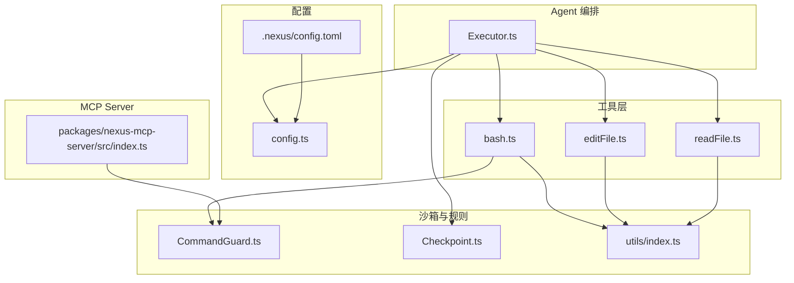
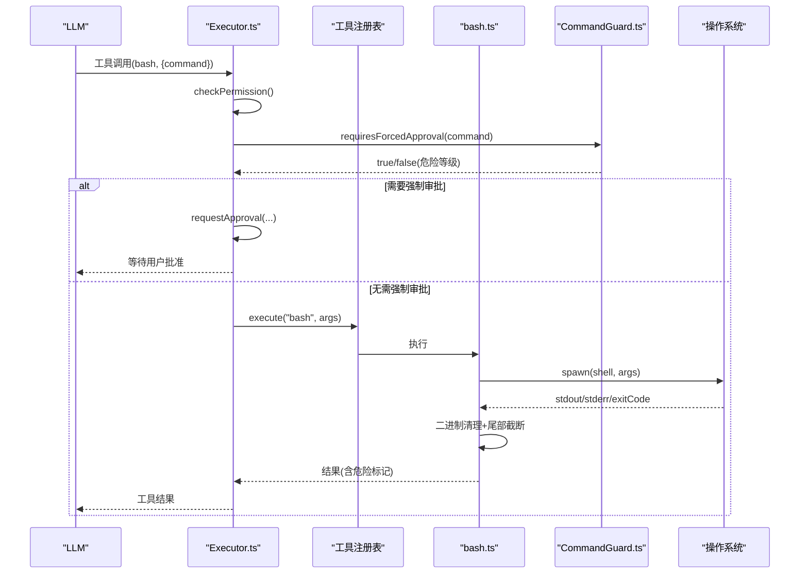
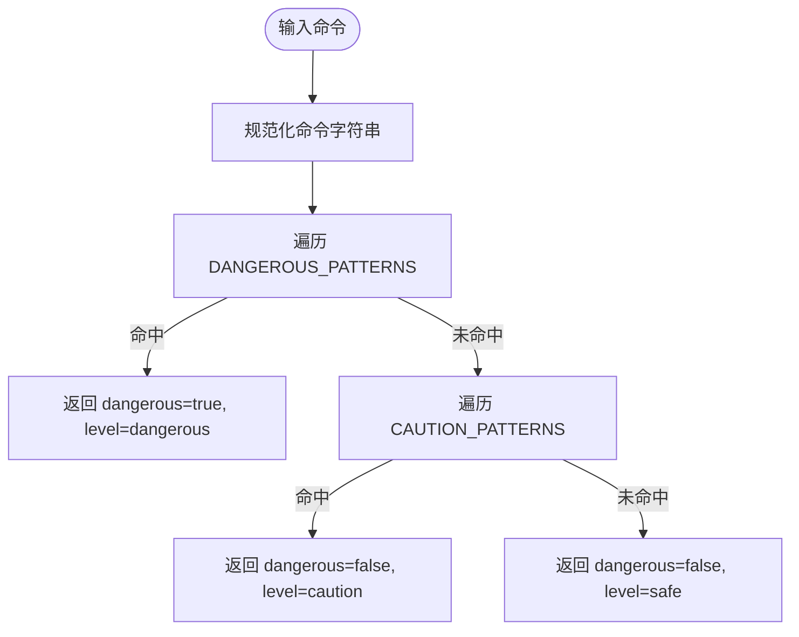
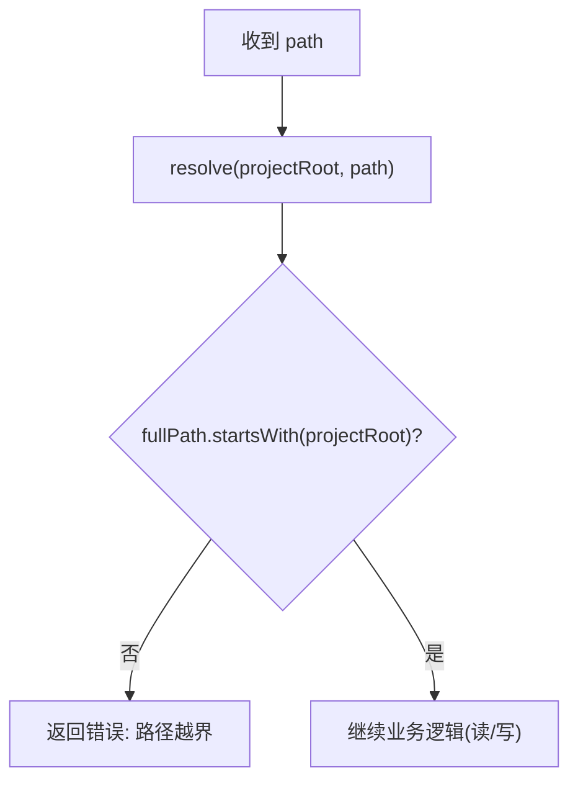
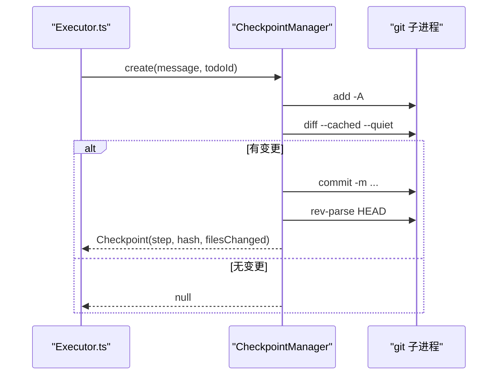
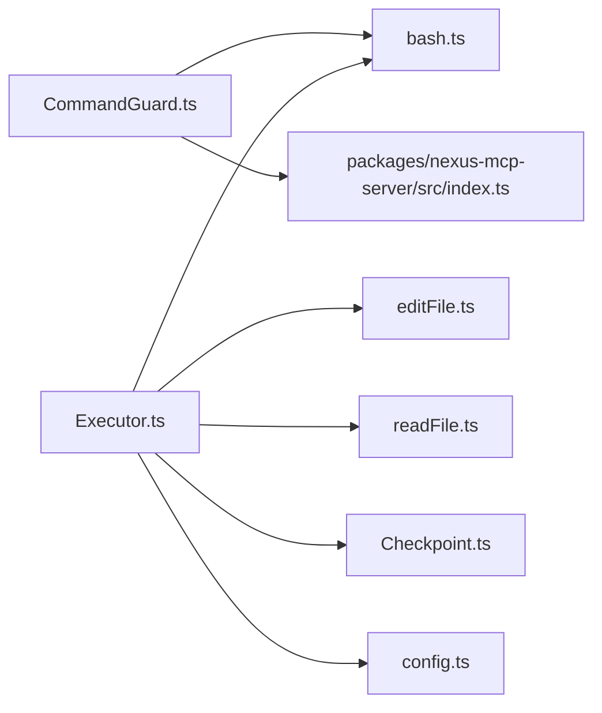

# 安全沙箱机制

<cite>
**本文引用的文件**   
- [CommandGuard.ts](file://src/sandbox/CommandGuard.ts)
- [Checkpoint.ts](file://src/sandbox/Checkpoint.ts)
- [bash.ts](file://src/tools/bash.ts)
- [editFile.ts](file://src/tools/editFile.ts)
- [readFile.ts](file://src/tools/readFile.ts)
- [Executor.ts](file://src/agent/Executor.ts)
- [config.ts](file://src/config.ts)
- [index.ts](file://packages/nexus-mcp-server/src/index.ts)
- [commandGuard.test.ts](file://tests/unit/commandGuard.test.ts)
- [types.ts](file://src/agent/types.ts)
- [index.ts](file://src/utils/index.ts)
</cite>

## 目录
1. [简介](#简介)
2. [项目结构](#项目结构)
3. [核心组件](#核心组件)
4. [架构总览](#架构总览)
5. [详细组件分析](#详细组件分析)
6. [依赖关系分析](#依赖关系分析)
7. [性能与资源限制](#性能与资源限制)
8. [故障排查指南](#故障排查指南)
9. [结论](#结论)
10. [附录：配置与安全策略清单](#附录配置与安全策略清单)

## 简介
本文件面向 MCP Server 的安全沙箱机制，系统性说明以下能力与策略：
- 路径越界校验：对文件读写与编辑操作进行工作目录边界检查，防止访问项目外文件。
- 危险命令检测：基于正则黑名单与启发式规则识别高危 shell 命令，并强制审批。
- 二进制文件防护：在读取阶段拒绝二进制文件，并对 bash 输出做控制字符清理与截断。
- 进程隔离、资源限制与超时控制：通过子进程执行、进程组管理、超时与输出大小限制降低风险。
- 自定义安全规则扩展：提供 DANGEROUS_PATTERNS 与 CAUTION_PATTERNS 的扩展方式。
- 安全审计日志与威胁检测：贯穿工具调用、审批、结果与检查点的事件流，便于审计与回溯。

## 项目结构
安全相关的关键位置与职责如下：
- src/sandbox/CommandGuard.ts：危险命令检测（正则黑名单 + 启发式），返回危险等级与原因。
- src/tools/bash.ts：shell 命令执行器，集成危险检测、超时、输出截断、工作目录锁定与进程组终止。
- src/tools/editFile.ts / readFile.ts：文件编辑与读取工具，包含路径越界校验与二进制检测。
- src/agent/Executor.ts：编排层权限检查，结合危险命令强制审批与权限模式。
- src/config.ts：加载 .nexus/config.toml，合并默认值，暴露 limits/checkpoint 等安全相关配置。
- packages/nexus-mcp-server/src/index.ts：MCP Server 侧也实现危险命令检测（与 CommandGuard 一致）。
- tests/unit/commandGuard.test.ts：覆盖危险命令检测用例。
- src/agent/types.ts：定义 SandboxProvider 接口，为未来替换底层沙箱实现提供抽象。
- src/utils/index.ts：通用工具（二进制清理、截断、行尾处理等）。



图表来源
- [Executor.ts:100-196](file://src/agent/Executor.ts#L100-L196)
- [bash.ts:123-186](file://src/tools/bash.ts#L123-L186)
- [editFile.ts:61-156](file://src/tools/editFile.ts#L61-L156)
- [readFile.ts:54-147](file://src/tools/readFile.ts#L54-L147)
- [CommandGuard.ts:71-98](file://src/sandbox/CommandGuard.ts#L71-L98)
- [Checkpoint.ts:30-181](file://src/sandbox/Checkpoint.ts#L30-L181)
- [config.ts:63-132](file://src/config.ts#L63-L132)
- [index.ts](file://packages/nexus-mcp-server/src/index.ts)

章节来源
- [Executor.ts:100-196](file://src/agent/Executor.ts#L100-L196)
- [bash.ts:123-186](file://src/tools/bash.ts#L123-L186)
- [editFile.ts:61-156](file://src/tools/editFile.ts#L61-L156)
- [readFile.ts:54-147](file://src/tools/readFile.ts#L54-L147)
- [CommandGuard.ts:71-98](file://src/sandbox/CommandGuard.ts#L71-L98)
- [Checkpoint.ts:30-181](file://src/sandbox/Checkpoint.ts#L30-L181)
- [config.ts:63-132](file://src/config.ts#L63-L132)
- [index.ts](file://packages/nexus-mcp-server/src/index.ts)

## 核心组件
- 危险命令检测（CommandGuard）
  - 提供 isDangerousCommand 与 requiresForcedApproval，按正则匹配返回 safe/caution/dangerous 三级评估。
  - 危险级别命令无论权限模式均强制审批。
- Shell 执行器（bash.ts）
  - 使用 child_process.spawn 启动独立 shell 进程，支持 Windows/Unix 差异。
  - 工作目录锁定在项目根；超时后杀死整个进程组；输出经二进制清理与尾部截断。
- 文件工具（editFile.ts / readFile.ts）
  - 严格路径越界校验，禁止访问项目外路径。
  - read_file 对二进制文件直接拒绝；edit_file 原子写入并生成 diff。
- 编排与审批（Executor.ts）
  - 根据权限模式与危险命令检测结果决定是否请求人工审批。
  - edit_file 成功后自动创建 Git 检查点，支持回滚。
- 配置（config.ts）
  - 从 .nexus/config.toml 加载权限模式、超时、输出大小、迭代上限、检查点分支等。
- MCP Server 侧检测（packages/nexus-mcp-server/src/index.ts）
  - 同步实现危险命令检测，确保跨入口一致性。

章节来源
- [CommandGuard.ts:12-98](file://src/sandbox/CommandGuard.ts#L12-L98)
- [bash.ts:42-121](file://src/tools/bash.ts#L42-L121)
- [editFile.ts:61-156](file://src/tools/editFile.ts#L61-L156)
- [readFile.ts:54-147](file://src/tools/readFile.ts#L54-L147)
- [Executor.ts:167-196](file://src/agent/Executor.ts#L167-L196)
- [config.ts:63-132](file://src/config.ts#L63-L132)
- [index.ts](file://packages/nexus-mcp-server/src/index.ts)

## 架构总览
下图展示一次“危险命令”的完整流程：从 LLM 发起工具调用，到编排层审批、执行、输出处理与审计事件。



图表来源
- [Executor.ts:167-196](file://src/agent/Executor.ts#L167-L196)
- [bash.ts:123-186](file://src/tools/bash.ts#L123-L186)
- [CommandGuard.ts:71-98](file://src/sandbox/CommandGuard.ts#L71-L98)

## 详细组件分析

### 危险命令检测与自定义规则扩展
- 规则集合
  - DANGEROUS_PATTERNS：高风险命令（如删除根目录、格式化磁盘、Fork 炸弹、远程下载并执行、覆写系统关键文件、Windows 破坏性操作、Git 强制推送等）。
  - CAUTION_PATTERNS：需谨慎的命令（如 rm -、git push、npm publish、docker rm、kill -9、绝对路径覆写等）。
- 判定逻辑
  - 先遍历 DANGEROUS_PATTERNS，命中则返回 dangerous=true、level=dangerous。
  - 再遍历 CAUTION_PATTERNS，命中则返回 dangerous=false、level=caution。
  - 否则返回 safe。
- 强制审批
  - requiresForcedApproval 仅当 level=dangerous 时返回 true，不受权限模式影响。
- 扩展方法
  - 新增规则：在 DANGEROUS_PATTERNS 或 CAUTION_PATTERNS 追加对象 { pattern: RegExp; reason: string }。
  - 建议遵循最小化原则，避免误报；对高频误报可降级至 caution。
- 测试覆盖
  - 单元测试覆盖了典型危险命令与正常命令场景，确保回归稳定。



图表来源
- [CommandGuard.ts:12-98](file://src/sandbox/CommandGuard.ts#L12-L98)

章节来源
- [CommandGuard.ts:12-98](file://src/sandbox/CommandGuard.ts#L12-L98)
- [commandGuard.test.ts:1-88](file://tests/unit/commandGuard.test.ts#L1-88)

### 路径越界校验与文件安全
- 读文件（readFile.ts）
  - 计算 fullPath 并校验是否以 projectRoot 开头，越界即拒绝。
  - 二进制检测：前 8KB 存在 null 字节视为二进制，直接拒绝。
  - 大文件采用头尾分段显示，避免上下文溢出。
- 编辑文件（editFile.ts）
  - 同样进行路径越界校验。
  - 唯一匹配 old_string，失败则提示重新获取最新内容。
  - 原子写入：先写临时文件再 rename，保证一致性。
  - 保留原始行尾风格与 BOM，减少格式漂移。



图表来源
- [readFile.ts:61-72](file://src/tools/readFile.ts#L61-L72)
- [editFile.ts:68-79](file://src/tools/editFile.ts#L68-L79)

章节来源
- [readFile.ts:54-147](file://src/tools/readFile.ts#L54-L147)
- [editFile.ts:61-156](file://src/tools/editFile.ts#L61-L156)

### 二进制文件防护与输出清洗
- 读取阶段
  - 二进制检测：若前 8KB 包含空字节，直接拒绝读取。
- 执行阶段
  - sanitizeBinaryOutput：过滤控制字符，保留换行与制表符，避免终端渲染异常。
  - truncateTail：保留末尾（错误信息通常在尾部），同时限制最大字节数与行数。

章节来源
- [readFile.ts:37-96](file://src/tools/readFile.ts#L37-L96)
- [index.ts](file://src/utils/index.ts)
- [bash.ts:111-121](file://src/tools/bash.ts#L111-L121)

### 进程隔离、资源限制与超时控制
- 进程隔离
  - 使用 child_process.spawn 启动独立 shell 进程，Windows 使用 powershell.exe，Unix 使用 /bin/bash。
  - Unix 下 detached 以便通过进程组 kill 终止；Windows 使用 taskkill /T 杀进程树。
- 超时控制
  - 基于 setTimeout 触发 killProcessGroup，并在结果中标记 timedOut。
- 输出限制
  - maxOutputBytes 由配置注入，bash.ts 统一截断 stdout/stderr。
- 工作目录锁定
  - 所有命令在 resolve(projectRoot) 下执行，避免逃逸。

```mermaid
classDiagram
class BashTool {
+execute(params, context) ToolResult
-execCommand(command, cwd, timeoutMs) Promise~ExecResult~
-truncateOutput(output, maxBytes) {text,truncated}
-killProcessGroup(child, isWindows) void
}
class Executor {
+checkPermission(toolName, args) Promise~boolean~
}
class CommandGuard {
+isDangerousCommand(command) DangerAssessment
+requiresForcedApproval(command) boolean
}
BashTool --> CommandGuard : "危险命令检测"
Executor --> BashTool : "调用工具"
```

图表来源
- [bash.ts:42-121](file://src/tools/bash.ts#L42-L121)
- [Executor.ts:167-196](file://src/agent/Executor.ts#L167-L196)
- [CommandGuard.ts:71-98](file://src/sandbox/CommandGuard.ts#L71-L98)

章节来源
- [bash.ts:42-121](file://src/tools/bash.ts#L42-L121)
- [Executor.ts:167-196](file://src/agent/Executor.ts#L167-L196)

### 检查点与回滚（变更可逆性）
- 每次 edit_file 成功后自动提交 Git 检查点，记录步骤号、消息、commitHash、变更文件列表。
- 支持 undo（回退到上一个检查点）与 jumpTo（跳转到指定步骤），会话结束可选择合并到工作分支。
- 初始化时确保仓库存在初始提交，并维护专用 checkpoint 分支。



图表来源
- [Checkpoint.ts:72-116](file://src/sandbox/Checkpoint.ts#L72-L116)
- [Executor.ts:135-144](file://src/agent/Executor.ts#L135-L144)

章节来源
- [Checkpoint.ts:30-181](file://src/sandbox/Checkpoint.ts#L30-L181)
- [Executor.ts:135-144](file://src/agent/Executor.ts#L135-L144)

### 权限模式与强制审批
- 权限模式
  - ask：所有需审批工具均需确认。
  - auto-edit：仅 edit_file 自动通过，其余需审批。
  - auto-all：全部自动通过。
  - yolo：完全放开（仍受危险命令强制审批约束）。
- 强制审批
  - 对于 bash 工具，若 requiresForcedApproval 返回 true，则无论模式如何都需人工批准。

章节来源
- [Executor.ts:167-196](file://src/agent/Executor.ts#L167-L196)
- [types.ts:27](file://src/agent/types.ts#L27)

### MCP Server 侧一致性
- packages/nexus-mcp-server/src/index.ts 中实现了与 CommandGuard 一致的 DANGEROUS_PATTERNS 与匹配逻辑，确保不同入口行为一致。

章节来源
- [index.ts](file://packages/nexus-mcp-server/src/index.ts)

## 依赖关系分析
- 低耦合设计
  - 危险命令检测集中在 CommandGuard，被 bash.ts 与 MCP Server 复用。
  - 文件工具与执行器通过类型与上下文解耦，易于替换实现。
- 可扩展性
  - types.ts 定义了 SandboxProvider 接口，未来可替换为更严格的沙箱实现（如 GoSandbox + cgroup + syscall 过滤），而 Agent loop 零改动。



图表来源
- [CommandGuard.ts:71-98](file://src/sandbox/CommandGuard.ts#L71-L98)
- [bash.ts:123-186](file://src/tools/bash.ts#L123-L186)
- [Executor.ts:100-196](file://src/agent/Executor.ts#L100-L196)
- [types.ts:239-252](file://src/agent/types.ts#L239-L252)

章节来源
- [types.ts:239-252](file://src/agent/types.ts#L239-L252)

## 性能与资源限制
- 输出截断
  - 使用 truncateTail 保留尾部（错误信息优先），限制最大字节与行数，避免上下文爆炸。
- 二进制清理
  - sanitizeBinaryOutput 去除控制字符，减少渲染开销与潜在注入风险。
- 超时与进程组
  - 超时后立即终止进程组，避免僵尸进程与资源泄漏。
- 配置项
  - bash_timeout、max_output_bytes、max_read_lines、max_iterations 均可通过 config.toml 调整。

章节来源
- [bash.ts:111-121](file://src/tools/bash.ts#L111-L121)
- [index.ts](file://src/utils/index.ts)
- [config.ts:106-114](file://src/config.ts#L106-L114)

## 故障排查指南
- 常见错误与定位
  - 路径越界：检查 path 参数是否为相对路径且位于 projectRoot 内。
  - 二进制文件：read_file 会拒绝二进制，改用 grep 或其他文本工具。
  - 危险命令被拒：查看危险原因，必要时申请特批或改写命令。
  - 超时：增大 bash_timeout 或优化命令；注意进程组终止是否生效。
  - 输出过大：关注 truncated 标志与提示信息，合理拆分任务。
- 日志与审计
  - 事件流包括 tool_call、tool_approval_request、tool_result、checkpoint、error 等，可用于追踪与复盘。
- 回归测试
  - 参考 commandGuard.test.ts 中的用例，验证新增规则不会引入误报。

章节来源
- [readFile.ts:61-96](file://src/tools/readFile.ts#L61-L96)
- [Executor.ts:105-154](file://src/agent/Executor.ts#L105-L154)
- [commandGuard.test.ts:1-88](file://tests/unit/commandGuard.test.ts#L1-88)

## 结论
本沙箱机制通过“正则黑名单 + 启发式规则”、“路径越界校验”、“二进制防护”、“进程隔离与超时”、“检查点与回滚”以及“事件流审计”，构建了多层防御体系。配合可插拔的 SandboxProvider 接口，可在不改动上层编排的前提下升级到底层更强的隔离实现。建议在持续演进中：
- 定期更新 DANGEROUS_PATTERNS 与 CAUTION_PATTERNS，平衡安全性与可用性。
- 在生产环境启用更严格的权限模式与资源限制。
- 完善审计日志与告警，形成闭环的安全运营。

## 附录：配置与安全策略清单
- 配置文件
  - .nexus/config.toml：权限模式、超时、输出大小、迭代上限、检查点分支等。
  - src/config.ts：默认值与合并逻辑。
- 关键配置项
  - permissions.mode：ask | auto-edit | auto-all | yolo
  - limits.bash_timeout：单次 bash 命令超时（秒）
  - limits.max_output_bytes：bash 输出最大字节数
  - limits.max_read_lines：文件读取最大行数
  - limits.max_iterations：Agent 循环最大步数
  - checkpoint.auto_checkpoint：是否自动创建检查点
  - checkpoint.branch：检查点分支名
- 安全策略要点
  - 危险命令强制审批，不受权限模式影响。
  - 文件工具严格路径越界校验与二进制检测。
  - 输出清洗与截断，避免渲染异常与上下文溢出。
  - 进程组管理与超时终止，防止资源耗尽。
  - 检查点与回滚，保障变更可逆。

章节来源
- [config.ts:63-132](file://src/config.ts#L63-L132)
- [types.ts:134-160](file://src/agent/types.ts#L134-L160)