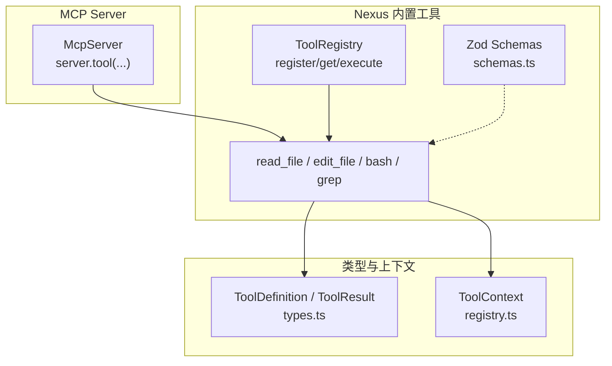
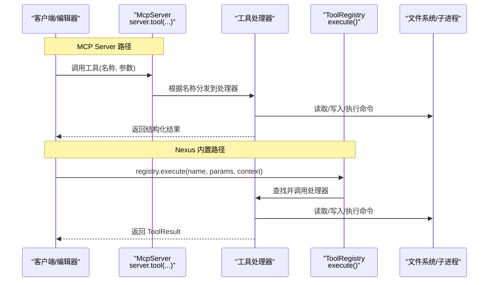
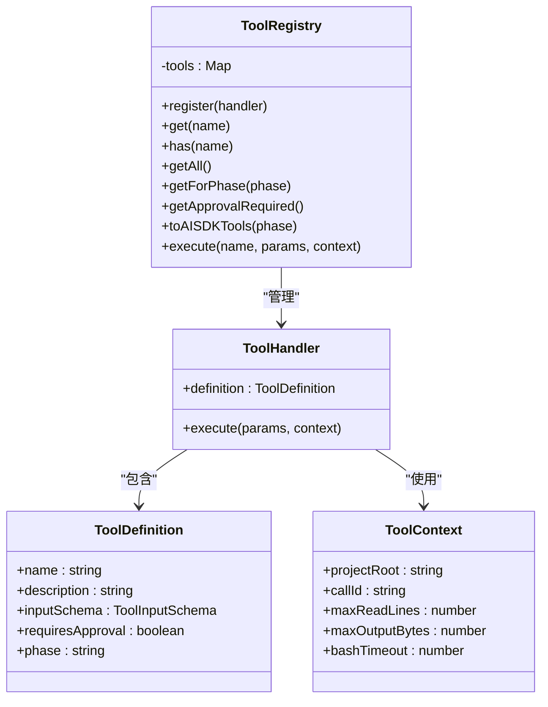
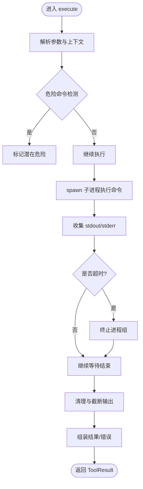
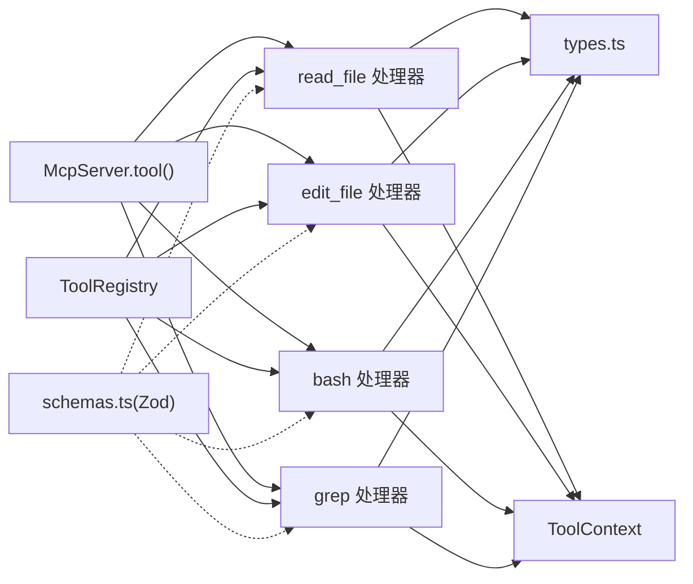

# 工具注册机制

<cite>
**本文引用的文件**
- [packages/nexus-mcp-server/src/index.ts](file://packages/nexus-mcp-server/src/index.ts)
- [src/tools/registry.ts](file://src/tools/registry.ts)
- [src/tools/schemas.ts](file://src/tools/schemas.ts)
- [src/tools/readFile.ts](file://src/tools/readFile.ts)
- [src/tools/editFile.ts](file://src/tools/editFile.ts)
- [src/tools/bash.ts](file://src/tools/bash.ts)
- [src/tools/grep.ts](file://src/tools/grep.ts)
- [src/tools/external.ts](file://src/tools/external.ts)
- [src/agent/types.ts](file://src/agent/types.ts)
- [tests/integration/tools.test.ts](file://tests/integration/tools.test.ts)
</cite>

## 目录
1. [简介](#简介)
2. [项目结构](#项目结构)
3. [核心组件](#核心组件)
4. [架构总览](#架构总览)
5. [详细组件分析](#详细组件分析)
6. [依赖关系分析](#依赖关系分析)
7. [性能与安全性考量](#性能与安全性考量)
8. [故障排查指南](#故障排查指南)
9. [结论](#结论)
10. [附录：Zod Schema 语法与最佳实践](#附录zod-schema-语法与最佳实践)

## 简介
本文件围绕 MCP 工具注册机制，系统性说明 server.tool() 的用法、工具元数据管理、参数 schema 定义（含 Zod）、处理器实现范式、以及版本控制策略。文档同时覆盖两类实现路径：
- 基于 @modelcontextprotocol/sdk 的 McpServer.tool() 注册方式（MCP Server）
- 基于内部 ToolRegistry 的注册与执行流程（Nexus 内置工具）

通过对比与对照，读者可快速理解如何在不同上下文中注册工具、定义参数校验、编写处理器函数，并安全地扩展新的工具类型。

## 项目结构
与工具注册相关的核心代码分布在以下位置：
- MCP Server 入口与工具注册：packages/nexus-mcp-server/src/index.ts
- 内部工具注册中心与上下文：src/tools/registry.ts
- 内置工具实现：src/tools/{readFile, editFile, bash, grep}.ts
- 工具输入参数的 Zod Schema 集中定义：src/tools/schemas.ts
- 外部 MCP Server 接入预留接口：src/tools/external.ts
- 共享类型定义（ToolDefinition、ToolResult 等）：src/agent/types.ts
- 集成测试用例：tests/integration/tools.test.ts

图表来源
- [packages/nexus-mcp-server/src/index.ts:112-356](file://packages/nexus-mcp-server/src/index.ts#L112-L356)
- [src/tools/registry.ts:25-93](file://src/tools/registry.ts#L25-L93)
- [src/tools/readFile.ts:11-35](file://src/tools/readFile.ts#L11-L35)
- [src/tools/editFile.ts:14-38](file://src/tools/editFile.ts#L14-L38)
- [src/tools/bash.ts:13-33](file://src/tools/bash.ts#L13-L33)
- [src/tools/grep.ts:11-43](file://src/tools/grep.ts#L11-L43)
- [src/tools/schemas.ts:8-31](file://src/tools/schemas.ts#L8-L31)
- [src/agent/types.ts:44-78](file://src/agent/types.ts#L44-L78)

章节来源
- [packages/nexus-mcp-server/src/index.ts:1-383](file://packages/nexus-mcp-server/src/index.ts#L1-L383)
- [src/tools/registry.ts:1-96](file://src/tools/registry.ts#L1-L96)
- [src/tools/schemas.ts:1-40](file://src/tools/schemas.ts#L1-L40)
- [src/tools/readFile.ts:1-150](file://src/tools/readFile.ts#L1-L150)
- [src/tools/editFile.ts:1-170](file://src/tools/editFile.ts#L1-L170)
- [src/tools/bash.ts:1-186](file://src/tools/bash.ts#L1-L186)
- [src/tools/grep.ts:1-178](file://src/tools/grep.ts#L1-L178)
- [src/tools/external.ts:1-76](file://src/tools/external.ts#L1-L76)
- [src/agent/types.ts:1-269](file://src/agent/types.ts#L1-L269)
- [tests/integration/tools.test.ts:1-100](file://tests/integration/tools.test.ts#L1-L100)

## 核心组件
- McpServer.tool() 注册器（MCP Server）
  - 使用 @modelcontextprotocol/sdk 提供的 server.tool(name, description, parametersSchema, handler) 完成工具注册。
  - parametersSchema 为 Zod schema，用于参数校验与 LLM 提示生成。
  - 处理器返回结构化结果 { content: [{ type: 'text', text }], isError }。

- ToolRegistry（Nexus 内置）
  - 维护工具处理器映射表，提供 register/get/has/getAll/getForPhase/getApprovalRequired/toAISDKTools/execute 等方法。
  - 支持按阶段过滤（plan/execute/both），并提供需要审批的工具列表。
  - 统一执行入口 execute(name, params, context)，返回 ToolResult。

- 工具处理器（Handler）
  - 每个工具包含 definition（名称、描述、输入 schema、是否需要审批、可用阶段）和 execute(params, context)。
  - 处理器负责参数解析、安全检查、I/O 或子进程调用、输出截断与错误封装。

- 工具上下文（ToolContext）
  - 包含 projectRoot、callId、maxReadLines、maxOutputBytes、bashTimeout 等运行时配置。

- 共享类型（ToolDefinition、ToolResult、ToolInputSchema、ToolProperty）
  - 定义工具元数据与输入 schema 的结构，确保各工具一致性与可扩展性。

章节来源
- [packages/nexus-mcp-server/src/index.ts:112-356](file://packages/nexus-mcp-server/src/index.ts#L112-L356)
- [src/tools/registry.ts:12-93](file://src/tools/registry.ts#L12-L93)
- [src/tools/readFile.ts:11-35](file://src/tools/readFile.ts#L11-L35)
- [src/tools/editFile.ts:14-38](file://src/tools/editFile.ts#L14-L38)
- [src/tools/bash.ts:13-33](file://src/tools/bash.ts#L13-L33)
- [src/tools/grep.ts:11-43](file://src/tools/grep.ts#L11-L43)
- [src/agent/types.ts:44-78](file://src/agent/types.ts#L44-L78)

## 架构总览
下图展示了两种工具注册路径及其交互关系：

图表来源
- [packages/nexus-mcp-server/src/index.ts:112-356](file://packages/nexus-mcp-server/src/index.ts#L112-L356)
- [src/tools/registry.ts:70-83](file://src/tools/registry.ts#L70-L83)

## 详细组件分析

### server.tool() 使用方法（MCP Server）
- 基本签名
  - server.tool(name, description, parametersSchema, handler)
  - name：工具唯一标识符
  - description：人类可读的描述，用于 LLM 选择工具
  - parametersSchema：Zod schema，用于参数校验与自动提示
  - handler：异步处理器，接收解构后的参数对象，返回 { content, isError }

- 示例工具
  - read_file：读取文件内容，支持行号格式化与行数截断
  - edit_file：精准替换字符串，要求唯一匹配，原子写入，保留 BOM 与行尾风格
  - bash：执行 shell 命令，带危险命令检测、超时、输出清理与截断
  - grep：基于 ripgrep 的代码搜索，支持正则、文件过滤、上下文行

- 返回值约定
  - 成功：{ content: [{ type: 'text', text }] }
  - 失败：{ content: [{ type: 'text', text }], isError: true }

章节来源
- [packages/nexus-mcp-server/src/index.ts:119-163](file://packages/nexus-mcp-server/src/index.ts#L119-L163)
- [packages/nexus-mcp-server/src/index.ts:167-224](file://packages/nexus-mcp-server/src/index.ts#L167-L224)
- [packages/nexus-mcp-server/src/index.ts:228-301](file://packages/nexus-mcp-server/src/index.ts#L228-L301)
- [packages/nexus-mcp-server/src/index.ts:305-356](file://packages/nexus-mcp-server/src/index.ts#L305-L356)

### 内部 ToolRegistry 注册与执行（Nexus 内置）
- 注册流程
  - createToolRegistry() 创建实例后，依次注册 readFileTool、editFileTool、bashTool、grepTool
  - 每个工具导出 ToolHandler = { definition, execute }

- 查询与过滤
  - getForPhase(phase)：按阶段过滤可用工具（plan/execute/both）
  - getApprovalRequired()：返回需要审批的工具名列表

- 执行流程
  - execute(name, params, context)：根据名称查找处理器并调用；未找到时返回“未知工具”错误

- 与 AI SDK 兼容
  - toAISDKTools(phase)：将内部工具转换为 Vercel AI SDK 兼容格式（description + parameters）

图表来源
- [src/tools/registry.ts:25-93](file://src/tools/registry.ts#L25-L93)
- [src/agent/types.ts:44-78](file://src/agent/types.ts#L44-L78)

章节来源
- [src/tools/registry.ts:85-93](file://src/tools/registry.ts#L85-L93)
- [src/tools/registry.ts:44-68](file://src/tools/registry.ts#L44-L68)
- [src/tools/registry.ts:70-83](file://src/tools/registry.ts#L70-L83)

### 工具处理器实现范式（以 bash 为例）
- 定义阶段
  - definition.name/description/inputSchema/requiresApproval/phase
  - inputSchema 采用 JSON Schema 风格（与内部类型一致）

- 执行逻辑
  - 解析参数与上下文（如 timeout、projectRoot、maxOutputBytes）
  - 安全检查（危险命令检测）
  - 工作目录锁定（cwd=projectRoot）
  - 子进程执行（spawn），处理 stdout/stderr、超时与进程组终止
  - 输出清理与截断，组装结果与错误信息

图表来源
- [src/tools/bash.ts:123-183](file://src/tools/bash.ts#L123-L183)
- [src/tools/bash.ts:42-109](file://src/tools/bash.ts#L42-L109)

章节来源
- [src/tools/bash.ts:13-33](file://src/tools/bash.ts#L13-L33)
- [src/tools/bash.ts:123-183](file://src/tools/bash.ts#L123-L183)

### 工具元数据管理与版本控制策略
- 元数据字段
  - name：工具唯一标识
  - description：面向用户的自然语言描述
  - inputSchema：JSON Schema 风格的参数定义（与内部类型一致）
  - requiresApproval：是否需要人工审批
  - phase：可用阶段（plan/execute/both）

- 版本控制建议
  - 在 McpServer 初始化时声明 version（例如 0.1.0），便于客户端识别能力
  - 对破坏性变更（schema 不兼容、行为变化）升级 major 版本
  - 新增可选参数或只读增强使用 minor 版本
  - 保持向后兼容的默认值与降级策略（如 rg 不可用时的回退）

章节来源
- [packages/nexus-mcp-server/src/index.ts:112-115](file://packages/nexus-mcp-server/src/index.ts#L112-L115)
- [src/agent/types.ts:44-50](file://src/agent/types.ts#L44-L50)

## 依赖关系分析
- 模块耦合
  - McpServer.tool() 直接依赖具体工具处理器（read_file/edit_file/bash/grep）
  - ToolRegistry 聚合所有内置工具处理器，并通过 execute 统一调度
  - 工具处理器依赖共享类型（ToolDefinition/ToolResult）与上下文（ToolContext）
  - schemas.ts 提供 Zod schema 集中定义，供 AI SDK 或其他场景复用

- 外部依赖
  - @modelcontextprotocol/sdk：MCP 协议与服务端能力
  - zod：参数校验与 schema 描述
  - fs/promises、child_process：文件与子进程操作

图表来源
- [packages/nexus-mcp-server/src/index.ts:112-356](file://packages/nexus-mcp-server/src/index.ts#L112-L356)
- [src/tools/registry.ts:25-93](file://src/tools/registry.ts#L25-L93)
- [src/tools/schemas.ts:8-31](file://src/tools/schemas.ts#L8-L31)
- [src/agent/types.ts:44-78](file://src/agent/types.ts#L44-L78)

章节来源
- [packages/nexus-mcp-server/src/index.ts:1-383](file://packages/nexus-mcp-server/src/index.ts#L1-L383)
- [src/tools/registry.ts:1-96](file://src/tools/registry.ts#L1-L96)
- [src/tools/schemas.ts:1-40](file://src/tools/schemas.ts#L1-L40)
- [src/agent/types.ts:1-269](file://src/agent/types.ts#L1-L269)

## 性能与安全性考量
- 性能
  - 大文件读取：read_file 支持范围读取与行数截断，避免一次性加载超大文件
  - 输出截断：bash/grep 均限制最大输出字节数，防止响应过大
  - 子进程管理：bash 使用进程组终止与超时控制，避免僵尸进程

- 安全性
  - 路径越界检查：read_file/edit_file 严格限定在项目根目录下
  - 危险命令检测：bash 工具内联规则拦截高风险命令（删除根目录、格式化磁盘、远程执行等）
  - 原子写入：edit_file 使用临时文件+rename，保证写入一致性
  - 二进制防护：read_file 拒绝二进制文件，避免乱码与资源浪费

章节来源
- [src/tools/readFile.ts:54-96](file://src/tools/readFile.ts#L54-L96)
- [src/tools/editFile.ts:61-101](file://src/tools/editFile.ts#L61-L101)
- [src/tools/bash.ts:123-183](file://src/tools/bash.ts#L123-L183)
- [packages/nexus-mcp-server/src/index.ts:27-66](file://packages/nexus-mcp-server/src/index.ts#L27-L66)

## 故障排查指南
- 常见错误与定位
  - 未知工具：ToolRegistry.execute 返回“未知工具”，检查工具名是否正确注册
  - 路径越界：read_file/edit_file 报错“路径越界”，确认相对路径是否在 projectRoot 内
  - 匹配不唯一：edit_file 报“匹配不唯一”，增加上下文行以确保唯一匹配
  - 未找到匹配：edit_file 报“未找到匹配”，重新读取最新文件内容后再编辑
  - ripgrep 不可用：grep 返回错误提示安装 rg，按提示安装或调整搜索策略
  - 命令超时：bash 返回超时信息，适当增大 timeout 或优化命令

- 调试建议
  - 启用更详细的日志输出（stdout/stderr）
  - 缩小搜索范围（grep 的 path/include/context_lines）
  - 分步验证：先 read_file 确认内容，再 edit_file 进行替换
  - 使用集成测试复现问题（参考 tests/integration/tools.test.ts）

章节来源
- [src/tools/registry.ts:70-83](file://src/tools/registry.ts#L70-L83)
- [src/tools/readFile.ts:64-96](file://src/tools/readFile.ts#L64-L96)
- [src/tools/editFile.ts:113-129](file://src/tools/editFile.ts#L113-L129)
- [src/tools/grep.ts:120-145](file://src/tools/grep.ts#L120-L145)
- [src/tools/bash.ts:151-173](file://src/tools/bash.ts#L151-L173)
- [tests/integration/tools.test.ts:36-98](file://tests/integration/tools.test.ts#L36-L98)

## 结论
- server.tool() 提供了简洁而强大的工具注册方式，结合 Zod schema 可实现强类型参数校验与 LLM 友好提示。
- ToolRegistry 为 Nexus 内置工具提供了统一的注册、过滤与执行框架，便于扩展与维护。
- 通过严格的元数据定义与安全策略，系统在保证功能的同时兼顾了可靠性与可观测性。
- 建议在新增工具时遵循现有范式：明确元数据、完善 schema、实现健壮处理器、补充测试用例。

## 附录：Zod Schema 语法与最佳实践
- 数据类型
  - z.string()、z.number()、z.boolean()、z.array()、z.object()
- 验证规则
  - .describe('...')：为字段添加描述，便于 LLM 理解
  - .optional()：标记可选参数
  - .default(value)：设置默认值（MCP Server 中常用）
  - .min()/max()、.regex()：数值与字符串约束
- 组合与嵌套
  - z.object({ ... })：定义对象型参数
  - z.array(z.string())：数组元素类型约束
- 最佳实践
  - 为每个字段提供清晰的 describe，提升 LLM 选择工具的准确性
  - 合理使用 optional/default，降低调用方负担
  - 对敏感参数（如 command/path）增加额外校验与安全检查
  - 将常用 schema 集中管理（schemas.ts），提高复用性与一致性

章节来源
- [packages/nexus-mcp-server/src/index.ts:119-163](file://packages/nexus-mcp-server/src/index.ts#L119-L163)
- [packages/nexus-mcp-server/src/index.ts:167-224](file://packages/nexus-mcp-server/src/index.ts#L167-L224)
- [packages/nexus-mcp-server/src/index.ts:228-301](file://packages/nexus-mcp-server/src/index.ts#L228-L301)
- [packages/nexus-mcp-server/src/index.ts:305-356](file://packages/nexus-mcp-server/src/index.ts#L305-L356)
- [src/tools/schemas.ts:8-31](file://src/tools/schemas.ts#L8-L31)