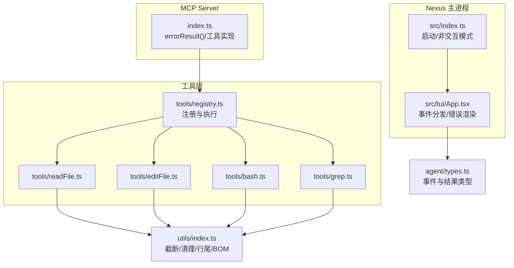
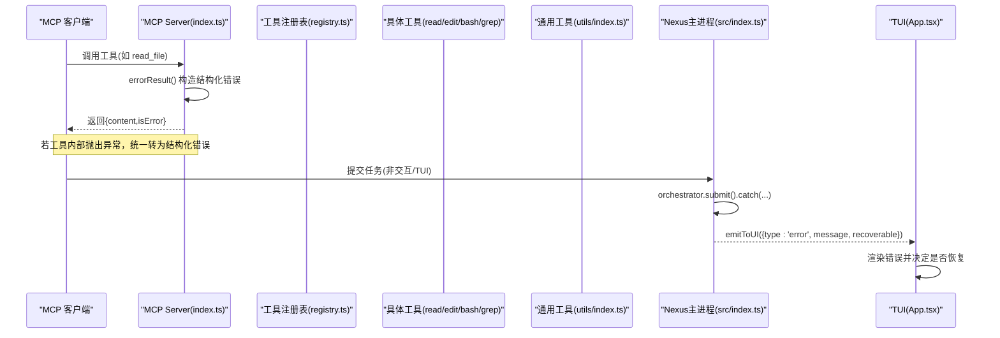
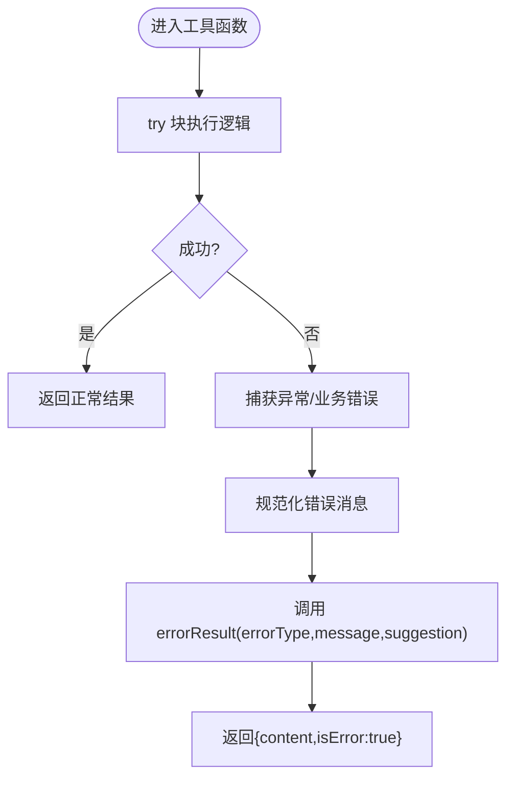
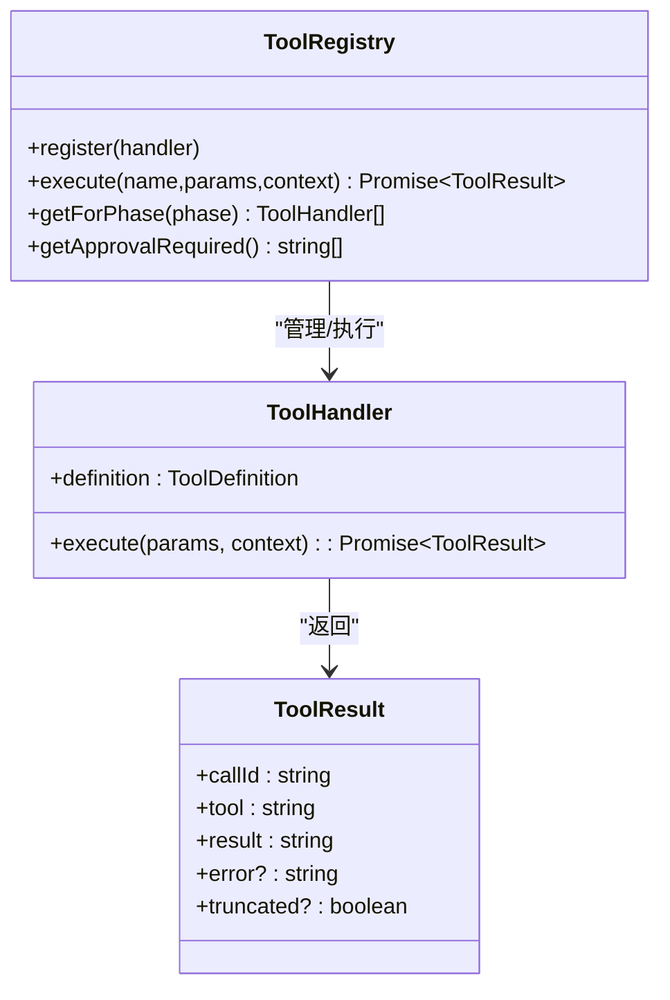
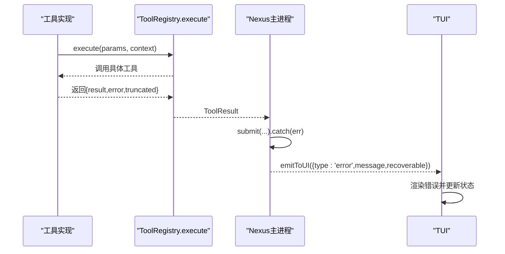
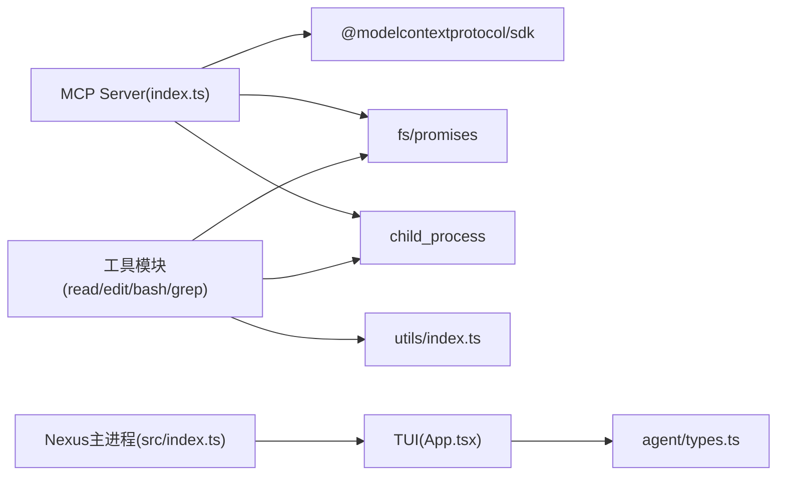

# 错误处理与调试

<cite>
**本文引用的文件**   
- [packages/nexus-mcp-server/src/index.ts](file://packages/nexus-mcp-server/src/index.ts)
- [src/index.ts](file://src/index.ts)
- [src/tui/App.tsx](file://src/tui/App.tsx)
- [src/agent/types.ts](file://src/agent/types.ts)
- [src/tools/registry.ts](file://src/tools/registry.ts)
- [src/tools/readFile.ts](file://src/tools/readFile.ts)
- [src/tools/editFile.ts](file://src/tools/editFile.ts)
- [src/tools/bash.ts](file://src/tools/bash.ts)
- [src/tools/grep.ts](file://src/tools/grep.ts)
- [src/utils/index.ts](file://src/utils/index.ts)
</cite>

## 目录
1. [简介](#简介)
2. [项目结构](#项目结构)
3. [核心组件](#核心组件)
4. [架构总览](#架构总览)
5. [详细组件分析](#详细组件分析)
6. [依赖关系分析](#依赖关系分析)
7. [性能考量](#性能考量)
8. [故障排查指南](#故障排查指南)
9. [结论](#结论)
10. [附录](#附录)

## 简介
本文件面向 MCP Server 与 Nexus TUI 的错误处理与调试机制，系统性梳理结构化错误返回格式、错误类型分类、消息标准化策略；详解 errorResult() 的使用方式与自定义错误扩展；说明异常捕获、错误传播与降级方案；并提供调试技巧、日志规范与常见问题的解决方案。目标是帮助开发者快速定位问题、统一错误表达、提升可观测性与稳定性。

## 项目结构
MCP Server 以 stdio 传输暴露工具（read_file、edit_file、bash、grep），每个工具内部实现统一的错误返回格式；Nexus 主进程通过事件系统向 TUI 推送错误事件，TUI 负责渲染与用户交互。工具层与注册中心解耦，便于扩展与测试。

图表来源
- [packages/nexus-mcp-server/src/index.ts:104-108](file://packages/nexus-mcp-server/src/index.ts#L104-L108)
- [src/index.ts:91-108](file://src/index.ts#L91-L108)
- [src/tui/App.tsx:168-176](file://src/tui/App.tsx#L168-L176)
- [src/tools/registry.ts:70-82](file://src/tools/registry.ts#L70-L82)
- [src/tools/readFile.ts:54-146](file://src/tools/readFile.ts#L54-L146)
- [src/tools/editFile.ts:61-156](file://src/tools/editFile.ts#L61-L156)
- [src/tools/bash.ts:123-183](file://src/tools/bash.ts#L123-L183)
- [src/tools/grep.ts:80-175](file://src/tools/grep.ts#L80-L175)
- [src/utils/index.ts:166-180](file://src/utils/index.ts#L166-L180)
- [src/agent/types.ts:8-22](file://src/agent/types.ts#L8-L22)

章节来源
- [packages/nexus-mcp-server/src/index.ts:104-108](file://packages/nexus-mcp-server/src/index.ts#L104-L108)
- [src/index.ts:91-108](file://src/index.ts#L91-L108)
- [src/tui/App.tsx:168-176](file://src/tui/App.tsx#L168-L176)
- [src/tools/registry.ts:70-82](file://src/tools/registry.ts#L70-L82)
- [src/tools/readFile.ts:54-146](file://src/tools/readFile.ts#L54-L146)
- [src/tools/editFile.ts:61-156](file://src/tools/editFile.ts#L61-L156)
- [src/tools/bash.ts:123-183](file://src/tools/bash.ts#L123-L183)
- [src/tools/grep.ts:80-175](file://src/tools/grep.ts#L80-L175)
- [src/utils/index.ts:166-180](file://src/utils/index.ts#L166-L180)
- [src/agent/types.ts:8-22](file://src/agent/types.ts#L8-L22)

## 核心组件
- 结构化错误返回：errorResult() 统一封装 { content, isError }，为所有 MCP 工具提供一致的错误语义。
- 工具注册与执行：ToolRegistry 集中管理工具定义与执行，未知工具会返回明确的错误信息。
- 事件与类型：NexusEvent 包含 error 事件，支持 recoverable 标记，TUI 据此决定 UI 状态恢复。
- 通用工具函数：utils/index.ts 提供 Result 类型、截断策略、二进制输出清理、BOM/行尾处理等。

章节来源
- [packages/nexus-mcp-server/src/index.ts:104-108](file://packages/nexus-mcp-server/src/index.ts#L104-L108)
- [src/tools/registry.ts:70-82](file://src/tools/registry.ts#L70-L82)
- [src/agent/types.ts:8-22](file://src/agent/types.ts#L8-L22)
- [src/utils/index.ts:9-35](file://src/utils/index.ts#L9-L35)

## 架构总览
下图展示了从 MCP 客户端到工具执行的错误流，以及 TUI 对错误的展示与恢复控制。

图表来源
- [packages/nexus-mcp-server/src/index.ts:104-108](file://packages/nexus-mcp-server/src/index.ts#L104-L108)
- [src/tools/registry.ts:70-82](file://src/tools/registry.ts#L70-L82)
- [src/index.ts:91-108](file://src/index.ts#L91-L108)
- [src/tui/App.tsx:168-176](file://src/tui/App.tsx#L168-L176)

## 详细组件分析

### 结构化错误与 errorResult()
- 作用：将错误类型、消息与建议拼装为标准文本，并以 { content:[{type:'text', text}], isError:true } 返回。
- 使用位置：MCP Server 中各工具 catch 分支或业务校验失败时调用。
- 扩展建议：新增错误类型只需在 errorResult() 调用处传入新的 errorType 与可选 suggestion。

图表来源
- [packages/nexus-mcp-server/src/index.ts:104-108](file://packages/nexus-mcp-server/src/index.ts#L104-L108)
- [packages/nexus-mcp-server/src/index.ts:157-161](file://packages/nexus-mcp-server/src/index.ts#L157-L161)
- [packages/nexus-mcp-server/src/index.ts:218-222](file://packages/nexus-mcp-server/src/index.ts#L218-L222)
- [packages/nexus-mcp-server/src/index.ts:296-299](file://packages/nexus-mcp-server/src/index.ts#L296-L299)
- [packages/nexus-mcp-server/src/index.ts:351-354](file://packages/nexus-mcp-server/src/index.ts#L351-L354)

章节来源
- [packages/nexus-mcp-server/src/index.ts:104-108](file://packages/nexus-mcp-server/src/index.ts#L104-L108)

### 工具层错误分类与标准化
- read_file
  - 路径越界、二进制文件、范围读取、行数截断、IO 异常均返回结构化错误。
- edit_file
  - 文件不存在、匹配不唯一、原子写入失败、格式保留（BOM/行尾）失败等均有明确错误码与提示。
- bash
  - 危险命令检测、超时、进程组终止、输出截断、子进程错误均被捕获并标准化。
- grep
  - ripgrep 缺失、无匹配、搜索错误、结果过大截断等场景均有清晰反馈。

图表来源
- [src/tools/registry.ts:25-83](file://src/tools/registry.ts#L25-L83)
- [src/agent/types.ts:66-78](file://src/agent/types.ts#L66-L78)

章节来源
- [src/tools/readFile.ts:54-146](file://src/tools/readFile.ts#L54-L146)
- [src/tools/editFile.ts:61-156](file://src/tools/editFile.ts#L61-L156)
- [src/tools/bash.ts:123-183](file://src/tools/bash.ts#L123-L183)
- [src/tools/grep.ts:80-175](file://src/tools/grep.ts#L80-L175)
- [src/tools/registry.ts:70-82](file://src/tools/registry.ts#L70-L82)

### 异常捕获策略与错误传播
- 工具层：每个工具 try/catch 包裹，统一将异常转换为结构化错误，避免未捕获异常泄漏。
- 主进程：submit() 的 .catch() 捕获后通过 emitToUI 推送 error 事件，TUI 根据 recoverable 决定是否继续。
- 事件模型：NexusEvent.error.message 承载人类可读信息，recoverable 控制 UI 是否恢复空闲态。

图表来源
- [src/tools/registry.ts:70-82](file://src/tools/registry.ts#L70-L82)
- [src/index.ts:91-108](file://src/index.ts#L91-L108)
- [src/tui/App.tsx:168-176](file://src/tui/App.tsx#L168-L176)
- [src/agent/types.ts:8-22](file://src/agent/types.ts#L8-L22)

章节来源
- [src/index.ts:91-108](file://src/index.ts#L91-L108)
- [src/tui/App.tsx:168-176](file://src/tui/App.tsx#L168-L176)
- [src/agent/types.ts:8-22](file://src/agent/types.ts#L8-L22)

### 降级处理方案
- grep 工具：当 rg 不可用（exit code 127）时，返回安装提示，上层可引导用户安装或回退到其他搜索方式。
- bash 工具：超时自动终止进程组，输出按尾部截断保留错误信息，确保关键诊断信息可见。
- read_file/edit_file：大文件/长输出采用头部或尾部截断策略，避免内存与带宽压力。

章节来源
- [src/tools/grep.ts:120-128](file://src/tools/grep.ts#L120-L128)
- [src/tools/bash.ts:111-121](file://src/tools/bash.ts#L111-L121)
- [src/tools/readFile.ts:114-130](file://src/tools/readFile.ts#L114-L130)
- [src/utils/index.ts:68-110](file://src/utils/index.ts#L68-L110)
- [src/utils/index.ts:116-154](file://src/utils/index.ts#L116-L154)

### 自定义错误类型扩展
- 在 MCP Server 中新增 PathError 类用于路径安全校验，统一归类 PATH_ERROR。
- 建议在工具层定义领域错误类（如 FileNotFound、PermissionDenied），并在 catch 分支映射为 errorResult() 的 errorType。
- 保持 errorType 稳定，便于上游解析与告警规则配置。

章节来源
- [packages/nexus-mcp-server/src/index.ts:28-41](file://packages/nexus-mcp-server/src/index.ts#L28-L41)
- [packages/nexus-mcp-server/src/index.ts:157-161](file://packages/nexus-mcp-server/src/index.ts#L157-L161)

## 依赖关系分析
- MCP Server 依赖 @modelcontextprotocol/sdk 进行工具注册与 stdio 通信。
- 工具层依赖 Node.js fs/promises、child_process、path 等标准库。
- utils/index.ts 被多个工具复用，提供一致的截断、清理与编码处理。
- TUI 依赖 Ink/React 渲染事件，并通过全局事件总线接收错误事件。

图表来源
- [packages/nexus-mcp-server/src/index.ts:11-16](file://packages/nexus-mcp-server/src/index.ts#L11-L16)
- [src/tools/readFile.ts:6-9](file://src/tools/readFile.ts#L6-L9)
- [src/tools/editFile.ts:7-12](file://src/tools/editFile.ts#L7-L12)
- [src/tools/bash.ts:6-11](file://src/tools/bash.ts#L6-L11)
- [src/tools/grep.ts:6-9](file://src/tools/grep.ts#L6-L9)
- [src/index.ts:7-14](file://src/index.ts#L7-L14)
- [src/tui/App.tsx:6-18](file://src/tui/App.tsx#L6-L18)
- [src/agent/types.ts:8-22](file://src/agent/types.ts#L8-L22)

章节来源
- [packages/nexus-mcp-server/src/index.ts:11-16](file://packages/nexus-mcp-server/src/index.ts#L11-L16)
- [src/tools/readFile.ts:6-9](file://src/tools/readFile.ts#L6-L9)
- [src/tools/editFile.ts:7-12](file://src/tools/editFile.ts#L7-L12)
- [src/tools/bash.ts:6-11](file://src/tools/bash.ts#L6-L11)
- [src/tools/grep.ts:6-9](file://src/tools/grep.ts#L6-L9)
- [src/index.ts:7-14](file://src/index.ts#L7-L14)
- [src/tui/App.tsx:6-18](file://src/tui/App.tsx#L6-L18)
- [src/agent/types.ts:8-22](file://src/agent/types.ts#L8-L22)

## 性能考量
- 输出截断：read_file 使用头部截断，bash 使用尾部截断，兼顾可读性与错误可见性。
- 二进制清理：sanitizeBinaryOutput 去除控制字符，防止终端渲染异常与内存膨胀。
- 原子写入：edit_file 写临时文件再 rename，降低并发写入风险。
- 子进程隔离：bash 使用独立进程组与超时控制，避免僵尸进程与资源泄露。

章节来源
- [src/utils/index.ts:68-110](file://src/utils/index.ts#L68-L110)
- [src/utils/index.ts:116-154](file://src/utils/index.ts#L116-L154)
- [src/utils/index.ts:166-180](file://src/utils/index.ts#L166-L180)
- [src/tools/editFile.ts:52-59](file://src/tools/editFile.ts#L52-L59)
- [src/tools/bash.ts:42-89](file://src/tools/bash.ts#L42-L89)

## 故障排查指南
- 常见问题与定位
  - 路径越界：检查 assertPathSafe/fullPath.startsWith(projectRoot)，确认相对路径正确。
  - 二进制文件：read_file 检测到 null 字节即拒绝，需改用其他工具或转换格式。
  - 匹配不唯一：edit_file 要求 old_string 唯一，增加上下文行或使用更精确的替换串。
  - ripgrep 缺失：grep 工具 exit code 127，安装 rg 或回退策略。
  - 命令超时：bash 工具超时后终止进程组，查看 stderr 末尾错误信息。
- 日志与调试
  - MCP Server 启动日志：stdio 启动时会打印运行环境与可用工具列表。
  - TUI 错误渲染：error 事件携带 recoverable 标志，非可恢复错误会停止忙碌状态。
  - 输出清理：sanitizeBinaryOutput 保证终端显示稳定，便于观察真实错误。
- 建议实践
  - 统一使用 errorResult() 返回结构化错误，避免直接 throw 导致上层无法解析。
  - 为每个工具定义清晰的 errorType，便于监控与告警。
  - 对可能失败的 IO/子进程操作设置超时与大小限制，防止资源耗尽。

章节来源
- [packages/nexus-mcp-server/src/index.ts:157-161](file://packages/nexus-mcp-server/src/index.ts#L157-L161)
- [packages/nexus-mcp-server/src/index.ts:218-222](file://packages/nexus-mcp-server/src/index.ts#L218-L222)
- [packages/nexus-mcp-server/src/index.ts:296-299](file://packages/nexus-mcp-server/src/index.ts#L296-L299)
- [packages/nexus-mcp-server/src/index.ts:351-354](file://packages/nexus-mcp-server/src/index.ts#L351-L354)
- [src/tools/readFile.ts:64-96](file://src/tools/readFile.ts#L64-L96)
- [src/tools/editFile.ts:113-129](file://src/tools/editFile.ts#L113-L129)
- [src/tools/grep.ts:120-145](file://src/tools/grep.ts#L120-L145)
- [src/tools/bash.ts:151-165](file://src/tools/bash.ts#L151-L165)
- [src/index.ts:91-108](file://src/index.ts#L91-L108)
- [src/tui/App.tsx:168-176](file://src/tui/App.tsx#L168-L176)
- [src/utils/index.ts:166-180](file://src/utils/index.ts#L166-L180)

## 结论
本项目在 MCP Server 与 TUI 两端实现了完善的错误处理与调试机制：通过 errorResult() 统一错误表达、工具层严格捕获与分类、主进程与 TUI 的事件化传播与恢复控制，辅以通用的截断、清理与原子写入能力，显著提升了稳定性与可观测性。建议后续持续完善错误类型体系、增强监控与告警，并结合用户反馈优化错误提示的可操作性。

## 附录
- 错误类型速查（示例）
  - PATH_ERROR：路径越界
  - BINARY_FILE：二进制文件拒绝
  - FILE_NOT_FOUND：文件不存在
  - NO_MATCH/MULTIPLE_MATCH：编辑匹配失败
  - DANGEROUS_COMMAND：危险命令拦截
  - EXEC_ERROR：命令执行失败
  - TOOL_MISSING：外部工具缺失
  - SEARCH_ERROR：搜索错误
- 调试清单
  - 确认工具参数与路径相对项目根目录
  - 检查外部依赖（如 rg）是否安装
  - 关注超时与输出大小限制
  - 利用 TUI 错误事件与 recoverable 标志判断恢复策略