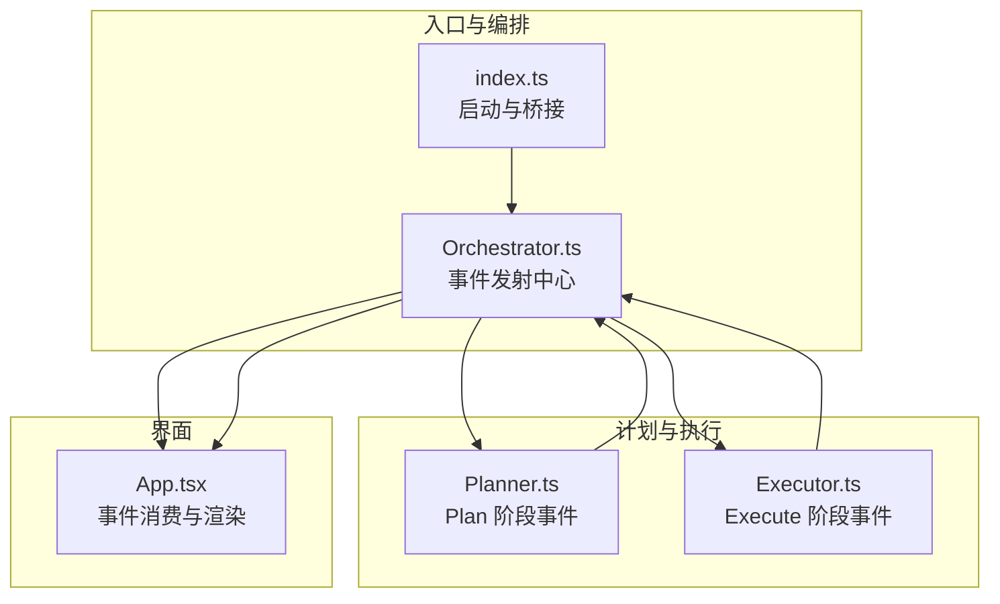
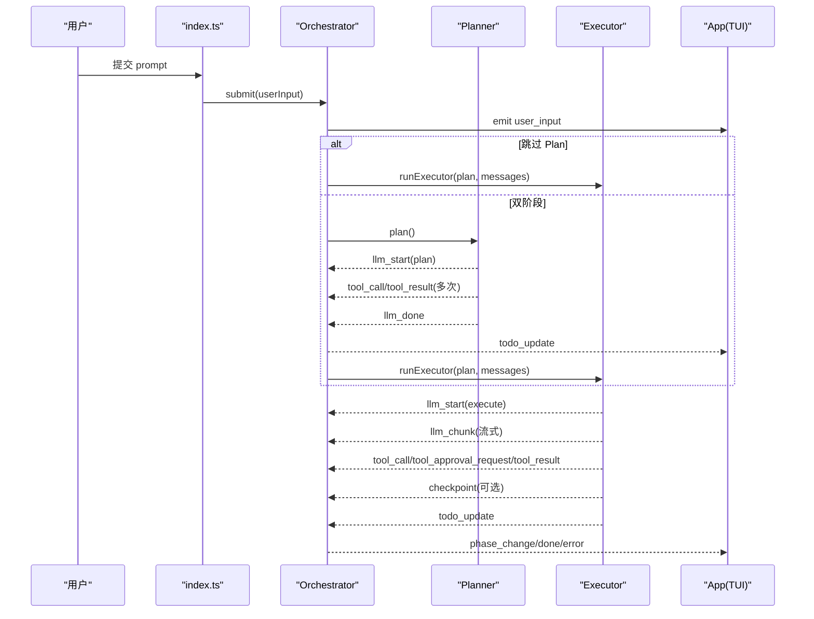
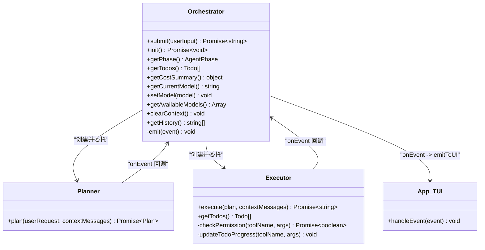

# 事件系统接口

<cite>
**本文引用的文件**   
- [src/agent/types.ts](file://src/agent/types.ts)
- [src/index.ts](file://src/index.ts)
- [src/tui/App.tsx](file://src/tui/App.tsx)
- [src/agent/Orchestrator.ts](file://src/agent/Orchestrator.ts)
- [src/agent/Planner.ts](file://src/agent/Planner.ts)
- [src/agent/Executor.ts](file://src/agent/Executor.ts)
- [src/router/CostTracker.ts](file://src/router/CostTracker.ts)
- [src/sandbox/Checkpoint.ts](file://src/sandbox/Checkpoint.ts)
</cite>

## 目录
1. [简介](#简介)
2. [项目结构](#项目结构)
3. [核心组件](#核心组件)
4. [架构总览](#架构总览)
5. [详细组件分析](#详细组件分析)
6. [依赖关系分析](#依赖关系分析)
7. [性能与实时性建议](#性能与实时性建议)
8. [故障排查指南](#故障排查指南)
9. [结论](#结论)
10. [附录：事件类型参考](#附录事件类型参考)

## 简介
本文件为 Nexus 事件系统的 API 文档，聚焦于 NexusEvent 类型及其在系统中的触发时机、数据结构与处理流程。内容覆盖用户输入、大模型调用、工具调用与审批、任务进度、检查点、成本更新、阶段切换、完成与错误等事件；并提供订阅与发布示例路径、生命周期管理、错误处理机制、TUI 展示方式以及实时监听的最佳实践与优化建议。

## 项目结构
Nexus 的事件系统围绕 Orchestrator 编排器统一对外暴露 onEvent 回调，内部由 Planner 与 Executor 在各自阶段产生事件，最终通过 index.ts 桥接到 TUI 的 App 组件进行渲染。

图表来源
- [src/index.ts:45-63](file://src/index.ts#L45-L63)
- [src/agent/Orchestrator.ts:28-36](file://src/agent/Orchestrator.ts#L28-L36)
- [src/agent/Planner.ts:40-46](file://src/agent/Planner.ts#L40-L46)
- [src/agent/Executor.ts:29-39](file://src/agent/Executor.ts#L29-L39)
- [src/tui/App.tsx:107-176](file://src/tui/App.tsx#L107-L176)

章节来源
- [src/index.ts:18-113](file://src/index.ts#L18-L113)
- [src/agent/Orchestrator.ts:88-118](file://src/agent/Orchestrator.ts#L88-L118)
- [src/agent/Planner.ts:55-137](file://src/agent/Planner.ts#L55-L137)
- [src/agent/Executor.ts:50-165](file://src/agent/Executor.ts#L50-L165)
- [src/tui/App.tsx:46-176](file://src/tui/App.tsx#L46-L176)

## 核心组件
- Orchestrator：统一接收并转发事件（onEvent），协调 Plan/Execute 两阶段，维护 AgentPhase、Todo、历史消息等状态。
- Planner：在规划阶段产生 llm_start、tool_call、tool_result、llm_done、todo_update 等事件。
- Executor：在执行阶段产生 llm_start、llm_chunk、tool_call、tool_approval_request、tool_result、checkpoint、todo_update、error 等事件。
- App（TUI）：订阅事件并更新 UI（消息列表、流式文本、工具卡片、Todo 进度、审批弹窗、状态栏）。
- CostTracker：记录 token 与费用，供上层汇总展示（当前未直接推送 cost_update 事件，但提供数据源）。
- CheckpointManager：在 edit_file 成功后创建 Git 检查点，并通过 checkpoint 事件通知。

章节来源
- [src/agent/Orchestrator.ts:38-58](file://src/agent/Orchestrator.ts#L38-L58)
- [src/agent/Planner.ts:48-53](file://src/agent/Planner.ts#L48-L53)
- [src/agent/Executor.ts:41-48](file://src/agent/Executor.ts#L41-L48)
- [src/tui/App.tsx:46-58](file://src/tui/App.tsx#L46-L58)
- [src/router/CostTracker.ts:8-12](file://src/router/CostTracker.ts#L8-L12)
- [src/sandbox/Checkpoint.ts:30-40](file://src/sandbox/Checkpoint.ts#L30-L40)

## 架构总览
下图展示了从用户输入到事件分发、再到 TUI 渲染的关键时序。

图表来源
- [src/index.ts:79-110](file://src/index.ts#L79-L110)
- [src/agent/Orchestrator.ts:120-180](file://src/agent/Orchestrator.ts#L120-L180)
- [src/agent/Planner.ts:55-137](file://src/agent/Planner.ts#L55-L137)
- [src/agent/Executor.ts:50-165](file://src/agent/Executor.ts#L50-L165)
- [src/tui/App.tsx:107-176](file://src/tui/App.tsx#L107-L176)

## 详细组件分析

### 事件类型定义与语义
NexusEvent 是系统内所有事件的联合类型，包含以下变体（字段以 TypeScript 类型为准）：
- user_input：用户输入事件，携带 text。
- llm_start：大模型调用开始，phase 为 plan 或 execute。
- llm_chunk：流式输出片段，text 为增量文本。
- llm_done：一次 LLM 调用结束，text 为完整结果。
- tool_call：工具调用发起，包含 tool、params、callId。
- tool_approval_request：需要人工审批的工具调用，包含 callId、tool、params、diff。
- tool_result：工具执行结果，包含 callId、tool、result、error。
- todo_update：任务清单更新，todos 数组。
- checkpoint：检查点创建成功，step、message。
- cost_update：成本更新（类型已定义，当前实现中未见直接推送，见“成本更新”小节说明）。
- phase_change：Agent 阶段变化，phase 枚举值。
- done：会话完成，summary 为总结。
- error：错误事件，message、recoverable 表示是否可恢复。

章节来源
- [src/agent/types.ts:8-21](file://src/agent/types.ts#L8-L21)

### 事件触发时机与数据来源
- user_input：Orchestrator.submit 入口处发出。
- llm_start：Planner.plan 与 Executor.execute 开始时分别以 phase=plan/execute 发出。
- llm_chunk：Executor 在生成文本时逐块发出（用于流式显示）。
- llm_done：Planner.plan 解析完成后发出。
- tool_call / tool_result：Planner 与 Executor 在调用工具前后发出。
- tool_approval_request：当工具需要审批且权限模式要求时，由 Executor.checkPermission 触发（具体实现路径见下节）。
- todo_update：Planner 产出计划后、Executor 推进步骤时发出。
- checkpoint：Executor 在 edit_file 成功后由 CheckpointManager.create 返回检查点时发出。
- cost_update：类型存在，当前未在关键路径中直接推送；如需实时展示，可在 ModelRouter 或 CostTracker 记录后向上层广播。
- phase_change：Orchestrator.setPhase 内部发出。
- done：Orchestrator.submit 结束时发出。
- error：Executor 达到迭代上限或其他异常路径发出。

章节来源
- [src/agent/Orchestrator.ts:88-118](file://src/agent/Orchestrator.ts#L88-L118)
- [src/agent/Orchestrator.ts:251-258](file://src/agent/Orchestrator.ts#L251-L258)
- [src/agent/Planner.ts:55-137](file://src/agent/Planner.ts#L55-L137)
- [src/agent/Executor.ts:50-165](file://src/agent/Executor.ts#L50-L165)
- [src/sandbox/Checkpoint.ts:72-116](file://src/sandbox/Checkpoint.ts#L72-L116)

### 事件订阅与发布示例（路径指引）
- 发布端（上游）
  - Orchestrator 构造函数接收 onEvent 回调，内部通过 this.emit(event) 转发。
  - Planner 与 Executor 构造时接收 onEvent，并在相应逻辑处调用。
- 订阅端（下游）
  - index.ts 将 Orchestrator.onEvent 绑定到 TUI 的 emitToUI。
  - App.tsx 注册全局处理器 __nexusEventHandler，emitToUI 会调用该处理器。

示例路径（不含代码内容）：
- 发布：[src/agent/Orchestrator.ts:256-258](file://src/agent/Orchestrator.ts#L256-L258)
- 订阅桥接：[src/index.ts:51-53](file://src/index.ts#L51-L53)
- 订阅注册：[src/tui/App.tsx:180-183](file://src/tui/App.tsx#L180-L183)
- 分发函数：[src/tui/App.tsx:279-283](file://src/tui/App.tsx#L279-L283)

章节来源
- [src/agent/Orchestrator.ts:28-36](file://src/agent/Orchestrator.ts#L28-L36)
- [src/agent/Planner.ts:40-46](file://src/agent/Planner.ts#L40-L46)
- [src/agent/Executor.ts:29-39](file://src/agent/Executor.ts#L29-L39)
- [src/index.ts:45-63](file://src/index.ts#L45-L63)
- [src/tui/App.tsx:180-183](file://src/tui/App.tsx#L180-L183)
- [src/tui/App.tsx:279-283](file://src/tui/App.tsx#L279-L283)

### 事件流的生命周期管理
- 启动：index.ts 加载配置、创建 Orchestrator，并将 onEvent 注入到 TUI。
- 运行：submit 触发 user_input → 进入 Plan/Execute → 各阶段产生对应事件 → 最终 done。
- 中断：abort 设置标志位，后续分支判断避免继续执行。
- 回滚：undo 调用 CheckpointManager.undo 回退到上一个检查点。
- 退出：等待 TUI 退出信号。

章节来源
- [src/index.ts:18-113](file://src/index.ts#L18-L113)
- [src/agent/Orchestrator.ts:182-190](file://src/agent/Orchestrator.ts#L182-L190)
- [src/sandbox/Checkpoint.ts:118-137](file://src/sandbox/Checkpoint.ts#L118-L137)

### 错误处理机制
- 可恢复错误：error.recoverable=true 时不终止交互，允许继续。
- 不可恢复错误：error.recoverable=false 时停止忙碌状态，提示用户。
- 迭代上限：Executor 达到最大迭代次数时发出错误事件。
- 工具拒绝：当工具被拒绝时，向 LLM 反馈拒绝信息，引导其调整策略。

章节来源
- [src/agent/Executor.ts:157-165](file://src/agent/Executor.ts#L157-L165)
- [src/agent/Executor.ts:112-119](file://src/agent/Executor.ts#L112-L119)
- [src/tui/App.tsx:168-175](file://src/tui/App.tsx#L168-L175)

### 在 TUI 中的处理与展示
- 消息列表：llm_done 追加助手消息；error 追加系统提示。
- 流式输出：llm_chunk 拼接 streamingText 实时显示。
- 工具卡片：tool_call 新增卡片，tool_result 更新状态与结果/错误。
- Todo 进度：todo_update 驱动进度条更新。
- 审批弹窗：tool_approval_request 由外部回调处理（当前简化实现中暂不阻塞 UI）。
- 状态栏：phase_change 更新状态文案；done 重置忙碌状态。

章节来源
- [src/tui/App.tsx:107-176](file://src/tui/App.tsx#L107-L176)

### 成本更新（cost_update）现状与建议
- 现状：CostTracker 负责累计 token 与费用，但未在当前主路径中推送 cost_update 事件。
- 建议：在 ModelRouter 或相关调用处记录后，周期性或增量地通过 onEvent 推送 cost_update，以便 TUI 实时展示。

章节来源
- [src/router/CostTracker.ts:14-42](file://src/router/CostTracker.ts#L14-L42)
- [src/agent/types.ts:18](file://src/agent/types.ts#L18-L18)

## 依赖关系分析

图表来源
- [src/agent/Orchestrator.ts:38-58](file://src/agent/Orchestrator.ts#L38-L58)
- [src/agent/Planner.ts:48-53](file://src/agent/Planner.ts#L48-L53)
- [src/agent/Executor.ts:41-48](file://src/agent/Executor.ts#L41-L48)
- [src/tui/App.tsx:107-176](file://src/tui/App.tsx#L107-L176)

章节来源
- [src/agent/Orchestrator.ts:88-180](file://src/agent/Orchestrator.ts#L88-L180)
- [src/agent/Planner.ts:55-137](file://src/agent/Planner.ts#L55-L137)
- [src/agent/Executor.ts:50-165](file://src/agent/Executor.ts#L50-L165)
- [src/tui/App.tsx:107-176](file://src/tui/App.tsx#L107-L176)

## 性能与实时性建议
- 批量合并事件：在高并发工具调用场景，可对频繁事件（如 tool_result）做节流或批处理，减少 UI 重绘压力。
- 流式渲染：llm_chunk 应使用增量更新而非全量替换，避免闪烁与卡顿。
- 异步审批：tool_approval_request 采用 Promise 回调，避免阻塞主循环；必要时增加超时与默认策略。
- 成本上报：若启用 cost_update，建议按固定间隔或阈值触发，避免高频事件风暴。
- 检查点频率：edit_file 成功后才创建检查点，避免无变更提交带来的开销。

[本节为通用指导，无需源码引用]

## 故障排查指南
- 事件未到达 TUI：
  - 确认 index.ts 已将 Orchestrator.onEvent 绑定到 emitToUI。
  - 确认 App.tsx 已注册 __nexusEventHandler。
- 审批卡住：
  - 检查 requestApproval 回调是否正确 resolve；非交互模式下应返回 true。
- 迭代上限错误：
  - 查看 Executor 的错误事件，适当提高 maxIterations 或优化 Prompt/工具链。
- 检查点失败：
  - 确认项目为 git 仓库且具备写入权限；查看 CheckpointManager 的 git 命令返回值。

章节来源
- [src/index.ts:51-63](file://src/index.ts#L51-L63)
- [src/tui/App.tsx:180-183](file://src/tui/App.tsx#L180-L183)
- [src/agent/Executor.ts:157-165](file://src/agent/Executor.ts#L157-L165)
- [src/sandbox/Checkpoint.ts:42-70](file://src/sandbox/Checkpoint.ts#L42-L70)

## 结论
Nexus 事件系统以 Orchestrator 为中心，将 Plan/Execute 两阶段的内部行为抽象为统一事件流，便于 TUI 与其他扩展模块消费。通过明确的事件类型、清晰的触发时机与稳健的错误处理，系统实现了良好的可观测性与可扩展性。建议在后续版本中完善 cost_update 的实时推送，并引入更健壮的事件总线替代全局变量分发，以提升可测试性与解耦度。

[本节为总结，无需源码引用]

## 附录：事件类型参考
- user_input
  - 触发：Orchestrator.submit 入口
  - 字段：text
- llm_start
  - 触发：Planner.plan、Executor.execute 开始
  - 字段：phase（plan | execute）
- llm_chunk
  - 触发：Executor 流式输出
  - 字段：text
- llm_done
  - 触发：Planner.plan 完成
  - 字段：text
- tool_call
  - 触发：Planner/Executor 调用工具前
  - 字段：tool、params、callId
- tool_approval_request
  - 触发：Executor.checkPermission 需要审批时
  - 字段：callId、tool、params、diff（可选）
- tool_result
  - 触发：工具执行后
  - 字段：callId、tool、result、error（可选）
- todo_update
  - 触发：计划产出、执行推进
  - 字段：todos
- checkpoint
  - 触发：edit_file 成功后创建检查点
  - 字段：step、message
- cost_update
  - 触发：建议由调用方在记录成本后推送（当前未在主路径推送）
  - 字段：inputTokens、outputTokens、cost
- phase_change
  - 触发：Orchestrator.setPhase
  - 字段：phase（idle | planning | awaiting_approval | executing | verifying | done | error）
- done
  - 触发：Orchestrator.submit 结束
  - 字段：summary
- error
  - 触发：Executor 达到迭代上限等异常路径
  - 字段：message、recoverable

章节来源
- [src/agent/types.ts:8-21](file://src/agent/types.ts#L8-L21)
- [src/agent/Orchestrator.ts:88-118](file://src/agent/Orchestrator.ts#L88-L118)
- [src/agent/Planner.ts:55-137](file://src/agent/Planner.ts#L55-L137)
- [src/agent/Executor.ts:50-165](file://src/agent/Executor.ts#L50-L165)
- [src/sandbox/Checkpoint.ts:72-116](file://src/sandbox/Checkpoint.ts#L72-L116)