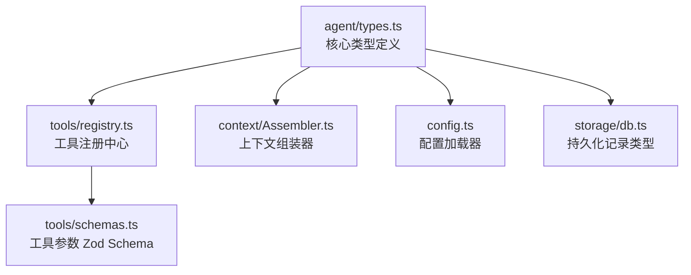
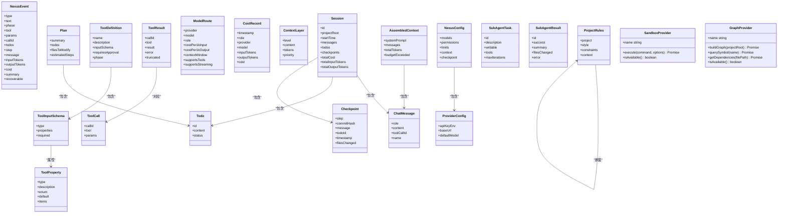
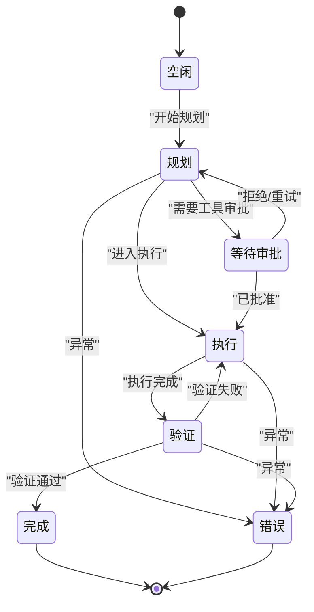
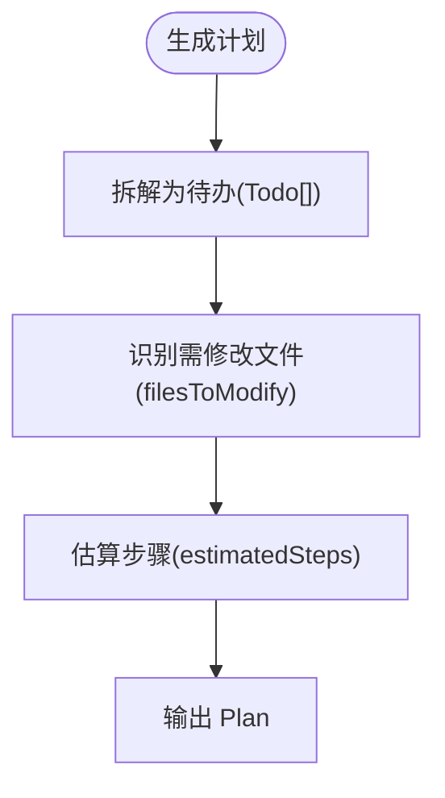
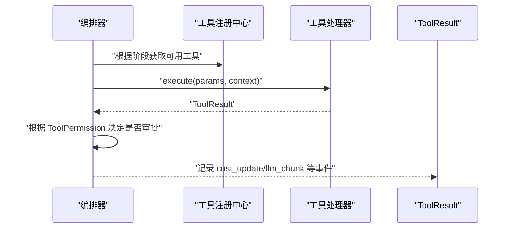
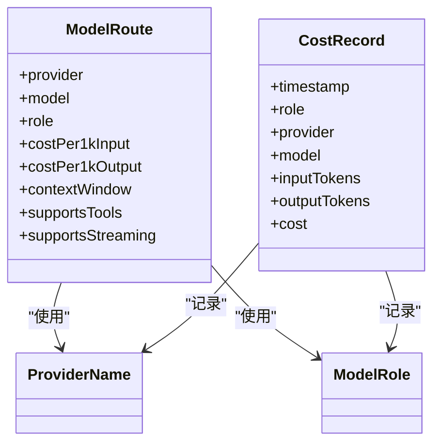
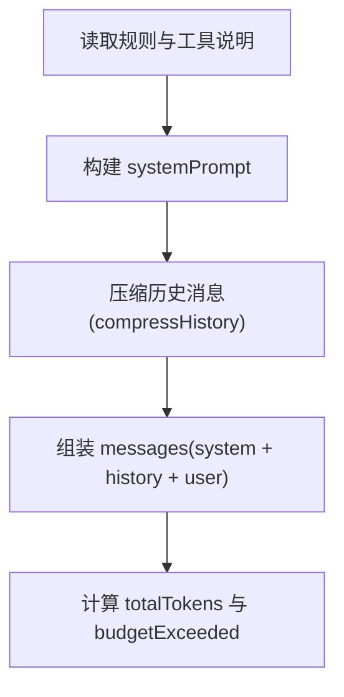
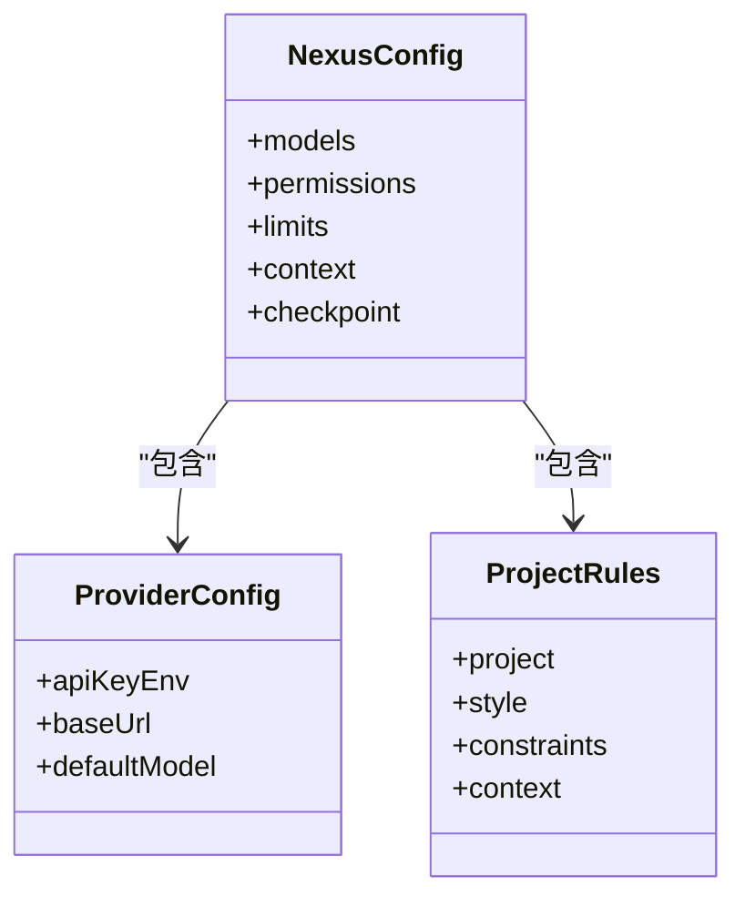
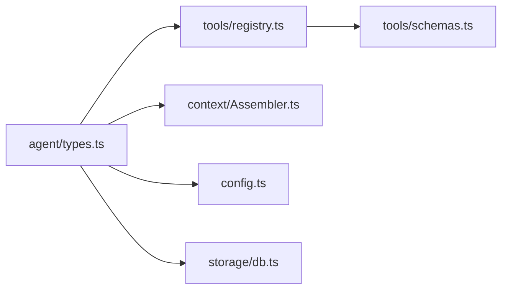
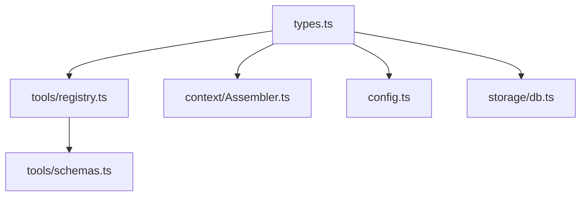

# 核心类型定义

<cite>
**本文引用的文件**   
- [src/agent/types.ts](file://src/agent/types.ts)
- [src/tools/schemas.ts](file://src/tools/schemas.ts)
- [src/tools/registry.ts](file://src/tools/registry.ts)
- [src/context/Assembler.ts](file://src/context/Assembler.ts)
- [src/config.ts](file://src/config.ts)
- [src/storage/db.ts](file://src/storage/db.ts)
</cite>

## 目录
1. [简介](#简介)
2. [项目结构](#项目结构)
3. [核心组件](#核心组件)
4. [架构总览](#架构总览)
5. [详细组件分析](#详细组件分析)
6. [依赖关系分析](#依赖关系分析)
7. [性能考量](#性能考量)
8. [故障排查指南](#故障排查指南)
9. [结论](#结论)
10. [附录：完整类型参考与使用示例](#附录完整类型参考与使用示例)

## 简介
本文件为 Nexus 的核心类型定义 API 文档，聚焦于事件流、工具、模型路由、上下文与会话等关键数据结构。目标读者包括需要理解并正确使用这些类型的开发者与集成方。文档提供字段含义、数据类型与约束说明，并通过图示展示类型之间的关系与数据流转路径，帮助快速上手与排错。

## 项目结构
Nexus 的核心类型集中在 agent 层，其他模块通过引用这些类型进行协作：
- 事件流、Agent 状态、计划与待办、工具定义、模型路由、上下文消息、配置、检查点、子 Agent、会话、可插拔引擎接口等统一在 agent/types 中定义
- 工具注册中心与工具参数 Schema 分别位于 tools/registry.ts 与 tools/schemas.ts
- 上下文组装器 context/Assembler.ts 消费 ChatMessage、ProjectRules、Todo 等类型
- 配置加载器 config.ts 基于 NexusConfig 合并默认值
- 存储层 storage/db.ts 提供持久化记录类型 SessionRecord、MessageRecord 等

图表来源
- [src/agent/types.ts:1-269](file://src/agent/types.ts#L1-L269)
- [src/tools/registry.ts:1-96](file://src/tools/registry.ts#L1-L96)
- [src/context/Assembler.ts:1-184](file://src/context/Assembler.ts#L1-L184)
- [src/config.ts:1-132](file://src/config.ts#L1-L132)
- [src/storage/db.ts:1-147](file://src/storage/db.ts#L1-L147)
- [src/tools/schemas.ts:1-40](file://src/tools/schemas.ts#L1-L40)

章节来源
- [src/agent/types.ts:1-269](file://src/agent/types.ts#L1-L269)
- [src/tools/registry.ts:1-96](file://src/tools/registry.ts#L1-L96)
- [src/context/Assembler.ts:1-184](file://src/context/Assembler.ts#L1-L184)
- [src/config.ts:1-132](file://src/config.ts#L1-L132)
- [src/storage/db.ts:1-147](file://src/storage/db.ts#L1-L147)
- [src/tools/schemas.ts:1-40](file://src/tools/schemas.ts#L1-L40)

## 核心组件
本节概述所有关键类型及其职责边界，便于快速定位与理解。

- 事件流与状态
  - NexusEvent：描述系统运行过程中的离散事件（用户输入、LLM 调用、工具调用与结果、待办更新、检查点、成本更新、阶段切换、完成与错误）
  - AgentPhase：Agent 当前所处阶段（空闲、规划、等待审批、执行、验证、完成、错误）
  - PermissionMode：权限策略模式（询问、自动编辑、自动全部、yolo）

- 任务与计划
  - Todo：单个待办项（id、content、status）
  - Plan：计划摘要、待办列表、需修改文件、预估步骤数

- 工具体系
  - ToolDefinition：工具元信息（名称、描述、输入 Schema、是否需要审批、适用阶段）
  - ToolInputSchema / ToolProperty：JSON Schema 风格的输入参数描述
  - ToolCall / ToolResult：工具调用与返回结果
  - ToolPermission：工具权限决策（自动、审批、拒绝）

- 模型路由与成本
  - ProviderName / ModelRole：提供商角色与模型角色枚举
  - ModelRoute：模型路由配置（提供商、模型名、角色、成本、上下文窗口、是否支持工具/流式）
  - CostRecord：单次调用的成本记录

- 上下文与消息
  - ContextLayer / AssembledContext：三层上下文与组装后的消息集合
  - ChatMessage：对话消息（system/user/assistant/tool），含可选的 toolCallId/name

- 配置
  - NexusConfig：全局配置（模型、权限、限制、上下文预算、检查点）
  - ProviderConfig：各提供商基础配置（环境变量键、baseUrl、默认模型）
  - ProjectRules：项目规则（语言、测试/构建命令、风格、约束、常驻上下文）

- 检查点与子 Agent
  - Checkpoint：检查点快照（步骤、提交哈希、消息、关联 todo、时间戳、变更文件）
  - SubAgentTask / SubAgentResult：子任务与结果

- 会话
  - Session：会话聚合（id、项目根、开始时间、消息、待办、检查点、成本与 token 统计）

- 可插拔引擎接口
  - SandboxProvider：沙箱执行抽象
  - GraphProvider：代码图谱访问抽象

章节来源
- [src/agent/types.ts:1-269](file://src/agent/types.ts#L1-L269)

## 架构总览
下图展示了核心类型在系统中的交互关系：工具注册中心依赖工具定义；上下文组装器消费消息与规则；配置加载器产出 NexusConfig；存储层提供持久化记录类型。

图表来源
- [src/agent/types.ts:1-269](file://src/agent/types.ts#L1-L269)

## 详细组件分析

### 事件流与状态（NexusEvent、AgentPhase、PermissionMode）
- NexusEvent 是联合类型，覆盖从用户输入到 LLM 调用、工具调用与结果、待办更新、检查点、成本更新、阶段切换、完成与错误的全生命周期事件
- AgentPhase 表示 Agent 的阶段机状态，用于控制流程分支与 UI 渲染
- PermissionMode 决定工具执行的审批策略

图表来源
- [src/agent/types.ts:25-25](file://src/agent/types.ts#L25-L25)

章节来源
- [src/agent/types.ts:8-27](file://src/agent/types.ts#L8-L27)

### 任务与计划（Todo、Plan）
- Todo 表示一个原子任务，状态包括 pending/in_progress/complete/cancelled
- Plan 汇总任务、涉及文件与预估步骤，作为规划阶段的产物

图表来源
- [src/agent/types.ts:29-40](file://src/agent/types.ts#L29-L40)

章节来源
- [src/agent/types.ts:29-40](file://src/agent/types.ts#L29-L40)

### 工具体系（ToolDefinition、ToolInputSchema、ToolProperty、ToolCall、ToolResult、ToolPermission）
- ToolDefinition 描述工具能力与约束，包含 JSON Schema 风格的 inputSchema
- ToolInputSchema/ToolProperty 定义参数结构与校验语义
- ToolCall/ToolResult 贯穿工具调用链路
- ToolPermission 表达审批决策

图表来源
- [src/tools/registry.ts:25-96](file://src/tools/registry.ts#L25-L96)
- [src/agent/types.ts:44-80](file://src/agent/types.ts#L44-L80)

章节来源
- [src/agent/types.ts:44-80](file://src/agent/types.ts#L44-L80)
- [src/tools/registry.ts:1-96](file://src/tools/registry.ts#L1-L96)
- [src/tools/schemas.ts:1-40](file://src/tools/schemas.ts#L1-L40)

### 模型路由与成本（ProviderName、ModelRole、ModelRoute、CostRecord）
- ProviderName 限定支持的提供商集合
- ModelRole 区分不同用途的模型（规划、执行、总结、验证）
- ModelRoute 描述具体模型的能力与定价
- CostRecord 记录每次调用的用量与费用

图表来源
- [src/agent/types.ts:84-107](file://src/agent/types.ts#L84-L107)

章节来源
- [src/agent/types.ts:84-107](file://src/agent/types.ts#L84-L107)

### 上下文与消息（ContextLayer、AssembledContext、ChatMessage）
- ContextLayer 表示三层上下文（L1/L2/L3）及优先级
- AssembledContext 是最终送入模型的上下文（systemPrompt + messages + token 统计）
- ChatMessage 为标准消息格式，支持 tool 角色与工具关联 id/name

图表来源
- [src/context/Assembler.ts:48-116](file://src/context/Assembler.ts#L48-L116)
- [src/agent/types.ts:111-130](file://src/agent/types.ts#L111-L130)

章节来源
- [src/context/Assembler.ts:1-184](file://src/context/Assembler.ts#L1-L184)
- [src/agent/types.ts:111-130](file://src/agent/types.ts#L111-L130)

### 配置（NexusConfig、ProviderConfig、ProjectRules）
- NexusConfig 聚合模型、权限、限制、上下文预算与检查点设置
- ProviderConfig 描述提供商接入参数
- ProjectRules 描述项目级规范与约束

图表来源
- [src/agent/types.ts:134-184](file://src/agent/types.ts#L134-L184)
- [src/config.ts:11-60](file://src/config.ts#L11-L60)

章节来源
- [src/agent/types.ts:134-184](file://src/agent/types.ts#L134-L184)
- [src/config.ts:1-132](file://src/config.ts#L1-L132)

### 检查点与子 Agent（Checkpoint、SubAgentTask、SubAgentResult）
- Checkpoint 记录关键步骤的可回溯信息
- SubAgentTask/SubAgentResult 描述子任务的委派与结果

章节来源
- [src/agent/types.ts:188-213](file://src/agent/types.ts#L188-L213)

### 会话（Session）
- Session 聚合一次对话的全部上下文与统计信息，便于持久化与回放

章节来源
- [src/agent/types.ts:217-227](file://src/agent/types.ts#L217-L227)

### 可插拔引擎接口（SandboxProvider、GraphProvider）
- SandboxProvider 抽象命令执行环境
- GraphProvider 抽象代码图谱访问

章节来源
- [src/agent/types.ts:239-268](file://src/agent/types.ts#L239-L268)

## 依赖关系分析
- 工具注册中心依赖 ToolDefinition/ToolResult 类型，并在运行时将 ToolDefinition 转换为 AI SDK 兼容的工具描述
- 上下文组装器消费 ChatMessage、ProjectRules、Todo 等类型，结合 TokenBudget 与 Compressor 生成最终消息
- 配置加载器基于 NexusConfig 合并 TOML 配置，映射 kebab-case 到 camelCase
- 存储层提供 SessionRecord/MessageRecord 等持久化记录类型，与内存中的 Session/ChatMessage 存在映射关系

图表来源
- [src/agent/types.ts:1-269](file://src/agent/types.ts#L1-L269)
- [src/tools/registry.ts:1-96](file://src/tools/registry.ts#L1-L96)
- [src/context/Assembler.ts:1-184](file://src/context/Assembler.ts#L1-L184)
- [src/config.ts:1-132](file://src/config.ts#L1-L132)
- [src/storage/db.ts:1-147](file://src/storage/db.ts#L1-L147)
- [src/tools/schemas.ts:1-40](file://src/tools/schemas.ts#L1-L40)

章节来源
- [src/agent/types.ts:1-269](file://src/agent/types.ts#L1-L269)
- [src/tools/registry.ts:1-96](file://src/tools/registry.ts#L1-L96)
- [src/context/Assembler.ts:1-184](file://src/context/Assembler.ts#L1-L184)
- [src/config.ts:1-132](file://src/config.ts#L1-L132)
- [src/storage/db.ts:1-147](file://src/storage/db.ts#L1-L147)
- [src/tools/schemas.ts:1-40](file://src/tools/schemas.ts#L1-L40)

## 性能考量
- 上下文预算与裁剪：通过 TokenBudget 与压缩策略控制消息长度，避免超出模型上下文窗口
- 工具输出截断：ToolResult 支持 truncated 标记，防止大输出阻塞或超预算
- 成本追踪：CostRecord 与 cost_update 事件配合，实时监控与限制会话总成本
- 异步与并发：工具执行与外部命令采用异步方式，注意超时与资源释放

[本节为通用指导，不直接分析具体文件]

## 故障排查指南
- 未知工具错误：当工具名未注册时，注册中心会返回 ToolResult.error 提示“未知工具”，请检查工具注册与名称拼写
- 审批失败：若 requiresApproval 为真且权限模式为 ask，需在审批前确认；否则可能触发 error 事件
- 上下文超限：当 budgetExceeded 为真时，应减少历史消息或提高预算比例
- 配置缺失：若 .nexus/config.toml 不存在，将回退到默认配置；请核对 provider 的 apiKeyEnv 与 baseUrl 是否正确

章节来源
- [src/tools/registry.ts:70-82](file://src/tools/registry.ts#L70-L82)
- [src/agent/types.ts:8-21](file://src/agent/types.ts#L8-L21)
- [src/context/Assembler.ts:92-116](file://src/context/Assembler.ts#L92-L116)
- [src/config.ts:62-74](file://src/config.ts#L62-L74)

## 结论
Nexus 的核心类型以 agent/types.ts 为中心，围绕事件驱动、工具抽象、模型路由与上下文管理形成清晰的数据契约。通过统一的类型定义，上层编排、UI 展示与持久化层得以稳定协作。建议在使用时严格遵循类型约束，并结合预算与成本机制保障系统稳定性。

[本节为总结性内容，不直接分析具体文件]

## 附录：完整类型参考与使用示例

### 类型清单与字段说明
- 事件与状态
  - NexusEvent：联合类型，涵盖 user_input、llm_start、llm_chunk、llm_done、tool_call、tool_approval_request、tool_result、todo_update、checkpoint、cost_update、phase_change、done、error
  - AgentPhase：idle | planning | awaiting_approval | executing | verifying | done | error
  - PermissionMode：ask | auto-edit | auto-all | yolo

- 任务与计划
  - Todo：id(string)、content(string)、status(pending|in_progress|complete|cancelled)
  - Plan：summary(string)、todos(Todo[])、filesToModify(string[])、estimatedSteps(number)

- 工具
  - ToolDefinition：name、description、inputSchema(ToolInputSchema)、requiresApproval(boolean)、phase(plan|execute|both)
  - ToolInputSchema：type(object)、properties(Record<string, ToolProperty>)、required(string[])
  - ToolProperty：type(string|number|boolean|array|object)、description?(string)、enum?(string[])、default?(unknown)、items?(ToolProperty)
  - ToolCall：callId、tool、params(Record<string, unknown>)
  - ToolResult：callId、tool、result(string)、error?(string)、truncated?(boolean)
  - ToolPermission：auto | approval | denied

- 模型路由与成本
  - ProviderName：anthropic | openai | google | ollama | openrouter | deepseek | custom
  - ModelRole：planner | executor | summarizer | verifier
  - ModelRoute：provider、model、role、costPer1kInput(number)、costPer1kOutput(number)、contextWindow(number)、supportsTools(boolean)、supportsStreaming(boolean)
  - CostRecord：timestamp、role、provider、model、inputTokens、outputTokens、cost

- 上下文与消息
  - ContextLayer：level(L1|L2|L3)、content(string)、tokens(number)、priority(number)
  - AssembledContext：systemPrompt(string)、messages(ChatMessage[])、totalTokens(number)、budgetExceeded(boolean)
  - ChatMessage：role(system|user|assistant|tool)、content(string)、toolCallId?(string)、name?(string)

- 配置
  - NexusConfig：models(planner/executor/summarizer/verifier/providers)、permissions(mode)、limits(maxSessionCost/bashTimeout/maxReadLines/maxIterations/maxOutputBytes)、context(budgetRatio/recentTurnsKeep)、checkpoint(autoCheckpoint/branch)
  - ProviderConfig：apiKeyEnv?(string)、baseUrl?(string)、defaultModel(string)
  - ProjectRules：project(name/language/testCommand/buildCommand)、style(indent/quote/semicolons)、constraints(Record<string, boolean>)、context(alwaysInclude(string[]))

- 检查点与子 Agent
  - Checkpoint：step、commitHash、message、todoId?(string)、timestamp、filesChanged(string[])
  - SubAgentTask：id、description、writable、tools(string[])、maxIterations
  - SubAgentResult：id、success、summary、filesChanged(string[])、error?(string)

- 会话
  - Session：id、projectRoot、startTime、messages(ChatMessage[])、todos(Todo[])、checkpoints(Checkpoint[])、totalCost、totalInputTokens、totalOutputTokens

- 可插拔引擎接口
  - SandboxProvider：execute(command, options) → {stdout, stderr, exitCode, timedOut}、isAvailable()、name
  - GraphProvider：buildGraph(projectRoot)、querySymbol(name)、getDependencies(filePath)、isAvailable()、name

章节来源
- [src/agent/types.ts:1-269](file://src/agent/types.ts#L1-L269)

### 类型关系图（精简版）

图表来源
- [src/agent/types.ts:1-269](file://src/agent/types.ts#L1-L269)
- [src/tools/registry.ts:1-96](file://src/tools/registry.ts#L1-L96)
- [src/context/Assembler.ts:1-184](file://src/context/Assembler.ts#L1-L184)
- [src/config.ts:1-132](file://src/config.ts#L1-L132)
- [src/storage/db.ts:1-147](file://src/storage/db.ts#L1-L147)
- [src/tools/schemas.ts:1-40](file://src/tools/schemas.ts#L1-L40)

### 使用示例（路径指引）
- 事件处理与状态机
  - 参考：[src/agent/types.ts:8-27](file://src/agent/types.ts#L8-L27)
- 工具注册与调用
  - 参考：[src/tools/registry.ts:25-96](file://src/tools/registry.ts#L25-L96)
- 工具参数校验（Zod Schema）
  - 参考：[src/tools/schemas.ts:1-40](file://src/tools/schemas.ts#L1-L40)
- 上下文组装与预算控制
  - 参考：[src/context/Assembler.ts:48-116](file://src/context/Assembler.ts#L48-L116)
- 配置加载与默认值合并
  - 参考：[src/config.ts:62-132](file://src/config.ts#L62-L132)
- 会话与消息持久化
  - 参考：[src/storage/db.ts:30-147](file://src/storage/db.ts#L30-L147)