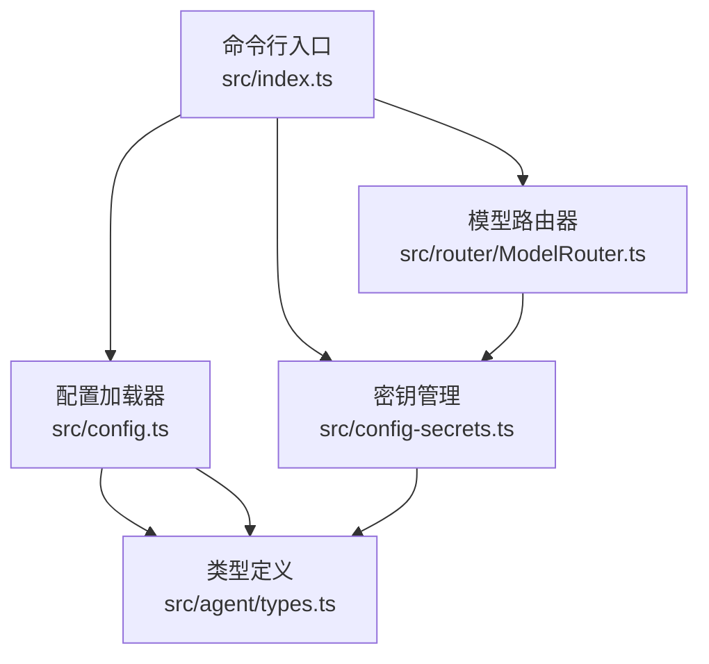
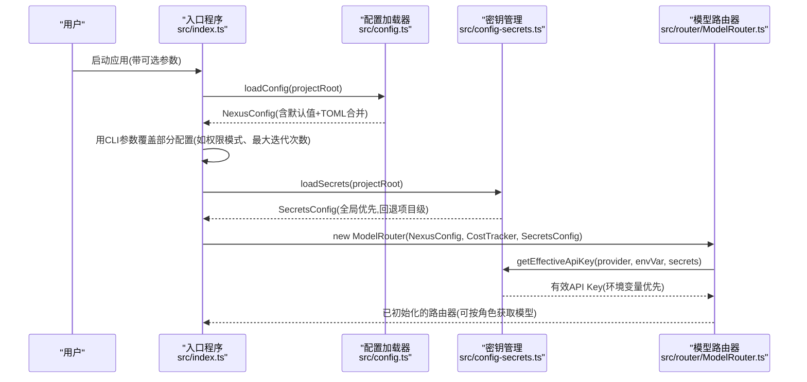
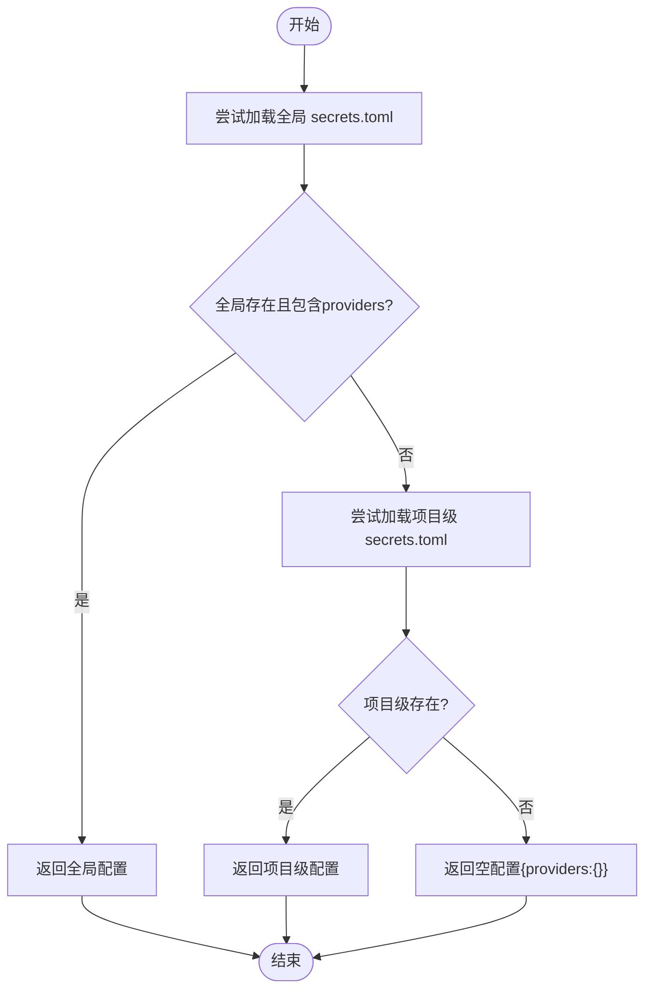
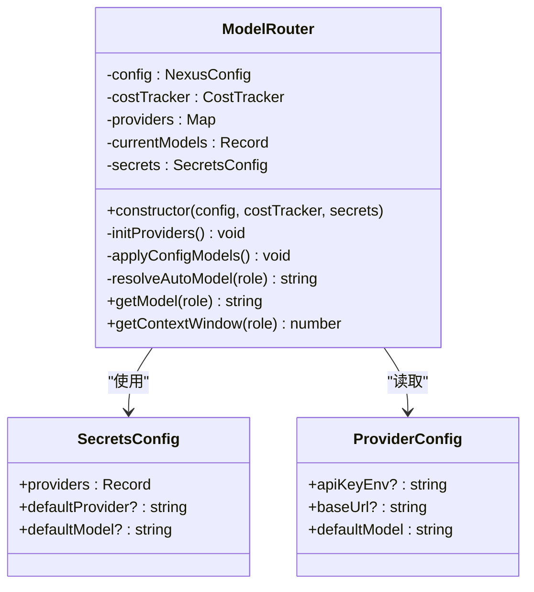
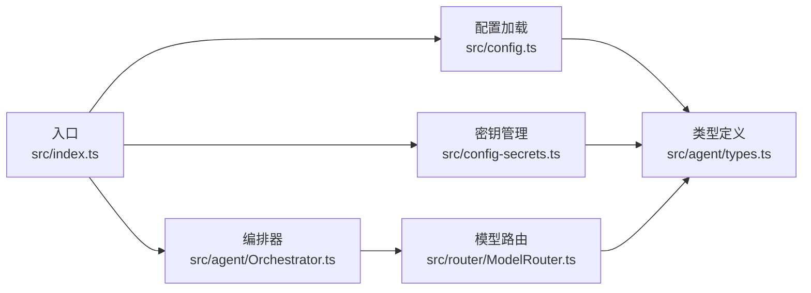

# 配置管理接口

<cite>
**本文引用的文件**
- [src/config.ts](file://src/config.ts)
- [src/config-secrets.ts](file://src/config-secrets.ts)
- [src/agent/types.ts](file://src/agent/types.ts)
- [.nexus/config.toml](file://.nexus/config.toml)
- [.nexus/rules.toml](file://.nexus/rules.toml)
- [src/index.ts](file://src/index.ts)
- [src/router/ModelRouter.ts](file://src/router/ModelRouter.ts)
</cite>

## 目录
1. [简介](#简介)
2. [项目结构](#项目结构)
3. [核心组件](#核心组件)
4. [架构总览](#架构总览)
5. [详细组件分析](#详细组件分析)
6. [依赖关系分析](#依赖关系分析)
7. [性能与成本考量](#性能与成本考量)
8. [故障排查指南](#故障排查指南)
9. [结论](#结论)
10. [附录：完整配置参考与最佳实践](#附录完整配置参考与最佳实践)

## 简介
本文件为 Nexus 配置管理接口的权威文档，聚焦于以下目标：
- 全面说明 NexusConfig 与 ProviderConfig 的所有配置项（模型、权限、限制、上下文预算等）
- 解释配置文件加载优先级与环境变量覆盖机制
- 提供完整的配置示例与最佳实践
- 说明密钥管理的最佳实践与安全考虑
- 包含配置验证规则与错误处理
- 展示如何在运行时动态修改配置与热重载机制

## 项目结构
Nexus 的配置系统由“配置加载 + 密钥管理 + 路由与应用”三部分构成：
- 配置加载：从 .nexus/config.toml 读取并合并默认值，生成 NexusConfig
- 密钥管理：从全局 ~/.nexus/secrets.toml 或项目级 .nexus/secrets.toml 读取 provider 密钥，支持环境变量覆盖
- 路由与应用：ModelRouter 根据配置初始化各 provider，并在运行期按角色选择模型；入口层允许 CLI 参数覆盖部分配置

图表来源
- [src/index.ts:18-41](file://src/index.ts#L18-L41)
- [src/config.ts:62-131](file://src/config.ts#L62-L131)
- [src/config-secrets.ts:42-131](file://src/config-secrets.ts#L42-L131)
- [src/router/ModelRouter.ts:101-165](file://src/router/ModelRouter.ts#L101-L165)
- [src/agent/types.ts:134-166](file://src/agent/types.ts#L134-L166)

章节来源
- [src/index.ts:18-41](file://src/index.ts#L18-L41)
- [src/config.ts:62-131](file://src/config.ts#L62-L131)
- [src/config-secrets.ts:42-131](file://src/config-secrets.ts#L42-L131)
- [src/router/ModelRouter.ts:101-165](file://src/router/ModelRouter.ts#L101-L165)
- [src/agent/types.ts:134-166](file://src/agent/types.ts#L134-L166)

## 核心组件
本节概述配置系统的核心对象与职责：
- NexusConfig：描述模型路由、权限模式、资源限制、上下文预算、检查点策略等
- ProviderConfig：描述单个 LLM 提供商的密钥来源、基础 URL、默认模型
- SecretsConfig：持久化存储 provider 密钥及用户选择的默认 provider/model
- ModelRouter：基于 NexusConfig 和 SecretsConfig 初始化 provider，并按角色解析具体模型
- 配置加载器：将 TOML 配置合并到默认配置，输出强类型的 NexusConfig

章节来源
- [src/agent/types.ts:134-166](file://src/agent/types.ts#L134-L166)
- [src/config.ts:11-60](file://src/config.ts#L11-L60)
- [src/config-secrets.ts:12-26](file://src/config-secrets.ts#L12-L26)
- [src/router/ModelRouter.ts:101-116](file://src/router/ModelRouter.ts#L101-L116)

## 架构总览
下图展示了配置在启动时的加载顺序、覆盖关系以及运行时使用路径。

图表来源
- [src/index.ts:18-41](file://src/index.ts#L18-L41)
- [src/config.ts:62-131](file://src/config.ts#L62-L131)
- [src/config-secrets.ts:42-131](file://src/config-secrets.ts#L42-L131)
- [src/router/ModelRouter.ts:101-165](file://src/router/ModelRouter.ts#L101-L165)

## 详细组件分析

### NexusConfig 接口详解
NexusConfig 是系统主配置的结构化表示，涵盖以下子域：
- models
  - planner/executor/summarizer/verifier：字符串，指定各阶段使用的模型名或 "auto"
  - providers：Record<string, ProviderConfig>，每个键为 provider 名称（如 anthropic/openai/ollama/deepseek/custom），值为该 provider 的配置
- permissions
  - mode：权限模式，枚举值包括 ask、auto-edit、auto-all、yolo
- limits
  - maxSessionCost：每会话最大成本（美元）
  - bashTimeout：单次 bash 命令超时（秒）
  - maxReadLines：文件读取最大行数
  - maxIterations：Agent loop 最大迭代步数
  - maxOutputBytes：bash 输出最大字节数
- context
  - budgetRatio：Token 预算占模型上下文窗口的比例
  - recentTurnsKeep：近期完整保留的对话轮数
- checkpoint
  - autoCheckpoint：是否自动创建 git checkpoint
  - branch：checkpoint 分支名

ProviderConfig 字段：
- apiKeyEnv：用于查找 API Key 的环境变量名
- baseUrl：provider 的基础 URL（可选）
- defaultModel：该 provider 的默认模型名

章节来源
- [src/agent/types.ts:134-166](file://src/agent/types.ts#L134-L166)

### 配置加载与合并规则
- 默认配置：内置 DEFAULT_CONFIG，定义了所有字段的默认值
- 配置文件：从项目根目录下的 .nexus/config.toml 读取，若不存在则仅返回默认配置
- 合并策略：对 raw TOML 进行类型校验后逐项合并到默认配置，未提供的字段保持默认值
- 字段映射：TOML 中的下划线命名（如 api_key_env）映射为驼峰命名（apiKeyEnv）

章节来源
- [src/config.ts:11-60](file://src/config.ts#L11-L60)
- [src/config.ts:62-131](file://src/config.ts#L62-L131)

### 密钥管理与覆盖优先级
- 存储位置
  - 全局：~/.nexus/secrets.toml（用户级，所有项目共享）
  - 项目级：.nexus/secrets.toml（兼容旧版本）
- 加载顺序：全局优先，若全局无可用 provider 则回退到项目级
- 覆盖优先级：环境变量 > secrets 文件
- 有效 Key 获取：getEffectiveApiKey(providerName, envVarName, secrets)
- 可用性检测：hasAnyApiKey(secrets) 可快速判断是否存在任意可用的 API Key
- 状态查询：getProviderStatus(secrets) 返回各 provider 的可用性与来源（env/secrets/none）
- 掩码显示：maskApiKey(key) 用于安全地展示 Key 片段

图表来源
- [src/config-secrets.ts:42-59](file://src/config-secrets.ts#L42-L59)
- [src/config-secrets.ts:120-131](file://src/config-secrets.ts#L120-L131)

章节来源
- [src/config-secrets.ts:12-26](file://src/config-secrets.ts#L12-L26)
- [src/config-secrets.ts:42-131](file://src/config-secrets.ts#L42-L131)

### 模型路由与自动选择
- 初始化：ModelRouter 根据 NexusConfig.models.providers 初始化各 provider
- 密钥解析：通过 getEffectiveApiKey 解析实际可用的 API Key（环境变量优先）
- 自动选择：当某角色配置为 "auto" 时，按优先级链选择第一个可用的 provider 的最佳模型
- 降级链：内置 fallback 链，用于在特定模型不可用时降级到其他模型
- 上下文窗口：根据所选模型的能力数据计算 Token 预算上限

图表来源
- [src/router/ModelRouter.ts:101-165](file://src/router/ModelRouter.ts#L101-L165)
- [src/agent/types.ts:134-166](file://src/agent/types.ts#L134-L166)
- [src/config-secrets.ts:12-26](file://src/config-secrets.ts#L12-L26)

章节来源
- [src/router/ModelRouter.ts:101-200](file://src/router/ModelRouter.ts#L101-L200)

### 运行时动态修改与热重载
- 入口层覆盖：在启动时可通过 CLI 参数覆盖部分配置（例如权限模式、最大迭代次数）
- 运行时更新：Orchestrator 暴露 setModel 等方法，可在 TUI 中切换当前模型
- 热重载建议：由于配置加载发生在进程启动阶段，真正的“热重载”需要重新加载配置并重建相关组件（如 Router、Assember）。当前实现未提供显式热重载 API，但可通过事件驱动的方式在 UI 层触发重新初始化流程

章节来源
- [src/index.ts:31-41](file://src/index.ts#L31-L41)
- [src/index.ts:68-76](file://src/index.ts#L68-L76)

## 依赖关系分析
- 入口层 index.ts 负责解析参数、加载配置、创建 Orchestrator 与 TUI
- config.ts 负责从 .nexus/config.toml 加载并合并默认值
- config-secrets.ts 负责加载 secrets 并提供密钥解析工具函数
- router/ModelRouter.ts 依赖 NexusConfig 与 SecretsConfig 初始化 provider，并按角色选择模型
- agent/types.ts 提供所有配置与运行期的类型定义

图表来源
- [src/index.ts:18-41](file://src/index.ts#L18-L41)
- [src/config.ts:62-131](file://src/config.ts#L62-L131)
- [src/config-secrets.ts:42-131](file://src/config-secrets.ts#L42-L131)
- [src/router/ModelRouter.ts:101-165](file://src/router/ModelRouter.ts#L101-L165)
- [src/agent/types.ts:134-166](file://src/agent/types.ts#L134-L166)

章节来源
- [src/index.ts:18-41](file://src/index.ts#L18-L41)
- [src/config.ts:62-131](file://src/config.ts#L62-L131)
- [src/config-secrets.ts:42-131](file://src/config-secrets.ts#L42-L131)
- [src/router/ModelRouter.ts:101-165](file://src/router/ModelRouter.ts#L101-L165)
- [src/agent/types.ts:134-166](file://src/agent/types.ts#L134-L166)

## 性能与成本考量
- 预算控制：context.budgetRatio 控制 Token 预算占上下文窗口的比例，避免超出模型能力范围
- 会话成本上限：limits.maxSessionCost 用于在单会话内累计成本接近阈值时暂停并提示用户
- 迭代限制：limits.maxIterations 防止 Agent 循环过长导致资源消耗过大
- 输出截断：limits.maxOutputBytes 与 limits.maxReadLines 保护 I/O 与内存占用
- 模型选择：auto 模式下优先选择高能力模型，必要时降级以平衡成本与效果

[本节为通用指导，不直接分析具体文件]

## 故障排查指南
- 无法解析 TOML 配置：确保 .nexus/config.toml 语法正确，字段命名遵循下划线风格（如 api_key_env）
- 缺少 API Key：
  - 检查环境变量是否设置（ANTHROPIC_API_KEY、OPENAI_API_KEY、DEEPSEEK_API_KEY、CUSTOM_API_KEY）
  - 或使用全局 ~/.nexus/secrets.toml 配置对应 provider 的 api_key
- 自定义 OpenAI 兼容接口不可用：需同时设置 CUSTOM_API_KEY 与 base_url（可通过 secrets 或环境变量 CUSTOM_BASE_URL）
- 自动选择失败：确认至少一个 provider 已正确配置并可访问；否则将回退到默认模型并在调用时报错
- 权限模式异常：确认 permissions.mode 为合法枚举值之一

章节来源
- [src/config.ts:62-131](file://src/config.ts#L62-L131)
- [src/config-secrets.ts:120-131](file://src/config-secrets.ts#L120-L131)
- [src/router/ModelRouter.ts:158-165](file://src/router/ModelRouter.ts#L158-L165)

## 结论
Nexus 的配置系统以强类型为核心，结合 TOML 配置文件与全局/项目级密钥管理，提供了灵活的模型路由与严格的资源控制。通过环境变量覆盖与 CLI 参数注入，既保证了安全性，也兼顾了易用性。建议在团队环境中统一使用全局 secrets 管理密钥，并通过 .nexus/config.toml 集中管理模型与行为策略。

[本节为总结性内容，不直接分析具体文件]

## 附录：完整配置参考与最佳实践

### 配置文件清单与用途
- .nexus/config.toml：模型路由、权限模式、限制参数、上下文预算、检查点策略
- .nexus/rules.toml：项目元信息、代码风格、硬约束、常驻上下文
- ~/.nexus/secrets.toml：全局密钥与默认 provider/model（推荐）
- .nexus/secrets.toml：项目级密钥（兼容旧版）

章节来源
- [.nexus/config.toml:1-62](file://.nexus/config.toml#L1-L62)
- [.nexus/rules.toml:1-21](file://.nexus/rules.toml#L1-L21)
- [src/config-secrets.ts:28-39](file://src/config-secrets.ts#L28-L39)

### 配置项速查表
- models.planner/executor/summarizer/verifier：字符串，模型名或 "auto"
- models.providers.<name>.api_key_env：环境变量名
- models.providers.<name>.base_url：基础 URL（可选）
- models.providers.<name>.default_model：默认模型名
- permissions.mode：ask | auto-edit | auto-all | yolo
- limits.max_session_cost：美元数值
- limits.bash_timeout：秒数
- limits.max_read_lines：行数
- limits.max_iterations：整数
- limits.max_output_bytes：字节数
- context.budget_ratio：0~1 的比例
- context.recent_turns_keep：整数
- checkpoint.auto_checkpoint：布尔
- checkpoint.branch：字符串

章节来源
- [src/config.ts:11-60](file://src/config.ts#L11-L60)
- [.nexus/config.toml:4-62](file://.nexus/config.toml#L4-L62)

### 环境变量与覆盖优先级
- 环境变量优先于 secrets 文件
- CLI 参数可覆盖部分配置（如权限模式、最大迭代次数）
- 自定义 OpenAI 兼容接口支持通过环境变量 CUSTOM_BASE_URL 指定 base_url

章节来源
- [src/config-secrets.ts:120-131](file://src/config-secrets.ts#L120-L131)
- [src/index.ts:31-41](file://src/index.ts#L31-L41)
- [src/router/ModelRouter.ts:158-165](file://src/router/ModelRouter.ts#L158-L165)

### 密钥管理最佳实践
- 使用全局 ~/.nexus/secrets.toml 集中管理密钥，避免泄露到仓库
- 敏感环境（CI/CD）优先使用环境变量注入
- 定期轮换 API Key，并使用最小权限原则
- 使用 maskApiKey 在日志或 UI 中安全展示 Key 片段

章节来源
- [src/config-secrets.ts:28-39](file://src/config-secrets.ts#L28-L39)
- [src/config-secrets.ts:166-171](file://src/config-secrets.ts#L166-L171)

### 配置验证规则与错误处理
- 类型校验：配置合并时对字段类型进行检查（字符串、数字、布尔等）
- 缺失处理：未提供的字段采用默认值；缺失 API Key 时对应 provider 不会注册
- 自动选择失败：若无任何可用 provider，将保留默认模型并在调用时报错，提示配置问题

章节来源
- [src/config.ts:76-131](file://src/config.ts#L76-L131)
- [src/router/ModelRouter.ts:118-165](file://src/router/ModelRouter.ts#L118-L165)

### 运行时动态修改与热重载机制
- 启动时覆盖：通过 CLI 参数覆盖权限模式与最大迭代次数
- 运行时切换：通过 Orchestrator 的 setModel 方法切换当前模型
- 热重载：当前未提供显式热重载 API；可在 UI 层触发重新初始化流程（重新加载配置并重建 Router/Assembler）

章节来源
- [src/index.ts:31-41](file://src/index.ts#L31-L41)
- [src/index.ts:68-76](file://src/index.ts#L68-L76)