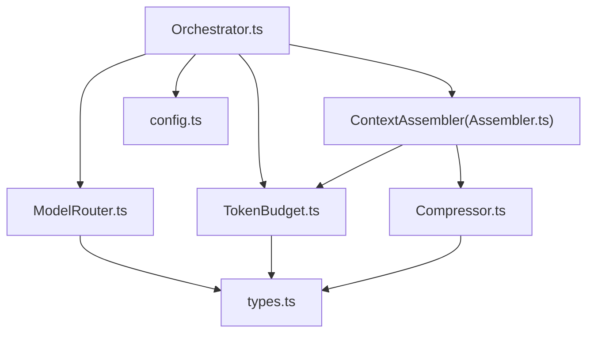
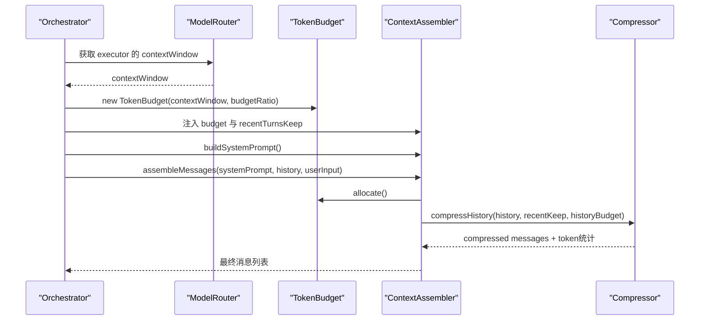
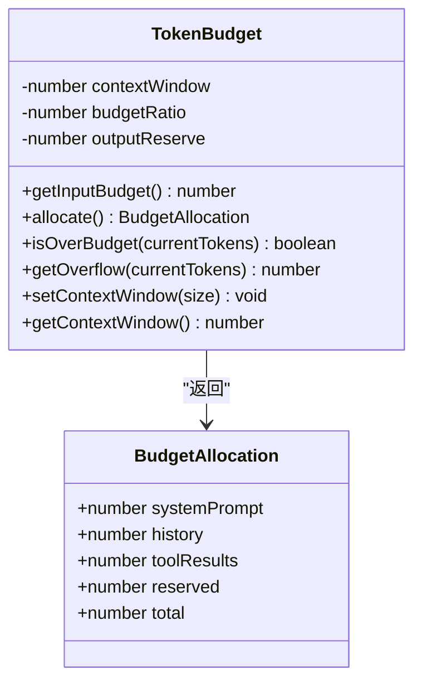
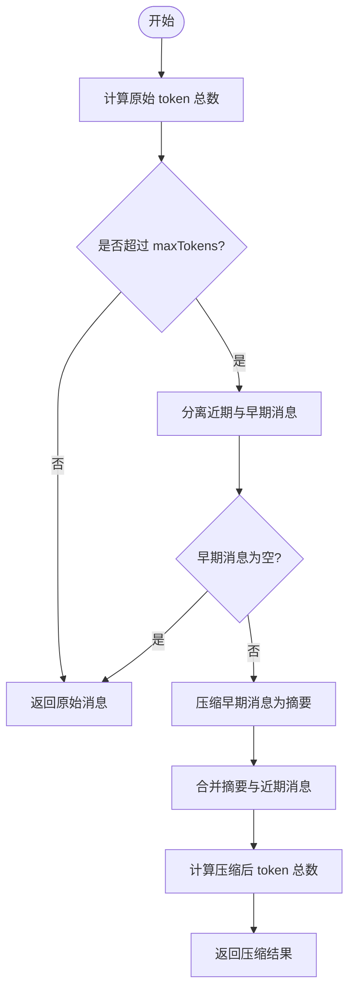
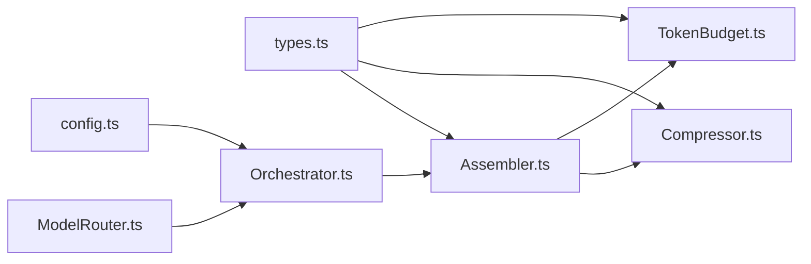

# Token 预算管理

<cite>
**本文引用的文件**   
- [TokenBudget.ts](file://src/context/TokenBudget.ts)
- [Compressor.ts](file://src/context/Compressor.ts)
- [Assembler.ts](file://src/context/Assembler.ts)
- [Orchestrator.ts](file://src/agent/Orchestrator.ts)
- [ModelRouter.ts](file://src/router/ModelRouter.ts)
- [types.ts](file://src/agent/types.ts)
- [config.ts](file://src/config.ts)
</cite>

## 目录
1. [简介](#简介)
2. [项目结构](#项目结构)
3. [核心组件](#核心组件)
4. [架构总览](#架构总览)
5. [详细组件分析](#详细组件分析)
6. [依赖关系分析](#依赖关系分析)
7. [性能考量](#性能考量)
8. [故障排查指南](#故障排查指南)
9. [结论](#结论)
10. [附录：配置与调优示例](#附录配置与调优示例)

## 简介
本技术文档围绕 TokenBudget 类及其在上下文组装、历史压缩中的协作机制，系统性阐述 Token 预算管理的核心算法与工程实践。重点包括：
- allocate() 的预算分配策略（系统提示、历史、工具结果、预留输出）
- estimateTokens() 的 Token 估算逻辑（ASCII/非 ASCII 混合语言近似换算）
- 不同模型类型的上下文窗口差异对预算的影响
- 历史消息压缩的优先级规则与自动裁剪流程
- 动态调整预算分配的方法与最佳实践
- 预算超限时的自动裁剪策略（按时间优先、按重要性排序）
- 监控 Token 使用与优化上下文内容的建议

## 项目结构
Token 预算管理涉及以下关键模块：
- TokenBudget：预算计算与分配
- Compressor：历史压缩与工具结果分级压缩
- Assembler：三层上下文组装与调用预算检查
- Orchestrator：初始化并注入 TokenBudget 到 ContextAssembler
- ModelRouter：提供各模型的 contextWindow，决定预算上限
- types：定义 ChatMessage、ContextLayer、AssembledContext 等类型
- config：加载 budgetRatio、recentTurnsKeep 等上下文相关配置

图表来源
- [Orchestrator.ts:60-86](file://src/agent/Orchestrator.ts#L60-L86)
- [ModelRouter.ts:298-302](file://src/router/ModelRouter.ts#L298-L302)
- [TokenBudget.ts:31-78](file://src/context/TokenBudget.ts#L31-L78)
- [Assembler.ts:48-116](file://src/context/Assembler.ts#L48-L116)
- [Compressor.ts:25-56](file://src/context/Compressor.ts#L25-L56)
- [types.ts:125-130](file://src/agent/types.ts#L125-L130)
- [config.ts:52-55](file://src/config.ts#L52-L55)

章节来源
- [Orchestrator.ts:60-86](file://src/agent/Orchestrator.ts#L60-L86)
- [ModelRouter.ts:298-302](file://src/router/ModelRouter.ts#L298-L302)
- [TokenBudget.ts:31-78](file://src/context/TokenBudget.ts#L31-L78)
- [Assembler.ts:48-116](file://src/context/Assembler.ts#L48-L116)
- [Compressor.ts:25-56](file://src/context/Compressor.ts#L25-L56)
- [types.ts:125-130](file://src/agent/types.ts#L125-L130)
- [config.ts:52-55](file://src/config.ts#L52-L55)

## 核心组件
- TokenBudget：负责输入预算计算、分层分配、溢出检测与上下文窗口更新
- Compressor：实现历史压缩与工具结果分级压缩，保证近期完整保留、早期摘要化
- ContextAssembler：组装 system prompt、历史、用户输入，并在组装前进行预算检查与压缩
- ModelRouter：提供不同模型的 contextWindow，驱动预算上限的动态变化
- types：定义消息、上下文层、组装结果等数据结构
- config：加载 budgetRatio、recentTurnsKeep 等上下文参数

章节来源
- [TokenBudget.ts:31-78](file://src/context/TokenBudget.ts#L31-L78)
- [Compressor.ts:25-56](file://src/context/Compressor.ts#L25-L56)
- [Assembler.ts:48-116](file://src/context/Assembler.ts#L48-L116)
- [ModelRouter.ts:298-302](file://src/router/ModelRouter.ts#L298-L302)
- [types.ts:125-130](file://src/agent/types.ts#L125-L130)
- [config.ts:52-55](file://src/config.ts#L52-L55)

## 架构总览
Token 预算管理贯穿“上下文组装 → 历史压缩 → 预算检查 → 裁剪”的流水线。整体流程如下：

图表来源
- [Orchestrator.ts:60-86](file://src/agent/Orchestrator.ts#L60-L86)
- [ModelRouter.ts:298-302](file://src/router/ModelRouter.ts#L298-L302)
- [TokenBudget.ts:47-57](file://src/context/TokenBudget.ts#L47-L57)
- [Assembler.ts:92-116](file://src/context/Assembler.ts#L92-L116)
- [Compressor.ts:25-56](file://src/context/Compressor.ts#L25-L56)

## 详细组件分析

### TokenBudget 类与 allocate() 策略
- 输入预算计算：getInputBudget() = floor(contextWindow × budgetRatio) - outputReserve
- 分层分配：allocate() 将输入预算按比例分配给 systemPrompt、history、toolResults，并预留 reserved 给模型输出
- 溢出检测：isOverBudget(currentTokens)、getOverflow(currentTokens)
- 动态调整：setContextWindow(size) 支持切换模型时更新上下文窗口

图表来源
- [TokenBudget.ts:31-78](file://src/context/TokenBudget.ts#L31-L78)

章节来源
- [TokenBudget.ts:31-78](file://src/context/TokenBudget.ts#L31-L78)

### estimateTokens() 估算逻辑
- 混合语言估算：统计 ASCII 与非 ASCII 字符数量
- 换算比例：ASCII 约 4 字符/token；非 ASCII（中文等）约 1.5 字符/token
- 返回向上取整的估算值

该函数被 Compressor 用于统计原始与压缩后的 token 数，也被 Assembler 用于评估 systemPrompt 大小。

章节来源
- [TokenBudget.ts:6-21](file://src/context/TokenBudget.ts#L6-L21)
- [Compressor.ts:25-56](file://src/context/Compressor.ts#L25-L56)
- [Assembler.ts:92-116](file://src/context/Assembler.ts#L92-L116)

### Compressor 历史压缩与工具结果分级
- 压缩策略：近期消息完整保留（每轮约 2 条），早期消息压缩为摘要
- 工具结果分级：bash 失败输出完整保留（调试关键）、read_file/grep/edit_file 仅保留路径或匹配数、bash 成功输出保留 exit code 与摘要
- 实时压缩：compressSingleToolResult 用于单条工具结果的即时压缩

图表来源
- [Compressor.ts:25-56](file://src/context/Compressor.ts#L25-L56)
- [Compressor.ts:59-97](file://src/context/Compressor.ts#L59-L97)
- [Compressor.ts:99-136](file://src/context/Compressor.ts#L99-L136)
- [Compressor.ts:138-159](file://src/context/Compressor.ts#L138-L159)

章节来源
- [Compressor.ts:25-56](file://src/context/Compressor.ts#L25-L56)
- [Compressor.ts:59-97](file://src/context/Compressor.ts#L59-L97)
- [Compressor.ts:99-136](file://src/context/Compressor.ts#L99-L136)
- [Compressor.ts:138-159](file://src/context/Compressor.ts#L138-L159)

### ContextAssembler 组装与预算检查
- 构建 system prompt（包含项目规则、工具说明、Git 状态、项目骨架树、任务进度）
- 调用 TokenBudget.allocate() 获取各层预算
- 调用 Compressor.compressHistory() 进行历史压缩
- 组装最终消息列表（system、compressed history、user input）

章节来源
- [Assembler.ts:55-90](file://src/context/Assembler.ts#L55-L90)
- [Assembler.ts:92-116](file://src/context/Assembler.ts#L92-L116)

### ModelRouter 与不同模型的上下文窗口差异
- MODEL_CATALOG 定义了多个模型的 contextWindow（如 claude-sonnet-4-20250514: 200k，gpt-4o: 128k，llama3: 8k，deepseek-chat: 65k）
- getContextWindow(role) 返回当前角色的上下文窗口大小，影响 TokenBudget 的预算上限
- 不同角色默认模型选择（planner/executor 用高能力模型，summarizer/verifier 用低成本模型）

章节来源
- [ModelRouter.ts:15-83](file://src/router/ModelRouter.ts#L15-L83)
- [ModelRouter.ts:298-302](file://src/router/ModelRouter.ts#L298-L302)

### 配置与动态调整
- config.ts 中 context.budgetRatio 与 context.recentTurnsKeep 控制预算比例与保留轮数
- Orchestrator 在 init() 中根据 router.getContextWindow('executor') 与 config.context.budgetRatio 创建 TokenBudget
- TokenBudget.setContextWindow(size) 支持运行时切换模型时动态调整上下文窗口

章节来源
- [config.ts:52-55](file://src/config.ts#L52-L55)
- [Orchestrator.ts:60-86](file://src/agent/Orchestrator.ts#L60-L86)
- [TokenBudget.ts:70-77](file://src/context/TokenBudget.ts#L70-L77)

## 依赖关系分析
- TokenBudget 依赖 types 中的基础类型（ChatMessage 等）
- Compressor 依赖 estimateTokens 与 ChatMessage 类型
- Assembler 依赖 TokenBudget、Compressor、RulesLoader、工具注册表
- Orchestrator 依赖 ModelRouter、TokenBudget、ContextAssembler
- ModelRouter 依赖 types 中的 ModelRoute、ProviderName 等

图表来源
- [types.ts:125-130](file://src/agent/types.ts#L125-L130)
- [TokenBudget.ts:31-78](file://src/context/TokenBudget.ts#L31-L78)
- [Compressor.ts:25-56](file://src/context/Compressor.ts#L25-L56)
- [Assembler.ts:48-116](file://src/context/Assembler.ts#L48-L116)
- [Orchestrator.ts:60-86](file://src/agent/Orchestrator.ts#L60-L86)
- [ModelRouter.ts:298-302](file://src/router/ModelRouter.ts#L298-L302)
- [config.ts:52-55](file://src/config.ts#L52-L55)

章节来源
- [types.ts:125-130](file://src/agent/types.ts#L125-L130)
- [TokenBudget.ts:31-78](file://src/context/TokenBudget.ts#L31-L78)
- [Compressor.ts:25-56](file://src/context/Compressor.ts#L25-L56)
- [Assembler.ts:48-116](file://src/context/Assembler.ts#L48-L116)
- [Orchestrator.ts:60-86](file://src/agent/Orchestrator.ts#L60-L86)
- [ModelRouter.ts:298-302](file://src/router/ModelRouter.ts#L298-L302)
- [config.ts:52-55](file://src/config.ts#L52-L55)

## 性能考量
- estimateTokens() 的时间复杂度为 O(n)，n 为文本长度，适合高频调用
- Compressor 的压缩过程会遍历消息列表，时间复杂度 O(m)，m 为消息数量
- 历史压缩采用“近期完整保留 + 早期摘要”的策略，避免全量压缩带来的信息丢失
- 工具结果分级压缩减少不必要的大文本进入上下文，降低内存与 token 消耗
- 通过 budgetRatio 与 recentTurnsKeep 调节，可在质量与成本之间取得平衡

[本节为通用指导，不直接分析具体文件]

## 故障排查指南
- 预算超限：检查 isOverBudget() 与 getOverflow() 返回值，确认 currentTokens 是否超过 getInputBudget()
- 历史未压缩：确认 compressHistory() 的 maxTokens 设置与 recentTurnsKeep 是否合理
- 工具结果过大：查看 compressToolResult() 的分级规则，确保错误信息完整保留，成功输出适当截断
- 模型切换后预算异常：调用 setContextWindow(size) 更新上下文窗口，重新计算预算

章节来源
- [TokenBudget.ts:59-68](file://src/context/TokenBudget.ts#L59-L68)
- [Compressor.ts:25-56](file://src/context/Compressor.ts#L25-L56)
- [Compressor.ts:99-136](file://src/context/Compressor.ts#L99-L136)
- [TokenBudget.ts:70-77](file://src/context/TokenBudget.ts#L70-L77)

## 结论
TokenBudget 类通过精确的预算分配与估算逻辑，结合 Compressor 的历史压缩策略，实现了高效的上下文管理。不同模型的上下文窗口差异通过 ModelRouter 动态注入，使预算上限可灵活调整。通过合理配置 budgetRatio 与 recentTurnsKeep，并结合工具结果分级压缩，可在保证对话质量的同时有效控制 token 消耗。

[本节为总结性内容，不直接分析具体文件]

## 附录：配置与调优示例
- 预算上限设置：根据模型 contextWindow 与业务需求设置 budgetRatio（默认 0.8），预留足够输出空间（outputReserve 默认 4096）
- 历史保留轮数：recentTurnsKeep 建议 5-10，平衡近期完整性与早期摘要化
- 监控 Token 使用：通过 CostTracker 记录 input/output tokens 与成本，定期分析使用情况
- 优化上下文内容：精简 system prompt，避免冗余信息；合理使用工具结果分级压缩；定期清理历史消息

章节来源
- [config.ts:52-55](file://src/config.ts#L52-L55)
- [TokenBudget.ts:36-45](file://src/context/TokenBudget.ts#L36-L45)
- [ModelRouter.ts:15-83](file://src/router/ModelRouter.ts#L15-L83)