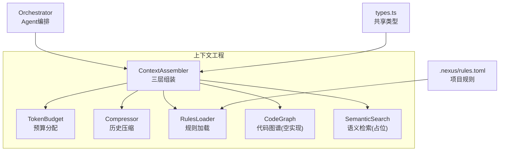
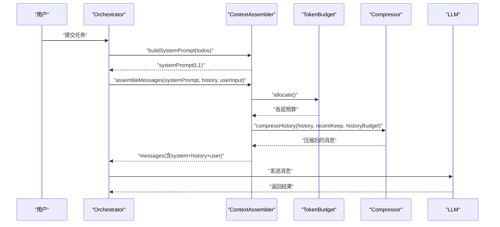
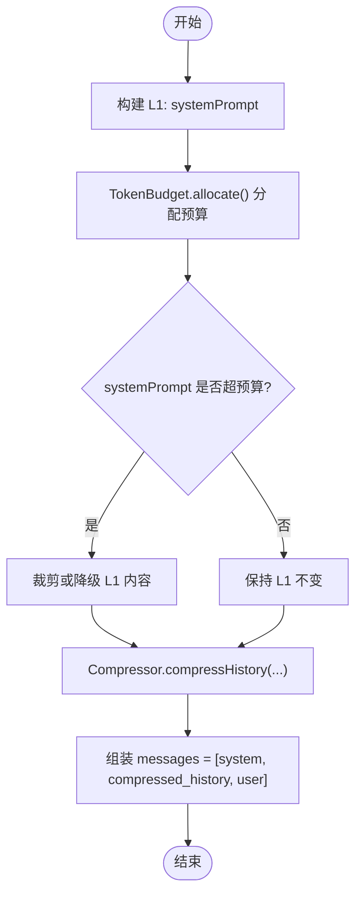
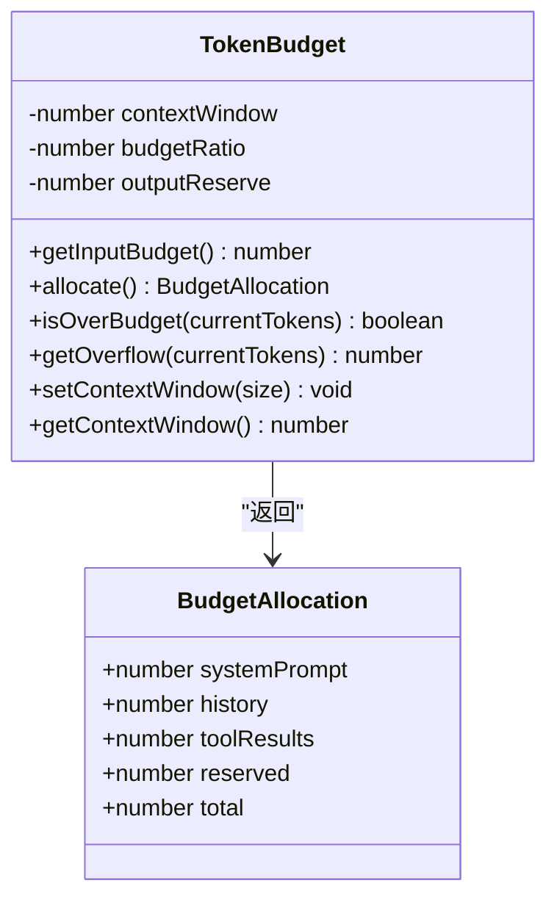
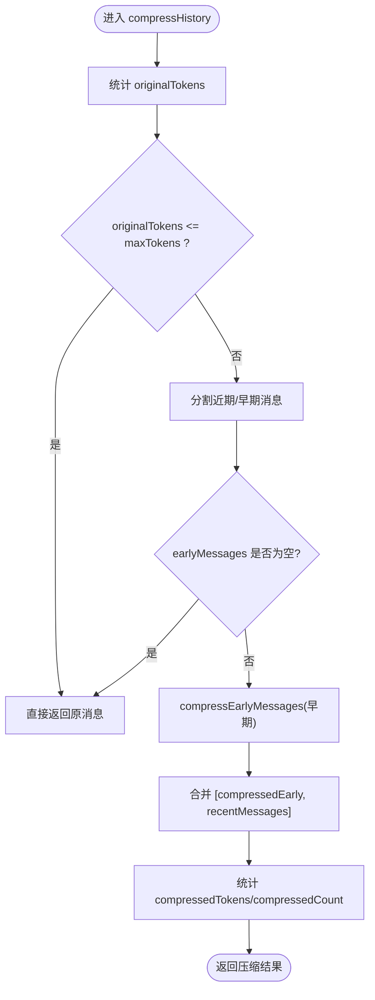
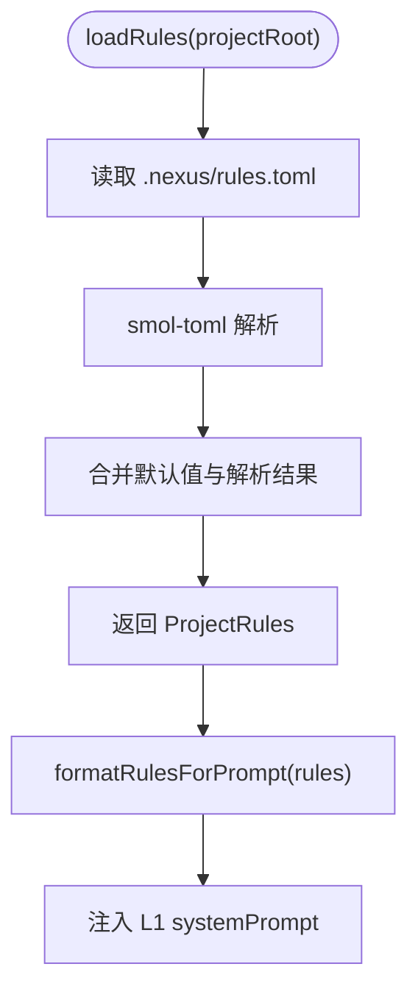
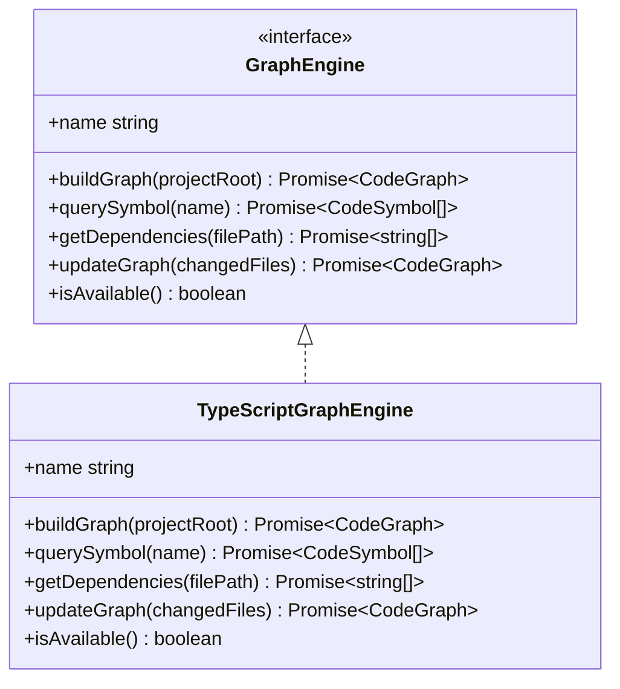
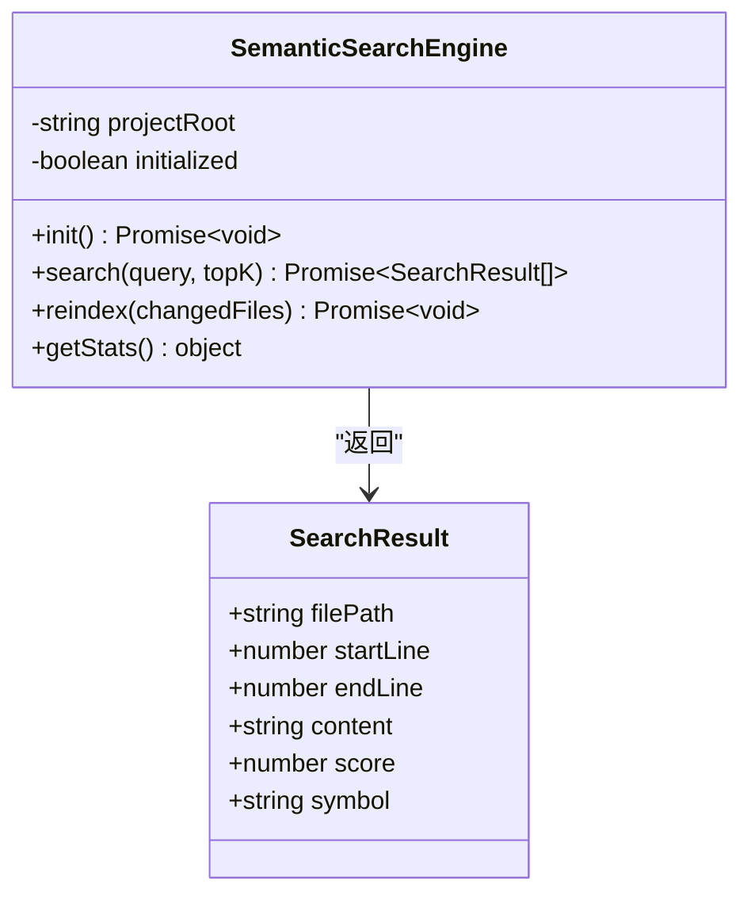
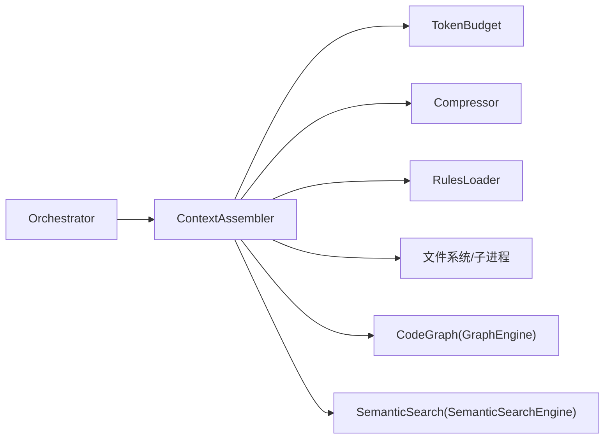

# 上下文工程

<cite>
**本文引用的文件**
- [src/context/Assembler.ts](file://src/context/Assembler.ts)
- [src/context/TokenBudget.ts](file://src/context/TokenBudget.ts)
- [src/context/Compressor.ts](file://src/context/Compressor.ts)
- [src/context/RulesLoader.ts](file://src/context/RulesLoader.ts)
- [src/context/CodeGraph.ts](file://src/context/CodeGraph.ts)
- [src/context/SemanticSearch.ts](file://src/context/SemanticSearch.ts)
- [src/agent/types.ts](file://src/agent/types.ts)
- [src/agent/Orchestrator.ts](file://src/agent/Orchestrator.ts)
- [.nexus/rules.toml](file://.nexus/rules.toml)
- [tests/unit/context.test.ts](file://tests/unit/context.test.ts)
</cite>

## 目录
1. [引言](#引言)
2. [项目结构](#项目结构)
3. [核心组件](#核心组件)
4. [架构总览](#架构总览)
5. [详细组件分析](#详细组件分析)
6. [依赖关系分析](#依赖关系分析)
7. [性能与优化建议](#性能与优化建议)
8. [故障排查指南](#故障排查指南)
9. [结论](#结论)
10. [附录：配置与最佳实践](#附录配置与最佳实践)

## 引言
本技术文档聚焦 Nexus 的“上下文工程系统”，围绕三层上下文结构（L1 静态规则、L2 任务历史、L3 检索增强）展开，深入解析 ContextAssembler 的组装策略、TokenBudget 的预算管理机制、Compressor 的历史压缩算法，以及 RulesLoader、CodeGraph、SemanticSearch 的职责与实现现状。同时提供避免上下文窗口溢出、提高检索准确性的最佳实践，并给出可操作的配置示例与性能调优建议。

## 项目结构
上下文工程相关代码集中在 src/context 目录，配合 agent 层的 Orchestrator 完成整体编排；类型定义位于 src/agent/types.ts；项目级规则由 .nexus/rules.toml 管理；单元测试覆盖 TokenBudget 与 Compressor 的核心行为。

图表来源
- [src/context/Assembler.ts:1-184](file://src/context/Assembler.ts#L1-L184)
- [src/context/TokenBudget.ts:1-79](file://src/context/TokenBudget.ts#L1-L79)
- [src/context/Compressor.ts:1-159](file://src/context/Compressor.ts#L1-L159)
- [src/context/RulesLoader.ts:1-90](file://src/context/RulesLoader.ts#L1-L90)
- [src/context/CodeGraph.ts:1-175](file://src/context/CodeGraph.ts#L1-L175)
- [src/context/SemanticSearch.ts:1-101](file://src/context/SemanticSearch.ts#L1-L101)
- [src/agent/Orchestrator.ts:60-86](file://src/agent/Orchestrator.ts#L60-L86)
- [src/agent/types.ts:110-131](file://src/agent/types.ts#L110-L131)
- [.nexus/rules.toml:1-21](file://.nexus/rules.toml#L1-L21)

章节来源
- [src/context/Assembler.ts:1-184](file://src/context/Assembler.ts#L1-L184)
- [src/context/TokenBudget.ts:1-79](file://src/context/TokenBudget.ts#L1-L79)
- [src/context/Compressor.ts:1-159](file://src/context/Compressor.ts#L1-L159)
- [src/context/RulesLoader.ts:1-90](file://src/context/RulesLoader.ts#L1-L90)
- [src/context/CodeGraph.ts:1-175](file://src/context/CodeGraph.ts#L1-L175)
- [src/context/SemanticSearch.ts:1-101](file://src/context/SemanticSearch.ts#L1-L101)
- [src/agent/Orchestrator.ts:60-86](file://src/agent/Orchestrator.ts#L60-L86)
- [src/agent/types.ts:110-131](file://src/agent/types.ts#L110-L131)
- [.nexus/rules.toml:1-21](file://.nexus/rules.toml#L1-L21)

## 核心组件
- ContextAssembler：负责构建 system prompt（L1）、组装消息序列（L2/L3），并在组装前进行 token 预算检查与裁剪。
- TokenBudget：估算文本 token 数、计算输入预算、按层分配预算、判断超预算与溢出量。
- Compressor：对长会话历史进行分级压缩，保留近期完整对话，早期摘要化，并对工具结果做差异化压缩。
- RulesLoader：从 .nexus/rules.toml 加载项目约定，格式化注入到 L1 上下文，并提供常驻包含文件路径。
- CodeGraph：代码图谱接口与 TypeScript 空实现（v2 将替换为 Go tree-sitter 引擎）。
- SemanticSearch：语义检索占位实现（Phase 4 计划接入本地 embedding + SQLite）。

章节来源
- [src/context/Assembler.ts:1-184](file://src/context/Assembler.ts#L1-L184)
- [src/context/TokenBudget.ts:1-79](file://src/context/TokenBudget.ts#L1-L79)
- [src/context/Compressor.ts:1-159](file://src/context/Compressor.ts#L1-L159)
- [src/context/RulesLoader.ts:1-90](file://src/context/RulesLoader.ts#L1-L90)
- [src/context/CodeGraph.ts:1-175](file://src/context/CodeGraph.ts#L1-L175)
- [src/context/SemanticSearch.ts:1-101](file://src/context/SemanticSearch.ts#L1-L101)

## 架构总览
上下文工程在 Orchestrator 初始化时创建 TokenBudget 与 ContextAssembler，随后在每次用户输入时构建 L1 system prompt，结合 L2 历史与 L3 检索内容，统一通过 Compressor 控制长度，最终输出符合模型上下文窗口的消息序列。

图表来源
- [src/agent/Orchestrator.ts:88-118](file://src/agent/Orchestrator.ts#L88-L118)
- [src/context/Assembler.ts:55-116](file://src/context/Assembler.ts#L55-L116)
- [src/context/TokenBudget.ts:47-57](file://src/context/TokenBudget.ts#L47-L57)
- [src/context/Compressor.ts:25-56](file://src/context/Compressor.ts#L25-L56)

## 详细组件分析

### 三层上下文结构与 ContextAssembler 组装策略
- L1 静态上下文：系统提示、项目规则、工具说明、Git 状态、项目骨架树、Todo 进度等。
- L2 任务上下文：对话历史（经压缩后保留近期完整轮次，早期摘要）。
- L3 检索增强：预留语义搜索与代码图谱能力，当前以空实现为主，后续扩展。

ContextAssembler 的关键流程：
- buildSystemPrompt：拼接基础系统提示、规则、工具列表、Git 状态、项目树、Todo 列表。
- assembleMessages：基于 TokenBudget 分配预算，调用 Compressor 压缩历史，最终生成 messages。
- loadAlwaysIncludeFiles：读取常驻上下文文件（来自 rules.context.alwaysInclude），截断过长内容。

图表来源
- [src/context/Assembler.ts:55-116](file://src/context/Assembler.ts#L55-L116)
- [src/context/TokenBudget.ts:47-57](file://src/context/TokenBudget.ts#L47-L57)
- [src/context/Compressor.ts:25-56](file://src/context/Compressor.ts#L25-L56)

章节来源
- [src/context/Assembler.ts:55-116](file://src/context/Assembler.ts#L55-L116)
- [src/context/Assembler.ts:155-168](file://src/context/Assembler.ts#L155-L168)
- [src/context/TokenBudget.ts:47-57](file://src/context/TokenBudget.ts#L47-L57)
- [src/context/Compressor.ts:25-56](file://src/context/Compressor.ts#L25-L56)

### TokenBudget 预算管理机制
- estimateTokens：粗略估算 token 数，区分 ASCII 与非 ASCII 字符，采用不同换算系数。
- getInputBudget：根据 contextWindow、budgetRatio、outputReserve 计算可用输入预算。
- allocate：按固定比例分配 L1/L2/L3 预算（systemPrompt/history/toolResults），并保留输出空间。
- isOverBudget/getOverflow：判断是否超预算及溢出量，用于触发裁剪策略。

图表来源
- [src/context/TokenBudget.ts:31-78](file://src/context/TokenBudget.ts#L31-L78)

章节来源
- [src/context/TokenBudget.ts:1-79](file://src/context/TokenBudget.ts#L1-L79)
- [tests/unit/context.test.ts:35-67](file://tests/unit/context.test.ts#L35-L67)

### Compressor 历史压缩算法
- compressHistory：当原始历史超过 maxTokens 时，分离近期消息与早期消息；近期完整保留，早期压缩为摘要。
- compressEarlyMessages：对用户请求、助手回复、工具结果分别处理，合并为一条历史摘要消息。
- compressToolResult：按工具类型差异化压缩（bash 失败完整保留、read_file/grep/edit_file 仅保留元信息、成功 bash 输出摘要）。
- compressSingleToolResult：实时压缩单条工具结果，错误完整保留，成功结果按类型压缩。

图表来源
- [src/context/Compressor.ts:25-56](file://src/context/Compressor.ts#L25-L56)
- [src/context/Compressor.ts:59-97](file://src/context/Compressor.ts#L59-L97)
- [src/context/Compressor.ts:100-136](file://src/context/Compressor.ts#L100-L136)
- [src/context/Compressor.ts:139-158](file://src/context/Compressor.ts#L139-L158)

章节来源
- [src/context/Compressor.ts:25-158](file://src/context/Compressor.ts#L25-L158)
- [tests/unit/context.test.ts:70-114](file://tests/unit/context.test.ts#L70-L114)

### RulesLoader 规则加载与管理
- loadRules：从 .nexus/rules.toml 解析项目名、语言、测试/构建命令、风格、约束、常驻包含文件等，缺失则回退默认值。
- formatRulesForPrompt：将规则格式化为 system prompt 片段，注入 L1。
- getAlwaysIncludePaths：将 alwaysInclude 转换为绝对路径，供 ContextAssembler.loadAlwaysIncludeFiles 使用。

图表来源
- [src/context/RulesLoader.ts:29-58](file://src/context/RulesLoader.ts#L29-L58)
- [src/context/RulesLoader.ts:60-84](file://src/context/RulesLoader.ts#L60-L84)
- [src/context/RulesLoader.ts:86-90](file://src/context/RulesLoader.ts#L86-L90)
- [.nexus/rules.toml:1-21](file://.nexus/rules.toml#L1-L21)

章节来源
- [src/context/RulesLoader.ts:1-90](file://src/context/RulesLoader.ts#L1-L90)
- [.nexus/rules.toml:1-21](file://.nexus/rules.toml#L1-L21)

### CodeGraph 代码图谱构建
- 接口 GraphEngine：定义全量构建、符号查询、依赖获取、增量更新、可用性检测等能力。
- TypeScriptGraphEngine：当前空实现（fallback），返回空图谱；v2 将替换为 Go 引擎（tree-sitter 后台索引服务）。
- 便捷函数：buildCodeGraph、updateCodeGraph、formatGraphForContext 用于集成与 L1 注入。

图表来源
- [src/context/CodeGraph.ts:75-93](file://src/context/CodeGraph.ts#L75-L93)
- [src/context/CodeGraph.ts:101-125](file://src/context/CodeGraph.ts#L101-L125)
- [src/context/CodeGraph.ts:141-175](file://src/context/CodeGraph.ts#L141-L175)

章节来源
- [src/context/CodeGraph.ts:1-175](file://src/context/CodeGraph.ts#L1-L175)

### SemanticSearch 智能检索
- SemanticSearchEngine：当前为占位实现，init/search/reindex/getStats 均为 TODO；Phase 4 计划接入 transformers.js 本地 embedding 与 SQLite 索引。
- semanticSearchToolDefinition：工具定义，描述自然语言/代码片段跨词面匹配能力，注册到工具层后供 Agent 调用。

图表来源
- [src/context/SemanticSearch.ts:31-74](file://src/context/SemanticSearch.ts#L31-L74)
- [src/context/SemanticSearch.ts:77-101](file://src/context/SemanticSearch.ts#L77-L101)

章节来源
- [src/context/SemanticSearch.ts:1-101](file://src/context/SemanticSearch.ts#L1-L101)

## 依赖关系分析
- Orchestrator 在 init 中加载 secrets、rules，创建 TokenBudget 与 ContextAssembler，并将 tools 列表注入。
- ContextAssembler 依赖 TokenBudget 与 Compressor 进行预算与压缩；依赖 RulesLoader 格式化规则；依赖文件系统与子进程执行 git/tree 命令。
- CodeGraph 与 SemanticSearch 作为可扩展模块，当前为空实现，便于未来替换为高性能后端。

图表来源
- [src/agent/Orchestrator.ts:60-86](file://src/agent/Orchestrator.ts#L60-L86)
- [src/context/Assembler.ts:1-184](file://src/context/Assembler.ts#L1-L184)
- [src/context/TokenBudget.ts:1-79](file://src/context/TokenBudget.ts#L1-L79)
- [src/context/Compressor.ts:1-159](file://src/context/Compressor.ts#L1-L159)
- [src/context/RulesLoader.ts:1-90](file://src/context/RulesLoader.ts#L1-L90)
- [src/context/CodeGraph.ts:1-175](file://src/context/CodeGraph.ts#L1-L175)
- [src/context/SemanticSearch.ts:1-101](file://src/context/SemanticSearch.ts#L1-L101)

章节来源
- [src/agent/Orchestrator.ts:60-86](file://src/agent/Orchestrator.ts#L60-L86)
- [src/context/Assembler.ts:1-184](file://src/context/Assembler.ts#L1-L184)

## 性能与优化建议
- 控制 L1 体积：精简 system prompt 与工具说明，限制 Git 状态与项目树行数（已内置上限）。
- 合理设置 budgetRatio 与 outputReserve：增大 outputReserve 可降低输出被截断风险；降低 budgetRatio 可减少输入占用。
- 调整 recentTurnsKeep：较长会话下适当减少保留轮数以节省历史空间。
- 工具结果压缩：优先使用 compressSingleToolResult 在实时阶段压缩大输出，避免一次性塞入过多内容。
- 常驻文件选择：alwaysInclude 仅包含关键设计文档与类型定义，避免过大文件导致 L1 膨胀。
- 图谱与检索：待 v2/v4 启用后，利用增量更新与局部索引减少全量扫描开销。

[本节为通用指导，不直接分析具体文件]

## 故障排查指南
- 上下文窗口溢出：
  - 现象：模型报错或响应异常中断。
  - 排查：检查 TokenBudget.isOverBudget 与 getOverflow 返回值；确认 recentTurnsKeep 与 budgetRatio 配置。
  - 修复：减小 L1 内容、缩短历史保留轮数、开启更激进的压缩策略。
- 历史未压缩：
  - 现象：messages 数量与原始历史一致。
  - 排查：确认 compressHistory 的 maxTokens 阈值与 originalTokens 比较逻辑。
  - 修复：降低 maxTokens 或增加 early 消息压缩强度。
- 工具结果过大：
  - 现象：单次工具调用导致上下文暴涨。
  - 排查：查看 compressSingleToolResult 分支逻辑，确保错误路径完整保留、成功路径有效压缩。
  - 修复：自定义压缩策略或在上游限制输出大小。
- 规则未生效：
  - 现象：systemPrompt 缺少项目信息或约束。
  - 排查：确认 .nexus/rules.toml 存在且字段正确；检查 formatRulesForPrompt 输出。
  - 修复：修正 TOML 键名与值类型，确保常量映射正确。

章节来源
- [src/context/TokenBudget.ts:59-68](file://src/context/TokenBudget.ts#L59-L68)
- [src/context/Compressor.ts:25-56](file://src/context/Compressor.ts#L25-L56)
- [src/context/Compressor.ts:139-158](file://src/context/Compressor.ts#L139-L158)
- [src/context/RulesLoader.ts:29-58](file://src/context/RulesLoader.ts#L29-L58)
- [src/context/RulesLoader.ts:60-84](file://src/context/RulesLoader.ts#L60-L84)

## 结论
Nexus 的上下文工程以三层结构为核心，通过 TokenBudget 精确分配、Compressor 分级压缩、RulesLoader 结构化注入，实现了长会话下的稳定上下文管理。CodeGraph 与 SemanticSearch 预留了可扩展接口，为后续引入高性能后端与本地语义检索奠定基础。配合合理的配置与优化策略，可有效避免上下文窗口溢出并提升检索准确性。

[本节为总结性内容，不直接分析具体文件]

## 附录：配置与最佳实践

### 配置示例
- 项目规则（.nexus/rules.toml）
  - 关键字段：project.name/language/test_command/build_command、style.indent/quote/semicolons、constraints 硬约束、context.always_include 常驻文件。
  - 建议：always_include 仅包含必要的设计文档与类型定义，避免过大文件。
- 上下文参数（NexusConfig.context）
  - budgetRatio：建议 0.75–0.85，平衡输入与输出空间。
  - recentTurnsKeep：短会话 5–10，长会话 2–5，视历史长度动态调整。
- 模型上下文窗口（ModelRoute.contextWindow）
  - 切换模型时需同步更新 TokenBudget.setContextWindow，确保预算计算正确。

章节来源
- [.nexus/rules.toml:1-21](file://.nexus/rules.toml#L1-L21)
- [src/agent/types.ts:134-160](file://src/agent/types.ts#L134-L160)
- [src/context/TokenBudget.ts:31-78](file://src/context/TokenBudget.ts#L31-L78)

### 避免上下文窗口溢出的最佳实践
- 控制 L1 体量：精简 system prompt、限制 Git 状态与项目树行数。
- 合理分配预算：提高 outputReserve，降低 budgetRatio，减少历史保留轮数。
- 强化压缩：启用 compressSingleToolResult，针对 read_file/bash/grep 等工具输出进行差异化压缩。
- 选择性常驻：alwaysInclude 仅包含高价值文件，避免重复或冗余内容。

章节来源
- [src/context/Assembler.ts:55-116](file://src/context/Assembler.ts#L55-L116)
- [src/context/Compressor.ts:139-158](file://src/context/Compressor.ts#L139-L158)
- [src/context/RulesLoader.ts:86-90](file://src/context/RulesLoader.ts#L86-L90)

### 提高检索准确性的建议
- 语义检索（Phase 4）：使用本地 embedding 模型与 SQLite 索引，切分为函数级块，提升召回精度。
- 代码图谱（v2）：启用 Go 引擎的 tree-sitter 后台索引，支持增量更新与依赖图查询。
- 组合检索：结合 grep 关键词与语义相似度排序，先粗筛再精排。

章节来源
- [src/context/SemanticSearch.ts:27-74](file://src/context/SemanticSearch.ts#L27-L74)
- [src/context/CodeGraph.ts:36-93](file://src/context/CodeGraph.ts#L36-L93)