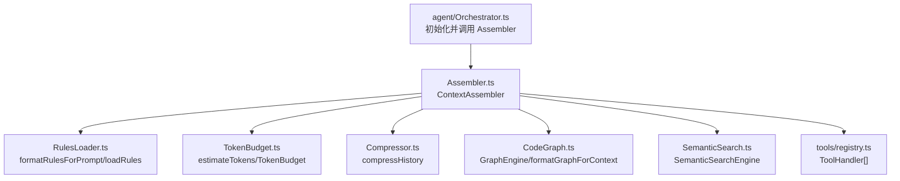
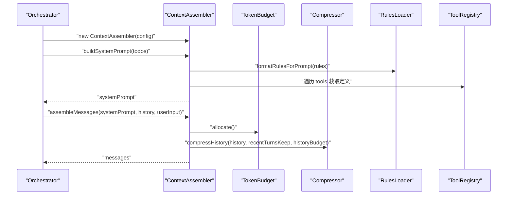
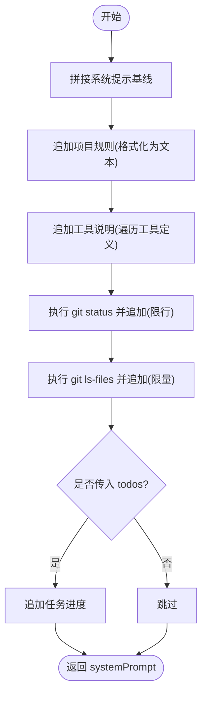
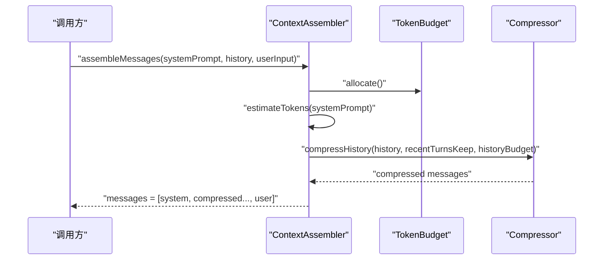
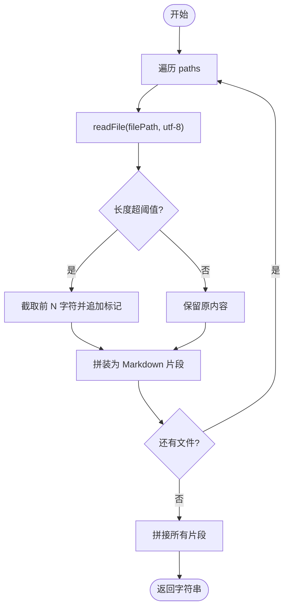
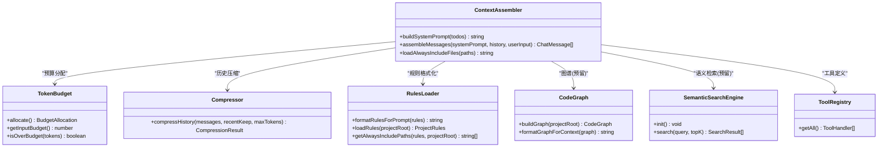

# 上下文组装器

<cite>
**本文引用的文件**
- [src/context/Assembler.ts](file://src/context/Assembler.ts)
- [src/context/RulesLoader.ts](file://src/context/RulesLoader.ts)
- [src/context/TokenBudget.ts](file://src/context/TokenBudget.ts)
- [src/context/Compressor.ts](file://src/context/Compressor.ts)
- [src/context/CodeGraph.ts](file://src/context/CodeGraph.ts)
- [src/context/SemanticSearch.ts](file://src/context/SemanticSearch.ts)
- [src/tools/registry.ts](file://src/tools/registry.ts)
- [src/agent/types.ts](file://src/agent/types.ts)
- [src/agent/Orchestrator.ts](file://src/agent/Orchestrator.ts)
</cite>

## 目录
1. [简介](#简介)
2. [项目结构](#项目结构)
3. [核心组件](#核心组件)
4. [架构总览](#架构总览)
5. [详细组件分析](#详细组件分析)
6. [依赖关系分析](#依赖关系分析)
7. [性能考量](#性能考量)
8. [故障排查指南](#故障排查指南)
9. [结论](#结论)
10. [附录：配置与最佳实践](#附录配置与最佳实践)

## 简介
本文件围绕 ContextAssembler 类，系统化阐述三层上下文结构的设计理念与实现细节：
- L1 静态上下文：系统提示、项目规则、工具说明等“不变或低频变化”的信息
- L2 任务上下文：Todo 进度、Git 状态等“随会话推进而更新”的信息
- L3 检索上下文：代码图谱、语义搜索结果等“按需检索并注入”的信息

重点解析以下方法：
- buildSystemPrompt：L1 静态上下文的组装策略
- assembleMessages：消息构建流程与预算控制
- loadAlwaysIncludeFiles：常驻文件加载机制

同时给出 AssemblerConfig 的配置项说明、使用示例与优化建议。

## 项目结构
ContextAssembler 位于 context 模块，负责将 L1/L2/L3 三类上下文整合为最终发送给模型的 messages。其关键依赖包括：
- TokenBudget：估算 token 数与分配预算
- Compressor：对话历史压缩
- RulesLoader：读取 .nexus/rules.toml 并格式化规则片段
- CodeGraph / SemanticSearch：L3 检索能力（当前为占位/空实现）
- ToolRegistry：工具定义集合，用于生成工具说明

图表来源
- [src/context/Assembler.ts:48-116](file://src/context/Assembler.ts#L48-L116)
- [src/context/RulesLoader.ts:29-84](file://src/context/RulesLoader.ts#L29-L84)
- [src/context/TokenBudget.ts:31-57](file://src/context/TokenBudget.ts#L31-L57)
- [src/context/Compressor.ts:25-56](file://src/context/Compressor.ts#L25-L56)
- [src/context/CodeGraph.ts:131-163](file://src/context/CodeGraph.ts#L131-L163)
- [src/context/SemanticSearch.ts:31-74](file://src/context/SemanticSearch.ts#L31-L74)
- [src/tools/registry.ts:12-42](file://src/tools/registry.ts#L12-L42)
- [src/agent/Orchestrator.ts:60-86](file://src/agent/Orchestrator.ts#L60-L86)

章节来源
- [src/context/Assembler.ts:1-184](file://src/context/Assembler.ts#L1-L184)
- [src/agent/Orchestrator.ts:60-86](file://src/agent/Orchestrator.ts#L60-L86)

## 核心组件
- ContextAssembler：上下文组装器，提供 system prompt 构建、消息组装、常驻文件加载等方法
- TokenBudget：token 预算管理与分配
- Compressor：对话历史分级压缩
- RulesLoader：规则加载与格式化
- CodeGraph：代码图谱接口与默认空实现
- SemanticSearch：语义搜索接口与工具定义（占位）
- ToolRegistry：工具注册中心，提供工具定义列表

章节来源
- [src/context/Assembler.ts:48-116](file://src/context/Assembler.ts#L48-L116)
- [src/context/TokenBudget.ts:31-57](file://src/context/TokenBudget.ts#L31-L57)
- [src/context/Compressor.ts:25-56](file://src/context/Compressor.ts#L25-L56)
- [src/context/RulesLoader.ts:29-84](file://src/context/RulesLoader.ts#L29-L84)
- [src/context/CodeGraph.ts:101-163](file://src/context/CodeGraph.ts#L101-L163)
- [src/context/SemanticSearch.ts:31-101](file://src/context/SemanticSearch.ts#L31-L101)
- [src/tools/registry.ts:12-42](file://src/tools/registry.ts#L12-L42)

## 架构总览
下图展示 Orchestrator 如何初始化并使用 ContextAssembler，以及 Assembler 在构建 system prompt 和消息时的调用链。

图表来源
- [src/agent/Orchestrator.ts:60-86](file://src/agent/Orchestrator.ts#L60-L86)
- [src/context/Assembler.ts:55-116](file://src/context/Assembler.ts#L55-L116)
- [src/context/RulesLoader.ts:60-84](file://src/context/RulesLoader.ts#L60-L84)
- [src/context/TokenBudget.ts:47-57](file://src/context/TokenBudget.ts#L47-L57)
- [src/context/Compressor.ts:25-56](file://src/context/Compressor.ts#L25-L56)
- [src/tools/registry.ts:40-42](file://src/tools/registry.ts#L40-L42)

## 详细组件分析

### 三层上下文设计理念
- L1 静态上下文
  - 内容：系统提示基线、项目规则、工具说明、Git 状态、项目骨架树、Todos 进度
  - 特点：相对固定，仅在项目规则或工具集变更时更新；通过 formatRulesForPrompt 注入结构化规则
- L2 任务上下文
  - 内容：历史对话（经压缩）、用户输入
  - 特点：随会话推进增长，需按预算进行分级压缩，保留近期完整轮次，早期摘要化
- L3 检索上下文
  - 内容：代码图谱（符号级地图）、语义搜索结果
  - 特点：按需检索，结合预算裁剪；当前 TypeScript 侧为空实现，预留 Go 引擎替换点

章节来源
- [src/context/Assembler.ts:55-90](file://src/context/Assembler.ts#L55-L90)
- [src/context/CodeGraph.ts:147-163](file://src/context/CodeGraph.ts#L147-L163)
- [src/context/SemanticSearch.ts:31-74](file://src/context/SemanticSearch.ts#L31-L74)

### buildSystemPrompt 的组装策略
- 步骤概览
  - 拼接系统提示基线
  - 追加项目规则（来自 rules.toml）
  - 追加工具说明（遍历 ToolHandler 列表）
  - 追加 Git 状态（git status --short --branch，限制行数）
  - 追加项目骨架树（git ls-files，限制数量）
  - 追加 Todos 进度（可选）
- 设计要点
  - 各部分以清晰标题分隔，便于模型理解层次
  - Git 状态与项目树均做上限截断，避免占用过多 token
  - 工具说明仅包含 name 与 description，保持简洁

图表来源
- [src/context/Assembler.ts:55-90](file://src/context/Assembler.ts#L55-L90)
- [src/context/Assembler.ts:118-153](file://src/context/Assembler.ts#L118-L153)
- [src/context/RulesLoader.ts:60-84](file://src/context/RulesLoader.ts#L60-L84)

章节来源
- [src/context/Assembler.ts:55-90](file://src/context/Assembler.ts#L55-L90)
- [src/context/Assembler.ts:118-153](file://src/context/Assembler.ts#L118-L153)
- [src/context/RulesLoader.ts:60-84](file://src/context/RulesLoader.ts#L60-L84)

### assembleMessages 的消息构建流程
- 预算分配
  - 根据 TokenBudget.allocate() 计算 systemPrompt/history/toolResults/reserved 的配额
- 历史压缩
  - 使用 compressHistory 对历史进行分级压缩，保留近期完整轮次，早期摘要化
- 消息组装
  - 构造 system/user 消息，并将压缩后的历史插入中间
- 输出
  - 返回 ChatMessage[] 供上层调用

图表来源
- [src/context/Assembler.ts:92-116](file://src/context/Assembler.ts#L92-L116)
- [src/context/TokenBudget.ts:47-57](file://src/context/TokenBudget.ts#L47-L57)
- [src/context/Compressor.ts:25-56](file://src/context/Compressor.ts#L25-L56)

章节来源
- [src/context/Assembler.ts:92-116](file://src/context/Assembler.ts#L92-L116)
- [src/context/TokenBudget.ts:47-57](file://src/context/TokenBudget.ts#L47-L57)
- [src/context/Compressor.ts:25-56](file://src/context/Compressor.ts#L25-L56)

### loadAlwaysIncludeFiles 的常驻文件加载机制
- 功能
  - 读取指定路径的文件内容，作为常驻上下文注入到 system prompt 或相关位置
- 行为
  - 逐文件读取，单文件超过阈值则截断并标注“已截断”
  - 不存在则跳过，不中断整体流程
- 典型用法
  - 从 rules.toml 的 alwaysInclude 字段解析路径，再调用此方法合并入上下文

图表来源
- [src/context/Assembler.ts:155-168](file://src/context/Assembler.ts#L155-L168)
- [src/context/RulesLoader.ts:86-90](file://src/context/RulesLoader.ts#L86-L90)

章节来源
- [src/context/Assembler.ts:155-168](file://src/context/Assembler.ts#L155-L168)
- [src/context/RulesLoader.ts:86-90](file://src/context/RulesLoader.ts#L86-L90)

### 配置 AssemblerConfig 详解
- projectRoot：项目根目录，用于执行 git 命令与解析绝对路径
- rules：ProjectRules，来源于 .nexus/rules.toml，包含项目信息、风格、约束、alwaysInclude 等
- tools：ToolHandler[]，由工具注册中心提供，用于生成工具说明
- budget：TokenBudget，控制上下文窗口与预算分配
- recentTurnsKeep：保留最近的完整轮次数，用于历史压缩

章节来源
- [src/context/Assembler.ts:40-53](file://src/context/Assembler.ts#L40-L53)
- [src/agent/types.ts:168-184](file://src/agent/types.ts#L168-L184)
- [src/tools/registry.ts:12-42](file://src/tools/registry.ts#L12-L42)
- [src/context/TokenBudget.ts:31-57](file://src/context/TokenBudget.ts#L31-L57)

### 使用示例与最佳实践
- 基本用法（概念性描述）
  - 在项目根目录下准备 .nexus/rules.toml，声明项目名称、语言、测试/构建命令、代码风格、alwaysInclude 列表
  - 初始化 TokenBudget，基于目标模型的 contextWindow 与预算比例创建
  - 通过 createToolRegistry().getAll() 获取工具定义列表
  - 实例化 ContextAssembler，传入上述配置
  - 调用 buildSystemPrompt(todos) 生成 system prompt
  - 调用 assembleMessages(systemPrompt, history, userInput) 得到最终消息数组
- 优化 system prompt 的建议
  - 精简工具说明：仅保留必要字段（name/description），避免冗长 schema
  - 合理设置 alwaysInclude：只包含关键文档或规范，避免大文件导致 token 浪费
  - 控制 Git 状态与项目树显示量：已在内部做了上限截断，可按需调整
  - 利用规则文件集中管理项目约定，减少硬编码
  - 定期清理历史：recentTurnsKeep 不宜过大，配合压缩策略降低开销

章节来源
- [src/context/Assembler.ts:55-90](file://src/context/Assembler.ts#L55-L90)
- [src/context/Assembler.ts:92-116](file://src/context/Assembler.ts#L92-L116)
- [src/context/RulesLoader.ts:29-84](file://src/context/RulesLoader.ts#L29-L84)
- [src/context/Compressor.ts:25-56](file://src/context/Compressor.ts#L25-L56)

## 依赖关系分析
- 直接依赖
  - Assembler → RulesLoader（规则格式化）
  - Assembler → TokenBudget（预算与估算）
  - Assembler → Compressor（历史压缩）
  - Assembler → ToolRegistry（工具定义）
  - Assembler → CodeGraph/SemanticSearch（L3 检索，当前为空实现）
- 间接依赖
  - Orchestrator 负责初始化 Assembler 并驱动调用
  - Agent types 提供共享类型（ChatMessage、ProjectRules、Todo 等）

图表来源
- [src/context/Assembler.ts:48-116](file://src/context/Assembler.ts#L48-L116)
- [src/context/TokenBudget.ts:31-57](file://src/context/TokenBudget.ts#L31-L57)
- [src/context/Compressor.ts:25-56](file://src/context/Compressor.ts#L25-L56)
- [src/context/RulesLoader.ts:29-90](file://src/context/RulesLoader.ts#L29-L90)
- [src/context/CodeGraph.ts:101-163](file://src/context/CodeGraph.ts#L101-L163)
- [src/context/SemanticSearch.ts:31-101](file://src/context/SemanticSearch.ts#L31-L101)
- [src/tools/registry.ts:12-42](file://src/tools/registry.ts#L12-L42)

章节来源
- [src/context/Assembler.ts:48-116](file://src/context/Assembler.ts#L48-L116)
- [src/context/TokenBudget.ts:31-57](file://src/context/TokenBudget.ts#L31-L57)
- [src/context/Compressor.ts:25-56](file://src/context/Compressor.ts#L25-L56)
- [src/context/RulesLoader.ts:29-90](file://src/context/RulesLoader.ts#L29-L90)
- [src/context/CodeGraph.ts:101-163](file://src/context/CodeGraph.ts#L101-L163)
- [src/context/SemanticSearch.ts:31-101](file://src/context/SemanticSearch.ts#L31-L101)
- [src/tools/registry.ts:12-42](file://src/tools/registry.ts#L12-L42)

## 性能考量
- Token 估算
  - estimateTokens 采用 ASCII/非 ASCII 混合估算，快速且近似，适合实时预算判断
- 预算分配
  - allocate 将输入预算按比例分配到 systemPrompt/history/toolResults，并预留输出空间
- 历史压缩
  - compressHistory 分离近期与早期消息，早期摘要化，显著降低长会话成本
- I/O 与外部命令
  - getGitStatus/getProjectTree 通过子进程执行 git 命令，存在失败与超时风险，内部已捕获异常并降级处理
- 常驻文件
  - loadAlwaysIncludeFiles 对大文件进行截断，避免单次注入过大内容

章节来源
- [src/context/TokenBudget.ts:6-21](file://src/context/TokenBudget.ts#L6-L21)
- [src/context/TokenBudget.ts:47-57](file://src/context/TokenBudget.ts#L47-L57)
- [src/context/Compressor.ts:25-56](file://src/context/Compressor.ts#L25-L56)
- [src/context/Assembler.ts:118-153](file://src/context/Assembler.ts#L118-L153)
- [src/context/Assembler.ts:155-168](file://src/context/Assembler.ts#L155-L168)

## 故障排查指南
- Git 命令不可用或无权限
  - 现象：getGitStatus/getProjectTree 返回 null
  - 排查：确认项目根目录正确、git 可用、具备读取权限
- 常驻文件缺失或路径错误
  - 现象：loadAlwaysIncludeFiles 跳过文件
  - 排查：检查 alwaysInclude 路径是否为绝对路径或相对于 projectRoot 的有效路径
- 预算超限
  - 现象：历史被压缩较多，早期内容丢失
  - 排查：调整 recentTurnsKeep、budgetRatio，或精简 rules/tools/system prompt
- 工具说明过长
  - 现象：system prompt 体积过大
  - 排查：仅保留必要工具，或精简 description

章节来源
- [src/context/Assembler.ts:118-153](file://src/context/Assembler.ts#L118-L153)
- [src/context/Assembler.ts:155-168](file://src/context/Assembler.ts#L155-L168)
- [src/context/TokenBudget.ts:47-57](file://src/context/TokenBudget.ts#L47-L57)
- [src/context/Compressor.ts:25-56](file://src/context/Compressor.ts#L25-L56)

## 结论
ContextAssembler 通过清晰的三层上下文结构与严格的预算控制，实现了稳定高效的系统提示与消息组装。L1 静态上下文确保模型获得一致的项目与工具认知；L2 任务上下文通过压缩策略维持长会话可用性；L3 检索上下文预留了可扩展的代码图谱与语义检索能力。配合 AssemblerConfig 的灵活配置，可在不同项目与模型间平滑迁移，兼顾性能与可维护性。

## 附录：配置与最佳实践

### AssemblerConfig 参数说明
- projectRoot：string，项目根目录，用于执行 git 命令与解析 alwaysInclude 路径
- rules：ProjectRules，来自 .nexus/rules.toml，包含项目信息、风格、约束、alwaysInclude
- tools：ToolHandler[]，工具定义集合，用于生成工具说明
- budget：TokenBudget，控制上下文窗口与预算分配
- recentTurnsKeep：number，保留最近完整轮数，影响历史压缩粒度

章节来源
- [src/context/Assembler.ts:40-53](file://src/context/Assembler.ts#L40-L53)
- [src/agent/types.ts:168-184](file://src/agent/types.ts#L168-L184)
- [src/tools/registry.ts:12-42](file://src/tools/registry.ts#L12-L42)
- [src/context/TokenBudget.ts:31-57](file://src/context/TokenBudget.ts#L31-L57)

### 使用示例（概念性步骤）
- 准备 .nexus/rules.toml，填写项目名、语言、测试/构建命令、代码风格、alwaysInclude 列表
- 初始化 TokenBudget，依据目标模型的 contextWindow 与预算比例
- 通过 createToolRegistry().getAll() 获取工具定义
- 实例化 ContextAssembler，传入配置
- 调用 buildSystemPrompt(todos) 生成 system prompt
- 调用 assembleMessages(systemPrompt, history, userInput) 得到最终消息数组

章节来源
- [src/context/Assembler.ts:55-116](file://src/context/Assembler.ts#L55-L116)
- [src/context/RulesLoader.ts:29-84](file://src/context/RulesLoader.ts#L29-L84)
- [src/tools/registry.ts:86-93](file://src/tools/registry.ts#L86-L93)

### 优化 system prompt 的结构与组织
- 分层清晰：系统提示基线、项目规则、工具说明、Git 状态、项目树、任务进度
- 控制体量：对 Git 状态与项目树进行上限截断；工具说明仅保留必要字段
- 常驻文件精选：alwaysInclude 仅包含关键规范或文档，避免大文件
- 预算优先：根据模型上下文窗口动态调整 budgetRatio 与 recentTurnsKeep
- 渐进增强：L3 检索上下文逐步接入代码图谱与语义搜索，按需注入，避免一次性膨胀

章节来源
- [src/context/Assembler.ts:55-90](file://src/context/Assembler.ts#L55-L90)
- [src/context/Assembler.ts:118-153](file://src/context/Assembler.ts#L118-L153)
- [src/context/TokenBudget.ts:47-57](file://src/context/TokenBudget.ts#L47-L57)
- [src/context/Compressor.ts:25-56](file://src/context/Compressor.ts#L25-L56)