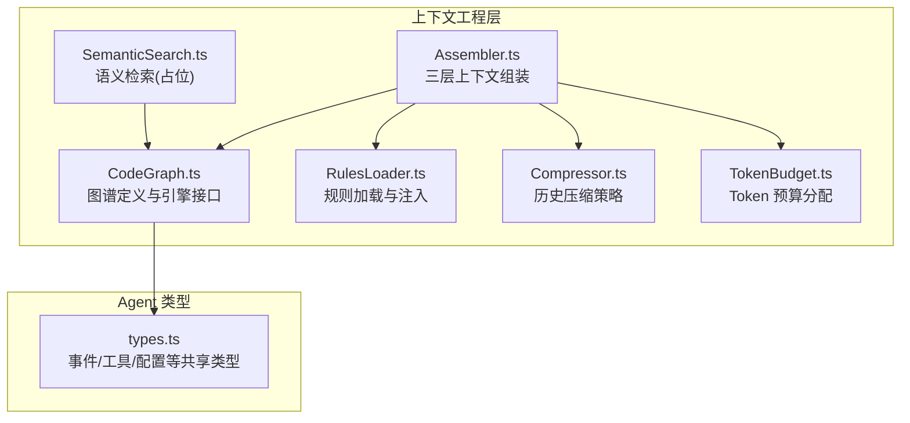
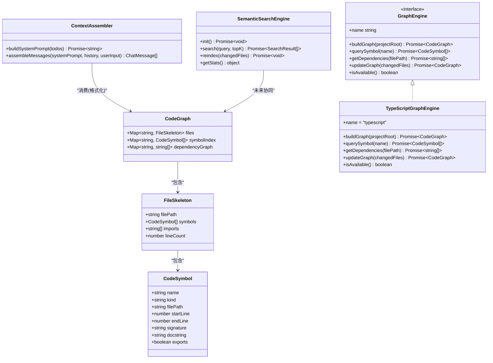
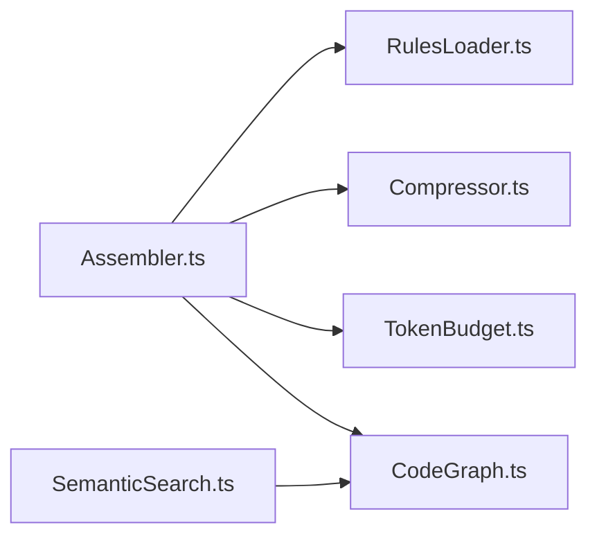

# 代码图谱

<cite>
**本文引用的文件**   
- [src/context/CodeGraph.ts](file://src/context/CodeGraph.ts)
- [src/context/Assembler.ts](file://src/context/Assembler.ts)
- [src/context/SemanticSearch.ts](file://src/context/SemanticSearch.ts)
- [src/context/RulesLoader.ts](file://src/context/RulesLoader.ts)
- [src/context/Compressor.ts](file://src/context/Compressor.ts)
- [src/context/TokenBudget.ts](file://src/context/TokenBudget.ts)
- [src/agent/types.ts](file://src/agent/types.ts)
- [README.md](file://README.md)
- [DESIGN.md](file://DESIGN.md)
</cite>

## 目录
1. [简介](#简介)
2. [项目结构](#项目结构)
3. [核心组件](#核心组件)
4. [架构总览](#架构总览)
5. [详细组件分析](#详细组件分析)
6. [依赖关系分析](#依赖关系分析)
7. [性能考量](#性能考量)
8. [故障排查指南](#故障排查指南)
9. [结论](#结论)
10. [附录：使用示例与查询方法](#附录使用示例与查询方法)

## 简介
本技术文档聚焦于 CodeGraph 模块，系统性阐述其设计目标、数据结构、接口契约、与上下文工程层的集成方式，以及未来向 Go 引擎迁移的演进路线。当前 TypeScript 侧为“空图谱 fallback”，用于在 Go 引擎不可用时提供稳定降级能力；v2 将引入 tree-sitter 后台索引服务，实现增量构建、跨文件符号解析与依赖分析。

## 项目结构
CodeGraph 位于上下文工程层，负责以“文件骨架 + 符号索引 + 依赖图”的形式呈现代码库概览，供上层 Agent 编排与 L1 静态上下文组装使用。语义检索（embedding）作为独立模块预留扩展点，后续与图谱协同工作。

图示来源
- [src/context/CodeGraph.ts:1-175](file://src/context/CodeGraph.ts#L1-L175)
- [src/context/Assembler.ts:1-184](file://src/context/Assembler.ts#L1-L184)
- [src/context/SemanticSearch.ts:1-101](file://src/context/SemanticSearch.ts#L1-L101)
- [src/context/RulesLoader.ts:1-90](file://src/context/RulesLoader.ts#L1-L90)
- [src/context/Compressor.ts:1-159](file://src/context/Compressor.ts#L1-L159)
- [src/context/TokenBudget.ts:1-79](file://src/context/TokenBudget.ts#L1-L79)
- [src/agent/types.ts:1-269](file://src/agent/types.ts#L1-L269)

章节来源
- [README.md:1-174](file://README.md#L1-L174)
- [DESIGN.md:312-324](file://DESIGN.md#L312-L324)

## 核心组件
- 图谱数据模型
  - 文件骨架：记录文件路径、符号列表、导入清单、行数统计
  - 符号索引：符号名到定义位置的映射
  - 依赖图：文件到被依赖文件的映射
- 图谱引擎接口
  - 全量构建、增量更新、符号查询、依赖查询、可用性检测、引擎名称
- TypeScript 默认实现
  - 返回空图谱，保证上层调用不中断
- 便捷函数
  - 构建图谱、格式化图谱为 L1 上下文片段、增量更新

章节来源
- [src/context/CodeGraph.ts:10-34](file://src/context/CodeGraph.ts#L10-L34)
- [src/context/CodeGraph.ts:75-93](file://src/context/CodeGraph.ts#L75-L93)
- [src/context/CodeGraph.ts:101-125](file://src/context/CodeGraph.ts#L101-L125)
- [src/context/CodeGraph.ts:141-174](file://src/context/CodeGraph.ts#L141-L174)

## 架构总览
CodeGraph 通过 GraphEngine 抽象屏蔽具体实现差异，上层仅依赖接口。当前 TypeScriptGraphEngine 为空实现；未来可无缝替换为 GoGraphEngine（tree-sitter 后台索引），保持 Agent loop 零改动。

图示来源
- [src/context/CodeGraph.ts:10-34](file://src/context/CodeGraph.ts#L10-L34)
- [src/context/CodeGraph.ts:75-93](file://src/context/CodeGraph.ts#L75-L93)
- [src/context/CodeGraph.ts:101-125](file://src/context/CodeGraph.ts#L101-L125)
- [src/context/Assembler.ts:48-116](file://src/context/Assembler.ts#L48-L116)
- [src/context/SemanticSearch.ts:31-74](file://src/context/SemanticSearch.ts#L31-L74)

## 详细组件分析

### 图谱数据模型与接口
- 文件骨架与符号
  - 每个文件维护一个骨架，包含符号列表、导入清单与行数统计，便于快速生成“地图”。
- 符号索引
  - 以符号名为键，聚合所有同名定义位置，支持跨文件定位。
- 依赖图
  - 以文件路径为键，值为被依赖文件集合，支撑影响范围分析。
- 引擎接口
  - 统一构建、查询、增量更新与可用性检测，确保上层对实现的无感知切换。

章节来源
- [src/context/CodeGraph.ts:10-34](file://src/context/CodeGraph.ts#L10-L34)
- [src/context/CodeGraph.ts:75-93](file://src/context/CodeGraph.ts#L75-L93)

### TypeScript 默认实现（空图谱 fallback）
- 行为
  - 构建返回空图谱；查询返回空结果；增量更新返回原图；始终可用。
- 目的
  - 保证上层调用链稳定，Go 引擎未就绪时不阻塞主流程。

章节来源
- [src/context/CodeGraph.ts:101-125](file://src/context/CodeGraph.ts#L101-L125)

### 便捷函数与 L1 上下文格式化
- 构建与增量更新
  - 通过 createGraphEngine 获取引擎实例并委托调用。
- 格式化
  - 将图谱转换为紧凑文本，作为 L1 静态上下文的一部分，让 Agent 了解全库概览。

章节来源
- [src/context/CodeGraph.ts:141-174](file://src/context/CodeGraph.ts#L141-L174)

### 与上下文工程的集成
- 组装器
  - 构建 system prompt 时，可接入图谱“地图”，配合项目规则、Git 状态、目录树等形成 L1 静态上下文。
- 压缩与预算
  - 结合 Token 预算与历史压缩策略，控制最终消息长度，避免窗口溢出。

章节来源
- [src/context/Assembler.ts:55-90](file://src/context/Assembler.ts#L55-L90)
- [src/context/Compressor.ts:25-56](file://src/context/Compressor.ts#L25-L56)
- [src/context/TokenBudget.ts:31-57](file://src/context/TokenBudget.ts#L31-L57)

### 语义检索（预留扩展）
- 当前为占位实现，Phase 4 将引入本地 embedding 与 SQLite 索引，与图谱协同完成跨词面匹配。
- 工具定义已预留，注册后由 Agent 按需调用。

章节来源
- [src/context/SemanticSearch.ts:31-74](file://src/context/SemanticSearch.ts#L31-L74)
- [src/context/SemanticSearch.ts:80-101](file://src/context/SemanticSearch.ts#L80-L101)

## 依赖关系分析
- 内部依赖
  - Assembler 依赖 RulesLoader、Compressor、TokenBudget，并在需要时消费 CodeGraph 的输出。
  - SemanticSearchEngine 与 CodeGraph 解耦，未来通过共享数据源或联合索引协作。
- 外部依赖
  - 文件系统、子进程（git、tree 等）由 Assembler 间接使用。
- 耦合与内聚
  - CodeGraph 通过接口隔离实现，内聚于“图谱数据 + 引擎抽象”，对外暴露最小必要 API。

图示来源
- [src/context/Assembler.ts:1-184](file://src/context/Assembler.ts#L1-L184)
- [src/context/CodeGraph.ts:1-175](file://src/context/CodeGraph.ts#L1-L175)
- [src/context/SemanticSearch.ts:1-101](file://src/context/SemanticSearch.ts#L1-L101)

章节来源
- [src/context/Assembler.ts:1-184](file://src/context/Assembler.ts#L1-L184)
- [src/context/CodeGraph.ts:1-175](file://src/context/CodeGraph.ts#L1-L175)
- [src/context/SemanticSearch.ts:1-101](file://src/context/SemanticSearch.ts#L1-L101)

## 性能考量
- 空图谱开销极低，适合 MVP 阶段快速迭代。
- 未来 Go 引擎应关注：
  - 增量索引：仅重算变更文件，降低冷启动与热更新成本。
  - 并发解析：按目录或文件批处理，利用多核提升吞吐。
  - 内存管理：大仓库下采用流式解析与分页索引，避免峰值内存过高。
  - 缓存策略：对频繁查询的符号与依赖进行短期缓存。

[本节为通用指导，无需源码引用]

## 故障排查指南
- 图谱为空
  - 检查是否处于 TypeScriptGraphEngine 模式；确认是否已切换到 Go 引擎。
- 增量更新无效
  - 确认 changedFiles 列表准确；验证引擎 updateGraph 实现是否正确传播变更。
- 符号查询无结果
  - 确认符号名拼写与大小写；检查 symbolIndex 是否已填充。
- 依赖图不完整
  - 确认 imports 收集逻辑覆盖所有语言特性；必要时补充解析规则。

章节来源
- [src/context/CodeGraph.ts:101-125](file://src/context/CodeGraph.ts#L101-L125)
- [src/context/CodeGraph.ts:141-174](file://src/context/CodeGraph.ts#L141-L174)

## 结论
CodeGraph 在当前阶段提供了稳定的空图谱 fallback 与清晰的引擎抽象，为后续 tree-sitter 驱动的 Go 引擎平滑升级奠定基础。通过 L1 静态上下文“地图”，Agent 可在不逐文件读取的情况下获得全局概览，显著降低 token 消耗与 I/O 压力。随着 Phase 4 落地，图谱将与语义检索协同，进一步提升理解与检索效率。

[本节为总结性内容，无需源码引用]

## 附录：使用示例与查询方法

### 构建与格式化图谱
- 步骤
  - 调用构建函数创建图谱
  - 将图谱格式化为 L1 上下文片段
- 参考路径
  - [src/context/CodeGraph.ts:141-163](file://src/context/CodeGraph.ts#L141-L163)

### 查询特定模块的依赖关系
- 步骤
  - 使用 getDependencies 获取某文件的直接依赖
  - 递归遍历 dependencyGraph 得到传递闭包（由上层实现）
- 参考路径
  - [src/context/CodeGraph.ts:82-83](file://src/context/CodeGraph.ts#L82-L83)
  - [src/context/CodeGraph.ts:33](file://src/context/CodeGraph.ts#L33)

### 分析代码变更的影响范围
- 步骤
  - 基于 changedFiles 调用 updateGraph 增量更新
  - 反向查找受影响的文件集合（由上层实现）
- 参考路径
  - [src/context/CodeGraph.ts:86](file://src/context/CodeGraph.ts#L86)
  - [src/context/CodeGraph.ts:168-174](file://src/context/CodeGraph.ts#L168-L174)

### 识别不同类型的代码关系
- 导入依赖
  - 通过 imports 字段与 dependencyGraph 建立文件级依赖
- 继承关系
  - 在 v2 中通过 AST 解析提取类/接口的 extends/implements 关系，写入符号元信息
- 函数调用
  - 在 v2 中通过 AST 解析调用表达式，构建调用边（可选）
- 循环依赖与外部库
  - 循环依赖：在构建时标记环，并提供可视化提示
  - 外部库：过滤 node_modules 或第三方包路径，仅保留项目内依赖

章节来源
- [src/context/CodeGraph.ts:21-34](file://src/context/CodeGraph.ts#L21-L34)
- [DESIGN.md:312-324](file://DESIGN.md#L312-L324)

### 可视化方法建议
- 节点：文件、符号（函数/类/方法/接口/类型/变量）
- 边：导入依赖、继承关系、调用关系
- 交互：按文件筛选、按符号跳转、高亮影响范围
- 输出：SVG/PNG 导出、交互式 Web 视图

[本节为概念性说明，无需源码引用]