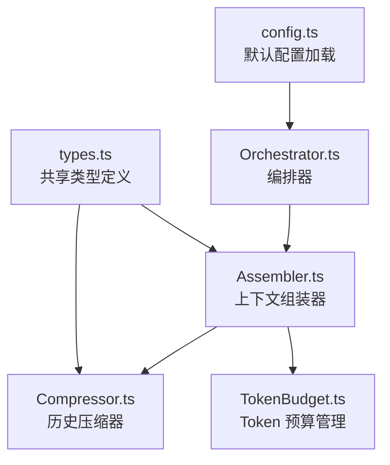
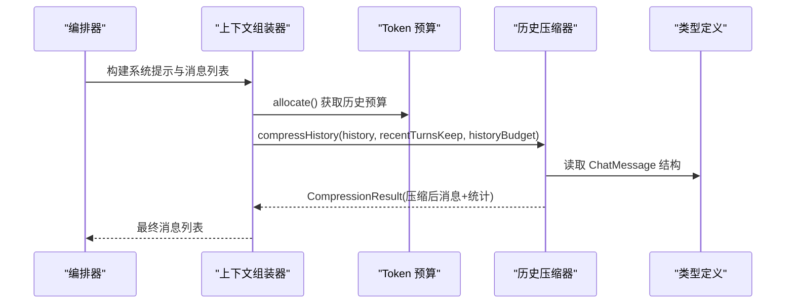
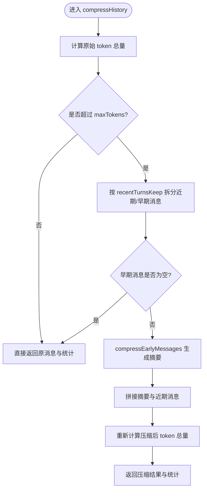
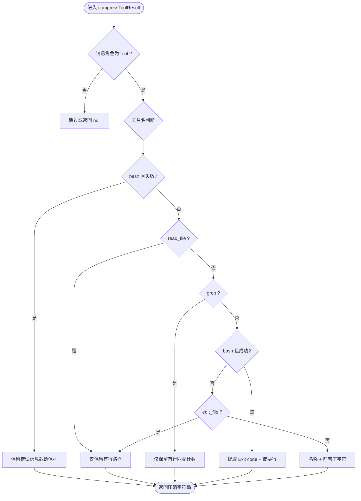
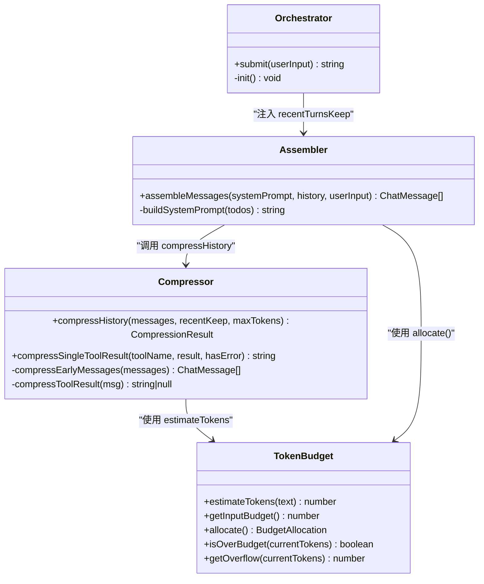

# 历史压缩器

<cite>
**本文引用的文件**
- [Compressor.ts](file://src/context/Compressor.ts)
- [TokenBudget.ts](file://src/context/TokenBudget.ts)
- [Assembler.ts](file://src/context/Assembler.ts)
- [types.ts](file://src/agent/types.ts)
- [config.ts](file://src/config.ts)
- [Orchestrator.ts](file://src/agent/Orchestrator.ts)
- [context.test.ts](file://tests/unit/context.test.ts)
</cite>

## 目录
1. [简介](#简介)
2. [项目结构](#项目结构)
3. [核心组件](#核心组件)
4. [架构总览](#架构总览)
5. [详细组件分析](#详细组件分析)
6. [依赖关系分析](#依赖关系分析)
7. [性能考量](#性能考量)
8. [故障排查指南](#故障排查指南)
9. [结论](#结论)
10. [附录](#附录)

## 简介
本技术文档聚焦于 Compressor 模块，系统性解析 compressHistory 函数的压缩算法与策略。内容涵盖：
- 智能摘要生成、冗余信息去除、关键信息保留策略
- 可压缩消息类型识别、对话连贯性保持、工具调用结果大文本处理
- recentTurnsKeep 参数的作用机制
- 在压缩过程中平衡信息完整性与 Token 效率的方法
- 压缩效果评估方法（压缩率统计、信息丢失检测）
- 配置示例与性能优化建议，帮助开发者理解何时启用压缩以及如何调整参数

## 项目结构
Compressor 模块位于上下文层，与 Token 预算和上下文组装器紧密协作，形成“预算驱动 + 分级压缩”的上下文管理方案。

图表来源
- [Assembler.ts:92-116](file://src/context/Assembler.ts#L92-L116)
- [Compressor.ts:25-56](file://src/context/Compressor.ts#L25-L56)
- [TokenBudget.ts:31-79](file://src/context/TokenBudget.ts#L31-L79)
- [Orchestrator.ts:74-86](file://src/agent/Orchestrator.ts#L74-L86)
- [types.ts:125-130](file://src/agent/types.ts#L125-L130)
- [config.ts:50-60](file://src/config.ts#L50-L60)

章节来源
- [Assembler.ts:92-116](file://src/context/Assembler.ts#L92-L116)
- [Compressor.ts:25-56](file://src/context/Compressor.ts#L25-L56)
- [TokenBudget.ts:31-79](file://src/context/TokenBudget.ts#L31-L79)
- [Orchestrator.ts:74-86](file://src/agent/Orchestrator.ts#L74-L86)
- [types.ts:125-130](file://src/agent/types.ts#L125-L130)
- [config.ts:50-60](file://src/config.ts#L50-L60)

## 核心组件
- 历史压缩器（Compressor.ts）
  - 提供 compressHistory 主入口，负责将早期历史压缩为摘要，近期消息完整保留
  - 提供 compressSingleToolResult 用于实时压缩单条工具结果
- Token 预算管理（TokenBudget.ts）
  - estimateTokens 粗略估算 token 数
  - TokenBudget 类计算输入预算、分配各层预算、判断超预算与溢出量
- 上下文组装器（Assembler.ts）
  - assembleMessages 根据预算调用 compressHistory 进行历史压缩
  - 注入 recentTurnsKeep 控制近期完整保留轮数
- 共享类型（types.ts）
  - ChatMessage 等类型定义，贯穿压缩流程
- 配置加载（config.ts）
  - 默认 context.recentTurnsKeep 值与合并逻辑
- 编排器（Orchestrator.ts）
  - 初始化 ContextAssembler 并传入 recentTurnsKeep

章节来源
- [Compressor.ts:25-56](file://src/context/Compressor.ts#L25-L56)
- [TokenBudget.ts:7-21](file://src/context/TokenBudget.ts#L7-L21)
- [TokenBudget.ts:31-79](file://src/context/TokenBudget.ts#L31-L79)
- [Assembler.ts:92-116](file://src/context/Assembler.ts#L92-L116)
- [types.ts:125-130](file://src/agent/types.ts#L125-L130)
- [config.ts:50-60](file://src/config.ts#L50-L60)
- [Orchestrator.ts:74-86](file://src/agent/Orchestrator.ts#L74-L86)

## 架构总览
compressHistory 的工作流由 Assembler 触发，结合 TokenBudget 的预算分配，对历史消息进行分级压缩。整体流程如下：

图表来源
- [Orchestrator.ts:98-99](file://src/agent/Orchestrator.ts#L98-L99)
- [Assembler.ts:92-116](file://src/context/Assembler.ts#L92-L116)
- [Compressor.ts:25-56](file://src/context/Compressor.ts#L25-L56)
- [types.ts:125-130](file://src/agent/types.ts#L125-L130)

## 详细组件分析

### compressHistory 函数与压缩算法
- 目标
  - 当历史消息总 token 超过 maxTokens 时，将早期消息压缩为一条或多条摘要，同时完整保留近期消息，确保对话连贯性与关键决策可见性
- 主要步骤
  - 计算原始 token 总量；若未超预算则直接返回
  - 按 recentTurnsKeep 分离近期与早期消息（每轮约两条 user/assistant）
  - 对早期消息执行 compressEarlyMessages 生成摘要
  - 拼接摘要与近期消息，重新计算压缩后的 token 总量并返回统计
- 智能摘要生成
  - 用户请求摘要：截断过长内容，保留前缀语义
  - 助手执行摘要：保留关键决策与执行说明，适度截断
  - 工具结果摘要：按工具类型分级压缩，合并为统一摘要片段
- 冗余信息去除
  - 长输出被截断，仅保留首行或关键行
  - 成功 bash 输出仅保留退出码与少量摘要行
  - read_file/grep/edit_file 等只保留路径或匹配计数
- 关键信息保留策略
  - 失败 bash 错误信息完整保留（便于调试）
  - 近期消息完整保留，避免丢失最新上下文
  - 摘要中明确标注“历史摘要 - 早期 N 条消息已压缩”，维持可追溯性

图表来源
- [Compressor.ts:25-56](file://src/context/Compressor.ts#L25-L56)
- [Compressor.ts:59-97](file://src/context/Compressor.ts#L59-L97)

章节来源
- [Compressor.ts:25-56](file://src/context/Compressor.ts#L25-L56)
- [Compressor.ts:59-97](file://src/context/Compressor.ts#L59-L97)

### 工具结果分级压缩
- 设计原则
  - 错误优先：失败输出完整保留，便于定位问题
  - 成功降维：仅保留关键元数据（如退出码、文件路径、匹配计数）
  - 长度限制：对超长输出进行截断，防止上下文膨胀
- 具体策略
  - bash 失败：包含 Exit code 非 0 的输出，保留前若干字符
  - read_file：仅保留首行（通常为文件路径），提示可再次调用查看
  - grep：仅保留首行（通常为匹配计数）
  - bash 成功：提取 Exit code 行，截取少量输出行，必要时标记“输出已压缩”
  - edit_file：仅保留首行（通常为文件路径）
  - 其他工具：名称 + 前若干字符

图表来源
- [Compressor.ts:100-136](file://src/context/Compressor.ts#L100-L136)

章节来源
- [Compressor.ts:100-136](file://src/context/Compressor.ts#L100-L136)

### 实时工具结果压缩（compressSingleToolResult）
- 使用场景
  - 在工具调用后立即压缩结果，减少后续上下文压力
- 行为
  - 错误结果完整保留
  - read_file：返回“已读取”提示，避免重复展示全文
  - bash：保留 Exit code 与少量输出行，必要时标记“输出已压缩”
  - 其他：超过阈值则截断

章节来源
- [Compressor.ts:139-158](file://src/context/Compressor.ts#L139-L158)

### recentTurnsKeep 参数机制
- 作用
  - 控制近期完整保留的轮数，每轮约两条消息（user + assistant）
  - 通过 slice(-recentKeep * 2) 切分近期与早期消息
- 影响
  - 较大的 recentTurnsKeep 提升对话连贯性与关键细节保留度，但可能降低压缩率
  - 较小的 recentTurnsKeep 提高压缩率，但可能丢失近期重要上下文
- 配置来源
  - 默认值来自 config.ts 的 context.recentTurnsKeep
  - 通过 Orchestrator 注入到 ContextAssembler，并在 assembleMessages 中传递给 compressHistory

章节来源
- [Compressor.ts:37-38](file://src/context/Compressor.ts#L37-L38)
- [config.ts:50-60](file://src/config.ts#L50-L60)
- [Orchestrator.ts:74-86](file://src/agent/Orchestrator.ts#L74-L86)
- [Assembler.ts:105-106](file://src/context/Assembler.ts#L105-L106)

### Token 预算与压缩效率平衡
- 预算计算
  - estimateTokens 基于 ASCII 与非 ASCII 字符比例粗略估算 token 数
  - TokenBudget 根据模型上下文窗口、预算比例与输出预留计算输入预算
- 压缩触发
  - 当历史消息总 token 超过 historyBudget 时触发压缩
- 平衡策略
  - 近期完整保留保证关键上下文不丢失
  - 早期摘要化去除冗余，保留关键决策与工具结果要点
  - 工具结果分级压缩进一步降低大文本对上下文的占用

章节来源
- [TokenBudget.ts:7-21](file://src/context/TokenBudget.ts#L7-L21)
- [TokenBudget.ts:31-79](file://src/context/TokenBudget.ts#L31-L79)
- [Compressor.ts:30-34](file://src/context/Compressor.ts#L30-L34)
- [Assembler.ts:105-106](file://src/context/Assembler.ts#L105-L106)

### 压缩效果评估方法
- 压缩率统计
  - 使用 CompressionResult.originalTokens 与 compressedTokens 计算压缩率
  - 公式：压缩率 = (originalTokens - compressedTokens) / originalTokens
- 信息丢失检测
  - 检查 compressedCount 是否过大导致关键信息缺失
  - 对比压缩前后 messages 的长度与角色分布，确保近期消息完整保留
  - 针对工具结果，验证失败信息是否完整保留，成功输出是否仅保留必要元数据
- 测试用例参考
  - 短历史不压缩：messages.length 不变，compressedCount 为 0
  - 长历史触发压缩：messages.length 减少，compressedCount > 0

章节来源
- [Compressor.ts:12-17](file://src/context/Compressor.ts#L12-L17)
- [Compressor.ts:48-55](file://src/context/Compressor.ts#L48-L55)
- [context.test.ts:70-92](file://tests/unit/context.test.ts#L70-L92)

### 配置示例与优化建议
- 配置项
  - context.budgetRatio：输入预算占上下文窗口的比例（默认 0.8）
  - context.recentTurnsKeep：近期完整保留轮数（默认 5）
- 示例
  - 在 .nexus/config.toml 中设置：
    - budget_ratio: 0.8
    - recent_turns_keep: 5
- 优化建议
  - 长会话且工具输出较多：适当增大 recentTurnsKeep，减少摘要粒度，提升连贯性
  - 严格 Token 预算：减小 recentTurnsKeep，增强早期摘要化，提高压缩率
  - 频繁 bash 失败：保持失败信息完整保留，便于快速定位问题
  - 监控压缩率与信息丢失：结合单元测试与日志，动态调整参数

章节来源
- [config.ts:50-60](file://src/config.ts#L50-L60)
- [config.ts:116-121](file://src/config.ts#L116-L121)
- [context.test.ts:70-92](file://tests/unit/context.test.ts#L70-L92)

## 依赖关系分析
- 模块耦合
  - Compressor 依赖 types.ChatMessage 与 TokenBudget.estimateTokens
  - Assembler 依赖 Compressor 与 TokenBudget，负责组装与预算分配
  - Orchestrator 注入 recentTurnsKeep 到 Assembler
- 外部集成点
  - 配置加载从 TOML 合并默认值
  - 单元测试覆盖压缩行为与预算计算

图表来源
- [Compressor.ts:25-56](file://src/context/Compressor.ts#L25-L56)
- [TokenBudget.ts:31-79](file://src/context/TokenBudget.ts#L31-L79)
- [Assembler.ts:92-116](file://src/context/Assembler.ts#L92-L116)
- [Orchestrator.ts:74-86](file://src/agent/Orchestrator.ts#L74-L86)

章节来源
- [Compressor.ts:25-56](file://src/context/Compressor.ts#L25-L56)
- [TokenBudget.ts:31-79](file://src/context/TokenBudget.ts#L31-L79)
- [Assembler.ts:92-116](file://src/context/Assembler.ts#L92-L116)
- [Orchestrator.ts:74-86](file://src/agent/Orchestrator.ts#L74-L86)

## 性能考量
- 时间复杂度
  - compressHistory 线性扫描消息列表，总体 O(N)
  - compressEarlyMessages 与 compressToolResult 均为线性处理
- 空间复杂度
  - 生成摘要数组与结果数组，额外空间 O(K)，K 为早期消息数量
- 优化机会
  - 预估 token 时使用更精确的分词器可降低误差
  - 对工具结果采用增量压缩，避免重复处理
  - 对超大输出采用流式摘要生成，减少内存峰值

[本节为通用性能讨论，不直接分析具体文件]

## 故障排查指南
- 常见问题
  - 压缩后关键信息丢失：检查 recentTurnsKeep 是否过小，适当增大
  - 压缩率过低：检查工具结果是否过多，考虑增强 compressToolResult 的截断策略
  - 失败信息不完整：确认 compressToolResult 对 bash 失败的判断逻辑是否正确
- 诊断方法
  - 打印 CompressionResult 的 originalTokens、compressedTokens、compressedCount
  - 对比压缩前后 messages 的角色分布与长度变化
  - 针对特定工具结果，单独调用 compressSingleToolResult 验证行为

章节来源
- [Compressor.ts:100-136](file://src/context/Compressor.ts#L100-L136)
- [Compressor.ts:139-158](file://src/context/Compressor.ts#L139-L158)
- [context.test.ts:94-113](file://tests/unit/context.test.ts#L94-L113)

## 结论
Compressor 模块通过“近期完整保留 + 早期摘要化 + 工具结果分级压缩”的策略，有效平衡了对话连贯性与 Token 效率。配合 TokenBudget 的预算管理与 Assembler 的组装流程，能够在长会话中稳定控制上下文大小，同时保留关键信息与错误详情。开发者可通过 recentTurnsKeep 与预算比例灵活调整压缩强度，并结合测试与日志持续优化。

[本节为总结性内容，不直接分析具体文件]

## 附录
- 相关类型与接口
  - ChatMessage：消息角色与内容定义
  - CompressionResult：压缩结果与统计字段
  - BudgetAllocation：各层预算分配
- 测试覆盖
  - 短历史不压缩、长历史触发压缩
  - 工具结果压缩行为验证

章节来源
- [types.ts:125-130](file://src/agent/types.ts#L125-L130)
- [Compressor.ts:12-17](file://src/context/Compressor.ts#L12-L17)
- [TokenBudget.ts:23-29](file://src/context/TokenBudget.ts#L23-L29)
- [context.test.ts:70-113](file://tests/unit/context.test.ts#L70-L113)