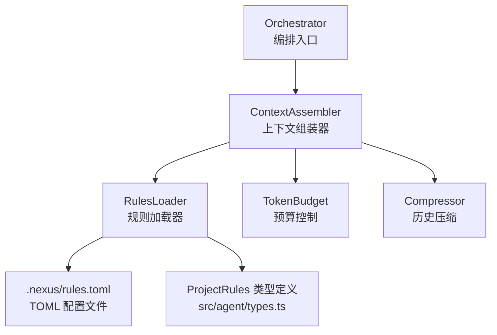
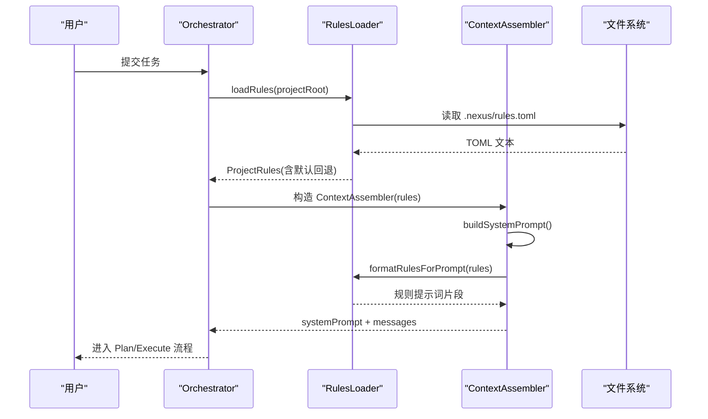
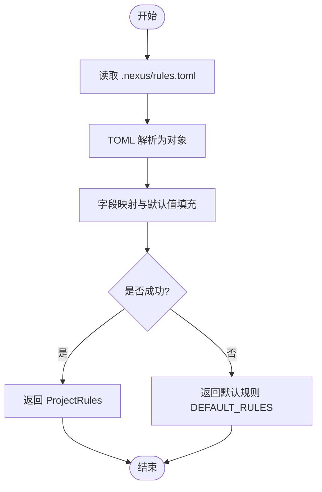
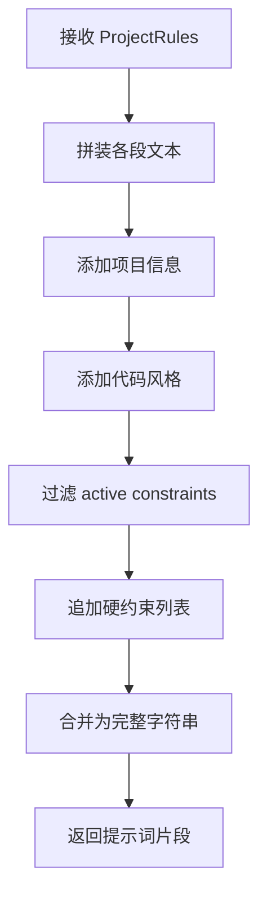
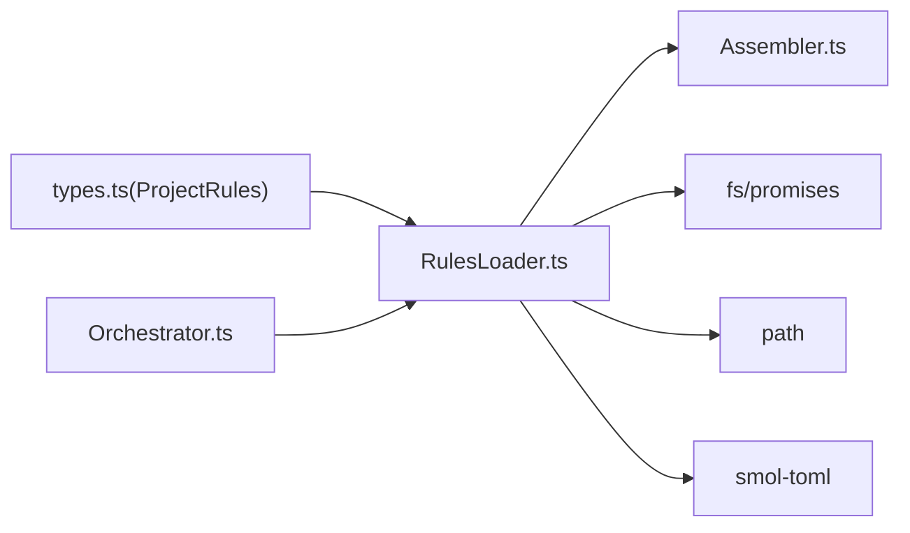

# 规则加载器

<cite>
**本文引用的文件**
- [RulesLoader.ts](file://src/context/RulesLoader.ts)
- [types.ts](file://src/agent/types.ts)
- [Assembler.ts](file://src/context/Assembler.ts)
- [Orchestrator.ts](file://src/agent/Orchestrator.ts)
- [rules.toml](file://.nexus/rules.toml)
- [DESIGN.md](file://DESIGN.md)
</cite>

## 目录
1. [简介](#简介)
2. [项目结构](#项目结构)
3. [核心组件](#核心组件)
4. [架构总览](#架构总览)
5. [详细组件分析](#详细组件分析)
6. [依赖分析](#依赖分析)
7. [性能考虑](#性能考虑)
8. [故障排查指南](#故障排查指南)
9. [结论](#结论)
10. [附录](#附录)

## 简介
本技术文档聚焦 RulesLoader 模块，系统性阐述项目规则的加载与管理机制。内容涵盖 .nexus/rules.toml 配置文件的解析流程、规则数据结构与规范、formatRulesForPrompt 函数将结构化规则转换为 LLM 可理解提示词的过程、规则优先级与冲突处理策略、验证与错误处理方案，以及面向大型项目的规则编写最佳实践、常见模式、调试与测试方法。

## 项目结构
RulesLoader 位于上下文层，负责读取并规范化项目约定（.nexus/rules.toml），并将其注入到系统提示词中；同时提供“常驻上下文”路径解析能力，供上下文组装器使用。

图表来源
- [Orchestrator.ts:60-86](file://src/agent/Orchestrator.ts#L60-L86)
- [Assembler.ts:55-90](file://src/context/Assembler.ts#L55-L90)
- [RulesLoader.ts:29-58](file://src/context/RulesLoader.ts#L29-L58)
- [types.ts:168-184](file://src/agent/types.ts#L168-L184)

章节来源
- [Orchestrator.ts:60-86](file://src/agent/Orchestrator.ts#L60-L86)
- [Assembler.ts:55-90](file://src/context/Assembler.ts#L55-L90)
- [RulesLoader.ts:29-58](file://src/context/RulesLoader.ts#L29-L58)
- [types.ts:168-184](file://src/agent/types.ts#L168-L184)

## 核心组件
- loadRules(projectRoot): 读取并解析 .nexus/rules.toml，缺失或解析失败时回退到默认值。
- formatRulesForPrompt(rules): 将 ProjectRules 对象序列化为 system prompt 片段，包含项目信息、代码风格、硬约束等。
- getAlwaysIncludePaths(rules, projectRoot): 将 always_include 相对路径解析为绝对路径，供上下文组装器常驻加载。

章节来源
- [RulesLoader.ts:29-58](file://src/context/RulesLoader.ts#L29-L58)
- [RulesLoader.ts:60-84](file://src/context/RulesLoader.ts#L60-L84)
- [RulesLoader.ts:86-90](file://src/context/RulesLoader.ts#L86-L90)

## 架构总览
RulesLoader 在 Orchestrator 初始化阶段被调用，返回的 ProjectRules 注入 ContextAssembler，用于构建 system prompt 和常驻上下文。

图表来源
- [Orchestrator.ts:60-86](file://src/agent/Orchestrator.ts#L60-L86)
- [RulesLoader.ts:29-58](file://src/context/RulesLoader.ts#L29-L58)
- [RulesLoader.ts:60-84](file://src/context/RulesLoader.ts#L60-L84)
- [Assembler.ts:55-90](file://src/context/Assembler.ts#L55-L90)

## 详细组件分析

### 数据模型与配置规范
- ProjectRules 接口定义了规则的数据结构，包括：
  - project: 项目名称、语言、测试命令、构建命令
  - style: 缩进、引号、分号
  - constraints: 键值对布尔标记，表示启用的硬约束
  - context.alwaysInclude: 需要常驻包含的文件路径列表
- rules.toml 采用 TOML 格式，字段映射关系如下：
  - project.name / language / test_command / build_command
  - style.indent / quote / semicolons
  - constraints 下的任意字符串键对应布尔值
  - context.always_include 为字符串数组

章节来源
- [types.ts:168-184](file://src/agent/types.ts#L168-L184)
- [rules.toml:1-21](file://.nexus/rules.toml#L1-L21)
- [DESIGN.md:338-365](file://DESIGN.md#L338-L365)

### 加载与解析流程
- 路径拼接：projectRoot/.nexus/rules.toml
- 读取与解析：使用 TOML 解析器将文本转为对象
- 字段映射与默认值：
  - 若某字段缺失，则回退到内置 DEFAULT_RULES
  - 支持 snake_case 与 camelCase 兼容（如 test_command → testCommand）
- 异常处理：文件不存在或解析失败时直接返回默认规则，避免中断启动

图表来源
- [RulesLoader.ts:29-58](file://src/context/RulesLoader.ts#L29-L58)

章节来源
- [RulesLoader.ts:29-58](file://src/context/RulesLoader.ts#L29-L58)

### 格式化提示词（formatRulesForPrompt）
- 输出结构：
  - 项目信息：名称、语言、测试命令、构建命令
  - 代码风格：缩进、引号、分号
  - 硬约束：仅输出值为 true 的约束项
- 用途：作为 system prompt 的一部分注入给 LLM，确保生成代码符合项目约定与安全约束

图表来源
- [RulesLoader.ts:60-84](file://src/context/RulesLoader.ts#L60-L84)

章节来源
- [RulesLoader.ts:60-84](file://src/context/RulesLoader.ts#L60-L84)

### 常驻上下文路径解析（getAlwaysIncludePaths）
- 输入：ProjectRules.context.alwaysInclude 中的相对路径
- 处理：基于 projectRoot 解析为绝对路径
- 输出：供 Assembler.loadAlwaysIncludeFiles 读取并注入到消息上下文中

章节来源
- [RulesLoader.ts:86-90](file://src/context/RulesLoader.ts#L86-L90)
- [Assembler.ts:155-168](file://src/context/Assembler.ts#L155-L168)

### 与上下文组装器的集成
- Orchestrator 在 init 阶段加载规则并创建 ContextAssembler
- ContextAssembler.buildSystemPrompt 调用 formatRulesForPrompt 将规则注入 system prompt
- TokenBudget 与 Compressor 参与后续消息组装与压缩，确保不超出上下文窗口

章节来源
- [Orchestrator.ts:60-86](file://src/agent/Orchestrator.ts#L60-L86)
- [Assembler.ts:55-90](file://src/context/Assembler.ts#L55-L90)

## 依赖分析
- 内部依赖
  - types.ts: ProjectRules 类型定义
  - Assembler.ts: 消费 formatRulesForPrompt 与 getAlwaysIncludePaths
  - Orchestrator.ts: 驱动 loadRules 并在初始化时注入规则
- 外部依赖
  - fs/promises: 读取 rules.toml
  - path: 路径拼接与解析
  - smol-toml: TOML 解析

图表来源
- [RulesLoader.ts:1-10](file://src/context/RulesLoader.ts#L1-L10)
- [types.ts:168-184](file://src/agent/types.ts#L168-L184)
- [Assembler.ts:13-15](file://src/context/Assembler.ts#L13-L15)
- [Orchestrator.ts:21-22](file://src/agent/Orchestrator.ts#L21-L22)

章节来源
- [RulesLoader.ts:1-10](file://src/context/RulesLoader.ts#L1-L10)
- [types.ts:168-184](file://src/agent/types.ts#L168-L184)
- [Assembler.ts:13-15](file://src/context/Assembler.ts#L13-L15)
- [Orchestrator.ts:21-22](file://src/agent/Orchestrator.ts#L21-L22)

## 性能考虑
- I/O 成本：仅在初始化阶段读取一次 rules.toml，开销极低
- 解析成本：TOML 解析轻量，且规则体积通常很小
- 内存占用：ProjectRules 结构紧凑，无额外缓存
- 提示词长度：formatRulesForPrompt 仅输出必要字段，避免冗余；结合 TokenBudget 控制整体上下文大小

[本节为通用指导，无需源码引用]

## 故障排查指南
- 常见问题
  - 找不到 .nexus/rules.toml：loadRules 会返回默认规则，不会抛出异常；检查 projectRoot 是否正确
  - TOML 语法错误：解析失败同样回退到默认规则；修正 rules.toml 语法后重试
  - 字段名不一致：确保使用设计文档约定的键名（如 test_command、always_include）
- 定位步骤
  - 确认 rules.toml 存在且可读
  - 校验 TOML 语法与键名
  - 观察 Assembler 输出的 system prompt 片段，确认规则已正确注入
- 建议
  - 在 CI 中加入 rules.toml 的语法校验
  - 通过最小化 rules.toml 逐步增加字段以定位问题

章节来源
- [RulesLoader.ts:29-58](file://src/context/RulesLoader.ts#L29-L58)
- [DESIGN.md:338-365](file://DESIGN.md#L338-L365)

## 结论
RulesLoader 以简洁可靠的方式完成项目规则的加载、规范化与注入。其默认回退机制保证鲁棒性，formatRulesForPrompt 将结构化规则转化为 LLM 友好的提示词片段，配合 ContextAssembler 与 TokenBudget 实现可控的上下文管理。遵循本文的最佳实践与示例，可在大型项目中高效组织与维护规则集。

[本节为总结性内容，无需源码引用]

## 附录

### 规则编写最佳实践
- 明确编码规范
  - 统一缩进、引号、分号等风格设置，减少团队分歧
  - 将常用命名约定与文件组织方式写入 constraints
- 安全约束
  - 禁止引入新的运行时依赖
  - 修改核心模块前必须补充测试
  - 限制敏感操作（如删除、覆盖）需审批
- 大型项目规则组织
  - 按模块拆分职责，将跨模块约定放入 constraints
  - 使用 always_include 固定关键文档与类型定义，提升一致性
  - 定期评审 rules.toml，移除过时条目

章节来源
- [rules.toml:1-21](file://.nexus/rules.toml#L1-L21)
- [DESIGN.md:338-365](file://DESIGN.md#L338-L365)

### 常见规则模式
- 项目元信息：name、language、test_command、build_command
- 代码风格：indent、quote、semicolons
- 硬约束：以自然语言描述，布尔启用
- 常驻上下文：always_include 指向架构文档与核心类型

章节来源
- [rules.toml:1-21](file://.nexus/rules.toml#L1-L21)
- [DESIGN.md:338-365](file://DESIGN.md#L338-L365)

### 规则调试与测试方法
- 手动验证
  - 运行应用并查看 system prompt 片段，确认规则已注入
  - 调整 rules.toml 后重启，观察变化
- 自动化建议
  - 在单元测试中模拟 rules.toml 内容，断言 formatRulesForPrompt 的输出结构
  - 对 getAlwaysIncludePaths 进行路径解析断言
  - 在 CI 中执行 TOML 语法检查

章节来源
- [RulesLoader.ts:60-84](file://src/context/RulesLoader.ts#L60-L84)
- [RulesLoader.ts:86-90](file://src/context/RulesLoader.ts#L86-L90)