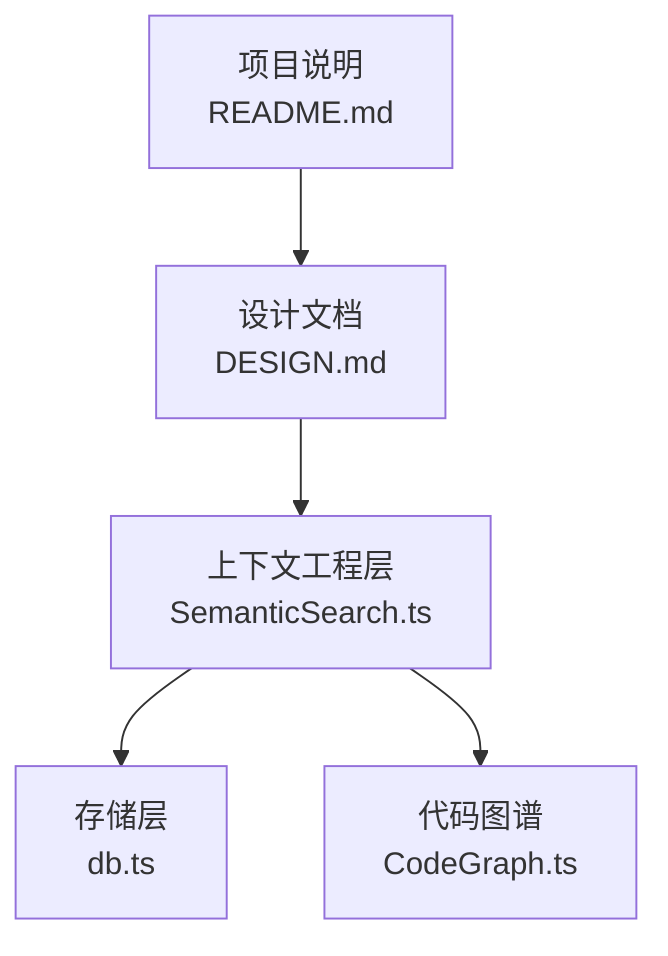
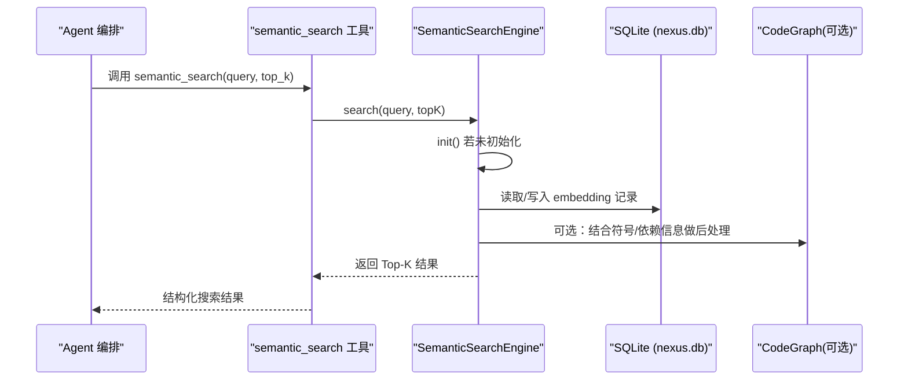
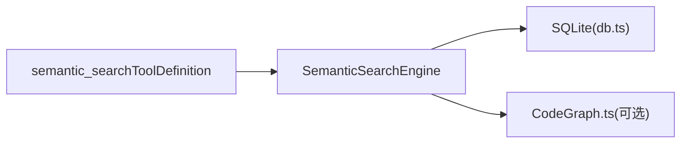

# 语义搜索

<cite>
**本文引用的文件**   
- [src/context/SemanticSearch.ts](file://src/context/SemanticSearch.ts)
- [DESIGN.md](file://DESIGN.md)
- [README.md](file://README.md)
- [src/storage/db.ts](file://src/storage/db.ts)
- [src/context/CodeGraph.ts](file://src/context/CodeGraph.ts)
</cite>

## 目录
1. [简介](#简介)
2. [项目结构](#项目结构)
3. [核心组件](#核心组件)
4. [架构总览](#架构总览)
5. [详细组件分析](#详细组件分析)
6. [依赖分析](#依赖分析)
7. [性能考量](#性能考量)
8. [故障排查指南](#故障排查指南)
9. [结论](#结论)
10. [附录](#附录)

## 简介
本技术文档聚焦于 Nexus 的“语义搜索”模块，围绕其设计目标、实现原理与演进路线进行系统化说明。当前仓库中该模块处于占位阶段（Phase 4），已定义接口、工具描述与数据结构，并规划了本地 embedding + SQLite 索引方案。本文在严格依据源码与设计文档的前提下，给出可落地的实现蓝图、算法选择建议、索引策略、排序与过滤机制、评估方法与最佳实践，帮助读者理解从自然语言查询到代码语义映射的完整链路。

## 项目结构
语义搜索相关能力位于上下文工程层，并与存储层、代码图谱协同工作：
- 语义搜索引擎与工具定义：src/context/SemanticSearch.ts
- 设计说明与路线图：DESIGN.md
- 项目概览与运行方式：README.md
- 持久化（SQLite）：src/storage/db.ts
- 代码图谱（函数/类签名地图）：src/context/CodeGraph.ts



图表来源
- [src/context/SemanticSearch.ts:1-101](file://src/context/SemanticSearch.ts#L1-L101)
- [src/storage/db.ts:1-147](file://src/storage/db.ts#L1-L147)
- [src/context/CodeGraph.ts:1-175](file://src/context/CodeGraph.ts#L1-L175)
- [DESIGN.md:312-324](file://DESIGN.md#L312-L324)
- [README.md:161-169](file://README.md#L161-L169)

章节来源
- [src/context/SemanticSearch.ts:1-101](file://src/context/SemanticSearch.ts#L1-L101)
- [DESIGN.md:312-324](file://DESIGN.md#L312-L324)
- [README.md:161-169](file://README.md#L161-L169)

## 核心组件
- 搜索结果与嵌入记录类型
  - SearchResult：包含文件路径、行号范围、内容片段、相关性分数以及可选符号名。
  - EmbeddingRecord：包含唯一标识、文件路径、行号范围、内容片段与向量（Float32Array）。
- 语义搜索引擎
  - SemanticSearchEngine：提供初始化、搜索、增量重索引与统计信息获取等能力。
- 工具定义
  - semantic_searchToolDefinition：对外暴露的工具元数据，包括名称、描述、输入参数 schema、是否需审批、适用阶段等。

章节来源
- [src/context/SemanticSearch.ts:9-25](file://src/context/SemanticSearch.ts#L9-L25)
- [src/context/SemanticSearch.ts:31-74](file://src/context/SemanticSearch.ts#L31-L74)
- [src/context/SemanticSearch.ts:80-100](file://src/context/SemanticSearch.ts#L80-L100)

## 架构总览
语义搜索的整体流程分为三个阶段：构建期（索引）、检索期（查询）、维护期（增量更新与统计）。



图表来源
- [src/context/SemanticSearch.ts:48-59](file://src/context/SemanticSearch.ts#L48-L59)
- [src/storage/db.ts:44-82](file://src/storage/db.ts#L44-L82)
- [src/context/CodeGraph.ts:101-125](file://src/context/CodeGraph.ts#L101-L125)

## 详细组件分析

### 组件一：语义搜索引擎（SemanticSearchEngine）
职责
- 初始化：加载本地 embedding 模型、扫描项目文件、切分代码块、计算向量并持久化。
- 搜索：将查询转为向量，执行相似度检索，返回 Top-K 结果。
- 增量索引：监听变更文件，仅对受影响块重新计算与写入。
- 统计：返回索引规模（块数、文件数）。

关键方法
- init(): Promise<void>
- search(query: string, topK?: number): Promise<SearchResult[]>
- reindex(changedFiles: string[]): Promise<void>
- getStats(): { totalChunks: number; totalFiles: number }

数据结构
- SearchResult：用于向调用方返回匹配的代码片段及评分。
- EmbeddingRecord：用于持久化的单条索引单元，包含 Float32Array 向量。

实现要点（基于 TODO 注释与接口契约）
- 使用本地 embedding 模型（如 Xenova/all-MiniLM-L6-v2 via transformers.js），确保隐私不上传代码。
- 以函数级为粒度切分代码块，兼顾召回与上下文完整性。
- 使用 SQLite 存储 embedding 与元数据；后续可扩展向量索引或近似最近邻（ANN）加速。
- 增量更新时删除旧记录、重建新记录，避免全量重建带来的开销。

```mermaid
classDiagram
class SemanticSearchEngine {
-projectRoot : string
-initialized : boolean
+init() Promise~void~
+search(query, topK) Promise~SearchResult[]~
+reindex(changedFiles) Promise~void~
+getStats() {totalChunks : number; totalFiles : number}
}
class SearchResult {
+filePath : string
+startLine : number
+endLine : number
+content : string
+score : number
+symbol? : string
}
class EmbeddingRecord {
+id : string
+filePath : string
+startLine : number
+endLine : number
+content : string
+embedding : Float32Array
}
SemanticSearchEngine --> SearchResult : "返回"
SemanticSearchEngine --> EmbeddingRecord : "读写"
```

图表来源
- [src/context/SemanticSearch.ts:31-74](file://src/context/SemanticSearch.ts#L31-L74)
- [src/context/SemanticSearch.ts:9-25](file://src/context/SemanticSearch.ts#L9-L25)

章节来源
- [src/context/SemanticSearch.ts:31-74](file://src/context/SemanticSearch.ts#L31-L74)
- [src/context/SemanticSearch.ts:9-25](file://src/context/SemanticSearch.ts#L9-L25)

### 组件二：工具定义（semantic_searchToolDefinition）
作用
- 作为 MCP 工具注册时的元数据，描述工具名称、用途、输入 schema、是否需要审批、适用阶段等。
- 约束输入参数：query（必填）、top_k（可选，默认值由上层决定）。

设计要点
- 强调“跨词面匹配”，区别于 grep 的字面匹配。
- 无需审批（requiresApproval: false），便于在计划与执行阶段均可使用。
- 通过 inputSchema 明确参数类型与描述，利于 LLM 正确构造调用。

章节来源
- [src/context/SemanticSearch.ts:80-100](file://src/context/SemanticSearch.ts#L80-L100)

### 组件三：存储层（SQLite）
职责
- 会话历史、检查点、未来 embedding 索引的持久化。
- 启用 WAL 模式提升并发写性能。

与语义搜索的关系
- 未来将承载 EmbeddingRecord 表与查询索引，支撑相似度检索与增量更新。
- 可通过扩展表结构与索引优化检索延迟。

章节来源
- [src/storage/db.ts:30-82](file://src/storage/db.ts#L30-L82)
- [src/storage/db.ts:138-146](file://src/storage/db.ts#L138-L146)

### 组件四：代码图谱（CodeGraph）
职责
- 生成每文件的“代码地图”（函数/类/方法签名与导出信息），常驻 L1 上下文。
- 提供符号查询与依赖关系，辅助语义检索后的二次定位与解释。

与语义搜索的关系
- 可作为后处理增强：根据符号名、依赖关系对搜索结果排序或去重。
- 在 Phase 4 之前为 TypeScript 空实现，v2 可替换为 Go 引擎。

章节来源
- [src/context/CodeGraph.ts:10-34](file://src/context/CodeGraph.ts#L10-L34)
- [src/context/CodeGraph.ts:101-125](file://src/context/CodeGraph.ts#L101-L125)
- [src/context/CodeGraph.ts:150-163](file://src/context/CodeGraph.ts#L150-L163)

## 依赖分析
- 模块内依赖
  - SemanticSearchEngine 依赖存储层（SQLite）与可选的代码图谱。
  - 工具定义独立于实现，便于注册到工具层。
- 外部依赖（规划）
  - 本地 embedding 模型：transformers.js（Xenova/all-MiniLM-L6-v2）。
  - 向量库/ANN：可选（如 sqlite-vec、faiss-lite 等），用于加速大规模检索。
- 耦合与解耦
  - 通过接口与工具定义解耦上层调用与底层实现，便于未来迁移至 Go 引擎。



图表来源
- [src/context/SemanticSearch.ts:31-74](file://src/context/SemanticSearch.ts#L31-L74)
- [src/storage/db.ts:30-82](file://src/storage/db.ts#L30-L82)
- [src/context/CodeGraph.ts:101-125](file://src/context/CodeGraph.ts#L101-L125)

章节来源
- [src/context/SemanticSearch.ts:31-74](file://src/context/SemanticSearch.ts#L31-L74)
- [src/storage/db.ts:30-82](file://src/storage/db.ts#L30-L82)
- [src/context/CodeGraph.ts:101-125](file://src/context/CodeGraph.ts#L101-L125)

## 性能考量
- 索引构建
  - 分块粒度：函数级优先，必要时按类/方法边界切分，平衡召回与上下文长度。
  - 批量写入：合并多次插入，减少 I/O 次数。
  - 并行度：embedding 计算可适度并行，注意内存峰值。
- 检索性能
  - 余弦相似度：向量归一化后可用点积替代，降低计算复杂度。
  - 索引结构：小库可用线性扫描；大库引入 ANN（如 HNSW/IVF）或向量列式索引。
  - 缓存：对高频查询结果做短期缓存（LRU），命中直接返回。
- 增量更新
  - 文件变更监听（fs.watch / chokidar），仅对受影响文件重算。
  - 原子写入：先写临时表再交换，保证一致性。
- 资源控制
  - 限制 topK 与内容截断，避免返回过大上下文。
  - 设置超时与重试上限，防止长时间阻塞。

[本节为通用指导，不直接分析具体文件]

## 故障排查指南
- 初始化失败
  - 现象：init 未完成，search 返回空结果。
  - 排查：确认模型加载路径、磁盘空间、SQLite 权限。
- 索引不一致
  - 现象：变更后检索不到最新代码。
  - 排查：确认 reindex 是否被触发、变更文件列表是否正确、旧记录是否删除。
- 检索缓慢
  - 现象：Top-K 返回耗时过长。
  - 排查：是否启用 ANN 索引、是否缓存命中、是否对大库做了分页/分批。
- 结果质量差
  - 现象：返回片段不相关。
  - 排查：调整分块策略、增加符号/依赖后处理、优化 query 预处理（同义词、缩写展开）。

章节来源
- [src/context/SemanticSearch.ts:40-59](file://src/context/SemanticSearch.ts#L40-L59)
- [src/storage/db.ts:30-82](file://src/storage/db.ts#L30-L82)

## 结论
当前语义搜索模块已完成接口与工具定义的占位，明确了“本地 embedding + SQLite 索引”的技术路线，并在设计文档中给出了清晰的演进计划。下一步应落地 Phase 4 的具体实现：完成代码分块、向量计算、索引构建与检索、增量更新与统计，并结合代码图谱进行结果增强与排序。同时建立评估体系，持续优化召回率与响应延迟，满足大规模代码库的搜索需求。

[本节为总结性内容，不直接分析具体文件]

## 附录

### 算法与实现建议
- 代码分块
  - 以函数/类/方法为单位，保留签名与 docstring，提高语义密度。
- 向量化
  - 使用轻量模型（如 all-MiniLM-L6-v2），在本地运行，保障隐私。
- 相似度计算
  - 余弦相似度；向量归一化后用点积加速。
- 索引与检索
  - 小库：SQLite 全表扫描 + 自定义相似度函数。
  - 大库：引入 ANN（HNSW/IVF）或向量列式索引，支持近似最近邻。
- 排序与过滤
  - 初筛：向量相似度得分。
  - 精排：结合符号匹配、依赖权重、时间衰减、用户偏好。
- 增量更新
  - 监听文件变更，删除旧记录，重建新记录，事务提交。
- 缓存机制
  - 查询缓存（LRU）、结果摘要缓存、热点文件预取。

[本节为通用指导，不直接分析具体文件]

### 使用示例与最佳实践
- 基本用法
  - 调用 semantic_search 工具，传入自然语言查询与 top_k。
- 高效查询编写
  - 明确意图与领域术语，避免模糊词；必要时加入限定条件（如“登录相关的鉴权逻辑”）。
- 性能优化
  - 合理设置 top_k；利用缓存；对频繁查询做预热。
- 大规模代码库
  - 采用增量索引与 ANN 索引；定期清理过期索引；监控索引大小与检索延迟。
- 质量评估
  - 指标：Precision@K、Recall@K、MRR、NDCG。
  - 数据集：构建小规模标注集，覆盖常见任务（重构、修复 bug、添加功能）。
  - 过程：离线评测 + 在线 A/B 测试，持续迭代。

[本节为通用指导，不直接分析具体文件]

### 参考与规划
- 设计文档指出 Phase 4 将引入 tree-sitter 代码骨架提取、本地 embedding + SQLite 索引、semantic_search 工具与增量索引，并评估是否需要 Go 引擎。
- README 提供了项目运行与配置说明，便于快速验证与集成。

章节来源
- [DESIGN.md:694-703](file://DESIGN.md#L694-L703)
- [README.md:161-169](file://README.md#L161-L169)