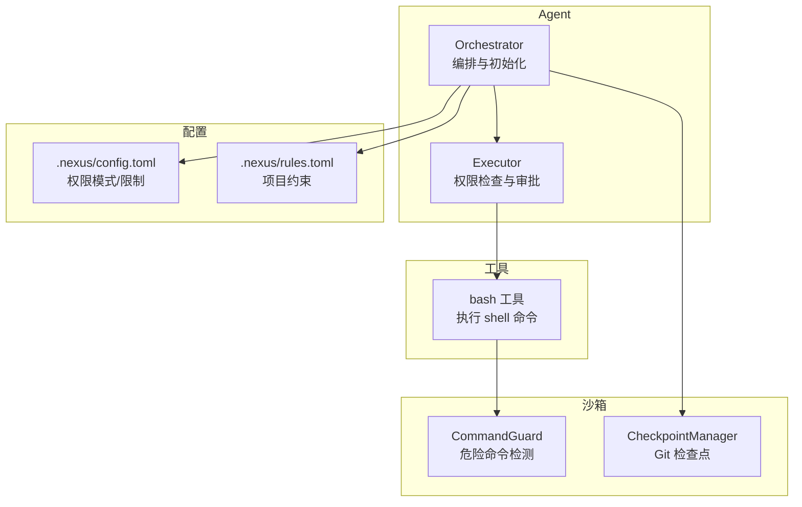
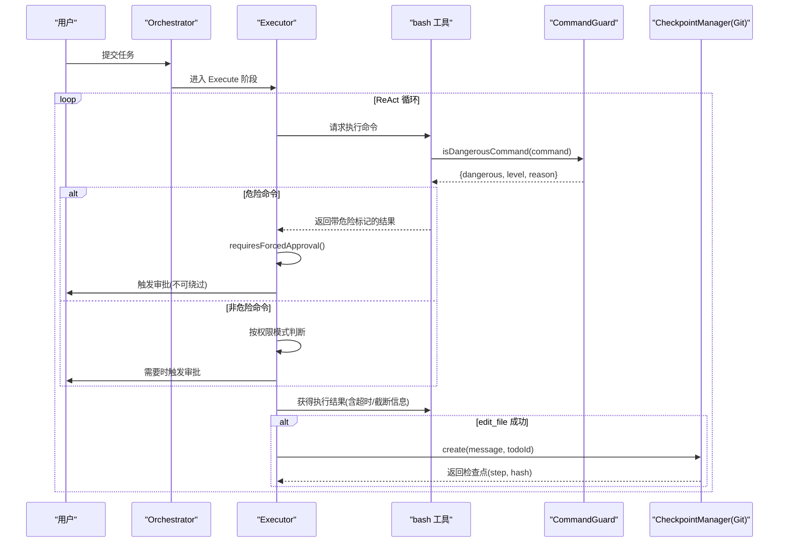
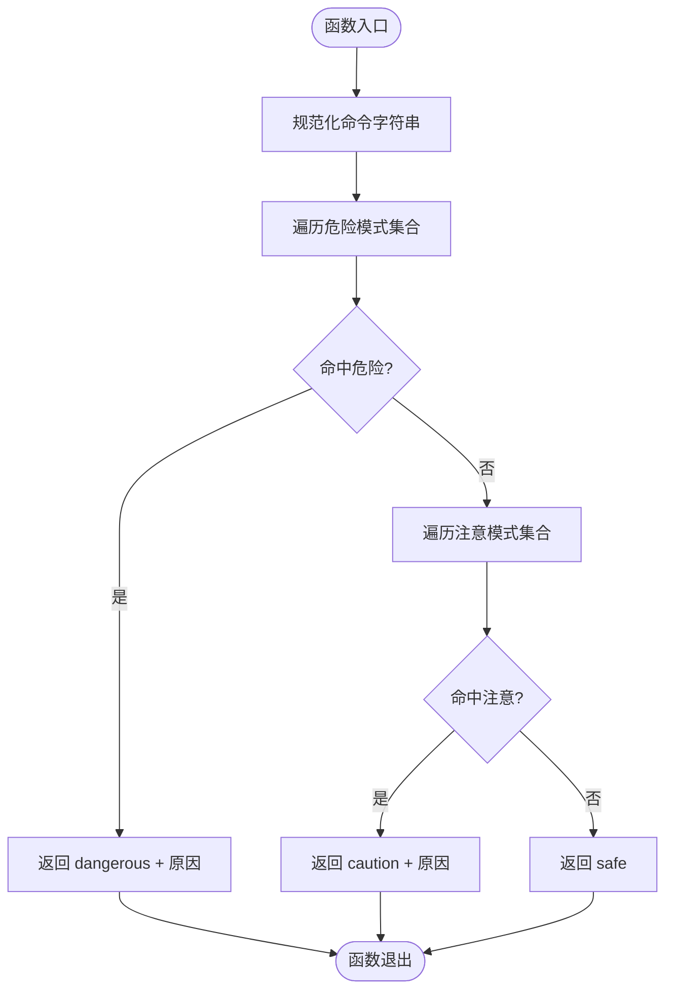
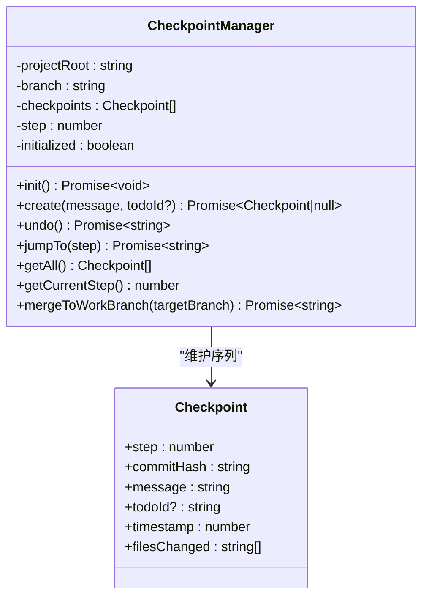
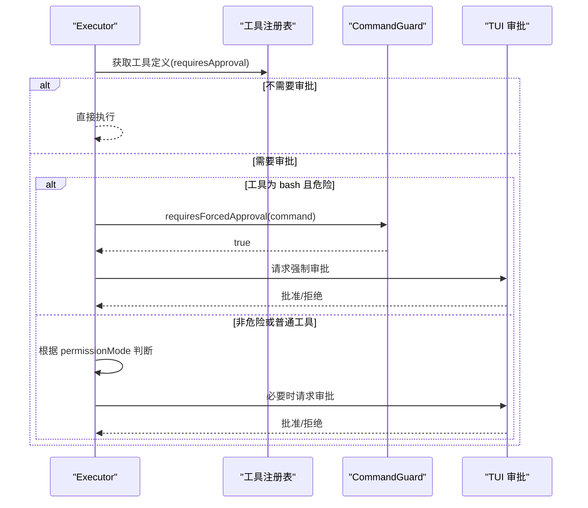
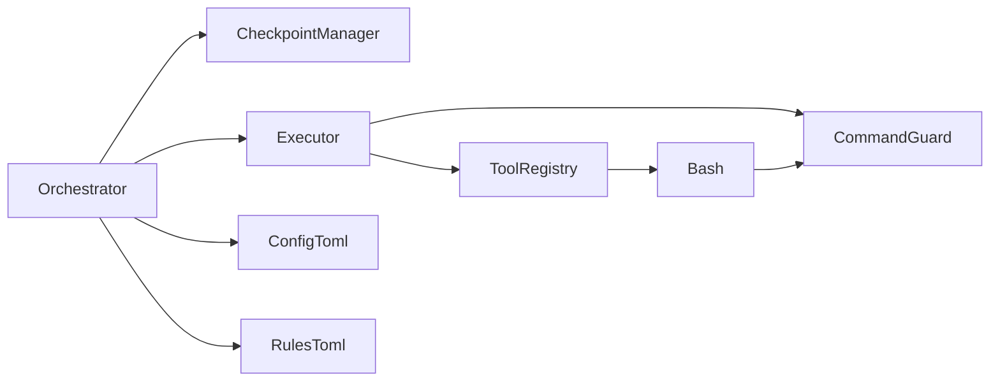

# 安全沙箱

<cite>
**本文引用的文件**
- [CommandGuard.ts](file://src/sandbox/CommandGuard.ts)
- [Checkpoint.ts](file://src/sandbox/Checkpoint.ts)
- [bash.ts](file://src/tools/bash.ts)
- [Executor.ts](file://src/agent/Executor.ts)
- [Orchestrator.ts](file://src/agent/Orchestrator.ts)
- [types.ts](file://src/agent/types.ts)
- [config.toml](file://.nexus/config.toml)
- [rules.toml](file://.nexus/rules.toml)
- [commandGuard.test.ts](file://tests/unit/commandGuard.test.ts)
- [README.md](file://README.md)
</cite>

## 目录
1. [简介](#简介)
2. [项目结构](#项目结构)
3. [核心组件](#核心组件)
4. [架构总览](#架构总览)
5. [详细组件分析](#详细组件分析)
6. [依赖关系分析](#依赖关系分析)
7. [性能与资源限制](#性能与资源限制)
8. [故障排查指南](#故障排查指南)
9. [结论](#结论)
10. [附录：配置与安全最佳实践](#附录配置与安全最佳实践)

## 简介
本技术文档聚焦 Nexus 的安全沙箱系统，围绕以下目标展开：
- CommandGuard 的危险命令检测机制：识别规则、白名单策略与强制审批边界。
- Checkpoint 检查点管理系统：Git 集成、自动提交、回滚与数据恢复流程。
- 权限模式（ask、auto-edit、auto-all、yolo）的安全影响与适用场景。
- 安全配置最佳实践：自定义危险命令规则、设置合适的权限级别。
- 安全审计日志与监控告警的实现细节与扩展建议。

## 项目结构
安全沙箱相关代码主要分布在 sandbox、tools、agent 以及配置文件中：
- src/sandbox: 危险命令检测与检查点管理
- src/tools/bash.ts: Shell 执行工具，集成超时、输出截断与危险标记
- src/agent/Executor.ts: 执行阶段权限控制与审批流
- src/agent/Orchestrator.ts: 编排层初始化与检查点生命周期
- .nexus/config.toml: 权限模式、超时、成本等全局配置
- .nexus/rules.toml: 项目级约束与上下文约定
- tests/unit/commandGuard.test.ts: 危险命令检测的单元测试

图表来源
- [CommandGuard.ts:1-98](file://src/sandbox/CommandGuard.ts#L1-L98)
- [Checkpoint.ts:1-182](file://src/sandbox/Checkpoint.ts#L1-L182)
- [bash.ts:1-186](file://src/tools/bash.ts#L1-L186)
- [Executor.ts:1-200](file://src/agent/Executor.ts#L1-L200)
- [Orchestrator.ts:1-260](file://src/agent/Orchestrator.ts#L1-L260)
- [config.toml:1-62](file://.nexus/config.toml#L1-L62)
- [rules.toml:1-21](file://.nexus/rules.toml#L1-L21)

章节来源
- [CommandGuard.ts:1-98](file://src/sandbox/CommandGuard.ts#L1-L98)
- [Checkpoint.ts:1-182](file://src/sandbox/Checkpoint.ts#L1-L182)
- [bash.ts:1-186](file://src/tools/bash.ts#L1-L186)
- [Executor.ts:1-200](file://src/agent/Executor.ts#L1-L200)
- [Orchestrator.ts:1-260](file://src/agent/Orchestrator.ts#L1-L260)
- [config.toml:1-62](file://.nexus/config.toml#L1-L62)
- [rules.toml:1-21](file://.nexus/rules.toml#L1-L21)

## 核心组件
- CommandGuard: 基于正则黑名单与启发式规则对命令进行分级评估（safe/caution/dangerous），并提供“是否强制审批”的判断接口。
- CheckpointManager: 在 Git 仓库中维护独立分支的检查点序列，支持自动创建、回滚到上一个或指定步骤、合并到工作分支。
- bash 工具: 以进程方式执行 shell 命令，具备超时、输出截断、二进制清理与工作目录锁定；危险命令会被标注并在结果中提示。
- Executor: 在 ReAct 循环中对工具调用进行权限检查，结合权限模式与危险命令强制审批逻辑决定是否放行。
- Orchestrator: 负责初始化检查点、注入配置与上下文，并协调 Plan/Execute 两阶段。

章节来源
- [CommandGuard.ts:1-98](file://src/sandbox/CommandGuard.ts#L1-L98)
- [Checkpoint.ts:1-182](file://src/sandbox/Checkpoint.ts#L1-L182)
- [bash.ts:1-186](file://src/tools/bash.ts#L1-L186)
- [Executor.ts:1-200](file://src/agent/Executor.ts#L1-L200)
- [Orchestrator.ts:1-260](file://src/agent/Orchestrator.ts#L1-L260)

## 架构总览
下图展示了从用户输入到命令执行的完整安全路径：计划与执行由 Orchestrator 协调，Executor 负责权限检查与审批，bash 工具在执行前通过 CommandGuard 进行危险评估，CheckpointManager 在编辑后自动提交检查点。

图表来源
- [Executor.ts:1-200](file://src/agent/Executor.ts#L1-L200)
- [bash.ts:1-186](file://src/tools/bash.ts#L1-L186)
- [CommandGuard.ts:1-98](file://src/sandbox/CommandGuard.ts#L1-L98)
- [Checkpoint.ts:1-182](file://src/sandbox/Checkpoint.ts#L1-L182)

## 详细组件分析

### CommandGuard 危险命令检测机制
- 识别规则
  - 文件系统破坏：根目录/主目录删除、递归强制删除等。
  - 磁盘/分区操作：直接写入块设备、格式化、安全擦除、分区操作。
  - Fork 炸弹：自复制进程模型与关键词匹配。
  - 管道执行远程脚本：curl/wget 直连 bash/sh/zsh，或以 sudo 执行。
  - 权限提升：root 递归删除、对根目录设置全开权限。
  - 系统关键文件覆写：/etc/passwd、shadow、fstab、/boot。
  - Windows 危险操作：format、递归删除驱动器、PowerShell 强制删除。
  - Git 破坏性操作：强制推送到主分支、硬重置。
  - 环境变量/密钥泄露：打印敏感变量名。
- 分级策略
  - dangerous: 命中黑名单，必须强制审批，不受权限模式影响。
  - caution: 需要额外注意但不一定危险，不强制审批。
  - safe: 普通命令。
- 白名单与扩展
  - 当前未实现显式白名单机制；如需白名单，可在 isDangerousCommand 之前增加“允许列表”快速返回 safe，或在 CAUTION_PATTERNS 中降低风险等级。
  - 建议在 rules.toml 中新增 [security] 段，集中管理正则表达式与原因说明，便于团队共享与版本化。
- 测试覆盖
  - 单元测试覆盖了典型危险命令、caution 行为与正常命令的判定。

图表来源
- [CommandGuard.ts:1-98](file://src/sandbox/CommandGuard.ts#L1-L98)

章节来源
- [CommandGuard.ts:1-98](file://src/sandbox/CommandGuard.ts#L1-L98)
- [commandGuard.test.ts:1-88](file://tests/unit/commandGuard.test.ts#L1-L88)

### Checkpoint 检查点管理系统
- Git 集成
  - 初始化：若不在 Git 仓库则 init，确保有初始提交后再创建 checkpoint 分支。
  - 分支策略：默认使用 nexus/checkpoints 分支，避免污染主分支。
- 自动提交
  - 每次 edit_file 成功后，暂存变更并提交，记录 step、commitHash、message、filesChanged 等元数据。
- 回滚机制
  - undo(): 回滚到上一个检查点（若无上一个则回退到该提交的前一个）。
  - jumpTo(step): 跳转到指定步骤，并裁剪后续检查点。
- 数据恢复流程
  - mergeToWorkBranch(targetBranch): 将检查点分支合并到目标工作分支，完成最终落盘。
- 错误处理
  - 无变更时跳过提交；失败时返回错误信息，保持内部状态一致。

图表来源
- [Checkpoint.ts:1-182](file://src/sandbox/Checkpoint.ts#L1-L182)
- [types.ts:186-195](file://src/agent/types.ts#L186-L195)

章节来源
- [Checkpoint.ts:1-182](file://src/sandbox/Checkpoint.ts#L1-L182)
- [types.ts:186-195](file://src/agent/types.ts#L186-L195)

### 权限模式与审批流程
- 模式定义
  - ask: 每个写操作都询问（默认）。
  - auto-edit: edit_file 自动批准，其他工具仍询问。
  - auto-all: 全部自动，但危险命令仍强制询问。
  - yolo: 全部自动，包含危险命令（自负责任）。
- 审批决策
  - 工具声明 requiresApproval=true 才进入审批流程。
  - bash 工具若检测到危险命令，无论何种模式均强制审批。
  - 其余工具按 permissionMode 决定自动或通过审批回调。
- TUI 交互
  - ApprovalPrompt 提供 Y/N 选择与 diff 预览，增强可解释性与可控性。

图表来源
- [Executor.ts:1-200](file://src/agent/Executor.ts#L1-L200)
- [CommandGuard.ts:1-98](file://src/sandbox/CommandGuard.ts#L1-L98)
- [ApprovalPrompt.tsx:1-57](file://src/tui/components/ApprovalPrompt.tsx#L1-L57)

章节来源
- [Executor.ts:1-200](file://src/agent/Executor.ts#L1-L200)
- [types.ts:27-27](file://src/agent/types.ts#L27-L27)
- [README.md:114-122](file://README.md#L114-L122)

### bash 工具执行与输出治理
- 执行环境
  - 跨平台 shell 选择（Windows: powershell.exe；Unix: /bin/bash）。
  - 工作目录锁定在项目根目录，防止越权访问。
- 超时与进程组管理
  - 超时后终止整个进程树（Windows: taskkill /T；Unix: kill -SIGKILL 进程组）。
- 输出治理
  - 清理二进制控制字符，尾部截断保留错误信息，附带原始大小与行数摘要。
- 危险标记
  - 调用 CommandGuard 进行危险评估，并在结果中标注原因，便于审计与展示。

章节来源
- [bash.ts:1-186](file://src/tools/bash.ts#L1-L186)
- [CommandGuard.ts:1-98](file://src/sandbox/CommandGuard.ts#L1-L98)

## 依赖关系分析
- Orchestrator 依赖 CheckpointManager 与 Executor，并通过配置注入权限模式与限制。
- Executor 依赖 CommandGuard 的强制审批能力与工具注册表。
- bash 工具依赖 CommandGuard 进行危险评估，同时受 Orchestrator 注入的上下文参数（如超时、输出上限）约束。
- 配置文件 config.toml 提供权限模式、超时、成本等关键参数；rules.toml 提供项目级约束与上下文约定。

图表来源
- [Orchestrator.ts:1-260](file://src/agent/Orchestrator.ts#L1-L260)
- [Executor.ts:1-200](file://src/agent/Executor.ts#L1-L200)
- [CommandGuard.ts:1-98](file://src/sandbox/CommandGuard.ts#L1-L98)
- [bash.ts:1-186](file://src/tools/bash.ts#L1-L186)
- [config.toml:1-62](file://.nexus/config.toml#L1-L62)
- [rules.toml:1-21](file://.nexus/rules.toml#L1-L21)

章节来源
- [Orchestrator.ts:1-260](file://src/agent/Orchestrator.ts#L1-L260)
- [Executor.ts:1-200](file://src/agent/Executor.ts#L1-L200)
- [CommandGuard.ts:1-98](file://src/sandbox/CommandGuard.ts#L1-L98)
- [bash.ts:1-186](file://src/tools/bash.ts#L1-L186)
- [config.toml:1-62](file://.nexus/config.toml#L1-L62)
- [rules.toml:1-21](file://.nexus/rules.toml#L1-L21)

## 性能与资源限制
- 超时控制
  - bash_timeout 限制单次命令执行时间，避免长时间占用资源。
- 输出限制
  - max_output_bytes 与 max_read_lines 防止大输出导致内存膨胀与渲染卡顿。
- 迭代上限
  - max_iterations 限制 Agent 循环步数，避免无限执行。
- 成本限制
  - max_session_cost 用于会话级成本阈值，超过后可暂停并提示用户。

章节来源
- [config.toml:39-50](file://.nexus/config.toml#L39-L50)
- [bash.ts:123-186](file://src/tools/bash.ts#L123-L186)

## 故障排查指南
- 危险命令误判
  - 现象：合法命令被标记为 caution 或 dangerous。
  - 排查：核对 CommandGuard 的正则集合，确认是否存在过度匹配；必要时在 isDangerousCommand 前引入白名单快速放行。
- 审批卡住
  - 现象：频繁弹出审批或无法继续。
  - 排查：检查 permissionMode 与工具 requiresApproval 标志；确认 TUI 审批回调是否正确返回。
- 检查点失败
  - 现象：create/jumpTo/undo 报错。
  - 排查：确认项目是否为 Git 仓库；检查分支是否存在；查看 git 子进程 stderr 输出。
- 输出过大
  - 现象：终端显示不完整或卡顿。
  - 排查：调整 max_output_bytes 与 max_read_lines；关注 truncateOutput 的提示信息。

章节来源
- [CommandGuard.ts:1-98](file://src/sandbox/CommandGuard.ts#L1-L98)
- [Executor.ts:167-196](file://src/agent/Executor.ts#L167-L196)
- [Checkpoint.ts:72-182](file://src/sandbox/Checkpoint.ts#L72-L182)
- [bash.ts:112-186](file://src/tools/bash.ts#L112-L186)

## 结论
Nexus 的安全沙箱通过 CommandGuard 的规则化危险检测、Checkpoint 的 Git 化版本控制与 Executor 的多模式权限控制，构建了“人在环中”的可控执行环境。配合合理的配置与审计日志，能够在保证效率的同时显著降低误操作风险。

## 附录：配置与安全最佳实践
- 自定义危险命令规则
  - 在 CommandGuard 中扩展 DANGEROUS_PATTERNS 与 CAUTION_PATTERNS，并为每条规则添加清晰的 reason，便于审计与可视化。
  - 建议引入白名单机制：在 isDangerousCommand 开头优先匹配允许列表，返回 safe。
- 权限级别设置
  - 默认使用 ask 模式，逐步过渡到 auto-edit 以提升效率；仅在可信环境与严格审计下考虑 auto-all 或 yolo。
  - 对高风险团队或合规要求高的场景，建议禁用 yolo，并对所有写操作启用强制审批。
- 检查点策略
  - 开启 auto_checkpoint，使用独立分支隔离实验性修改；定期合并到工作分支并清理旧分支。
  - 在关键里程碑处手动创建检查点，便于回溯。
- 审计与监控
  - 利用 Orchestrator 的事件流（tool_call、tool_result、checkpoint、cost_update、error）记录审计日志。
  - 对危险命令与审批事件进行专项统计，设置阈值告警（如单位时间内危险命令次数、审批拒绝率）。
  - 将成本与 token 消耗纳入仪表盘，结合 max_session_cost 实现预算超限时自动暂停与通知。

章节来源
- [CommandGuard.ts:1-98](file://src/sandbox/CommandGuard.ts#L1-L98)
- [Executor.ts:1-200](file://src/agent/Executor.ts#L1-L200)
- [Orchestrator.ts:1-260](file://src/agent/Orchestrator.ts#L1-L260)
- [config.toml:35-62](file://.nexus/config.toml#L35-L62)
- [types.ts:8-22](file://src/agent/types.ts#L8-L22)