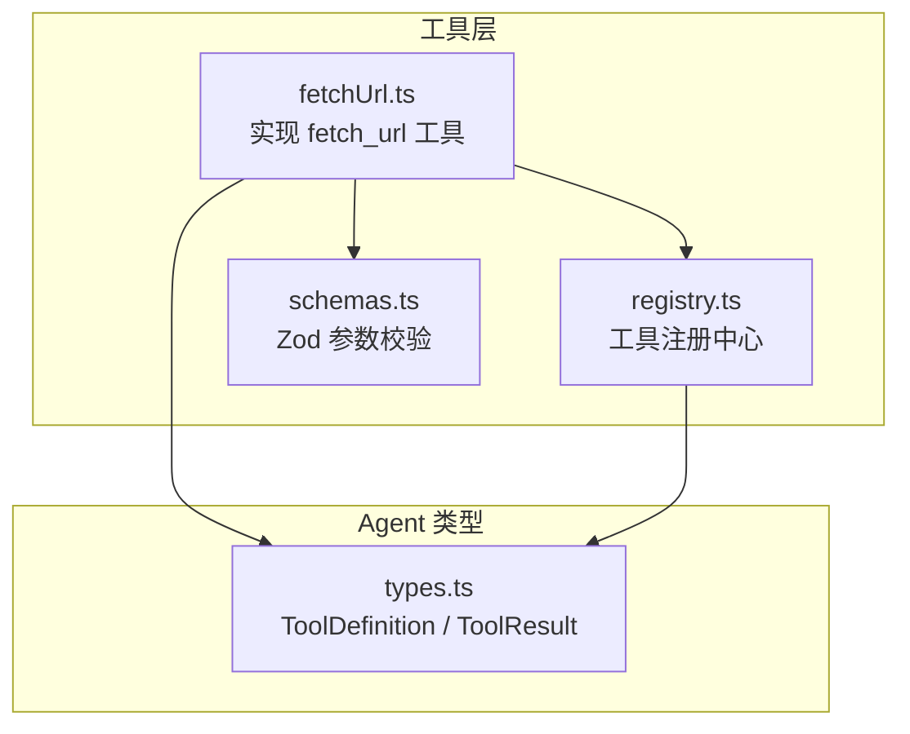
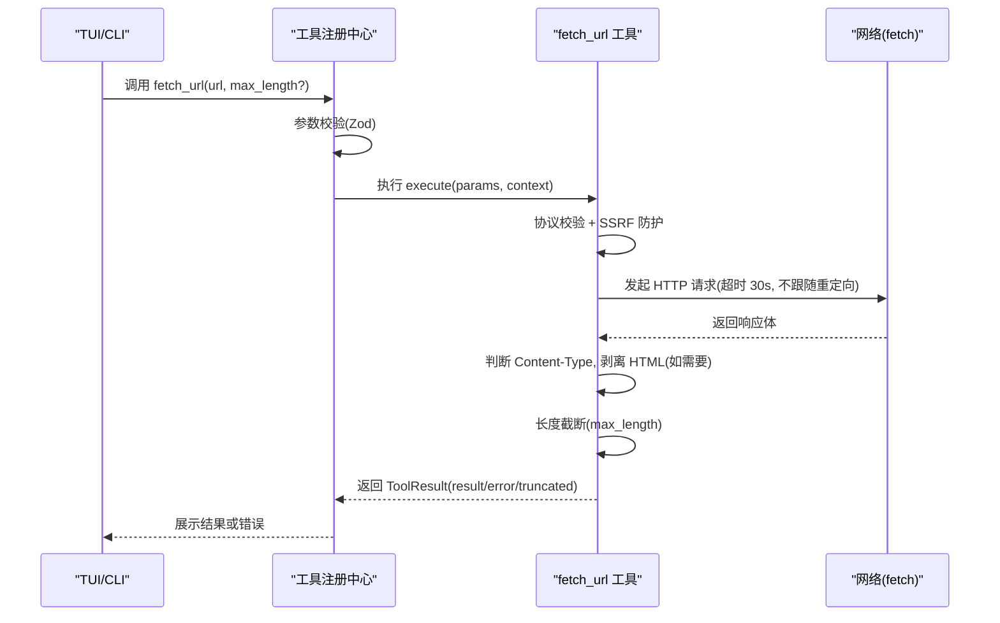
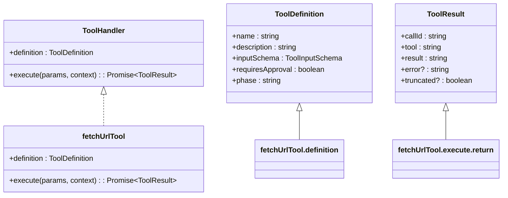
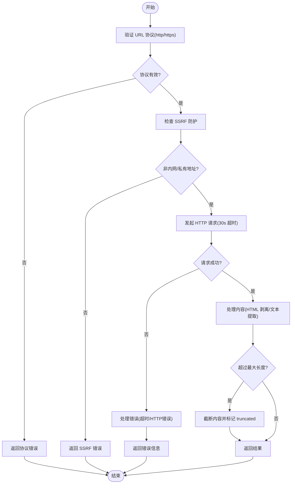
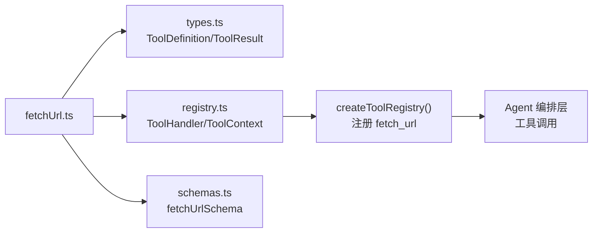

# fetch_url 网页内容获取工具

<cite>
**本文引用的文件**   
- [src/tools/fetchUrl.ts](file://src/tools/fetchUrl.ts)
- [src/tools/registry.ts](file://src/tools/registry.ts)
- [src/tools/schemas.ts](file://src/tools/schemas.ts)
- [src/agent/types.ts](file://src/agent/types.ts)
- [tests/integration/newTools.test.ts](file://tests/integration/newTools.test.ts)
- [README.md](file://README.md)
- [DESIGN.md](file://DESIGN.md)
</cite>

## 目录
1. [简介](#简介)
2. [项目结构](#项目结构)
3. [核心组件](#核心组件)
4. [架构总览](#架构总览)
5. [详细组件分析](#详细组件分析)
6. [依赖关系分析](#依赖关系分析)
7. [性能与安全性考量](#性能与安全性考量)
8. [故障排查指南](#故障排查指南)
9. [结论](#结论)
10. [附录：使用示例与最佳实践](#附录使用示例与最佳实践)

## 简介
fetch_url 是 Nexus 工具层的一个网络抓取工具，用于获取指定 URL 的网页内容并提取主要文本。该工具基于 Bun 内置的 fetch API，具备以下特点：
- 自动移除 HTML 标签、脚本和样式，保留正文内容
- 支持可选的最大返回字符数限制
- 严格的协议校验与 SSRF 防护（拒绝内网/私有地址）
- 超时控制（默认 30 秒）
- 需要人工审批（requiresApproval: true），适用于计划与执行两个阶段（phase: both）

该工具通过工具注册中心统一暴露给 Agent 编排层，并在参数层面由 Zod Schema 进行运行时校验。

## 项目结构
fetch_url 工具位于 src/tools 目录下，作为独立模块实现，并通过 registry.ts 注册到全局工具表。其输入输出遵循统一的 ToolDefinition 与 ToolResult 类型定义，确保与其他工具一致的行为。



图表来源
- [src/tools/fetchUrl.ts:1-228](file://src/tools/fetchUrl.ts#L1-L228)
- [src/tools/registry.ts:1-216](file://src/tools/registry.ts#L1-L216)
- [src/tools/schemas.ts:1-96](file://src/tools/schemas.ts#L1-L96)
- [src/agent/types.ts:45-81](file://src/agent/types.ts#L45-L81)

章节来源
- [src/tools/fetchUrl.ts:1-228](file://src/tools/fetchUrl.ts#L1-L228)
- [src/tools/registry.ts:1-216](file://src/tools/registry.ts#L1-L216)
- [src/tools/schemas.ts:1-96](file://src/tools/schemas.ts#L1-L96)
- [src/agent/types.ts:45-81](file://src/agent/types.ts#L45-L81)

## 核心组件
- 工具定义与执行器
  - 名称：fetch_url
  - 描述：获取网页内容并提取主要文本，移除 HTML 标签、脚本和样式，保留正文内容；超时 30 秒；需要审批（网络请求）
  - 输入参数：
    - url（必填）：目标 URL，必须是 http 或 https 协议
    - max_length（可选）：最大返回字符数，默认 10000
  - 权限：requiresApproval = true
  - 阶段：phase = both（在 plan 和 execute 阶段均可用）
- 参数校验
  - 使用 Zod Schema 定义 fetchUrlSchema，确保运行时参数合法性
- 执行流程
  - 协议校验 → SSRF 防护 → 发起 HTTP 请求（带超时与重定向控制）→ 根据 Content-Type 决定是否剥离 HTML → 长度截断 → 返回结果或错误信息

章节来源
- [src/tools/fetchUrl.ts:10-30](file://src/tools/fetchUrl.ts#L10-L30)
- [src/tools/schemas.ts:60-63](file://src/tools/schemas.ts#L60-L63)
- [src/tools/registry.ts:127-138](file://src/tools/registry.ts#L127-L138)

## 架构总览
fetch_url 工具在整体架构中的位置如下：
- 工具层：实现具体功能（网络请求、HTML 清理、SSRF 防护）
- 注册中心：统一管理工具生命周期、参数校验、调用分发
- Agent 类型：定义工具契约（ToolDefinition、ToolResult）
- 测试层：集成测试覆盖关键行为（协议校验、审批标志、阶段可用性）



图表来源
- [src/tools/registry.ts:96-123](file://src/tools/registry.ts#L96-L123)
- [src/tools/fetchUrl.ts:118-225](file://src/tools/fetchUrl.ts#L118-L225)

## 详细组件分析

### 工具定义与注册
- fetch_url 工具通过 fetchUrlTool 对象导出，包含 definition 和 execute 方法
- 在 createToolRegistry() 中注册，使其对 Agent 可用
- 工具名映射到 Zod Schema，确保参数校验一致性



图表来源
- [src/tools/fetchUrl.ts:10-30](file://src/tools/fetchUrl.ts#L10-L30)
- [src/agent/types.ts:47-81](file://src/agent/types.ts#L47-L81)

章节来源
- [src/tools/fetchUrl.ts:10-30](file://src/tools/fetchUrl.ts#L10-L30)
- [src/tools/registry.ts:127-138](file://src/tools/registry.ts#L127-L138)
- [src/agent/types.ts:47-81](file://src/agent/types.ts#L47-L81)

### 执行逻辑与数据处理
- 协议校验：仅允许 http:// 和 https:// 协议
- SSRF 防护：检测并拒绝内网/私有地址（包括 localhost、127.0.0.1、私有 IP 段、云元数据端点等）
- 网络请求：使用 AbortController 实现 30 秒超时，手动处理重定向（redirect: 'manual'）
- 内容处理：根据 Content-Type 判断是否为 HTML，若是则剥离标签、脚本、样式，保留正文
- 长度控制：超过 max_length 时截断并添加提示
- 错误处理：区分超时、HTTP 错误、网络异常等情况，返回结构化错误信息



图表来源
- [src/tools/fetchUrl.ts:118-225](file://src/tools/fetchUrl.ts#L118-L225)

章节来源
- [src/tools/fetchUrl.ts:118-225](file://src/tools/fetchUrl.ts#L118-L225)

### 安全机制详解
- 协议白名单：仅允许 http 和 https 协议，防止 ftp、file 等危险协议
- SSRF 防护：
  - 本地回环地址：localhost、127.0.0.1、::1
  - 私有 IP 段：10.0.0.0/8、172.16.0.0/12、192.168.0.0/16、127.0.0.0/8、169.254.0.0/16、0.0.0.0/8
  - 云元数据端点：169.254.169.254、metadata.google.internal
  - 特殊后缀：.local、.internal
- 重定向控制：设置 redirect: 'manual'，防止自动跳转到内网地址
- 超时保护：30 秒超时，避免长时间阻塞

章节来源
- [src/tools/fetchUrl.ts:73-116](file://src/tools/fetchUrl.ts#L73-L116)
- [src/tools/fetchUrl.ts:147-154](file://src/tools/fetchUrl.ts#L147-L154)

### 测试覆盖
集成测试覆盖了以下关键场景：
- 协议校验：拒绝非 http/https 协议
- 参数校验：url 字段必填
- 权限标志：requiresApproval = true
- 阶段可用性：phase = both
- 工具注册：fetch_url 已正确注册

章节来源
- [tests/integration/newTools.test.ts:161-196](file://tests/integration/newTools.test.ts#L161-L196)

## 依赖关系分析
fetch_url 工具的依赖关系如下：
- 直接依赖：
  - ToolDefinition、ToolResult 类型（来自 agent/types.ts）
  - ToolHandler、ToolContext 接口（来自 tools/registry.ts）
  - Zod Schema 校验（来自 tools/schemas.ts）
- 间接依赖：
  - 工具注册中心（tools/registry.ts）
  - Agent 编排层（通过工具调用机制）



图表来源
- [src/tools/fetchUrl.ts:1-10](file://src/tools/fetchUrl.ts#L1-L10)
- [src/tools/registry.ts:127-138](file://src/tools/registry.ts#L127-L138)

章节来源
- [src/tools/fetchUrl.ts:1-10](file://src/tools/fetchUrl.ts#L1-L10)
- [src/tools/registry.ts:127-138](file://src/tools/registry.ts#L127-L138)

## 性能与安全性考量

### 性能优化
- 超时控制：30 秒超时避免长时间等待
- 内容截断：max_length 参数限制返回大小，减少内存占用
- HTML 处理：正则表达式批量替换，避免复杂解析器开销
- 重定向控制：手动处理重定向，避免不必要的额外请求

### 安全加固
- 协议白名单：严格限制允许的协议类型
- SSRF 防护：全面的内网地址检测和拒绝
- 重定向安全：禁用自动重定向，防止跳转攻击
- 用户代理：设置明确的 User-Agent，便于服务器识别和日志追踪

### 错误处理
- 分类错误：区分协议错误、SSRF 错误、网络错误、超时错误
- 结构化响应：所有错误都返回标准化的 ToolResult 格式
- 调试友好：错误消息包含详细信息，便于问题定位

章节来源
- [src/tools/fetchUrl.ts:118-225](file://src/tools/fetchUrl.ts#L118-L225)

## 故障排查指南

### 常见问题及解决方案
1. **协议错误**
   - 现象：返回"无效的 URL 协议"错误
   - 原因：使用了非 http/https 协议
   - 解决：确保 URL 以 http:// 或 https:// 开头

2. **SSRF 防护触发**
   - 现象：返回"不允许访问内网或私有地址"错误
   - 原因：目标地址属于内网或私有范围
   - 解决：使用公网可访问的 URL

3. **请求超时**
   - 现象：返回"请求超时(30秒)"错误
   - 原因：服务器响应过慢或网络问题
   - 解决：检查网络连接和目标服务器状态

4. **HTTP 错误**
   - 现象：返回具体的 HTTP 状态码错误
   - 原因：服务器返回 4xx/5xx 错误
   - 解决：检查 URL 是否正确，服务器是否正常运行

5. **内容为空**
   - 现象：返回"页面内容为空或无法解析"
   - 原因：页面没有可提取的文本内容
   - 解决：确认目标 URL 是否有实际内容

### 调试技巧
- 启用详细日志：查看完整的错误信息和堆栈跟踪
- 逐步验证：先测试基本连接，再逐步增加复杂度
- 使用代理：通过代理服务器监控请求和响应
- 检查防火墙：确保网络策略允许出站连接

章节来源
- [src/tools/fetchUrl.ts:118-225](file://src/tools/fetchUrl.ts#L118-L225)

## 结论
fetch_url 工具为 Nexus 提供了安全可靠的网页内容获取能力。通过严格的协议校验、SSRF 防护、超时控制和内容处理，确保了工具的稳定性和安全性。该工具与现有工具架构完美集成，支持参数校验、权限控制和阶段管理，为 Agent 提供了强大的网络信息获取能力。

在实际使用中，建议：
- 始终提供有效的 http/https URL
- 合理设置 max_length 参数控制输出大小
- 注意 SSRF 防护规则，避免访问内网地址
- 关注错误信息，及时排查问题

## 附录：使用示例与最佳实践

### 基本用法
```typescript
// 基本网页内容获取
const result = await registry.execute('fetch_url', {
  url: 'https://example.com'
}, context);

// 限制返回长度
const result = await registry.execute('fetch_url', {
  url: 'https://example.com',
  max_length: 5000
}, context);
```

### 错误处理示例
```typescript
try {
  const result = await registry.execute('fetch_url', {
    url: 'invalid-url'
  }, context);
  
  if (result.error) {
    console.log('错误:', result.error);
  } else {
    console.log('内容:', result.result);
  }
} catch (err) {
  console.log('异常:', err);
}
```

### 最佳实践
1. **URL 验证**：在执行前验证 URL 格式和协议
2. **长度控制**：根据实际需求设置合理的 max_length
3. **错误处理**：妥善处理各种异常情况
4. **资源管理**：注意超时和网络资源消耗
5. **安全考虑**：避免访问敏感或内网地址

章节来源
- [tests/integration/newTools.test.ts:161-196](file://tests/integration/newTools.test.ts#L161-L196)
- [src/tools/fetchUrl.ts:118-225](file://src/tools/fetchUrl.ts#L118-L225)