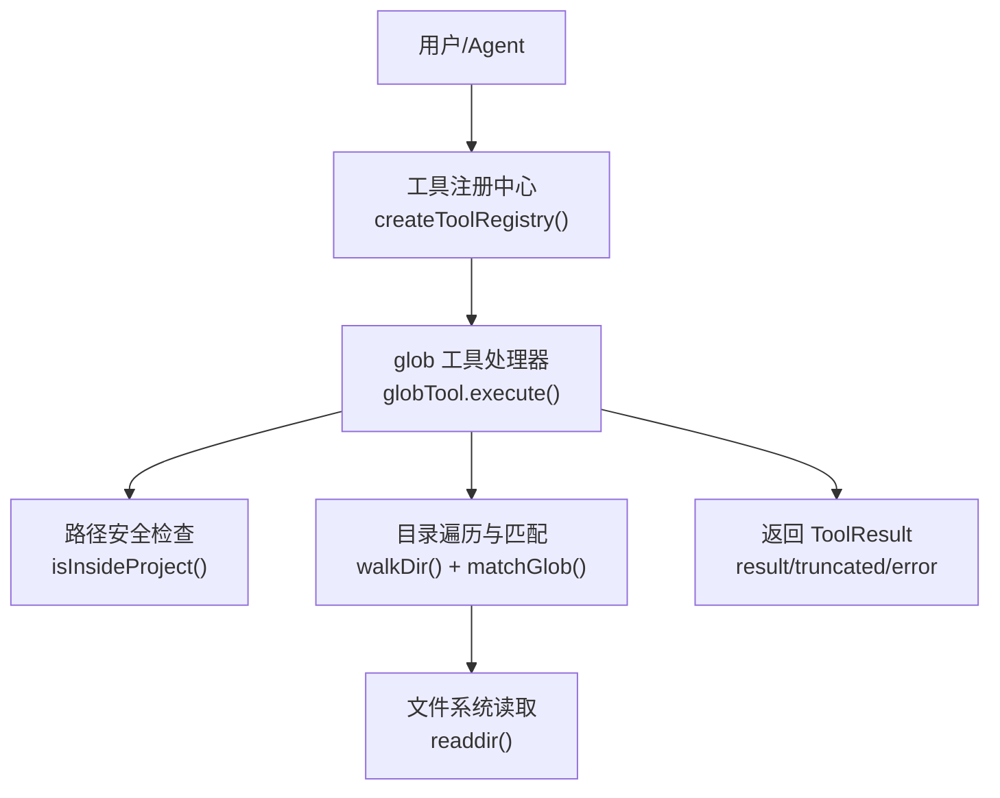
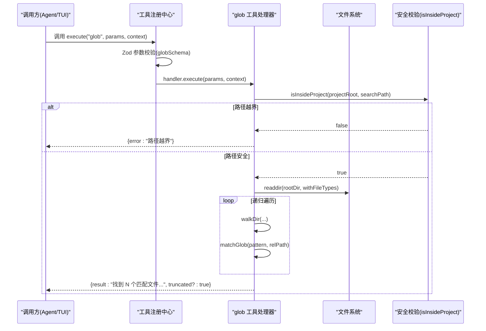
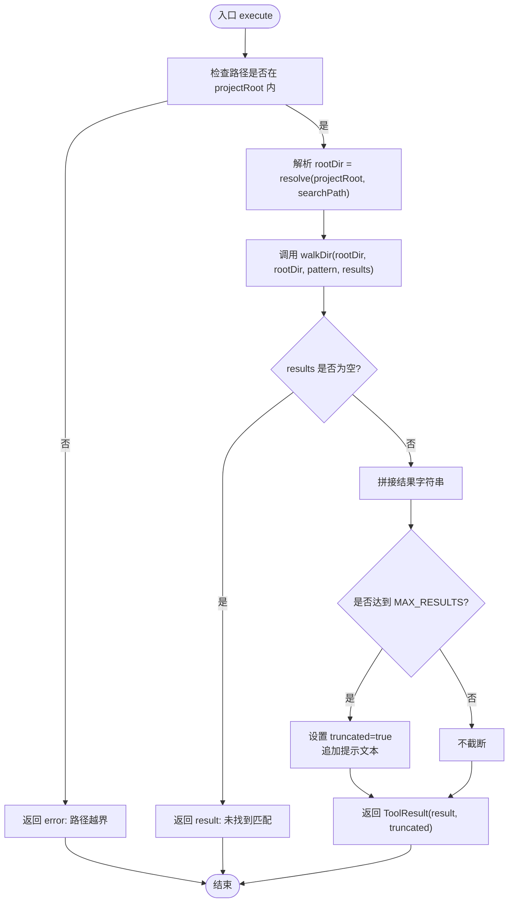
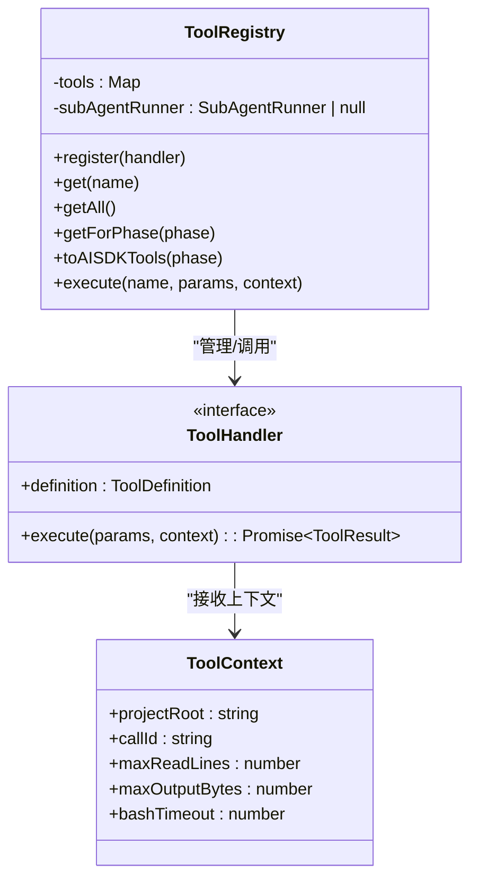
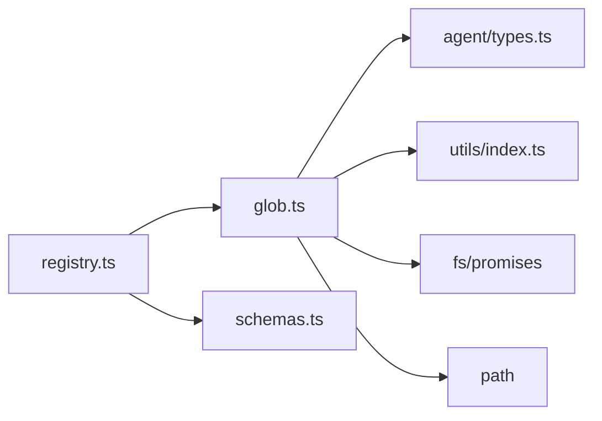

# glob 文件模式搜索工具

<cite>
**本文引用的文件**   
- [src/tools/glob.ts](file://src/tools/glob.ts)
- [src/tools/registry.ts](file://src/tools/registry.ts)
- [src/tools/schemas.ts](file://src/tools/schemas.ts)
- [src/agent/types.ts](file://src/agent/types.ts)
- [src/utils/index.ts](file://src/utils/index.ts)
- [README.md](file://README.md)
- [DESIGN.md](file://DESIGN.md)
</cite>

## 目录
1. [简介](#简介)
2. [项目结构中的位置](#项目结构中的位置)
3. [核心组件](#核心组件)
4. [架构总览](#架构总览)
5. [详细组件分析](#详细组件分析)
6. [依赖关系分析](#依赖关系分析)
7. [性能与复杂度](#性能与复杂度)
8. [故障排查指南](#故障排查指南)
9. [结论](#结论)

## 简介
glob 工具用于在项目中按 glob 模式搜索匹配的文件路径，支持常见的 **、*、? 等通配符。该工具为只读操作，无需审批，适用于规划阶段和执行阶段的文件发现场景。实现上优先使用内置能力（如 Bun Glob），若不可用则回退到递归遍历目录并基于正则进行匹配，同时提供结果数量上限与安全边界控制。

## 项目结构中的位置
- 工具实现：src/tools/glob.ts
- 工具注册与调度：src/tools/registry.ts
- 参数校验 Schema：src/tools/schemas.ts
- 类型定义（ToolDefinition、ToolResult 等）：src/agent/types.ts
- 安全与路径校验工具：src/utils/index.ts
- 项目说明与设计文档：README.md、DESIGN.md

图表来源
- [src/tools/registry.ts:127-138](file://src/tools/registry.ts#L127-L138)
- [src/tools/glob.ts:97-146](file://src/tools/glob.ts#L97-L146)
- [src/utils/index.ts:279-285](file://src/utils/index.ts#L279-L285)

章节来源
- [src/tools/glob.ts:1-149](file://src/tools/glob.ts#L1-L149)
- [src/tools/registry.ts:127-138](file://src/tools/registry.ts#L127-L138)
- [src/tools/schemas.ts:33-36](file://src/tools/schemas.ts#L33-L36)
- [src/agent/types.ts:47-81](file://src/agent/types.ts#L47-L81)
- [src/utils/index.ts:279-285](file://src/utils/index.ts#L279-L285)
- [README.md:1-174](file://README.md#L1-L174)
- [DESIGN.md:1-200](file://DESIGN.md#L1-L200)

## 核心组件
- glob 工具定义与执行器：定义名称、描述、输入 Schema、是否需审批、适用阶段；实现 execute(params, context) 完成搜索与结果组装。
- 模式匹配：matchGlob(pattern, filePath) 将 glob 转为正则，支持 **、*、?。
- 目录遍历：walkDir(dir, rootDir, pattern, results) 递归扫描目录，跳过常见无关目录，限制最大结果数。
- 安全校验：isInsideProject(projectRoot, searchPath) 防止路径越界。
- 工具注册：createToolRegistry() 中注册 glob 工具，使其可被 Agent 调用。
- 参数校验：schemas.ts 中 globSchema 对入参进行 Zod 校验。

章节来源
- [src/tools/glob.ts:14-34](file://src/tools/glob.ts#L14-L34)
- [src/tools/glob.ts:40-54](file://src/tools/glob.ts#L40-L54)
- [src/tools/glob.ts:57-95](file://src/tools/glob.ts#L57-L95)
- [src/tools/glob.ts:97-146](file://src/tools/glob.ts#L97-L146)
- [src/tools/registry.ts:127-138](file://src/tools/registry.ts#L127-L138)
- [src/tools/schemas.ts:33-36](file://src/tools/schemas.ts#L33-L36)
- [src/utils/index.ts:279-285](file://src/utils/index.ts#L279-L285)

## 架构总览
glob 工具作为 MCP 工具之一，通过工具注册中心暴露给上层 Agent。调用流程包括参数校验、路径安全检查、目录遍历与模式匹配、结果截断与格式化，最终返回标准 ToolResult。

图表来源
- [src/tools/registry.ts:96-123](file://src/tools/registry.ts#L96-L123)
- [src/tools/glob.ts:97-146](file://src/tools/glob.ts#L97-L146)
- [src/tools/schemas.ts:33-36](file://src/tools/schemas.ts#L33-L36)
- [src/utils/index.ts:279-285](file://src/utils/index.ts#L279-L285)

## 详细组件分析

### glob 工具处理器（glob.ts）
- 定义：name="glob"，描述清晰，inputSchema 包含 pattern 和可选 path，requiresApproval=false，phase="both"。
- 模式匹配：matchGlob 将 ** 映射为任意字符（含 /），* 为非 / 字符，? 为单个非 / 字符，其他特殊字符转义后构建正则。
- 目录遍历：walkDir 递归读取目录，排序保证输出稳定，跳过 node_modules/.git/dist 等无关目录，达到 MAX_RESULTS=100 时提前终止。
- 执行流程：execute 先做路径安全检查，再解析根目录，调用 walkDir 收集结果，拼接输出并标记 truncated。
- 错误处理：捕获异常并返回结构化 error 信息。

图表来源
- [src/tools/glob.ts:97-146](file://src/tools/glob.ts#L97-L146)
- [src/tools/glob.ts:57-95](file://src/tools/glob.ts#L57-L95)
- [src/tools/glob.ts:40-54](file://src/tools/glob.ts#L40-L54)

章节来源
- [src/tools/glob.ts:14-34](file://src/tools/glob.ts#L14-L34)
- [src/tools/glob.ts:40-54](file://src/tools/glob.ts#L40-L54)
- [src/tools/glob.ts:57-95](file://src/tools/glob.ts#L57-L95)
- [src/tools/glob.ts:97-146](file://src/tools/glob.ts#L97-L146)

### 工具注册与调度（registry.ts）
- createToolRegistry 初始化并注册所有工具，包括 glob。
- execute(name, params, context) 负责查找处理器、Zod 校验、调用处理器执行。
- getForPhase(phase) 根据 phase 过滤可用工具，确保 plan 阶段仅暴露只读工具。

图表来源
- [src/tools/registry.ts:39-124](file://src/tools/registry.ts#L39-L124)
- [src/tools/registry.ts:127-138](file://src/tools/registry.ts#L127-L138)

章节来源
- [src/tools/registry.ts:39-124](file://src/tools/registry.ts#L39-L124)
- [src/tools/registry.ts:127-138](file://src/tools/registry.ts#L127-L138)

### 参数校验（schemas.ts）
- globSchema 定义 pattern 必填、path 可选，描述与类型约束明确，供 registry.execute 的 Zod 校验使用。

章节来源
- [src/tools/schemas.ts:33-36](file://src/tools/schemas.ts#L33-L36)

### 类型定义（types.ts）
- ToolDefinition：name、description、inputSchema、requiresApproval、phase。
- ToolResult：callId、tool、result、error、truncated。
- ToolInputSchema：object 类型，properties、required。

章节来源
- [src/agent/types.ts:47-81](file://src/agent/types.ts#L47-L81)

### 安全与路径校验（utils/index.ts）
- isInsideProject：通过 relative 与绝对路径判断目标是否在项目根目录下，防止路径遍历攻击。

章节来源
- [src/utils/index.ts:279-285](file://src/utils/index.ts#L279-L285)

## 依赖关系分析
- glob.ts 依赖：
  - path 模块：resolve、relative
  - fs/promises：readdir
  - agent/types：ToolDefinition、ToolResult
  - tools/registry：ToolHandler、ToolContext
  - utils：isInsideProject
- registry.ts 依赖：
  - 各工具处理器（包括 glob）
  - schemas：Zod schema 校验
  - agent/types：SubAgentTask、SubAgentResult（与子任务相关）
- schemas.ts 依赖：
  - zod：参数校验

图表来源
- [src/tools/registry.ts:127-138](file://src/tools/registry.ts#L127-L138)
- [src/tools/glob.ts:1-10](file://src/tools/glob.ts#L1-L10)
- [src/tools/schemas.ts:1-10](file://src/tools/schemas.ts#L1-L10)
- [src/agent/types.ts:47-81](file://src/agent/types.ts#L47-L81)
- [src/utils/index.ts:279-285](file://src/utils/index.ts#L279-L285)

章节来源
- [src/tools/registry.ts:127-138](file://src/tools/registry.ts#L127-L138)
- [src/tools/glob.ts:1-10](file://src/tools/glob.ts#L1-L10)
- [src/tools/schemas.ts:1-10](file://src/tools/schemas.ts#L1-L10)
- [src/agent/types.ts:47-81](file://src/agent/types.ts#L47-L81)
- [src/utils/index.ts:279-285](file://src/utils/index.ts#L279-L285)

## 性能与复杂度
- 时间复杂度：O(N log N + N·M)，N 为目录条目总数（含递归），M 为每个相对路径的正则匹配成本。排序用于稳定输出，正则匹配为线性扫描。
- 空间复杂度：O(R)，R 为匹配结果数量，最多 MAX_RESULTS=100。
- I/O 特征：深度优先遍历，遇到权限问题会跳过目录；对大仓库建议缩小 path 范围或提高模式选择性以减少扫描量。
- 截断策略：当结果达到上限时，返回 truncated=true 并附加提示，引导用户细化搜索条件。

[本节为通用性能讨论，不直接分析具体文件]

## 故障排查指南
- 路径越界：searchPath 不在 projectRoot 内会被拒绝，检查传入的 path 是否正确且相对项目根。
- 无匹配结果：确认 pattern 语法正确（**、*、?），必要时缩小 path 范围或调整模式。
- 结果过多：默认最多 100 条，如需更多请优化模式或限定目录。
- 权限问题：某些目录无法读取会被跳过，不影响整体流程但可能遗漏部分结果。
- 参数校验失败：检查 pattern/path 是否符合 schema 要求（pattern 必填）。

章节来源
- [src/tools/glob.ts:97-146](file://src/tools/glob.ts#L97-L146)
- [src/tools/schemas.ts:33-36](file://src/tools/schemas.ts#L33-L36)
- [src/utils/index.ts:279-285](file://src/utils/index.ts#L279-L285)

## 结论
glob 工具提供了稳定、安全的文件模式搜索能力，结合路径安全检查与结果上限控制，适合在计划与执行阶段快速定位代码文件。其实现简洁可靠，易于扩展与维护，并与工具注册中心、参数校验、类型系统紧密集成，符合生产级工具的设计原则。

[本节为总结性内容，不直接分析具体文件]