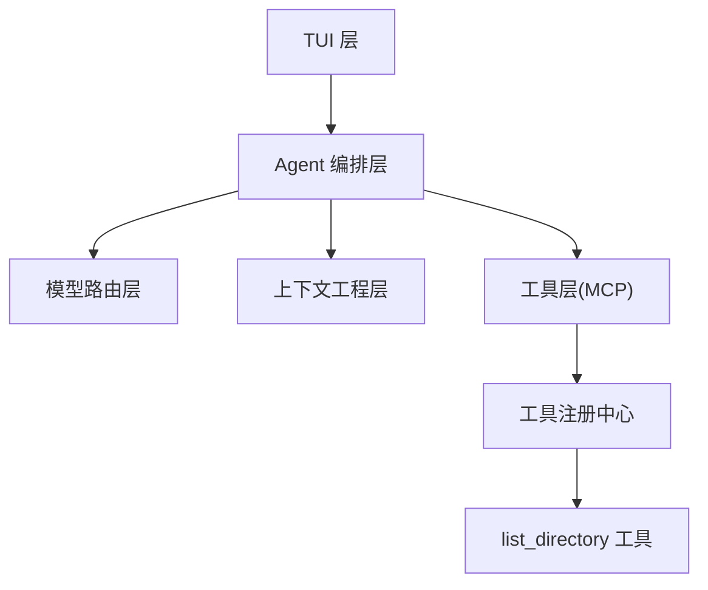
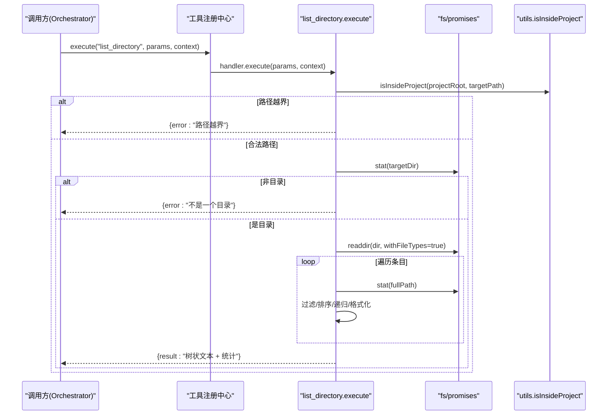
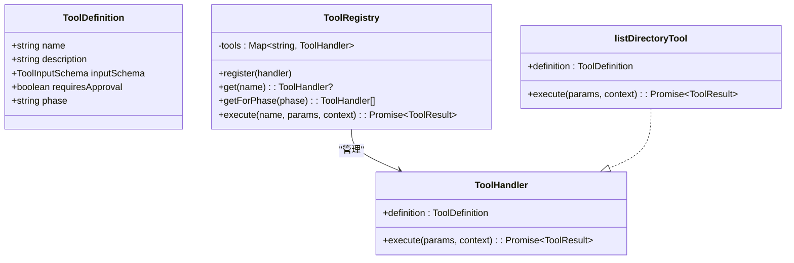
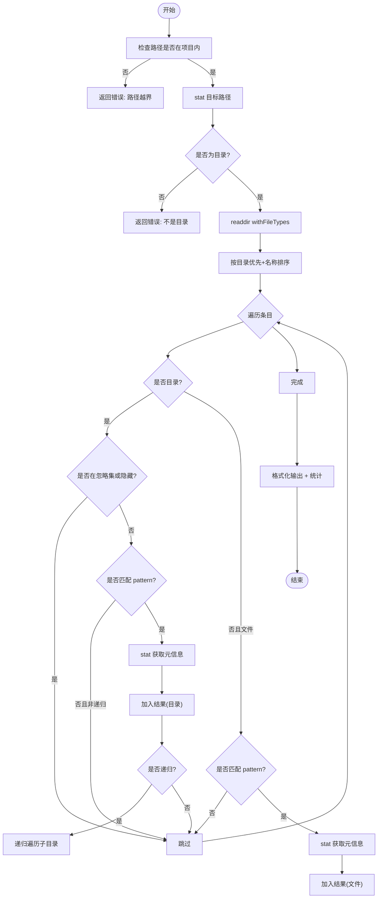
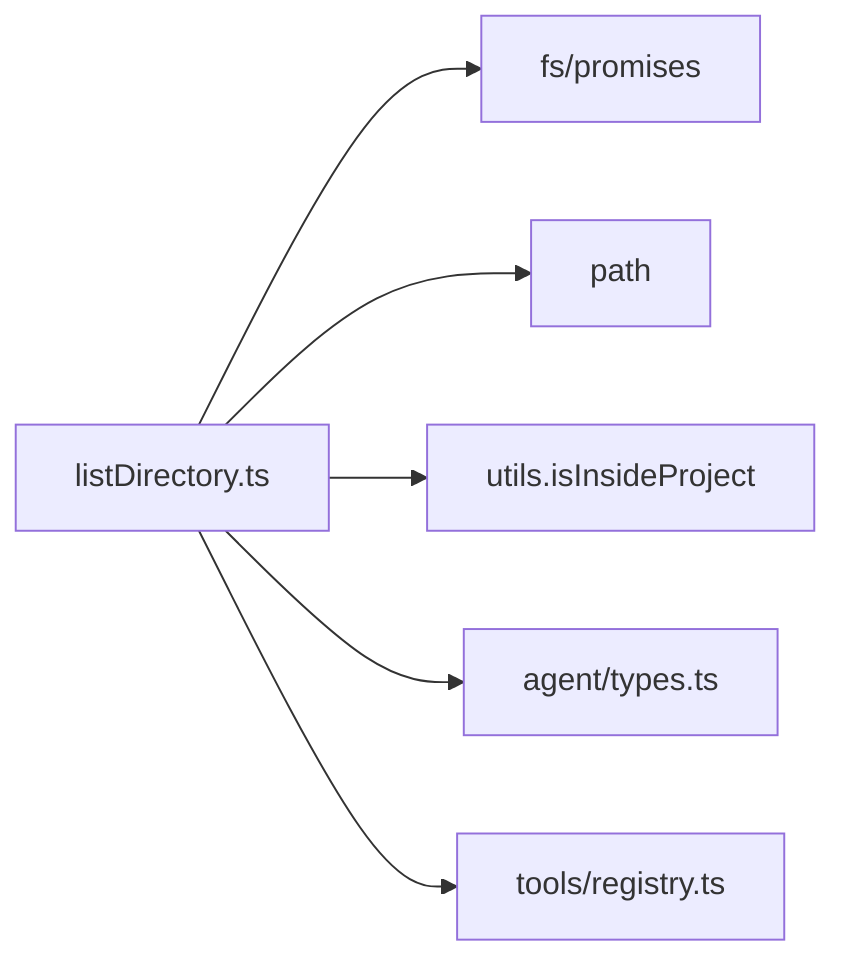

# list_directory 目录列表工具

<cite>
**本文引用的文件**
- [src/tools/listDirectory.ts](file://src/tools/listDirectory.ts)
- [src/tools/registry.ts](file://src/tools/registry.ts)
- [src/agent/types.ts](file://src/agent/types.ts)
- [src/utils/index.ts](file://src/utils/index.ts)
- [tests/integration/tools.test.ts](file://tests/integration/tools.test.ts)
- [README.md](file://README.md)
- [DESIGN.md](file://DESIGN.md)
- [package.json](file://package.json)
</cite>

## 目录
1. [简介](#简介)
2. [项目结构](#项目结构)
3. [核心组件](#核心组件)
4. [架构总览](#架构总览)
5. [详细组件分析](#详细组件分析)
6. [依赖关系分析](#依赖关系分析)
7. [性能考量](#性能考量)
8. [故障排查指南](#故障排查指南)
9. [结论](#结论)
10. [附录](#附录)

## 简介
list_directory 是 Nexus 的只读工具之一，用于列出指定目录下的文件和子目录，支持递归遍历与文件名过滤。该工具自动忽略常见构建产物与依赖目录（如 node_modules、.git、dist 等），输出包含类型、大小、修改时间等信息，并以树状缩进格式展示。作为 MCP 工具，它被注册到工具注册中心，供 Agent 在 Plan/Execute 阶段调用。

## 项目结构
Nexus 采用分层架构：TUI → Agent 编排层 → 模型路由层 → 上下文工程层 → 工具层（MCP-native）。list_directory 位于工具层，通过工具注册中心暴露给上层调用。

图表来源
- [DESIGN.md:54-85](file://DESIGN.md#L54-L85)
- [src/tools/registry.ts:127-138](file://src/tools/registry.ts#L127-L138)

章节来源
- [README.md:1-174](file://README.md#L1-L174)
- [DESIGN.md:54-85](file://DESIGN.md#L54-L85)

## 核心组件
- 工具定义与输入模式：name、description、inputSchema、requiresApproval、phase
- 执行器：execute(params, context) 返回 ToolResult
- 工具注册中心：ToolRegistry，负责注册、查找、阶段过滤、参数校验与调用分发
- 安全与路径处理：isInsideProject 防止路径越界
- 文件系统操作：readdir/stat 获取目录条目与元信息
- 格式化输出：按层级缩进显示图标、名称、大小、时间

章节来源
- [src/tools/listDirectory.ts:12-36](file://src/tools/listDirectory.ts#L12-L36)
- [src/tools/registry.ts:26-37](file://src/tools/registry.ts#L26-L37)
- [src/agent/types.ts:47-81](file://src/agent/types.ts#L47-L81)
- [src/utils/index.ts:279-285](file://src/utils/index.ts#L279-L285)

## 架构总览
list_directory 的执行流程如下：

图表来源
- [src/tools/registry.ts:96-123](file://src/tools/registry.ts#L96-L123)
- [src/tools/listDirectory.ts:142-199](file://src/tools/listDirectory.ts#L142-L199)
- [src/utils/index.ts:279-285](file://src/utils/index.ts#L279-L285)

## 详细组件分析

### 工具定义与输入模式
- name: list_directory
- description: 说明功能、行为与权限（只读、无需审批）
- inputSchema: path（相对项目根）、recursive（是否递归）、pattern（简单子串匹配）
- requiresApproval: false
- phase: both（Plan/Execute 均可用）

章节来源
- [src/tools/listDirectory.ts:12-36](file://src/tools/listDirectory.ts#L12-L36)
- [src/agent/types.ts:47-53](file://src/agent/types.ts#L47-L53)

### 执行器实现要点
- 安全检查：使用 isInsideProject 确保目标路径在项目根内
- 目录校验：stat 确认目标为目录
- 递归遍历：readdir + stat，深度保护（depth > 10 停止）
- 过滤策略：
  - 忽略目录集合（node_modules、.git、dist、build、.next、.nuxt、coverage、__pycache__、.cache、.svelte-kit、.output）
  - 隐藏目录（以 . 开头，除 .nexus）
  - pattern 子串匹配（非递归时直接跳过；递归时进入子目录但仅对当前层级进行过滤）
- 结果收集：记录 type、name、path、size、modified
- 输出格式化：树状缩进、图标、文件大小、修改时间、汇总统计

章节来源
- [src/tools/listDirectory.ts:38-49](file://src/tools/listDirectory.ts#L38-L49)
- [src/tools/listDirectory.ts:69-123](file://src/tools/listDirectory.ts#L69-L123)
- [src/tools/listDirectory.ts:126-140](file://src/tools/listDirectory.ts#L126-L140)
- [src/tools/listDirectory.ts:142-199](file://src/tools/listDirectory.ts#L142-L199)

### 工具注册与调用
- createToolRegistry 中注册 listDirectoryTool
- registry.execute 会先根据 schema 校验参数（若存在），再调用具体 handler.execute
- getForPhase 支持按阶段过滤可用工具

章节来源
- [src/tools/registry.ts:127-138](file://src/tools/registry.ts#L127-L138)
- [src/tools/registry.ts:96-123](file://src/tools/registry.ts#L96-L123)
- [src/tools/registry.ts:64-69](file://src/tools/registry.ts#L64-L69)

### 类与接口关系图

图表来源
- [src/agent/types.ts:47-81](file://src/agent/types.ts#L47-L81)
- [src/tools/registry.ts:26-37](file://src/tools/registry.ts#L26-L37)
- [src/tools/listDirectory.ts:201](file://src/tools/listDirectory.ts#L201-L202)

### 算法流程图（目录遍历与过滤）

图表来源
- [src/tools/listDirectory.ts:69-123](file://src/tools/listDirectory.ts#L69-L123)
- [src/tools/listDirectory.ts:126-140](file://src/tools/listDirectory.ts#L126-L140)

## 依赖关系分析
- 内部依赖
  - fs/promises: readdir、stat
  - path: resolve、relative、join
  - utils.isInsideProject: 路径安全校验
  - agent.types.ToolDefinition、ToolResult、ToolContext
  - tools.registry.ToolHandler、ToolRegistry
- 外部依赖
  - Node.js 运行时提供的文件系统 API
- 耦合与内聚
  - listDirectory 模块高内聚，职责单一（目录列举与格式化）
  - 通过 ToolHandler 接口与注册中心解耦，便于扩展与替换
  - 安全边界由 isInsideProject 统一保障

图表来源
- [src/tools/listDirectory.ts:6-10](file://src/tools/listDirectory.ts#L6-L10)
- [src/utils/index.ts:279-285](file://src/utils/index.ts#L279-L285)
- [src/tools/registry.ts:127-138](file://src/tools/registry.ts#L127-L138)

章节来源
- [src/tools/listDirectory.ts:6-10](file://src/tools/listDirectory.ts#L6-L10)
- [src/tools/registry.ts:127-138](file://src/tools/registry.ts#L127-L138)
- [src/utils/index.ts:279-285](file://src/utils/index.ts#L279-L285)

## 性能考量
- 递归深度限制：depth > 10 时提前返回，避免过深遍历导致栈溢出或性能问题
- 目录过滤：忽略常见大目录（node_modules、.git、dist 等），减少 I/O 与内存占用
- 排序与统计：entries.sort 基于目录优先与名称比较，复杂度 O(n log n)
- 元信息读取：每个条目一次 stat 调用，I/O 密集场景可考虑批量或缓存策略
- 输出格式化：字符串拼接与缩进计算线性复杂度，适合终端渲染

优化建议
- 对于超大目录，可在非递归模式下增加“仅顶层”快速视图
- 对频繁访问的目录元信息可引入轻量缓存（注意一致性）
- 当 pattern 过滤较复杂时，可考虑将简单子串匹配升级为正则引擎（按需开启）

[本节为通用指导，不直接分析具体文件]

## 故障排查指南
- 路径越界
  - 现象：返回 error 提示“路径越界”
  - 原因：targetPath 不在 projectRoot 范围内
  - 解决：修正 path 参数或使用相对路径
- 目标不是目录
  - 现象：返回 error 提示“不是一个目录”
  - 原因：stat 判定为非目录
  - 解决：确认 path 指向目录而非文件
- 空目录
  - 现象：返回 result 提示“目录为空”
  - 原因：无匹配条目或全部被过滤
  - 解决：调整 recursive/pattern 或检查忽略规则
- 权限或 I/O 异常
  - 现象：catch 分支返回 error 提示“列出目录失败”
  - 原因：权限不足、路径不存在、磁盘错误等
  - 解决：检查系统权限与路径有效性

章节来源
- [src/tools/listDirectory.ts:142-199](file://src/tools/listDirectory.ts#L142-L199)

## 结论
list_directory 是一个稳健、安全的只读目录浏览工具，具备递归遍历、智能过滤、格式化输出与完善的错误处理。通过 MCP 工具注册机制，它与 Nexus 的 Agent 编排层无缝集成，适用于 Plan/Execute 各阶段的代码库探索与导航。其设计遵循安全优先、性能可控、可扩展的原则，易于在未来增强（如更复杂的过滤、缓存、并发控制等）。

[本节为总结性内容，不直接分析具体文件]

## 附录

### 使用示例（概念性）
- 列出当前目录（非递归）
  - 参数：{ path: ".", recursive: false }
- 递归列出 src 目录并过滤包含 “util” 的文件
  - 参数：{ path: "src", recursive: true, pattern: "util" }
- 列出项目根目录（默认）
  - 参数：{}

[本节为概念性说明，不直接分析具体文件]

### 相关测试参考
- 集成测试展示了工具注册与调用的基本用法，可作为扩展 list_directory 测试的参考范式

章节来源
- [tests/integration/tools.test.ts:12-34](file://tests/integration/tools.test.ts#L12-L34)
- [tests/integration/tools.test.ts:83-98](file://tests/integration/tools.test.ts#L83-L98)