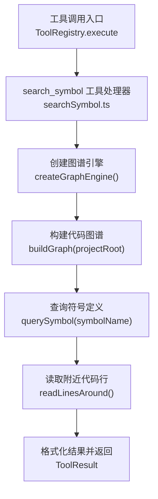
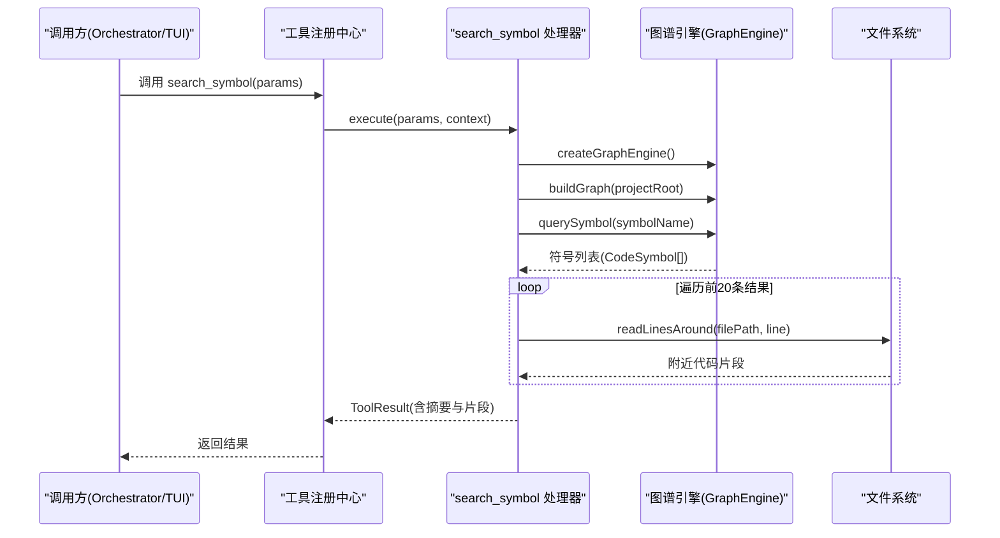
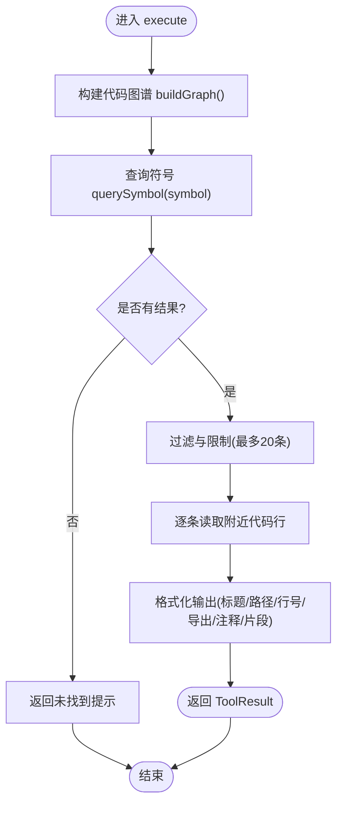
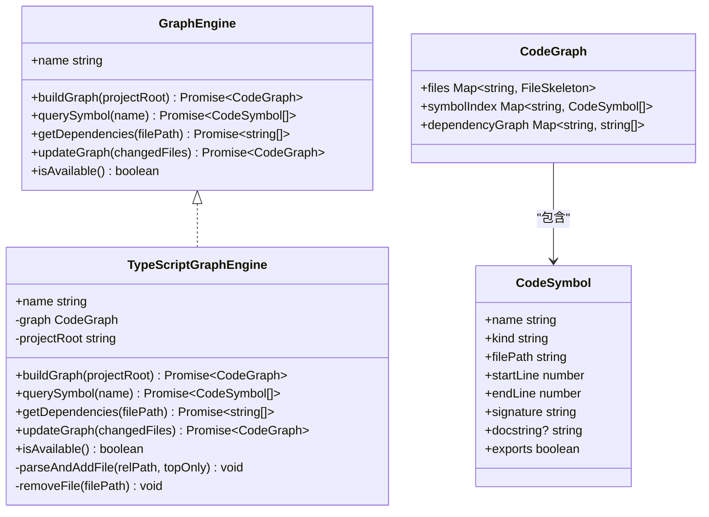
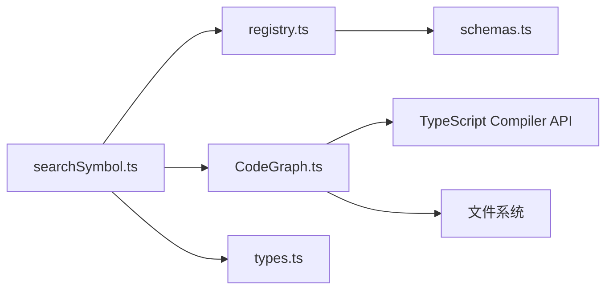

# search_symbol 符号搜索工具

<cite>
**本文引用的文件**   
- [src/tools/searchSymbol.ts](file://src/tools/searchSymbol.ts)
- [src/context/CodeGraph.ts](file://src/context/CodeGraph.ts)
- [src/tools/registry.ts](file://src/tools/registry.ts)
- [src/tools/schemas.ts](file://src/tools/schemas.ts)
- [src/agent/types.ts](file://src/agent/types.ts)
- [tests/integration/tools.test.ts](file://tests/integration/tools.test.ts)
- [README.md](file://README.md)
- [DESIGN.md](file://DESIGN.md)
</cite>

## 目录
1. [简介](#简介)
2. [项目结构](#项目结构)
3. [核心组件](#核心组件)
4. [架构总览](#架构总览)
5. [详细组件分析](#详细组件分析)
6. [依赖关系分析](#依赖关系分析)
7. [性能考量](#性能考量)
8. [故障排查指南](#故障排查指南)
9. [结论](#结论)
10. [附录](#附录)

## 简介
search_symbol 是一个用于在代码库中搜索符号（函数、类、接口、类型、变量等）定义与上下文的工具。它基于 TypeScript Compiler API 构建代码图谱，支持按名称检索并返回匹配的定义位置、行号以及附近代码片段，便于 Agent 或开发者快速定位和理解符号的上下文。该工具为只读操作，无需审批，可在计划阶段和执行阶段使用。

## 项目结构
search_symbol 工具位于 tools 层，通过 MCP 工具注册中心对外暴露；其核心能力由 context 层的 CodeGraph 提供，后者负责扫描项目文件、解析 AST、构建符号索引与依赖图。工具参数校验由 schemas.ts 中的 Zod Schema 完成，工具执行流程遵循统一的 ToolHandler 契约。

图表来源
- [src/tools/searchSymbol.ts:54-122](file://src/tools/searchSymbol.ts#L54-L122)
- [src/context/CodeGraph.ts:294-341](file://src/context/CodeGraph.ts#L294-L341)
- [src/tools/registry.ts:96-123](file://src/tools/registry.ts#L96-L123)

章节来源
- [src/tools/searchSymbol.ts:1-125](file://src/tools/searchSymbol.ts#L1-L125)
- [src/context/CodeGraph.ts:1-464](file://src/context/CodeGraph.ts#L1-L464)
- [src/tools/registry.ts:1-216](file://src/tools/registry.ts#L1-L216)
- [src/tools/schemas.ts:55-58](file://src/tools/schemas.ts#L55-L58)
- [src/agent/types.ts:47-81](file://src/agent/types.ts#L47-L81)

## 核心组件
- 工具定义与执行器：searchSymbol.ts 定义了工具的元数据（名称、描述、输入模式、权限、阶段），并提供 execute 实现。
- 代码图谱引擎：CodeGraph.ts 提供 GraphEngine 接口与 TypeScriptGraphEngine 实现，负责构建全量/增量图谱、符号索引与依赖关系。
- 工具注册中心：registry.ts 统一注册、校验与调度所有工具，将 search_symbol 纳入可用工具集。
- 参数校验：schemas.ts 定义 search_symbol 的 Zod Schema，确保 symbol 与 type 字段合法。
- 类型契约：types.ts 定义 ToolDefinition、ToolResult、ToolContext 等通用类型，保证工具间一致的数据契约。

章节来源
- [src/tools/searchSymbol.ts:13-34](file://src/tools/searchSymbol.ts#L13-L34)
- [src/context/CodeGraph.ts:77-95](file://src/context/CodeGraph.ts#L77-L95)
- [src/tools/registry.ts:127-138](file://src/tools/registry.ts#L127-L138)
- [src/tools/schemas.ts:55-58](file://src/tools/schemas.ts#L55-L58)
- [src/agent/types.ts:47-81](file://src/agent/types.ts#L47-L81)

## 架构总览
search_symbol 的执行路径如下：
- 上层 Orchestrator/TUI 发起工具调用，经由 ToolRegistry 路由到具体工具处理器。
- search_symbol 处理器创建图谱引擎，构建项目级代码图谱，查询符号定义。
- 对每个匹配项，读取目标文件指定行附近的代码片段，格式化后返回。
- 若未找到符号或发生异常，返回友好提示或错误信息。

图表来源
- [src/tools/searchSymbol.ts:54-122](file://src/tools/searchSymbol.ts#L54-L122)
- [src/context/CodeGraph.ts:294-341](file://src/context/CodeGraph.ts#L294-L341)
- [src/tools/registry.ts:96-123](file://src/tools/registry.ts#L96-L123)

## 详细组件分析

### 工具处理器：searchSymbol.ts
- 工具元数据：name、description、inputSchema、requiresApproval=false、phase=both。
- 输入参数：symbol（必填）、type（可选，当前仅支持 definition 与 all）。
- 执行流程：
  - 创建图谱引擎并构建项目代码图谱。
  - 查询符号定义，若无结果则返回“未找到”提示。
  - 过滤与限制结果数量（最多前20条）。
  - 读取每条符号所在文件的附近代码行，拼接标题、路径、行号、导出标记、文档注释与代码片段。
  - 返回结构化结果，包含 summary 与 truncated 标志。
- 错误处理：捕获异常并返回 error 字段，便于上层统一展示。

图表来源
- [src/tools/searchSymbol.ts:54-122](file://src/tools/searchSymbol.ts#L54-L122)

章节来源
- [src/tools/searchSymbol.ts:13-34](file://src/tools/searchSymbol.ts#L13-L34)
- [src/tools/searchSymbol.ts:36-52](file://src/tools/searchSymbol.ts#L36-L52)
- [src/tools/searchSymbol.ts:54-122](file://src/tools/searchSymbol.ts#L54-L122)

### 代码图谱引擎：CodeGraph.ts
- 数据结构：
  - CodeSymbol：符号名、种类、文件路径、起止行、签名、文档注释、是否导出。
  - FileSkeleton：文件路径、符号列表、导入列表、行数。
  - CodeGraph：文件映射、符号索引、依赖图。
- 引擎接口 GraphEngine：
  - buildGraph(projectRoot)：构建全量图谱。
  - querySymbol(name)：跨文件查询符号定义。
  - getDependencies(filePath)：获取文件依赖。
  - updateGraph(changedFiles)：增量更新。
  - isAvailable()/name：可用性检测与引擎标识。
- TypeScriptGraphEngine 实现：
  - 遍历项目文件，排除常见无关目录，仅处理 .ts/.tsx/.js/.jsx/.mts/.cts。
  - 使用 TypeScript Compiler API 解析 AST，提取函数、类、方法、接口、类型别名、导出的变量声明。
  - 构建符号索引与依赖图（相对导入解析）。
  - 支持大项目优化（超过阈值时仅提取顶层声明）。
  - 提供便捷函数 buildCodeGraph/updateCodeGraph 与 formatGraphForContext。

图表来源
- [src/context/CodeGraph.ts:12-36](file://src/context/CodeGraph.ts#L12-L36)
- [src/context/CodeGraph.ts:77-95](file://src/context/CodeGraph.ts#L77-L95)
- [src/context/CodeGraph.ts:294-410](file://src/context/CodeGraph.ts#L294-L410)

章节来源
- [src/context/CodeGraph.ts:1-464](file://src/context/CodeGraph.ts#L1-L464)

### 工具注册与参数校验：registry.ts 与 schemas.ts
- registry.ts：
  - 维护工具处理器集合，提供阶段过滤、审批需求查询、AI SDK 兼容转换。
  - 执行工具时进行 Zod Schema 校验，失败返回错误信息。
  - 注册 search_symbol 工具处理器。
- schemas.ts：
  - 定义 search_symbol 的输入模式：symbol（字符串）、type（枚举：definition/reference/all，但工具实现目前仅支持 definition/all）。

章节来源
- [src/tools/registry.ts:96-123](file://src/tools/registry.ts#L96-L123)
- [src/tools/registry.ts:127-138](file://src/tools/registry.ts#L127-L138)
- [src/tools/schemas.ts:55-58](file://src/tools/schemas.ts#L55-L58)

### 类型契约：types.ts
- ToolDefinition：工具元数据（名称、描述、输入模式、是否需要审批、适用阶段）。
- ToolResult：工具执行结果（callId、tool、result、error、truncated）。
- ToolContext：工具执行上下文（projectRoot、callId、maxReadLines、maxOutputBytes、bashTimeout）。

章节来源
- [src/agent/types.ts:47-81](file://src/agent/types.ts#L47-L81)
- [src/agent/types.ts:31-37](file://src/agent/types.ts#L31-L37)

## 依赖关系分析
- search_symbol 工具依赖：
  - CodeGraph.createGraphEngine：获取图谱引擎实例。
  - 文件系统：读取目标文件附近代码行。
  - 工具注册中心：统一调度与参数校验。
  - 类型系统：ToolDefinition、ToolResult、ToolContext。
- CodeGraph 引擎依赖：
  - TypeScript Compiler API：AST 解析与符号提取。
  - 文件系统：遍历与读取项目文件。
  - 路径与扩展名判断：过滤支持的脚本文件类型。

图表来源
- [src/tools/searchSymbol.ts:11](file://src/tools/searchSymbol.ts#L11)
- [src/context/CodeGraph.ts:8](file://src/context/CodeGraph.ts#L8)
- [src/tools/registry.ts:18](file://src/tools/registry.ts#L18)

章节来源
- [src/tools/searchSymbol.ts:1-125](file://src/tools/searchSymbol.ts#L1-L125)
- [src/context/CodeGraph.ts:1-464](file://src/context/CodeGraph.ts#L1-L464)
- [src/tools/registry.ts:1-216](file://src/tools/registry.ts#L1-L216)
- [src/tools/schemas.ts:1-96](file://src/tools/schemas.ts#L1-L96)
- [src/agent/types.ts:1-274](file://src/agent/types.ts#L1-L274)

## 性能考量
- 图谱构建复杂度：
  - 文件遍历 O(N)，N 为支持的文件数。
  - AST 解析与符号提取线性于文件内容大小。
  - 大项目优化：当文件数超过阈值（如 1000）时，仅提取顶层声明以减少开销。
- 查询性能：
  - 符号查询基于内存中的 symbolIndex，时间复杂度近似 O(M)，M 为符号总数。
  - 结果限制在前 20 条，避免大量 I/O 与格式化开销。
- I/O 优化：
  - 仅读取必要行的附近代码片段，减少磁盘读取。
  - 文件读取失败时静默降级，不影响整体流程。
- 可扩展性：
  - GraphEngine 接口允许未来替换为 Go 后端（tree-sitter 后台索引服务），保持上层零改动。

[本节为通用指导，不直接分析具体文件]

## 故障排查指南
- 未找到符号：
  - 检查 symbol 名称是否正确，确认目标文件是否在索引范围内（.ts/.tsx/.js/.jsx/.mts/.cts）。
  - 若不在索引范围，建议使用 grep 工具进行文本搜索。
- 参数校验失败：
  - 确保 symbol 为字符串，type 为定义值（definition/all）。
  - 查看 ToolResult.error 字段获取具体错误信息。
- 文件读取失败：
  - 检查文件路径与权限，readLinesAround 会返回“无法读取文件内容”占位。
- 结果过多被截断：
  - 工具默认返回前 20 条，注意 truncated 标志。

章节来源
- [src/tools/searchSymbol.ts:68-74](file://src/tools/searchSymbol.ts#L68-L74)
- [src/tools/searchSymbol.ts:104-112](file://src/tools/searchSymbol.ts#L104-L112)
- [src/tools/searchSymbol.ts:113-121](file://src/tools/searchSymbol.ts#L113-L121)

## 结论
search_symbol 工具通过 TypeScript Compiler API 构建代码图谱，提供高效、准确的符号定义搜索能力。其设计遵循 MCP 工具规范，具备清晰的类型契约、参数校验与错误处理机制。结合 CodeGraph 的可插拔引擎接口，未来可平滑迁移至高性能后端，满足大规模项目的索引与检索需求。

[本节为总结性内容，不直接分析具体文件]

## 附录
- 使用示例（概念性）：
  - 在计划阶段，Agent 可通过 search_symbol 查找 ToolHandler 的定义，了解工具接口。
  - 在执行阶段，Agent 可搜索 createToolRegistry 以理解工具注册流程。
- 相关文档：
  - README.md 概述了 Nexus 的核心特性与运行方式。
  - DESIGN.md 详细说明了架构分层、工具层设计与上下文工程策略。

章节来源
- [README.md:1-174](file://README.md#L1-L174)
- [DESIGN.md:219-282](file://DESIGN.md#L219-L282)