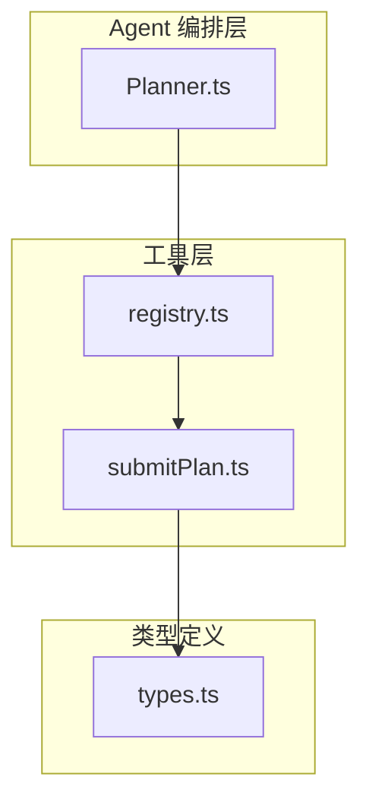
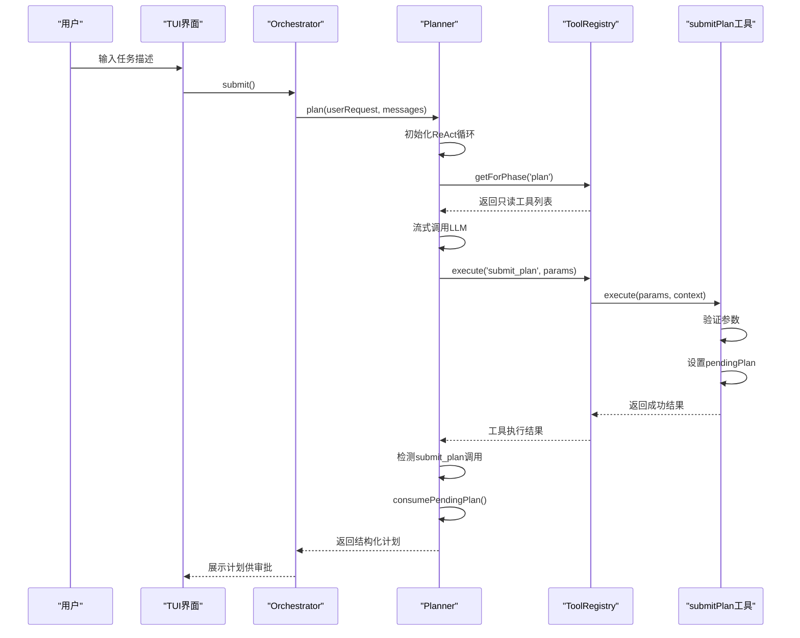
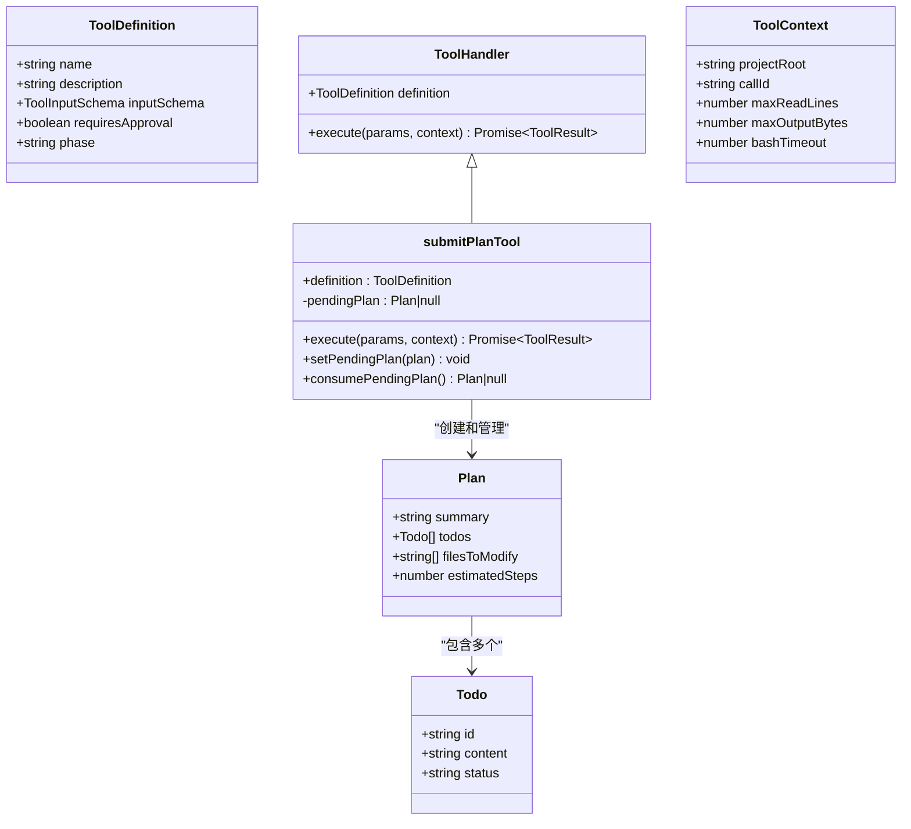
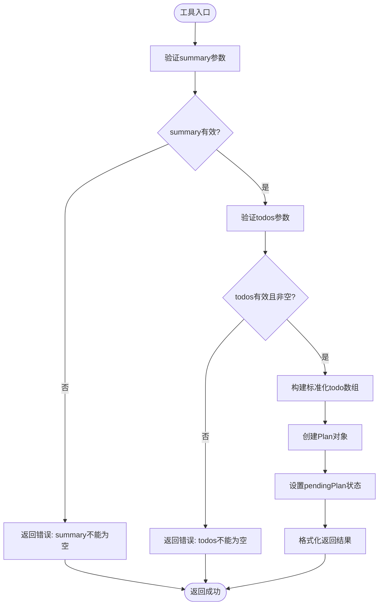
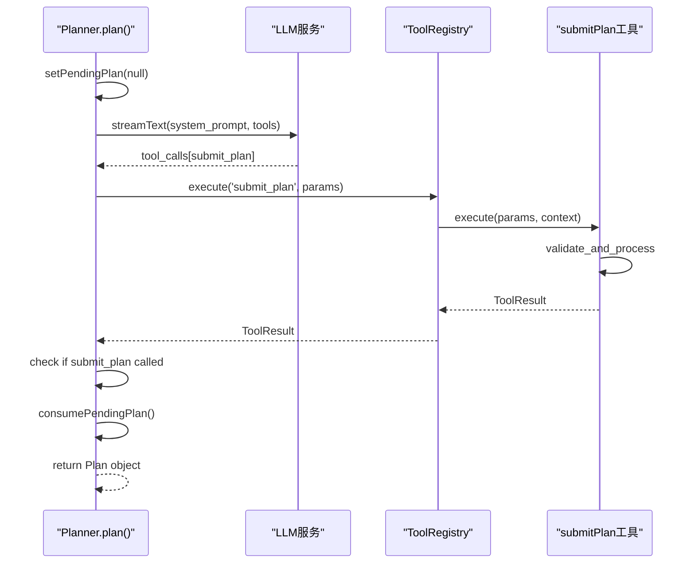
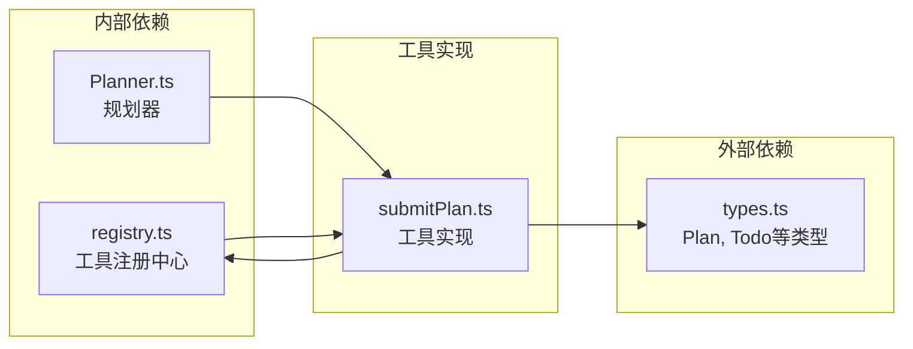

# submit_plan 计划提交工具

<cite>
**本文引用的文件**   
- [src/tools/submitPlan.ts](file://src/tools/submitPlan.ts)
- [src/tools/registry.ts](file://src/tools/registry.ts)
- [src/agent/Planner.ts](file://src/agent/Planner.ts)
- [src/agent/types.ts](file://src/agent/types.ts)
- [DESIGN.md](file://DESIGN.md)
- [README.md](file://README.md)
- [.zcode/plans/plan-sess_f1206653-a69d-4c87-a306-34f88e623d6c.md](file://.zcode/plans/plan-sess_f1206653-a69d-4c87-a306-34f88e623d6c.md)
</cite>

## 目录
1. [简介](#简介)
2. [项目结构](#项目结构)
3. [核心组件](#核心组件)
4. [架构总览](#架构总览)
5. [详细组件分析](#详细组件分析)
6. [依赖关系分析](#依赖关系分析)
7. [性能与可靠性](#性能与可靠性)
8. [故障排查指南](#故障排查指南)
9. [结论](#结论)
10. [附录](#附录)

## 简介
submit_plan 是 Nexus 在 Plan（规划）阶段的核心工具，用于让 LLM 在完成代码探索后，以结构化方式提交执行计划。该工具通过模块级共享状态与 Planner 协作，替代了早期基于正则解析 JSON 的脆弱方案，提升了计划生成的稳定性与可维护性。

其关键特性：
- 结构化输入：摘要、步骤列表、预计修改文件、预估步数
- 阶段约束：仅在 plan 阶段可用，无需审批
- 状态共享：通过模块级 pendingPlan 与 Planner 通信
- 健壮校验：对必填字段进行严格校验并返回错误提示
- 向后兼容：Planner 同时支持工具调用与文本兜底解析

**章节来源**
- [src/tools/submitPlan.ts:1-103](file://src/tools/submitPlan.ts#L1-L103)
- [src/agent/Planner.ts:15-35](file://src/agent/Planner.ts#L15-L35)
- [.zcode/plans/plan-sess_f1206653-a69d-4c87-a306-34f88e623d6c.md:105-110](file://.zcode/plans/plan-sess_f1206653-a69d-4c87-a306-34f88e623d6c.md#L105-L110)

## 项目结构
Nexus 采用分层架构，submit_plan 位于工具层，由 Agent 编排层的 Planner 调用，并通过注册中心暴露给 LLM。

**图表来源**
- [src/agent/Planner.ts:1-20](file://src/agent/Planner.ts#L1-L20)
- [src/tools/registry.ts:1-20](file://src/tools/registry.ts#L1-L20)
- [src/tools/submitPlan.ts:1-15](file://src/tools/submitPlan.ts#L1-L15)
- [src/agent/types.ts:1-20](file://src/agent/types.ts#L1-L20)

**章节来源**
- [README.md:134-146](file://README.md#L134-L146)
- [DESIGN.md:575-638](file://DESIGN.md#L575-L638)

## 核心组件
### submitPlan 工具实现
- **工具定义**：name、description、inputSchema、requiresApproval、phase
- **参数校验**：summary 和 todos 为必填，todos 至少包含一个步骤
- **状态管理**：模块级 pendingPlan 变量存储待处理计划
- **执行逻辑**：验证参数 → 构建 Plan 对象 → 设置 pendingPlan → 返回结果

### 工具注册与发现
- 在 registry.ts 中统一注册所有工具
- 提供 getForPhase(phase) 方法按阶段过滤可用工具
- 将工具转换为 AI SDK 兼容格式供 LLM 调用

### Planner 集成
- 在 PLAN_SYSTEM_SUFFIX 中指示 LLM 使用 submit_plan 工具
- ReAct 循环检测 submit_plan 工具调用
- 通过 consumePendingPlan() 获取结构化计划
- 支持重规划功能 replan()

**章节来源**
- [src/tools/submitPlan.ts:12-45](file://src/tools/submitPlan.ts#L12-L45)
- [src/tools/submitPlan.ts:65-100](file://src/tools/submitPlan.ts#L65-L100)
- [src/tools/registry.ts:127-138](file://src/tools/registry.ts#L127-L138)
- [src/agent/Planner.ts:64-209](file://src/agent/Planner.ts#L64-L209)

## 架构总览
submit_plan 工具在整个系统中的作用流程如下：

**图表来源**
- [src/agent/Planner.ts:91-194](file://src/agent/Planner.ts#L91-L194)
- [src/tools/registry.ts:95-123](file://src/tools/registry.ts#L95-L123)
- [src/tools/submitPlan.ts:65-100](file://src/tools/submitPlan.ts#L65-L100)

## 详细组件分析

### submitPlan 工具类图

**图表来源**
- [src/tools/submitPlan.ts:12-45](file://src/tools/submitPlan.ts#L12-L45)
- [src/tools/submitPlan.ts:47-61](file://src/tools/submitPlan.ts#L47-L61)
- [src/agent/types.ts:32-43](file://src/agent/types.ts#L32-L43)

### 工具执行流程图

**图表来源**
- [src/tools/submitPlan.ts:65-100](file://src/tools/submitPlan.ts#L65-L100)

### Planner 集成时序图

**图表来源**
- [src/agent/Planner.ts:64-194](file://src/agent/Planner.ts#L64-L194)

**章节来源**
- [src/tools/submitPlan.ts:65-100](file://src/tools/submitPlan.ts#L65-L100)
- [src/agent/Planner.ts:91-194](file://src/agent/Planner.ts#L91-L194)

## 依赖关系分析
submit_plan 工具的依赖关系清晰明确：

**图表来源**
- [src/tools/submitPlan.ts:8-10](file://src/tools/submitPlan.ts#L8-L10)
- [src/tools/registry.ts:13](file://src/tools/registry.ts#L13)
- [src/agent/Planner.ts:11](file://src/agent/Planner.ts#L11)

### 耦合度分析
- **低耦合**：submitPlan 仅依赖类型定义，不直接依赖其他业务逻辑
- **单向依赖**：Planner 依赖 submitPlan，但 submitPlan 不反向依赖 Planner
- **接口隔离**：通过 ToolHandler 接口抽象，便于替换实现

**章节来源**
- [src/tools/submitPlan.ts:8-10](file://src/tools/submitPlan.ts#L8-L10)
- [src/tools/registry.ts:26-37](file://src/tools/registry.ts#L26-L37)

## 性能与可靠性

### 性能特征
- **O(1) 状态访问**：pendingPlan 使用模块级变量，访问复杂度为常数时间
- **零拷贝设计**：consumePendingPlan 直接返回引用，避免不必要的复制
- **流式处理**：Planner 使用流式 LLM 调用，减少内存占用

### 可靠性保障
- **参数校验**：严格的输入验证，防止无效数据进入系统
- **错误处理**：详细的错误消息，便于调试和问题定位
- **状态清理**：每次 plan 开始前清理 pendingPlan，防止状态泄漏

### 优化建议
- 考虑添加计划缓存机制，避免重复生成相同计划
- 实现计划版本控制，支持计划的回滚和比较
- 添加计划质量评估指标，自动检测低质量计划

**章节来源**
- [src/tools/submitPlan.ts:47-61](file://src/tools/submitPlan.ts#L47-L61)
- [src/agent/Planner.ts:68-69](file://src/agent/Planner.ts#L68-L69)

## 故障排查指南

### 常见问题及解决方案

#### 问题1：计划未生效
**症状**：调用 submit_plan 后，Planner 无法获取计划
**可能原因**：
- pendingPlan 被意外清空
- consumePendingPlan 未被正确调用
- 多线程环境下的竞态条件

**解决方案**：
- 检查 Planner.plan() 是否正确调用 consumePendingPlan()
- 确认没有其他地方意外调用 setPendingPlan(null)
- 在并发环境下考虑使用线程安全的状态管理

#### 问题2：参数验证失败
**症状**：submit_plan 返回错误信息
**可能原因**：
- summary 为空或只包含空白字符
- todos 不是数组或为空数组
- todo 项缺少必要的 id 或 content 字段

**解决方案**：
- 确保 LLM 输出符合 inputSchema 定义
- 在前端或中间层增加参数预校验
- 查看详细错误消息定位具体问题

#### 问题3：计划质量不佳
**症状**：生成的计划不够详细或步骤不合理
**可能原因**：
- LLM 理解偏差
- 提示词不够明确
- 缺乏足够的上下文信息

**解决方案**：
- 优化 PLAN_SYSTEM_SUFFIX 提示词
- 提供更多代码上下文和示例
- 实现计划反馈和改进机制

**章节来源**
- [src/tools/submitPlan.ts:72-77](file://src/tools/submitPlan.ts#L72-L77)
- [src/agent/Planner.ts:173-192](file://src/agent/Planner.ts#L173-L192)

## 结论
submit_plan 工具是 Nexus 计划驱动架构的关键组件，它通过结构化的方式解决了 LLM 计划生成的稳定性和可靠性问题。该工具的设计体现了以下重要原则：

1. **模块化设计**：清晰的职责分离，便于维护和扩展
2. **类型安全**：完整的 TypeScript 类型定义，编译时错误检查
3. **容错处理**：完善的参数验证和错误处理机制
4. **向后兼容**：支持多种计划生成方式的优雅降级

未来改进方向包括：
- 增强计划验证和质量评估
- 实现计划版本管理和比较
- 添加计划模板和最佳实践
- 支持分布式环境下的状态同步

**章节来源**
- [DESIGN.md:122-142](file://DESIGN.md#L122-L142)
- [.zcode/plans/plan-sess_f1206653-a69d-4c87-a306-34f88e623d6c.md:105-110](file://.zcode/plans/plan-sess_f1206653-a69d-4c87-a306-34f88e623d6c.md#L105-L110)

## 附录

### API 参考

#### submit_plan 工具参数
- **summary**: string - 计划摘要（一句话描述整体目标）
- **todos**: array - 执行步骤列表，每项包含 id 和 content
- **filesToModify**: string[] - 预计需要修改的文件路径列表
- **estimatedSteps**: number - 预估总步数

#### 返回值
- **result**: string - 格式化后的计划摘要
- **error**: string? - 错误信息（如果存在）

### 配置选项
- **phase**: 'plan' - 工具可用阶段
- **requiresApproval**: false - 是否需要用户审批

**章节来源**
- [src/tools/submitPlan.ts:16-42](file://src/tools/submitPlan.ts#L16-L42)
- [src/tools/submitPlan.ts:43-44](file://src/tools/submitPlan.ts#L43-L44)