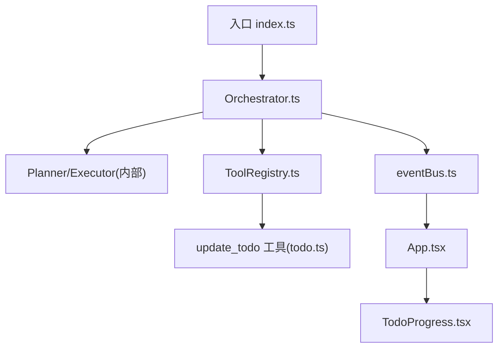
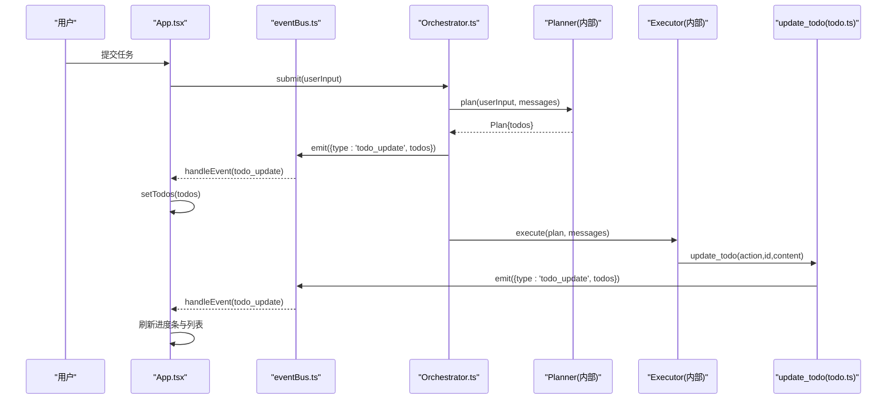
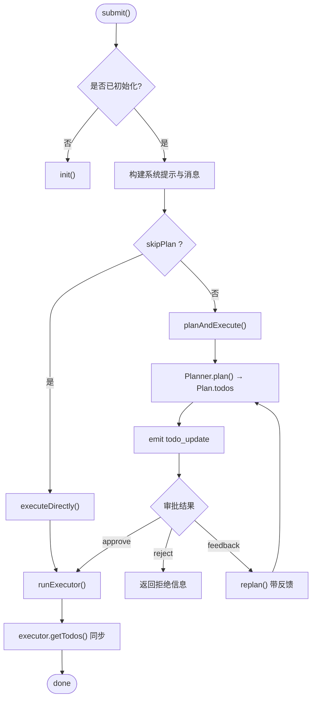
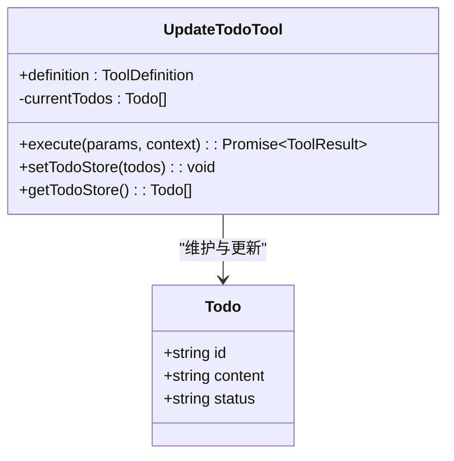
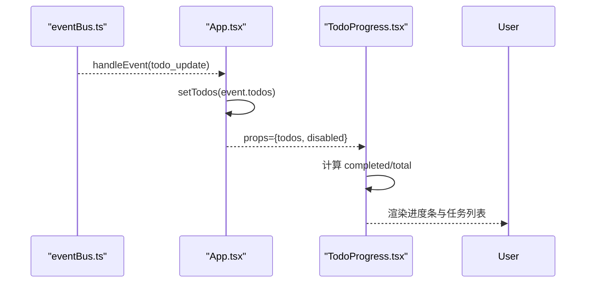
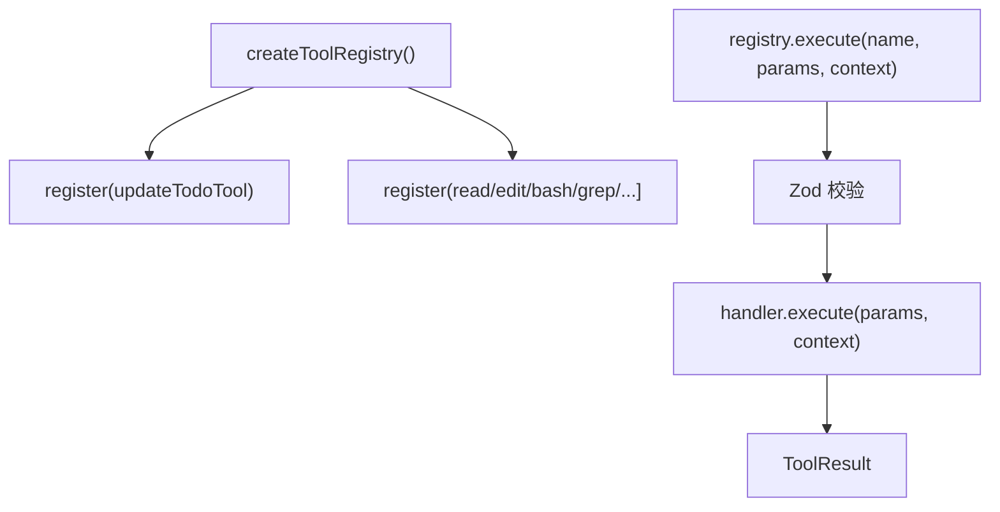
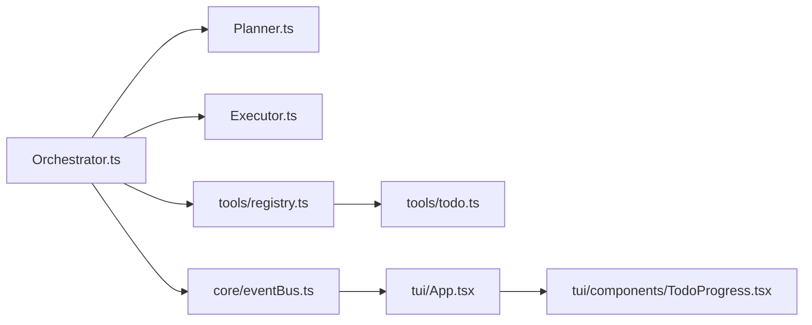

# Nexus 任务管理工具文档

<cite>
**本文档引用的文件**
- [README.md](file://README.md)
- [package.json](file://package.json)
- [DESIGN.md](file://DESIGN.md)
- [src/index.ts](file://src/index.ts)
- [src/agent/types.ts](file://src/agent/types.ts)
- [src/agent/Orchestrator.ts](file://src/agent/Orchestrator.ts)
- [src/tools/todo.ts](file://src/tools/todo.ts)
- [src/tui/components/TodoProgress.tsx](file://src/tui/components/TodoProgress.tsx)
- [src/tui/App.tsx](file://src/tui/App.tsx)
- [src/tools/registry.ts](file://src/tools/registry.ts)
- [src/core/eventBus.ts](file://src/core/eventBus.ts)
</cite>

## 目录
1. [简介](#简介)
2. [项目结构](#项目结构)
3. [核心组件](#核心组件)
4. [架构总览](#架构总览)
5. [详细组件分析](#详细组件分析)
6. [依赖关系分析](#依赖关系分析)
7. [性能与可扩展性](#性能与可扩展性)
8. [故障排查指南](#故障排查指南)
9. [结论与建议](#结论与建议)
10. [附录：配置与使用](#附录配置与使用)

## 简介
Nexus 是一个面向生产级的终端 Coding Agent，核心理念是“上下文为王、工具为先、人在环中”。它通过流式 TUI、Plan/Execute 双阶段、多模型路由、子 Agent 编排、Git Checkpoint、上下文工程与成本追踪等能力，提供端到端的编程辅助体验。本专题聚焦其“任务管理（Todo）”子系统：如何在执行过程中动态维护任务清单、实时同步到 UI、并通过工具驱动状态流转。

## 项目结构
- 入口与启动流程由 src/index.ts 负责，解析参数、加载配置、初始化 Orchestrator、渲染 TUI 或进入非交互模式。
- 任务管理的核心类型定义在 src/agent/types.ts，包括 Todo、Plan、NexusEvent 等。
- Orchestrator 协调 Plan/Execute 双阶段，并在计划生成后下发 todos，在执行过程中更新并广播 todo_update 事件。
- update_todo 工具位于 src/tools/todo.ts，支持 add/update/complete 操作，并通过 eventBus 通知 UI。
- TUI 的进度展示由 src/tui/components/TodoProgress.tsx 实现，支持展开/折叠与进度条。
- App.tsx 订阅事件总线，将 todo_update 映射到本地状态，驱动 TodoProgress 渲染。
- 工具注册中心 src/tools/registry.ts 统一管理内置工具，包含 update_todo 的注册与调用路径。
- 事件总线 src/core/eventBus.ts 提供类型安全的事件分发机制。

图表来源
- [src/index.ts:71-162](file://src/index.ts#L71-L162)
- [src/agent/Orchestrator.ts:256-333](file://src/agent/Orchestrator.ts#L256-L333)
- [src/tools/registry.ts:127-140](file://src/tools/registry.ts#L127-L140)
- [src/tools/todo.ts:1-128](file://src/tools/todo.ts#L1-L128)
- [src/core/eventBus.ts:1-46](file://src/core/eventBus.ts#L1-L46)
- [src/tui/App.tsx:228-232](file://src/tui/App.tsx#L228-L232)
- [src/tui/components/TodoProgress.tsx:1-89](file://src/tui/components/TodoProgress.tsx#L1-L89)

章节来源
- [README.md:1-174](file://README.md#L1-L174)
- [package.json:1-46](file://package.json#L1-L46)
- [DESIGN.md:1-774](file://DESIGN.md#L1-L774)

## 核心组件
- 任务类型与事件
  - Todo：id、content、status（pending/in_progress/complete/cancelled）
  - Plan：summary、todos、filesToModify、estimatedSteps
  - NexusEvent：包含 todo_update 事件，携带当前 todos 列表
- Orchestrator
  - 在 Plan 阶段生成 Plan.todos 并设置到实例状态，随后 emit todo_update
  - 在 Execute 阶段通过 Executor 获取最新 todos，保持 UI 与执行一致
- update_todo 工具
  - 支持 action=complete/add/update
  - 校验参数、更新模块级 TodoStore，emit todo_update 并返回格式化摘要
- TUI 组件
  - App.tsx 订阅 eventBus，处理 todo_update 事件，更新本地 todos
  - TodoProgress.tsx 渲染进度条与可展开的任务项

章节来源
- [src/agent/types.ts:32-43](file://src/agent/types.ts#L32-L43)
- [src/agent/types.ts:8-24](file://src/agent/types.ts#L8-L24)
- [src/agent/Orchestrator.ts:335-390](file://src/agent/Orchestrator.ts#L335-L390)
- [src/tools/todo.ts:12-37](file://src/tools/todo.ts#L12-L37)
- [src/tools/todo.ts:55-125](file://src/tools/todo.ts#L55-L125)
- [src/tui/App.tsx:192-194](file://src/tui/App.tsx#L192-L194)
- [src/tui/components/TodoProgress.tsx:17-51](file://src/tui/components/TodoProgress.tsx#L17-L51)

## 架构总览
Nexus 的任务管理贯穿“计划—执行—展示”全链路：
- 计划阶段：Planner 输出 Plan.todos，Orchestrator 持久化到自身状态并广播
- 执行阶段：Executor 逐步推进，LLM 通过 update_todo 工具主动更新任务状态
- 展示阶段：TUI 通过事件总线接收 todo_update，驱动进度条与任务列表实时更新

图表来源
- [src/agent/Orchestrator.ts:335-390](file://src/agent/Orchestrator.ts#L335-L390)
- [src/tools/todo.ts:55-125](file://src/tools/todo.ts#L55-L125)
- [src/core/eventBus.ts:23-42](file://src/core/eventBus.ts#L23-L42)
- [src/tui/App.tsx:228-232](file://src/tui/App.tsx#L228-L232)

## 详细组件分析

### Orchestrator 中的任务生命周期
- 初始化时构建 ContextAssembler、ModelRouter、SubAgent 等；若无可用的 provider，推迟创建 SubAgent
- submit() 主入口：
  - 若无可用 provider，尝试 reinitProviders()
  - 组装 systemPrompt 与 messages
  - 根据 skipPlan 选择直接执行或 Plan→Execute
- planAndExecute()：
  - Planner 生成 Plan，设置 this.todos，emit todo_update
  - 审批循环：approve/reject/feedback（最多 3 次重规划）
  - runExecutor() 执行，结束后用 executor.getTodos() 同步状态
- executeDirectly()：Auto 模式下空 todos，由 LLM 在执行中通过 update_todo 自主拆解

图表来源
- [src/agent/Orchestrator.ts:256-333](file://src/agent/Orchestrator.ts#L256-L333)
- [src/agent/Orchestrator.ts:335-390](file://src/agent/Orchestrator.ts#L335-L390)
- [src/agent/Orchestrator.ts:392-403](file://src/agent/Orchestrator.ts#L392-L403)

章节来源
- [src/agent/Orchestrator.ts:47-80](file://src/agent/Orchestrator.ts#L47-L80)
- [src/agent/Orchestrator.ts:256-333](file://src/agent/Orchestrator.ts#L256-L333)
- [src/agent/Orchestrator.ts:335-403](file://src/agent/Orchestrator.ts#L335-L403)

### update_todo 工具：状态机与事件
- 输入 schema：action（complete/add/update）、id（complete/update 必需）、content（add/update 必需）
- 执行逻辑：
  - complete：查找 id，标记 status=complete
  - add：生成新 id，push pending 任务
  - update：查找 id，可选更新 content
- 错误处理：缺少必要参数或未找到 id 时返回 error
- 成功后 emit todo_update，并返回格式化摘要（含图标与状态）

图表来源
- [src/tools/todo.ts:12-37](file://src/tools/todo.ts#L12-L37)
- [src/tools/todo.ts:39-51](file://src/tools/todo.ts#L39-L51)
- [src/tools/todo.ts:55-125](file://src/tools/todo.ts#L55-L125)

章节来源
- [src/tools/todo.ts:1-128](file://src/tools/todo.ts#L1-L128)

### TUI 任务进度展示
- App.tsx 订阅 eventBus，处理 todo_update 事件，更新本地 todos
- TodoProgress.tsx 渲染：
  - 紧凑单行摘要：进度 N/M + 进度条
  - 支持 P 键展开/折叠任务列表
  - 不同状态对应不同图标与颜色

图表来源
- [src/tui/App.tsx:228-232](file://src/tui/App.tsx#L228-L232)
- [src/tui/components/TodoProgress.tsx:17-51](file://src/tui/components/TodoProgress.tsx#L17-L51)

章节来源
- [src/tui/App.tsx:192-194](file://src/tui/App.tsx#L192-L194)
- [src/tui/components/TodoProgress.tsx:1-89](file://src/tui/components/TodoProgress.tsx#L1-L89)

### 工具注册与调用路径
- ToolRegistry 集中注册内置工具，包括 update_todo
- 执行时进行 Zod 参数校验，再调用具体 handler.execute
- 支持按阶段过滤工具（plan/execute），以及需要审批的工具列表

图表来源
- [src/tools/registry.ts:127-140](file://src/tools/registry.ts#L127-L140)
- [src/tools/registry.ts:96-123](file://src/tools/registry.ts#L96-L123)

章节来源
- [src/tools/registry.ts:1-216](file://src/tools/registry.ts#L1-L216)

## 依赖关系分析
- Orchestrator 依赖：
  - Planner/Executor（内部类）
  - ToolRegistry（工具注册与执行）
  - ContextAssembler/TokenBudget（上下文工程）
  - ModelRouter/CostTracker（模型路由与成本）
  - CheckpointManager（Git 检查点）
  - ExternalMCPManager（外部 MCP Server）
  - CodeGraph（代码图谱）
- 事件总线 eventBus 作为松耦合通信通道，连接 Orchestrator 与 TUI
- update_todo 工具通过 eventBus 触发 UI 更新，避免直接耦合

图表来源
- [src/agent/Orchestrator.ts:16-34](file://src/agent/Orchestrator.ts#L16-L34)
- [src/tools/registry.ts:1-20](file://src/tools/registry.ts#L1-L20)
- [src/core/eventBus.ts:1-46](file://src/core/eventBus.ts#L1-L46)
- [src/tui/App.tsx:1-24](file://src/tui/App.tsx#L1-L24)

章节来源
- [src/agent/Orchestrator.ts:1-34](file://src/agent/Orchestrator.ts#L1-L34)
- [src/tools/registry.ts:1-20](file://src/tools/registry.ts#L1-L20)
- [src/core/eventBus.ts:1-46](file://src/core/eventBus.ts#L1-L46)
- [src/tui/App.tsx:1-24](file://src/tui/App.tsx#L1-L24)

## 性能与可扩展性
- 事件总线采用 EventEmitter，默认最大监听器数设为 50，避免内存泄漏警告
- update_todo 工具在每次变更后立即 emit 事件，保证 UI 实时性
- ToolRegistry 支持按阶段过滤工具，减少不必要的工具暴露
- 未来可扩展：
  - 增加更多任务状态（如 blocked、reviewing）
  - 支持任务优先级、依赖关系
  - 将 TodoStore 持久化到数据库，支持跨会话恢复

[本节为通用指导，不直接分析具体文件]

## 故障排查指南
- 未找到 id 的错误：
  - 现象：update_todo 返回 error：“未找到 id 为 X 的 todo”
  - 排查：确认 id 是否正确传递，是否在 add 之后立即 complete
- 缺少必要参数：
  - 现象：complete 缺少 id，add/update 缺少 content
  - 排查：检查调用方参数是否符合 schema
- 事件未触发：
  - 现象：UI 未更新
  - 排查：确认 eventBus.emit 是否被调用，App.tsx 是否订阅了 todo_update
- 权限与审批：
  - 现象：工具调用被拒绝
  - 排查：检查 permissionMode 与 requiresApproval 配置

章节来源
- [src/tools/todo.ts:62-98](file://src/tools/todo.ts#L62-L98)
- [src/tui/App.tsx:149-170](file://src/tui/App.tsx#L149-L170)

## 结论与建议
Nexus 的任务管理系统以 Orchestrator 为核心，通过 update_todo 工具与 eventBus 实现解耦的状态更新与 UI 同步。其设计遵循“人在环中”与“工具优先”的原则，确保关键决策可控、执行过程透明。建议后续增强任务依赖与优先级管理，并考虑持久化以提升鲁棒性。

[本节为总结，不直接分析具体文件]

## 附录：配置与使用
- 环境变量配置 API Key（Anthropic/OpenAI/DeepSeek/Custom）
- 项目级配置 .nexus/config.toml 与规则 .nexus/rules.toml
- 运行方式：交互式 TUI、非交互模式、指定模型、自动批准等
- 斜杠命令：/model、/cost、/clear、/undo、/history、/help

章节来源
- [README.md:32-112](file://README.md#L32-L112)
- [package.json:13-21](file://package.json#L13-L21)