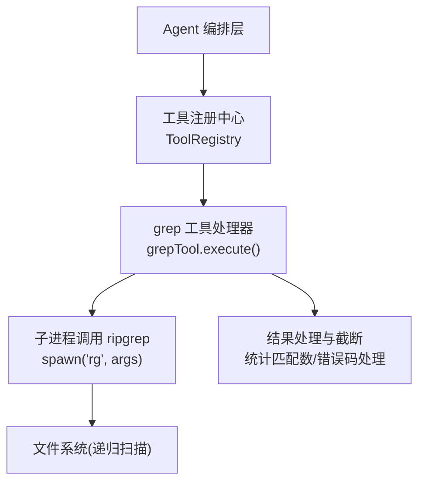
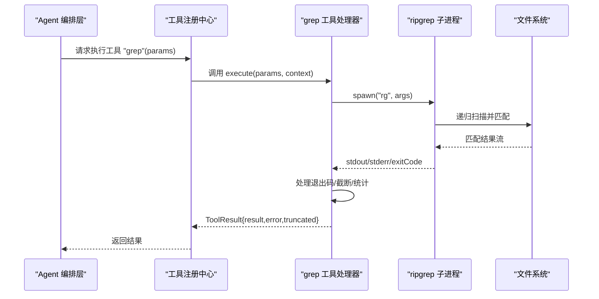
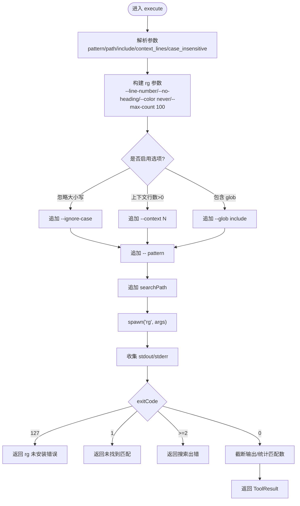
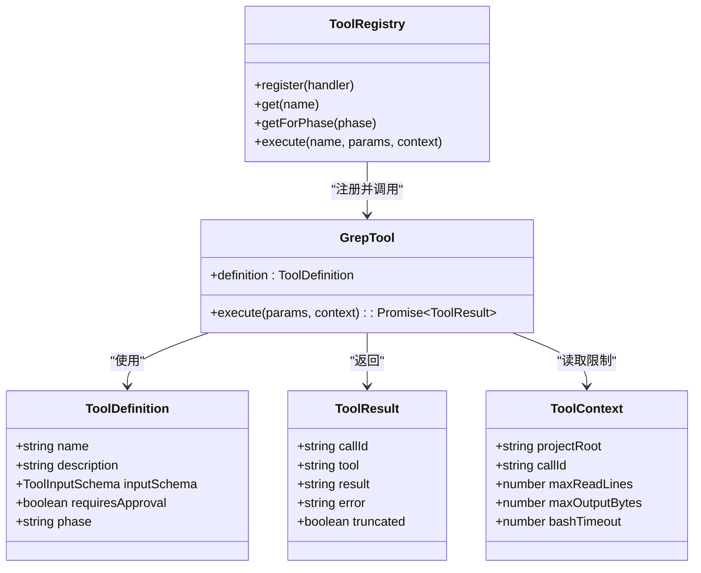

# 代码搜索工具 (grep)

<cite>
**本文引用的文件**   
- [src/tools/grep.ts](file://src/tools/grep.ts)
- [src/tools/registry.ts](file://src/tools/registry.ts)
- [src/tools/schemas.ts](file://src/tools/schemas.ts)
- [src/agent/types.ts](file://src/agent/types.ts)
- [.nexus/config.toml](file://.nexus/config.toml)
- [tests/integration/tools.test.ts](file://tests/integration/tools.test.ts)
- [README.md](file://README.md)
</cite>

## 目录
1. [简介](#简介)
2. [项目结构](#项目结构)
3. [核心组件](#核心组件)
4. [架构总览](#架构总览)
5. [详细组件分析](#详细组件分析)
6. [依赖关系分析](#依赖关系分析)
7. [性能与优化](#性能与优化)
8. [使用示例](#使用示例)
9. [故障排查](#故障排查)
10. [结论](#结论)
11. [附录：参数参考](#附录参数参考)

## 简介
本文件为 Nexus 项目中的 grep 代码搜索工具的完整使用文档。该工具基于 ripgrep（rg）实现，提供快速、强大的正则表达式匹配、文件类型过滤、上下文行显示等能力，并通过 MCP 工具注册机制暴露给上层 Agent 编排层调用。文档覆盖功能说明、参数配置、使用示例、算法与流程、性能优化与最佳实践，以及常见问题排查。

## 项目结构
grep 工具位于 src/tools 目录下，作为 MCP 工具之一被注册到工具注册中心，并在 Agent 的“计划”和“执行”阶段均可用。其输入参数由 Zod Schema 定义，运行时通过 child_process.spawn 调用外部 ripgrep 命令，并对输出进行截断与统计。

图表来源
- [src/tools/registry.ts:25-92](file://src/tools/registry.ts#L25-L92)
- [src/tools/grep.ts:80-175](file://src/tools/grep.ts#L80-L175)

章节来源
- [src/tools/grep.ts:1-178](file://src/tools/grep.ts#L1-L178)
- [src/tools/registry.ts:1-96](file://src/tools/registry.ts#L1-L96)
- [src/tools/schemas.ts:25-31](file://src/tools/schemas.ts#L25-L31)

## 核心组件
- 工具定义与输入模式：在 grep.ts 中声明 name、description、inputSchema，并指定 required 字段；同时 schemas.ts 提供 Zod 校验规则。
- 执行器：execute(params, context) 负责解析参数、构建 rg 参数、调用 ripgrep、处理退出码、截断输出、统计匹配数。
- 工具注册：registry.ts 将 grepTool 注册到 ToolRegistry，并提供按阶段过滤、获取可用工具列表、执行工具调用等方法。
- 上下文与限制：context.maxOutputBytes 用于控制输出大小，避免过大结果影响系统稳定性。

章节来源
- [src/tools/grep.ts:11-43](file://src/tools/grep.ts#L11-L43)
- [src/tools/schemas.ts:25-31](file://src/tools/schemas.ts#L25-L31)
- [src/tools/registry.ts:25-92](file://src/tools/registry.ts#L25-L92)
- [src/agent/types.ts:44-78](file://src/agent/types.ts#L44-L78)

## 架构总览
grep 工具通过 MCP 协议暴露给上层 Agent，Agent 根据任务阶段选择可用的工具集。grep 属于只读型工具，可在 plan 与 execute 两个阶段使用。执行时，工具处理器构造 rg 命令行参数，启动子进程执行搜索，并将结果标准化返回。

图表来源
- [src/tools/registry.ts:70-82](file://src/tools/registry.ts#L70-L82)
- [src/tools/grep.ts:46-78](file://src/tools/grep.ts#L46-L78)
- [src/tools/grep.ts:80-175](file://src/tools/grep.ts#L80-L175)

## 详细组件分析

### grep 工具处理器
- 参数解析：pattern（必填）、path（可选）、include（glob 过滤）、context_lines（上下文行数）、case_insensitive（忽略大小写）。
- 参数构建：始终启用 --line-number、--no-heading、--color never、--max-count 100；支持 --ignore-case、--context N、--glob pattern。
- 子进程调用：使用 child_process.spawn 调用 rg，收集 stdout/stderr，处理 close/error 事件。
- 退出码处理：127 表示 rg 不可用；1 表示无匹配；>=2 表示错误；0 表示成功。
- 输出处理：按 maxOutputBytes 截断，附加提示文本；统计匹配行数并返回结构化结果。

图表来源
- [src/tools/grep.ts:80-175](file://src/tools/grep.ts#L80-L175)

章节来源
- [src/tools/grep.ts:46-78](file://src/tools/grep.ts#L46-L78)
- [src/tools/grep.ts:80-175](file://src/tools/grep.ts#L80-L175)

### 工具注册与阶段过滤
- 注册：createToolRegistry() 将 grepTool 注册到 Map，支持 get/getForPhase/getApprovalRequired 等方法。
- 阶段过滤：grep 的 phase 为 'both'，因此在 plan 与 execute 阶段均可见。
- 执行：registry.execute(name, params, context) 查找处理器并调用 execute。

章节来源
- [src/tools/registry.ts:25-92](file://src/tools/registry.ts#L25-L92)
- [tests/integration/tools.test.ts:83-98](file://tests/integration/tools.test.ts#L83-L98)

### 输入模式与校验
- 定义：schemas.ts 中 grepSchema 定义了 pattern、path、include、context_lines、case_insensitive 的类型与描述。
- 用途：Vercel AI SDK generateText 需要 parameters 为 Zod schema，确保参数结构与类型正确。

章节来源
- [src/tools/schemas.ts:25-31](file://src/tools/schemas.ts#L25-L31)

### 上下文与限制
- context.maxOutputBytes：控制单次工具输出的最大字节数，防止结果过大导致内存或传输问题。
- 默认限制：rg 参数中包含 --max-count 100，限制每个文件的匹配数量，提升性能。

章节来源
- [src/tools/grep.ts:147-165](file://src/tools/grep.ts#L147-L165)
- [src/tools/grep.ts:92-97](file://src/tools/grep.ts#L92-L97)
- [.nexus/config.toml:49](file://.nexus/config.toml#L49)

## 依赖关系分析
- 外部依赖：child_process.spawn 调用外部 ripgrep（rg），要求系统已安装 rg。
- 内部依赖：ToolDefinition、ToolResult、ToolContext 等类型来自 agent/types.ts；工具注册来自 registry.ts。
- 配置依赖：max_output_bytes 来自 .nexus/config.toml 的 limits 配置。

图表来源
- [src/agent/types.ts:44-78](file://src/agent/types.ts#L44-L78)
- [src/tools/registry.ts:25-92](file://src/tools/registry.ts#L25-L92)
- [src/tools/grep.ts:11-43](file://src/tools/grep.ts#L11-L43)

章节来源
- [src/agent/types.ts:44-78](file://src/agent/types.ts#L44-L78)
- [src/tools/registry.ts:25-92](file://src/tools/registry.ts#L25-L92)
- [src/tools/grep.ts:11-43](file://src/tools/grep.ts#L11-L43)

## 性能与优化
- 大文件处理：rg 原生支持高效扫描，配合 --max-count 限制每文件匹配数，减少 I/O 与内存占用。
- 内存限制：通过 context.maxOutputBytes 截断输出，避免超大结果阻塞或溢出。
- 搜索深度控制：path 参数限定搜索范围，结合 include glob 精确过滤文件类型，降低无关扫描。
- 增量搜索：当前实现为每次调用独立执行 rg，未实现缓存或增量索引；如需更高性能，可考虑后台索引服务（未来 Go 引擎）。

章节来源
- [src/tools/grep.ts:92-97](file://src/tools/grep.ts#L92-L97)
- [src/tools/grep.ts:147-165](file://src/tools/grep.ts#L147-L165)
- [README.md:134-146](file://README.md#L134-L146)

## 使用示例
以下为常见使用场景与参数组合建议（不展示具体代码内容，仅给出路径引用）：
- 简单文本搜索：使用 pattern 指定关键词，path 可选，返回匹配的文件:行号:内容。
- 正则表达式匹配：pattern 使用正则语法，必要时开启 case_insensitive。
- 限定目录搜索：path 指向子目录，结合 include 指定 *.ts 等 glob。
- 结果过滤：include 使用文件名 glob，context_lines 设置上下文行数增强可读性。
- 性能优化：合理设置 path 与 include，限制 context_lines，避免过宽搜索。

章节来源
- [src/tools/grep.ts:11-43](file://src/tools/grep.ts#L11-L43)
- [src/tools/schemas.ts:25-31](file://src/tools/schemas.ts#L25-L31)

## 故障排查
- ripgrep 未安装：当 exitCode 为 127 时，返回错误提示安装 rg。
- 无匹配结果：exitCode 为 1 时，返回“未找到匹配”信息。
- 搜索出错：exitCode >= 2 时，返回 stderr 中的错误信息。
- 输出过长：超过 maxOutputBytes 将被截断，并附加提示缩小搜索范围或使用更精确的模式。

章节来源
- [src/tools/grep.ts:120-145](file://src/tools/grep.ts#L120-L145)
- [src/tools/grep.ts:147-165](file://src/tools/grep.ts#L147-L165)

## 结论
grep 工具以 ripgrep 为核心，提供了高性能、可扩展的代码搜索能力。通过清晰的参数定义、严格的输入校验、完善的错误处理与输出限制，能够在复杂项目中快速定位目标代码片段。建议在实际使用中合理限定搜索范围、使用精确的正则模式、控制上下文行数与结果数量，以获得最佳性能与体验。

## 附录：参数参考
- pattern：搜索模式（支持正则表达式），必填。
- path：搜索路径（相对于项目根目录），可选，默认为整个项目。
- include：文件名 glob 过滤（如 "*.ts", "*.{js,jsx}"），可选。
- context_lines：显示匹配行前后的上下文行数，默认 0。
- case_insensitive：是否忽略大小写，默认 false。
- 其他内置限制：--max-count 100（每文件最多匹配数），--line-number/--no-heading/--color never。

章节来源
- [src/tools/grep.ts:11-43](file://src/tools/grep.ts#L11-L43)
- [src/tools/schemas.ts:25-31](file://src/tools/schemas.ts#L25-L31)
- [src/tools/grep.ts:92-97](file://src/tools/grep.ts#L92-L97)