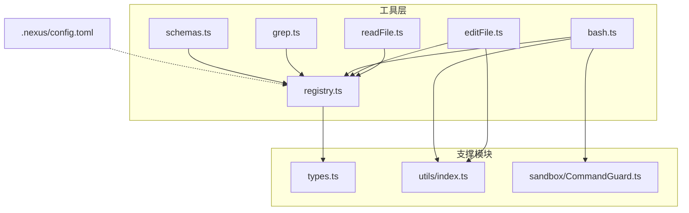
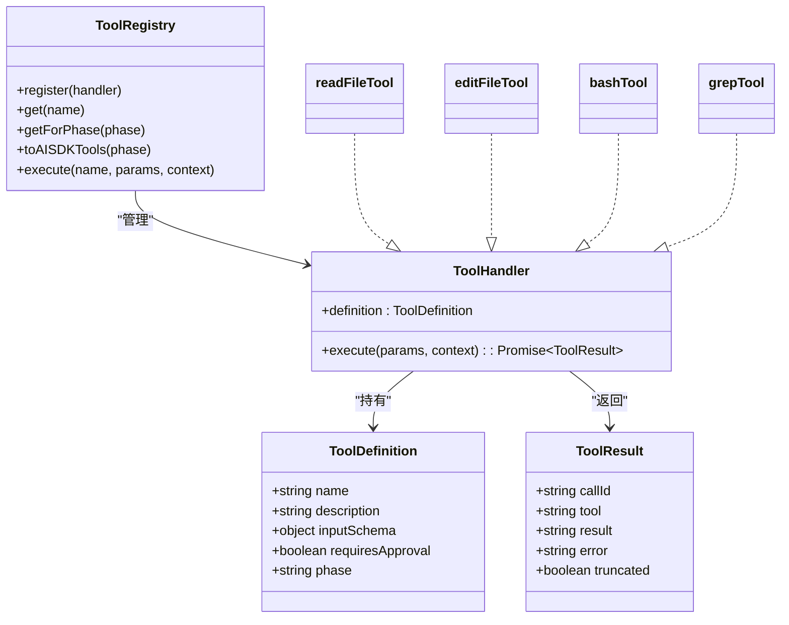

# 内置工具

<cite>
**本文引用的文件**   
- [readFile.ts](file://src/tools/readFile.ts)
- [editFile.ts](file://src/tools/editFile.ts)
- [bash.ts](file://src/tools/bash.ts)
- [grep.ts](file://src/tools/grep.ts)
- [registry.ts](file://src/tools/registry.ts)
- [schemas.ts](file://src/tools/schemas.ts)
- [types.ts](file://src/agent/types.ts)
- [index.ts](file://src/utils/index.ts)
- [CommandGuard.ts](file://src/sandbox/CommandGuard.ts)
- [config.toml](file://.nexus/config.toml)
- [tools.test.ts](file://tests/integration/tools.test.ts)
</cite>

## 目录
1. [简介](#简介)
2. [项目结构](#项目结构)
3. [核心组件](#核心组件)
4. [架构总览](#架构总览)
5. [详细组件分析](#详细组件分析)
6. [依赖关系分析](#依赖关系分析)
7. [性能与限制](#性能与限制)
8. [故障排查指南](#故障排查指南)
9. [结论](#结论)
10. [附录：参数速查表](#附录参数速查表)

## 简介
本章节面向使用 Nexus 的开发者，系统化介绍其内置工具集：read_file、edit_file、bash、grep。每个工具均提供功能说明、参数定义、错误处理策略、安全与权限控制、最佳实践与常见用例，帮助你在计划（plan）与执行（execute）两个阶段高效、安全地使用工具完成代码任务。

## 项目结构
Nexus 的工具层位于 src/tools 目录下，采用“按能力拆分 + 注册中心”的组织方式：
- 各工具独立实现，包含声明式输入 Schema、执行逻辑、安全与输出限制
- 注册中心集中管理工具生命周期、阶段过滤、审批清单与 AI SDK 兼容导出
- 类型与配置由上层 agent 和全局配置注入到工具上下文

图表来源
- [registry.ts:1-96](file://src/tools/registry.ts#L1-L96)
- [readFile.ts:1-150](file://src/tools/readFile.ts#L1-L150)
- [editFile.ts:1-170](file://src/tools/editFile.ts#L1-L170)
- [bash.ts:1-186](file://src/tools/bash.ts#L1-L186)
- [grep.ts:1-178](file://src/tools/grep.ts#L1-L178)
- [schemas.ts:1-40](file://src/tools/schemas.ts#L1-L40)
- [types.ts:44-78](file://src/agent/types.ts#L44-L78)
- [index.ts:1-211](file://src/utils/index.ts#L1-L211)
- [CommandGuard.ts:1-98](file://src/sandbox/CommandGuard.ts#L1-L98)
- [config.toml:39-49](file://.nexus/config.toml#L39-L49)

章节来源
- [registry.ts:1-96](file://src/tools/registry.ts#L1-L96)
- [types.ts:44-78](file://src/agent/types.ts#L44-L78)

## 核心组件
- 工具定义与执行契约
  - ToolDefinition：描述工具名、说明、输入 Schema、是否需要审批、可用阶段
  - ToolResult：统一返回结构，包含结果文本、可选错误信息、是否被截断
  - ToolContext：运行时上下文，包含项目根、调用 ID、各类上限与超时等
- 注册中心
  - 负责注册、查找、阶段过滤、生成 AI SDK 兼容定义、执行分发
- 校验 Schema
  - 为 Vercel AI SDK 提供 Zod 校验定义，确保参数类型正确

章节来源
- [types.ts:44-78](file://src/agent/types.ts#L44-L78)
- [registry.ts:12-83](file://src/tools/registry.ts#L12-L83)
- [schemas.ts:1-40](file://src/tools/schemas.ts#L1-L40)

## 架构总览
下图展示了从 Agent 编排层到具体工具的调用路径，以及关键的安全与限制点。

图表来源
- [registry.ts:70-83](file://src/tools/registry.ts#L70-L83)
- [readFile.ts:54-147](file://src/tools/readFile.ts#L54-L147)
- [editFile.ts:61-156](file://src/tools/editFile.ts#L61-L156)
- [bash.ts:123-183](file://src/tools/bash.ts#L123-L183)
- [grep.ts:80-175](file://src/tools/grep.ts#L80-L175)
- [CommandGuard.ts:71-89](file://src/sandbox/CommandGuard.ts#L71-L89)
- [index.ts:116-154](file://src/utils/index.ts#L116-L154)

## 详细组件分析

### read_file：安全读取文件
- 功能概述
  - 读取项目内文件内容，自动添加行号；支持按起止行范围读取；对超大文件进行头尾截断；拒绝二进制文件；严格路径越界检查。
- 参数定义
  - path：必填，相对项目根的文件路径
  - start_line：可选，起始行号（从 1 开始）
  - end_line：可选，结束行号
- 行为与限制
  - 路径安全检查：禁止访问项目根之外的路径
  - 存在性与类型检查：仅允许普通文件
  - 二进制检测：前 8KB 含空字节即视为二进制并拒绝
  - 行数截断：超过 max_read_lines 时保留头部约 70% 与尾部约 30%，并提示可使用 start_line/end_line 或 grep 定位
  - 输出格式：首行显示相对路径与总行数，后续每行带左对齐行号
- 错误处理
  - 路径越界、非文件、二进制、IO 异常等均返回结构化 error 字段
- 典型用法
  - 读取完整文件（小文件）
  - 指定行范围快速定位
  - 大文件只读头部/尾部概览
- 最佳实践
  - 优先使用 start_line/end_line 精确阅读，避免触发截断
  - 结合 grep 先定位再读取，减少不必要的大文件读取
  - 注意二进制文件会被拒绝，需改用其他工具查看

章节来源
- [readFile.ts:11-35](file://src/tools/readFile.ts#L11-L35)
- [readFile.ts:37-52](file://src/tools/readFile.ts#L37-L52)
- [readFile.ts:54-147](file://src/tools/readFile.ts#L54-L147)
- [config.toml:44-45](file://.nexus/config.toml#L44-L45)

### edit_file：精准替换与差异预览
- 功能概述
  - 基于 old_string 的唯一匹配进行精准替换；支持创建新文件（old_string 为空）；生成 unified diff 供审阅；原子写入保障一致性；保留原始 BOM 与行尾风格。
- 参数定义
  - path：必填，目标文件路径
  - old_string：必填，要替换的原文，必须唯一匹配
  - new_string：必填，替换后的新内容
- 行为与限制
  - 路径安全检查：禁止编辑项目外文件
  - 唯一性校验：0 次匹配报错；>1 次匹配报错，要求提供更多上下文
  - 格式保持：去除 BOM、统一 LF 后计算 diff，写回时恢复原始行尾与 BOM
  - 原子写入：临时文件 + rename，避免部分写入导致损坏
  - 新文件创建：当文件不存在且 old_string 为空时直接创建
- 错误处理
  - 未找到匹配、匹配不唯一、文件不存在（且非创建场景）、IO 异常等均有明确错误信息
- 典型用法
  - 精准修改某函数体或配置项
  - 批量替换前先 grep 确认唯一性
  - 通过 diff 审阅变更后再提交
- 最佳实践
  - old_string 应包含足够上下文以确保唯一性
  - 复杂改动建议分多次小步替换，降低冲突风险
  - 配合 git checkpoint 使用，便于回滚

章节来源
- [editFile.ts:14-38](file://src/tools/editFile.ts#L14-L38)
- [editFile.ts:40-59](file://src/tools/editFile.ts#L40-L59)
- [editFile.ts:61-156](file://src/tools/editFile.ts#L61-L156)
- [editFile.ts:158-166](file://src/tools/editFile.ts#L158-L166)
- [index.ts:187-210](file://src/utils/index.ts#L187-L210)

### bash：受限的命令执行
- 功能概述
  - 在项目根工作目录下执行 shell 命令；具备危险命令检测、进程组管理、超时控制、输出大小与行数限制、二进制输出清理。
- 参数定义
  - command：必填，要执行的 shell 命令
  - timeout：可选，超时秒数，默认来自配置
- 行为与限制
  - 工作目录锁定：始终在 projectRoot 下执行
  - 危险命令检测：基于规则集评估，危险命令强制审批（即便 yolo 模式仍会标注）
  - 超时控制：到达超时后终止进程树（Unix 用进程组 kill，Windows 用 taskkill）
  - 输出限制：stdout/stderr 分别进行尾部截断，保留末尾错误信息；清理控制字符
  - 平台适配：Windows 使用 powershell.exe，Unix 使用 /bin/bash
- 错误处理
  - 超时、进程错误、非零退出码均返回相应信息；dangerous 命令会在结果中标注原因
- 典型用法
  - 运行构建、测试、lint 等常规命令
  - 查询环境信息与依赖版本
  - 执行一次性脚本（注意超时与输出量）
- 最佳实践
  - 合理设置 timeout，避免长时间阻塞
  - 将冗长日志重定向到文件，再使用 read_file 查看关键片段
  - 谨慎使用破坏性命令，遵循最小权限原则

章节来源
- [bash.ts:13-33](file://src/tools/bash.ts#L13-L33)
- [bash.ts:42-109](file://src/tools/bash.ts#L42-L109)
- [bash.ts:111-121](file://src/tools/bash.ts#L111-L121)
- [bash.ts:123-183](file://src/tools/bash.ts#L123-L183)
- [CommandGuard.ts:12-55](file://src/sandbox/CommandGuard.ts#L12-L55)
- [CommandGuard.ts:71-89](file://src/sandbox/CommandGuard.ts#L71-L89)
- [index.ts:166-180](file://src/utils/index.ts#L166-L180)
- [config.toml:42-43](file://.nexus/config.toml#L42-L43)

### grep：高性能代码搜索
- 功能概述
  - 封装 ripgrep 进行快速正则搜索；支持文件名 glob 过滤、上下文行、忽略大小写；限制单文件匹配数量与总输出大小。
- 参数定义
  - pattern：必填，搜索模式（支持正则）
  - path：可选，搜索路径（相对项目根），默认为整个项目
  - include：可选，文件名 glob 过滤（如 "*.ts", "*.{js,jsx}"）
  - context_lines：可选，上下文行数（默认 0）
  - case_insensitive：可选，忽略大小写（默认 false）
- 行为与限制
  - 优先使用 rg；不可用时返回安装提示
  - 限制每个文件最多 100 个匹配，避免单次结果过大
  - 总输出超过 max_output_bytes 时进行截断并提示缩小范围
  - 无匹配时返回友好提示
- 错误处理
  - rg 缺失、系统错误、搜索失败等均有明确错误信息
- 典型用法
  - 全局符号/关键字检索
  - 限定文件类型快速定位
  - 借助上下文行理解调用关系
- 最佳实践
  - 先用 grep 缩小范围，再用 read_file 精读
  - 合理使用 include 与 case_insensitive 提升命中率
  - 遇到大量结果时逐步细化 pattern

章节来源
- [grep.ts:11-43](file://src/tools/grep.ts#L11-L43)
- [grep.ts:45-78](file://src/tools/grep.ts#L45-L78)
- [grep.ts:80-175](file://src/tools/grep.ts#L80-L175)

## 依赖关系分析
- 内部依赖
  - 所有工具依赖 types.ts 中的 ToolDefinition/ToolResult 等类型
  - edit_file 与 bash 依赖 utils/index.ts 的截断、BOM/行尾处理、二进制清理等
  - bash 依赖 sandbox/CommandGuard.ts 的危险命令检测
  - registry.ts 聚合四个工具并提供阶段过滤与执行分发
- 外部依赖
  - fs/promises、path、child_process、diff 等标准库与第三方包
  - ripgrep（rg）作为 grep 的高性能后端
- 配置注入
  - .nexus/config.toml 中 limits 段决定 max_read_lines、bash_timeout、max_output_bytes 等阈值

图表来源
- [types.ts:44-78](file://src/agent/types.ts#L44-L78)
- [registry.ts:12-83](file://src/tools/registry.ts#L12-L83)
- [readFile.ts:149-150](file://src/tools/readFile.ts#L149-L150)
- [editFile.ts:168-170](file://src/tools/editFile.ts#L168-L170)
- [bash.ts:185-186](file://src/tools/bash.ts#L185-L186)
- [grep.ts:177-178](file://src/tools/grep.ts#L177-L178)

章节来源
- [types.ts:44-78](file://src/agent/types.ts#L44-L78)
- [registry.ts:25-83](file://src/tools/registry.ts#L25-L83)
- [config.toml:39-49](file://.nexus/config.toml#L39-L49)

## 性能与限制
- 读取限制
  - 默认最大读取行数由配置 max_read_lines 控制，超出则头尾截断
- 输出限制
  - bash 与 grep 的输出受 max_output_bytes 限制，防止大输出阻塞
- 搜索优化
  - grep 限制每个文件最多 100 个匹配，避免单次扫描过多结果
- 命令执行
  - bash 默认超时由配置 bash_timeout 控制，超时后终止进程树
- 建议
  - 使用 grep 先行定位，再按需 read_file 局部读取
  - 对可能产生大量输出的命令，重定向到文件后分段读取
  - 合理调整配置以平衡吞吐与资源占用

章节来源
- [config.toml:42-49](file://.nexus/config.toml#L42-L49)
- [grep.ts:92-97](file://src/tools/grep.ts#L92-L97)
- [bash.ts:123-127](file://src/tools/bash.ts#L123-L127)

## 故障排查指南
- read_file
  - 路径越界：检查 path 是否为相对项目根的路径
  - 二进制文件：该工具不支持二进制，请改用其他方式查看
  - 大文件截断：使用 start_line/end_line 或 grep 定位
- edit_file
  - 未找到匹配：重新 read_file 获取最新内容，或扩大 old_string 上下文
  - 匹配不唯一：增加上下文行确保唯一性
  - 文件不存在：若意图创建新文件，请将 old_string 设为空字符串
- bash
  - 命令超时：增大 timeout 或将耗时操作拆分为多步
  - 输出过长：重定向到文件后用 read_file 查看
  - 危险命令：根据提示调整命令或走审批流程
- grep
  - 无匹配：检查 pattern 语法、大小写、include 过滤条件
  - 结果过多：缩小 path、增加 include、细化 pattern
  - rg 不可用：按提示安装 ripgrep

章节来源
- [readFile.ts:64-96](file://src/tools/readFile.ts#L64-L96)
- [editFile.ts:113-129](file://src/tools/editFile.ts#L113-L129)
- [bash.ts:123-183](file://src/tools/bash.ts#L123-L183)
- [grep.ts:120-145](file://src/tools/grep.ts#L120-L145)

## 结论
Nexus 的内置工具围绕“安全、可控、可观测”的原则设计：read_file 强调安全与可读性，edit_file 强调唯一性与原子性，bash 强调沙箱化与输出治理，grep 强调性能与可过滤性。配合注册中心的阶段过滤与审批机制，可在保证安全的前提下最大化自动化效率。

## 附录：参数速查表
- read_file
  - 必填：path
  - 可选：start_line、end_line
  - 限制：max_read_lines（配置）
- edit_file
  - 必填：path、old_string、new_string
  - 行为：唯一匹配、原子写入、保留 BOM/行尾
- bash
  - 必填：command
  - 可选：timeout（秒）
  - 限制：bash_timeout、max_output_bytes（配置）
- grep
  - 必填：pattern
  - 可选：path、include、context_lines、case_insensitive
  - 限制：max_output_bytes（配置）、每文件最多 100 匹配

章节来源
- [schemas.ts:8-31](file://src/tools/schemas.ts#L8-L31)
- [config.toml:42-49](file://.nexus/config.toml#L42-L49)