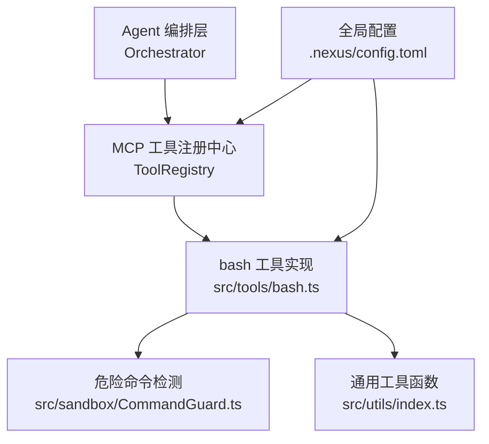
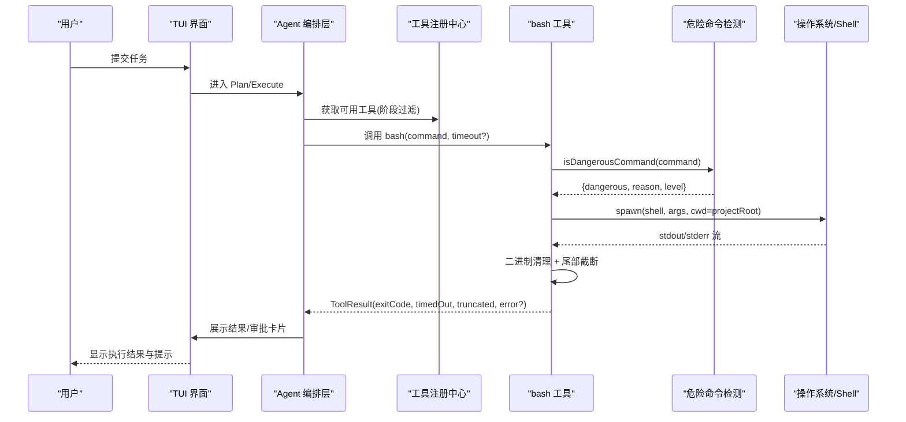
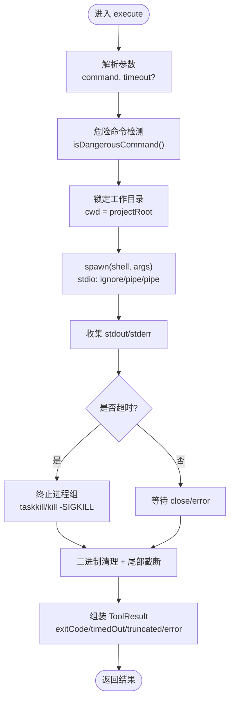
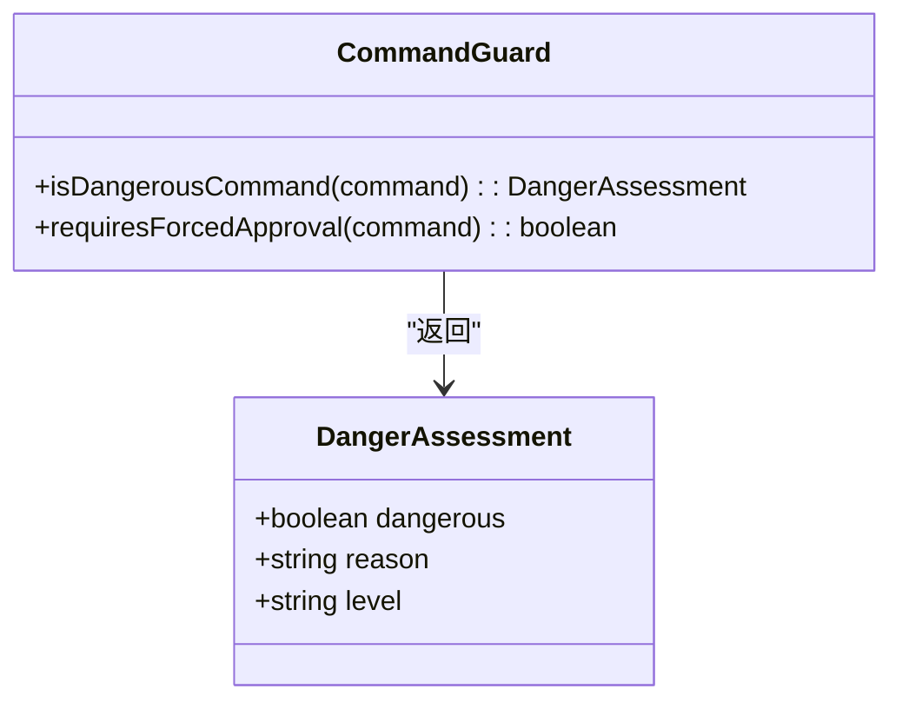
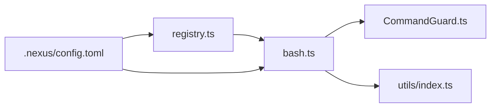

# 命令执行工具 (bash)

<cite>
**本文引用的文件**   
- [src/tools/bash.ts](file://src/tools/bash.ts)
- [src/sandbox/CommandGuard.ts](file://src/sandbox/CommandGuard.ts)
- [src/tools/registry.ts](file://src/tools/registry.ts)
- [src/utils/index.ts](file://src/utils/index.ts)
- [.nexus/config.toml](file://.nexus/config.toml)
- [tests/unit/commandGuard.test.ts](file://tests/unit/commandGuard.test.ts)
- [tests/integration/tools.test.ts](file://tests/integration/tools.test.ts)
- [README.md](file://README.md)
- [DESIGN.md](file://DESIGN.md)
</cite>

## 目录
1. [简介](#简介)
2. [项目结构](#项目结构)
3. [核心组件](#核心组件)
4. [架构总览](#架构总览)
5. [详细组件分析](#详细组件分析)
6. [依赖关系分析](#依赖关系分析)
7. [性能与资源限制](#性能与资源限制)
8. [故障排查指南](#故障排查指南)
9. [最佳实践](#最佳实践)
10. [结论](#结论)

## 简介
本文件面向使用 Nexus 的“bash”工具的用户与维护者，系统性说明命令执行能力、参数配置、安全沙箱机制、错误处理与最佳实践。该工具在项目根目录下以受控方式运行 Shell 命令，具备危险命令检测、超时控制、输出大小限制、工作目录锁定等特性，并通过 MCP 工具注册中心统一接入 Agent 编排层。

## 项目结构
与 bash 工具直接相关的代码与配置分布如下：
- 工具实现：src/tools/bash.ts
- 危险命令检测：src/sandbox/CommandGuard.ts
- 工具注册与上下文：src/tools/registry.ts
- 通用工具（截断、清理）：src/utils/index.ts
- 全局配置（含默认超时、输出大小等）：.nexus/config.toml
- 单元测试与集成测试：tests/unit/commandGuard.test.ts、tests/integration/tools.test.ts
- 设计文档与快速开始：DESIGN.md、README.md

图表来源
- [src/tools/bash.ts:1-186](file://src/tools/bash.ts#L1-L186)
- [src/tools/registry.ts:1-96](file://src/tools/registry.ts#L1-L96)
- [src/sandbox/CommandGuard.ts:1-98](file://src/sandbox/CommandGuard.ts#L1-L98)
- [src/utils/index.ts:1-211](file://src/utils/index.ts#L1-L211)
- [.nexus/config.toml:1-62](file://.nexus/config.toml#L1-L62)

章节来源
- [src/tools/bash.ts:1-186](file://src/tools/bash.ts#L1-L186)
- [src/tools/registry.ts:1-96](file://src/tools/registry.ts#L1-L96)
- [src/sandbox/CommandGuard.ts:1-98](file://src/sandbox/CommandGuard.ts#L1-L98)
- [src/utils/index.ts:1-211](file://src/utils/index.ts#L1-L211)
- [.nexus/config.toml:1-62](file://.nexus/config.toml#L1-L62)

## 核心组件
- bash 工具定义与执行器
  - 提供输入 Schema：command（必填）、timeout（可选，秒）。
  - 在工具上下文中读取 projectRoot、maxOutputBytes、bashTimeout 等全局限制。
  - 调用危险命令检测，标记潜在风险；实际拦截由上层审批策略决定。
  - 通过子进程执行命令，支持跨平台 shell 选择与进程组管理。
  - 对 stdout/stderr 进行二进制清理与尾部截断，避免内存与渲染问题。
  - 组装结果并返回 ToolResult，包含退出码、是否超时、是否被截断、错误信息等。

- 危险命令检测
  - 基于正则黑名单与启发式规则，返回危险等级与安全原因。
  - 区分 dangerous/caution/safe 三级，dangerous 强制审批。

- 工具注册中心
  - 维护工具生命周期、阶段可见性（plan/execute）、是否需要审批。
  - 将内部工具转换为 Vercel AI SDK 兼容的工具描述。
  - 提供统一的 execute 入口，注入 ToolContext。

- 通用工具函数
  - truncateHead/truncateTail：按行/字节上限截断，分别用于 read_file 与 bash 输出。
  - sanitizeBinaryOutput：清理控制字符，防止终端异常。
  - formatSize：人类可读的大小格式化。

章节来源
- [src/tools/bash.ts:13-33](file://src/tools/bash.ts#L13-L33)
- [src/tools/bash.ts:123-183](file://src/tools/bash.ts#L123-L183)
- [src/sandbox/CommandGuard.ts:67-98](file://src/sandbox/CommandGuard.ts#L67-L98)
- [src/tools/registry.ts:12-24](file://src/tools/registry.ts#L12-L24)
- [src/tools/registry.ts:44-68](file://src/tools/registry.ts#L44-L68)
- [src/utils/index.ts:112-154](file://src/utils/index.ts#L112-L154)
- [src/utils/index.ts:166-180](file://src/utils/index.ts#L166-L180)

## 架构总览
下图展示了从 Agent 到 bash 工具执行的端到端流程，包括权限检查、危险命令检测、超时与输出限制、以及结果回传。

图表来源
- [src/tools/bash.ts:42-89](file://src/tools/bash.ts#L42-L89)
- [src/tools/bash.ts:123-183](file://src/tools/bash.ts#L123-L183)
- [src/sandbox/CommandGuard.ts:71-89](file://src/sandbox/CommandGuard.ts#L71-L89)
- [src/tools/registry.ts:70-82](file://src/tools/registry.ts#L70-L82)

## 详细组件分析

### bash 工具实现
- 输入参数
  - command：要执行的 Shell 命令（必填）。
  - timeout：超时时间（秒），若未提供则使用上下文中的 bashTimeout。
- 执行流程
  - 根据平台选择 shell（Windows 使用 powershell.exe，Unix 使用 /bin/bash）。
  - 设置工作目录为项目根目录，隔离环境。
  - 启动子进程，监听 stdout/stderr，记录退出码与错误信息。
  - 超时控制：到达超时后终止整个进程组，避免僵尸进程。
  - 输出处理：先清理二进制控制字符，再按最大字节数进行尾部截断，保留错误信息。
  - 结果组装：包含命令、退出码、是否超时、stdout/stderr 内容、危险标记、错误信息、是否被截断。
- 关键行为
  - 危险命令检测仅做标记，实际拦截由上层审批策略决定。
  - 非零退出码会携带错误信息，便于诊断。
  - 支持跨平台进程组终止，确保资源释放。

图表来源
- [src/tools/bash.ts:42-89](file://src/tools/bash.ts#L42-L89)
- [src/tools/bash.ts:111-121](file://src/tools/bash.ts#L111-L121)
- [src/tools/bash.ts:123-183](file://src/tools/bash.ts#L123-L183)

章节来源
- [src/tools/bash.ts:13-33](file://src/tools/bash.ts#L13-L33)
- [src/tools/bash.ts:42-89](file://src/tools/bash.ts#L42-L89)
- [src/tools/bash.ts:111-121](file://src/tools/bash.ts#L111-L121)
- [src/tools/bash.ts:123-183](file://src/tools/bash.ts#L123-L183)

### 危险命令检测
- 规则分类
  - 危险模式：如删除根目录、格式化磁盘、Fork 炸弹、远程下载并执行、覆写系统关键文件、Git 破坏性操作、敏感变量泄露等。
  - 注意模式：删除操作、Git 推送、发布包、删除容器、强制杀进程、覆写绝对路径等。
- 返回值
  - dangerous：布尔值，表示是否命中危险模式。
  - reason：命中原因。
  - level：safe/caution/dangerous 三级。
- 强制审批
  - requiresForcedApproval：当 level === 'dangerous' 时强制审批，不受权限模式影响。

图表来源
- [src/sandbox/CommandGuard.ts:6-10](file://src/sandbox/CommandGuard.ts#L6-L10)
- [src/sandbox/CommandGuard.ts:71-98](file://src/sandbox/CommandGuard.ts#L71-L98)

章节来源
- [src/sandbox/CommandGuard.ts:12-65](file://src/sandbox/CommandGuard.ts#L12-L65)
- [src/sandbox/CommandGuard.ts:71-98](file://src/sandbox/CommandGuard.ts#L71-L98)
- [tests/unit/commandGuard.test.ts:1-88](file://tests/unit/commandGuard.test.ts#L1-L88)

### 工具注册中心与上下文
- 工具上下文
  - projectRoot：项目根目录，用于锁定工作目录。
  - callId：调用标识。
  - maxReadLines：文件读取最大行数。
  - maxOutputBytes：bash 输出最大字节数。
  - bashTimeout：单次命令默认超时（秒）。
- 阶段可见性
  - plan：只读工具（read_file、grep）。
  - execute：全部工具（read_file、edit_file、bash、grep）。
- 审批要求
  - requiresApproval：标记需要审批的工具名列表。
- 转换与执行
  - toAISDKTools：生成 Vercel AI SDK 兼容的工具描述。
  - execute：统一入口，查找处理器并调用。

章节来源
- [src/tools/registry.ts:12-24](file://src/tools/registry.ts#L12-L24)
- [src/tools/registry.ts:44-68](file://src/tools/registry.ts#L44-L68)
- [src/tools/registry.ts:70-82](file://src/tools/registry.ts#L70-L82)
- [tests/integration/tools.test.ts:83-98](file://tests/integration/tools.test.ts#L83-L98)

### 通用工具函数（截断与清理）
- truncateTail：适用于 bash 输出，保留末尾（错误信息通常在末尾）。
- sanitizeBinaryOutput：去除控制字符，防止终端渲染异常。
- formatSize：将字节数格式化为人类可读单位。

章节来源
- [src/utils/index.ts:112-154](file://src/utils/index.ts#L112-L154)
- [src/utils/index.ts:166-180](file://src/utils/index.ts#L166-L180)
- [src/utils/index.ts:156-161](file://src/utils/index.ts#L156-L161)

## 依赖关系分析
- bash 工具依赖
  - child_process.spawn：创建子进程执行命令。
  - path.resolve：解析项目根目录。
  - sandbox.CommandGuard.isDangerousCommand：危险命令检测。
  - utils.truncateTail、sanitizeBinaryOutput、formatSize：输出处理。
- 工具注册中心依赖
  - 导入所有内置工具（readFile、editFile、bash、grep）。
  - 暴露阶段过滤与审批列表。
- 配置依赖
  - .nexus/config.toml 提供默认超时、输出大小、权限模式等。

图表来源
- [src/tools/bash.ts:1-12](file://src/tools/bash.ts#L1-L12)
- [src/tools/registry.ts:7-11](file://src/tools/registry.ts#L7-L11)
- [.nexus/config.toml:35-50](file://.nexus/config.toml#L35-L50)

章节来源
- [src/tools/bash.ts:1-12](file://src/tools/bash.ts#L1-L12)
- [src/tools/registry.ts:7-11](file://src/tools/registry.ts#L7-L11)
- [.nexus/config.toml:35-50](file://.nexus/config.toml#L35-L50)

## 性能与资源限制
- 超时控制
  - 默认超时来自配置项 bash_timeout（秒），可在调用时覆盖。
  - 超时后终止整个进程组，避免僵尸进程占用 CPU。
- 输出大小限制
  - 默认最大输出字节数来自配置项 max_output_bytes。
  - 采用尾部截断，保留错误信息，同时标注原始大小与保留行数。
- 二进制清理
  - 去除控制字符，避免终端渲染异常与内存膨胀。
- 进程组管理
  - Windows 使用 taskkill /T 终止进程树；Unix 使用 kill -SIGKILL 终止进程组。

章节来源
- [.nexus/config.toml:42-49](file://.nexus/config.toml#L42-L49)
- [src/tools/bash.ts:62-109](file://src/tools/bash.ts#L62-L109)
- [src/tools/bash.ts:111-121](file://src/tools/bash.ts#L111-L121)
- [src/utils/index.ts:112-154](file://src/utils/index.ts#L112-L154)

## 故障排查指南
- 命令执行失败
  - 非零退出码会在结果中附带错误信息，优先检查 stderr 输出。
  - 常见原因：命令不存在、权限不足、路径越界、语法错误。
- 超时中断
  - 结果中标注“命令超时”，需检查命令耗时或增大超时阈值。
  - 确认进程组已正确终止，无残留进程。
- 权限不足
  - 某些系统文件或设备写入会被拒绝，需提升权限或调整命令。
- 系统错误
  - 子进程创建失败或环境变量缺失会导致错误，检查运行环境与依赖。
- 危险命令标记
  - 若命令被标记为危险，即使自动模式也会触发审批，请确认意图后再批准。

章节来源
- [src/tools/bash.ts:146-183](file://src/tools/bash.ts#L146-L183)
- [src/sandbox/CommandGuard.ts:71-98](file://src/sandbox/CommandGuard.ts#L71-L98)
- [tests/unit/commandGuard.test.ts:1-88](file://tests/unit/commandGuard.test.ts#L1-L88)

## 最佳实践
- 合理的超时设置
  - 短命令建议 10-30 秒；长任务（构建、测试）可适当提高，但需监控资源占用。
- 输出大小限制
  - 保持默认或略高于默认的输出上限，避免大输出拖慢 UI 与上下文窗口。
- 敏感命令的审批流程
  - 危险命令强制审批，建议在团队内建立审批清单与审计日志。
- 管道与后台任务
  - 复杂管道可拆分为多步命令，便于定位错误与超时。
  - 后台任务建议使用显式的守护进程或服务，而非长时间运行的 bash 命令。
- 工作目录锁定
  - 始终在项目根下执行，避免 cd 越狱；如需访问外部路径，请使用相对路径或挂载卷。
- 审计与回滚
  - 结合 Git Checkpoint 与 /undo 命令，确保每次变更可追溯与回滚。

章节来源
- [DESIGN.md:262-281](file://DESIGN.md#L262-L281)
- [DESIGN.md:461-472](file://DESIGN.md#L461-L472)
- [.nexus/config.toml:35-50](file://.nexus/config.toml#L35-L50)

## 结论
bash 工具在 Nexus 中提供了安全可控的命令执行能力，通过危险命令检测、超时控制、输出限制与工作目录锁定，有效降低误用与滥用风险。配合工具注册中心与全局配置，用户可以在不同权限模式下灵活使用，并在出现错误时快速定位与恢复。遵循最佳实践可进一步提升稳定性与可维护性。