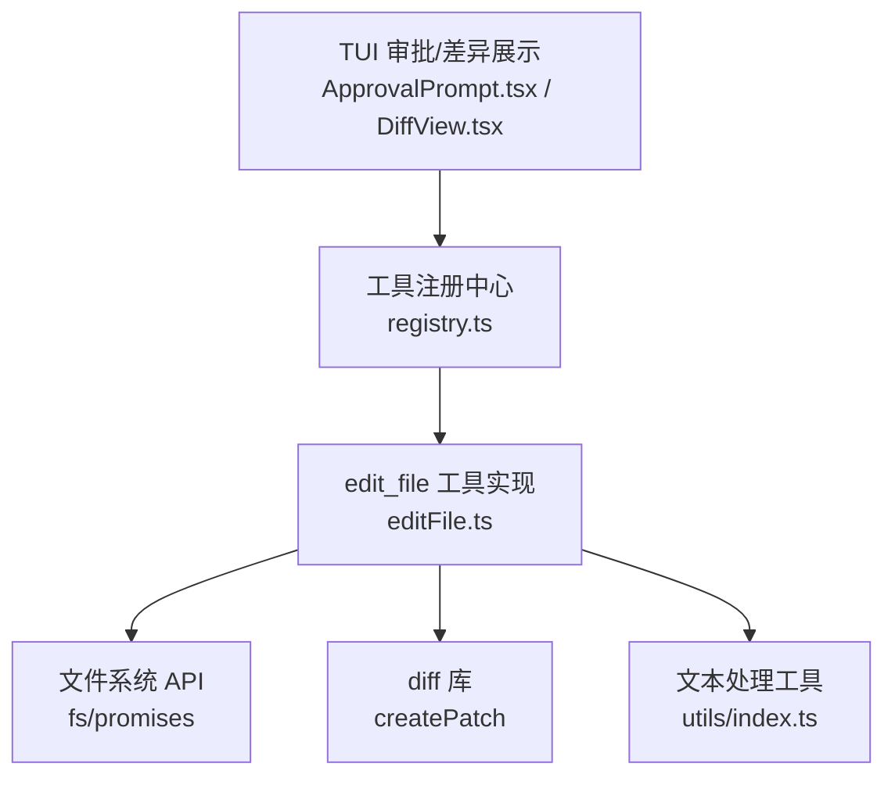
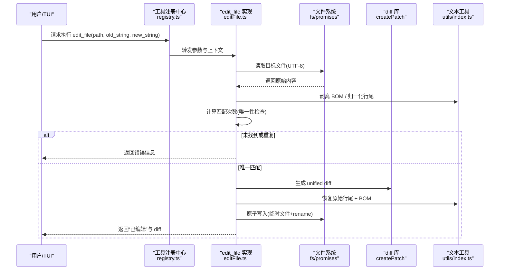
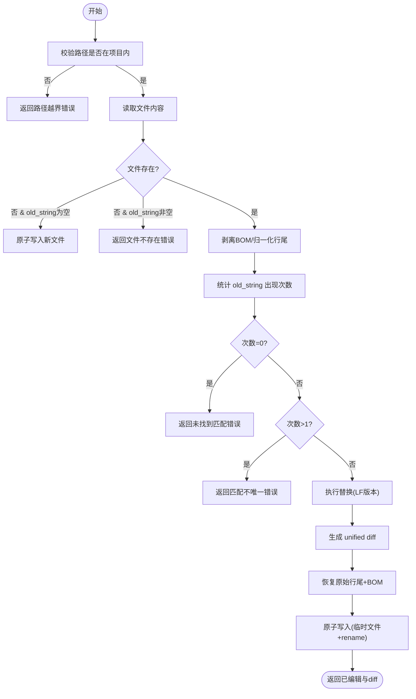
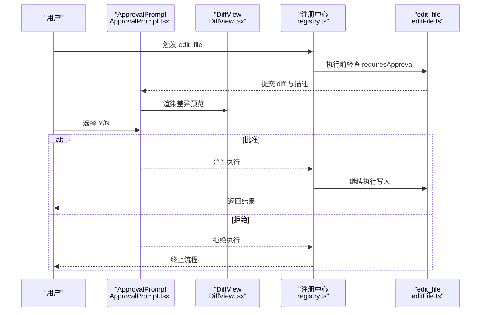
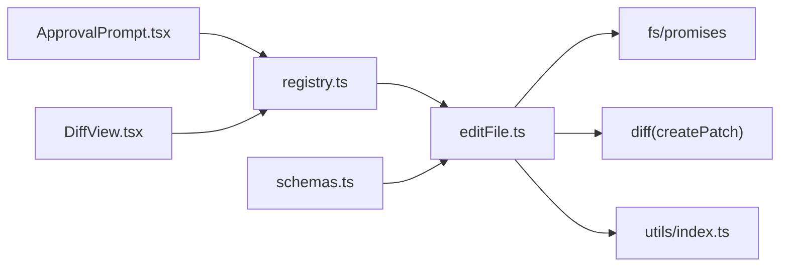

# 文件编辑工具 (edit_file)

<cite>
**本文引用的文件**   
- [src/tools/editFile.ts](file://src/tools/editFile.ts)
- [src/tools/schemas.ts](file://src/tools/schemas.ts)
- [src/tools/registry.ts](file://src/tools/registry.ts)
- [src/tui/components/DiffView.tsx](file://src/tui/components/DiffView.tsx)
- [src/tui/components/ApprovalPrompt.tsx](file://src/tui/components/ApprovalPrompt.tsx)
- [src/utils/index.ts](file://src/utils/index.ts)
- [tests/integration/tools.test.ts](file://tests/integration/tools.test.ts)
- [.nexus/config.toml](file://.nexus/config.toml)
- [README.md](file://README.md)
</cite>

## 目录
1. [简介](#简介)
2. [项目结构](#项目结构)
3. [核心组件](#核心组件)
4. [架构总览](#架构总览)
5. [详细组件分析](#详细组件分析)
6. [依赖关系分析](#依赖关系分析)
7. [性能与可靠性](#性能与可靠性)
8. [故障排查指南](#故障排查指南)
9. [结论](#结论)
10. [附录：参数与示例](#附录参数与示例)

## 简介
本文件为 edit_file 工具的全面使用文档。该工具用于在项目中精准替换文件内容，强制唯一匹配、原子写入，并提供差异预览与审批流程，确保变更安全可控。它支持创建新文件（当 old_string 为空时），并保留原始文件的 BOM 和行尾风格。

## 项目结构
edit_file 位于工具层，通过注册中心暴露给上层编排器与 TUI 界面。其关键关联如下：
- 工具定义与执行逻辑：src/tools/editFile.ts
- 输入校验 Schema：src/tools/schemas.ts
- 工具注册与阶段过滤：src/tools/registry.ts
- 差异展示 UI：src/tui/components/DiffView.tsx
- 审批交互 UI：src/tui/components/ApprovalPrompt.tsx
- 文本处理工具（BOM、行尾等）：src/utils/index.ts
- 集成测试用例：tests/integration/tools.test.ts
- 权限模式配置：.nexus/config.toml
- 概览说明：README.md

图表来源
- [src/tools/registry.ts:25-93](file://src/tools/registry.ts#L25-L93)
- [src/tools/editFile.ts:14-38](file://src/tools/editFile.ts#L14-L38)
- [src/tui/components/ApprovalPrompt.tsx:18-56](file://src/tui/components/ApprovalPrompt.tsx#L18-L56)
- [src/tui/components/DiffView.tsx:14-40](file://src/tui/components/DiffView.tsx#L14-L40)
- [src/utils/index.ts:187-210](file://src/utils/index.ts#L187-L210)

章节来源
- [src/tools/editFile.ts:14-38](file://src/tools/editFile.ts#L14-L38)
- [src/tools/schemas.ts:14-18](file://src/tools/schemas.ts#L14-L18)
- [src/tools/registry.ts:25-93](file://src/tools/registry.ts#L25-L93)
- [src/tui/components/DiffView.tsx:14-40](file://src/tui/components/DiffView.tsx#L14-L40)
- [src/tui/components/ApprovalPrompt.tsx:18-56](file://src/tui/components/ApprovalPrompt.tsx#L18-L56)
- [src/utils/index.ts:187-210](file://src/utils/index.ts#L187-L210)
- [tests/integration/tools.test.ts:43-76](file://tests/integration/tools.test.ts#L43-L76)
- [.nexus/config.toml:35-37](file://.nexus/config.toml#L35-L37)
- [README.md:114-122](file://README.md#L114-L122)

## 核心组件
- 工具定义与输入约束
  - 名称：edit_file
  - 描述：精准替换文件中的字符串，要求 old_string 必须唯一匹配
  - 必需参数：path、old_string、new_string
  - 需要审批：是（requiresApproval=true）
  - 阶段：execute
- 输入校验 Schema
  - path：字符串，相对项目根目录
  - old_string：字符串，需包含足够上下文以确保唯一性
  - new_string：字符串，替换后的新内容
- 工具注册与阶段控制
  - 注册到工具注册中心，默认在 execute 阶段可用
  - 提供 getForPhase 过滤，plan 阶段不包含写操作工具
- 差异与审批 UI
  - DiffView：以统一 diff 格式高亮显示增删行
  - ApprovalPrompt：交互式批准/拒绝，可附带原因
- 文本处理工具
  - stripBom/detectLineEnding/normalizeToLF/restoreLineEndings：保证跨平台一致性与格式保留

章节来源
- [src/tools/editFile.ts:14-38](file://src/tools/editFile.ts#L14-L38)
- [src/tools/schemas.ts:14-18](file://src/tools/schemas.ts#L14-L18)
- [src/tools/registry.ts:44-56](file://src/tools/registry.ts#L44-L56)
- [src/tui/components/DiffView.tsx:14-40](file://src/tui/components/DiffView.tsx#L14-L40)
- [src/tui/components/ApprovalPrompt.tsx:18-56](file://src/tui/components/ApprovalPrompt.tsx#L18-L56)
- [src/utils/index.ts:187-210](file://src/utils/index.ts#L187-L210)

## 架构总览
edit_file 的调用链路从 TUI 或编排器发起，经注册中心路由到具体实现，最终完成文件读写与差异生成。

图表来源
- [src/tools/registry.ts:70-82](file://src/tools/registry.ts#L70-L82)
- [src/tools/editFile.ts:61-156](file://src/tools/editFile.ts#L61-L156)
- [src/utils/index.ts:187-210](file://src/utils/index.ts#L187-L210)

## 详细组件分析

### 工具定义与输入校验
- 定义字段
  - name: edit_file
  - description: 强调唯一匹配与上下文重要性
  - inputSchema: 定义 path、old_string、new_string 三个必填字段
  - requiresApproval: true，表示需要人工审批
  - phase: execute，仅在“执行阶段”可用
- 校验 Schema
  - Zod schema 与 ToolDefinition.inputSchema 保持一致，便于上层 SDK 使用

章节来源
- [src/tools/editFile.ts:14-38](file://src/tools/editFile.ts#L14-L38)
- [src/tools/schemas.ts:14-18](file://src/tools/schemas.ts#L14-L18)

### 执行流程与核心逻辑
- 路径安全检查
  - 解析绝对路径，禁止越界访问项目外文件
- 文件读取与空内容创建
  - 若文件不存在且 old_string 为空，则直接创建新文件并返回 diff
  - 否则返回“文件不存在”的错误提示
- 文本规范化与匹配计数
  - 剥离 BOM，检测并归一化为 LF，统计 old_string 出现次数
  - 0 次：报错“未找到匹配”，建议重新 read_file
  - >1 次：报错“匹配不唯一”，要求提供更多上下文
- 应用替换与差异生成
  - 基于 LF 版本进行替换，生成 unified diff
- 原子写入
  - 先写临时文件，再 rename 为目标文件，避免部分写入导致损坏
- 结果返回
  - 成功：返回“已编辑”与 diff 摘要
  - 失败：返回结构化错误信息

图表来源
- [src/tools/editFile.ts:61-156](file://src/tools/editFile.ts#L61-L156)
- [src/utils/index.ts:187-210](file://src/utils/index.ts#L187-L210)

章节来源
- [src/tools/editFile.ts:61-156](file://src/tools/editFile.ts#L61-L156)

### 差异预览与审批流程
- 差异预览
  - 使用 diff 库生成 unified diff，仅保留主体部分
  - TUI 中 DiffView 组件对增删行进行颜色高亮
- 审批交互
  - 由于 requiresApproval=true，系统会在执行前弹出 ApprovalPrompt
  - 用户可选择批准或拒绝（可附原因），拒绝后不会执行写入
- 权限模式
  - 配置文件 .nexus/config.toml 中 permissions.mode 决定行为：ask/auto-edit/auto-all/yolo
  - README 中对各模式有简要说明

图表来源
- [src/tui/components/ApprovalPrompt.tsx:18-56](file://src/tui/components/ApprovalPrompt.tsx#L18-L56)
- [src/tui/components/DiffView.tsx:14-40](file://src/tui/components/DiffView.tsx#L14-L40)
- [src/tools/registry.ts:51-56](file://src/tools/registry.ts#L51-L56)
- [src/tools/editFile.ts:14-38](file://src/tools/editFile.ts#L14-L38)

章节来源
- [src/tui/components/ApprovalPrompt.tsx:18-56](file://src/tui/components/ApprovalPrompt.tsx#L18-L56)
- [src/tui/components/DiffView.tsx:14-40](file://src/tui/components/DiffView.tsx#L14-L40)
- [.nexus/config.toml:35-37](file://.nexus/config.toml#L35-L37)
- [README.md:114-122](file://README.md#L114-L122)

### 撤销支持与回滚
- 当前实现未内置“撤销”功能
- 可通过 Git checkpoint 机制进行回滚（项目级配置 auto_checkpoint 与 branch）
- 建议在重要编辑前创建检查点，以便一键回滚

章节来源
- [.nexus/config.toml:57-62](file://.nexus/config.toml#L57-L62)
- [README.md:123-133](file://README.md#L123-L133)

## 依赖关系分析
- 内部依赖
  - fs/promises：文件 I/O
  - diff：生成 unified diff
  - utils/index.ts：BOM 与行尾处理
  - registry.ts：工具注册与阶段过滤
  - schemas.ts：Zod 校验
  - TUI 组件：DiffView、ApprovalPrompt
- 外部依赖
  - ripgrep（grep 工具依赖，与本工具间接相关）
  - Bun 运行时

图表来源
- [src/tools/editFile.ts:7-12](file://src/tools/editFile.ts#L7-L12)
- [src/tools/registry.ts:25-93](file://src/tools/registry.ts#L25-L93)
- [src/tools/schemas.ts:14-18](file://src/tools/schemas.ts#L14-L18)
- [src/tui/components/ApprovalPrompt.tsx:18-56](file://src/tui/components/ApprovalPrompt.tsx#L18-L56)
- [src/tui/components/DiffView.tsx:14-40](file://src/tui/components/DiffView.tsx#L14-L40)

章节来源
- [src/tools/editFile.ts:7-12](file://src/tools/editFile.ts#L7-L12)
- [src/tools/registry.ts:25-93](file://src/tools/registry.ts#L25-L93)
- [src/tools/schemas.ts:14-18](file://src/tools/schemas.ts#L14-L18)

## 性能与可靠性
- 原子写入
  - 采用“临时文件 + rename”策略，避免并发写入导致的中间状态
- 文本一致性
  - 剥离 BOM、归一化行尾后再比较与替换，最后恢复原始风格，减少跨平台差异
- 唯一匹配保障
  - 严格计数 old_string 出现次数，防止误改多处
- 大文件处理
  - 差异生成基于内存字符串，超大文件可能影响性能；建议分块重构或使用更细粒度的替换范围
- 错误快速失败
  - 路径越界、文件不存在、匹配不唯一等情况立即返回错误，避免无效写入

[本节为通用指导，无需列出具体文件来源]

## 故障排查指南
- 常见错误与处理
  - 路径越界：确认 path 相对于项目根目录，不要尝试访问外部路径
  - 文件不存在：如需创建新文件，请将 old_string 设为空字符串
  - 未找到匹配：请重新 read_file 获取最新内容，并确保 old_string 包含足够上下文
  - 匹配不唯一：增加上下文行，使 old_string 唯一
  - 写入失败：检查磁盘空间、权限与进程占用；必要时重试
- 调试建议
  - 查看返回的 diff 摘要，确认变更范围
  - 在 TUI 中使用 DiffView 与 ApprovalPrompt 进行可视化审查
  - 结合 Git checkpoint 进行回滚验证

章节来源
- [src/tools/editFile.ts:71-156](file://src/tools/editFile.ts#L71-L156)
- [tests/integration/tools.test.ts:58-76](file://tests/integration/tools.test.ts#L58-L76)

## 结论
edit_file 通过唯一匹配、原子写入、差异预览与审批流程，提供了安全可靠的文件编辑能力。配合 Git checkpoint 与权限模式，可在复杂工程中实现可控的自动化修改。遵循最佳实践（精确匹配、合理范围、重要变更审批）可显著降低风险。

[本节为总结性内容，无需列出具体文件来源]

## 附录：参数与示例

### 参数说明
- path：要编辑的文件路径（相对于项目根目录）
- old_string：待替换的原文，必须在文件中唯一匹配；包含足够上下文以确保唯一性
- new_string：替换后的新内容

章节来源
- [src/tools/editFile.ts:18-35](file://src/tools/editFile.ts#L18-L35)
- [src/tools/schemas.ts:14-18](file://src/tools/schemas.ts#L14-L18)

### 使用示例（场景化）
- 简单文本替换
  - 场景：将函数返回值从 “world” 改为 “nexus”
  - 要点：old_string 应包含完整表达式，确保唯一匹配
  - 参考测试：见 tests/integration/tools.test.ts 中“edit_file 能精准替换”的用例
- 多行内容修改
  - 场景：替换一段多行代码块
  - 要点：old_string 需包含首尾行与必要上下文，避免与其他相似块冲突
- 复杂代码重构
  - 场景：调整接口签名或方法体
  - 要点：分步替换，每次只改一处；必要时先生成 diff 预览并审批
- 创建新文件
  - 场景：old_string 为空时，直接写入 new_string 作为新文件内容
  - 注意：此行为会跳过匹配检查，需谨慎使用

章节来源
- [tests/integration/tools.test.ts:43-76](file://tests/integration/tools.test.ts#L43-L76)
- [src/tools/editFile.ts:86-101](file://src/tools/editFile.ts#L86-L101)

### 安全机制
- 用户审批流程
  - 工具标记 requiresApproval=true，执行前弹出 ApprovalPrompt
  - 用户可审阅 DiffView 的差异预览，决定是否批准
- 变更预览
  - 生成 unified diff，仅保留主体部分，便于快速理解变更范围
- 权限验证
  - 路径越界检查，禁止访问项目外文件
  - 权限模式由 .nexus/config.toml 的 permissions.mode 控制

章节来源
- [src/tools/editFile.ts:71-79](file://src/tools/editFile.ts#L71-L79)
- [src/tui/components/ApprovalPrompt.tsx:18-56](file://src/tui/components/ApprovalPrompt.tsx#L18-L56)
- [src/tui/components/DiffView.tsx:14-40](file://src/tui/components/DiffView.tsx#L14-L40)
- [.nexus/config.toml:35-37](file://.nexus/config.toml#L35-L37)
- [README.md:114-122](file://README.md#L114-L122)

### 错误处理
- 内容不匹配
  - 未找到匹配：返回错误，建议重新 read_file
  - 匹配不唯一：返回错误，要求提供更多上下文
- 文件锁定/写入失败
  - 捕获异常并返回错误消息；建议检查权限与磁盘状态
- 路径越界
  - 直接拒绝并返回错误

章节来源
- [src/tools/editFile.ts:113-156](file://src/tools/editFile.ts#L113-L156)

### 最佳实践
- 精确的内容匹配
  - old_string 包含足够的上下文行，确保唯一性
- 合理的变更范围
  - 尽量小步替换，避免一次性大范围改动
- 重要的编辑操作审批
  - 保持 ask 或 auto-edit 模式，谨慎使用 yolo
- 利用差异预览
  - 在 ApprovalPrompt 中仔细审阅 DiffView 输出
- 借助检查点
  - 重要变更前创建 Git checkpoint，便于回滚

章节来源
- [src/tools/editFile.ts:14-38](file://src/tools/editFile.ts#L14-L38)
- [.nexus/config.toml:35-37](file://.nexus/config.toml#L35-L37)
- [README.md:114-133](file://README.md#L114-L133)