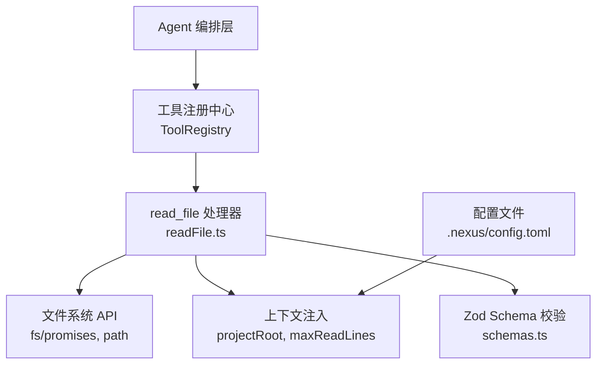
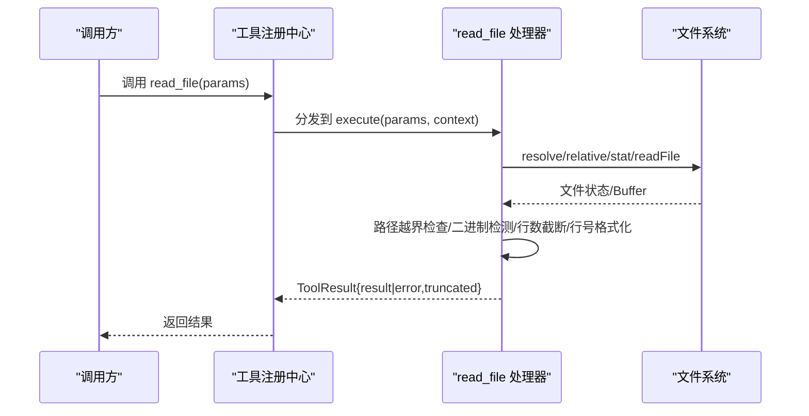
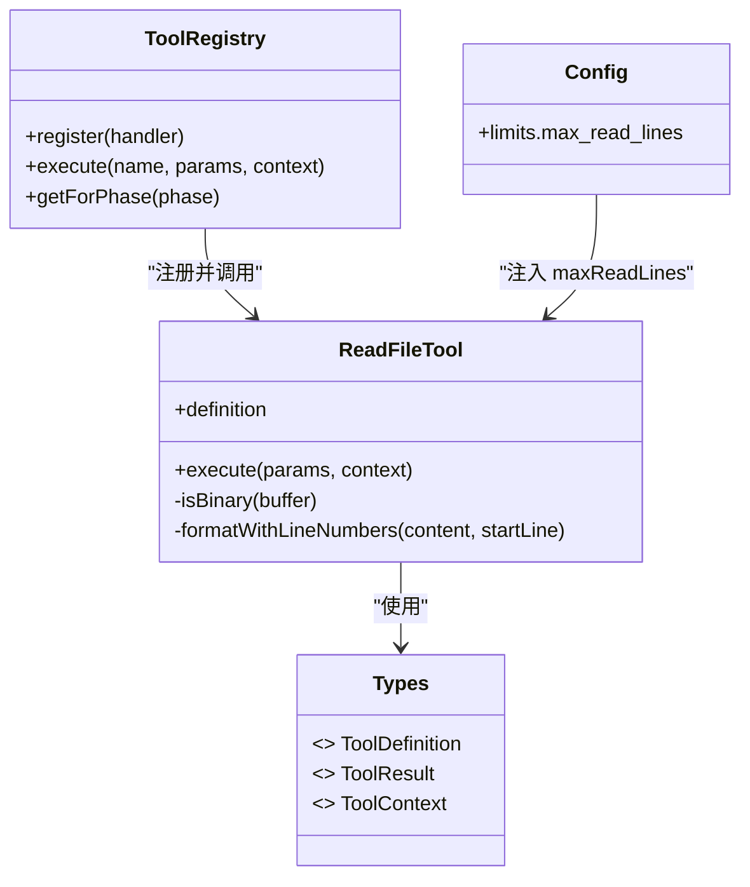

# 文件读取工具 (read_file)

<cite>
**本文引用的文件**   
- [src/tools/readFile.ts](file://src/tools/readFile.ts)
- [src/tools/schemas.ts](file://src/tools/schemas.ts)
- [src/tools/registry.ts](file://src/tools/registry.ts)
- [src/agent/types.ts](file://src/agent/types.ts)
- [.nexus/config.toml](file://.nexus/config.toml)
- [tests/integration/tools.test.ts](file://tests/integration/tools.test.ts)
</cite>

## 目录
1. [简介](#简介)
2. [项目结构](#项目结构)
3. [核心组件](#核心组件)
4. [架构总览](#架构总览)
5. [详细组件分析](#详细组件分析)
6. [依赖关系分析](#依赖关系分析)
7. [性能与限制](#性能与限制)
8. [故障排查指南](#故障排查指南)
9. [结论](#结论)
10. [附录：参数与行为速查](#附录参数与行为速查)

## 简介
read_file 是 Nexus 提供的只读文件读取工具，具备以下关键能力：
- 安全文件读取：路径越界检查、仅允许读取项目根目录内的文件。
- 二进制文件检测：自动拒绝二进制文件，避免输出不可读内容。
- 行数截断策略：对超大文件采用“头尾拼接 + 省略提示”的截断方式，默认最大行数由配置控制。
- 行号格式化输出：返回结果包含相对路径、总行数以及带行号的文本，便于定位。

该工具在计划阶段和执行阶段均可使用（phase: both），无需审批。

## 项目结构
read_file 的实现位于工具层，通过注册中心暴露给上层 Agent 编排调用。其输入参数校验同时提供 JSON Schema 和 Zod Schema 两种形式，分别用于运行时描述与类型约束。

图示来源
- [src/tools/registry.ts:25-93](file://src/tools/registry.ts#L25-L93)
- [src/tools/readFile.ts:11-35](file://src/tools/readFile.ts#L11-L35)
- [src/tools/schemas.ts:8-12](file://src/tools/schemas.ts#L8-L12)
- [.nexus/config.toml:39-49](file://.nexus/config.toml#L39-L49)

章节来源
- [src/tools/readFile.ts:1-150](file://src/tools/readFile.ts#L1-L150)
- [src/tools/registry.ts:1-96](file://src/tools/registry.ts#L1-L96)
- [src/tools/schemas.ts:1-40](file://src/tools/schemas.ts#L1-L40)
- [.nexus/config.toml:39-49](file://.nexus/config.toml#L39-L49)

## 核心组件
- 工具定义与执行器
  - 定义名称、描述、输入 Schema、是否需要审批、可用阶段等元信息。
  - 实现 execute 函数，负责解析参数、安全检查、读取文件、格式化和返回结果。
- 输入参数校验
  - 提供 JSON Schema 与 Zod Schema 双份定义，确保参数类型与语义正确。
- 注册与调度
  - 工具注册中心将 read_file 注册为可调用工具，并在需要时执行。
- 类型与上下文
  - ToolResult 统一返回结构，包含 result、error、truncated 等字段。
  - ToolContext 注入 projectRoot、maxReadLines 等运行期上下文。

章节来源
- [src/tools/readFile.ts:11-35](file://src/tools/readFile.ts#L11-L35)
- [src/tools/readFile.ts:54-147](file://src/tools/readFile.ts#L54-L147)
- [src/tools/schemas.ts:8-12](file://src/tools/schemas.ts#L8-L12)
- [src/tools/registry.ts:12-23](file://src/tools/registry.ts#L12-L23)
- [src/agent/types.ts:72-78](file://src/agent/types.ts#L72-L78)

## 架构总览
read_file 的调用链路如下：

图示来源
- [src/tools/registry.ts:70-82](file://src/tools/registry.ts#L70-L82)
- [src/tools/readFile.ts:54-147](file://src/tools/readFile.ts#L54-L147)

## 详细组件分析

### 参数与输入校验
- 必需参数
  - path: 字符串，表示要读取的文件路径（相对于项目根目录）。
- 可选参数
  - start_line: 数字，起始行号（从 1 开始）。
  - end_line: 数字，结束行号（可选）。
- 校验规则
  - JSON Schema 与 Zod Schema 均声明了上述字段及类型；path 为必填。
  - 当未指定 start_line 时，默认从第 1 行开始。
  - 当指定 end_line 时，按范围截取；未指定则走整体读取与截断策略。

章节来源
- [src/tools/readFile.ts:15-32](file://src/tools/readFile.ts#L15-L32)
- [src/tools/schemas.ts:8-12](file://src/tools/schemas.ts#L8-L12)

### 安全机制
- 路径越界检查
  - 基于项目根目录进行绝对路径解析与相对路径计算，拒绝任何不在项目目录内的路径。
- 二进制文件拒绝
  - 读取前若干字节进行检测，若包含空字节则认为二进制文件并拒绝读取。
- 项目目录限制
  - 所有路径必须位于 projectRoot 下，防止跨目录访问敏感资源。

章节来源
- [src/tools/readFile.ts:60-72](file://src/tools/readFile.ts#L60-L72)
- [src/tools/readFile.ts:86-96](file://src/tools/readFile.ts#L86-L96)

### 行数截断策略
- 触发条件
  - 当文件总行数超过 maxReadLines 时启用截断。
- 策略细节
  - 头部保留约 70% 的行数，尾部保留约 30% 的行数，中间省略并给出提示。
  - 返回结果中标记 truncated 为 true，以便上层感知。
- 范围读取优先
  - 如果提供了 start_line 与 end_line，则直接按范围返回，不触发全局截断逻辑。

章节来源
- [src/tools/readFile.ts:102-130](file://src/tools/readFile.ts#L102-L130)

### 行号格式化输出
- 输出结构
  - 首行包含相对路径与行数统计信息。
  - 后续内容为带行号的文本，行号宽度自适应最大行号长度。
- 范围读取
  - 当指定范围时，返回对应区间的行号，且首行显示区间与总行数。

章节来源
- [src/tools/readFile.ts:44-52](file://src/tools/readFile.ts#L44-L52)
- [src/tools/readFile.ts:107-111](file://src/tools/readFile.ts#L107-L111)
- [src/tools/readFile.ts:132-137](file://src/tools/readFile.ts#L132-L137)

### 错误处理与异常
- 常见错误
  - 路径越界：返回错误信息，指示不在项目目录内。
  - 非文件：若目标不是普通文件，返回错误。
  - 二进制文件：检测到二进制内容，拒绝读取。
  - 其他 IO 异常：捕获系统级错误并返回可读消息。
- 返回结构
  - 成功：result 包含格式化后的内容，可能附带 truncated 标记。
  - 失败：error 包含错误原因，result 为空。

章节来源
- [src/tools/readFile.ts:64-96](file://src/tools/readFile.ts#L64-L96)
- [src/tools/readFile.ts:138-146](file://src/tools/readFile.ts#L138-L146)

### 使用示例
- 基本读取
  - 仅传入 path，返回完整内容（受 maxReadLines 限制）。
- 范围读取
  - 传入 path 与 start_line、end_line，返回指定区间的行号内容。
- 大文件处理
  - 当文件超过 maxReadLines 时，自动返回“头+省略提示+尾”的拼接结果，并标记 truncated。
- 集成测试参考
  - 参见集成测试中对 read_file 的基本读取与路径越界拒绝用例。

章节来源
- [tests/integration/tools.test.ts:36-41](file://tests/integration/tools.test.ts#L36-L41)
- [tests/integration/tools.test.ts:78-81](file://tests/integration/tools.test.ts#L78-L81)

## 依赖关系分析
- 内部依赖
  - 工具注册中心：负责发现与调度 read_file。
  - 类型定义：ToolDefinition、ToolResult、ToolContext 等。
  - 配置：maxReadLines 来自配置文件，注入到上下文。
- 外部依赖
  - Node.js fs/promises：异步文件读写与 stat。
  - Node.js path：路径解析与相对路径计算。
  - Zod：参数校验（在 schemas.ts 中定义）。

图示来源
- [src/tools/registry.ts:25-93](file://src/tools/registry.ts#L25-L93)
- [src/tools/readFile.ts:11-35](file://src/tools/readFile.ts#L11-L35)
- [src/agent/types.ts:44-78](file://src/agent/types.ts#L44-L78)
- [.nexus/config.toml:39-49](file://.nexus/config.toml#L39-L49)

章节来源
- [src/tools/registry.ts:1-96](file://src/tools/registry.ts#L1-L96)
- [src/agent/types.ts:44-78](file://src/agent/types.ts#L44-L78)
- [.nexus/config.toml:39-49](file://.nexus/config.toml#L39-L49)

## 性能与限制
- 最大行数限制
  - 默认值来源于配置文件 limits.max_read_lines，当前为 2000 行。
  - 超过限制时采用“头尾拼接 + 省略提示”的策略，减少输出体积。
- 二进制检测开销
  - 仅检查前若干字节，开销较小，但会引入一次额外读取。
- 建议
  - 对于大型代码库或日志文件，优先使用 grep 搜索关键字，再针对小范围使用 read_file 查看上下文。
  - 合理设置 maxReadLines，避免一次性加载过大文件导致内存压力。

章节来源
- [.nexus/config.toml:39-49](file://.nexus/config.toml#L39-L49)
- [src/tools/readFile.ts:114-130](file://src/tools/readFile.ts#L114-L130)

## 故障排查指南
- 路径越界
  - 现象：返回错误信息，指出路径不在项目目录内。
  - 排查：确认 path 是否以项目根目录为基准，避免使用 “..” 跳出目录。
- 非文件或权限不足
  - 现象：返回错误，说明不是文件或读取失败。
  - 排查：检查文件是否存在、是否为普通文件、是否有读取权限。
- 二进制文件
  - 现象：返回错误，提示为二进制文件无法读取。
  - 排查：确认目标文件是否为文本文件；如需查看二进制内容，请使用其他专用工具。
- 范围读取无效
  - 现象：返回结果为空或不符合预期。
  - 排查：确认 start_line 与 end_line 是否在有效范围内；注意行号从 1 开始。

章节来源
- [src/tools/readFile.ts:64-96](file://src/tools/readFile.ts#L64-L96)
- [src/tools/readFile.ts:138-146](file://src/tools/readFile.ts#L138-L146)

## 结论
read_file 在安全性、易用性与性能之间取得了良好平衡：通过路径越界检查与二进制检测保障安全，通过行数截断与行号格式化提升可读性，并通过灵活的参数支持满足多种读取场景。结合 grep 与范围读取，可有效应对大文件与复杂项目的阅读需求。

## 附录：参数与行为速查
- 参数
  - path（必需）：字符串，相对项目根目录的文件路径。
  - start_line（可选）：数字，起始行号（从 1 开始）。
  - end_line（可选）：数字，结束行号。
- 行为
  - 路径越界：拒绝读取并返回错误。
  - 二进制文件：拒绝读取并返回错误。
  - 范围读取：返回指定区间的行号内容。
  - 大文件截断：超过 maxReadLines 时返回“头+省略提示+尾”，并标记 truncated。
  - 正常返回：返回相对路径、总行数与带行号的内容。

章节来源
- [src/tools/readFile.ts:15-32](file://src/tools/readFile.ts#L15-L32)
- [src/tools/readFile.ts:102-130](file://src/tools/readFile.ts#L102-L130)
- [src/tools/readFile.ts:132-137](file://src/tools/readFile.ts#L132-L137)