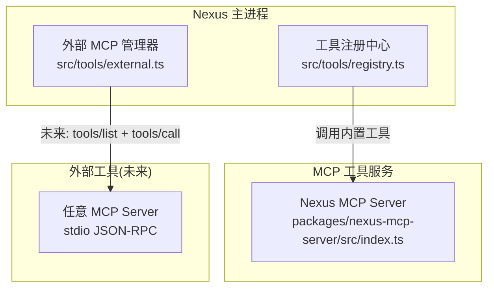
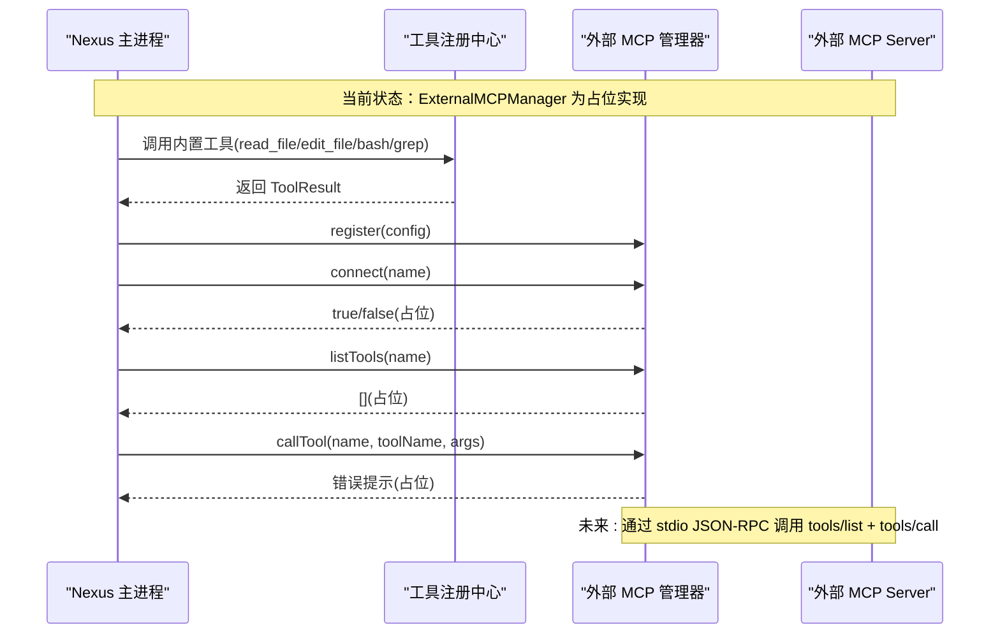
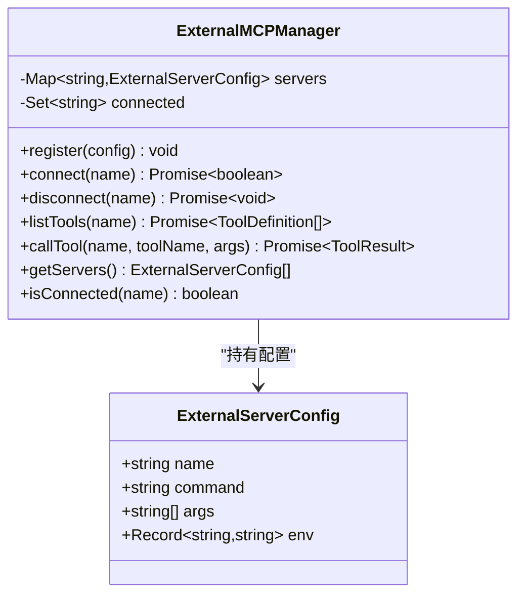
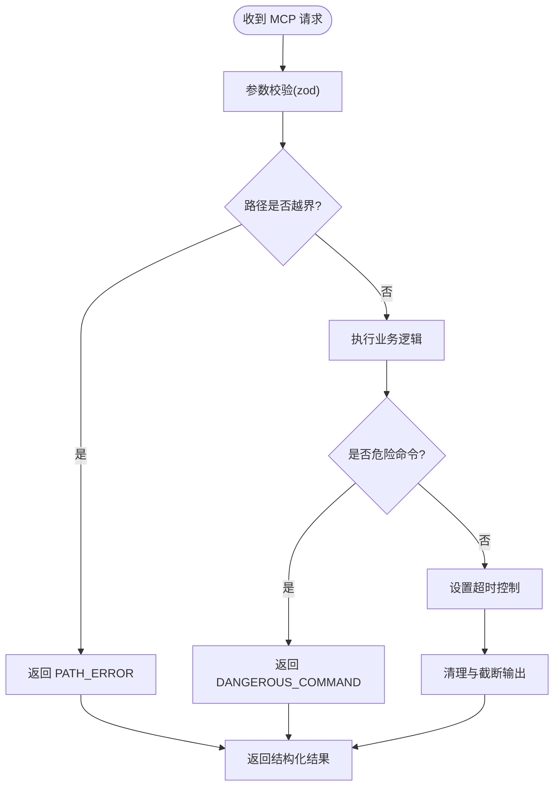
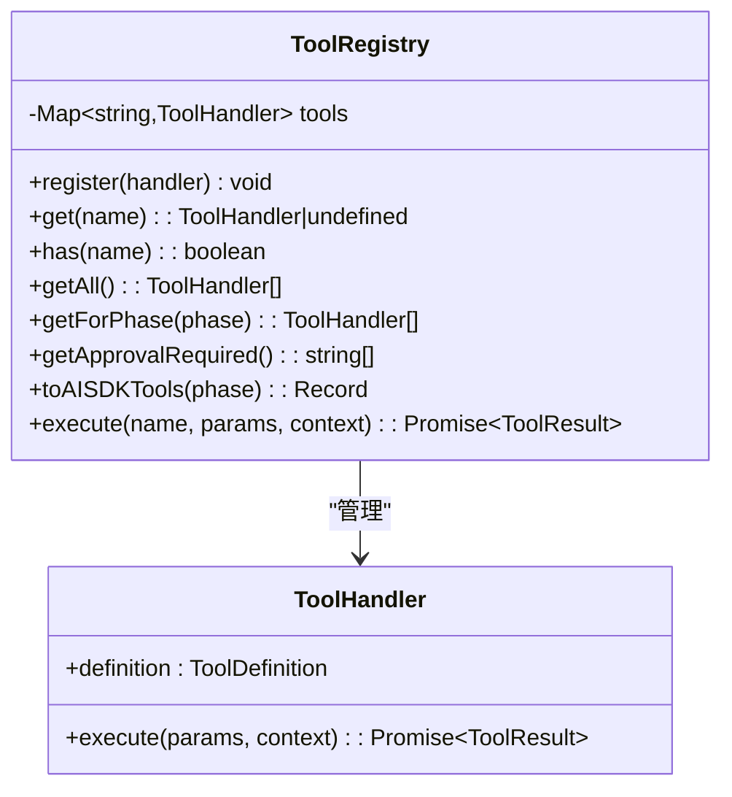
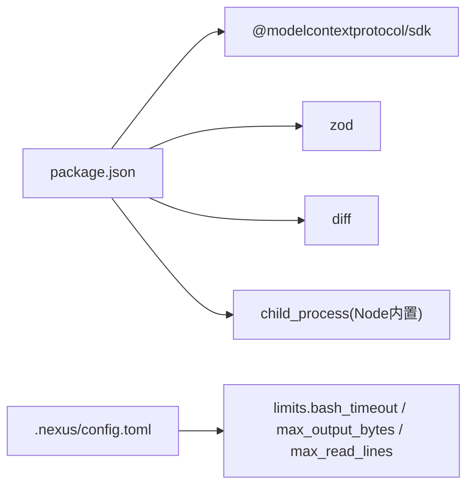
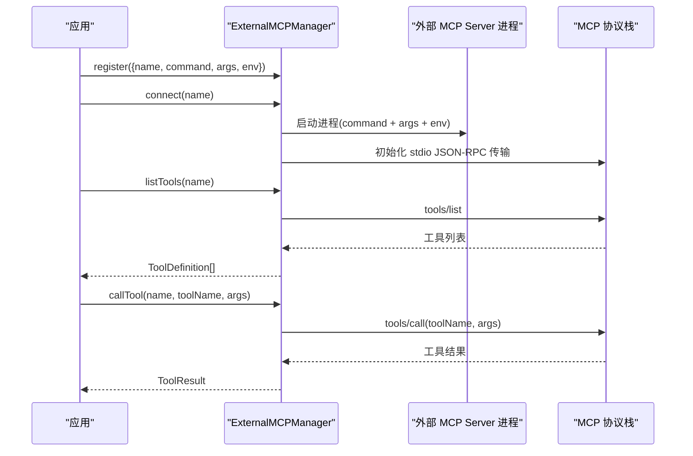

# 外部工具

<cite>
**本文引用的文件**   
- [src/tools/external.ts](file://src/tools/external.ts)
- [packages/nexus-mcp-server/src/index.ts](file://packages/nexus-mcp-server/src/index.ts)
- [src/tools/registry.ts](file://src/tools/registry.ts)
- [src/tools/schemas.ts](file://src/tools/schemas.ts)
- [src/tools/readFile.ts](file://src/tools/readFile.ts)
- [src/tools/editFile.ts](file://src/tools/editFile.ts)
- [src/tools/bash.ts](file://src/tools/bash.ts)
- [src/tools/grep.ts](file://src/tools/grep.ts)
- [src/agent/types.ts](file://src/agent/types.ts)
- [.nexus/config.toml](file://.nexus/config.toml)
- [README.md](file://README.md)
- [package.json](file://package.json)
</cite>

## 目录
1. [简介](#简介)
2. [项目结构](#项目结构)
3. [核心组件](#核心组件)
4. [架构总览](#架构总览)
5. [详细组件分析](#详细组件分析)
6. [依赖关系分析](#依赖关系分析)
7. [性能与可靠性](#性能与可靠性)
8. [故障排查指南](#故障排查指南)
9. [结论](#结论)
10. [附录：开发指南与示例](#附录开发指南与示例)

## 简介
本技术文档聚焦 Nexus 的“外部工具”体系，围绕以下目标展开：
- 解释 external 工具的当前实现原理与未来规划（通过 MCP 协议与外部工具服务器通信）
- 说明外部工具的发现、注册与调用流程
- 给出连接配置、错误处理、超时管理与重试机制的设计建议
- 提供外部工具开发指南（MCP 协议实现、工具定义格式、通信规范）
- 提供集成示例与故障排查方法

Nexus 当前内置工具（read_file、edit_file、bash、grep）已通过 MCP 协议以独立进程形式暴露为 MCP Server，供宿主或第三方客户端挂载。同时，Nexus 内部预留了 ExternalMCPManager 作为未来通过 stdio JSON-RPC 接入任意外部 MCP Server 的统一入口。

## 项目结构
与外部工具相关的关键位置如下：
- src/tools/external.ts：外部 MCP Server 管理器（预留接口，Phase 2+ 完整实现 stdio JSON-RPC）
- packages/nexus-mcp-server/src/index.ts：将 Nexus 核心能力封装为 MCP Server（stdio transport）
- src/tools/registry.ts：工具注册中心（管理内置工具）
- src/tools/*.ts：各内置工具的具体实现
- .nexus/config.toml：全局配置（包含 bash 超时、输出大小等限制）
- README.md：项目概览与运行方式
- package.json：依赖声明（含 @modelcontextprotocol/sdk）

图表来源
- [src/tools/external.ts:1-76](file://src/tools/external.ts#L1-L76)
- [packages/nexus-mcp-server/src/index.ts:1-383](file://packages/nexus-mcp-server/src/index.ts#L1-L383)
- [src/tools/registry.ts:1-96](file://src/tools/registry.ts#L1-L96)

章节来源
- [src/tools/external.ts:1-76](file://src/tools/external.ts#L1-L76)
- [packages/nexus-mcp-server/src/index.ts:1-383](file://packages/nexus-mcp-server/src/index.ts#L1-L383)
- [src/tools/registry.ts:1-96](file://src/tools/registry.ts#L1-L96)

## 核心组件
- 外部 MCP 管理器（ExternalMCPManager）
  - 负责外部 MCP Server 的注册、连接、断开、工具列表获取与工具调用
  - 当前为简化占位实现，预留 connect/listTools/callTool 等接口，待 Phase 2 实现 stdio JSON-RPC
- MCP Server（packages/nexus-mcp-server）
  - 使用 @modelcontextprotocol/sdk 的 McpServer 与 StdioServerTransport
  - 将 read_file、edit_file、bash、grep 等能力暴露为标准 MCP 工具
- 工具注册中心（ToolRegistry）
  - 管理内置工具的生命周期、阶段过滤、权限标记、AI SDK 兼容导出
  - 执行时统一返回 ToolResult 结构

章节来源
- [src/tools/external.ts:1-76](file://src/tools/external.ts#L1-L76)
- [packages/nexus-mcp-server/src/index.ts:1-383](file://packages/nexus-mcp-server/src/index.ts#L1-L383)
- [src/tools/registry.ts:1-96](file://src/tools/registry.ts#L1-L96)

## 架构总览
下图展示当前与未来的两条路径：
- 当前：Nexus 主进程通过工具注册中心直接调用内置工具；同时，独立的 MCP Server 进程对外暴露相同能力，供第三方客户端访问
- 未来：Nexus 主进程通过 ExternalMCPManager 以 stdio JSON-RPC 与任意外部 MCP Server 通信，完成工具发现与调用

图表来源
- [src/tools/external.ts:1-76](file://src/tools/external.ts#L1-L76)
- [src/tools/registry.ts:1-96](file://src/tools/registry.ts#L1-L96)

## 详细组件分析

### 外部 MCP 管理器（ExternalMCPManager）
- 职责
  - 维护已注册的 ExternalServerConfig 集合
  - 维护已连接 server 集合
  - 提供 register/connect/disconnect/listTools/callTool 等方法
- 现状
  - connect 仅记录连接成功（未实际启动子进程或建立 stdio 通道）
  - listTools 返回空数组
  - callTool 返回错误提示，指示尚未连接
- 关键类型
  - ExternalServerConfig：name/command/args/env
  - 工具定义与结果类型复用自 agent/types.ts 中的 ToolDefinition 与 ToolResult

图表来源
- [src/tools/external.ts:1-76](file://src/tools/external.ts#L1-L76)
- [src/agent/types.ts:44-78](file://src/agent/types.ts#L44-L78)

章节来源
- [src/tools/external.ts:1-76](file://src/tools/external.ts#L1-L76)
- [src/agent/types.ts:44-78](file://src/agent/types.ts#L44-L78)

### MCP Server（packages/nexus-mcp-server）
- 职责
  - 使用 @modelcontextprotocol/sdk 的 McpServer 与 StdioServerTransport
  - 注册工具：read_file、edit_file、bash、grep
  - 对输入参数进行校验（zod），对输出进行安全清理与截断
- 安全与健壮性
  - 路径越界检查（确保在 PROJECT_ROOT 内）
  - 危险命令检测（拒绝高风险 shell 命令）
  - 二进制内容检测与清理
  - 原子写入（临时文件 + rename）
  - 超时控制（bash 工具）
  - 结构化错误返回（errorResult）

图表来源
- [packages/nexus-mcp-server/src/index.ts:1-383](file://packages/nexus-mcp-server/src/index.ts#L1-L383)

章节来源
- [packages/nexus-mcp-server/src/index.ts:1-383](file://packages/nexus-mcp-server/src/index.ts#L1-L383)

### 工具注册中心（ToolRegistry）
- 职责
  - 注册/查询/枚举工具处理器
  - 按阶段过滤（plan/execute/both）
  - 生成 Vercel AI SDK 兼容的工具定义
  - 统一执行并返回 ToolResult
- 内置工具
  - read_file、edit_file、bash、grep

图表来源
- [src/tools/registry.ts:1-96](file://src/tools/registry.ts#L1-L96)
- [src/agent/types.ts:44-78](file://src/agent/types.ts#L44-L78)

章节来源
- [src/tools/registry.ts:1-96](file://src/tools/registry.ts#L1-L96)
- [src/agent/types.ts:44-78](file://src/agent/types.ts#L44-L78)

### 内置工具实现要点
- read_file
  - 二进制检测、行数截断策略、行号格式化、相对路径输出
- edit_file
  - 唯一匹配强制、BOM/行尾风格保留、原子写入、diff 输出
- bash
  - 危险命令检测、工作目录锁定、进程组杀除、输出截断
- grep
  - 基于 ripgrep 的正则搜索、上下文行、大小写不敏感、结果截断

章节来源
- [src/tools/readFile.ts:1-150](file://src/tools/readFile.ts#L1-L150)
- [src/tools/editFile.ts:1-170](file://src/tools/editFile.ts#L1-L170)
- [src/tools/bash.ts:1-186](file://src/tools/bash.ts#L1-L186)
- [src/tools/grep.ts:1-178](file://src/tools/grep.ts#L1-L178)

## 依赖关系分析
- 运行时依赖
  - @modelcontextprotocol/sdk：用于 MCP Server 与 Transport 的实现
  - zod：参数校验
  - diff：生成 unified diff
  - child_process：执行外部命令（bash/grep）
- 配置文件
  - .nexus/config.toml：包含 bash_timeout、max_output_bytes、max_read_lines 等限制
- 测试
  - tests/integration/tools.test.ts：验证内置工具端到端行为

图表来源
- [package.json:1-43](file://package.json#L1-L43)
- [.nexus/config.toml:1-62](file://.nexus/config.toml#L1-L62)

章节来源
- [package.json:1-43](file://package.json#L1-L43)
- [.nexus/config.toml:1-62](file://.nexus/config.toml#L1-L62)

## 性能与可靠性
- 超时管理
  - bash 工具支持超时控制，默认值来自配置 limits.bash_timeout
  - MCP Server 中 bash 工具也实现了超时控制与进程组杀除
- 输出限制
  - 统一通过 max_output_bytes 限制输出大小，避免大输出导致内存膨胀
- 资源保护
  - 路径越界检查、危险命令检测、二进制内容清理
- 原子写入
  - edit_file 采用临时文件 + rename 保证一致性
- 可观测性
  - 结构化错误返回，便于上层日志与监控

章节来源
- [.nexus/config.toml:39-49](file://.nexus/config.toml#L39-L49)
- [src/tools/bash.ts:123-183](file://src/tools/bash.ts#L123-L183)
- [packages/nexus-mcp-server/src/index.ts:226-301](file://packages/nexus-mcp-server/src/index.ts#L226-L301)
- [src/tools/editFile.ts:52-59](file://src/tools/editFile.ts#L52-L59)

## 故障排查指南
- 常见错误与定位
  - 未知工具：检查 ToolRegistry 是否正确注册
  - 路径越界：确认 projectRoot 与传入路径
  - 二进制文件读取失败：read_file 会拒绝二进制文件
  - 编辑不唯一匹配：edit_file 要求 old_string 唯一
  - ripgrep 不可用：grep 工具返回特定错误码与提示信息
  - 命令超时：检查 limits.bash_timeout 与命令复杂度
- 诊断步骤
  - 查看工具返回的 error 字段与 result 片段
  - 检查 MCP Server 控制台输出（stderr）
  - 核对 .nexus/config.toml 的限制项
  - 使用集成测试用例复现问题

章节来源
- [src/tools/registry.ts:70-82](file://src/tools/registry.ts#L70-L82)
- [src/tools/readFile.ts:60-96](file://src/tools/readFile.ts#L60-L96)
- [src/tools/editFile.ts:113-129](file://src/tools/editFile.ts#L113-L129)
- [src/tools/grep.ts:120-145](file://src/tools/grep.ts#L120-L145)
- [src/tools/bash.ts:140-173](file://src/tools/bash.ts#L140-L173)

## 结论
- 当前 Nexus 的外部工具体系由两部分组成：
  - 内置工具通过 MCP Server 暴露标准能力，具备完善的安全与健壮性设计
  - 外部 MCP 管理器预留接口，为后续通过 stdio JSON-RPC 接入任意外部 MCP Server 奠定基础
- 建议在 Phase 2 优先实现：
  - ExternalMCPManager 的 stdio JSON-RPC 传输层
  - tools/list 与 tools/call 的发现与调用流程
  - 连接池与心跳保活、错误分类与重试策略

[本节不直接分析具体文件]

## 附录：开发指南与示例

### 外部工具开发指南（面向 MCP Server 提供方）
- 协议与传输
  - 使用 @modelcontextprotocol/sdk 的 McpServer 与 StdioServerTransport
  - 通过 stdin/stdout 进行 JSON-RPC 通信
- 工具定义
  - 使用 zod 描述参数 schema
  - 返回结构化结果，必要时携带 isError 标志
- 安全与健壮性
  - 路径越界检查、危险命令检测、二进制内容清理
  - 原子写入、超时控制、输出截断
- 参考实现
  - packages/nexus-mcp-server/src/index.ts 提供了完整的工具注册与实现样例

章节来源
- [packages/nexus-mcp-server/src/index.ts:1-383](file://packages/nexus-mcp-server/src/index.ts#L1-L383)

### 连接配置（ExternalServerConfig）
- 字段
  - name：外部服务器标识
  - command：启动命令
  - args：启动参数数组
  - env：环境变量映射
- 用法
  - 通过 ExternalMCPManager.register(config) 注册
  - 通过 connect(name) 建立连接（Phase 2 实现）
  - 通过 listTools(name) 获取工具列表
  - 通过 callTool(name, toolName, args) 调用工具

章节来源
- [src/tools/external.ts:9-27](file://src/tools/external.ts#L9-L27)

### 发现、注册与调用流程（未来实现）

图表来源
- [src/tools/external.ts:24-60](file://src/tools/external.ts#L24-L60)

### 集成示例（当前可用）
- 通过 MCP Server 暴露能力
  - 独立启动：bun run packages/nexus-mcp-server/src/index.ts
  - 工具清单：read_file、edit_file、bash、grep
- 通过 CLI 运行 Nexus
  - 交互式会话：bun run start
  - 指定模型：bun run start -m gpt-4o "修复登录 bug"
  - 自动批准编辑：bun run start --permission auto-edit "添加单元测试"

章节来源
- [packages/nexus-mcp-server/src/index.ts:360-366](file://packages/nexus-mcp-server/src/index.ts#L360-L366)
- [README.md:95-112](file://README.md#L95-L112)

### 错误处理、超时与重试（建议）
- 错误分类
  - 连接类：进程启动失败、JSON-RPC 握手失败
  - 协议类：tools/list 或 tools/call 返回错误
  - 业务类：工具执行异常、参数校验失败
- 超时策略
  - 连接超时：设置握手超时
  - 调用超时：为 tools/call 设置请求级超时
- 重试机制
  - 幂等工具：允许有限次指数退避重试
  - 非幂等工具：谨慎重试，结合幂等键或事务语义
- 熔断与降级
  - 连续失败达到阈值后熔断，返回缓存或友好提示
  - 降级到本地只读工具或替代实现

[本节为通用建议，不直接分析具体文件]