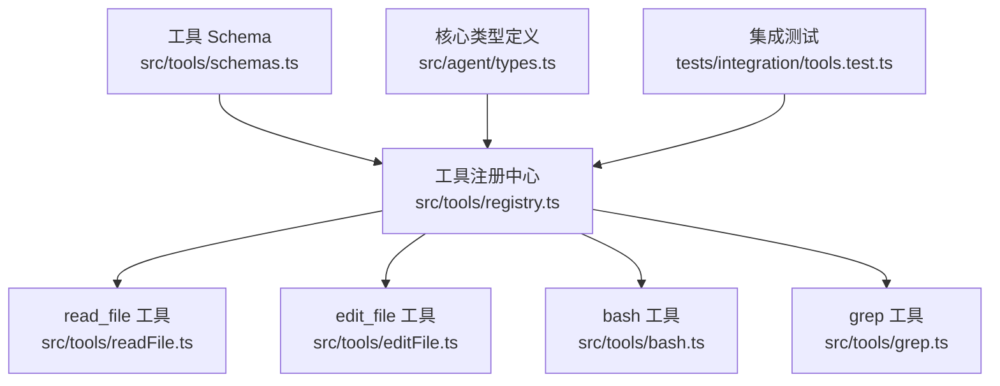
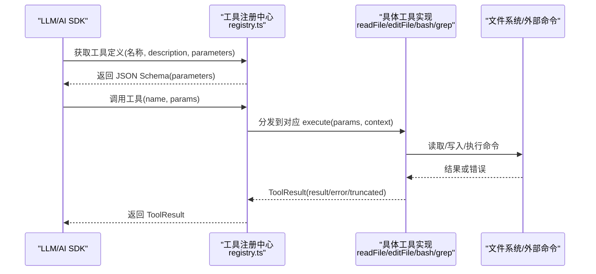
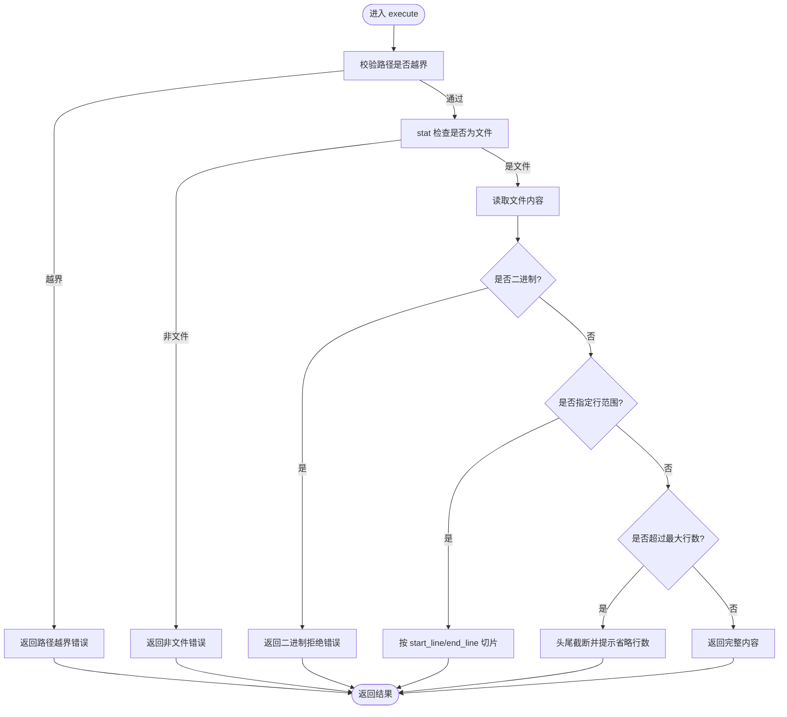
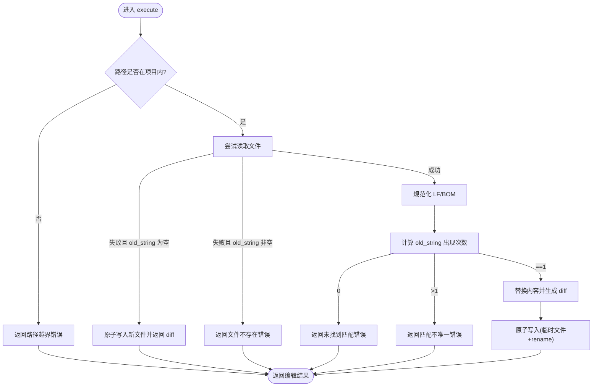
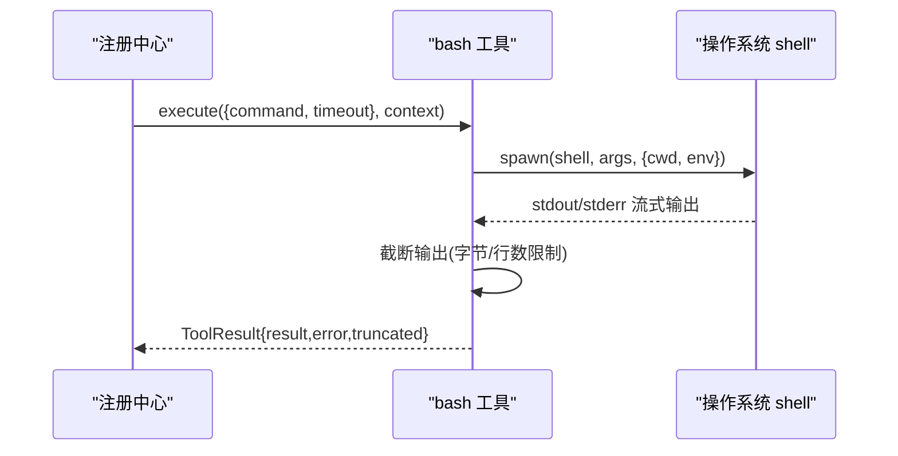
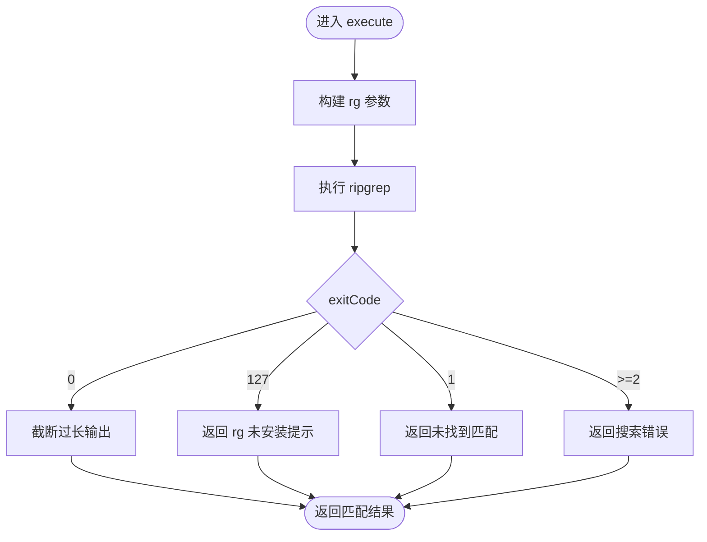
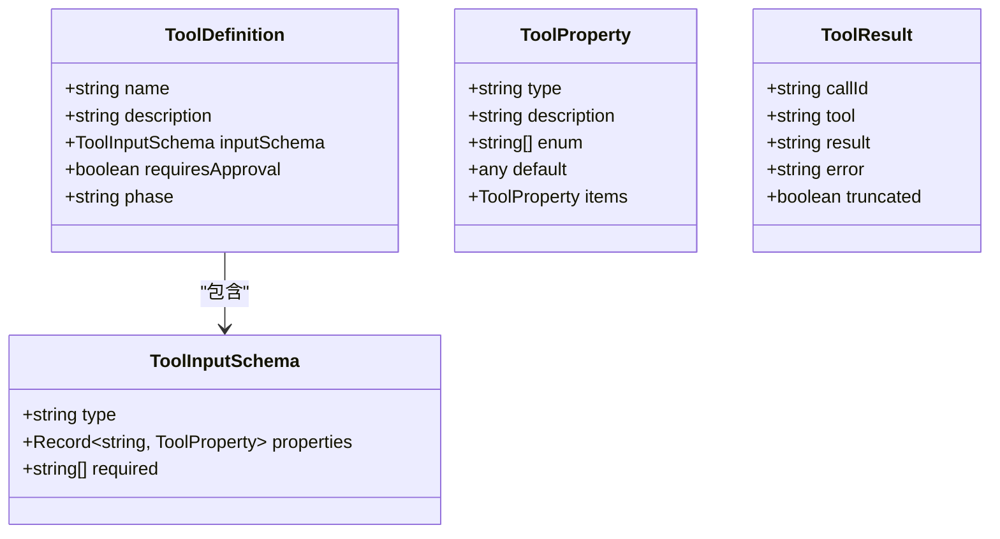
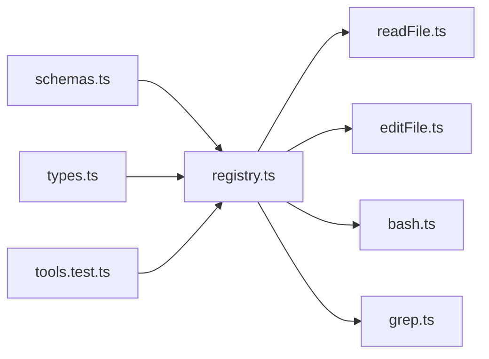

# 工具参数验证

<cite>
**本文引用的文件**   
- [src/tools/schemas.ts](file://src/tools/schemas.ts)
- [src/tools/registry.ts](file://src/tools/registry.ts)
- [src/tools/readFile.ts](file://src/tools/readFile.ts)
- [src/tools/editFile.ts](file://src/tools/editFile.ts)
- [src/tools/bash.ts](file://src/tools/bash.ts)
- [src/tools/grep.ts](file://src/tools/grep.ts)
- [src/agent/types.ts](file://src/agent/types.ts)
- [tests/integration/tools.test.ts](file://tests/integration/tools.test.ts)
</cite>

## 目录
1. [简介](#简介)
2. [项目结构](#项目结构)
3. [核心组件](#核心组件)
4. [架构总览](#架构总览)
5. [详细组件分析](#详细组件分析)
6. [依赖关系分析](#依赖关系分析)
7. [性能考量](#性能考量)
8. [故障排查指南](#故障排查指南)
9. [结论](#结论)
10. [附录：自定义验证规则与最佳实践](#附录自定义验证规则与最佳实践)

## 简介
本文件系统化阐述 Nexus 的工具参数验证系统，重点围绕基于 Zod 的 Schema 定义、工具输入校验策略、错误处理与用户友好消息生成，以及扩展自定义验证规则的实践。文档同时覆盖字符串、数字范围、布尔值、对象结构等常见参数的验证方式，并提供调试方法与示例路径，帮助开发者快速定位问题并提升健壮性。

## 项目结构
Nexus 的工具参数验证主要分布在以下模块：
- 工具 Schema 集中定义：用于 AI SDK 的参数描述与类型约束
- 工具注册中心：统一暴露工具定义、阶段过滤、执行入口
- 各工具实现：各自声明 inputSchema（JSON Schema）并在 execute 中做运行时校验与安全控制
- 类型定义：贯穿全系统的 ToolDefinition、ToolInputSchema、ToolResult 等核心类型
- 集成测试：端到端验证工具调用流程与错误分支

图表来源
- [src/tools/schemas.ts:1-40](file://src/tools/schemas.ts#L1-L40)
- [src/tools/registry.ts:1-96](file://src/tools/registry.ts#L1-L96)
- [src/tools/readFile.ts:1-150](file://src/tools/readFile.ts#L1-L150)
- [src/tools/editFile.ts:1-170](file://src/tools/editFile.ts#L1-L170)
- [src/tools/bash.ts:1-186](file://src/tools/bash.ts#L1-L186)
- [src/tools/grep.ts:1-178](file://src/tools/grep.ts#L1-L178)
- [src/agent/types.ts:44-78](file://src/agent/types.ts#L44-L78)
- [tests/integration/tools.test.ts:1-100](file://tests/integration/tools.test.ts#L1-L100)

章节来源
- [src/tools/schemas.ts:1-40](file://src/tools/schemas.ts#L1-L40)
- [src/tools/registry.ts:1-96](file://src/tools/registry.ts#L1-L96)
- [src/agent/types.ts:44-78](file://src/agent/types.ts#L44-L78)

## 核心组件
- 工具 Schema 映射表：集中维护工具名到 Zod schema 的映射，便于 AI SDK 使用
- 工具注册中心：管理工具生命周期、阶段过滤、AI SDK 兼容导出、执行分发
- 工具实现：每个工具提供 definition（含 inputSchema）、execute（含运行时校验与安全策略）
- 类型契约：ToolDefinition、ToolInputSchema、ToolProperty、ToolResult 等确保一致性

章节来源
- [src/tools/schemas.ts:1-40](file://src/tools/schemas.ts#L1-L40)
- [src/tools/registry.ts:1-96](file://src/tools/registry.ts#L1-L96)
- [src/agent/types.ts:44-78](file://src/agent/types.ts#L44-L78)

## 架构总览
下图展示从“工具 Schema”到“注册中心”，再到“具体工具执行”的整体数据流与职责边界。

图表来源
- [src/tools/schemas.ts:1-40](file://src/tools/schemas.ts#L1-L40)
- [src/tools/registry.ts:58-82](file://src/tools/registry.ts#L58-L82)
- [src/tools/readFile.ts:54-147](file://src/tools/readFile.ts#L54-L147)
- [src/tools/editFile.ts:61-156](file://src/tools/editFile.ts#L61-L156)
- [src/tools/bash.ts:123-183](file://src/tools/bash.ts#L123-L183)
- [src/tools/grep.ts:80-175](file://src/tools/grep.ts#L80-L175)

## 详细组件分析

### 工具 Schema 与 AI SDK 集成
- 使用 Zod 定义工具参数结构，并通过 describe 提供字段说明，便于 LLM 理解
- 将 Zod schema 映射为工具名键值对，供上层生成 AI SDK 兼容的 parameters
- 注意：当前工具实现仍使用 JSON Schema 作为 inputSchema；Zod schema 主要用于 AI SDK 参数描述与类型提示

章节来源
- [src/tools/schemas.ts:1-40](file://src/tools/schemas.ts#L1-L40)
- [src/tools/registry.ts:58-68](file://src/tools/registry.ts#L58-L68)

### 工具注册中心与阶段过滤
- 注册中心维护工具集合，支持按阶段（plan/execute/both）过滤
- 对外暴露 toAISDKTools，将 ToolDefinition.inputSchema 转为 AI SDK 可用的 parameters
- 执行入口统一封装，未找到工具时返回明确错误信息

章节来源
- [src/tools/registry.ts:25-82](file://src/tools/registry.ts#L25-L82)

### read_file 工具：字符串与数字范围验证
- 参数：path（必填字符串）、start_line/end_line（可选数字）
- 运行时校验：
  - 路径越界检查（不允许读取项目外文件）
  - 文件存在性与类型检查（必须为文件）
  - 二进制检测（拒绝二进制文件）
  - 行数截断策略（超过阈值仅显示头尾）
- 错误处理：统一返回 ToolResult.error，包含可读的错误原因

图表来源
- [src/tools/readFile.ts:54-147](file://src/tools/readFile.ts#L54-L147)

章节来源
- [src/tools/readFile.ts:11-35](file://src/tools/readFile.ts#L11-L35)
- [src/tools/readFile.ts:54-147](file://src/tools/readFile.ts#L54-L147)

### edit_file 工具：唯一匹配与原子写入
- 参数：path（必填字符串）、old_string/new_string（必填字符串）
- 运行时校验：
  - 路径越界检查
  - 文件不存在时的创建逻辑（old_string 为空则创建新文件）
  - old_string 唯一性检查（0 次或 >1 次均报错）
  - 保留原始行尾与 BOM，原子写入（临时文件 + rename）
- 错误处理：未找到/不唯一/IO 异常均有清晰错误消息

图表来源
- [src/tools/editFile.ts:61-156](file://src/tools/editFile.ts#L61-L156)

章节来源
- [src/tools/editFile.ts:14-38](file://src/tools/editFile.ts#L14-L38)
- [src/tools/editFile.ts:61-156](file://src/tools/editFile.ts#L61-L156)

### bash 工具：命令执行、超时与输出截断
- 参数：command（必填字符串）、timeout（可选数字，秒）
- 运行时校验：
  - 危险命令标记（审批层拦截）
  - 工作目录锁定在项目根
  - 超时控制与进程组清理
  - 输出截断（stdout/stderr 分别限制字节数与行数）
- 错误处理：退出码非零、超时、IO 异常均返回结构化错误

图表来源
- [src/tools/bash.ts:123-183](file://src/tools/bash.ts#L123-L183)

章节来源
- [src/tools/bash.ts:13-33](file://src/tools/bash.ts#L13-L33)
- [src/tools/bash.ts:123-183](file://src/tools/bash.ts#L123-L183)

### grep 工具：正则搜索与上下文行
- 参数：pattern（必填字符串）、path/include/context_lines/case_insensitive（可选）
- 运行时校验：
  - 构建 rg 参数（行号、无标题、颜色关闭、最大匹配数限制）
  - 忽略大小写、上下文行、glob 过滤
  - 回退策略：rg 不可用时返回安装提示
- 错误处理：无匹配、错误码≥2、输出过大截断均有明确反馈

图表来源
- [src/tools/grep.ts:80-175](file://src/tools/grep.ts#L80-L175)

章节来源
- [src/tools/grep.ts:11-43](file://src/tools/grep.ts#L11-L43)
- [src/tools/grep.ts:80-175](file://src/tools/grep.ts#L80-L175)

### 类型契约与数据结构
- ToolDefinition：工具元数据（名称、描述、inputSchema、是否需要审批、可用阶段）
- ToolInputSchema/ToolProperty：统一的 JSON Schema 结构，描述参数类型、枚举、默认值、数组项等
- ToolResult：标准化返回结构（callId、tool、result、error、truncated）

图表来源
- [src/agent/types.ts:44-78](file://src/agent/types.ts#L44-L78)

章节来源
- [src/agent/types.ts:44-78](file://src/agent/types.ts#L44-L78)

## 依赖关系分析
- schemas.ts 提供 Zod schema 映射，但实际工具执行依赖各自的 JSON Schema（inputSchema）
- registry.ts 聚合所有工具，负责阶段过滤与 AI SDK 兼容导出
- 各工具实现依赖文件系统、子进程、安全策略（如 CommandGuard）
- 集成测试验证端到端行为，包括错误分支与阶段过滤

图表来源
- [src/tools/schemas.ts:1-40](file://src/tools/schemas.ts#L1-L40)
- [src/tools/registry.ts:1-96](file://src/tools/registry.ts#L1-L96)
- [src/tools/readFile.ts:1-150](file://src/tools/readFile.ts#L1-L150)
- [src/tools/editFile.ts:1-170](file://src/tools/editFile.ts#L1-L170)
- [src/tools/bash.ts:1-186](file://src/tools/bash.ts#L1-186)
- [src/tools/grep.ts:1-178](file://src/tools/grep.ts#L1-178)
- [src/agent/types.ts:44-78](file://src/agent/types.ts#L44-L78)
- [tests/integration/tools.test.ts:1-100](file://tests/integration/tools.test.ts#L1-L100)

章节来源
- [src/tools/registry.ts:1-96](file://src/tools/registry.ts#L1-L96)
- [tests/integration/tools.test.ts:1-100](file://tests/integration/tools.test.ts#L1-L100)

## 性能考量
- 大文件读取：read_file 采用头尾截断策略，避免一次性加载超大文件
- 命令输出：bash 工具对 stdout/stderr 进行字节与行数双重限制，防止内存膨胀
- 搜索限制：grep 限制每文件最大匹配数，并对整体输出进行截断
- 原子写入：edit_file 使用临时文件 + rename，减少部分写入导致的损坏风险

[本节为通用指导，无需引用具体文件]

## 故障排查指南
- 常见错误类型
  - 路径越界：read_file/edit_file 会拒绝项目外路径
  - 文件不存在：edit_file 在未找到文件且 old_string 非空时报错
  - 匹配不唯一：edit_file 要求 old_string 唯一匹配
  - 二进制文件：read_file 拒绝二进制文件
  - 命令超时/错误：bash 工具返回超时标志与退出码
  - ripgrep 不可用：grep 工具返回安装提示
- 调试建议
  - 启用 verbose 日志（CLI 参数），查看工具调用与结果
  - 在集成测试中构造最小复现用例，逐步缩小问题范围
  - 关注 ToolResult.error 与 truncated 标志，确认是否被截断

章节来源
- [src/tools/readFile.ts:54-147](file://src/tools/readFile.ts#L54-L147)
- [src/tools/editFile.ts:61-156](file://src/tools/editFile.ts#L61-L156)
- [src/tools/bash.ts:123-183](file://src/tools/bash.ts#L123-L183)
- [src/tools/grep.ts:80-175](file://src/tools/grep.ts#L80-L175)
- [tests/integration/tools.test.ts:36-98](file://tests/integration/tools.test.ts#L36-L98)

## 结论
Nexus 的工具参数验证系统以 JSON Schema 为核心契约，结合各工具的运行时校验与安全策略，形成稳定可靠的调用链路。Zod schema 用于 AI SDK 的参数描述与类型提示，而工具实现保持对 JSON Schema 的兼容性。通过清晰的错误消息、输出截断与原子写入机制，系统在易用性与健壮性之间取得良好平衡。

[本节为总结性内容，无需引用具体文件]

## 附录：自定义验证规则与最佳实践
- 设计原则
  - 在 ToolDefinition.inputSchema 中明确参数类型、必填项与描述
  - 在 execute 中进行运行时校验（路径、权限、资源限制）
  - 错误消息应面向用户，包含可操作建议
- 字符串验证
  - 使用 JSON Schema 的 type: string，必要时添加 enum/default
  - 在运行时进行格式校验（如路径合法性、正则模式有效性）
- 数字范围检查
  - 使用 type: number，在运行时限制上下限（如超时时间、行数）
- 数组与对象结构
  - 使用 type: array/object，配合 items/properties 定义结构
  - 在运行时校验长度、元素类型与嵌套结构
- 自定义验证规则编写步骤
  - 在 inputSchema 中声明字段与约束
  - 在 execute 开头进行参数解析与类型断言
  - 增加业务规则校验（唯一性、存在性、权限）
  - 捕获异常并返回 ToolResult.error
- 调试方法
  - 使用集成测试覆盖正常与异常分支
  - 打印关键中间状态（如匹配计数、文件大小、输出字节数）
  - 利用 truncated 标志判断是否需调整限制

章节来源
- [src/agent/types.ts:44-78](file://src/agent/types.ts#L44-L78)
- [src/tools/readFile.ts:54-147](file://src/tools/readFile.ts#L54-L147)
- [src/tools/editFile.ts:61-156](file://src/tools/editFile.ts#L61-L156)
- [src/tools/bash.ts:123-183](file://src/tools/bash.ts#L123-L183)
- [src/tools/grep.ts:80-175](file://src/tools/grep.ts#L80-L175)
- [tests/integration/tools.test.ts:36-98](file://tests/integration/tools.test.ts#L36-L98)