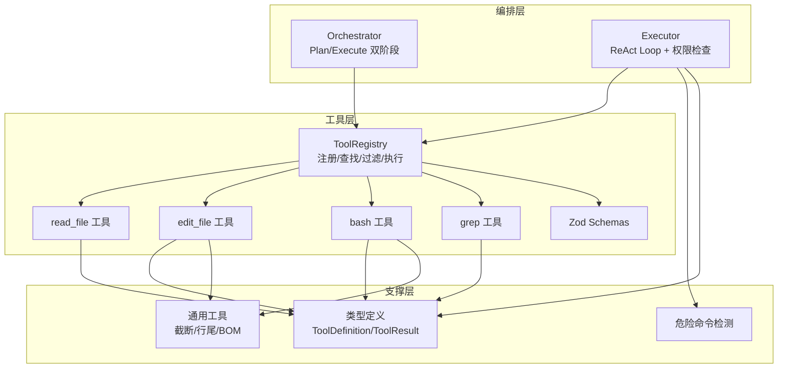
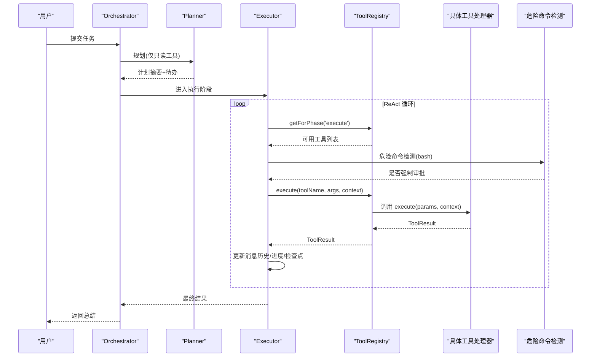
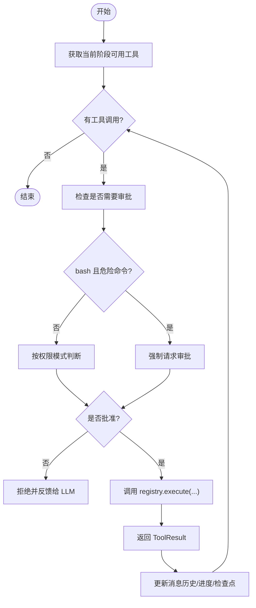
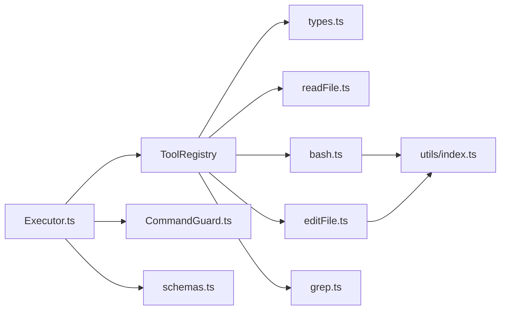

# 工具注册中心

<cite>
**本文引用的文件**   
- [src/tools/registry.ts](file://src/tools/registry.ts)
- [src/tools/schemas.ts](file://src/tools/schemas.ts)
- [src/tools/readFile.ts](file://src/tools/readFile.ts)
- [src/tools/editFile.ts](file://src/tools/editFile.ts)
- [src/tools/bash.ts](file://src/tools/bash.ts)
- [src/tools/grep.ts](file://src/tools/grep.ts)
- [src/agent/types.ts](file://src/agent/types.ts)
- [src/agent/Orchestrator.ts](file://src/agent/Orchestrator.ts)
- [src/agent/Executor.ts](file://src/agent/Executor.ts)
- [src/sandbox/CommandGuard.ts](file://src/sandbox/CommandGuard.ts)
- [src/utils/index.ts](file://src/utils/index.ts)
- [tests/integration/tools.test.ts](file://tests/integration/tools.test.ts)
</cite>

## 目录
1. [简介](#简介)
2. [项目结构](#项目结构)
3. [核心组件](#核心组件)
4. [架构总览](#架构总览)
5. [详细组件分析](#详细组件分析)
6. [依赖关系分析](#依赖关系分析)
7. [性能与限制](#性能与限制)
8. [故障排查指南](#故障排查指南)
9. [结论](#结论)
10. [附录：扩展自定义工具](#附录扩展自定义工具)

## 简介
本技术文档聚焦于 Nexus 的工具注册中心，系统性解析 ToolRegistry 的设计模式与实现原理，涵盖工具的注册、查找、过滤与执行机制；深入说明 ToolHandler 接口与 ToolContext 上下文对象的结构与用途；解释工具的阶段控制（plan/execute/both）和审批机制；并提供如何扩展自定义工具到注册中心的完整指南，包括工具定义、参数校验与错误处理。文末给出工具生命周期管理的示例路径，帮助读者快速上手。

## 项目结构
工具注册中心位于 src/tools 目录下，包含注册表、内置工具实现、Zod Schema 定义等；Agent 编排层在 src/agent 中消费注册表，提供阶段化能力与审批流程；沙箱安全与通用工具函数分别在 src/sandbox 与 src/utils 中提供支撑。



图表来源
- [src/tools/registry.ts:25-96](file://src/tools/registry.ts#L25-L96)
- [src/tools/readFile.ts:11-35](file://src/tools/readFile.ts#L11-L35)
- [src/tools/editFile.ts:14-38](file://src/tools/editFile.ts#L14-L38)
- [src/tools/bash.ts:13-33](file://src/tools/bash.ts#L13-L33)
- [src/tools/grep.ts:11-43](file://src/tools/grep.ts#L11-L43)
- [src/tools/schemas.ts:1-40](file://src/tools/schemas.ts#L1-L40)
- [src/agent/Orchestrator.ts:38-86](file://src/agent/Orchestrator.ts#L38-L86)
- [src/agent/Executor.ts:41-165](file://src/agent/Executor.ts#L41-L165)
- [src/agent/types.ts:44-78](file://src/agent/types.ts#L44-L78)
- [src/sandbox/CommandGuard.ts:71-98](file://src/sandbox/CommandGuard.ts#L71-L98)
- [src/utils/index.ts:166-211](file://src/utils/index.ts#L166-L211)

章节来源
- [src/tools/registry.ts:1-96](file://src/tools/registry.ts#L1-L96)
- [src/agent/Orchestrator.ts:1-200](file://src/agent/Orchestrator.ts#L1-L200)
- [src/agent/Executor.ts:1-200](file://src/agent/Executor.ts#L1-L200)

## 核心组件
本节从设计模式角度剖析 ToolRegistry、ToolHandler、ToolContext 以及工具定义与结果类型。

- ToolRegistry
  - 职责：集中管理所有工具处理器，提供注册、查询、按阶段过滤、生成 AI SDK 兼容工具定义、统一执行入口。
  - 关键方法：register、get、has、getAll、getForPhase、getApprovalRequired、toAISDKTools、execute。
  - 设计要点：Map 存储 handler；phase 过滤支持 plan/execute/both；AI SDK 兼容输出便于 LLM 调用。

- ToolHandler
  - 职责：封装单个工具的元数据与执行逻辑。
  - 字段：definition（描述、输入 schema、是否需要审批、阶段）、execute（执行函数）。

- ToolContext
  - 职责：为工具执行提供运行时上下文，如项目根目录、调用 ID、行数/字节数上限、bash 超时等。

- 工具定义与结果类型
  - ToolDefinition：name、description、inputSchema、requiresApproval、phase。
  - ToolResult：callId、tool、result、error、truncated。

- 参数校验
  - 使用 Zod Schema 进行强类型校验，确保 LLM 生成的参数符合预期。

章节来源
- [src/tools/registry.ts:12-83](file://src/tools/registry.ts#L12-L83)
- [src/agent/types.ts:44-78](file://src/agent/types.ts#L44-L78)
- [src/tools/schemas.ts:1-40](file://src/tools/schemas.ts#L1-L40)

## 架构总览
工具注册中心作为“服务定位器”，被 Orchestrator 与 Executor 共同消费。Orchestrator 负责 Plan/Execute 两阶段编排，Executor 在 Execute 阶段通过 ReAct 循环驱动工具调用，并在调用前进行权限检查与强制审批策略。



图表来源
- [src/agent/Orchestrator.ts:120-180](file://src/agent/Orchestrator.ts#L120-L180)
- [src/agent/Executor.ts:50-165](file://src/agent/Executor.ts#L50-L165)
- [src/tools/registry.ts:44-83](file://src/tools/registry.ts#L44-L83)
- [src/sandbox/CommandGuard.ts:71-98](file://src/sandbox/CommandGuard.ts#L71-L98)

## 详细组件分析

### ToolRegistry 类设计与实现
- 数据结构
  - 内部 Map<string, ToolHandler> 以工具名为键，避免重复注册覆盖问题由上层保证。
- 注册与查找
  - register：将 ToolHandler 的 definition.name 作为键存入 Map。
  - get/has/getAll：基础查询能力。
- 阶段过滤
  - getForPhase(phase)：返回 phase 匹配或 both 的工具集合，用于 Plan/Execute 阶段的差异化暴露。
- 审批清单
  - getApprovalRequired()：收集 requiresApproval=true 的工具名，供 UI 或审批面板展示。
- AI SDK 兼容
  - toAISDKTools(phase)：将 ToolHandler 转换为 Vercel AI SDK 所需的 { description, parameters } 格式，其中 parameters 优先使用 Zod Schema。
- 统一执行
  - execute(name, params, context)：根据名称查找处理器并调用其 execute，未找到时返回错误结果。

```mermaid
classDiagram
class ToolRegistry {
-tools : Map~string, ToolHandler~
+register(handler) void
+get(name) ToolHandler|undefined
+has(name) boolean
+getAll() ToolHandler[]
+getForPhase(phase) ToolHandler[]
+getApprovalRequired() string[]
+toAISDKTools(phase) Record~string, {description, parameters}~
+execute(name, params, context) Promise~ToolResult~
}
class ToolHandler {
+definition : ToolDefinition
+execute(params, context) Promise~ToolResult~
}
class ToolContext {
+projectRoot : string
+callId : string
+maxReadLines : number
+maxOutputBytes : number
+bashTimeout : number
}
class ToolDefinition {
+name : string
+description : string
+inputSchema : ToolInputSchema
+requiresApproval : boolean
+phase : "plan"|"execute"|"both"
}
class ToolResult {
+callId : string
+tool : string
+result : string
+error? : string
+truncated? : boolean
}
ToolRegistry --> ToolHandler : "管理"
ToolHandler --> ToolDefinition : "持有"
ToolHandler --> ToolContext : "执行时使用"
ToolRegistry --> ToolResult : "返回"
```

图表来源
- [src/tools/registry.ts:12-83](file://src/tools/registry.ts#L12-L83)
- [src/agent/types.ts:44-78](file://src/agent/types.ts#L44-L78)

章节来源
- [src/tools/registry.ts:25-96](file://src/tools/registry.ts#L25-L96)

### 工具处理器与上下文
- ToolHandler.execute
  - 接收参数与上下文，返回 ToolResult。
  - 各内置工具均遵循此约定，统一错误处理与结果结构。
- ToolContext
  - projectRoot：限定工作目录，防止越界访问。
  - callId：追踪每次工具调用的唯一标识。
  - maxReadLines/maxOutputBytes：控制读取与输出大小，避免大输出导致内存/带宽压力。
  - bashTimeout：shell 命令超时时间。

章节来源
- [src/tools/registry.ts:17-23](file://src/tools/registry.ts#L17-L23)
- [src/tools/readFile.ts:54-147](file://src/tools/readFile.ts#L54-L147)
- [src/tools/editFile.ts:61-156](file://src/tools/editFile.ts#L61-L156)
- [src/tools/bash.ts:123-183](file://src/tools/bash.ts#L123-L183)
- [src/tools/grep.ts:80-175](file://src/tools/grep.ts#L80-L175)

### 阶段控制与审批机制
- 阶段控制
  - plan：仅允许只读工具（如 read_file、grep），用于信息收集与规划。
  - execute：允许读写与系统交互工具（如 edit_file、bash）。
  - both：同时出现在两个阶段（如 read_file、grep）。
- 审批机制
  - 基于 ToolDefinition.requiresApproval 标记需要审批的工具。
  - 危险命令强制审批：bash 工具在执行前通过 CommandGuard 检测，命中高危规则则无论权限模式都需人工确认。
  - 权限模式：ask/auto-edit/auto-all/yolo，影响默认审批行为。



图表来源
- [src/agent/Executor.ts:167-196](file://src/agent/Executor.ts#L167-L196)
- [src/sandbox/CommandGuard.ts:71-98](file://src/sandbox/CommandGuard.ts#L71-L98)
- [src/tools/registry.ts:44-56](file://src/tools/registry.ts#L44-L56)

章节来源
- [src/agent/Executor.ts:167-196](file://src/agent/Executor.ts#L167-L196)
- [src/sandbox/CommandGuard.ts:1-98](file://src/sandbox/CommandGuard.ts#L1-L98)
- [src/tools/registry.ts:44-56](file://src/tools/registry.ts#L44-L56)

### 内置工具详解

#### read_file
- 功能：读取文本文件内容，支持行号格式化、范围读取、二进制检测、行数截断。
- 安全：路径越界检查，拒绝非文件类型，拒绝二进制文件。
- 阶段：both（可在 plan 与 execute 阶段使用）。
- 典型用法：在规划阶段了解代码结构，在执行阶段验证修改效果。

章节来源
- [src/tools/readFile.ts:11-35](file://src/tools/readFile.ts#L11-L35)
- [src/tools/readFile.ts:54-147](file://src/tools/readFile.ts#L54-L147)

#### edit_file
- 功能：精准替换字符串，要求 old_string 唯一匹配；原子写入（临时文件+rename）；保留原始行尾风格与 BOM；生成 diff 反馈。
- 安全：路径越界检查；不存在文件时支持创建新文件（old_string 为空）。
- 阶段：execute。
- 典型用法：对目标文件进行最小变更式编辑，降低冲突风险。

章节来源
- [src/tools/editFile.ts:14-38](file://src/tools/editFile.ts#L14-L38)
- [src/tools/editFile.ts:61-156](file://src/tools/editFile.ts#L61-L156)

#### bash
- 功能：在项目根目录执行 shell 命令，带超时、进程组管理、输出截断、危险命令检测。
- 安全：工作目录锁定；危险命令检测与强制审批；输出清理与截断。
- 阶段：execute。
- 典型用法：运行测试、构建脚本、安装依赖等。

章节来源
- [src/tools/bash.ts:13-33](file://src/tools/bash.ts#L13-L33)
- [src/tools/bash.ts:123-183](file://src/tools/bash.ts#L123-L183)
- [src/sandbox/CommandGuard.ts:71-98](file://src/sandbox/CommandGuard.ts#L71-L98)

#### grep
- 功能：基于 ripgrep 的快速正则搜索，支持 include 过滤、上下文行、忽略大小写、结果截断。
- 阶段：both。
- 典型用法：在规划阶段定位符号与引用，在执行阶段验证改动影响范围。

章节来源
- [src/tools/grep.ts:11-43](file://src/tools/grep.ts#L11-L43)
- [src/tools/grep.ts:80-175](file://src/tools/grep.ts#L80-L175)

### 参数校验与错误处理
- 参数校验
  - 使用 Zod Schema 定义参数结构，Vercel AI SDK 的 generateText 可直接消费这些 schema。
  - toolSchemas 映射工具名到对应 schema，便于动态装配。
- 错误处理
  - 各工具统一返回 ToolResult，包含 result/error/truncated 字段。
  - 常见错误：路径越界、文件不存在、匹配不唯一、二进制文件、命令超时、外部依赖缺失（如 rg 不可用）。

章节来源
- [src/tools/schemas.ts:1-40](file://src/tools/schemas.ts#L1-L40)
- [src/tools/readFile.ts:88-96](file://src/tools/readFile.ts#L88-L96)
- [src/tools/editFile.ts:113-129](file://src/tools/editFile.ts#L113-L129)
- [src/tools/bash.ts:174-183](file://src/tools/bash.ts#L174-L183)
- [src/tools/grep.ts:120-145](file://src/tools/grep.ts#L120-L145)

## 依赖关系分析
- 直接依赖
  - ToolRegistry 依赖 ToolHandler 与类型定义。
  - 各工具处理器依赖 fs/promises、child_process、path、diff 等标准库与第三方库。
  - Executor 依赖 CommandGuard 进行危险命令检测，依赖 toolSchemas 进行参数 schema 装配。
- 间接依赖
  - utils 提供截断、BOM 处理、行尾恢复等通用能力，被 bash 与 edit_file 复用。
- 潜在耦合
  - 工具处理器与 Agent 编排层通过 ToolRegistry 解耦，但共享类型定义，需保持向后兼容。



图表来源
- [src/tools/registry.ts:1-96](file://src/tools/registry.ts#L1-L96)
- [src/agent/Executor.ts:1-200](file://src/agent/Executor.ts#L1-L200)
- [src/sandbox/CommandGuard.ts:1-98](file://src/sandbox/CommandGuard.ts#L1-L98)
- [src/tools/schemas.ts:1-40](file://src/tools/schemas.ts#L1-L40)
- [src/utils/index.ts:166-211](file://src/utils/index.ts#L166-L211)

章节来源
- [src/tools/registry.ts:1-96](file://src/tools/registry.ts#L1-L96)
- [src/agent/Executor.ts:1-200](file://src/agent/Executor.ts#L1-L200)

## 性能与限制
- 输出截断
  - truncateTail 与 truncateHead 分别针对 bash 输出与文件读取，避免过大输出占用内存与带宽。
- 二进制清理
  - sanitizeBinaryOutput 去除控制字符，防止终端渲染异常。
- 行尾与 BOM
  - detectLineEnding/restoreLineEndings/stripBom 确保编辑后保留原始风格，减少不必要的 diff。
- 资源限制
  - maxReadLines、maxOutputBytes、bashTimeout 可配置，避免长时间阻塞与内存溢出。

章节来源
- [src/utils/index.ts:72-154](file://src/utils/index.ts#L72-L154)
- [src/utils/index.ts:166-211](file://src/utils/index.ts#L166-L211)
- [src/tools/bash.ts:112-121](file://src/tools/bash.ts#L112-L121)
- [src/tools/readFile.ts:114-130](file://src/tools/readFile.ts#L114-L130)

## 故障排查指南
- 常见问题
  - 路径越界：read_file/edit_file 会拒绝访问项目外路径，检查 projectRoot 与相对路径。
  - 匹配不唯一：edit_file 要求 old_string 唯一，增加上下文行或使用更精确的匹配。
  - 二进制文件：read_file 拒绝二进制文件，改用其他工具或转换格式。
  - ripgrep 不可用：grep 工具回退提示安装 rg，或调整搜索范围。
  - 命令超时：bash 工具受 timeout 限制，优化命令或增大超时。
- 调试建议
  - 关注 ToolResult.error 与 truncated 标志。
  - 利用集成测试用例验证工具链路与边界条件。

章节来源
- [src/tools/readFile.ts:64-96](file://src/tools/readFile.ts#L64-L96)
- [src/tools/editFile.ts:113-129](file://src/tools/editFile.ts#L113-L129)
- [src/tools/grep.ts:120-145](file://src/tools/grep.ts#L120-L145)
- [src/tools/bash.ts:174-183](file://src/tools/bash.ts#L174-L183)
- [tests/integration/tools.test.ts:36-98](file://tests/integration/tools.test.ts#L36-L98)

## 结论
Nexus 的工具注册中心通过清晰的 ToolRegistry/ToolHandler/ToolContext 抽象，实现了工具的统一管理与灵活扩展。结合阶段控制与审批机制，既保障了安全性，又提供了强大的执行能力。借助 Zod Schema 的参数校验与完善的错误处理，工具链在生产环境中具备高可靠性与可维护性。

## 附录：扩展自定义工具
以下步骤展示如何将自定义工具扩展到注册中心，包括工具定义、参数校验与错误处理，并给出生命周期管理的示例路径。

- 步骤一：定义工具处理器
  - 新建一个模块，导出 ToolHandler，包含 definition 与 execute。
  - definition 中设置 name、description、inputSchema、requiresApproval、phase。
  - execute 中实现业务逻辑，返回 ToolResult。

- 步骤二：定义参数 Schema
  - 在 schemas.ts 中添加 Zod Schema，并在 toolSchemas 中映射工具名。
  - 确保与 inputSchema 保持一致，以便 AI SDK 正确生成参数。

- 步骤三：注册工具
  - 在 createToolRegistry 中调用 registry.register(yourTool)。
  - 或通过外部注入方式扩展（保持向后兼容）。

- 步骤四：权限与阶段
  - 根据工具风险设置 requiresApproval。
  - 根据能力设置 phase（plan/execute/both）。

- 步骤五：错误处理与日志
  - 统一返回 ToolResult，包含 error 与 truncated 标志。
  - 记录必要上下文（如 callId、tool、result 片段）。

- 生命周期管理示例路径
  - 注册与初始化：[createToolRegistry:85-93](file://src/tools/registry.ts#L85-L93)
  - 阶段过滤与 AI SDK 适配：[getForPhase/toAISDKTools:44-68](file://src/tools/registry.ts#L44-L68)
  - 执行入口与错误处理：[execute:70-83](file://src/tools/registry.ts#L70-L83)
  - 权限检查与强制审批：[checkPermission/requiresForcedApproval:167-196](file://src/agent/Executor.ts#L167-L196), [src/sandbox/CommandGuard.ts:71-98](file://src/sandbox/CommandGuard.ts#L71-L98)
  - 集成测试参考：[tools.test.ts:36-98](file://tests/integration/tools.test.ts#L36-L98)

章节来源
- [src/tools/registry.ts:85-93](file://src/tools/registry.ts#L85-L93)
- [src/tools/registry.ts:44-68](file://src/tools/registry.ts#L44-L68)
- [src/tools/registry.ts:70-83](file://src/tools/registry.ts#L70-L83)
- [src/agent/Executor.ts:167-196](file://src/agent/Executor.ts#L167-L196)
- [src/sandbox/CommandGuard.ts:71-98](file://src/sandbox/CommandGuard.ts#L71-L98)
- [tests/integration/tools.test.ts:36-98](file://tests/integration/tools.test.ts#L36-L98)