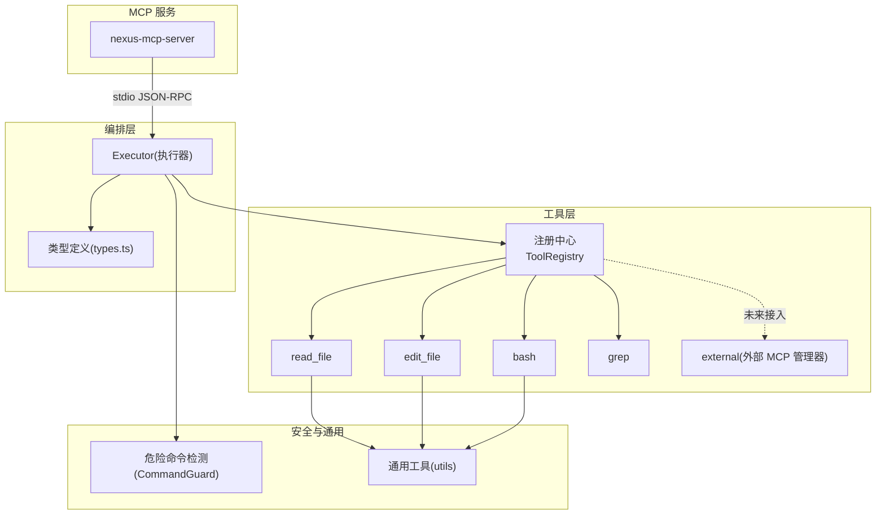
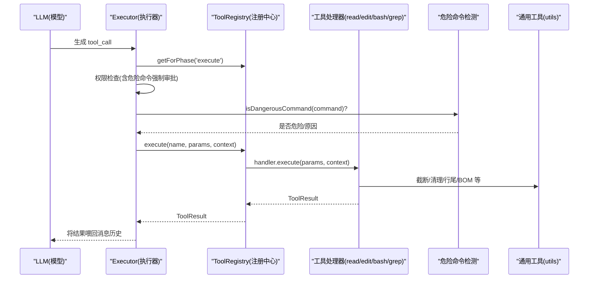
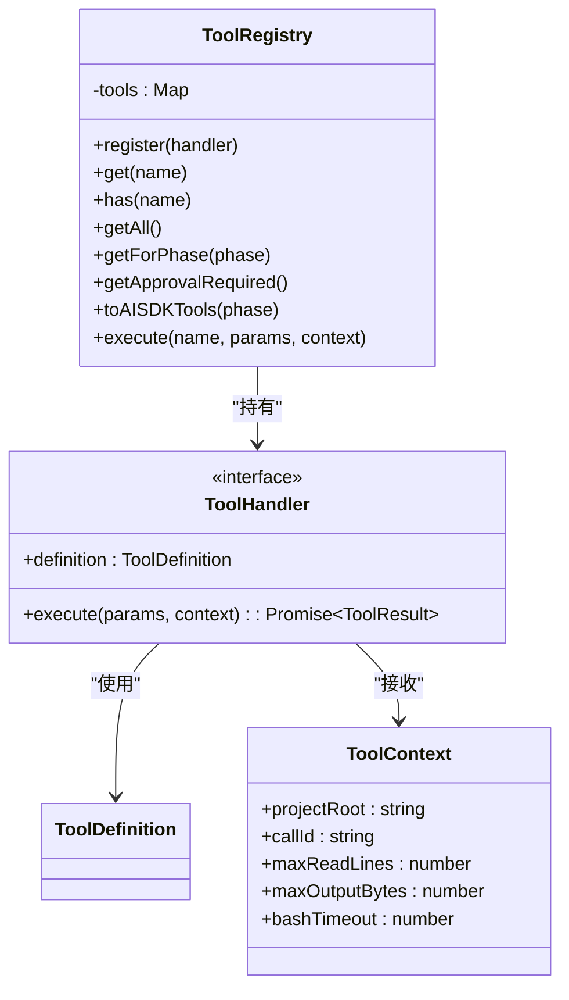
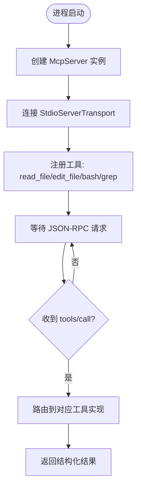
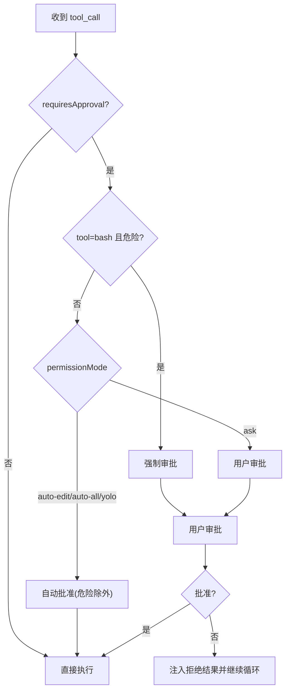
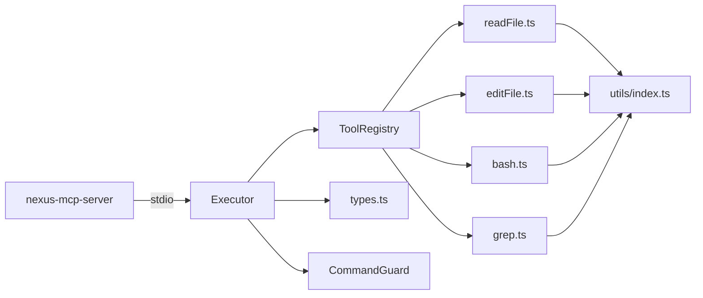

# 工具系统

<cite>
**本文引用的文件**   
- [src/tools/registry.ts](file://src/tools/registry.ts)
- [src/tools/schemas.ts](file://src/tools/schemas.ts)
- [src/tools/readFile.ts](file://src/tools/readFile.ts)
- [src/tools/editFile.ts](file://src/tools/editFile.ts)
- [src/tools/bash.ts](file://src/tools/bash.ts)
- [src/tools/grep.ts](file://src/tools/grep.ts)
- [src/tools/external.ts](file://src/tools/external.ts)
- [src/agent/types.ts](file://src/agent/types.ts)
- [src/agent/Executor.ts](file://src/agent/Executor.ts)
- [src/sandbox/CommandGuard.ts](file://src/sandbox/CommandGuard.ts)
- [src/utils/index.ts](file://src/utils/index.ts)
- [packages/nexus-mcp-server/src/index.ts](file://packages/nexus-mcp-server/src/index.ts)
- [tests/integration/tools.test.ts](file://tests/integration/tools.test.ts)
- [README.md](file://README.md)
- [DESIGN.md](file://DESIGN.md)
</cite>

## 目录
1. [简介](#简介)
2. [项目结构](#项目结构)
3. [核心组件](#核心组件)
4. [架构总览](#架构总览)
5. [详细组件分析](#详细组件分析)
6. [依赖关系分析](#依赖关系分析)
7. [性能与限制](#性能与限制)
8. [故障排查指南](#故障排查指南)
9. [结论](#结论)
10. [附录：自定义工具开发指南](#附录自定义工具开发指南)

## 简介
本文件面向 Nexus 的 MCP 工具系统，系统性阐述注册中心设计、MCP 协议实现细节、内置工具用法与安全机制，并提供自定义工具开发与测试指南。内容覆盖 read_file、edit_file、bash、grep、external 五大能力，以及参数校验、错误处理、权限控制、沙箱协作与集成模式。

## 项目结构
Nexus 的工具层采用“注册中心 + 工具处理器”的解耦设计，并通过 MCP Server 暴露给外部生态（如 Cursor/VSCode/Claude Desktop）。Agent 编排层通过注册中心按阶段选择可用工具，并在执行前进行权限检查与审批。

图表来源
- [src/tools/registry.ts:25-96](file://src/tools/registry.ts#L25-L96)
- [src/agent/Executor.ts:41-196](file://src/agent/Executor.ts#L41-L196)
- [src/sandbox/CommandGuard.ts:71-98](file://src/sandbox/CommandGuard.ts#L71-L98)
- [src/utils/index.ts:1-211](file://src/utils/index.ts#L1-L211)
- [packages/nexus-mcp-server/src/index.ts:112-383](file://packages/nexus-mcp-server/src/index.ts#L112-L383)

章节来源
- [README.md:1-174](file://README.md#L1-L174)
- [DESIGN.md:219-282](file://DESIGN.md#L219-L282)

## 核心组件
- 注册中心 ToolRegistry：集中管理工具定义、阶段过滤、审批清单、AI SDK 兼容导出与统一执行入口。
- 工具处理器 ToolHandler：每个工具提供 definition 与 execute，definition 描述名称、描述、输入 schema、是否需要审批、适用阶段；execute 负责具体逻辑与结果返回。
- 工具上下文 ToolContext：注入项目根路径、调用 ID、行数/字节数上限、超时等运行时约束。
- 参数 Schema：使用 Zod 定义强类型参数校验，并与 AI SDK 的 parameters 要求对齐。
- 权限与审批：结合 Executor 的权限策略与危险命令强制审批规则，确保关键操作受控。
- MCP 服务器：独立进程以 stdio 传输暴露相同工具集，供外部 IDE/客户端挂载。

章节来源
- [src/tools/registry.ts:12-96](file://src/tools/registry.ts#L12-L96)
- [src/tools/schemas.ts:1-40](file://src/tools/schemas.ts#L1-L40)
- [src/agent/types.ts:44-78](file://src/agent/types.ts#L44-L78)
- [src/agent/Executor.ts:167-196](file://src/agent/Executor.ts#L167-L196)
- [packages/nexus-mcp-server/src/index.ts:112-383](file://packages/nexus-mcp-server/src/index.ts#L112-L383)

## 架构总览
下图展示从 LLM 到工具执行的完整链路，包括阶段过滤、权限检查、危险命令拦截、输出截断与结果回传。

图表来源
- [src/agent/Executor.ts:80-165](file://src/agent/Executor.ts#L80-L165)
- [src/tools/registry.ts:70-83](file://src/tools/registry.ts#L70-L83)
- [src/sandbox/CommandGuard.ts:71-98](file://src/sandbox/CommandGuard.ts#L71-L98)
- [src/utils/index.ts:116-154](file://src/utils/index.ts#L116-L154)

## 详细组件分析

### 注册中心 ToolRegistry
- 职责
  - 维护工具映射表，支持注册、查询、列出、按阶段过滤、生成 AI SDK 兼容定义、统一执行。
  - 提供需要审批的工具名列表，便于 UI 或上层策略渲染审批卡片。
- 关键方法
  - register/get/getAll/getForPhase/getApprovalRequired/toAISDKTools/execute
- 默认工具
  - 初始化时注册 read_file、edit_file、bash、grep。

图表来源
- [src/tools/registry.ts:25-96](file://src/tools/registry.ts#L25-L96)
- [src/agent/types.ts:44-78](file://src/agent/types.ts#L44-L78)

章节来源
- [src/tools/registry.ts:25-96](file://src/tools/registry.ts#L25-L96)

### 参数校验与 Schema
- 使用 Zod 为各工具定义强类型参数，并导出 name→schema 映射，供 AI SDK 使用。
- 内置 schema：readFileSchema、editFileSchema、bashSchema、grepSchema。

章节来源
- [src/tools/schemas.ts:1-40](file://src/tools/schemas.ts#L1-L40)

### 内置工具详解

#### read_file（文件读取）
- 功能要点
  - 相对项目根路径解析，越界拒绝。
  - 二进制检测（前 8KB 含 null 字节即拒绝）。
  - 行数截断策略：超过 maxReadLines 时显示头尾并提示范围读取。
  - 带行号格式化输出。
- 错误处理
  - 路径越界、非文件、二进制、IO 异常均返回结构化错误信息。
- 典型用法
  - 指定 path，可选 start_line/end_line 获取片段。

章节来源
- [src/tools/readFile.ts:11-149](file://src/tools/readFile.ts#L11-L149)

#### edit_file（文件编辑）
- 可靠性设计
  - 唯一匹配校验：old_string 必须恰好出现一次，否则报错。
  - BOM 与行尾风格保留：先剥离 BOM、归一化为 LF，替换后再恢复原始行尾与 BOM。
  - 原子写入：写临时文件后 rename，避免部分写入导致损坏。
  - 支持创建新文件：当 old_string 为空且目标不存在时直接创建。
- 权限控制
  - requiresApproval=true，默认需审批。
- 典型用法
  - 提供足够上下文的 old_string 以确保唯一性。

章节来源
- [src/tools/editFile.ts:14-169](file://src/tools/editFile.ts#L14-L169)
- [src/utils/index.ts:187-211](file://src/utils/index.ts#L187-L211)

#### bash（命令执行）
- 安全与资源控制
  - 危险命令检测：正则黑名单 + 启发式规则，命中则强制审批。
  - 工作目录锁定在项目根，防止 cd 越狱。
  - 超时与进程组管理：跨平台 kill 子树，避免僵尸进程。
  - 输出截断与二进制清理：保留尾部错误信息，限制最大字节数。
- 典型用法
  - command 必填，timeout 可选（秒），默认由上下文配置。

章节来源
- [src/tools/bash.ts:13-186](file://src/tools/bash.ts#L13-L186)
- [src/sandbox/CommandGuard.ts:71-98](file://src/sandbox/CommandGuard.ts#L71-L98)
- [src/utils/index.ts:166-180](file://src/utils/index.ts#L166-L180)

#### grep（代码搜索）
- 功能要点
  - 基于 ripgrep 子进程封装，支持正则、glob 过滤、上下文行、忽略大小写。
  - 限制每文件最多匹配数，并对过长结果做字节级截断。
  - 未安装 rg 时给出明确错误提示。
- 典型用法
  - pattern 必填，path/include/context_lines/case_insensitive 可选。

章节来源
- [src/tools/grep.ts:11-178](file://src/tools/grep.ts#L11-L178)

#### external（外部 MCP 工具调用）
- 当前状态
  - v1 预留接口：ExternalMCPManager 提供注册、连接、断开、工具列表与调用占位。
  - Phase 2+ 计划通过 stdio JSON-RPC 对接外部 MCP Server。
- 集成方式
  - 通过 register(config) 声明外部 server，后续在编排层扩展为可发现/可调用的工具。

章节来源
- [src/tools/external.ts:9-76](file://src/tools/external.ts#L9-L76)

### MCP 协议实现细节
- 独立 MCP Server 包
  - 使用 @modelcontextprotocol/sdk 的 McpServer 与 StdioServerTransport，暴露 read_file、edit_file、bash、grep 四个工具。
  - 内联安全策略（危险命令检测、路径越界校验、BOM/行尾处理、输出清理）与内部工具保持一致。
- 启动流程
  - 创建 McpServer → 连接 StdioServerTransport → 注册工具 → 等待 stdin JSON-RPC 请求。
- 与内部工具的关系
  - 对外暴露的语义与行为与内部工具一致，保证外部 IDE/客户端体验统一。

图表来源
- [packages/nexus-mcp-server/src/index.ts:112-383](file://packages/nexus-mcp-server/src/index.ts#L112-L383)

章节来源
- [packages/nexus-mcp-server/src/index.ts:112-383](file://packages/nexus-mcp-server/src/index.ts#L112-L383)

### 权限控制与审批流程
- 权限模式
  - ask/auto-edit/auto-all/yolo，影响是否需要审批。
- 强制审批
  - bash 中危险命令无论模式如何都强制审批。
- 审批交互
  - 拒绝视为观察结果喂回 LLM，引导其调整策略。

图表来源
- [src/agent/Executor.ts:167-196](file://src/agent/Executor.ts#L167-L196)
- [src/sandbox/CommandGuard.ts:95-98](file://src/sandbox/CommandGuard.ts#L95-L98)

章节来源
- [src/agent/Executor.ts:167-196](file://src/agent/Executor.ts#L167-L196)
- [src/sandbox/CommandGuard.ts:71-98](file://src/sandbox/CommandGuard.ts#L71-L98)

### 与沙箱系统的协作
- 危险命令检测
  - CommandGuard 提供正则黑名单与启发式规则，返回危险等级与原因。
- 执行隔离
  - bash 工具固定 cwd 为项目根，超时后按平台杀死进程组，避免残留。
- 输出治理
  - 清理控制字符、截断尾部输出，保障终端渲染稳定。

章节来源
- [src/sandbox/CommandGuard.ts:13-89](file://src/sandbox/CommandGuard.ts#L13-L89)
- [src/tools/bash.ts:42-121](file://src/tools/bash.ts#L42-L121)
- [src/utils/index.ts:166-180](file://src/utils/index.ts#L166-L180)

## 依赖关系分析
- 模块耦合
  - Executor 依赖 ToolRegistry 与 types，同时引入 CommandGuard 进行危险命令判断。
  - 工具实现依赖 utils 提供的截断、行尾/BOM 处理、二进制清理等通用能力。
  - MCP Server 独立进程，复用相同工具语义但自包含安全策略。
- 外部依赖
  - @modelcontextprotocol/sdk 用于 MCP 通信。
  - zod 用于参数校验。
  - diff 用于生成 unified diff。
  - child_process 用于 bash/grep 子进程。

图表来源
- [src/agent/Executor.ts:41-196](file://src/agent/Executor.ts#L41-L196)
- [src/tools/registry.ts:25-96](file://src/tools/registry.ts#L25-L96)
- [src/tools/readFile.ts:1-149](file://src/tools/readFile.ts#L1-149)
- [src/tools/editFile.ts:1-169](file://src/tools/editFile.ts#L1-L169)
- [src/tools/bash.ts:1-186](file://src/tools/bash.ts#L1-L186)
- [src/tools/grep.ts:1-178](file://src/tools/grep.ts#L1-L178)
- [src/utils/index.ts:1-211](file://src/utils/index.ts#L1-L211)
- [packages/nexus-mcp-server/src/index.ts:112-383](file://packages/nexus-mcp-server/src/index.ts#L112-L383)

章节来源
- [package.json:19-31](file://package.json#L19-L31)

## 性能与限制
- 输出与行数限制
  - read_file 默认按 maxReadLines 截断，优先保留头尾；bash/grep 对输出按 maxOutputBytes 截断，保留尾部错误信息。
- 二进制与编码
  - read_file 对二进制文件直接拒绝；edit_file 保留原始行尾与 BOM，避免格式漂移。
- 进程与超时
  - bash 工具设置超时并安全终止进程组，避免长时间占用 CPU。
- 检索效率
  - grep 基于 ripgrep，限制每文件匹配数量，避免大结果集拖慢响应。

章节来源
- [src/tools/readFile.ts:114-130](file://src/tools/readFile.ts#L114-L130)
- [src/tools/bash.ts:111-121](file://src/tools/bash.ts#L111-L121)
- [src/tools/grep.ts:92-117](file://src/tools/grep.ts#L92-L117)
- [src/utils/index.ts:116-154](file://src/utils/index.ts#L116-L154)

## 故障排查指南
- 常见错误与定位
  - 路径越界：read_file/edit_file 会拒绝访问项目外路径，检查相对路径是否正确。
  - 匹配不唯一：edit_file 报“匹配不唯一”，请扩大 old_string 上下文。
  - 未找到匹配：edit_file 报“未找到”，可能文件已变更，先 read_file 再重试。
  - 危险命令被拒：bash 命中黑名单，需人工审批或修改命令。
  - ripgrep 不可用：grep 返回安装提示，按指引安装 rg。
- 调试建议
  - 查看工具返回的 error 字段与 truncated 标记。
  - 在 Executor 的事件流中关注 tool_call/tool_result/checkpoint 事件。
  - 使用集成测试用例验证端到端流程。

章节来源
- [src/tools/readFile.ts:64-96](file://src/tools/readFile.ts#L64-L96)
- [src/tools/editFile.ts:113-129](file://src/tools/editFile.ts#L113-L129)
- [src/tools/bash.ts:128-134](file://src/tools/bash.ts#L128-L134)
- [src/tools/grep.ts:120-145](file://src/tools/grep.ts#L120-L145)
- [tests/integration/tools.test.ts:36-98](file://tests/integration/tools.test.ts#L36-L98)

## 结论
Nexus 工具系统以注册中心为核心，结合强类型参数校验、严格的权限与危险命令管控、稳定的输出治理与原子写入策略，构建了高可靠的可插拔工具生态。通过 MCP 协议，既可在内部高效运行，也可被外部 IDE/客户端无缝挂载。未来可通过 External MCP Manager 接入更多第三方工具，保持 Agent loop 零改动迁移。

## 附录：自定义工具开发指南

### 工具定义与注册
- 步骤
  - 新建工具文件，定义 ToolDefinition 与 execute 函数，遵循 ToolHandler 接口。
  - 在 createToolRegistry 中注册该工具。
  - 如需 AI SDK 参数校验，新增 Zod schema 并加入 toolSchemas 映射。
- 关键点
  - phase 设置为 plan/execute/both，决定在哪个阶段可用。
  - requiresApproval 控制是否需要审批。
  - 使用 ToolContext 中的 projectRoot、maxReadLines、maxOutputBytes、bashTimeout 等约束。

章节来源
- [src/tools/registry.ts:85-93](file://src/tools/registry.ts#L85-L93)
- [src/tools/schemas.ts:33-40](file://src/tools/schemas.ts#L33-L40)
- [src/agent/types.ts:44-78](file://src/agent/types.ts#L44-L78)

### 参数 Schema 编写
- 使用 Zod 定义属性、描述、可选性与枚举值。
- 与 AI SDK 的 parameters 要求保持一致，便于 LLM 正确生成参数。

章节来源
- [src/tools/schemas.ts:8-31](file://src/tools/schemas.ts#L8-L31)

### 安全考虑
- 路径安全：始终 resolve 后校验是否在 projectRoot 内。
- 危险命令：若涉及 shell 执行，参考 CommandGuard 的规则进行前置检测。
- 输出治理：使用 utils 的截断与二进制清理，避免终端渲染异常。
- 原子写入：编辑类工具采用临时文件 + rename 策略。

章节来源
- [src/sandbox/CommandGuard.ts:71-98](file://src/sandbox/CommandGuard.ts#L71-L98)
- [src/utils/index.ts:116-154](file://src/utils/index.ts#L116-L154)
- [src/tools/editFile.ts:52-59](file://src/tools/editFile.ts#L52-L59)

### 测试方法
- 单元/集成测试
  - 使用临时目录模拟项目根，构造测试文件，验证读/改/查流程。
  - 覆盖边界条件：路径越界、匹配不唯一、未找到匹配、二进制文件、rg 缺失等。
- 示例参考
  - 集成测试覆盖了 read_file、edit_file、grep 的基本工作流与阶段过滤。

章节来源
- [tests/integration/tools.test.ts:12-99](file://tests/integration/tools.test.ts#L12-L99)

### 与 MCP 服务器的集成模式
- 本地进程内：通过 ToolRegistry 直接调用，零网络开销。
- 外部进程：通过 nexus-mcp-server 暴露相同工具，IDE/客户端以 stdio JSON-RPC 调用。
- 未来扩展：External MCP Manager 可桥接第三方 MCP Server，逐步纳入统一工具视图。

章节来源
- [packages/nexus-mcp-server/src/index.ts:112-383](file://packages/nexus-mcp-server/src/index.ts#L112-L383)
- [src/tools/external.ts:20-70](file://src/tools/external.ts#L20-L70)