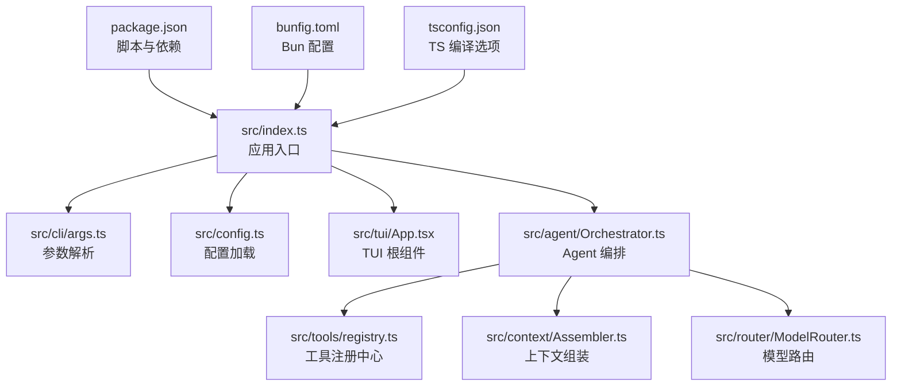
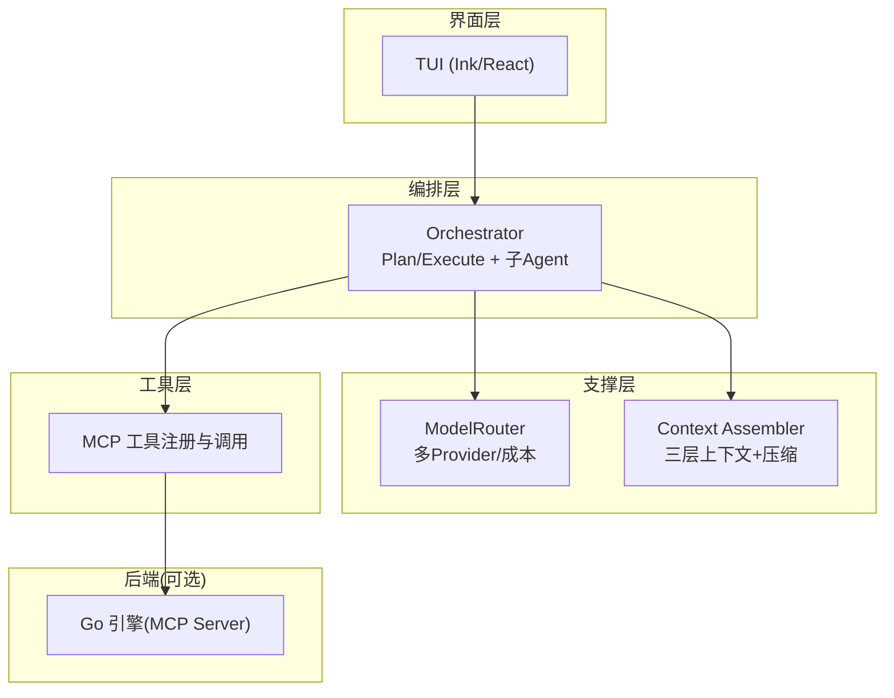
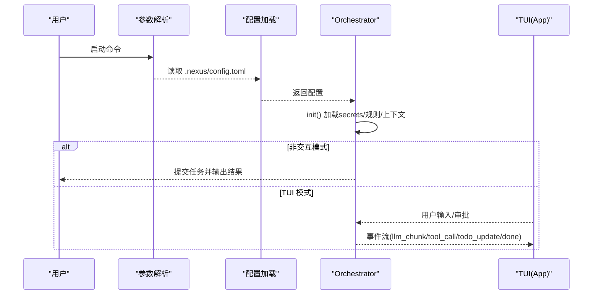
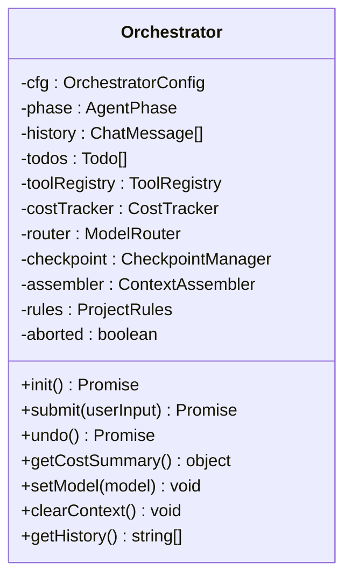
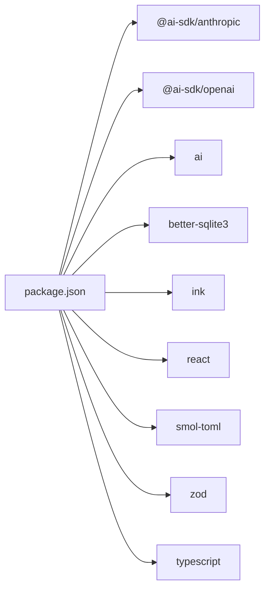

# 开发指南

<cite>
**本文引用的文件**   
- [package.json](file://package.json)
- [tsconfig.json](file://tsconfig.json)
- [bunfig.toml](file://bunfig.toml)
- [README.md](file://README.md)
- [DESIGN.md](file://DESIGN.md)
- [src/index.ts](file://src/index.ts)
- [src/config.ts](file://src/config.ts)
- [src/cli/args.ts](file://src/cli/args.ts)
- [src/tui/App.tsx](file://src/tui/App.tsx)
- [src/agent/Orchestrator.ts](file://src/agent/Orchestrator.ts)
- [src/tools/registry.ts](file://src/tools/registry.ts)
- [src/context/Assembler.ts](file://src/context/Assembler.ts)
- [src/router/ModelRouter.ts](file://src/router/ModelRouter.ts)
- [tests/unit/args.test.ts](file://tests/unit/args.test.ts)
</cite>

## 目录
1. [简介](#简介)
2. [项目结构](#项目结构)
3. [核心组件](#核心组件)
4. [架构总览](#架构总览)
5. [详细组件分析](#详细组件分析)
6. [依赖分析](#依赖分析)
7. [性能考虑](#性能考虑)
8. [故障排查指南](#故障排查指南)
9. [结论](#结论)
10. [附录](#附录)

## 简介
本指南面向 Nexus 项目的开发者，覆盖环境搭建、代码规范、构建与发布、调试与工作流优化、Git 分支策略、贡献流程以及常见问题排查。Nexus 是一个运行在终端的 AI 编程助手，采用 TypeScript + Bun 技术栈，提供流式 TUI、Plan/Execute 双阶段 Agent 编排、多模型路由、MCP 工具层与 Git Checkpoint 回滚能力。

## 项目结构
- 根目录包含包管理、TS 配置、Bun 配置与文档说明。
- src 为核心源码：入口、CLI 参数解析、TUI、Agent 编排、上下文工程、模型路由、工具注册与实现、沙箱与存储等。
- tests 为测试用例（单元、集成、评估）。
- .nexus 存放项目级规则与配置。

图表来源
- [package.json:1-43](file://package.json#L1-L43)
- [src/index.ts:1-119](file://src/index.ts#L1-L119)
- [src/cli/args.ts:1-129](file://src/cli/args.ts#L1-L129)
- [src/config.ts:1-132](file://src/config.ts#L1-L132)
- [src/tui/App.tsx:1-284](file://src/tui/App.tsx#L1-L284)
- [src/agent/Orchestrator.ts:1-260](file://src/agent/Orchestrator.ts#L1-L260)
- [src/tools/registry.ts:1-96](file://src/tools/registry.ts#L1-L96)
- [src/context/Assembler.ts:1-184](file://src/context/Assembler.ts#L1-L184)
- [src/router/ModelRouter.ts:1-308](file://src/router/ModelRouter.ts#L1-L308)
- [bunfig.toml:1-9](file://bunfig.toml#L1-L9)
- [tsconfig.json:1-26](file://tsconfig.json#L1-L26)

章节来源
- [README.md:1-174](file://README.md#L1-L174)
- [DESIGN.md:1-774](file://DESIGN.md#L1-L774)

## 核心组件
- 入口与启动：解析 CLI 参数、加载配置、创建 Orchestrator、渲染 TUI 或执行非交互模式。
- 配置系统：从 .nexus/config.toml 合并默认值，支持多 Provider 与权限、限制、上下文预算、Checkpoint 等。
- CLI 参数：支持模型、Provider、权限模式、最大迭代次数、非交互模式等。
- TUI：基于 Ink/React，流式输出、工具卡片、审批面板、进度条、输入框。
- Agent 编排：Plan/Execute 双阶段、子 Agent 分派、检查点管理、事件驱动。
- 工具层：MCP 原生工具注册与调用（read/edit/bash/grep），按阶段与权限控制。
- 上下文工程：三层上下文组装、历史压缩、Token 预算、Git 状态与项目骨架注入。
- 模型路由：多 Provider 抽象、自动选择、降级链、成本追踪。

章节来源
- [src/index.ts:1-119](file://src/index.ts#L1-L119)
- [src/config.ts:1-132](file://src/config.ts#L1-L132)
- [src/cli/args.ts:1-129](file://src/cli/args.ts#L1-L129)
- [src/tui/App.tsx:1-284](file://src/tui/App.tsx#L1-L284)
- [src/agent/Orchestrator.ts:1-260](file://src/agent/Orchestrator.ts#L1-L260)
- [src/tools/registry.ts:1-96](file://src/tools/registry.ts#L1-L96)
- [src/context/Assembler.ts:1-184](file://src/context/Assembler.ts#L1-L184)
- [src/router/ModelRouter.ts:1-308](file://src/router/ModelRouter.ts#L1-L308)

## 架构总览
Nexus 的分层架构清晰：TUI 层 → Agent 编排层 → 模型路由层 / 上下文工程层 → MCP 工具层 → 可选 Go 引擎（未来）。

图表来源
- [src/tui/App.tsx:1-284](file://src/tui/App.tsx#L1-L284)
- [src/agent/Orchestrator.ts:1-260](file://src/agent/Orchestrator.ts#L1-L260)
- [src/router/ModelRouter.ts:1-308](file://src/router/ModelRouter.ts#L1-L308)
- [src/context/Assembler.ts:1-184](file://src/context/Assembler.ts#L1-L184)
- [src/tools/registry.ts:1-96](file://src/tools/registry.ts#L1-L96)

## 详细组件分析

### 入口与启动流程
- 解析命令行参数，处理版本/帮助。
- 加载项目配置并合并 CLI 覆盖项。
- 创建 Orchestrator，绑定事件回调与审批回调。
- 初始化后进入非交互模式或直接渲染 TUI。
- 若存在初始 prompt，延迟提交以适配 UI 就绪。

图表来源
- [src/index.ts:1-119](file://src/index.ts#L1-L119)
- [src/config.ts:1-132](file://src/config.ts#L1-L132)
- [src/agent/Orchestrator.ts:1-260](file://src/agent/Orchestrator.ts#L1-L260)
- [src/tui/App.tsx:1-284](file://src/tui/App.tsx#L1-L284)

章节来源
- [src/index.ts:1-119](file://src/index.ts#L1-L119)
- [src/cli/args.ts:1-129](file://src/cli/args.ts#L1-L129)
- [src/config.ts:1-132](file://src/config.ts#L1-L132)

### 配置系统
- 默认配置涵盖模型角色、Provider、权限模式、限制、上下文预算、Checkpoint。
- 从 .nexus/config.toml 读取并合并，字段名兼容下划线与驼峰。
- 支持自定义 Provider（OpenAI 兼容）与本地 Ollama。

章节来源
- [src/config.ts:1-132](file://src/config.ts#L1-L132)

### CLI 参数解析
- 支持 -m/--model、-p/--provider、--permission、--cwd、--skip-plan、--max-iterations、--non-interactive、--verbose、--version、-h/--help。
- 位置参数拼接为初始 prompt。

章节来源
- [src/cli/args.ts:1-129](file://src/cli/args.ts#L1-L129)
- [tests/unit/args.test.ts:1-82](file://tests/unit/args.test.ts#L1-L82)

### TUI 组件
- 消息列表、流式输出、工具卡片、Todo 进度、审批提示、输入框。
- 首次运行检测 API Key，无 key 时进入配置向导。
- 通过全局事件分发接收 Orchestrator 事件。

章节来源
- [src/tui/App.tsx:1-284](file://src/tui/App.tsx#L1-L284)

### Agent 编排（Orchestrator）
- 初始化 secrets、规则、上下文组装器、Checkpoint。
- submit(userInput) 构建 systemPrompt 与消息，Plan→Execute 或直执行。
- Executor 循环中处理 tool_call、审批、git checkpoint、成本追踪。
- 暴露 undo/clear/getHistory/getCostSummary/setModel 等方法。

图表来源
- [src/agent/Orchestrator.ts:1-260](file://src/agent/Orchestrator.ts#L1-L260)

章节来源
- [src/agent/Orchestrator.ts:1-260](file://src/agent/Orchestrator.ts#L1-L260)

### 工具注册中心
- 统一注册 readFile/editFile/bash/grep 四个工具。
- 提供阶段过滤、审批需求查询、AI SDK 工具定义转换。
- execute(name, params, context) 执行工具并返回结果。

章节来源
- [src/tools/registry.ts:1-96](file://src/tools/registry.ts#L1-L96)

### 上下文工程（Assembler）
- 构建 systemPrompt（基础原则 + 项目规则 + 工具说明 + Git 状态 + 项目树 + Todos）。
- assembleMessages 进行历史压缩与 Token 预算分配。
- 获取 Git 状态与项目树（优先 git ls-files）。

章节来源
- [src/context/Assembler.ts:1-184](file://src/context/Assembler.ts#L1-L184)

### 模型路由（ModelRouter）
- 内置模型目录与成本信息，支持 Anthropic/OpenAI/Ollama/DeepSeek/Custom。
- auto 模式根据可用 Provider 选择最佳模型；具备降级链。
- getModel(role) 返回 LanguageModel；getAvailableModels 列出当前可用模型。

章节来源
- [src/router/ModelRouter.ts:1-308](file://src/router/ModelRouter.ts#L1-L308)

## 依赖分析
- 运行时依赖：@ai-sdk/*、ai、better-sqlite3、chalk、diff、ink、react、smol-toml、zod。
- 开发依赖：@types/*、typescript。
- 构建与测试：Bun（脚本 start/dev/build/test/lint）。

图表来源
- [package.json:1-43](file://package.json#L1-L43)

章节来源
- [package.json:1-43](file://package.json#L1-L43)

## 性能考虑
- 使用 Bun 作为运行时与打包器，启动快、单二进制分发。
- 上下文压缩与 Token 预算避免长会话爆窗口。
- 工具输出截断与超时控制防止资源占用。
- 模型路由按角色选择合适模型，平衡能力与成本。
- 未来可抽离 bash/grep 到 Go 引擎以降低 P95 延迟。

[本节为通用指导，不直接分析具体文件]

## 故障排查指南
- 启动失败：检查 Bun 版本是否满足要求；确认环境变量（ANTHROPIC_API_KEY/OPENAI_API_KEY/DEEPSEEK_API_KEY/CUSTOM_*）。
- 模型不可用：确认对应 Provider 已配置且密钥有效；查看路由降级链是否生效。
- 工具报错：检查路径与权限；bash 危险命令强制审批；输出过大被截断。
- TUI 无响应：确认事件总线是否正常；检查审批回调是否 resolve。
- 测试失败：运行 bun test；定位单元测试与集成测试用例。

章节来源
- [README.md:1-174](file://README.md#L1-L174)
- [src/router/ModelRouter.ts:1-308](file://src/router/ModelRouter.ts#L1-L308)
- [src/tools/registry.ts:1-96](file://src/tools/registry.ts#L1-L96)
- [src/tui/App.tsx:1-284](file://src/tui/App.tsx#L1-L284)

## 结论
Nexus 以清晰的层次化架构与严格的工具可靠性设计，结合上下文工程与多模型路由，提供了生产可用的终端 Coding Agent。遵循本指南可快速搭建环境、理解核心模块、优化开发与调试流程，并按规范贡献代码。

[本节为总结性内容，不直接分析具体文件]

## 附录

### 开发环境搭建
- 前置要求：Bun >= 1.1.0、ripgrep、Git。
- 安装依赖：bun install。
- 配置 API Key：设置环境变量或通过 TUI 配置面板保存。
- 运行：bun run start；非交互：bun run start --non-interactive "任务"。

章节来源
- [README.md:1-174](file://README.md#L1-L174)
- [package.json:1-43](file://package.json#L1-L43)

### 代码规范与风格指南
- TypeScript：启用严格模式、ESNext 目标、JSX React 模式、声明与 SourceMap 输出、路径别名 @/*。
- 构建与类型检查：bun run lint（tsc --noEmit）。
- 格式化：建议使用编辑器集成 Prettier/ESLint（仓库未内置 ESLint 配置，可按需添加）。

章节来源
- [tsconfig.json:1-26](file://tsconfig.json#L1-L26)
- [package.json:1-43](file://package.json#L1-L43)

### 构建与发布流程
- 构建：bun run build（输出 dist，目标 bun）。
- 测试：bun test；单元：bun test tests/unit/；集成：bun test tests/integration/。
- 发布：按 package.json 的 bin 定义生成 CLI 可执行；确保依赖与配置正确。

章节来源
- [package.json:1-43](file://package.json#L1-L43)

### 调试技巧与工作流优化
- 开发监听：bun --watch run src/index.ts。
- 日志与事件：通过 Orchestrator 事件回调观察 llm_chunk/tool_call/todo_update/done。
- 审批调试：在 TUI 中查看审批卡片与 diff；非交互模式默认批准便于自动化。
- 成本追踪：使用 getCostSummary 查看 token 与花费。

章节来源
- [src/index.ts:1-119](file://src/index.ts#L1-L119)
- [src/agent/Orchestrator.ts:1-260](file://src/agent/Orchestrator.ts#L1-L260)
- [src/tui/App.tsx:1-284](file://src/tui/App.tsx#L1-L284)

### Git 工作流与分支管理
- 建议分支策略：main（稳定）、develop（集成）、feature/*（功能）、hotfix/*（修复）。
- Commit 规范：语义化提交信息，描述变更影响范围。
- Checkpoint：每次 edit 自动提交至指定分支，支持 /undo 回滚。

章节来源
- [src/config.ts:1-132](file://src/config.ts#L1-L132)
- [DESIGN.md:1-774](file://DESIGN.md#L1-L774)

### 贡献指南
- Fork 仓库并创建特性分支。
- 编写/更新测试，确保 bun test 通过。
- 提交代码并推送，发起 Pull Request，描述变更动机与影响。
- 参与讨论：在 Issue/PR 中保持专业简洁，关键决策提供理由。

[本节为通用指导，不直接分析具体文件]

### 常见问题解答
- 如何切换模型？使用 /model 或在 CLI 指定 -m/--model。
- 如何查看花费？使用 /cost 或 getCostSummary。
- 如何清理上下文？使用 /clear 或 clearContext。
- 如何回滚？使用 /undo 或 orchestrator.undo()。

章节来源
- [src/tui/App.tsx:1-284](file://src/tui/App.tsx#L1-L284)
- [src/agent/Orchestrator.ts:1-260](file://src/agent/Orchestrator.ts#L1-L260)