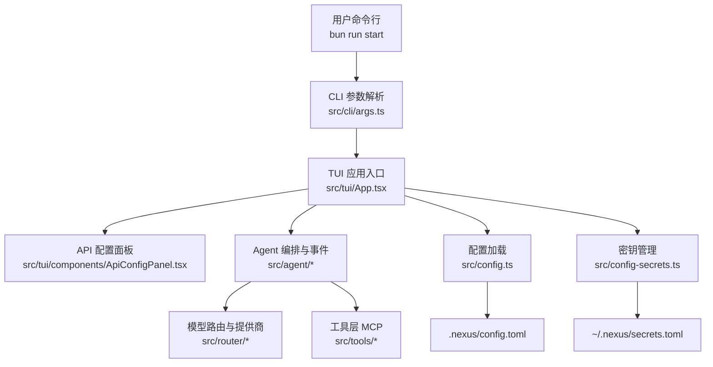
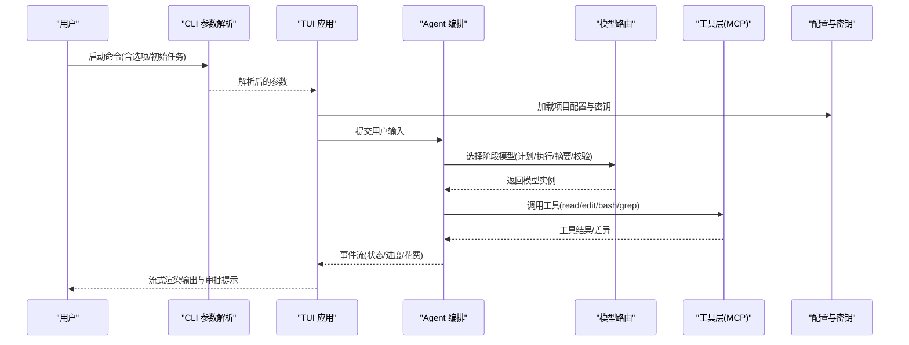
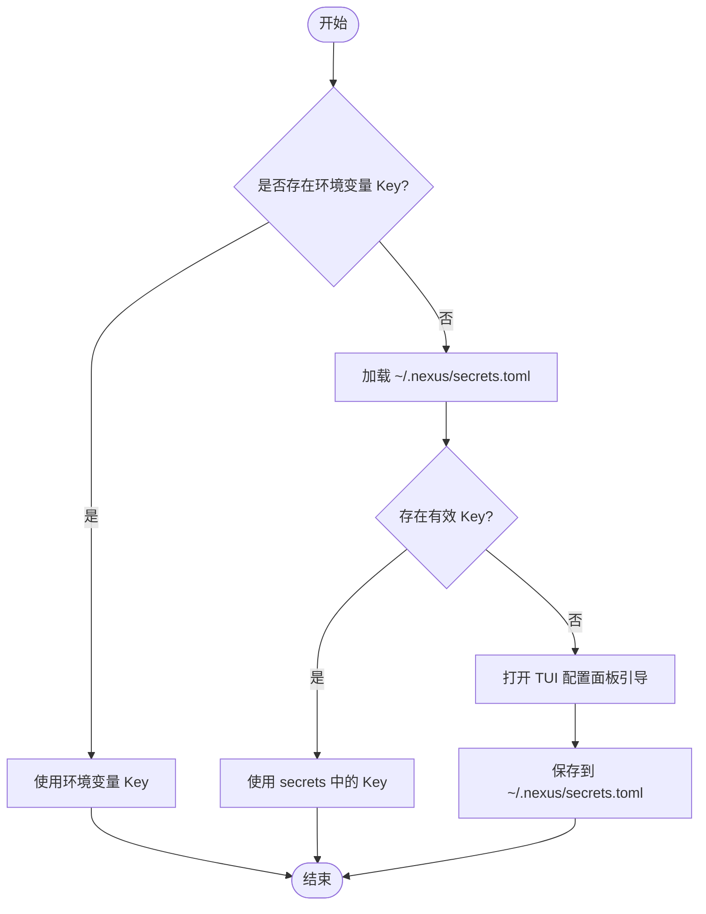
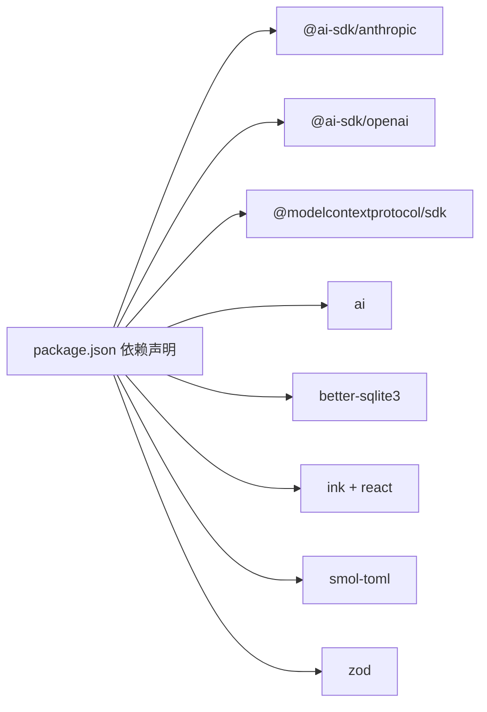

# 快速开始

<cite>
**本文引用的文件**   
- [README.md](file://README.md)
- [package.json](file://package.json)
- [src/config.ts](file://src/config.ts)
- [.nexus/config.toml](file://.nexus/config.toml)
- [src/cli/args.ts](file://src/cli/args.ts)
- [src/agent/types.ts](file://src/agent/types.ts)
- [src/config-secrets.ts](file://src/config-secrets.ts)
- [src/tui/App.tsx](file://src/tui/App.tsx)
- [src/tui/components/ApiConfigPanel.tsx](file://src/tui/components/ApiConfigPanel.tsx)
</cite>

## 目录
1. [简介](#简介)
2. [项目结构](#项目结构)
3. [核心组件](#核心组件)
4. [架构总览](#架构总览)
5. [详细组件分析](#详细组件分析)
6. [依赖关系分析](#依赖关系分析)
7. [性能注意事项](#性能注意事项)
8. [故障排查指南](#故障排查指南)
9. [结论](#结论)
10. [附录](#附录)

## 简介
Nexus 是一个面向生产级的终端 Coding Agent，强调“上下文为王、工具为先、人在环中”。它提供流式 TUI 交互、Plan/Execute 双阶段执行、多模型路由、子 Agent 编排、Git Checkpoint、上下文工程与成本追踪等能力。本快速开始指南将帮助你在 5 分钟内完成环境准备、安装配置并运行第一个任务。

## 项目结构
- 入口与脚本：通过包管理器脚本启动应用，支持开发、构建与测试。
- 配置系统：项目级配置位于 .nexus/config.toml；API Key 持久化在 ~/.nexus/secrets.toml（全局），环境变量优先。
- CLI 参数：支持指定模型、Provider、权限模式、非交互模式等。
- TUI 界面：基于 Ink 的交互式终端界面，内置 API 配置面板与斜杠命令处理。

图表来源 
- [src/cli/args.ts:1-129](file://src/cli/args.ts#L1-L129)
- [src/tui/App.tsx:1-284](file://src/tui/App.tsx#L1-L284)
- [src/tui/components/ApiConfigPanel.tsx:1-249](file://src/tui/components/ApiConfigPanel.tsx#L1-L249)
- [src/config.ts:1-132](file://src/config.ts#L1-L132)
- [.nexus/config.toml:1-62](file://.nexus/config.toml#L1-L62)
- [src/config-secrets.ts:1-171](file://src/config-secrets.ts#L1-L171)

章节来源
- [README.md:1-174](file://README.md#L1-L174)
- [package.json:1-43](file://package.json#L1-L43)

## 核心组件
- 前置要求与环境
  - 需要 Bun >= 1.1.0、ripgrep、Git。
  - 安装依赖使用包管理器脚本。
- 配置与密钥
  - 项目级配置：.nexus/config.toml（模型路由、权限模式、限制、上下文预算、检查点）。
  - 密钥存储：~/.nexus/secrets.toml（全局）或兼容旧的项目级 secrets.toml；环境变量优先级最高。
  - 支持的 Provider：Anthropic、OpenAI、DeepSeek、Ollama、Custom（任意 OpenAI 兼容接口）。
- CLI 参数与运行模式
  - 支持交互式会话、带初始任务、指定模型、自动批准编辑、非交互模式等。
- 权限模式
  - ask（默认）、auto-edit、auto-all、yolo，覆盖从谨慎到完全自动的不同场景。
- 斜杠命令
  - /model、/cost、/clear、/undo、/history、/help 等，用于会话内控制与查询。

章节来源
- [README.md:18-133](file://README.md#L18-L133)
- [src/config.ts:1-132](file://src/config.ts#L1-L132)
- [.nexus/config.toml:1-62](file://.nexus/config.toml#L1-L62)
- [src/cli/args.ts:1-129](file://src/cli/args.ts#L1-L129)
- [src/agent/types.ts:25-28](file://src/agent/types.ts#L25-L28)
- [src/config-secrets.ts:1-171](file://src/config-secrets.ts#L1-L171)
- [src/tui/App.tsx:78-95](file://src/tui/App.tsx#L78-L95)

## 架构总览
Nexus 的运行流程由 TUI 驱动，结合 Agent 编排、模型路由、工具调用与上下文工程，形成“输入→规划→执行→审批→验证→总结”的闭环。

图表来源 
- [src/cli/args.ts:1-129](file://src/cli/args.ts#L1-L129)
- [src/tui/App.tsx:1-284](file://src/tui/App.tsx#L1-L284)
- [src/config.ts:1-132](file://src/config.ts#L1-L132)
- [src/config-secrets.ts:1-171](file://src/config-secrets.ts#L1-L171)

## 详细组件分析

### 前置环境与安装
- 前置要求
  - Bun >= 1.1.0
  - ripgrep（grep 工具依赖）
  - Git（检查点与回滚）
- 安装步骤
  - 在项目根目录执行包管理器脚本以安装依赖。
  - 确保上述工具已正确安装并可被命令行调用。

章节来源
- [README.md:20-31](file://README.md#L20-L31)
- [package.json:10-18](file://package.json#L10-L18)

### API Key 配置方法
- 环境变量方式（推荐）
  - Anthropic：设置 ANTHROPIC_API_KEY
  - OpenAI：设置 OPENAI_API_KEY
  - DeepSeek：设置 DEEPSEEK_API_KEY
  - Custom（OpenAI 兼容）：设置 CUSTOM_API_KEY 与 CUSTOM_BASE_URL，可选 CUSTOM_DEFAULT_MODEL
- 交互式配置面板
  - 首次启动若无任何可用 Key，将自动进入配置向导；也可在会话中输入 /config 或 /api 打开面板。
  - 支持选择 Provider、输入 Key、Base URL（Custom）、默认模型，保存至 ~/.nexus/secrets.toml。
- 优先级
  - 环境变量 > secrets.toml（全局）> 项目级 secrets.toml（兼容旧版本）

图表来源 
- [src/config-secrets.ts:42-91](file://src/config-secrets.ts#L42-L91)
- [src/tui/components/ApiConfigPanel.tsx:30-145](file://src/tui/components/ApiConfigPanel.tsx#L30-L145)

章节来源
- [README.md:32-93](file://README.md#L32-L93)
- [src/config-secrets.ts:1-171](file://src/config-secrets.ts#L1-L171)
- [src/tui/components/ApiConfigPanel.tsx:1-249](file://src/tui/components/ApiConfigPanel.tsx#L1-L249)

### 运行模式与示例
- 交互式会话
  - 直接启动，进入 TUI 对话界面。
- 带初始任务
  - 启动时传入任务文本，直接进入执行。
- 指定模型
  - 通过参数指定模型名称或 Provider。
- 自动批准编辑
  - 设置权限模式为 auto-edit，edit 操作自动批准，bash 仍询问。
- 非交互模式
  - 启用后执行完即退出，适合自动化脚本。

章节来源
- [README.md:95-112](file://README.md#L95-L112)
- [src/cli/args.ts:33-56](file://src/cli/args.ts#L33-L56)

### 权限模式说明
- ask（默认）：每个写操作都询问用户。
- auto-edit：edit 自动批准，bash 仍询问。
- auto-all：全部自动（危险命令仍强制问）。
- yolo：全部自动，含危险命令（自负责任）。

章节来源
- [README.md:114-122](file://README.md#L114-L122)
- [src/agent/types.ts:25-28](file://src/agent/types.ts#L25-L28)
- [.nexus/config.toml:35-37](file://.nexus/config.toml#L35-L37)

### 斜杠命令参考
- /model [name]：查看或切换模型
- /cost：查看本次会话花费
- /clear：清除当前上下文
- /undo：回滚到上一个检查点
- /history：查看会话历史
- /help：显示可用命令
- /config 或 /api：打开 API 配置面板

章节来源
- [README.md:123-133](file://README.md#L123-L133)
- [src/tui/App.tsx:78-95](file://src/tui/App.tsx#L78-L95)

### 配置与密钥详解
- 项目级配置（.nexus/config.toml）
  - models：各阶段模型与提供商配置（planner/executor/summarizer/verifier）
  - permissions：权限模式
  - limits：会话成本上限、bash 超时、读取行数限制、最大迭代步数、输出字节限制
  - context：Token 预算比例、近期轮次保留数量
  - checkpoint：是否自动创建 Git 检查点、分支名
- 密钥管理（~/.nexus/secrets.toml）
  - 支持多个 Provider 的 api_key、base_url、default_model
  - 支持默认 Provider 与默认模型
  - 环境变量优先于 secrets 文件

章节来源
- [.nexus/config.toml:1-62](file://.nexus/config.toml#L1-L62)
- [src/config.ts:1-132](file://src/config.ts#L1-L132)
- [src/config-secrets.ts:1-171](file://src/config-secrets.ts#L1-L171)

## 依赖关系分析
- 运行时依赖
  - Ink + React：TUI 界面渲染
  - AI SDK：Anthropic/OpenAI 客户端
  - MCP SDK：工具协议通信
  - better-sqlite3：本地数据存储
  - smol-toml：配置文件解析
  - zod：输入校验
- 开发依赖
  - TypeScript、类型定义、diff 库等

图表来源 
- [package.json:19-31](file://package.json#L19-L31)

章节来源
- [package.json:1-43](file://package.json#L1-L43)

## 性能注意事项
- 合理设置 Token 预算比例与近期轮次保留数量，避免长会话爆窗口。
- 限制 bash 超时与输出字节数，防止长时间阻塞或过大输出影响体验。
- 使用不同模型分担计划、执行、摘要、校验阶段，平衡能力与成本。
- 利用 Git Checkpoint 进行阶段性快照，便于回滚与问题定位。

[本节为通用指导，不直接分析具体文件]

## 故障排查指南
- 无法连接模型服务
  - 检查环境变量是否正确设置，或 secrets.toml 中对应 Provider 的 Key 是否有效。
  - Custom 提供商需确认 Base URL 与模型名称匹配。
- 权限模式不符合预期
  - 确认 CLI 参数或 config.toml 中的权限模式设置。
- 斜杠命令无效
  - 确认输入格式正确（以 / 开头），并在 TUI 输入框中使用。
- 会话成本超限
  - 调整 limits.max_session_cost，或减少上下文规模与迭代次数。

章节来源
- [src/config-secrets.ts:118-138](file://src/config-secrets.ts#L118-L138)
- [src/cli/args.ts:84-98](file://src/cli/args.ts#L84-L98)
- [src/tui/App.tsx:78-95](file://src/tui/App.tsx#L78-L95)

## 结论
通过以上步骤，你可以在 5 分钟内完成 Nexus 的安装、配置与首次运行。建议从 ask 权限模式开始，逐步熟悉斜杠命令与配置项，再根据需求切换到更自动化的模式。遇到问题时，优先检查环境变量与 secrets 配置，以及 CLI 参数是否正确传递。

[本节为总结性内容，不直接分析具体文件]

## 附录
- 常用命令速查
  - 启动交互式会话：bun run start
  - 带初始任务：bun run start "你的任务"
  - 指定模型：bun run start -m <模型名> "你的任务"
  - 自动批准编辑：bun run start --permission auto-edit "你的任务"
  - 非交互模式：bun run start --non-interactive "你的任务"
- 斜杠命令速查
  - /model [name]、/cost、/clear、/undo、/history、/help、/config、/api

章节来源
- [README.md:95-133](file://README.md#L95-L133)
- [src/cli/args.ts:33-56](file://src/cli/args.ts#L33-L56)