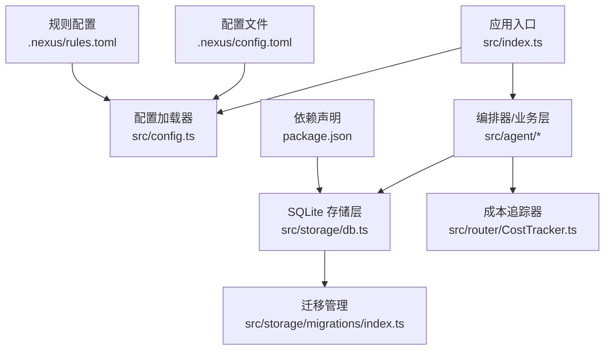
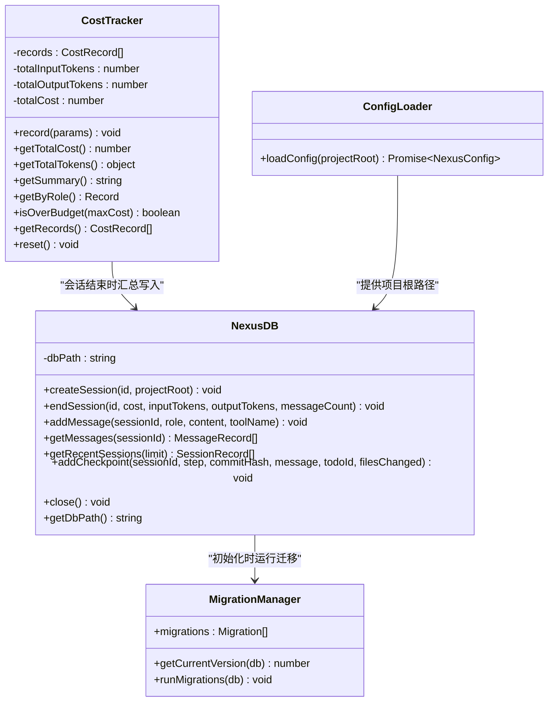
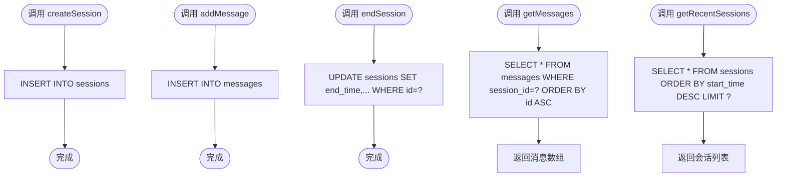
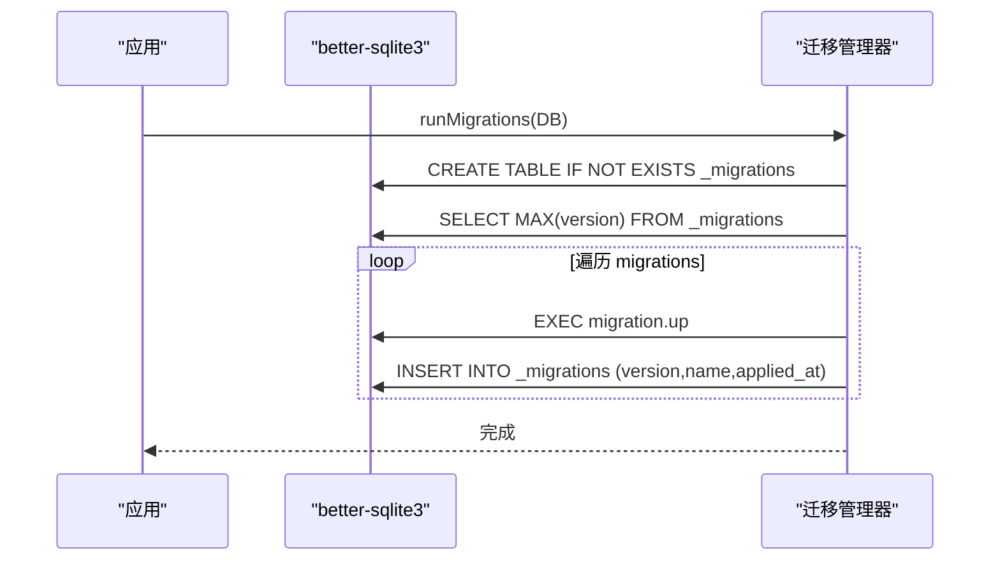
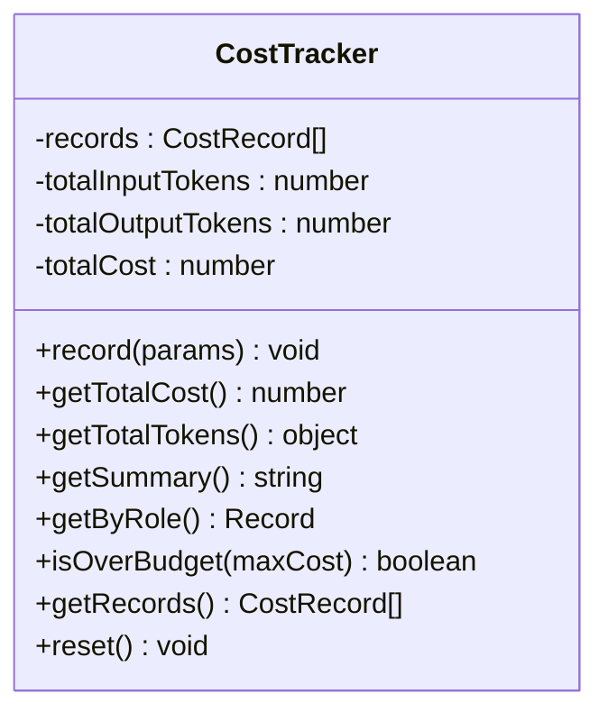
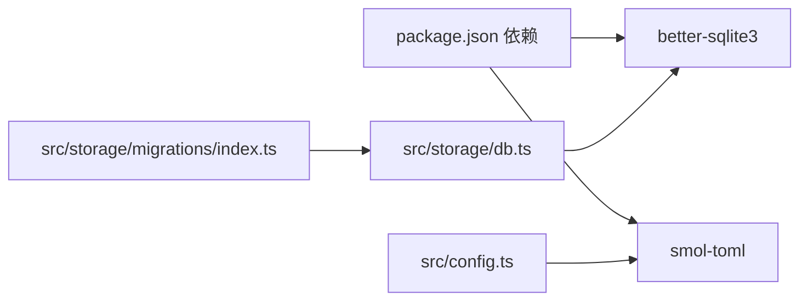

# 数据存储

<cite>
**本文引用的文件**   
- [src/storage/db.ts](file://src/storage/db.ts)
- [src/storage/migrations/index.ts](file://src/storage/migrations/index.ts)
- [src/router/CostTracker.ts](file://src/router/CostTracker.ts)
- [src/config.ts](file://src/config.ts)
- [package.json](file://package.json)
- [.nexus/config.toml](file://.nexus/config.toml)
- [.nexus/rules.toml](file://.nexus/rules.toml)
- [tests/unit/costTracker.test.ts](file://tests/unit/costTracker.test.ts)
</cite>

## 目录
1. [简介](#简介)
2. [项目结构](#项目结构)
3. [核心组件](#核心组件)
4. [架构总览](#架构总览)
5. [详细组件分析](#详细组件分析)
6. [依赖关系分析](#依赖关系分析)
7. [性能与优化](#性能与优化)
8. [数据迁移机制](#数据迁移机制)
9. [备份与恢复指南](#备份与恢复指南)
10. [监控与维护最佳实践](#监控与维护最佳实践)
11. [数据安全与访问控制](#数据安全与访问控制)
12. [故障排查](#故障排查)
13. [结论](#结论)

## 简介
本技术文档聚焦 Nexus 的数据存储系统，围绕 SQLite 数据库的设计模式、表结构与索引优化、查询性能调优、数据迁移机制（含版本管理与回滚策略）、会话历史与成本追踪数据的持久化方案、配置信息持久化、备份与恢复流程、监控维护以及安全与访问控制进行全面说明。目标是帮助开发者快速理解并高效运维该存储子系统。

## 项目结构
Nexus 的存储相关代码主要位于 src/storage 目录，包含数据库封装与迁移管理；成本追踪在路由层实现；配置加载器负责从 .nexus/config.toml 读取配置；测试覆盖成本追踪逻辑。

图表来源
- [src/index.ts:1-118](file://src/index.ts#L1-L118)
- [src/config.ts:1-132](file://src/config.ts#L1-L132)
- [src/storage/db.ts:1-147](file://src/storage/db.ts#L1-L147)
- [src/storage/migrations/index.ts:1-118](file://src/storage/migrations/index.ts#L1-L118)
- [src/router/CostTracker.ts:1-96](file://src/router/CostTracker.ts#L1-L96)
- [.nexus/config.toml:1-62](file://.nexus/config.toml#L1-L62)
- [.nexus/rules.toml:1-21](file://.nexus/rules.toml#L1-L21)
- [package.json:1-43](file://package.json#L1-L43)

章节来源
- [src/index.ts:1-118](file://src/index.ts#L1-L118)
- [src/config.ts:1-132](file://src/config.ts#L1-L132)
- [src/storage/db.ts:1-147](file://src/storage/db.ts#L1-L147)
- [src/storage/migrations/index.ts:1-118](file://src/storage/migrations/index.ts#L1-L118)
- [src/router/CostTracker.ts:1-96](file://src/router/CostTracker.ts#L1-L96)
- [.nexus/config.toml:1-62](file://.nexus/config.toml#L1-L62)
- [.nexus/rules.toml:1-21](file://.nexus/rules.toml#L1-L21)
- [package.json:1-43](file://package.json#L1-L43)

## 核心组件
- SQLite 存储层：提供会话、消息、检查点等核心实体的持久化能力，使用 WAL 模式提升并发读写性能，并在初始化时执行内联建表与索引。
- 迁移管理：以版本化脚本驱动 schema 演进，支持 up/down 迁移，自动记录已应用版本。
- 成本追踪器：在内存中累计每次 LLM 调用的 token 数与估算成本，供会话结束时汇总写入持久层。
- 配置加载器：从 .nexus/config.toml 合并默认值，为运行时提供模型路由、权限、限制、上下文预算、检查点策略等配置。

章节来源
- [src/storage/db.ts:1-147](file://src/storage/db.ts#L1-L147)
- [src/storage/migrations/index.ts:1-118](file://src/storage/migrations/index.ts#L1-L118)
- [src/router/CostTracker.ts:1-96](file://src/router/CostTracker.ts#L1-L96)
- [src/config.ts:1-132](file://src/config.ts#L1-L132)

## 架构总览
Nexus 的存储架构采用“单进程 + 单文件 SQLite”的模式，通过 better-sqlite3 驱动，WAL 模式保障高并发读写的稳定性。存储层暴露会话创建、结束、消息追加、检查点记录、最近会话列表等接口；迁移模块确保 schema 向前兼容演进；成本追踪器作为内存聚合器，配合存储层完成最终落盘。

图表来源
- [src/storage/db.ts:1-147](file://src/storage/db.ts#L1-L147)
- [src/storage/migrations/index.ts:1-118](file://src/storage/migrations/index.ts#L1-L118)
- [src/router/CostTracker.ts:1-96](file://src/router/CostTracker.ts#L1-L96)
- [src/config.ts:1-132](file://src/config.ts#L1-L132)

## 详细组件分析

### SQLite 存储层（NexusDB）
- 设计要点
  - 单文件数据库，路径位于项目根目录下的 .nexus/nexus.db。
  - 启用 WAL 模式以提升并发读性能与崩溃恢复能力。
  - 内联建表与索引，保证首次启动即可用。
- 表结构
  - sessions：会话元数据（id、project_root、时间戳、token 统计、消息计数）。
  - messages：会话消息明细（角色、内容、工具名、时间戳），按 session_id 建立索引。
  - checkpoints：检查点记录（步骤、提交哈希、消息、todo_id、变更文件列表），按 session_id 建立索引。
  - embeddings（由迁移引入）：向量嵌入存储（文件路径、行范围、内容、BLOB 向量、时间戳），按 file_path 建立索引。
- 关键操作
  - createSession/endSession：会话生命周期管理，更新结束时间与统计字段。
  - addMessage/getMessages：消息追加与按会话顺序检索。
  - getRecentSessions：按开始时间倒序返回最近会话。
  - addCheckpoint：记录检查点，files_changed 序列化为 JSON 文本。
- 复杂度与性能
  - 插入均为 O(1)，主键自增或文本主键。
  - 基于 session_id 的索引使按会话查询接近 O(log n)。
  - WAL 模式减少写锁竞争，适合高频消息写入场景。
- 错误处理
  - 使用 prepare/run/all 进行参数化查询，避免 SQL 注入。
  - 关闭连接释放资源。

图表来源
- [src/storage/db.ts:44-82](file://src/storage/db.ts#L44-L82)
- [src/storage/db.ts:84-141](file://src/storage/db.ts#L84-L141)

章节来源
- [src/storage/db.ts:1-147](file://src/storage/db.ts#L1-L147)

### 迁移管理（migrations/index.ts）
- 设计要点
  - 以 version/name/up/down 描述迁移单元，按版本升序执行。
  - 使用 _migrations 表记录已应用迁移的版本、名称与应用时间。
  - runMigrations 会先确保 _migrations 表存在，再比较当前版本并执行未应用的 up 脚本。
- 版本管理
  - getCurrentVersion 读取 _migrations 的最大 version，不存在则返回 0。
  - 新增迁移需递增 version 并提供 up/down 脚本。
- 回滚策略
  - down 脚本用于回滚，但当前未提供统一回滚 API；可按需扩展 runRollback(version) 从目标版本向下执行 down。
- 示例迁移
  - v1：初始 schema（sessions/messages/checkpoints 及索引）。
  - v2：添加 embeddings 表与索引。

图表来源
- [src/storage/migrations/index.ts:84-118](file://src/storage/migrations/index.ts#L84-L118)
- [src/storage/migrations/index.ts:14-82](file://src/storage/migrations/index.ts#L14-L82)

章节来源
- [src/storage/migrations/index.ts:1-118](file://src/storage/migrations/index.ts#L1-L118)

### 成本追踪器（CostTracker）
- 功能概述
  - 记录每次 LLM 调用的输入/输出 token 数与单价，计算单次成本并累加。
  - 提供按角色分组统计、超预算判断、摘要输出等方法。
- 与存储层的协作
  - 会话结束时将 total_cost、total_input_tokens、total_output_tokens、message_count 汇总写入 sessions 表。
- 复杂度
  - record 为 O(1)，getByRole 为 O(n) 遍历记录。
- 测试覆盖
  - 单元测试验证初始状态、单次记录、多次累加、超预算判断、分组统计、重置与摘要格式。

图表来源
- [src/router/CostTracker.ts:1-96](file://src/router/CostTracker.ts#L1-L96)

章节来源
- [src/router/CostTracker.ts:1-96](file://src/router/CostTracker.ts#L1-L96)
- [tests/unit/costTracker.test.ts:1-138](file://tests/unit/costTracker.test.ts#L1-L138)

### 配置加载器（config.ts）
- 功能概述
  - 从 .nexus/config.toml 读取配置并与内置默认值合并，生成 NexusConfig。
  - 支持 models.providers、permissions.mode、limits.*、context.*、checkpoint.* 等项。
- 与存储的关系
  - 提供项目根路径与运行时限制（如 maxSessionCost），影响会话结束时的持久化行为。

章节来源
- [src/config.ts:1-132](file://src/config.ts#L1-L132)
- [.nexus/config.toml:1-62](file://.nexus/config.toml#L1-L62)
- [.nexus/rules.toml:1-21](file://.nexus/rules.toml#L1-L21)

## 依赖关系分析
- 外部依赖
  - better-sqlite3：同步高性能 SQLite 驱动，启用 WAL 模式。
  - smol-toml：解析 TOML 配置文件。
- 内部耦合
  - 存储层与迁移管理强耦合（初始化时执行迁移）。
  - 成本追踪器与存储层松耦合（通过汇总数据写入）。
  - 配置加载器独立于存储层，仅传递项目根路径与限制参数。

图表来源
- [package.json:19-31](file://package.json#L19-L31)
- [src/storage/db.ts:1-10](file://src/storage/db.ts#L1-L10)
- [src/config.ts:6-9](file://src/config.ts#L6-L9)
- [src/storage/migrations/index.ts:1-10](file://src/storage/migrations/index.ts#L1-L10)

章节来源
- [package.json:1-43](file://package.json#L1-L43)
- [src/storage/db.ts:1-10](file://src/storage/db.ts#L1-L10)
- [src/config.ts:6-9](file://src/config.ts#L6-L9)
- [src/storage/migrations/index.ts:1-10](file://src/storage/migrations/index.ts#L1-L10)

## 性能与优化
- 索引优化
  - messages.session_id、checkpoints.session_id、embeddings.file_path 均建立索引，加速按会话与文件的检索。
- 查询优化
  - 使用参数化查询与预编译语句，减少重复解析开销。
  - 按主键或索引列排序与过滤，避免全表扫描。
- 写入优化
  - WAL 模式降低写锁冲突，适合高频消息写入。
  - 批量写入可考虑事务包裹（当前实现逐条插入，可在热点路径上优化）。
- 空间优化
  - embeddings.embedding 使用 BLOB 存储向量，注意文件大小增长与定期清理策略。
  - checkpoints.files_changed 使用 JSON 文本，建议控制变更文件数量与长度。

[本节为通用指导，不直接分析具体文件]

## 数据迁移机制
- 迁移脚本编写规范
  - 每个迁移对象包含 version、name、up、down 四个字段。
  - up 脚本定义正向变更（CREATE/ALTER/DROP 等），down 脚本定义反向回滚。
  - 按 version 升序排列，确保幂等性（IF NOT EXISTS 等）。
- 版本管理
  - 通过 _migrations 表记录已应用版本，getCurrentVersion 获取当前最大版本。
  - runMigrations 对比当前版本与 migrations 列表，依次执行未应用的 up 脚本并记录。
- 回滚策略
  - 当前未提供统一回滚 API；可扩展 runRollback(targetVersion) 从当前版本向下执行 down 至目标版本。
  - 建议在重大变更前备份数据库，确保回滚安全。

章节来源
- [src/storage/migrations/index.ts:14-82](file://src/storage/migrations/index.ts#L14-L82)
- [src/storage/migrations/index.ts:84-118](file://src/storage/migrations/index.ts#L84-L118)

## 备份与恢复指南
- 全量备份
  - 直接复制 .nexus/nexus.db 文件。由于使用 WAL 模式，建议同时备份 nexus.db-wal 与 nexus.db-shm 以确保一致性。
- 增量备份
  - 基于 WAL 的增量备份可通过定期归档 .nexus/nexus.db-wal 与 .nexus/nexus.db-shm，并结合文件系统快照工具实现。
- 灾难恢复
  - 停止应用后替换 .nexus/nexus.db 及其 WAL/SHM 文件，重启应用即可恢复。
  - 若损坏，优先尝试从最近的全量备份恢复，再回放增量 WAL 文件。
- 注意事项
  - 备份期间尽量保持应用空闲，或使用数据库级快照（如操作系统卷快照）保证一致性。
  - 校验备份完整性（文件大小、校验和）。

[本节为通用指导，不直接分析具体文件]

## 监控与维护最佳实践
- 监控指标
  - 数据库文件大小与增长速率（重点关注 embeddings 表）。
  - 会话数量、消息数量、检查点数量趋势。
  - 最近会话查询耗时与失败率。
- 维护任务
  - 定期清理过期会话与消息（按时间窗口或大小阈值）。
  - 对大表执行 VACUUM 以回收空间（在低峰期执行）。
  - 监控 _migrations 表，确保无异常版本漂移。
- 日志与告警
  - 记录迁移执行日志（版本、名称、时间）。
  - 对长时间运行的查询设置超时与告警。

[本节为通用指导，不直接分析具体文件]

## 数据安全与访问控制
- 文件权限
  - 限制 .nexus 目录与 nexus.db 的访问权限，仅允许应用用户读写。
- 敏感信息
  - 配置中的 API Key 通过环境变量注入，避免明文存储在数据库中。
- 传输与存储加密
  - 当前未启用数据库级加密；如需更高安全级别，可考虑使用加密文件系统或第三方加密库。
- 审计
  - 结合操作系统审计工具记录对 .nexus 目录的访问事件。

[本节为通用指导，不直接分析具体文件]

## 故障排查
- 常见问题
  - 数据库锁定：检查是否多进程并发写入；确保单实例或正确使用 WAL 模式。
  - 迁移失败：查看 _migrations 表确认当前版本，核对 up/down 脚本幂等性。
  - 查询缓慢：确认索引是否存在且命中，避免全表扫描。
- 定位方法
  - 打印 getDbPath 确认数据库路径。
  - 使用 SQLite 命令行工具检查表结构与索引。
  - 查看迁移日志与应用日志，定位异常时间点。

章节来源
- [src/storage/db.ts:138-146](file://src/storage/db.ts#L138-L146)
- [src/storage/migrations/index.ts:84-118](file://src/storage/migrations/index.ts#L84-L118)

## 结论
Nexus 的存储系统以 SQLite 为核心，结合 WAL 模式与合理的索引设计，提供了稳定高效的会话历史、检查点与嵌入向量存储能力。迁移管理机制保障了 schema 演进的向前兼容与可控回滚。配合成本追踪器与配置加载器，形成了完整的持久化闭环。在生产环境中，建议完善备份恢复流程、监控维护策略与安全加固措施，以获得更高的可用性与安全性。