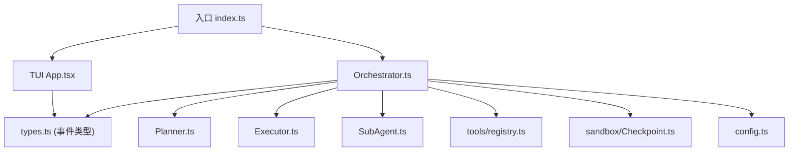
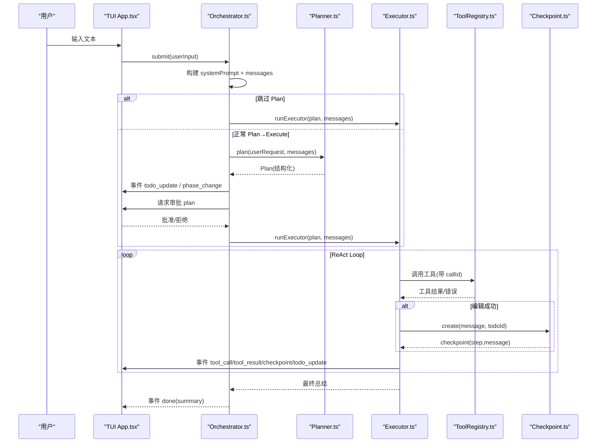
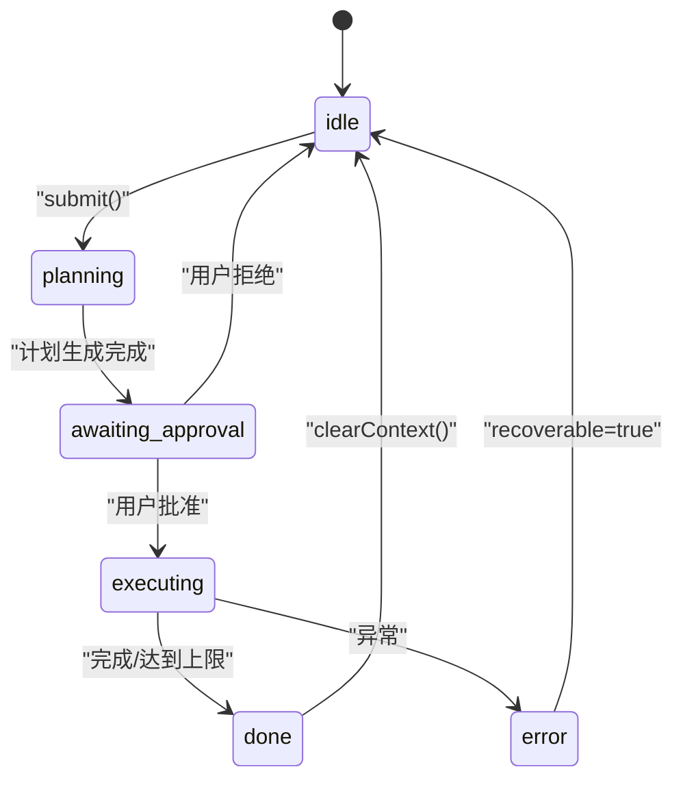
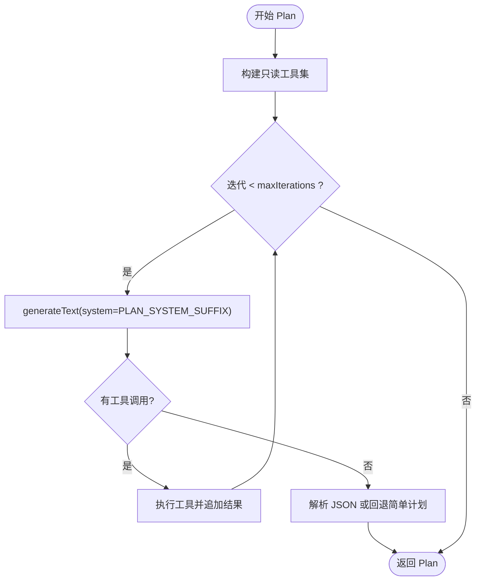
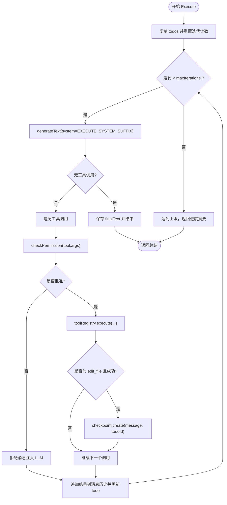
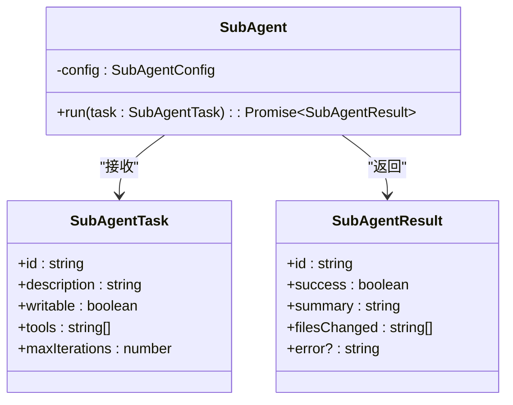
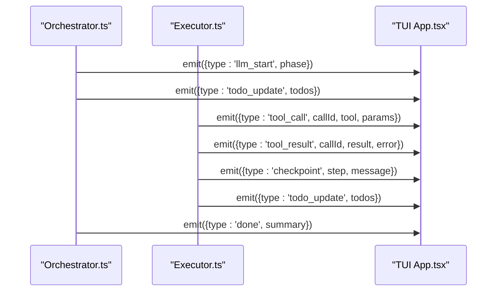
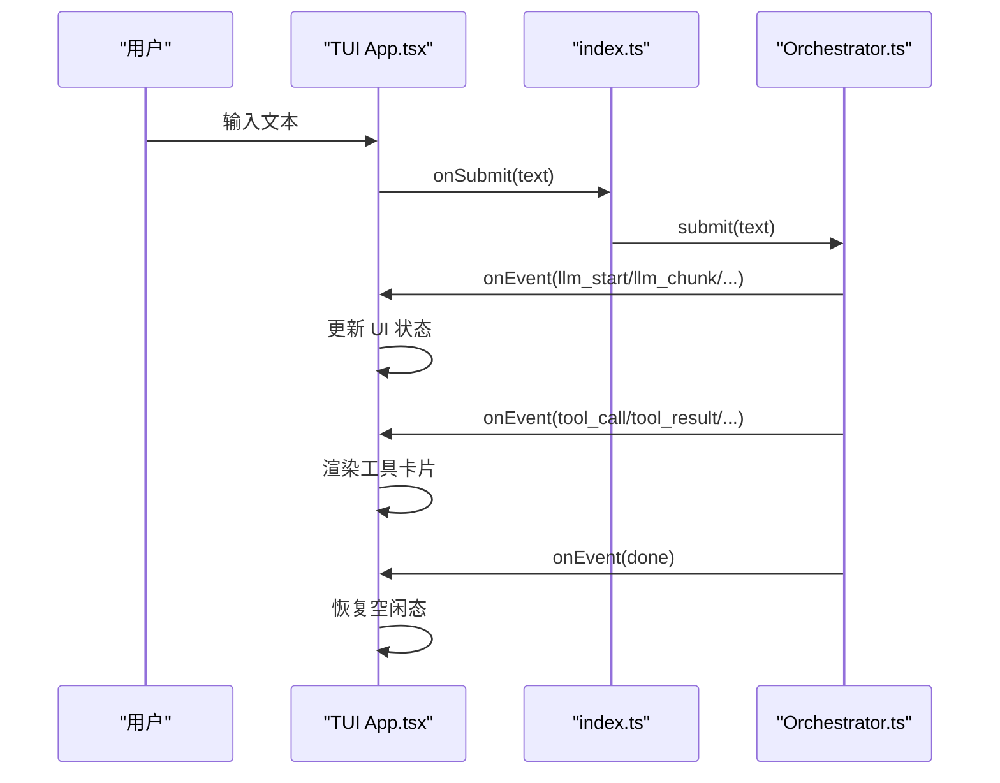
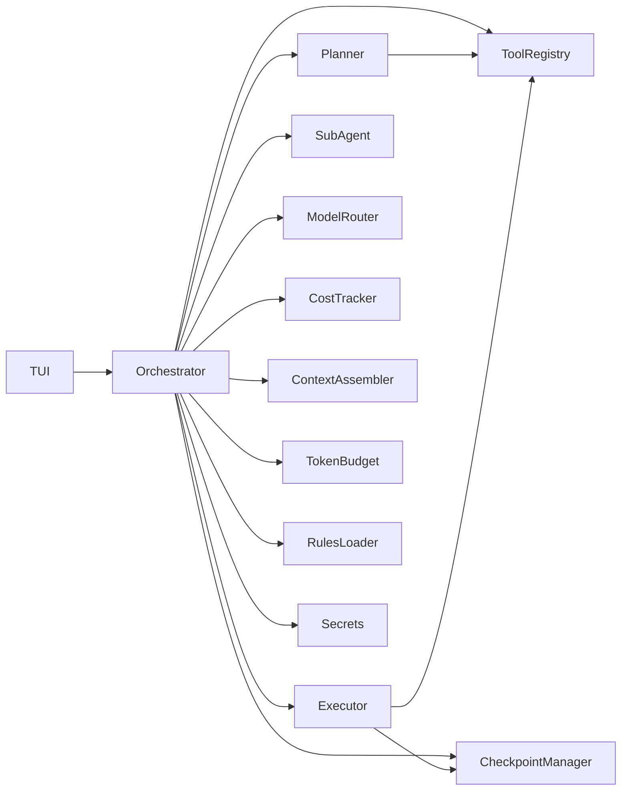

# Agent 编排架构

<cite>
**本文引用的文件**   
- [src/index.ts](file://src/index.ts)
- [src/agent/Orchestrator.ts](file://src/agent/Orchestrator.ts)
- [src/agent/Planner.ts](file://src/agent/Planner.ts)
- [src/agent/Executor.ts](file://src/agent/Executor.ts)
- [src/agent/SubAgent.ts](file://src/agent/SubAgent.ts)
- [src/agent/types.ts](file://src/agent/types.ts)
- [src/tui/App.tsx](file://src/tui/App.tsx)
- [src/tools/registry.ts](file://src/tools/registry.ts)
- [src/tools/readFile.ts](file://src/tools/readFile.ts)
- [src/sandbox/Checkpoint.ts](file://src/sandbox/Checkpoint.ts)
- [src/config.ts](file://src/config.ts)
- [README.md](file://README.md)
</cite>

## 目录
1. [简介](#简介)
2. [项目结构](#项目结构)
3. [核心组件](#核心组件)
4. [架构总览](#架构总览)
5. [详细组件分析](#详细组件分析)
6. [依赖关系分析](#依赖关系分析)
7. [性能与成本考量](#性能与成本考量)
8. [故障排查指南](#故障排查指南)
9. [结论](#结论)
10. [附录：扩展点与实现示例](#附录扩展点与实现示例)

## 简介
本文件为 Nexus Agent 编排系统的架构文档，聚焦 Orchestrator 作为“大脑”的核心设计，包括 ReAct Loop 内部状态机、Plan/Execute 双阶段工作流、子 Agent 分派机制（独立上下文窗口、写权限控制、深度限制）、事件驱动架构（NexusEvent 类型的事件流）和状态管理模式。同时提供完整的时序图和数据流图，解释与 TUI 层的集成方式和消息传递协议，并给出具体实现示例与扩展点说明。

## 项目结构
- 入口与启动流程位于 src/index.ts，负责解析参数、加载配置、创建 Orchestrator、渲染 TUI 或执行非交互模式。
- 编排层集中在 src/agent 下：
  - Orchestrator.ts：协调 Plan/Execute 双阶段、子 Agent 分派、检查点管理、事件分发。
  - Planner.ts：规划阶段，只读工具探索代码库，输出结构化计划。
  - Executor.ts：执行阶段，ReAct Loop 逐步执行计划，支持审批、回滚、进度更新。
  - SubAgent.ts：子 Agent 分派，独立上下文窗口，默认不可写，限制深度。
  - types.ts：全局共享类型定义（事件、模型路由、工具、会话、检查点等）。
- TUI 层在 src/tui/App.tsx，基于 Ink + React，订阅 Orchestrator 事件，渲染消息、工具调用卡片、Todo 进度、审批提示等。
- 工具注册中心在 src/tools/registry.ts，内置 read_file/edit_file/bash/grep 等工具，按阶段暴露。
- 沙箱与检查点在 src/sandbox/Checkpoint.ts，每次 edit 后自动提交，支持一键回滚。
- 配置加载在 src/config.ts，从 .nexus/config.toml 合并默认值。

图表来源
- [src/index.ts:1-119](file://src/index.ts#L1-L119)
- [src/agent/Orchestrator.ts:1-260](file://src/agent/Orchestrator.ts#L1-L260)
- [src/agent/Planner.ts:1-176](file://src/agent/Planner.ts#L1-L176)
- [src/agent/Executor.ts:1-234](file://src/agent/Executor.ts#L1-L234)
- [src/agent/SubAgent.ts:1-148](file://src/agent/SubAgent.ts#L1-L148)
- [src/tui/App.tsx:1-284](file://src/tui/App.tsx#L1-L284)
- [src/tools/registry.ts:1-96](file://src/tools/registry.ts#L1-L96)
- [src/sandbox/Checkpoint.ts:1-182](file://src/sandbox/Checkpoint.ts#L1-L182)
- [src/config.ts:1-132](file://src/config.ts#L1-L132)
- [src/agent/types.ts:1-269](file://src/agent/types.ts#L1-L269)

章节来源
- [src/index.ts:1-119](file://src/index.ts#L1-L119)
- [README.md:134-146](file://README.md#L134-L146)

## 核心组件
- Orchestrator：系统“大脑”，维护会话历史、Todo 列表、阶段状态、成本追踪、模型路由、上下文组装器、规则加载、Git 检查点；对外暴露 submit() 主入口，内部驱动 Plan/Execute 双阶段，并通过 onEvent 回调向 TUI 推送事件。
- Planner：仅使用只读工具（read_file、grep），通过 ReAct 循环探索代码库，最终输出结构化 Plan（包含 summary、todos、filesToModify、estimatedSteps）。
- Executor：执行阶段的 ReAct Loop，逐轮调用工具，进行权限校验、结果反馈、编辑后创建检查点、更新 Todo 进度，达到迭代上限时返回当前进度摘要。
- SubAgent：子任务执行器，拥有独立上下文窗口，根据 writable 决定可用工具集（plan 或 execute），默认不可写，限制最大迭代次数，返回结果摘要与变更文件列表。
- ToolRegistry：工具注册与调度中心，按阶段过滤工具，生成 AI SDK 兼容的工具定义，统一执行与错误处理。
- CheckpointManager：基于 Git 的检查点管理，每次 edit 成功后自动提交，支持 undo/jumpTo/mergeToWorkBranch。
- TUI App：终端 UI，订阅事件，渲染消息、工具调用卡片、Todo 进度、审批提示，支持斜杠命令与 API Key 配置面板。

章节来源
- [src/agent/Orchestrator.ts:1-260](file://src/agent/Orchestrator.ts#L1-L260)
- [src/agent/Planner.ts:1-176](file://src/agent/Planner.ts#L1-L176)
- [src/agent/Executor.ts:1-234](file://src/agent/Executor.ts#L1-L234)
- [src/agent/SubAgent.ts:1-148](file://src/agent/SubAgent.ts#L1-L148)
- [src/tools/registry.ts:1-96](file://src/tools/registry.ts#L1-L96)
- [src/sandbox/Checkpoint.ts:1-182](file://src/sandbox/Checkpoint.ts#L1-L182)
- [src/tui/App.tsx:1-284](file://src/tui/App.tsx#L1-L284)

## 架构总览
整体采用事件驱动的异步流水线：
- 用户输入经 Orchestrator.submit() 进入，构建系统提示与消息上下文。
- 若未跳过 Plan，则先由 Planner 生成结构化计划，再交由 Executor 执行。
- Executor 的 ReAct Loop 每步调用工具，必要时请求审批，成功后创建检查点，并更新 Todo 状态。
- 所有关键节点通过 NexusEvent 事件流通知 TUI，实现实时渲染与交互。

图表来源
- [src/index.ts:42-112](file://src/index.ts#L42-L112)
- [src/agent/Orchestrator.ts:88-180](file://src/agent/Orchestrator.ts#L88-L180)
- [src/agent/Planner.ts:55-137](file://src/agent/Planner.ts#L55-L137)
- [src/agent/Executor.ts:50-165](file://src/agent/Executor.ts#L50-L165)
- [src/tools/registry.ts:70-82](file://src/tools/registry.ts#L70-L82)
- [src/sandbox/Checkpoint.ts:72-116](file://src/sandbox/Checkpoint.ts#L72-L116)
- [src/tui/App.tsx:107-176](file://src/tui/App.tsx#L107-L176)

## 详细组件分析

### Orchestrator 核心设计与状态机
- 职责：初始化 secrets、规则、上下文组装器、模型路由；维护 phase/history/todos/costTracker/checkpoint；对外暴露 submit()/abort()/undo() 等接口。
- 状态机（AgentPhase）：idle → planning → awaiting_approval → executing → done（或 error）。
- 双阶段工作流：
  - Plan：构造 Planner，传入只读工具，生成 Plan，等待用户审批。
  - Execute：构造 Executor，传入全部工具与权限策略，运行 ReAct Loop。
- 事件驱动：通过 onEvent 回调将 NexusEvent 推送到 TUI。
- 上下文工程：ContextAssembler 结合 TokenBudget 与 ProjectRules 构建 systemPrompt 与 messages，避免上下文溢出。
- 检查点：edit_file 成功后创建 Git 检查点，支持 undo。

图表来源
- [src/agent/types.ts:25-27](file://src/agent/types.ts#L25-L27)
- [src/agent/Orchestrator.ts:88-180](file://src/agent/Orchestrator.ts#L88-L180)

章节来源
- [src/agent/Orchestrator.ts:1-260](file://src/agent/Orchestrator.ts#L1-L260)
- [src/agent/types.ts:1-269](file://src/agent/types.ts#L1-L269)

### Planner 规划阶段（只读探索）
- 目标：理解需求与现有实现，输出结构化 Plan。
- 工具约束：仅允许 plan 阶段可用的只读工具（read_file、grep）。
- ReAct 循环：每轮生成文本或工具调用，将工具结果追加到消息历史，直到无工具调用为止。
- 输出解析：尝试从 JSON 代码块提取 Plan，失败则回退为简单三步计划。

图表来源
- [src/agent/Planner.ts:55-137](file://src/agent/Planner.ts#L55-L137)
- [src/agent/Planner.ts:139-175](file://src/agent/Planner.ts#L139-L175)

章节来源
- [src/agent/Planner.ts:1-176](file://src/agent/Planner.ts#L1-L176)

### Executor 执行阶段（ReAct Loop）
- 目标：按批准的计划逐步执行，确保修改正确性。
- 权限策略：根据 permissionMode 与 requiresApproval 决定是否请求审批；危险 bash 命令强制审批。
- 检查点：edit_file 成功后创建 Git 检查点，记录 step/message/todoId/filesChanged。
- 进度跟踪：根据工具调用更新 Todo 状态（pending → in_progress → complete）。
- 终止条件：无工具调用或达到 maxIterations。

图表来源
- [src/agent/Executor.ts:50-165](file://src/agent/Executor.ts#L50-L165)
- [src/agent/Executor.ts:167-215](file://src/agent/Executor.ts#L167-L215)
- [src/sandbox/Checkpoint.ts:72-116](file://src/sandbox/Checkpoint.ts#L72-L116)

章节来源
- [src/agent/Executor.ts:1-234](file://src/agent/Executor.ts#L1-L234)
- [src/sandbox/Checkpoint.ts:1-182](file://src/sandbox/Checkpoint.ts#L1-L182)

### SubAgent 子 Agent 分派机制
- 独立上下文窗口：每个子 Agent 拥有独立的 messages 历史，不污染主 Agent 上下文。
- 写权限控制：writable=false 时使用 plan 阶段工具（只读）；writable=true 时使用 execute 阶段工具（可写）。
- 深度限制：默认限制为 1 层（由 Orchestrator 控制），防止递归过深。
- 工具过滤：可根据 task.tools 进一步限定可用工具集合。
- 结果聚合：返回 success/summary/filesChanged/error，便于主 Agent 汇总。

图表来源
- [src/agent/SubAgent.ts:20-118](file://src/agent/SubAgent.ts#L20-L118)
- [src/agent/types.ts:199-213](file://src/agent/types.ts#L199-L213)

章节来源
- [src/agent/SubAgent.ts:1-148](file://src/agent/SubAgent.ts#L1-L148)
- [src/agent/types.ts:199-213](file://src/agent/types.ts#L199-L213)

### 事件驱动架构与状态管理
- 事件类型（NexusEvent）：涵盖用户输入、LLM 生命周期、工具调用与结果、Todo 更新、检查点、成本更新、阶段变化、完成与错误等。
- 事件流向：
  - Orchestrator 在各阶段 emit(NexusEvent)。
  - TUI App 订阅事件，更新本地状态（messages、toolCalls、todos、phase、streamingText）。
  - 审批流程：Executor.requestApproval 触发 TUI 显示 ApprovalPrompt，用户批准后 resolve(true)，否则 resolve(false)。
- 状态管理模式：
  - Orchestrator 维护 phase/history/todos/costTracker。
  - TUI 维护 UI 状态，与 Orchestrator 解耦，通过事件总线通信。

图表来源
- [src/agent/types.ts:8-22](file://src/agent/types.ts#L8-L22)
- [src/agent/Orchestrator.ts:251-258](file://src/agent/Orchestrator.ts#L251-L258)
- [src/agent/Executor.ts:105-165](file://src/agent/Executor.ts#L105-L165)
- [src/tui/App.tsx:107-176](file://src/tui/App.tsx#L107-L176)

章节来源
- [src/agent/types.ts:1-269](file://src/agent/types.ts#L1-L269)
- [src/tui/App.tsx:1-284](file://src/tui/App.tsx#L1-L284)

### 与 TUI 层的集成与消息传递协议
- 入口绑定：index.ts 创建 Orchestrator 并将 onEvent 指向 emitToUI(event)，TUI 通过全局处理器接收事件。
- 用户输入：TUI 的 onSubmit(text) 调用 orchestrator.submit(text)，并在错误时以 error 事件上报。
- 审批交互：requestApproval 在非交互模式下直接返回 true；在 TUI 模式下通过 Promise 等待用户选择，TUI 组件调用 resolve(approved)。
- 渲染映射：
  - llm_start/llm_chunk/llm_done → 流式思考与助手消息
  - tool_call/tool_result → 工具卡片（运行中/完成/错误）
  - todo_update → 进度条
  - phase_change → 状态栏
  - done → 最终总结与空闲态恢复
  - error → 错误消息（可恢复则保持 busy）

图表来源
- [src/index.ts:42-112](file://src/index.ts#L42-L112)
- [src/tui/App.tsx:78-105](file://src/tui/App.tsx#L78-L105)
- [src/tui/App.tsx:107-176](file://src/tui/App.tsx#L107-L176)

章节来源
- [src/index.ts:1-119](file://src/index.ts#L1-L119)
- [src/tui/App.tsx:1-284](file://src/tui/App.tsx#L1-L284)

## 依赖关系分析
- Orchestrator 依赖 Planner、Executor、SubAgent、ToolRegistry、ContextAssembler、TokenBudget、RulesLoader、ModelRouter、CostTracker、CheckpointManager、Secrets。
- Planner/Executor 依赖 ToolRegistry 与 AI SDK（generateText/streamText）。
- Executor 依赖 CheckpointManager 用于编辑后的检查点创建。
- TUI 依赖 Orchestrator 事件流与 CLI 命令上下文。
- 工具层通过 registry 统一管理，readFile 为例展示了安全读取、二进制检测、行数截断等实现细节。

图表来源
- [src/agent/Orchestrator.ts:1-260](file://src/agent/Orchestrator.ts#L1-L260)
- [src/agent/Planner.ts:1-176](file://src/agent/Planner.ts#L1-L176)
- [src/agent/Executor.ts:1-234](file://src/agent/Executor.ts#L1-L234)
- [src/agent/SubAgent.ts:1-148](file://src/agent/SubAgent.ts#L1-L148)
- [src/tools/registry.ts:1-96](file://src/tools/registry.ts#L1-L96)
- [src/sandbox/Checkpoint.ts:1-182](file://src/sandbox/Checkpoint.ts#L1-L182)
- [src/tui/App.tsx:1-284](file://src/tui/App.tsx#L1-L284)

章节来源
- [src/agent/Orchestrator.ts:1-260](file://src/agent/Orchestrator.ts#L1-L260)
- [src/tools/registry.ts:1-96](file://src/tools/registry.ts#L1-L96)
- [src/tools/readFile.ts:1-150](file://src/tools/readFile.ts#L1-L150)

## 性能与成本考量
- 上下文预算：TokenBudget 结合 budgetRatio 与 recentTurnsKeep 控制上下文大小，避免超出模型窗口。
- 迭代上限：maxIterations 限制 Plan/Execute 的最大步骤数，防止无限循环。
- 输出限制：maxOutputBytes 与 maxReadLines 控制工具输出规模，减少带宽与内存占用。
- 多模型路由：不同角色（planner/executor/summarizer/verifier）可选择不同 provider 与 model，平衡能力与成本。
- 成本追踪：CostTracker 累计 input/output tokens 与费用，便于监控与优化。

[本节为通用指导，无需特定文件引用]

## 故障排查指南
- 常见错误类型：
  - 工具未知：ToolRegistry.execute 返回 error="未知工具: xxx"。
  - 路径越界：read_file 检测到路径不在项目根目录下，返回错误。
  - 二进制文件：read_file 拒绝读取二进制内容。
  - 权限拒绝：permissionMode 与 requiresApproval 导致 requestApproval 被调用，用户拒绝后注入拒绝消息给 LLM。
  - 迭代上限：达到 maxIterations 时返回当前进度摘要，标记 recoverable=true。
- 定位方法：
  - 查看 TUI 中的工具卡片错误信息与 error 事件。
  - 检查 Todo 进度与 checkpoint 列表，确认 edit 是否成功提交。
  - 使用 /undo 或 jumpTo 回滚到指定步骤。

章节来源
- [src/tools/registry.ts:70-82](file://src/tools/registry.ts#L70-L82)
- [src/tools/readFile.ts:60-96](file://src/tools/readFile.ts#L60-L96)
- [src/agent/Executor.ts:157-165](file://src/agent/Executor.ts#L157-L165)
- [src/sandbox/Checkpoint.ts:118-155](file://src/sandbox/Checkpoint.ts#L118-L155)

## 结论
Nexus 的 Agent 编排系统以 Orchestrator 为核心，采用 Plan/Execute 双阶段与 ReAct Loop 驱动的执行模型，结合事件驱动架构与严格的权限控制，实现了高可控、可审计、可扩展的终端 Coding Agent。子 Agent 分派机制提供了复杂任务的拆解能力，而 Git 检查点与成本追踪增强了安全性与可观测性。TUI 层通过统一事件协议与 Orchestrator 解耦，提供流畅的用户体验。

[本节为总结，无需特定文件引用]

## 附录：扩展点与实现示例
- 新增工具：
  - 在 tools/registry.ts 中注册新的 ToolHandler，定义 name/description/inputSchema/requiresApproval/phase。
  - 参考 readFile 的安全读取、二进制检测、行数截断实现。
- 自定义权限策略：
  - 在 Executor.checkPermission 中扩展逻辑，例如针对特定工具或命令组合增加额外审批。
- 子 Agent 深度控制：
  - 在 Orchestrator 中限制 SubAgent 的嵌套层级，防止递归过深。
- 上下文工程增强：
  - 调整 TokenBudget 的 budgetRatio 与 recentTurnsKeep，或引入语义检索与压缩策略。
- 多模型路由扩展：
  - 在 ModelRouter 中新增 Provider 支持，如 Moonshot/智谱/硅基流动等 OpenAI 兼容厂商。
- 检查点策略：
  - 在 CheckpointManager 中扩展 mergeToWorkBranch 的自动化策略，或在会话结束时提示合并。

章节来源
- [src/tools/registry.ts:85-93](file://src/tools/registry.ts#L85-L93)
- [src/tools/readFile.ts:1-150](file://src/tools/readFile.ts#L1-L150)
- [src/agent/Executor.ts:167-196](file://src/agent/Executor.ts#L167-L196)
- [src/agent/SubAgent.ts:20-118](file://src/agent/SubAgent.ts#L20-L118)
- [src/config.ts:1-132](file://src/config.ts#L1-L132)
- [src/sandbox/Checkpoint.ts:167-180](file://src/sandbox/Checkpoint.ts#L167-L180)