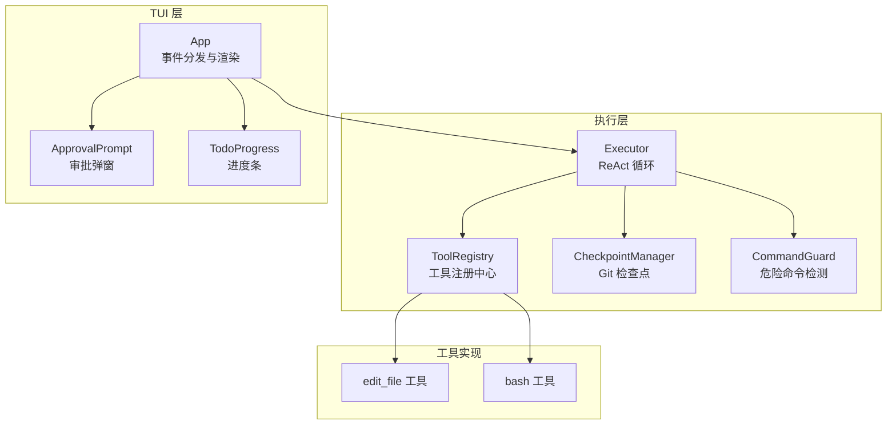
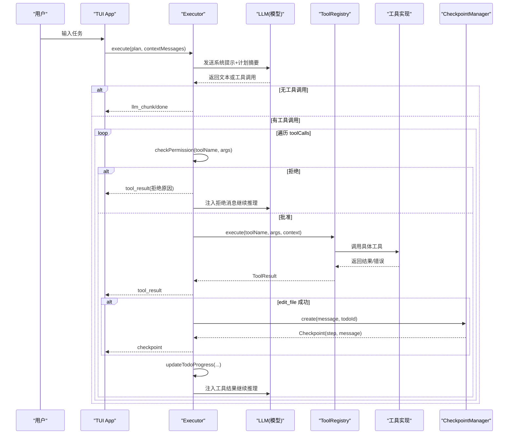
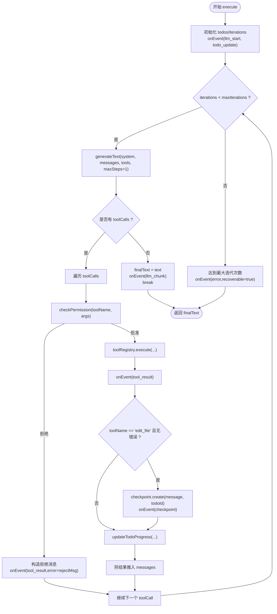
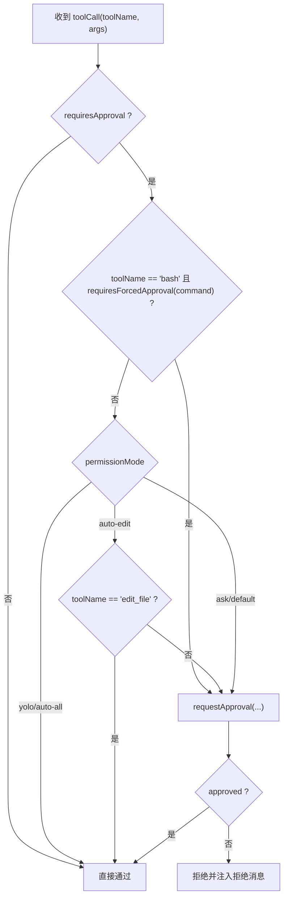
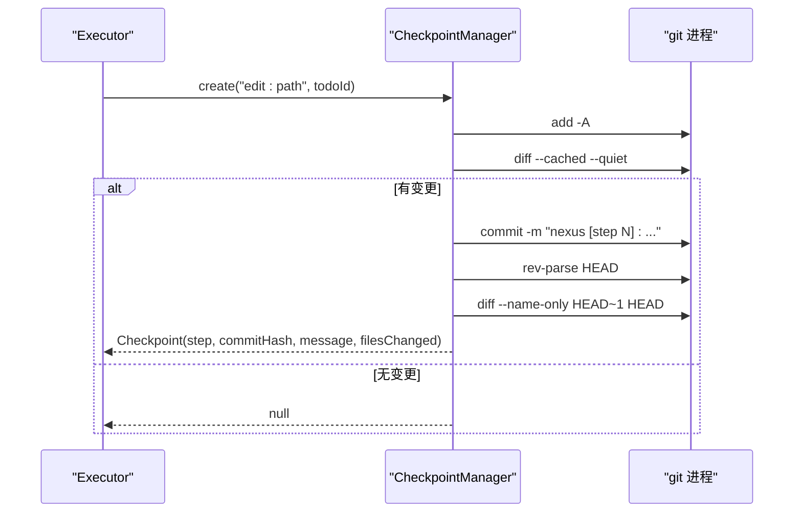
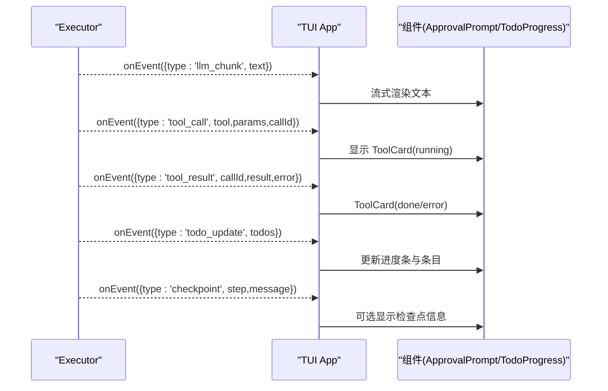
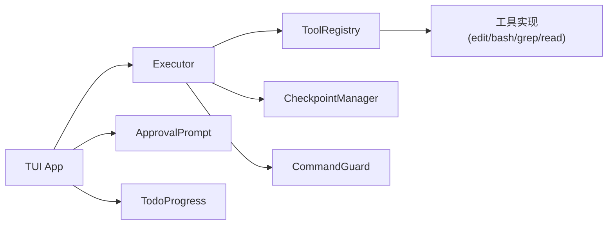

# Executor 执行引擎

<cite>
**本文引用的文件**   
- [src/agent/Executor.ts](file://src/agent/Executor.ts)
- [src/tools/registry.ts](file://src/tools/registry.ts)
- [src/sandbox/Checkpoint.ts](file://src/sandbox/Checkpoint.ts)
- [src/sandbox/CommandGuard.ts](file://src/sandbox/CommandGuard.ts)
- [src/tools/editFile.ts](file://src/tools/editFile.ts)
- [src/tools/bash.ts](file://src/tools/bash.ts)
- [src/tui/components/ApprovalPrompt.tsx](file://src/tui/components/ApprovalPrompt.tsx)
- [src/tui/components/TodoProgress.tsx](file://src/tui/components/TodoProgress.tsx)
- [src/tui/App.tsx](file://src/tui/App.tsx)
- [src/config.ts](file://src/config.ts)
- [README.md](file://README.md)
</cite>

## 目录
1. [简介](#简介)
2. [项目结构](#项目结构)
3. [核心组件](#核心组件)
4. [架构总览](#架构总览)
5. [详细组件分析](#详细组件分析)
6. [依赖关系分析](#依赖关系分析)
7. [性能考量](#性能考量)
8. [故障排查指南](#故障排查指南)
9. [结论](#结论)
10. [附录](#附录)

## 简介
本技术文档聚焦于 Executor 执行引擎，系统性阐述 Execute 阶段的 ReAct 循环、任务（Todo）推进机制、工具调用调度与权限控制、Git 检查点管理、错误恢复策略，以及与 TUI 层的实时通信。文档同时给出配置项说明与自定义扩展方法，并附带性能优化建议与调试技巧，帮助读者快速理解与高效使用。

## 项目结构
与 Executor 相关的代码主要分布在以下模块：
- 执行器与类型定义：src/agent/Executor.ts、src/agent/types.ts
- 工具注册与实现：src/tools/registry.ts、src/tools/editFile.ts、src/tools/bash.ts
- 沙箱与安全：src/sandbox/Checkpoint.ts、src/sandbox/CommandGuard.ts
- TUI 交互：src/tui/App.tsx、src/tui/components/ApprovalPrompt.tsx、src/tui/components/TodoProgress.tsx
- 配置加载：src/config.ts
- 项目说明：README.md



图表来源
- [src/agent/Executor.ts:1-234](file://src/agent/Executor.ts#L1-L234)
- [src/tools/registry.ts:1-96](file://src/tools/registry.ts#L1-L96)
- [src/sandbox/Checkpoint.ts:1-182](file://src/sandbox/Checkpoint.ts#L1-L182)
- [src/sandbox/CommandGuard.ts:1-98](file://src/sandbox/CommandGuard.ts#L1-L98)
- [src/tools/editFile.ts:1-170](file://src/tools/editFile.ts#L1-L170)
- [src/tools/bash.ts:1-186](file://src/tools/bash.ts#L1-L186)
- [src/tui/App.tsx:1-284](file://src/tui/App.tsx#L1-L284)
- [src/tui/components/ApprovalPrompt.tsx:1-57](file://src/tui/components/ApprovalPrompt.tsx#L1-L57)
- [src/tui/components/TodoProgress.tsx:1-72](file://src/tui/components/TodoProgress.tsx#L1-L72)

章节来源
- [README.md:1-174](file://README.md#L1-L174)

## 核心组件
- Executor：Execute 阶段的核心控制器，驱动 ReAct 循环，协调工具调用、权限校验、检查点创建与 Todo 状态更新。
- ToolRegistry：工具注册中心，负责工具的注册、按阶段过滤、参数生成与执行派发。
- CheckpointManager：基于 Git 的检查点管理器，自动提交变更、支持回滚与跳转。
- CommandGuard：危险命令检测，强制对高危命令进行审批拦截。
- TUI 组件：ApprovalPrompt、TodoProgress、App 等，负责用户交互、实时展示与事件分发。

章节来源
- [src/agent/Executor.ts:1-234](file://src/agent/Executor.ts#L1-L234)
- [src/tools/registry.ts:1-96](file://src/tools/registry.ts#L1-L96)
- [src/sandbox/Checkpoint.ts:1-182](file://src/sandbox/Checkpoint.ts#L1-L182)
- [src/sandbox/CommandGuard.ts:1-98](file://src/sandbox/CommandGuard.ts#L1-L98)
- [src/tui/components/ApprovalPrompt.tsx:1-57](file://src/tui/components/ApprovalPrompt.tsx#L1-L57)
- [src/tui/components/TodoProgress.tsx:1-72](file://src/tui/components/TodoProgress.tsx#L1-L72)
- [src/tui/App.tsx:1-284](file://src/tui/App.tsx#L1-L284)

## 架构总览
Executor 在 Execute 阶段通过 ReAct 循环逐步执行 Plan 中的每个 Todo 项。每次迭代调用 LLM 生成文本或工具调用；若存在工具调用，则依次进行权限校验、工具执行、结果反馈与 Todo 状态推进；编辑成功后触发 Git 检查点快照。TUI 层通过事件总线实时接收 llm_chunk、tool_call、tool_result、todo_update、checkpoint 等事件，用于流式输出、工具卡片、审批弹窗与进度条更新。



图表来源
- [src/agent/Executor.ts:50-165](file://src/agent/Executor.ts#L50-L165)
- [src/tools/registry.ts:70-82](file://src/tools/registry.ts#L70-L82)
- [src/sandbox/Checkpoint.ts:72-116](file://src/sandbox/Checkpoint.ts#L72-L116)
- [src/tui/App.tsx:108-176](file://src/tui/App.tsx#L108-L176)

## 详细组件分析

### Executor 执行器与 ReAct 循环
- 入口函数 execute(plan, contextMessages)：初始化 todos、迭代计数，构建系统提示与计划摘要，进入 while 循环直至达到 maxIterations 或 LLM 不再调用工具。
- 工具集合：从 ToolRegistry.getForPhase('execute') 获取当前阶段可用工具，并为 AI SDK 生成描述与参数 schema。
- 权限检查：checkPermission 根据工具定义 requiresApproval、CommandGuard 的危险命令规则以及配置的 permissionMode 决定是否需要用户审批。
- 工具执行：通过 ToolRegistry.execute 调用具体工具，收集 result/error 并通过 onEvent 推送 tool_result。
- 检查点：当 edit_file 成功时，调用 CheckpointManager.create 创建快照，关联当前 in_progress 的 todoId。
- Todo 推进：updateTodoProgress 将首个 pending 的 todo 标记为 in_progress；非测试类 bash 执行后将 in_progress 标记为 complete。
- 事件上报：llm_start、llm_chunk、tool_call、tool_result、todo_update、checkpoint、error 等事件统一由 onEvent 上报给 TUI。



图表来源
- [src/agent/Executor.ts:50-165](file://src/agent/Executor.ts#L50-L165)
- [src/agent/Executor.ts:167-196](file://src/agent/Executor.ts#L167-L196)
- [src/agent/Executor.ts:198-215](file://src/agent/Executor.ts#L198-L215)

章节来源
- [src/agent/Executor.ts:1-234](file://src/agent/Executor.ts#L1-L234)

### 工具调度与 ToolRegistry 集成
- 注册与查询：register/get/getAll/getForPhase/getApprovalRequired/toAISDKTools。
- 阶段过滤：getForPhase(phase) 仅返回 phase 匹配或 both 的工具。
- 执行派发：execute(name, params, context) 查找 handler 并调用其 execute(params, context)。
- 上下文传递：ToolContext 包含 projectRoot、callId、maxReadLines、maxOutputBytes、bashTimeout 等，供工具安全与限流使用。

```mermaid
classDiagram
class ToolRegistry {
+register(handler) void
+get(name) ToolHandler?
+has(name) boolean
+getAll() ToolHandler[]
+getForPhase(phase) ToolHandler[]
+getApprovalRequired() string[]
+toAISDKTools(phase) Record~string,{description : string;parameters : unknown}~
+execute(name, params, context) Promise~ToolResult~
}
class ToolHandler {
+definition : ToolDefinition
+execute(params, context) Promise~ToolResult~
}
class ToolContext {
+projectRoot : string
+callId : string
+maxReadLines : number
+maxOutputBytes : number
+bashTimeout : number
}
ToolRegistry --> ToolHandler : "管理"
ToolHandler --> ToolContext : "使用"
```

图表来源
- [src/tools/registry.ts:25-83](file://src/tools/registry.ts#L25-L83)

章节来源
- [src/tools/registry.ts:1-96](file://src/tools/registry.ts#L1-L96)

### 权限控制系统与审批流程
- PermissionMode 模式：ask（默认）、auto-edit、auto-all、yolo。
- 危险命令强制审批：CommandGuard.requiresForcedApproval 对高危命令（如 rm -rf /、格式化磁盘、Fork 炸弹、网络下载并执行脚本等）强制要求审批，即使 yolo 模式也不绕过。
- 审批回调：requestApproval(tool, params, diff?) 由上层（TUI）提供，返回 true 表示批准，false 表示拒绝。
- 拒绝处理：Executor 将拒绝原因作为 user 消息注入 LLM，引导其换一种方式完成任务。



图表来源
- [src/agent/Executor.ts:167-196](file://src/agent/Executor.ts#L167-L196)
- [src/sandbox/CommandGuard.ts:71-98](file://src/sandbox/CommandGuard.ts#L71-L98)
- [src/tui/components/ApprovalPrompt.tsx:1-57](file://src/tui/components/ApprovalPrompt.tsx#L1-L57)

章节来源
- [src/agent/Executor.ts:167-196](file://src/agent/Executor.ts#L167-L196)
- [src/sandbox/CommandGuard.ts:1-98](file://src/sandbox/CommandGuard.ts#L1-L98)
- [src/tui/components/ApprovalPrompt.tsx:1-57](file://src/tui/components/ApprovalPrompt.tsx#L1-L57)

### 检查点管理与 Git 集成
- 初始化：init 确保仓库存在、有初始提交、创建或切换到 checkpoint 分支。
- 创建检查点：create 暂存所有变更并提交，记录 step、commitHash、message、todoId、timestamp、filesChanged。
- 回滚与跳转：undo 回滚到上一个检查点；jumpTo 跳转到指定步骤并清理后续检查点。
- 合并：mergeToWorkBranch 将检查点分支合并回工作分支。



图表来源
- [src/sandbox/Checkpoint.ts:42-116](file://src/sandbox/Checkpoint.ts#L42-L116)

章节来源
- [src/sandbox/Checkpoint.ts:1-182](file://src/sandbox/Checkpoint.ts#L1-L182)

### 错误恢复与重试策略
- 部分失败处理：工具执行返回 error 字段，Executor 将其包装为 tool_result 事件并注入 LLM 上下文，促使 LLM 调整策略。
- 迭代上限保护：当 iterations >= maxIterations，返回当前进度并上报 recoverable 错误，允许上层决定是否继续或回滚。
- 编辑失败回退：edit_file 未找到匹配或不唯一时返回错误，Executor 将错误信息反馈给 LLM，避免重复错误路径。
- 命令超时与截断：bash 工具支持超时与输出截断，避免长时间阻塞与内存膨胀。

章节来源
- [src/agent/Executor.ts:157-165](file://src/agent/Executor.ts#L157-L165)
- [src/tools/editFile.ts:113-129](file://src/tools/editFile.ts#L113-L129)
- [src/tools/bash.ts:123-183](file://src/tools/bash.ts#L123-L183)

### 与 TUI 层的实时通信
- 事件类型：llm_start、llm_chunk、llm_done、tool_call、tool_approval_request、tool_result、todo_update、checkpoint、cost_update、phase_change、done、error。
- 事件分发：TUI App 通过全局事件处理器 __nexusEventHandler 接收事件并更新 UI（消息列表、工具卡片、审批弹窗、进度条）。
- 审批交互：ApprovalPrompt 组件提供 Y/N 按键响应，调用外部 requestApproval 回调。
- 进度展示：TodoProgress 组件根据 todos 状态实时更新进度条与条目样式。



图表来源
- [src/tui/App.tsx:108-176](file://src/tui/App.tsx#L108-L176)
- [src/tui/components/ApprovalPrompt.tsx:1-57](file://src/tui/components/ApprovalPrompt.tsx#L1-L57)
- [src/tui/components/TodoProgress.tsx:1-72](file://src/tui/components/TodoProgress.tsx#L1-L72)

章节来源
- [src/tui/App.tsx:1-284](file://src/tui/App.tsx#L1-L284)
- [src/tui/components/ApprovalPrompt.tsx:1-57](file://src/tui/components/ApprovalPrompt.tsx#L1-L57)
- [src/tui/components/TodoProgress.tsx:1-72](file://src/tui/components/TodoProgress.tsx#L1-L72)

### 配置选项与自定义执行策略
- 配置文件：.nexus/config.toml，通过 loadConfig 合并默认值。
- 关键配置项：
  - models：planner/executor/summarizer/verifier 及 providers 配置。
  - permissions.mode：ask/auto-edit/auto-all/yolo。
  - limits：maxSessionCost、bashTimeout、maxReadLines、maxIterations、maxOutputBytes。
  - context：budgetRatio、recentTurnsKeep。
  - checkpoint：autoCheckpoint、branch。
- 自定义执行策略：
  - 扩展 ToolRegistry：新增工具注册与定义，实现 ToolHandler.execute。
  - 自定义权限策略：在 Executor.checkPermission 中增加新的判断逻辑或接入外部审批服务。
  - 自定义检查点行为：继承或替换 CheckpointManager，实现不同的快照/回滚策略。
  - 自定义事件处理：在 onEvent 回调中实现日志、监控、审计等。

章节来源
- [src/config.ts:1-132](file://src/config.ts#L1-L132)
- [src/tools/registry.ts:85-93](file://src/tools/registry.ts#L85-L93)
- [src/agent/Executor.ts:29-48](file://src/agent/Executor.ts#L29-L48)

## 依赖关系分析
- Executor 依赖 ToolRegistry、CheckpointManager、CommandGuard 与 onEvent 回调。
- ToolRegistry 依赖各工具实现（readFile、editFile、bash、grep），并提供阶段过滤与执行派发。
- CheckpointManager 依赖 git 命令行，封装常用操作。
- TUI App 依赖事件类型与组件，负责渲染与用户交互。



图表来源
- [src/agent/Executor.ts:1-234](file://src/agent/Executor.ts#L1-L234)
- [src/tools/registry.ts:1-96](file://src/tools/registry.ts#L1-L96)
- [src/sandbox/Checkpoint.ts:1-182](file://src/sandbox/Checkpoint.ts#L1-L182)
- [src/sandbox/CommandGuard.ts:1-98](file://src/sandbox/CommandGuard.ts#L1-L98)
- [src/tui/App.tsx:1-284](file://src/tui/App.tsx#L1-L284)

章节来源
- [src/agent/Executor.ts:1-234](file://src/agent/Executor.ts#L1-L234)
- [src/tools/registry.ts:1-96](file://src/tools/registry.ts#L1-L96)
- [src/sandbox/Checkpoint.ts:1-182](file://src/sandbox/Checkpoint.ts#L1-L182)
- [src/sandbox/CommandGuard.ts:1-98](file://src/sandbox/CommandGuard.ts#L1-L98)
- [src/tui/App.tsx:1-284](file://src/tui/App.tsx#L1-L284)

## 性能考量
- 限制迭代次数：通过 maxIterations 防止无限循环，避免资源耗尽。
- 输出截断：bash 工具对 stdout/stderr 进行尾部截断，减少内存占用与传输开销。
- 原子写入：edit_file 使用临时文件 + rename 保证写入原子性，降低损坏风险。
- 最小化工具集：按阶段过滤工具，减少 LLM 工具选择复杂度。
- 事件批量更新：TUI 组件按需更新，避免频繁重渲染。

[本节为通用指导，不直接分析具体文件]

## 故障排查指南
- 工具调用失败：查看 tool_result 事件的 error 字段，确认参数是否正确、权限是否被拒绝。
- 编辑失败：edit_file 报错通常为未找到匹配或不唯一，需重新 read_file 获取最新内容并扩大 old_string 上下文。
- 命令超时：bash 工具超时后会终止进程组，检查命令耗时与 maxOutputBytes 设置。
- 权限问题：确认 permissionMode 与 CommandGuard 的危险命令规则，必要时调整审批策略。
- 检查点异常：确认 Git 仓库状态与分支权限，必要时手动 reset 或清理分支。

章节来源
- [src/agent/Executor.ts:157-165](file://src/agent/Executor.ts#L157-L165)
- [src/tools/editFile.ts:113-129](file://src/tools/editFile.ts#L113-L129)
- [src/tools/bash.ts:123-183](file://src/tools/bash.ts#L123-L183)
- [src/sandbox/CommandGuard.ts:71-98](file://src/sandbox/CommandGuard.ts#L71-L98)
- [src/sandbox/Checkpoint.ts:118-155](file://src/sandbox/Checkpoint.ts#L118-L155)

## 结论
Executor 执行引擎以 ReAct 循环为核心，结合严格的权限控制与 Git 检查点机制，实现了可追溯、可回滚、可审批的执行流程。通过 ToolRegistry 的工具抽象与 TUI 的事件驱动，系统在安全性、可观测性与用户体验方面达到了生产级标准。合理配置与扩展策略可进一步提升性能与灵活性。

[本节为总结，不直接分析具体文件]

## 附录
- 配置示例与用法参考 README 中的“权限模式”、“斜杠命令”与“运行”章节。
- 如需自定义工具或权限策略，建议在 ToolRegistry 与 Executor.checkPermission 中进行扩展，保持接口稳定。

章节来源
- [README.md:114-133](file://README.md#L114-L133)