# Orchestrator 核心编排器

<cite>
**本文引用的文件**   
- [src/agent/Orchestrator.ts](file://src/agent/Orchestrator.ts)
- [src/agent/types.ts](file://src/agent/types.ts)
- [src/agent/Planner.ts](file://src/agent/Planner.ts)
- [src/agent/Executor.ts](file://src/agent/Executor.ts)
- [src/tools/registry.ts](file://src/tools/registry.ts)
- [src/router/ModelRouter.ts](file://src/router/ModelRouter.ts)
- [src/sandbox/Checkpoint.ts](file://src/sandbox/Checkpoint.ts)
- [src/context/Assembler.ts](file://src/context/Assembler.ts)
- [src/index.ts](file://src/index.ts)
- [README.md](file://README.md)
</cite>

## 目录
1. [简介](#简介)
2. [项目结构](#项目结构)
3. [核心组件](#核心组件)
4. [架构总览](#架构总览)
5. [详细组件分析](#详细组件分析)
6. [依赖关系分析](#依赖关系分析)
7. [性能考量](#性能考量)
8. [故障排查指南](#故障排查指南)
9. [结论](#结论)
10. [附录](#附录)

## 简介
本技术文档聚焦于 Orchestrator 核心编排器，阐述其作为 Agent 系统“大脑”的设计模式与实现细节。内容涵盖：
- ReAct Loop 内部状态机与生命周期管理（idle → planning → awaiting_approval → executing → done）
- 双阶段工作流协调机制：Plan 阶段调用 Planner 生成结构化计划，Execute 阶段调用 Executor 执行具体任务
- 事件驱动架构中的 NexusEvent 事件流设计（user_input、phase_change、todo_update、done 等）
- 与外部系统的集成协作：ToolRegistry、ModelRouter、CheckpointManager
- 完整初始化流程、错误处理策略与扩展点说明
- 自定义事件处理器与权限控制逻辑的示例指引

## 项目结构
Nexus 采用分层模块化组织，Agent 编排层位于 src/agent，工具注册在 src/tools，模型路由在 src/router，沙箱检查点在 src/sandbox，上下文工程在 src/context，入口在 src/index.ts。

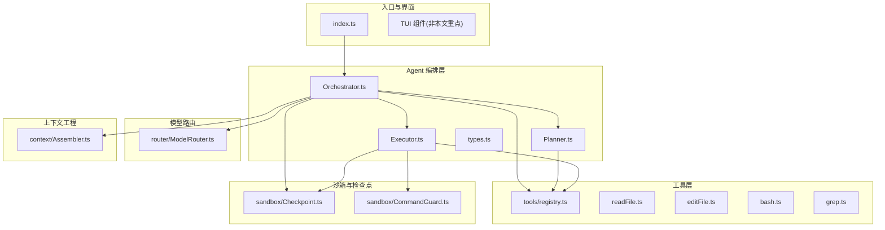

图表来源
- [src/index.ts:1-119](file://src/index.ts#L1-L119)
- [src/agent/Orchestrator.ts:1-260](file://src/agent/Orchestrator.ts#L1-L260)
- [src/agent/Planner.ts:1-176](file://src/agent/Planner.ts#L1-L176)
- [src/agent/Executor.ts:1-234](file://src/agent/Executor.ts#L1-L234)
- [src/tools/registry.ts:1-96](file://src/tools/registry.ts#L1-L96)
- [src/router/ModelRouter.ts:1-308](file://src/router/ModelRouter.ts#L1-L308)
- [src/sandbox/Checkpoint.ts:1-182](file://src/sandbox/Checkpoint.ts#L1-L182)
- [src/context/Assembler.ts:1-184](file://src/context/Assembler.ts#L1-L184)

章节来源
- [README.md:1-174](file://README.md#L1-L174)

## 核心组件
- Orchestrator：编排核心，负责生命周期、事件分发、双阶段协调、成本追踪、模型切换、历史与 Todo 管理
- Planner：Plan 阶段的 ReAct 循环，只读工具探索代码并输出结构化 Plan
- Executor：Execute 阶段的 ReAct 循环，带权限审批、Checkpoint 创建、Todo 进度推进
- ToolRegistry：工具注册中心，按阶段过滤工具、统一执行接口
- ModelRouter：多 Provider 模型路由，支持自动选择、降级、成本追踪
- CheckpointManager：Git 检查点管理，编辑后自动提交，支持回滚与跳转
- ContextAssembler：三层上下文组装与压缩，预算控制

章节来源
- [src/agent/Orchestrator.ts:1-260](file://src/agent/Orchestrator.ts#L1-L260)
- [src/agent/Planner.ts:1-176](file://src/agent/Planner.ts#L1-L176)
- [src/agent/Executor.ts:1-234](file://src/agent/Executor.ts#L1-L234)
- [src/tools/registry.ts:1-96](file://src/tools/registry.ts#L1-L96)
- [src/router/ModelRouter.ts:1-308](file://src/router/ModelRouter.ts#L1-L308)
- [src/sandbox/Checkpoint.ts:1-182](file://src/sandbox/Checkpoint.ts#L1-L182)
- [src/context/Assembler.ts:1-184](file://src/context/Assembler.ts#L1-L184)

## 架构总览
Orchestrator 通过事件驱动将用户输入转化为结构化计划，再进入执行阶段。每个阶段都通过 onEvent 回调向外广播事件，供 UI 或日志系统消费。

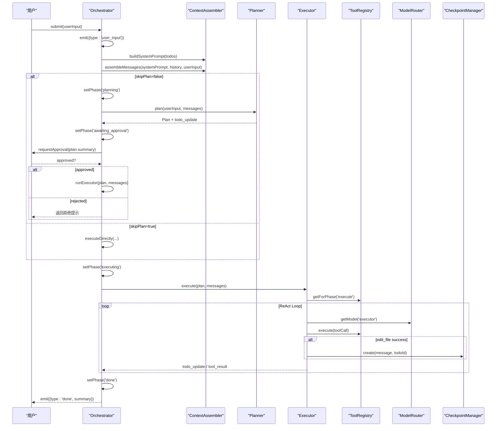

图表来源
- [src/agent/Orchestrator.ts:88-180](file://src/agent/Orchestrator.ts#L88-L180)
- [src/agent/Planner.ts:55-137](file://src/agent/Planner.ts#L55-L137)
- [src/agent/Executor.ts:50-165](file://src/agent/Executor.ts#L50-L165)
- [src/tools/registry.ts:44-82](file://src/tools/registry.ts#L44-L82)
- [src/router/ModelRouter.ts:204-227](file://src/router/ModelRouter.ts#L204-L227)
- [src/sandbox/Checkpoint.ts:72-116](file://src/sandbox/Checkpoint.ts#L72-L116)

## 详细组件分析

### Orchestrator 类：Agent 大脑与状态机
- 职责
  - 维护 AgentPhase 状态机：idle → planning → awaiting_approval → executing → done
  - 构建上下文（Assembler）、加载规则与 Secrets、初始化 ModelRouter
  - 协调 Plan/Execute 双阶段，分发事件，记录历史与 Todo
  - 提供 abort、undo、clearContext、模型切换、成本摘要等能力
- 关键方法
  - init：加载 secrets、rules，构建 ContextAssembler，初始化 Checkpoint
  - submit：主入口，根据 skipPlan 决定直接执行或 Plan→Execute
  - planAndExecute：Plan 阶段生成计划，等待审批，进入 Execute
  - executeDirectly：跳过 Plan，构造最小 Plan 直接进入 Execute
  - runExecutor：实例化 Executor，传入模型、工具、权限模式、审批回调
  - setPhase/emit：状态变更与事件广播
- 事件流
  - user_input、llm_start、tool_call、tool_result、todo_update、checkpoint、cost_update、phase_change、done、error

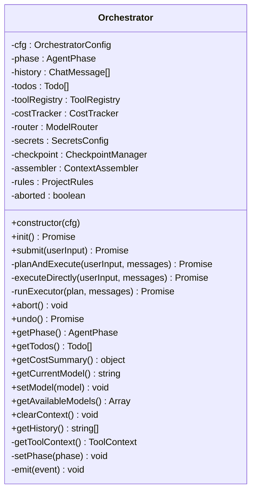

图表来源
- [src/agent/Orchestrator.ts:38-259](file://src/agent/Orchestrator.ts#L38-L259)

章节来源
- [src/agent/Orchestrator.ts:1-260](file://src/agent/Orchestrator.ts#L1-L260)

### Planner：Plan 阶段 ReAct 循环
- 职责
  - 使用只读工具（read_file、grep）探索代码库
  - 通过 LLM 生成结构化 Plan（summary、todos、filesToModify、estimatedSteps）
  - 解析 JSON 代码块，失败时回退到简单计划
- 关键流程
  - 设置 phase=plan 的事件
  - 获取 plan 阶段可用工具，构建 AI SDK 兼容的工具定义
  - ReAct 循环：generateText → 工具调用 → 结果注入消息 → 继续直到无工具调用
  - 输出 llm_done 事件，解析并返回 Plan

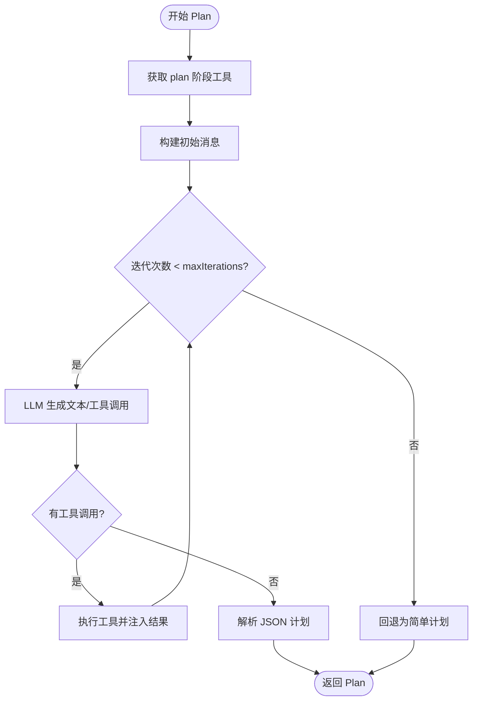

图表来源
- [src/agent/Planner.ts:55-137](file://src/agent/Planner.ts#L55-L137)
- [src/agent/Planner.ts:139-174](file://src/agent/Planner.ts#L139-L174)

章节来源
- [src/agent/Planner.ts:1-176](file://src/agent/Planner.ts#L1-L176)

### Executor：Execute 阶段 ReAct 循环与权限控制
- 职责
  - 按照批准的 Plan 逐步执行，每步可回滚
  - 权限检查：基于 permissionMode 与危险命令强制审批
  - 编辑成功后创建 Checkpoint，更新 Todo 进度
- 关键流程
  - 设置 phase=execute 的事件，初始化 todos
  - 获取 execute 阶段全部工具，构建 AI SDK 工具定义
  - ReAct 循环：generateText → 工具调用 → 权限检查 → 执行工具 → 结果注入消息
  - edit_file 成功则创建 checkpoint；bash 测试成功则标记 todo 完成
  - 达到迭代上限时发出 error 事件

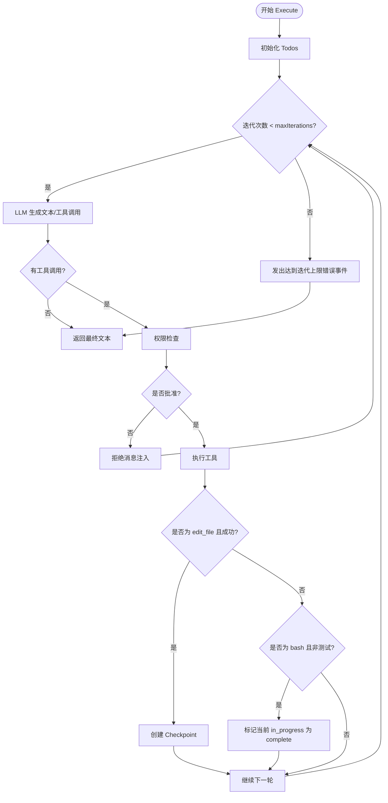

图表来源
- [src/agent/Executor.ts:50-165](file://src/agent/Executor.ts#L50-L165)
- [src/agent/Executor.ts:167-196](file://src/agent/Executor.ts#L167-L196)
- [src/agent/Executor.ts:198-215](file://src/agent/Executor.ts#L198-L215)

章节来源
- [src/agent/Executor.ts:1-234](file://src/agent/Executor.ts#L1-L234)

### ToolRegistry：工具注册与阶段隔离
- 职责
  - 注册/查找/执行工具
  - 按阶段过滤工具（plan/execute/both）
  - 生成 Vercel AI SDK 兼容的工具定义
- 关键点
  - getForPhase：仅暴露对应阶段的工具
  - getApprovalRequired：列出需要审批的工具名
  - execute：统一执行接口，返回 ToolResult

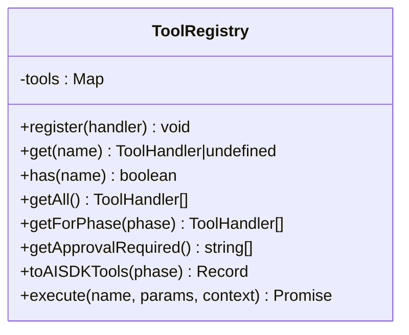

图表来源
- [src/tools/registry.ts:25-83](file://src/tools/registry.ts#L25-L83)

章节来源
- [src/tools/registry.ts:1-96](file://src/tools/registry.ts#L1-L96)

### ModelRouter：多 Provider 模型路由
- 职责
  - 初始化多个 Provider（Anthropic、OpenAI、Ollama、DeepSeek、Custom）
  - 按角色（planner/executor/summarizer/verifier）选择模型
  - 支持 auto 模式、降级链、成本追踪
- 关键点
  - getModel(role)：返回 LanguageModel 实例
  - getFallback(role)：Provider 不可用时的降级
  - getAvailableModels()：列出可用模型及当前选择

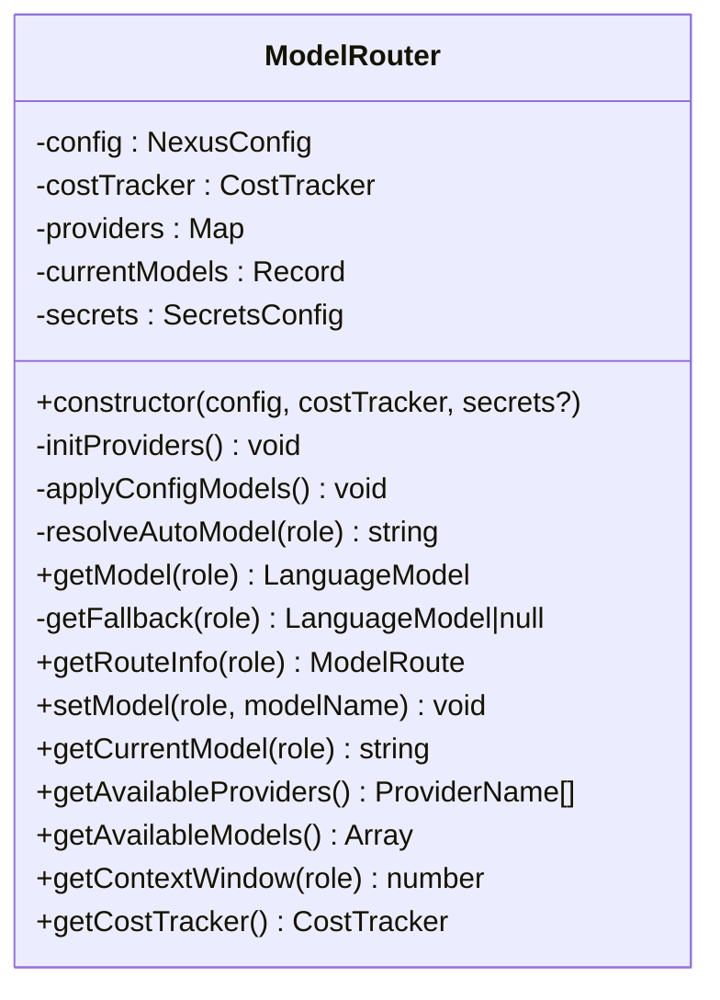

图表来源
- [src/router/ModelRouter.ts:101-308](file://src/router/ModelRouter.ts#L101-L308)

章节来源
- [src/router/ModelRouter.ts:1-308](file://src/router/ModelRouter.ts#L1-L308)

### CheckpointManager：Git 检查点与回滚
- 职责
  - 初始化 Git 仓库与分支
  - 每次 edit_file 成功后创建检查点并提交
  - 支持 undo/jumpTo/mergeToWorkBranch
- 关键点
  - create：暂存变更、提交、记录 commitHash 与变更文件列表
  - undo：回滚到上一个检查点
  - jumpTo：跳转到指定步骤

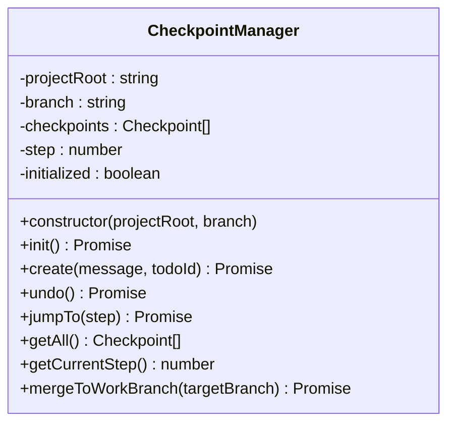

图表来源
- [src/sandbox/Checkpoint.ts:30-182](file://src/sandbox/Checkpoint.ts#L30-L182)

章节来源
- [src/sandbox/Checkpoint.ts:1-182](file://src/sandbox/Checkpoint.ts#L1-L182)

### ContextAssembler：上下文组装与预算控制
- 职责
  - 构建 system prompt（包含项目规则、工具说明、Git 状态、项目结构、Todo）
  - 组装消息列表并进行历史压缩与预算裁剪
- 关键点
  - buildSystemPrompt：整合静态与动态上下文
  - assembleMessages：预算分配、压缩历史、组装最终消息

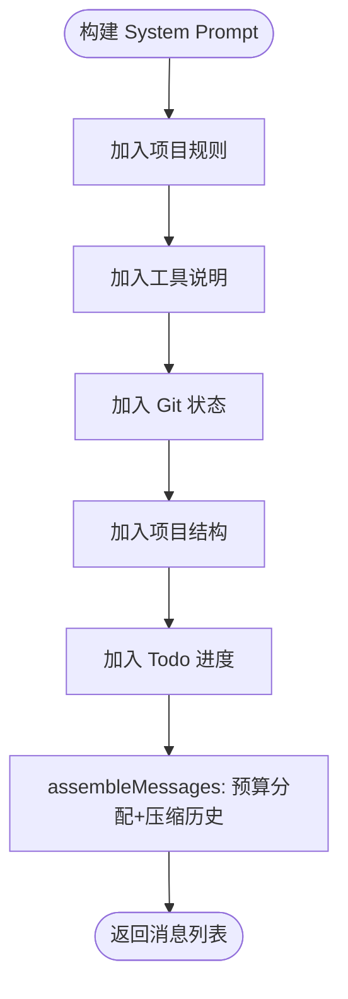

图表来源
- [src/context/Assembler.ts:55-116](file://src/context/Assembler.ts#L55-L116)

章节来源
- [src/context/Assembler.ts:1-184](file://src/context/Assembler.ts#L1-L184)

### 事件驱动架构：NexusEvent 类型与事件流
- 事件类型
  - user_input：用户输入
  - llm_start/llm_chunk/llm_done：LLM 调用生命周期
  - tool_call/tool_result：工具调用与结果
  - todo_update：Todo 进度更新
  - checkpoint：检查点创建
  - cost_update：成本更新
  - phase_change：阶段变化
  - done：完成
  - error：错误（含 recoverable 标志）
- 事件传播
  - Orchestrator.setPhase/emit 统一广播
  - Planner/Executor 在执行过程中持续触发事件
  - index.ts 中通过 emitToUI 将事件转发给 TUI

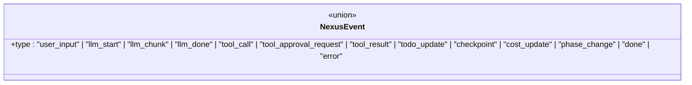

图表来源
- [src/agent/types.ts:8-22](file://src/agent/types.ts#L8-L22)

章节来源
- [src/agent/types.ts:1-269](file://src/agent/types.ts#L1-L269)
- [src/index.ts:51-63](file://src/index.ts#L51-L63)

### 权限控制与危险命令检测
- 权限模式
  - ask：默认，每个写操作询问
  - auto-edit：edit_file 自动批准，bash 仍问
  - auto-all：全部自动（危险命令仍强制问）
  - yolo：全部自动，含危险命令（自负责任）
- 危险命令检测
  - CommandGuard 正则黑名单识别危险命令（如 rm 根目录、格式化磁盘、Fork 炸弹、curl|bash 等）
  - requiresForcedApproval：危险命令无论权限模式均强制审批

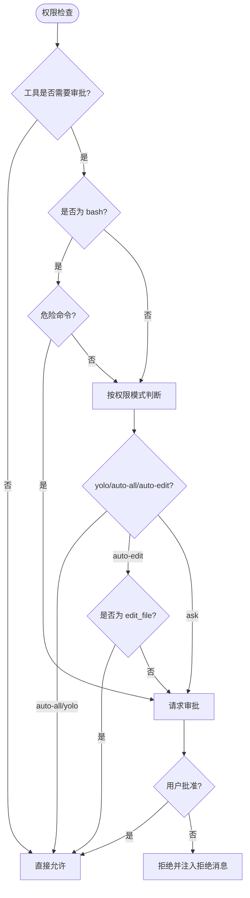

图表来源
- [src/agent/Executor.ts:167-196](file://src/agent/Executor.ts#L167-L196)
- [src/sandbox/CommandGuard.ts:71-98](file://src/sandbox/CommandGuard.ts#L71-L98)

章节来源
- [src/agent/Executor.ts:167-196](file://src/agent/Executor.ts#L167-L196)
- [src/sandbox/CommandGuard.ts:1-98](file://src/sandbox/CommandGuard.ts#L1-L98)

## 依赖关系分析
- Orchestrator 依赖：
  - Planner/Executor：双阶段执行
  - ToolRegistry：工具注册与执行
  - ModelRouter：模型选择与路由
  - CheckpointManager：检查点管理
  - ContextAssembler：上下文组装
- Planner 依赖：
  - ToolRegistry（plan 阶段工具）
  - AI SDK generateText
- Executor 依赖：
  - ToolRegistry（execute 阶段工具）
  - CheckpointManager（编辑后创建检查点）
  - CommandGuard（危险命令检测）
- ModelRouter 依赖：
  - CostTracker（成本追踪）
  - Secrets 配置（API Key）

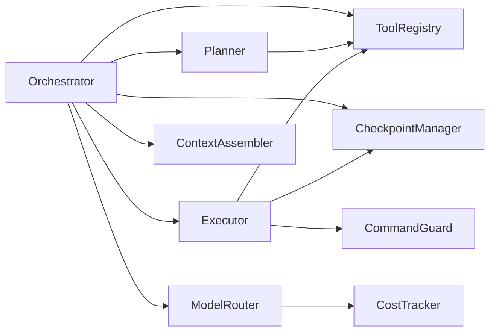

图表来源
- [src/agent/Orchestrator.ts:16-26](file://src/agent/Orchestrator.ts#L16-L26)
- [src/agent/Planner.ts:8-10](file://src/agent/Planner.ts#L8-L10)
- [src/agent/Executor.ts:8-12](file://src/agent/Executor.ts#L8-L12)
- [src/router/ModelRouter.ts:10-12](file://src/router/ModelRouter.ts#L10-L12)

章节来源
- [src/agent/Orchestrator.ts:1-260](file://src/agent/Orchestrator.ts#L1-L260)
- [src/agent/Planner.ts:1-176](file://src/agent/Planner.ts#L1-L176)
- [src/agent/Executor.ts:1-234](file://src/agent/Executor.ts#L1-L234)
- [src/tools/registry.ts:1-96](file://src/tools/registry.ts#L1-L96)
- [src/router/ModelRouter.ts:1-308](file://src/router/ModelRouter.ts#L1-L308)
- [src/sandbox/Checkpoint.ts:1-182](file://src/sandbox/Checkpoint.ts#L1-L182)
- [src/context/Assembler.ts:1-184](file://src/context/Assembler.ts#L1-L184)

## 性能考量
- 上下文预算与压缩
  - ContextAssembler 使用 TokenBudget 进行预算分配，对历史进行压缩，避免超出上下文窗口
- 工具输出截断
  - bash 工具对 stdout/stderr 进行尾部截断，防止大输出阻塞
- 迭代上限保护
  - Executor 设置 maxIterations，达到上限时发出错误事件，避免无限循环
- 模型路由与降级
  - ModelRouter 支持自动选择与降级链，确保可用性并平衡成本

[本节为通用指导，不直接分析具体文件]

## 故障排查指南
- 常见错误
  - 未知工具：ToolRegistry.execute 返回错误，确认工具已注册
  - 路径越界：read_file/edit_file 安全检查失败，确认路径在项目根内
  - 匹配不唯一：edit_file old_string 出现多次，提供更多上下文行
  - 危险命令被拒：CommandGuard 检测到危险命令，需人工审批
  - 达到迭代上限：Executor 达到 maxIterations，检查任务复杂度或调整上限
- 调试建议
  - 订阅 onEvent 事件，观察 tool_call/tool_result/todo_update/phase_change/error
  - 查看 CheckpointManager 的检查点历史，必要时使用 undo/jumpTo 回滚
  - 使用 getCostSummary 监控 token 消耗与成本

章节来源
- [src/tools/registry.ts:70-82](file://src/tools/registry.ts#L70-L82)
- [src/tools/readFile.ts:60-96](file://src/tools/readFile.ts#L60-L96)
- [src/tools/editFile.ts:110-130](file://src/tools/editFile.ts#L110-L130)
- [src/sandbox/CommandGuard.ts:71-98](file://src/sandbox/CommandGuard.ts#L71-L98)
- [src/agent/Executor.ts:157-165](file://src/agent/Executor.ts#L157-L165)

## 结论
Orchestrator 作为 Agent 系统的大脑，通过清晰的状态机与事件驱动架构，实现了 Plan/Execute 双阶段的可控执行。借助 ToolRegistry、ModelRouter、CheckpointManager 的协作，系统在安全性、可恢复性与成本可控性方面具备良好表现。扩展点包括自定义工具、权限控制逻辑与事件处理器，便于按需定制与集成。

[本节为总结，不直接分析具体文件]

## 附录

### 初始化流程
- index.ts 中创建 Orchestrator，注入 onEvent 与 requestApproval
- Orchestrator.init 加载 secrets、rules，构建 ContextAssembler，初始化 Checkpoint
- 非交互模式下直接 submit(prompt)，TUI 模式下渲染 App 并监听提交

章节来源
- [src/index.ts:42-65](file://src/index.ts#L42-L65)
- [src/agent/Orchestrator.ts:60-86](file://src/agent/Orchestrator.ts#L60-L86)

### 自定义事件处理器
- 在 index.ts 中通过 onEvent 回调接收所有 NexusEvent，转发至 UI 或日志系统
- 示例：订阅 phase_change 以更新界面状态，订阅 todo_update 以显示进度

章节来源
- [src/index.ts:51-63](file://src/index.ts#L51-L63)
- [src/agent/types.ts:8-22](file://src/agent/types.ts#L8-L22)

### 自定义权限控制逻辑
- 在 OrchestratorConfig.requestApproval 中实现自定义审批逻辑
- 结合 CommandGuard.requiresForcedApproval 对危险命令强制审批
- 示例：根据工具名与参数决定是否自动批准，或弹出确认对话框

章节来源
- [src/agent/Orchestrator.ts:34-36](file://src/agent/Orchestrator.ts#L34-L36)
- [src/sandbox/CommandGuard.ts:92-98](file://src/sandbox/CommandGuard.ts#L92-L98)

### 扩展点说明
- 新增工具：在 tools/registry.ts 中注册 ToolHandler，定义 name/description/inputSchema/requiresApproval/phase
- 新增 Provider：在 ModelRouter 中初始化新的 provider 工厂，并在 MODEL_CATALOG 中添加模型信息
- 自定义上下文层：扩展 ContextAssembler 的 buildSystemPrompt 与 assembleMessages，增加更多上下文源

章节来源
- [src/tools/registry.ts:85-93](file://src/tools/registry.ts#L85-L93)
- [src/router/ModelRouter.ts:118-165](file://src/router/ModelRouter.ts#L118-L165)
- [src/context/Assembler.ts:55-116](file://src/context/Assembler.ts#L55-L116)