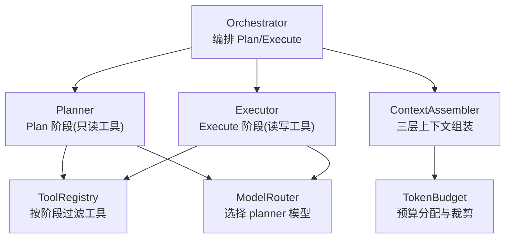
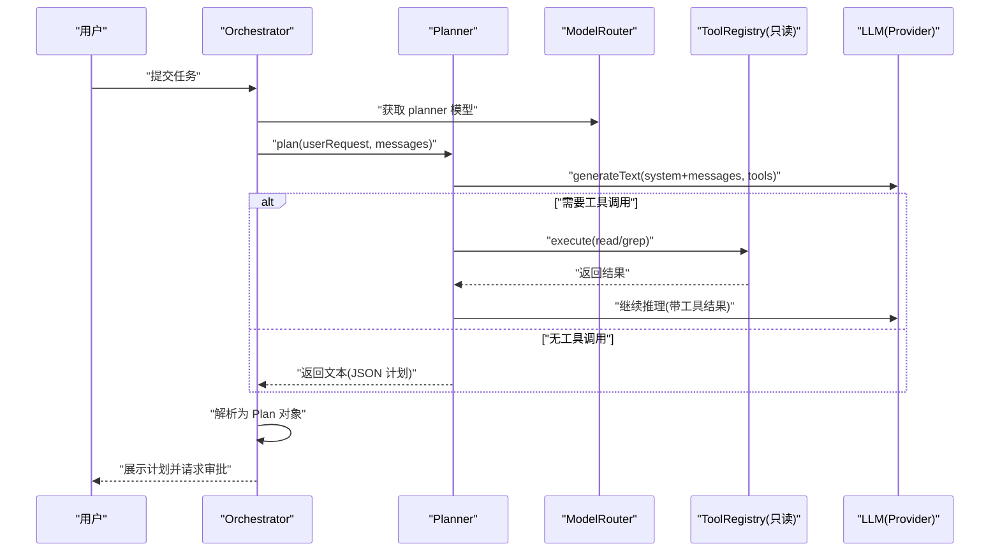
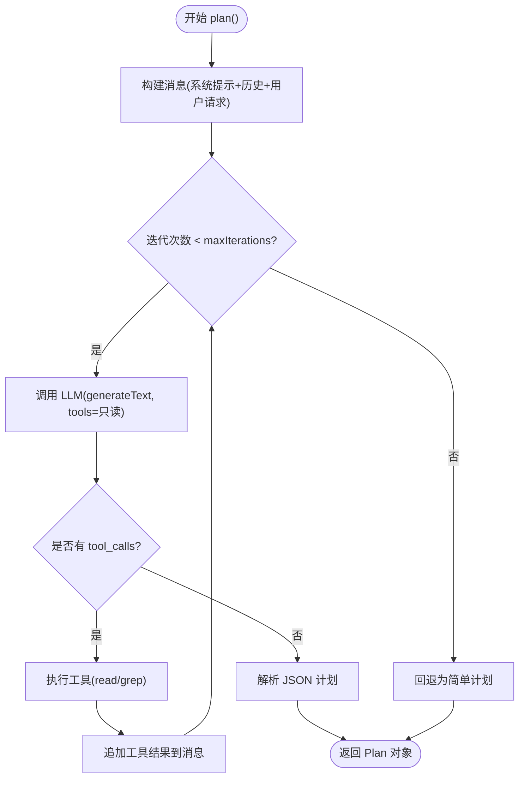
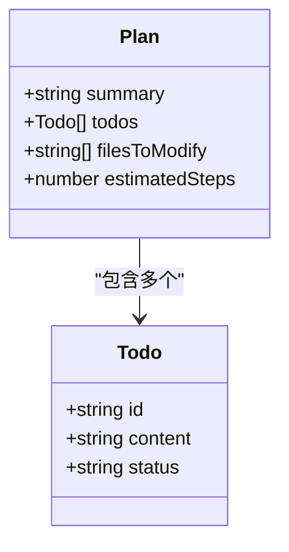
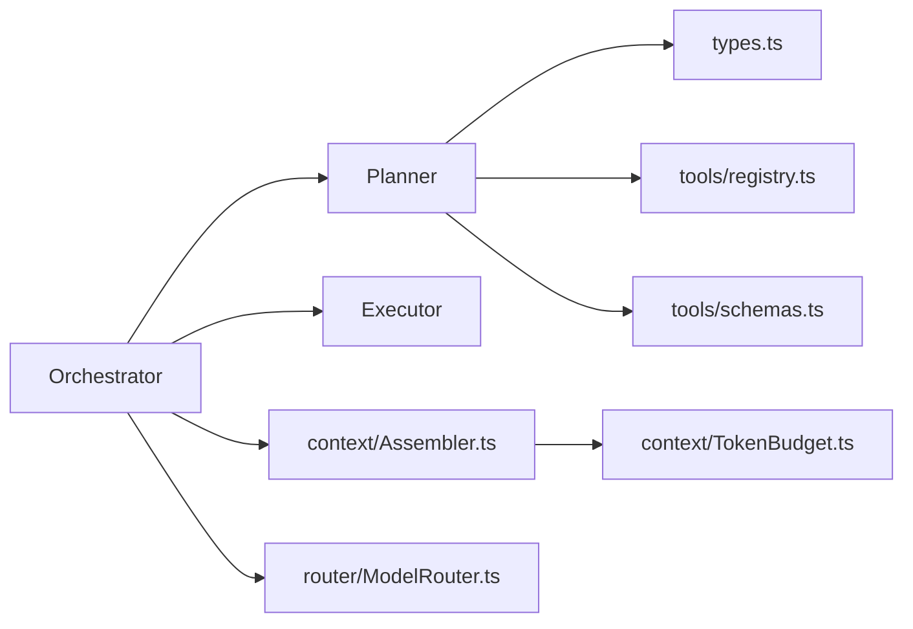

# Planner 规划系统

<cite>
**本文引用的文件**   
- [Planner.ts](file://src/agent/Planner.ts)
- [types.ts](file://src/agent/types.ts)
- [Orchestrator.ts](file://src/agent/Orchestrator.ts)
- [Executor.ts](file://src/agent/Executor.ts)
- [registry.ts](file://src/tools/registry.ts)
- [schemas.ts](file://src/tools/schemas.ts)
- [Assembler.ts](file://src/context/Assembler.ts)
- [TokenBudget.ts](file://src/context/TokenBudget.ts)
- [ModelRouter.ts](file://src/router/ModelRouter.ts)
- [config.toml](file://.nexus/config.toml)
- [rules.toml](file://.nexus/rules.toml)
- [README.md](file://README.md)
- [DESIGN.md](file://DESIGN.md)
</cite>

## 目录
1. [引言](#引言)
2. [项目结构](#项目结构)
3. [核心组件](#核心组件)
4. [架构总览](#架构总览)
5. [详细组件分析](#详细组件分析)
6. [依赖关系分析](#依赖关系分析)
7. [性能与预算控制](#性能与预算控制)
8. [故障排查指南](#故障排查指南)
9. [结论](#结论)
10. [附录：配置与使用示例](#附录配置与使用示例)

## 引言
本技术文档聚焦于 Nexus 的 Plan 阶段与 Planner 规划系统，系统性阐述以下要点：
- 智能规划算法：如何将自然语言需求转化为结构化执行计划（Plan）
- Todo 列表生成逻辑：任务分解策略、依赖关系分析与优先级排序
- Plan 对象数据结构：summary、todos、filesToModify、estimatedSteps 的含义与用途
- LLM 交互方式：提示词工程、上下文构建与结果解析
- 迭代限制与失败重试机制
- 配置选项与使用示例：如何自定义规划策略并优化计划质量
- 错误处理与边界情况处理方式

## 项目结构
Nexus 采用分层架构：TUI 层 → Agent 编排层（Orchestrator + Planner + Executor）→ 模型路由层（ModelRouter）→ 工具层（MCP-native）。Plan 阶段由 Planner 负责，仅允许只读工具（read_file、grep），在探索代码库后输出结构化 Plan。

图表来源
- [Orchestrator.ts:120-148](file://src/agent/Orchestrator.ts#L120-L148)
- [Planner.ts:55-137](file://src/agent/Planner.ts#L55-L137)
- [Executor.ts:50-165](file://src/agent/Executor.ts#L50-L165)
- [registry.ts:44-68](file://src/tools/registry.ts#L44-L68)
- [ModelRouter.ts:101-179](file://src/router/ModelRouter.ts#L101-L179)
- [Assembler.ts:55-116](file://src/context/Assembler.ts#L55-L116)
- [TokenBudget.ts:31-57](file://src/context/TokenBudget.ts#L31-L57)

章节来源
- [README.md:1-174](file://README.md#L1-L174)
- [DESIGN.md:116-143](file://DESIGN.md#L116-L143)

## 核心组件
- Planner：Plan 阶段的智能规划器，基于 ReAct 循环调用只读工具探索代码库，最终输出结构化 Plan。
- Orchestrator：Agent 编排核心，协调 Plan/Execute 双阶段、子 Agent 分派、检查点管理。
- Executor：Execute 阶段的核心 ReAct Loop，逐步执行计划，每步可回滚。
- ToolRegistry：MCP 工具注册中心，按阶段提供可用工具集。
- ContextAssembler：三层上下文组装（L1/L2/L3），结合 TokenBudget 进行预算控制。
- ModelRouter：多 Provider 路由，支持降级与自动选择。

章节来源
- [Planner.ts:48-176](file://src/agent/Planner.ts#L48-L176)
- [Orchestrator.ts:38-148](file://src/agent/Orchestrator.ts#L38-L148)
- [Executor.ts:41-165](file://src/agent/Executor.ts#L41-L165)
- [registry.ts:25-96](file://src/tools/registry.ts#L25-L96)
- [Assembler.ts:48-116](file://src/context/Assembler.ts#L48-L116)
- [ModelRouter.ts:101-179](file://src/router/ModelRouter.ts#L101-L179)

## 架构总览
Plan 阶段的关键流程如下：
- 接收用户输入与上下文消息
- 通过 ModelRouter 获取 planner 模型
- 使用只读工具（read_file、grep）进行 ReAct 探索
- 解析 LLM 输出的 JSON 计划，生成 Plan 对象
- 将 Plan 提交给 Orchestrator 进入审批与 Execute 阶段

图表来源
- [Orchestrator.ts:120-148](file://src/agent/Orchestrator.ts#L120-L148)
- [Planner.ts:55-137](file://src/agent/Planner.ts#L55-L137)
- [registry.ts:44-68](file://src/tools/registry.ts#L44-L68)
- [ModelRouter.ts:204-227](file://src/router/ModelRouter.ts#L204-L227)

## 详细组件分析

### Plan 阶段智能规划算法
- 输入：用户自然语言需求与上下文消息（包含系统提示、历史压缩后的对话、当前任务进度等）
- 工具约束：仅允许只读工具（read_file、grep），避免在规划阶段产生副作用
- ReAct 循环：每次调用 LLM 最多一步（maxSteps=1），若出现 tool_call，则执行工具并将结果注入消息继续推理；若无 tool_call，则认为规划完成
- 输出：JSON 格式的 Plan，包含 summary、todos、filesToModify、estimatedSteps

图表来源
- [Planner.ts:55-137](file://src/agent/Planner.ts#L55-L137)
- [Planner.ts:139-174](file://src/agent/Planner.ts#L139-L174)

章节来源
- [Planner.ts:12-38](file://src/agent/Planner.ts#L12-38)
- [Planner.ts:55-137](file://src/agent/Planner.ts#L55-L137)
- [Planner.ts:139-174](file://src/agent/Planner.ts#L139-L174)

### Todo 列表生成逻辑
- 生成来源：Plan 的 todos 字段来自 LLM 输出的 JSON；若解析失败，回退为默认三步计划（分析需求、实施修改、验证正确性）
- 任务分解策略：要求“具体可执行，每步对应一个明确的文件操作”，步骤数量合理（通常 3-10 步）
- 依赖关系分析：Plan 阶段不显式建模依赖图，但通过“先理解再规划”的系统提示引导 LLM 在探索后再产出步骤
- 优先级排序：默认顺序即执行顺序；状态机包括 pending/in_progress/complete/cancelled，由 Execute 阶段推进

图表来源
- [types.ts:35-40](file://src/agent/types.ts#L35-L40)
- [types.ts:29-33](file://src/agent/types.ts#L29-L33)
- [Planner.ts:139-174](file://src/agent/Planner.ts#L139-L174)

章节来源
- [types.ts:29-40](file://src/agent/types.ts#L29-L40)
- [Planner.ts:139-174](file://src/agent/Planner.ts#L139-L174)

### Plan 对象数据结构说明
- summary：计划摘要，来源于 LLM 或回退为用户原始请求
- todos：任务列表，每项包含 id、content、status；用于 UI 进度展示与执行跟踪
- filesToModify：预计需要修改的文件路径集合，辅助用户审批与变更预览
- estimatedSteps：预估步骤数，默认等于 todos 长度，便于成本与时间估算

章节来源
- [types.ts:35-40](file://src/agent/types.ts#L35-L40)
- [Planner.ts:139-174](file://src/agent/Planner.ts#L139-L174)

### 与 LLM 模型的交互方式
- 提示词工程：
  - 系统提示包含角色定义、工作流规范、工具使用规则与输出格式约束
  - Plan 阶段专用后缀强调“只读工具”和“JSON 输出格式”
- 上下文构建：
  - 通过 ContextAssembler 组装 L1（静态）、L2（任务）、L3（检索）上下文
  - TokenBudget 控制预算比例与输出预留空间
- 结果解析：
  - 优先从 JSON 代码块中提取 Plan；解析失败时回退为简单计划
  - 对 todos 进行规范化（id、content、status）

章节来源
- [Planner.ts:12-38](file://src/agent/Planner.ts#L12-38)
- [Planner.ts:139-174](file://src/agent/Planner.ts#L139-L174)
- [Assembler.ts:55-116](file://src/context/Assembler.ts#L55-L116)
- [TokenBudget.ts:31-57](file://src/context/TokenBudget.ts#L31-L57)

### 迭代限制与失败重试机制
- 迭代限制：
  - Plan 阶段：maxIterations 上限（受 Orchestrator 传入值限制，最大 15）
  - Execute 阶段：独立 maxIterations，达到上限触发错误事件并输出当前进度
- 失败重试：
  - Plan 阶段：无显式重试，依靠 ReAct 循环多次推理直至无 tool_call
  - Execute 阶段：拒绝操作作为观察反馈喂回 LLM，促使其改道；危险命令强制审批
- 回退策略：
  - Plan JSON 解析失败时回退为简单计划
  - 模型不可用时尝试降级链（见 ModelRouter）

章节来源
- [Orchestrator.ts:120-148](file://src/agent/Orchestrator.ts#L120-L148)
- [Executor.ts:157-165](file://src/agent/Executor.ts#L157-L165)
- [Planner.ts:55-137](file://src/agent/Planner.ts#L55-L137)
- [ModelRouter.ts:229-243](file://src/router/ModelRouter.ts#L229-L243)

### 权限与工具约束
- Plan 阶段：仅暴露只读工具（read_file、grep），禁止写操作
- Execute 阶段：解锁全部工具（含 edit_file、bash），并根据权限模式决定是否审批
- 危险命令：无论权限模式如何，均强制审批

章节来源
- [registry.ts:44-68](file://src/tools/registry.ts#L44-L68)
- [Executor.ts:167-196](file://src/agent/Executor.ts#L167-L196)

## 依赖关系分析
- Planner 依赖：
  - ai SDK（generateText/streamText）
  - types（Plan、Todo、ChatMessage、NexusEvent）
  - ToolRegistry（按阶段过滤工具）
  - schemas（工具参数校验）
- Orchestrator 依赖：
  - Planner、Executor、SubAgent
  - ToolRegistry、ContextAssembler、TokenBudget、RulesLoader
  - ModelRouter、CostTracker、CheckpointManager
- 上下文与预算：
  - Assembler 组合 RulesLoader、Compressor、TokenBudget
  - TokenBudget 根据模型上下文窗口与预算比例分配各层 token 配额

图表来源
- [Planner.ts:1-10](file://src/agent/Planner.ts#L1-L10)
- [Orchestrator.ts:1-26](file://src/agent/Orchestrator.ts#L1-L26)
- [Assembler.ts:1-15](file://src/context/Assembler.ts#L1-L15)
- [TokenBudget.ts:1-21](file://src/context/TokenBudget.ts#L1-L21)
- [ModelRouter.ts:1-12](file://src/router/ModelRouter.ts#L1-L12)

章节来源
- [Planner.ts:1-10](file://src/agent/Planner.ts#L1-L10)
- [Orchestrator.ts:1-26](file://src/agent/Orchestrator.ts#L1-L26)
- [Assembler.ts:1-15](file://src/context/Assembler.ts#L1-L15)
- [TokenBudget.ts:1-21](file://src/context/TokenBudget.ts#L1-L21)
- [ModelRouter.ts:1-12](file://src/router/ModelRouter.ts#L1-L12)

## 性能与预算控制
- Token 预算：
  - 按模型上下文窗口与 budgetRatio 计算输入预算，预留固定输出空间
  - 分配比例：systemPrompt 25%、history 45%、toolResults 30%
- 上下文压缩：
  - 近期完整保留 recentTurnsKeep 轮次，早期内容压缩为摘要
  - 工具结果分级保留（错误信息完整保留，成功输出摘要化）
- 模型路由与降级：
  - 按角色选择合适模型（planner/executor 高档，summarizer/verifier 低档）
  - 自动选择可用 provider，不可用时沿降级链切换

章节来源
- [TokenBudget.ts:31-57](file://src/context/TokenBudget.ts#L31-L57)
- [Assembler.ts:92-116](file://src/context/Assembler.ts#L92-L116)
- [ModelRouter.ts:181-202](file://src/router/ModelRouter.ts#L181-L202)
- [ModelRouter.ts:229-243](file://src/router/ModelRouter.ts#L229-L243)

## 故障排查指南
- Plan 阶段常见问题：
  - JSON 解析失败：检查 LLM 输出是否包含标准 JSON 代码块；必要时调整 system 提示或减少工具调用复杂度
  - 迭代耗尽：增大 maxIterations 或精简 prompt；确认只读工具可用
- Execute 阶段常见问题：
  - 权限拒绝：检查权限模式与危险命令检测；必要时调整 requestApproval 回调
  - 迭代上限：查看当前 todo 进度，考虑拆分任务或提升模型能力
- 模型路由问题：
  - Provider 未配置或 API key 缺失：检查 secrets 与 config.toml；确认环境变量
  - 模型不在已知目录：确保 MODEL_CATALOG 覆盖或使用默认 provider 创建实例

章节来源
- [Planner.ts:139-174](file://src/agent/Planner.ts#L139-L174)
- [Executor.ts:157-196](file://src/agent/Executor.ts#L157-L196)
- [ModelRouter.ts:204-243](file://src/router/ModelRouter.ts#L204-L243)

## 结论
Planner 规划系统以“只读探索 + 结构化输出”为核心，通过 ReAct 循环与严格的工具约束，将自然语言需求转化为可执行的 Plan。配合 Orchestrator 的双阶段编排、上下文工程与多模型路由，系统在计划质量、成本控制与用户体验之间取得平衡。未来可通过增强依赖关系建模、细化优先级策略与引入语义检索进一步提升规划准确性与效率。

## 附录：配置与使用示例
- 配置文件（.nexus/config.toml）关键项：
  - models.planner / models.executor：指定或 auto 自动选择
  - permissions.mode：ask | auto-edit | auto-all | yolo
  - limits.max_iterations：Agent loop 最大迭代步数
  - context.budget_ratio：Token 预算占上下文窗口的比例
  - checkpoint.auto_checkpoint：是否自动创建 git checkpoint
- 项目约定（.nexus/rules.toml）：
  - project/language/test_command/build_command
  - style/indent/quote/semicolons
  - constraints 硬约束
  - context.always_include 常驻上下文文件
- 运行示例：
  - 交互式会话：bun run start
  - 带初始任务：bun run start "重构 utils 模块"
  - 指定模型：bun run start -m gpt-4o "修复登录 bug"
  - 自动批准编辑：bun run start --permission auto-edit "添加单元测试"
  - 非交互模式：bun run start --non-interactive "运行测试并修复失败的用例"

章节来源
- [config.toml:1-62](file://.nexus/config.toml#L1-L62)
- [rules.toml:1-21](file://.nexus/rules.toml#L1-L21)
- [README.md:95-132](file://README.md#L95-L132)