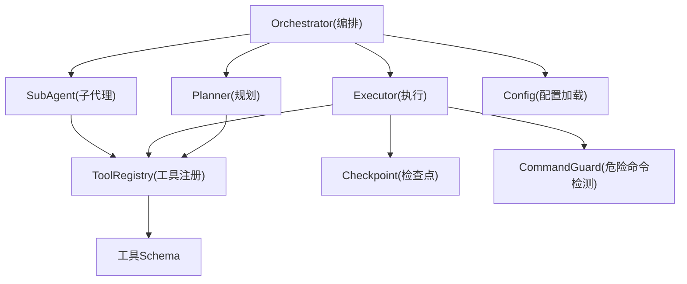
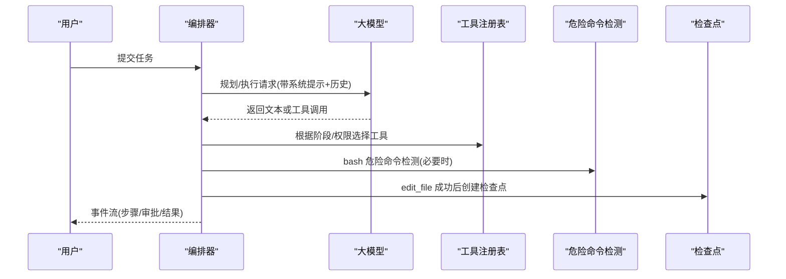
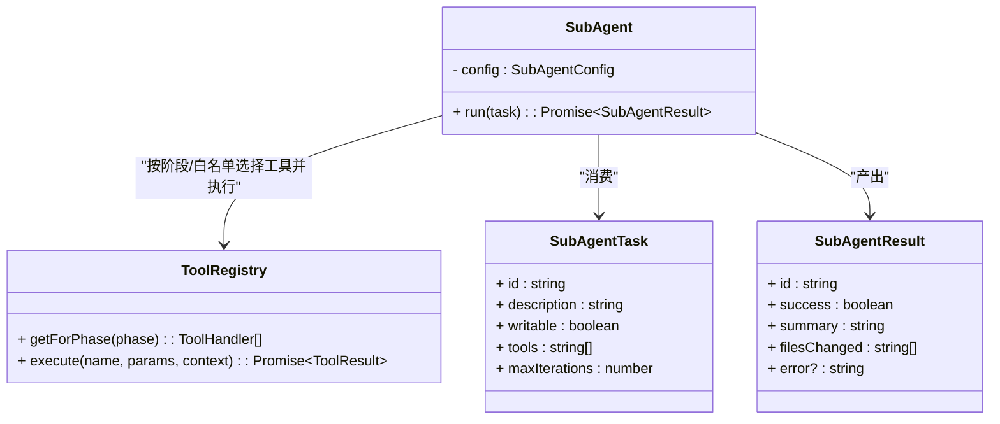
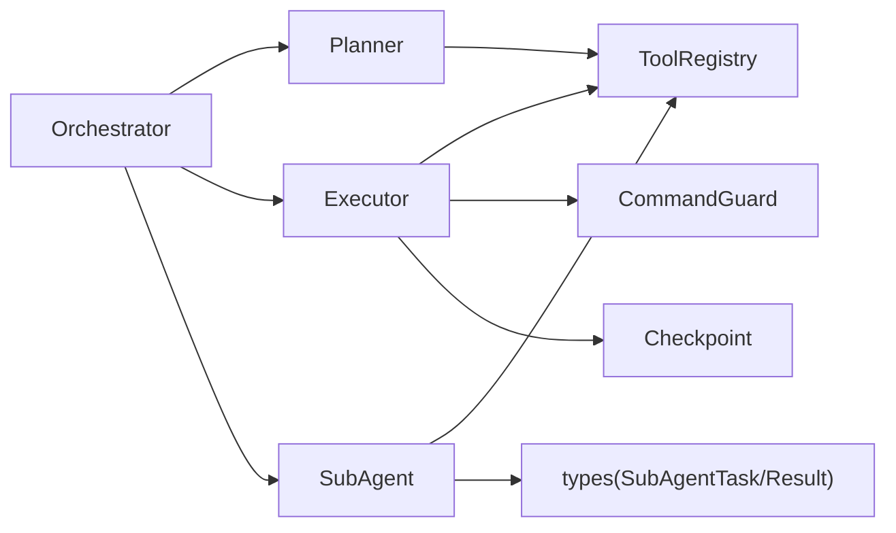

# SubAgent 子代理框架

<cite>
**本文引用的文件**   
- [SubAgent.ts](file://src/agent/SubAgent.ts)
- [Orchestrator.ts](file://src/agent/Orchestrator.ts)
- [Executor.ts](file://src/agent/Executor.ts)
- [Planner.ts](file://src/agent/Planner.ts)
- [types.ts](file://src/agent/types.ts)
- [registry.ts](file://src/tools/registry.ts)
- [schemas.ts](file://src/tools/schemas.ts)
- [Checkpoint.ts](file://src/sandbox/Checkpoint.ts)
- [CommandGuard.ts](file://src/sandbox/CommandGuard.ts)
- [config.ts](file://src/config.ts)
- [README.md](file://README.md)
- [DESIGN.md](file://DESIGN.md)
</cite>

## 目录
1. [简介](#简介)
2. [项目结构](#项目结构)
3. [核心组件](#核心组件)
4. [架构总览](#架构总览)
5. [详细组件分析](#详细组件分析)
6. [依赖关系分析](#依赖关系分析)
7. [性能与资源管理](#性能与资源管理)
8. [故障排查指南](#故障排查指南)
9. [结论](#结论)
10. [附录：配置与最佳实践](#附录配置与最佳实践)

## 简介
本技术文档聚焦于 SubAgent 子代理框架，系统性阐述复杂任务的分解与分派机制、隔离策略（独立上下文窗口、写权限控制、深度限制）、父子代理通信协议与数据传递方式、资源管理与生命周期控制（含内存优化与超时处理）、嵌套执行限制与防递归保护、配置选项与自定义行为，并提供使用场景、最佳实践以及性能监控与调试方法。

## 项目结构
围绕子代理的关键代码位于 agent 层与工具注册中心、沙箱安全与检查点模块之间。整体组织遵循“编排—规划—执行—子代理”的分层职责划分，并通过类型定义统一事件流与数据结构。

图示来源
- [Orchestrator.ts:1-260](file://src/agent/Orchestrator.ts#L1-L260)
- [Planner.ts:1-176](file://src/agent/Planner.ts#L1-L176)
- [Executor.ts:1-234](file://src/agent/Executor.ts#L1-L234)
- [SubAgent.ts:1-148](file://src/agent/SubAgent.ts#L1-L148)
- [registry.ts:1-96](file://src/tools/registry.ts#L1-L96)
- [schemas.ts:1-40](file://src/tools/schemas.ts#L1-L40)
- [Checkpoint.ts:1-182](file://src/sandbox/Checkpoint.ts#L1-L182)
- [CommandGuard.ts:1-98](file://src/sandbox/CommandGuard.ts#L1-L98)
- [config.ts:1-132](file://src/config.ts#L1-L132)

章节来源
- [README.md:1-174](file://README.md#L1-L174)
- [DESIGN.md:1-774](file://DESIGN.md#L1-L774)

## 核心组件
- 子代理类与任务/结果模型：定义子代理运行入口、工具选择、消息循环与结果汇总；提供暴露给主 Agent LLM 的 dispatch_subagent 工具定义。
- 编排器：负责 Plan/Execute 双阶段流程、子代理分派、审批回调、成本追踪、检查点集成等。
- 执行器：ReAct 循环、权限检查、工具调用、进度更新、检查点创建。
- 规划器：只读探索、结构化计划生成与解析。
- 工具注册表：按阶段过滤工具、参数 Schema 注入、统一执行接口。
- 沙箱与安全：危险命令检测、Git 检查点管理。
- 配置：默认值与 TOML 合并，影响权限模式、迭代上限、输出截断、bash 超时等。

章节来源
- [SubAgent.ts:1-148](file://src/agent/SubAgent.ts#L1-L148)
- [types.ts:198-213](file://src/agent/types.ts#L198-L213)
- [Orchestrator.ts:1-260](file://src/agent/Orchestrator.ts#L1-L260)
- [Executor.ts:1-234](file://src/agent/Executor.ts#L1-L234)
- [Planner.ts:1-176](file://src/agent/Planner.ts#L1-L176)
- [registry.ts:1-96](file://src/tools/registry.ts#L1-L96)
- [schemas.ts:1-40](file://src/tools/schemas.ts#L1-L40)
- [Checkpoint.ts:1-182](file://src/sandbox/Checkpoint.ts#L1-L182)
- [CommandGuard.ts:1-98](file://src/sandbox/CommandGuard.ts#L1-L98)
- [config.ts:1-132](file://src/config.ts#L1-L132)

## 架构总览
子代理作为“可被主 Agent 调用的独立执行单元”，具备独立上下文窗口与受限工具集，通过统一的工具注册表与事件流与主 Agent 协作。

图示来源
- [Orchestrator.ts:88-180](file://src/agent/Orchestrator.ts#L88-L180)
- [Executor.ts:50-165](file://src/agent/Executor.ts#L50-L165)
- [registry.ts:44-82](file://src/tools/registry.ts#L44-L82)
- [CommandGuard.ts:71-98](file://src/sandbox/CommandGuard.ts#L71-L98)
- [Checkpoint.ts:72-116](file://src/sandbox/Checkpoint.ts#L72-L116)

## 详细组件分析

### 子代理类与任务/结果模型
- 子代理运行入口接收任务描述、是否可写、允许的工具列表与最大迭代次数；根据 writable 决定可用工具集合（plan 或 execute），并可选进一步按 tools 白名单过滤。
- 内部维护消息历史，逐轮调用 LLM，若出现 tool_calls 则依次执行工具并将结果回灌；若无 tool_calls 则视为完成并汇总摘要。
- 对 edit_file 进行变更文件追踪，便于上层审计与回滚。
- 错误捕获后返回失败结果与错误信息。

图示来源
- [SubAgent.ts:20-118](file://src/agent/SubAgent.ts#L20-L118)
- [types.ts:198-213](file://src/agent/types.ts#L198-L213)
- [registry.ts:44-82](file://src/tools/registry.ts#L44-L82)

章节来源
- [SubAgent.ts:1-148](file://src/agent/SubAgent.ts#L1-L148)
- [types.ts:198-213](file://src/agent/types.ts#L198-L213)

### 子代理分派工具（dispatch_subagent）
- 以工具定义形式暴露给主 Agent LLM，包含 description、writable、tools 等字段，phase 为 execute，无需额外审批。
- 主 Agent 在 Execute 阶段可将复杂子任务封装为子代理任务，交由 SubAgent 独立执行，仅将最终摘要与变更文件列表回传，避免占用主上下文。

章节来源
- [SubAgent.ts:121-148](file://src/agent/SubAgent.ts#L121-L148)

### 编排器中的子代理集成
- 编排器负责初始化模型路由、上下文组装、规则加载、检查点与成本追踪，并在 Plan/Execute 两阶段中协调各组件。
- 子代理作为可复用能力，由主 Agent 在需要时通过工具分派；其工具权限继承主 Agent 的策略，不重复询问用户。

章节来源
- [Orchestrator.ts:60-180](file://src/agent/Orchestrator.ts#L60-L180)
- [DESIGN.md:188-216](file://DESIGN.md#L188-L216)

### 执行器与权限/检查点联动
- 执行器在 ReAct 循环中逐步推进，遇到工具调用先进行权限检查，再执行工具，随后创建检查点（edit_file 成功时），并将结果喂回 LLM。
- 危险命令强制审批，即便处于自动模式；支持多种权限模式（ask/auto-edit/auto-all/yolo）。

章节来源
- [Executor.ts:50-165](file://src/agent/Executor.ts#L50-L165)
- [CommandGuard.ts:71-98](file://src/sandbox/CommandGuard.ts#L71-L98)
- [Checkpoint.ts:72-116](file://src/sandbox/Checkpoint.ts#L72-L116)

### 规划器（只读探索）
- 规划阶段仅开放只读工具（read/grep），引导 LLM 探索代码库并输出结构化计划（JSON 块），失败时回退到简单计划。

章节来源
- [Planner.ts:1-176](file://src/agent/Planner.ts#L1-L176)

### 工具注册与 Schema
- 工具注册表按阶段过滤工具，并为 AI SDK 生成兼容的参数 Schema；execute 统一分发到具体实现。
- 工具 Schema 使用 Zod 定义，确保参数校验与 LLM 工具调用格式一致。

章节来源
- [registry.ts:1-96](file://src/tools/registry.ts#L1-L96)
- [schemas.ts:1-40](file://src/tools/schemas.ts#L1-L40)

## 依赖关系分析
- 子代理强依赖工具注册表与 AI SDK 的 generateText；弱依赖编排器的事件回调与配置。
- 执行器依赖危险命令检测与检查点管理器，用于安全与可回滚性。
- 规划器与执行器共享工具注册表与 Schema，但阶段不同导致工具集差异。

图示来源
- [SubAgent.ts:1-148](file://src/agent/SubAgent.ts#L1-L148)
- [Executor.ts:1-234](file://src/agent/Executor.ts#L1-L234)
- [Planner.ts:1-176](file://src/agent/Planner.ts#L1-L176)
- [registry.ts:1-96](file://src/tools/registry.ts#L1-L96)
- [CommandGuard.ts:1-98](file://src/sandbox/CommandGuard.ts#L1-L98)
- [Checkpoint.ts:1-182](file://src/sandbox/Checkpoint.ts#L1-L182)
- [types.ts:198-213](file://src/agent/types.ts#L198-L213)

## 性能与资源管理
- 上下文窗口与预算
  - 编排器基于模型上下文窗口与预算比例构建上下文，避免长会话爆窗。
  - 子代理拥有独立上下文窗口，仅回传最终摘要，显著降低主 Agent 上下文压力。
- 迭代上限与超时
  - 子代理与执行器均受 maxIterations 限制，达到上限后进入总结或提示状态。
  - bash 命令支持超时控制，防止长时间阻塞。
- 输出截断与读取限制
  - 工具上下文包含 maxReadLines 与 maxOutputBytes，避免大文件与大输出拖慢系统。
- 检查点与回滚
  - 每次编辑自动创建 Git 检查点，支持一键回滚，提升容错效率。
- 成本追踪
  - 编排器集成成本追踪，实时统计 token 消耗与估算费用，辅助资源决策。

章节来源
- [Orchestrator.ts:60-120](file://src/agent/Orchestrator.ts#L60-L120)
- [SubAgent.ts:27-118](file://src/agent/SubAgent.ts#L27-L118)
- [Executor.ts:50-165](file://src/agent/Executor.ts#L50-L165)
- [config.ts:45-60](file://src/config.ts#L45-L60)
- [Checkpoint.ts:72-116](file://src/sandbox/Checkpoint.ts#L72-L116)

## 故障排查指南
- 常见错误定位
  - 子代理未完成任务：检查 maxIterations 是否过小；查看 filesChanged 与 summary 判断进展。
  - 工具拒绝：确认权限模式与危险命令检测；查看 tool_result 事件中的 error 字段。
  - 编辑失败：确保 old_string 唯一匹配；必要时先 read_file 获取最新内容再重试。
- 日志与事件
  - 关注 llm_start/llm_chunk/llm_done、tool_call/tool_result、todo_update、checkpoint、error 等事件，结合 callId 串联一次调用链路。
- 回滚与恢复
  - 使用检查点快速回滚到上一步；必要时跳转到指定步骤。

章节来源
- [SubAgent.ts:108-118](file://src/agent/SubAgent.ts#L108-L118)
- [Executor.ts:167-196](file://src/agent/Executor.ts#L167-L196)
- [Checkpoint.ts:118-155](file://src/sandbox/Checkpoint.ts#L118-L155)
- [types.ts:8-22](file://src/agent/types.ts#L8-L22)

## 结论
SubAgent 子代理框架通过“独立上下文窗口 + 受限工具集 + 严格深度限制”的设计，有效解耦复杂任务，提升主 Agent 的可扩展性与稳定性。配合权限控制、检查点与成本追踪，形成从规划、执行到验证与回滚的完整闭环。建议在实际工程中优先采用只读子代理进行探索与批量处理，谨慎开启写权限，并结合迭代上限与超时策略保障系统健壮性。

## 附录：配置与最佳实践

### 配置选项（节选）
- 权限模式
  - ask：每个写操作都问（默认）
  - auto-edit：edit 自动批准，bash 仍问
  - auto-all：全部自动（危险命令仍强制问）
  - yolo：全部自动，含危险命令（自负责任）
- 限制项
  - maxSessionCost：会话成本上限
  - bashTimeout：bash 命令超时秒数
  - maxReadLines：单次读取行数上限
  - maxIterations：最大迭代次数
  - maxOutputBytes：输出字节上限
- 上下文
  - budgetRatio：上下文预算比例
  - recentTurnsKeep：保留最近轮次数量
- 检查点
  - autoCheckpoint：是否自动创建检查点
  - branch：检查点分支名

章节来源
- [config.ts:11-60](file://src/config.ts#L11-L60)
- [README.md:114-132](file://README.md#L114-L132)

### 使用场景与最佳实践
- 探索型子代理（只读）
  - 适用：扫描全库依赖、归类 require/import、统计函数调用分布。
  - 建议：writable=false，tools 限定 grep/read_file，maxIterations 适中。
- 批处理型子代理（可写）
  - 适用：批量修改 src/utils/* 下文件、统一风格转换。
  - 建议：writable=true，tools 包含 edit_file；设置合理 maxIterations，启用检查点。
- 验证型子代理（只读）
  - 适用：跑测试、检查残留旧 API、回归验证。
  - 建议：writable=false，tools 包含 bash（只读命令为主），注意 bashTimeout。
- 嵌套与递归保护
  - 子代理不再 spawn 子代理（深度限制一层），防止递归爆炸。
- 权限与审批
  - 危险命令强制审批；auto-all 模式下仍需二次确认。
- 性能与成本
  - 优先使用只读子代理减少上下文占用；按需开启写权限；监控 cost_update 事件控制预算。

章节来源
- [SubAgent.ts:121-148](file://src/agent/SubAgent.ts#L121-L148)
- [Executor.ts:167-196](file://src/agent/Executor.ts#L167-L196)
- [DESIGN.md:188-216](file://DESIGN.md#L188-L216)