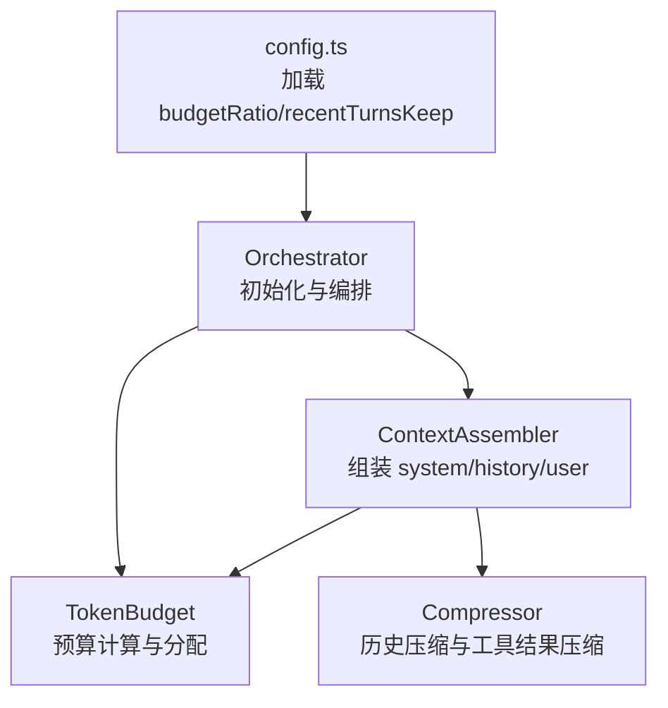
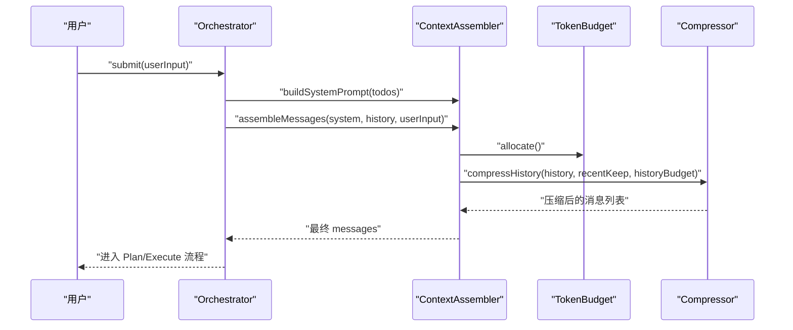
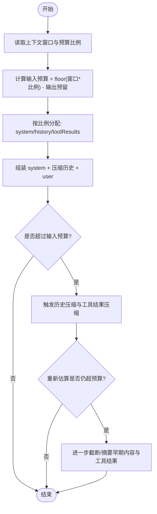
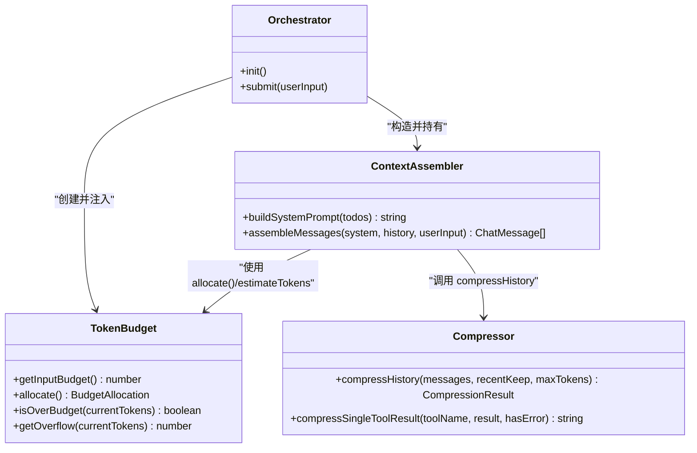

# Token 预算管理

<cite>
**本文引用的文件**
- [src/context/TokenBudget.ts](file://src/context/TokenBudget.ts)
- [src/context/Assembler.ts](file://src/context/Assembler.ts)
- [src/context/Compressor.ts](file://src/context/Compressor.ts)
- [src/agent/Orchestrator.ts](file://src/agent/Orchestrator.ts)
- [src/config.ts](file://src/config.ts)
- [tests/unit/context.test.ts](file://tests/unit/context.test.ts)
- [README.md](file://README.md)
</cite>

## 目录
1. [简介](#简介)
2. [项目结构](#项目结构)
3. [核心组件](#核心组件)
4. [架构总览](#架构总览)
5. [详细组件分析](#详细组件分析)
6. [依赖关系分析](#依赖关系分析)
7. [性能与精度考量](#性能与精度考量)
8. [配置示例](#配置示例)
9. [故障排查指南](#故障排查指南)
10. [结论](#结论)

## 简介
本文件围绕 Nexus 的 Token 预算管理系统，系统性阐述以下要点：
- Token 估算算法的实现原理与精度权衡
- 预算分配策略（system prompt、历史消息、工具结果）
- 超预算时的裁剪策略与优先级排序机制
- 不同模型提供商在 Token 计算上的差异说明
- 预算配置示例与性能优化建议

## 项目结构
与 Token 预算管理直接相关的代码集中在 context 层，并由 Orchestrator 初始化并注入到上下文组装器中。关键文件如下：
- TokenBudget.ts：估算函数与预算类
- Assembler.ts：三层上下文组装与预算检查入口
- Compressor.ts：历史压缩与工具结果分级压缩
- Orchestrator.ts：创建 TokenBudget 并注入 ContextAssembler
- config.ts：加载 budgetRatio 等上下文相关配置
- tests/unit/context.test.ts：预算与压缩的单元测试

图表来源
- [src/agent/Orchestrator.ts:60-86](file://src/agent/Orchestrator.ts#L60-L86)
- [src/context/TokenBudget.ts:31-57](file://src/context/TokenBudget.ts#L31-L57)
- [src/context/Assembler.ts:92-116](file://src/context/Assembler.ts#L92-L116)
- [src/context/Compressor.ts:25-56](file://src/context/Compressor.ts#L25-L56)
- [src/config.ts:52-55](file://src/config.ts#L52-L55)

章节来源
- [src/agent/Orchestrator.ts:60-86](file://src/agent/Orchestrator.ts#L60-L86)
- [src/context/TokenBudget.ts:31-57](file://src/context/TokenBudget.ts#L31-L57)
- [src/context/Assembler.ts:92-116](file://src/context/Assembler.ts#L92-L116)
- [src/context/Compressor.ts:25-56](file://src/context/Compressor.ts#L25-L56)
- [src/config.ts:52-55](file://src/config.ts#L52-L55)

## 核心组件
- Token 估算函数：对文本进行 ASCII/非 ASCII 字符统计，按经验比率换算为 token 数，用于快速估算输入大小。
- TokenBudget 类：根据上下文窗口、预算比例与输出预留，计算可用输入预算、各层分配、溢出量等。
- ContextAssembler：构建 system prompt、组装 messages，并在组装前调用预算与压缩逻辑。
- Compressor：对长会话历史进行分级压缩，保留近期完整轮次，早期内容摘要化；对工具结果按类型差异化压缩。

章节来源
- [src/context/TokenBudget.ts:6-21](file://src/context/TokenBudget.ts#L6-L21)
- [src/context/TokenBudget.ts:31-68](file://src/context/TokenBudget.ts#L31-L68)
- [src/context/Assembler.ts:55-116](file://src/context/Assembler.ts#L55-L116)
- [src/context/Compressor.ts:25-97](file://src/context/Compressor.ts#L25-L97)

## 架构总览
Token 预算管理贯穿“上下文组装 → 压缩 → 预算校验”的关键路径，由 Orchestrator 在初始化时创建 TokenBudget 并注入 ContextAssembler，随后在每次提交用户输入时完成上下文构建与预算控制。

图表来源
- [src/agent/Orchestrator.ts:88-118](file://src/agent/Orchestrator.ts#L88-L118)
- [src/context/Assembler.ts:92-116](file://src/context/Assembler.ts#L92-L116)
- [src/context/TokenBudget.ts:47-57](file://src/context/TokenBudget.ts#L47-L57)
- [src/context/Compressor.ts:25-56](file://src/context/Compressor.ts#L25-L56)

## 详细组件分析

### Token 估算算法与精度
- 实现思路：遍历文本统计 ASCII 与非 ASCII 字符数量，分别以经验比率折算为 token 数后求和取整。
- 精度考虑：
  - 该估算是近似值，适用于快速判断是否超预算，不等同于任何具体模型的精确计数。
  - 不同分词器（如 tiktoken、bpe）对中英文及特殊符号的处理存在差异，实际调用时可能产生偏差。
  - 对于混合语言文本，ASCII 占比越高，估算越接近英文分词器的行为；中文等非 ASCII 占比高时，估算会偏大或偏小取决于真实分词粒度。

章节来源
- [src/context/TokenBudget.ts:6-21](file://src/context/TokenBudget.ts#L6-L21)
- [tests/unit/context.test.ts:10-33](file://tests/unit/context.test.ts#L10-L33)

### 预算分配策略
- 输入预算计算：基于上下文窗口乘以预算比例，再减去输出预留 token，得到可用于输入的预算上限。
- 分层分配：
  - system prompt：固定比例（约 25%）
  - 历史消息：固定比例（约 45%）
  - 工具结果：固定比例（约 30%）
  - reserved：输出预留（默认值可配置）
- 使用方式：
  - ContextAssembler 在 assembleMessages 中先获取 allocation，再将 history 交由 Compressor 按 historyBudget 进行压缩。
  - 若 system prompt 本身已超出系统提示预算，后续压缩仍会尽力将整体控制在输入预算内。

图表来源
- [src/context/TokenBudget.ts:42-68](file://src/context/TokenBudget.ts#L42-L68)
- [src/context/Assembler.ts:92-116](file://src/context/Assembler.ts#L92-L116)
- [src/context/Compressor.ts:25-97](file://src/context/Compressor.ts#L25-L97)

章节来源
- [src/context/TokenBudget.ts:42-68](file://src/context/TokenBudget.ts#L42-L68)
- [src/context/Assembler.ts:92-116](file://src/context/Assembler.ts#L92-L116)

### 超预算裁剪策略与优先级
- 优先级顺序（从高到低）：
  1) 近期对话轮次完整保留（recentTurnsKeep 指定轮数）
  2) 早期对话摘要化（user 请求与 assistant 决策摘要）
  3) 工具结果分级压缩（错误信息优先保留，成功输出按类型精简）
- 具体规则：
  - 近期消息：每轮两条（user + assistant），完整保留最近 N 轮。
  - 早期消息：合并为一条摘要消息，包含用户请求摘要、执行摘要与工具调用摘要。
  - 工具结果：
    - bash 失败：保留错误信息片段（便于调试）
    - read_file/grep/edit_file：仅保留首行或元信息
    - bash 成功：保留退出码与少量输出摘要
- 目标：在满足输入预算的前提下，尽量保留关键语义与可诊断信息。

章节来源
- [src/context/Compressor.ts:25-97](file://src/context/Compressor.ts#L25-L97)
- [src/context/Compressor.ts:99-136](file://src/context/Compressor.ts#L99-L136)
- [src/context/Compressor.ts:138-158](file://src/context/Compressor.ts#L138-L158)
- [tests/unit/context.test.ts:70-114](file://tests/unit/context.test.ts#L70-L114)

### 不同模型提供商的 Token 计算差异
- 本项目采用通用估算函数进行快速预算控制，未针对特定提供商的分词器做精确适配。
- 常见差异点（概念性说明）：
  - OpenAI 系列通常使用字节级 BPE 分词，标点、空格与子词切分会影响 token 计数。
  - Anthropic 系列使用自有分词器，对多语言与特殊字符的处理可能与 OpenAI 不同。
  - DeepSeek 等兼容 OpenAI 接口的服务，其计费与计数也可能遵循各自实现。
- 实践建议：
  - 预算比例与输出预留应保守设置，留出一定余量以覆盖不同提供商的计数差异。
  - 如需更精确的成本预估，可在上层集成各提供商的官方 token 计数接口（当前仓库未内置）。

章节来源
- [README.md:54-93](file://README.md#L54-L93)
- [src/context/TokenBudget.ts:6-21](file://src/context/TokenBudget.ts#L6-L21)

## 依赖关系分析
- Orchestrator 负责：
  - 从 ModelRouter 获取 executor 的上下文窗口
  - 创建 TokenBudget（传入 budgetRatio）
  - 将 TokenBudget 注入 ContextAssembler
- ContextAssembler 负责：
  - 构建 system prompt
  - 调用 TokenBudget.allocate() 获取各层预算
  - 调用 Compressor.compressHistory() 压缩历史
- Compressor 依赖 estimateTokens 进行原始与压缩后 token 统计
- config.ts 提供 budgetRatio 与 recentTurnsKeep 的默认值与 TOML 覆盖

图表来源
- [src/agent/Orchestrator.ts:60-86](file://src/agent/Orchestrator.ts#L60-L86)
- [src/context/TokenBudget.ts:31-68](file://src/context/TokenBudget.ts#L31-L68)
- [src/context/Assembler.ts:92-116](file://src/context/Assembler.ts#L92-L116)
- [src/context/Compressor.ts:25-56](file://src/context/Compressor.ts#L25-L56)

章节来源
- [src/agent/Orchestrator.ts:60-86](file://src/agent/Orchestrator.ts#L60-L86)
- [src/context/TokenBudget.ts:31-68](file://src/context/TokenBudget.ts#L31-L68)
- [src/context/Assembler.ts:92-116](file://src/context/Assembler.ts#L92-L116)
- [src/context/Compressor.ts:25-56](file://src/context/Compressor.ts#L25-L56)

## 性能与精度考量
- 估算复杂度：estimateTokens 为线性扫描，时间复杂度 O(n)，空间复杂度 O(1)。
- 预算计算：allocate 与 isOverBudget 均为常数时间操作。
- 压缩策略：
  - compressHistory 首先全量估算原始 token，然后对早期消息进行摘要化，减少后续处理开销。
  - 工具结果压缩按类型分支处理，避免不必要的字符串拼接。
- 精度与稳定性：
  - 由于估算为近似值，建议在预算比例上留有余量（例如 0.75~0.85），并根据实际提供商微调。
  - 输出预留需结合目标模型的最大输出长度与任务需求设定，避免截断重要响应。

章节来源
- [src/context/TokenBudget.ts:6-21](file://src/context/TokenBudget.ts#L6-L21)
- [src/context/TokenBudget.ts:42-68](file://src/context/TokenBudget.ts#L42-L68)
- [src/context/Compressor.ts:25-56](file://src/context/Compressor.ts#L25-L56)

## 配置示例
- 通过 .nexus/config.toml 调整上下文预算参数：
  - budget_ratio：输入预算占上下文窗口的比例（默认 0.8）
  - recent_turns_keep：近期完整保留的轮数（默认 5）
- 在 Orchestrator 初始化时，budgetRatio 会被传入 TokenBudget 构造函数，影响 getInputBudget 与 allocate 的结果。

章节来源
- [src/config.ts:52-55](file://src/config.ts#L52-L55)
- [src/config.ts:116-121](file://src/config.ts#L116-L121)
- [src/agent/Orchestrator.ts:68-72](file://src/agent/Orchestrator.ts#L68-L72)

## 故障排查指南
- 现象：频繁触发压缩但效果不佳
  - 检查 recent_turns_keep 是否过小导致过多历史被摘要
  - 检查 budget_ratio 是否过低导致输入预算不足
- 现象：系统提示过长导致整体超预算
  - 精简 system prompt 中的静态内容，或将部分动态信息移至运行时注入
- 现象：工具结果过大影响预算
  - 确认 compressSingleToolResult 的压缩策略是否生效（错误信息优先保留，成功输出精简）
- 验证方法：
  - 参考单元测试中对 estimateTokens、TokenBudget 与 Compressor 的行为断言，确保预期一致

章节来源
- [src/context/Compressor.ts:99-136](file://src/context/Compressor.ts#L99-L136)
- [tests/unit/context.test.ts:35-67](file://tests/unit/context.test.ts#L35-L67)
- [tests/unit/context.test.ts:70-114](file://tests/unit/context.test.ts#L70-L114)

## 结论
Nexus 的 Token 预算管理系统以轻量估算为核心，结合分层预算分配与分级压缩策略，在保证关键语义与可诊断信息的前提下，有效缓解长会话导致的上下文窗口压力。通过合理配置 budget_ratio 与 recent_turns_keep，并结合不同提供商的实际计数差异进行保守预留，可在成本与质量之间取得良好平衡。