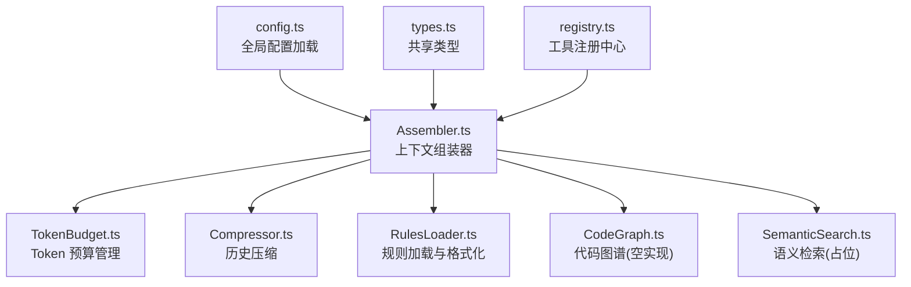
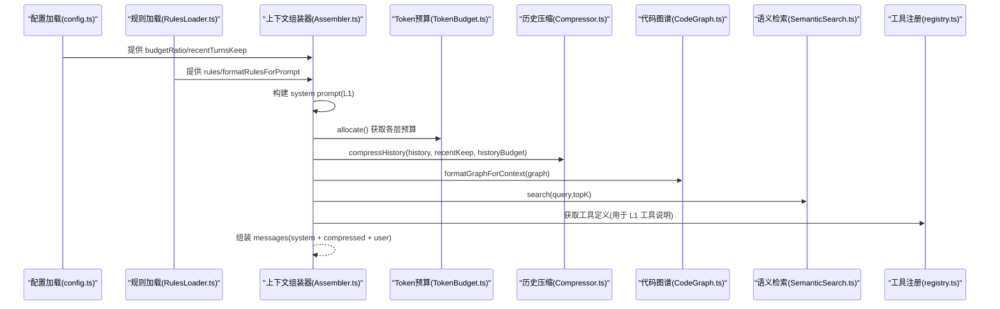
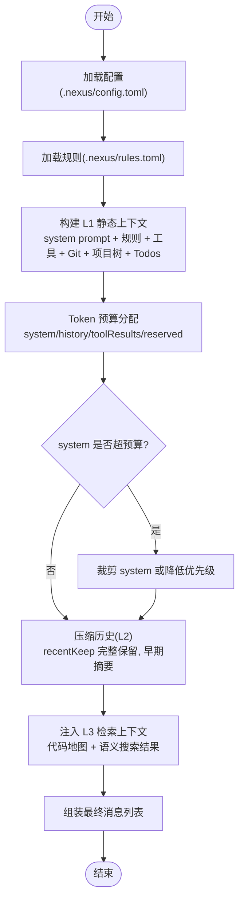
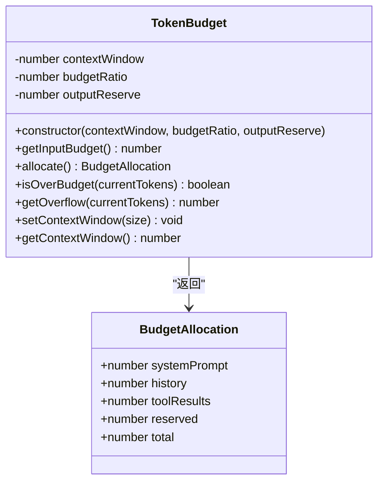
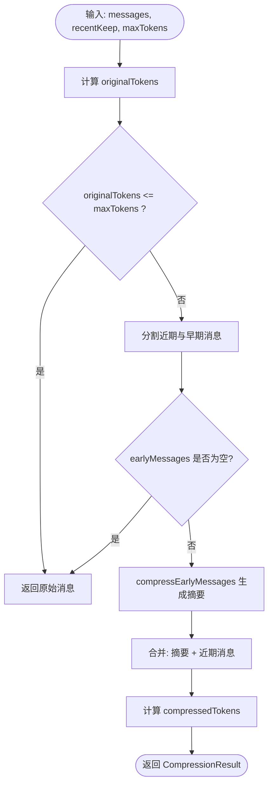
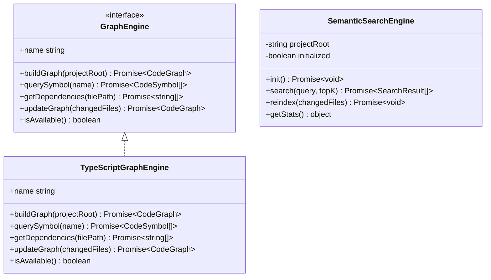
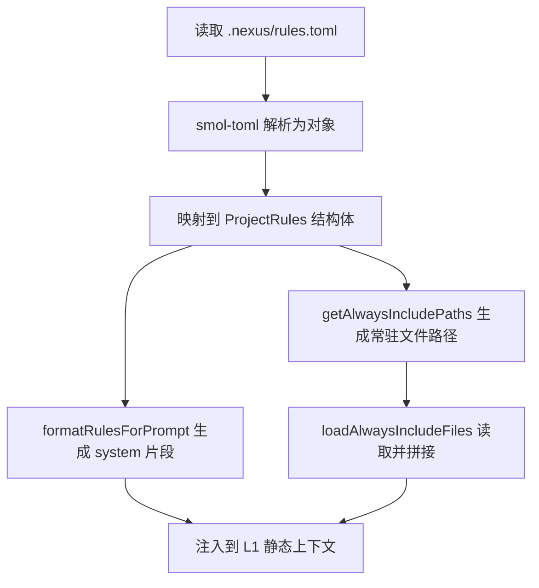
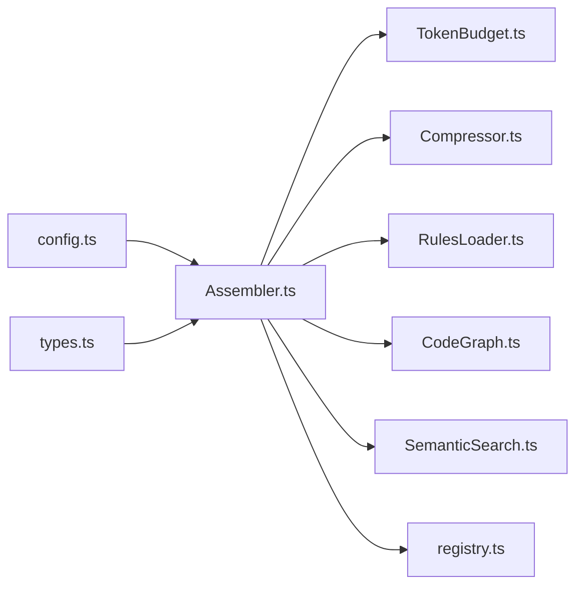

# 上下文工程架构

<cite>
**本文引用的文件**   
- [Assembler.ts](file://src/context/Assembler.ts)
- [TokenBudget.ts](file://src/context/TokenBudget.ts)
- [Compressor.ts](file://src/context/Compressor.ts)
- [CodeGraph.ts](file://src/context/CodeGraph.ts)
- [SemanticSearch.ts](file://src/context/SemanticSearch.ts)
- [RulesLoader.ts](file://src/context/RulesLoader.ts)
- [config.ts](file://src/config.ts)
- [types.ts](file://src/agent/types.ts)
- [registry.ts](file://src/tools/registry.ts)
- [.nexus/rules.toml](file://.nexus/rules.toml)
- [.nexus/config.toml](file://.nexus/config.toml)
</cite>

## 目录
1. [引言](#引言)
2. [项目结构](#项目结构)
3. [核心组件](#核心组件)
4. [架构总览](#架构总览)
5. [详细组件分析](#详细组件分析)
6. [依赖分析](#依赖分析)
7. [性能考虑](#性能考虑)
8. [故障排查指南](#故障排查指南)
9. [结论](#结论)
10. [附录：扩展指南](#附录扩展指南)

## 引言
本架构文档聚焦于 Nexus 的“上下文工程系统”，围绕三层上下文组装机制（L1 静态上下文、L2 任务上下文、L3 检索上下文）、Token 预算管理与历史压缩策略、代码图谱构建与语义检索实现原理，以及 .nexus/rules.toml 的配置解析与注入机制展开。文档同时提供上下文组装流程图与压缩策略示意图，并给出自定义上下文源与压缩器的扩展指南，帮助读者快速理解与二次开发。

## 项目结构
上下文工程相关模块集中于 src/context 目录，配合配置加载器与类型定义，形成清晰的职责边界：
- Assembler.ts：负责三层上下文组装与消息拼装
- TokenBudget.ts：Token 预算估算与分配
- Compressor.ts：对话历史分级压缩
- CodeGraph.ts：代码图谱接口与默认空实现
- SemanticSearch.ts：语义检索引擎占位与工具定义
- RulesLoader.ts：.nexus/rules.toml 解析与格式化注入
- config.ts：全局配置加载与合并
- types.ts：共享类型定义（含上下文层、消息、工具等）
- registry.ts：工具注册中心（为 L3 检索结果注入到上下文提供支撑）

图表来源
- [Assembler.ts:1-184](file://src/context/Assembler.ts#L1-L184)
- [TokenBudget.ts:1-79](file://src/context/TokenBudget.ts#L1-L79)
- [Compressor.ts:1-159](file://src/context/Compressor.ts#L1-L159)
- [RulesLoader.ts:1-90](file://src/context/RulesLoader.ts#L1-L90)
- [CodeGraph.ts:1-175](file://src/context/CodeGraph.ts#L1-L175)
- [SemanticSearch.ts:1-101](file://src/context/SemanticSearch.ts#L1-L101)
- [config.ts:1-132](file://src/config.ts#L1-L132)
- [types.ts:1-269](file://src/agent/types.ts#L1-L269)
- [registry.ts:1-96](file://src/tools/registry.ts#L1-L96)

章节来源
- [Assembler.ts:1-184](file://src/context/Assembler.ts#L1-L184)
- [config.ts:1-132](file://src/config.ts#L1-L132)
- [types.ts:1-269](file://src/agent/types.ts#L1-L269)

## 核心组件
- 上下文组装器（ContextAssembler）
  - 负责构建 system prompt（L1），整合项目规则、工具说明、Git 状态、项目骨架树、Todo 进度；在 assembleMessages 中执行预算检查与历史压缩，最终输出 messages 列表。
- Token 预算管理（TokenBudget）
  - 提供 estimateTokens 粗略估算、allocate 分层预算分配、isOverBudget/getOverflow 超预算检测与裁剪量计算。
- 历史压缩（Compressor）
  - compressHistory 将早期消息摘要化，保留近期完整轮次；compressToolResult 对工具结果进行分级压缩；compressSingleToolResult 用于实时单条结果压缩。
- 代码图谱（CodeGraph）
  - 定义 GraphEngine 接口与 TypeScriptGraphEngine 空实现，提供 buildGraph/querySymbol/getDependencies/updateGraph/isAvailable/name 能力，当前作为 Go 引擎的前置抽象。
- 语义检索（SemanticSearch）
  - 定义 SemanticSearchEngine 与 semantic_search 工具定义，当前为占位实现，预留本地 embedding + SQLite 索引方案。
- 规则加载（RulesLoader）
  - loadRules 解析 .nexus/rules.toml，formatRulesForPrompt 生成 system prompt 片段，getAlwaysIncludePaths 返回常驻包含文件路径。
- 全局配置（config.ts）
  - loadConfig 读取 .nexus/config.toml 并与默认值合并，暴露 context.budgetRatio 与 context.recentTurnsKeep 等关键参数。
- 工具注册（registry.ts）
  - 管理内置工具注册、阶段过滤、审批清单与 AI SDK 兼容导出，为 L3 检索结果注入提供基础。

章节来源
- [Assembler.ts:1-184](file://src/context/Assembler.ts#L1-L184)
- [TokenBudget.ts:1-79](file://src/context/TokenBudget.ts#L1-L79)
- [Compressor.ts:1-159](file://src/context/Compressor.ts#L1-L159)
- [CodeGraph.ts:1-175](file://src/context/CodeGraph.ts#L1-L175)
- [SemanticSearch.ts:1-101](file://src/context/SemanticSearch.ts#L1-L101)
- [RulesLoader.ts:1-90](file://src/context/RulesLoader.ts#L1-L90)
- [config.ts:1-132](file://src/config.ts#L1-L132)
- [registry.ts:1-96](file://src/tools/registry.ts#L1-L96)

## 架构总览
下图展示上下文组装的整体流程：从配置与规则加载开始，构建 L1 静态上下文，结合 L2 任务上下文（历史消息）与 L3 检索上下文（代码图谱/语义检索），经 Token 预算校验与历史压缩后，输出最终消息序列。

图表来源
- [config.ts:1-132](file://src/config.ts#L1-L132)
- [RulesLoader.ts:1-90](file://src/context/RulesLoader.ts#L1-L90)
- [Assembler.ts:1-184](file://src/context/Assembler.ts#L1-L184)
- [TokenBudget.ts:1-79](file://src/context/TokenBudget.ts#L1-L79)
- [Compressor.ts:1-159](file://src/context/Compressor.ts#L1-L159)
- [CodeGraph.ts:1-175](file://src/context/CodeGraph.ts#L1-L175)
- [SemanticSearch.ts:1-101](file://src/context/SemanticSearch.ts#L1-L101)
- [registry.ts:1-96](file://src/tools/registry.ts#L1-L96)

## 详细组件分析

### 三层上下文组装机制（L1/L2/L3）
- L1 静态上下文
  - 由 Assembler.buildSystemPrompt 构建，包含系统提示基线、项目规则（来自 RulesLoader.formatRulesForPrompt）、可用工具说明（来自 registry.getAll）、Git 状态、项目骨架树、当前 Todo 进度。
  - 常驻包含文件通过 RulesLoader.getAlwaysIncludePaths 与 Assembler.loadAlwaysIncludeFiles 注入。
- L2 任务上下文
  - 即对话历史 ChatMessage[]，在 assembleMessages 中按 TokenBudget.allocate().history 预算进行压缩，保留近期完整轮次，早期消息摘要化。
- L3 检索上下文
  - 代码图谱：通过 CodeGraph.formatGraphForContext 生成“代码地图”片段，辅助 agent 了解全库符号与结构。
  - 语义检索：SemanticSearchEngine.search 返回 top-K 相似代码块，未来将基于本地 embedding + SQLite 实现。

图表来源
- [config.ts:1-132](file://src/config.ts#L1-L132)
- [RulesLoader.ts:1-90](file://src/context/RulesLoader.ts#L1-L90)
- [Assembler.ts:1-184](file://src/context/Assembler.ts#L1-L184)
- [TokenBudget.ts:1-79](file://src/context/TokenBudget.ts#L1-L79)
- [Compressor.ts:1-159](file://src/context/Compressor.ts#L1-L159)
- [CodeGraph.ts:1-175](file://src/context/CodeGraph.ts#L1-L175)
- [SemanticSearch.ts:1-101](file://src/context/SemanticSearch.ts#L1-L101)

章节来源
- [Assembler.ts:55-116](file://src/context/Assembler.ts#L55-L116)
- [RulesLoader.ts:60-89](file://src/context/RulesLoader.ts#L60-L89)
- [registry.ts:40-68](file://src/tools/registry.ts#L40-L68)
- [CodeGraph.ts:150-163](file://src/context/CodeGraph.ts#L150-L163)
- [SemanticSearch.ts:48-59](file://src/context/SemanticSearch.ts#L48-L59)

### Token 预算管理策略
- 估算方法
  - estimateTokens 采用 ASCII 与非 ASCII 字符分别估算，ASCII 约 4 字符/token，非 ASCII 约 1.5 字符/token，适用于中英文混合文本。
- 预算分配
  - allocate 将输入预算按比例分配至 systemPrompt(25%)、history(45%)、toolResults(30%)，并预留 outputReserve 给模型输出。
- 超预算处理
  - isOverBudget 判断是否超出输入预算；getOverflow 计算需裁剪 token 数；上层可据此对 L1/L2/L3 内容按优先级裁剪。

图表来源
- [TokenBudget.ts:1-79](file://src/context/TokenBudget.ts#L1-L79)

章节来源
- [TokenBudget.ts:6-21](file://src/context/TokenBudget.ts#L6-L21)
- [TokenBudget.ts:31-78](file://src/context/TokenBudget.ts#L31-L78)

### 历史压缩算法
- 总体策略
  - compressHistory 先统计原始 token 总量，若未超 maxTokens 则直接返回；否则分离近期与早期消息，近期完整保留，早期压缩为一条摘要消息。
- 早期消息摘要
  - compressEarlyMessages 对用户请求与助手回复进行截断摘要，并将工具调用结果合并为“工具调用摘要”。
- 工具结果分级压缩
  - compressToolResult 针对 bash/read_file/grep/edit_file 等不同工具进行差异化压缩，错误信息优先保留，成功输出仅保留关键行。
- 实时单条压缩
  - compressSingleToolResult 用于即时压缩单条工具结果，避免上下文膨胀。

图表来源
- [Compressor.ts:25-56](file://src/context/Compressor.ts#L25-L56)
- [Compressor.ts:58-97](file://src/context/Compressor.ts#L58-L97)
- [Compressor.ts:99-136](file://src/context/Compressor.ts#L99-L136)
- [Compressor.ts:138-159](file://src/context/Compressor.ts#L138-L159)

章节来源
- [Compressor.ts:25-56](file://src/context/Compressor.ts#L25-L56)
- [Compressor.ts:58-97](file://src/context/Compressor.ts#L58-L97)
- [Compressor.ts:99-136](file://src/context/Compressor.ts#L99-L136)
- [Compressor.ts:138-159](file://src/context/Compressor.ts#L138-L159)

### 代码图谱构建与语义检索
- 代码图谱
  - GraphEngine 定义了构建、查询、依赖获取、增量更新与可用性检测等能力；TypeScriptGraphEngine 当前为空实现，v2 将替换为 Go tree-sitter 后台索引服务。
  - formatGraphForContext 将图谱格式化为 L1 上下文片段，使 agent 具备全库概览。
- 语义检索
  - SemanticSearchEngine 预留 init/search/reindex/getStats 接口，计划使用 transformers.js 本地 embedding 与 SQLite 索引；semantic_search 工具定义已就绪，待 Phase 4 注册到工具层。

图表来源
- [CodeGraph.ts:75-136](file://src/context/CodeGraph.ts#L75-L136)
- [SemanticSearch.ts:31-74](file://src/context/SemanticSearch.ts#L31-L74)

章节来源
- [CodeGraph.ts:101-136](file://src/context/CodeGraph.ts#L101-L136)
- [CodeGraph.ts:150-163](file://src/context/CodeGraph.ts#L150-L163)
- [SemanticSearch.ts:31-74](file://src/context/SemanticSearch.ts#L31-L74)
- [SemanticSearch.ts:80-101](file://src/context/SemanticSearch.ts#L80-L101)

### .nexus/rules.toml 配置解析与注入机制
- 解析流程
  - loadRules 读取 .nexus/rules.toml，使用 smol-toml 解析为对象，并按字段映射到 ProjectRules 结构体；缺失字段回退到 DEFAULT_RULES。
- 注入方式
  - formatRulesForPrompt 将规则转换为 system prompt 片段，包含项目信息、代码风格与硬约束；getAlwaysIncludePaths 将 always_include 转为绝对路径供 Assembler.loadAlwaysIncludeFiles 读取并注入。
- 示例配置
  - .nexus/rules.toml 定义了项目名称、语言、测试/构建命令、缩进/引号/分号风格、硬约束与常驻包含文件。

图表来源
- [RulesLoader.ts:29-58](file://src/context/RulesLoader.ts#L29-L58)
- [RulesLoader.ts:60-89](file://src/context/RulesLoader.ts#L60-L89)
- [Assembler.ts:155-168](file://src/context/Assembler.ts#L155-L168)
- [.nexus/rules.toml:1-21](file://.nexus/rules.toml#L1-L21)

章节来源
- [RulesLoader.ts:29-58](file://src/context/RulesLoader.ts#L29-L58)
- [RulesLoader.ts:60-89](file://src/context/RulesLoader.ts#L60-L89)
- [Assembler.ts:155-168](file://src/context/Assembler.ts#L155-L168)
- [.nexus/rules.toml:1-21](file://.nexus/rules.toml#L1-L21)

## 依赖分析
- 组件耦合
  - Assembler 依赖 TokenBudget、Compressor、RulesLoader、CodeGraph、SemanticSearch 与工具注册中心；整体呈现“组装器为中心”的松耦合设计。
- 外部依赖
  - 配置与规则均通过 smol-toml 解析 TOML；文件系统操作通过 fs/promises；子进程执行通过 child_process.spawn。
- 潜在循环依赖
  - 当前无直接循环导入；GraphEngine 与 TypeScriptGraphEngine 为接口与实现关系，便于 v2 替换。

图表来源
- [Assembler.ts:1-184](file://src/context/Assembler.ts#L1-L184)
- [TokenBudget.ts:1-79](file://src/context/TokenBudget.ts#L1-L79)
- [Compressor.ts:1-159](file://src/context/Compressor.ts#L1-L159)
- [RulesLoader.ts:1-90](file://src/context/RulesLoader.ts#L1-L90)
- [CodeGraph.ts:1-175](file://src/context/CodeGraph.ts#L1-L175)
- [SemanticSearch.ts:1-101](file://src/context/SemanticSearch.ts#L1-L101)
- [registry.ts:1-96](file://src/tools/registry.ts#L1-L96)
- [config.ts:1-132](file://src/config.ts#L1-L132)
- [types.ts:1-269](file://src/agent/types.ts#L1-L269)

章节来源
- [Assembler.ts:1-184](file://src/context/Assembler.ts#L1-L184)
- [config.ts:1-132](file://src/config.ts#L1-L132)
- [types.ts:1-269](file://src/agent/types.ts#L1-L269)

## 性能考虑
- Token 估算开销
  - estimateTokens 为线性扫描，时间复杂度 O(n)，空间复杂度 O(1)，适合高频调用。
- 历史压缩效率
  - compressHistory 主要涉及切片与字符串拼接，早期摘要生成时按角色遍历消息，时间复杂度 O(m)；建议合理设置 recentKeep 以平衡上下文质量与压缩成本。
- 工具结果压缩
  - 针对特定工具名进行分支判断与字符串截取，避免大对象序列化；建议在工具层统一输出格式以提升压缩效果。
- 代码图谱与语义检索
  - 当前为占位实现，后续引入 tree-sitter 与本地 embedding 时需关注索引构建耗时与内存占用；建议增量更新与缓存策略。

[本节为通用性能讨论，不直接分析具体文件]

## 故障排查指南
- 规则文件缺失或解析失败
  - RulesLoader.loadRules 捕获异常并返回默认规则；检查 .nexus/rules.toml 是否存在且语法正确。
- 工具执行错误
  - Compressor.compressToolResult 对 bash 失败输出进行特殊保留；查看工具结果中的错误信息与退出码。
- 上下文超预算
  - TokenBudget.isOverBudget 与 getOverflow 可用于诊断；调整 budgetRatio、recentTurnsKeep 或裁剪 L1/L3 内容。
- 配置项未生效
  - 确认 .nexus/config.toml 字段命名与类型符合 mergeConfig 映射；注意 snake_case 到 camelCase 的转换。

章节来源
- [RulesLoader.ts:29-58](file://src/context/RulesLoader.ts#L29-L58)
- [Compressor.ts:99-136](file://src/context/Compressor.ts#L99-L136)
- [TokenBudget.ts:59-68](file://src/context/TokenBudget.ts#L59-L68)
- [config.ts:76-131](file://src/config.ts#L76-L131)

## 结论
Nexus 的上下文工程系统通过三层上下文组装、精细化的 Token 预算管理与分级历史压缩，有效控制了长会话的上下文膨胀问题。代码图谱与语义检索为 L3 检索上下文提供了可扩展的基础设施，而 .nexus/rules.toml 的规则注入机制确保了项目约定与风格的稳定传递。整体架构清晰、职责明确，具备良好的可维护性与扩展性。

[本节为总结性内容，不直接分析具体文件]

## 附录：扩展指南

### 自定义上下文源
- 目标
  - 在不改动 Assembler 主流程的前提下，新增 L1/L2/L3 上下文来源（如知识库、外部 API、用户偏好）。
- 步骤
  - 定义新的上下文提供者接口（参考 GraphEngine 的设计模式），实现 build/query 等方法。
  - 在 Assembler 的 buildSystemPrompt 或 assembleMessages 中调用新提供者，并将其结果注入到对应层级。
  - 如需常驻包含文件，可在 .nexus/rules.toml 的 context.always_include 中添加路径，或通过配置注入。
- 注意事项
  - 控制输出大小，避免破坏 Token 预算；必要时在提供者内部进行压缩或分页。
  - 遵循类型定义（ChatMessage、ContextLayer 等），确保与现有流程兼容。

章节来源
- [CodeGraph.ts:75-93](file://src/context/CodeGraph.ts#L75-L93)
- [Assembler.ts:55-116](file://src/context/Assembler.ts#L55-L116)
- [RulesLoader.ts:86-89](file://src/context/RulesLoader.ts#L86-L89)
- [types.ts:111-130](file://src/agent/types.ts#L111-L130)

### 自定义压缩器
- 目标
  - 替换或增强 Compressor 的压缩策略，以适应不同场景（如更激进的摘要、保留更多工具细节）。
- 步骤
  - 实现新的压缩函数（参考 compressHistory/compressEarlyMessages/compressToolResult 的职责划分）。
  - 在 Assembler.assembleMessages 中调用新压缩器，传入 recentTurnsKeep 与 historyBudget。
  - 如需支持实时压缩，实现类似 compressSingleToolResult 的单条压缩逻辑。
- 注意事项
  - 保持输出为 ChatMessage[] 结构，确保 role/content/name 字段一致。
  - 评估压缩后的语义完整性，避免丢失关键决策与错误信息。

章节来源
- [Compressor.ts:25-56](file://src/context/Compressor.ts#L25-L56)
- [Compressor.ts:58-97](file://src/context/Compressor.ts#L58-L97)
- [Compressor.ts:99-136](file://src/context/Compressor.ts#L99-L136)
- [Compressor.ts:138-159](file://src/context/Compressor.ts#L138-L159)
- [Assembler.ts:92-116](file://src/context/Assembler.ts#L92-L116)