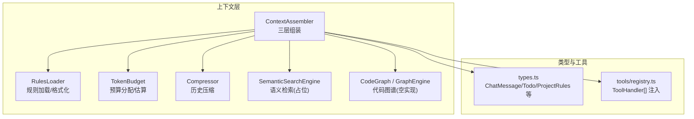
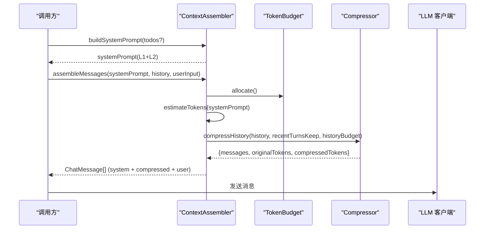
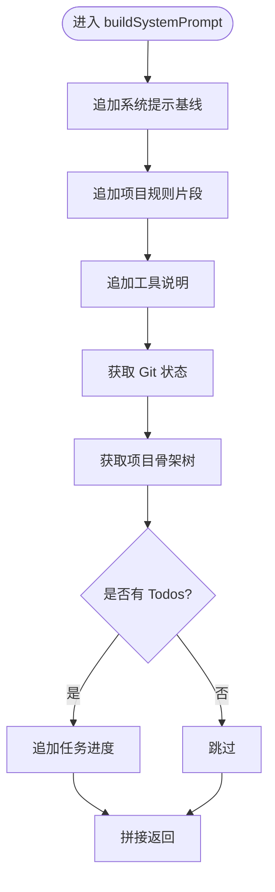
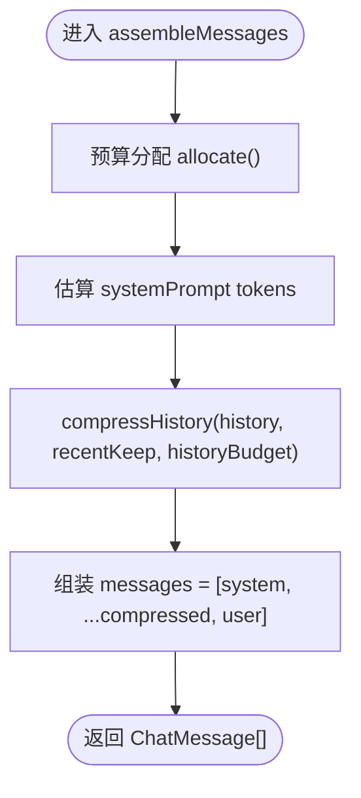
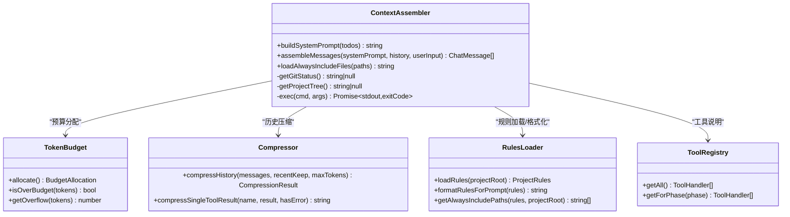

# 上下文组装器

<cite>
**本文引用的文件**   
- [Assembler.ts](file://src/context/Assembler.ts)
- [RulesLoader.ts](file://src/context/RulesLoader.ts)
- [TokenBudget.ts](file://src/context/TokenBudget.ts)
- [Compressor.ts](file://src/context/Compressor.ts)
- [SemanticSearch.ts](file://src/context/SemanticSearch.ts)
- [CodeGraph.ts](file://src/context/CodeGraph.ts)
- [types.ts](file://src/agent/types.ts)
- [registry.ts](file://src/tools/registry.ts)
- [rules.toml](file://.nexus/rules.toml)
</cite>

## 目录
1. [简介](#简介)
2. [项目结构](#项目结构)
3. [核心组件](#核心组件)
4. [架构总览](#架构总览)
5. [详细组件分析](#详细组件分析)
6. [依赖关系分析](#依赖关系分析)
7. [性能考量](#性能考量)
8. [故障排查指南](#故障排查指南)
9. [结论](#结论)
10. [附录：扩展自定义上下文源](#附录：扩展自定义上下文源)

## 简介
本文件围绕“上下文组装器”展开，系统性阐述三层上下文组装机制与关键实现：
- L1 静态上下文：系统提示、项目规则、工具说明等
- L2 任务上下文：Todo 进度、Git 状态等
- L3 检索上下文：动态文件内容（语义检索、代码图谱等）

重点解析 ContextAssembler 的 buildSystemPrompt 与 assembleMessages 方法，包括项目骨架树构建、Git 状态获取、常驻文件加载、消息组装流程与预算检查机制。并提供扩展自定义上下文源的实践指南。

## 项目结构
上下文相关模块位于 src/context 下，配合 agent 类型定义与工具注册中心，形成可插拔的上下文装配管线。

图示来源
- [Assembler.ts:48-116](file://src/context/Assembler.ts#L48-L116)
- [RulesLoader.ts:29-84](file://src/context/RulesLoader.ts#L29-L84)
- [TokenBudget.ts:31-57](file://src/context/TokenBudget.ts#L31-L57)
- [Compressor.ts:25-56](file://src/context/Compressor.ts#L25-L56)
- [SemanticSearch.ts:31-74](file://src/context/SemanticSearch.ts#L31-L74)
- [CodeGraph.ts:101-136](file://src/context/CodeGraph.ts#L101-L136)
- [types.ts:125-184](file://src/agent/types.ts#L125-L184)
- [registry.ts:12-49](file://src/tools/registry.ts#L12-L49)

章节来源
- [Assembler.ts:1-184](file://src/context/Assembler.ts#L1-L184)
- [RulesLoader.ts:1-90](file://src/context/RulesLoader.ts#L1-L90)
- [TokenBudget.ts:1-79](file://src/context/TokenBudget.ts#L1-L79)
- [Compressor.ts:1-159](file://src/context/Compressor.ts#L1-L159)
- [SemanticSearch.ts:1-101](file://src/context/SemanticSearch.ts#L1-L101)
- [CodeGraph.ts:1-175](file://src/context/CodeGraph.ts#L1-L175)
- [types.ts:1-269](file://src/agent/types.ts#L1-L269)
- [registry.ts:1-96](file://src/tools/registry.ts#L1-L96)

## 核心组件
- ContextAssembler：负责三层上下文拼装、系统提示生成、消息组装与预算控制。
- RulesLoader：加载 .nexus/rules.toml，提供格式化片段与常驻文件路径解析。
- TokenBudget：token 估算与预算分配，支持超预算裁剪计算。
- Compressor：对话历史分级压缩策略，保留近期完整、早期摘要化。
- SemanticSearchEngine：语义检索引擎接口与工具定义（当前为占位）。
- CodeGraph：代码图谱接口与 TypeScript 空实现，用于 L1 地图注入。

章节来源
- [Assembler.ts:48-116](file://src/context/Assembler.ts#L48-L116)
- [RulesLoader.ts:29-84](file://src/context/RulesLoader.ts#L29-L84)
- [TokenBudget.ts:31-57](file://src/context/TokenBudget.ts#L31-L57)
- [Compressor.ts:25-56](file://src/context/Compressor.ts#L25-L56)
- [SemanticSearch.ts:31-74](file://src/context/SemanticSearch.ts#L31-L74)
- [CodeGraph.ts:101-136](file://src/context/CodeGraph.ts#L101-L136)

## 架构总览
上下文组装的整体流程如下：
- 输入：systemPrompt（由 buildSystemPrompt 生成）、历史消息 history、用户输入 userInput
- 步骤：
  - 使用 TokenBudget.allocate() 分配各层 token 预算
  - 估算 systemPrompt 的 token 数并校验是否超预算
  - 对历史进行压缩，得到符合 history 预算的消息序列
  - 组装最终消息列表（system + compressed history + user）
- 输出：ChatMessage[]，供模型调用

图示来源
- [Assembler.ts:55-116](file://src/context/Assembler.ts#L55-L116)
- [TokenBudget.ts:47-57](file://src/context/TokenBudget.ts#L47-L57)
- [Compressor.ts:25-56](file://src/context/Compressor.ts#L25-L56)

## 详细组件分析

### 三层上下文机制
- L1 静态上下文
  - 系统提示基线：内置行为准则、工具使用规范、输出规范
  - 项目规则：从 rules.toml 加载并格式化为提示片段
  - 工具说明：遍历 ToolHandler[]，将名称与描述注入
  - Git 状态：通过 git status --short --branch 获取变更摘要
  - 项目骨架树：通过 git ls-files 列举文件，限制显示数量
  - 常驻文件：根据 rules.context.alwaysInclude 读取并截断拼接
- L2 任务上下文
  - Todo 进度：以图标标记状态，按顺序追加到 system prompt
  - Git 状态：作为工作区现状的轻量快照
- L3 检索上下文
  - 语义检索：SemanticSearchEngine.search(query, topK) 返回相关代码块（当前为空实现）
  - 代码图谱：GraphEngine.buildGraph(...) 生成符号级“地图”，formatGraphForContext 可注入 L1

章节来源
- [Assembler.ts:55-90](file://src/context/Assembler.ts#L55-L90)
- [RulesLoader.ts:29-84](file://src/context/RulesLoader.ts#L29-L84)
- [SemanticSearch.ts:48-59](file://src/context/SemanticSearch.ts#L48-L59)
- [CodeGraph.ts:150-163](file://src/context/CodeGraph.ts#L150-L163)
- [rules.toml:18-21](file://.nexus/rules.toml#L18-L21)

### buildSystemPrompt 实现逻辑
- 初始化 parts 数组，先加入系统提示基线
- 追加格式化后的项目规则片段
- 追加可用工具清单（名称 + 描述）
- 执行 getGitStatus() 获取变更摘要，若存在则追加
- 执行 getProjectTree() 获取文件列表，限制行数并追加
- 若传入 todos，则以图标形式追加任务进度
- 返回拼接后的字符串

图示来源
- [Assembler.ts:55-90](file://src/context/Assembler.ts#L55-L90)

章节来源
- [Assembler.ts:55-90](file://src/context/Assembler.ts#L55-L90)

#### 项目骨架树构建
- 优先使用 git ls-files 列出受控文件
- 过滤空行，限制最多显示 50 个文件，超出时附加省略提示
- 失败或无结果时返回 null，上层不追加

章节来源
- [Assembler.ts:134-153](file://src/context/Assembler.ts#L134-L153)

#### Git 状态获取
- 执行 git status --short --branch
- 过滤空行，限制最多显示 20 行，超出时附加省略提示
- 无变更时返回“工作区干净”，异常时返回 null

章节来源
- [Assembler.ts:118-132](file://src/context/Assembler.ts#L118-L132)

#### 常驻文件加载
- 依据 rules.context.alwaysInclude 解析绝对路径
- 逐个读取文件，单文件超过阈值时截断并标注
- 拼接为多段 Markdown 代码块

章节来源
- [RulesLoader.ts:86-89](file://src/context/RulesLoader.ts#L86-L89)
- [Assembler.ts:155-168](file://src/context/Assembler.ts#L155-L168)

### assembleMessages 消息组装与预算检查
- 通过 TokenBudget.allocate() 获得 systemPrompt/history/toolResults/reserved 预算
- 使用 estimateTokens 估算 systemPrompt 的 token 数
- 调用 compressHistory 对历史进行分级压缩，目标上限为 history 预算
- 组装最终消息：system + 压缩后的历史 + user
- 注意：当前实现未显式在 assembleMessages 中做“超预算即裁剪”的分支；实际裁剪发生在 compressHistory 内部

图示来源
- [Assembler.ts:92-116](file://src/context/Assembler.ts#L92-L116)
- [TokenBudget.ts:47-57](file://src/context/TokenBudget.ts#L47-L57)
- [Compressor.ts:25-56](file://src/context/Compressor.ts#L25-L56)

章节来源
- [Assembler.ts:92-116](file://src/context/Assembler.ts#L92-L116)
- [TokenBudget.ts:31-57](file://src/context/TokenBudget.ts#L31-L57)
- [Compressor.ts:25-56](file://src/context/Compressor.ts#L25-L56)

### 预算管理与压缩策略
- TokenBudget
  - getInputBudget：基于 contextWindow * budgetRatio - outputReserve 计算输入预算
  - allocate：按比例分配 systemPrompt/history/toolResults
  - isOverBudget/getOverflow：判断是否超预算及溢出量
- Compressor
  - 分离近期与早期消息，近期完整保留，早期压缩为摘要
  - 工具结果分级压缩：bash 错误完整保留，read_file/grep/edit_file 仅保留元信息，成功 bash 输出摘要
  - 提供单次工具结果压缩函数 compressSingleToolResult

章节来源
- [TokenBudget.ts:31-79](file://src/context/TokenBudget.ts#L31-L79)
- [Compressor.ts:25-56](file://src/context/Compressor.ts#L25-L56)
- [Compressor.ts:99-159](file://src/context/Compressor.ts#L99-L159)

### 语义检索与代码图谱
- SemanticSearchEngine
  - 当前为占位实现，init/search/reindex/getStats 均为 TODO
  - 提供 semantic_search 工具定义，便于后续接入
- CodeGraph
  - 定义 GraphEngine 接口与 TypeScriptGraphEngine 空实现
  - formatGraphForContext 可将符号级“地图”注入 L1 上下文

章节来源
- [SemanticSearch.ts:31-74](file://src/context/SemanticSearch.ts#L31-L74)
- [SemanticSearch.ts:80-101](file://src/context/SemanticSearch.ts#L80-L101)
- [CodeGraph.ts:75-136](file://src/context/CodeGraph.ts#L75-L136)
- [CodeGraph.ts:150-163](file://src/context/CodeGraph.ts#L150-L163)

## 依赖关系分析
- ContextAssembler 依赖
  - TokenBudget：预算分配与 token 估算
  - Compressor：历史压缩
  - RulesLoader：规则加载与格式化
  - tools/registry.ts：工具定义集合
  - fs/promises、child_process、path：文件系统与子进程
- 类型依赖
  - types.ts：ChatMessage、Todo、ProjectRules、ToolDefinition 等

图示来源
- [Assembler.ts:48-116](file://src/context/Assembler.ts#L48-L116)
- [TokenBudget.ts:31-57](file://src/context/TokenBudget.ts#L31-L57)
- [Compressor.ts:25-56](file://src/context/Compressor.ts#L25-L56)
- [RulesLoader.ts:29-84](file://src/context/RulesLoader.ts#L29-L84)
- [registry.ts:25-49](file://src/tools/registry.ts#L25-L49)

章节来源
- [Assembler.ts:48-116](file://src/context/Assembler.ts#L48-L116)
- [registry.ts:12-49](file://src/tools/registry.ts#L12-L49)
- [types.ts:125-184](file://src/agent/types.ts#L125-L184)

## 性能考量
- 子进程开销：git 命令通过 spawn 执行，建议复用连接或在高频场景缓存结果（如 Git 状态、项目树）
- 文本估算：estimateTokens 采用 ASCII/非 ASCII 字符统计，近似但高效
- 历史压缩：compressHistory 避免全量传输，显著降低长会话成本
- 文件读取：常驻文件读取有长度截断，防止大文件撑爆上下文

[本节为通用指导，无需源码引用]

## 故障排查指南
- Git 命令不可用或权限不足
  - 现象：getGitStatus/getProjectTree 返回 null
  - 处理：确认仓库初始化、git 可用、cwd 正确
- 常驻文件不存在
  - 现象：loadAlwaysIncludeFiles 跳过缺失文件
  - 处理：检查 rules.toml 中的 always_include 路径是否正确
- 预算超限
  - 现象：历史被压缩，部分早期消息变为摘要
  - 处理：调整 recentTurnsKeep、budgetRatio 或增大 contextWindow
- 工具结果过大
  - 现象：compressSingleToolResult 对成功输出进行截断
  - 处理：按需重新调用工具或细化查询范围

章节来源
- [Assembler.ts:118-153](file://src/context/Assembler.ts#L118-L153)
- [Assembler.ts:155-168](file://src/context/Assembler.ts#L155-L168)
- [Compressor.ts:99-159](file://src/context/Compressor.ts#L99-L159)

## 结论
上下文组装器通过三层上下文与预算控制，实现了稳定、可扩展的系统提示与消息组装能力。L1/L2 提供稳定的工程背景与任务状态，L3 预留了语义检索与代码图谱扩展点。结合压缩策略，可在长会话中保持高信噪比与可控成本。

[本节为总结性内容，无需源码引用]

## 附录：扩展自定义上下文源
- 扩展点位置
  - buildSystemPrompt：适合注入 L1/L2 片段（如额外规则、环境信息、任务元数据）
  - loadAlwaysIncludeFiles：适合注入全局文档、契约、API 规范等
  - assembleMessages：如需在 L3 阶段注入检索结果，可在组装前合并至 messages
- 最佳实践
  - 预算优先：新增上下文需考虑 token 占用，必要时启用压缩或限流
  - 幂等与容错：外部 IO 失败应降级返回空或默认值，不影响整体流程
  - 可配置化：通过 rules.toml 或运行时配置控制开关与阈值
  - 可观测性：记录注入内容的 token 估算与大小，便于调优
- 示例思路（概念性）
  - 在 buildSystemPrompt 末尾追加“运行环境说明”、“依赖版本矩阵”等
  - 在 assembleMessages 中根据 userInput 触发 L3 检索，并将 top-K 结果插入 user 之前
  - 使用 TokenBudget.isOverBudget 与 getOverflow 做快速裁剪决策

[本节为概念性指导，无需源码引用]