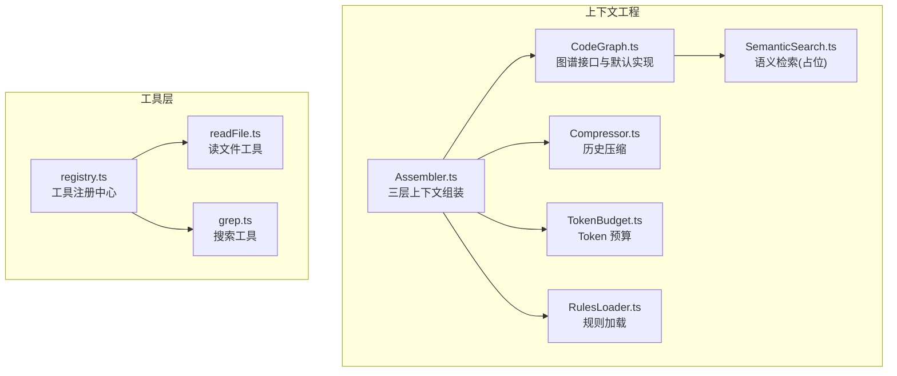
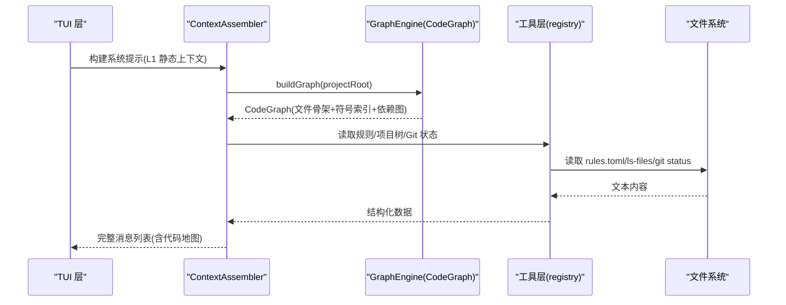
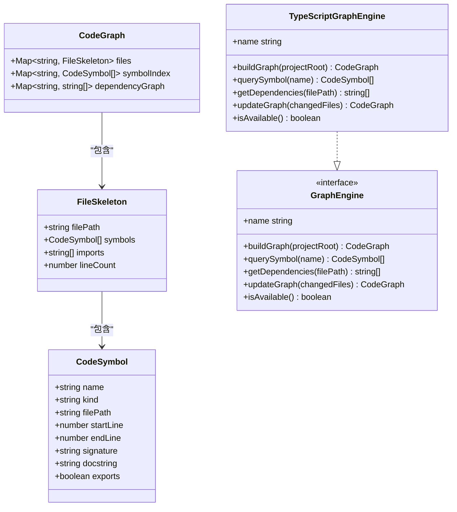
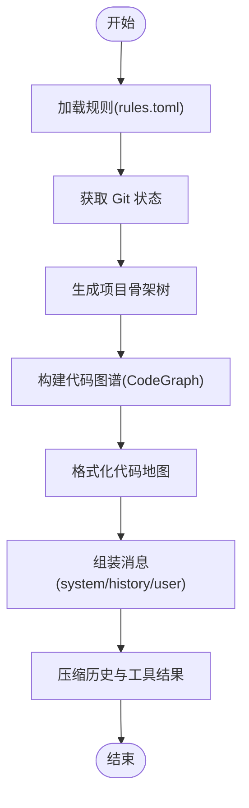
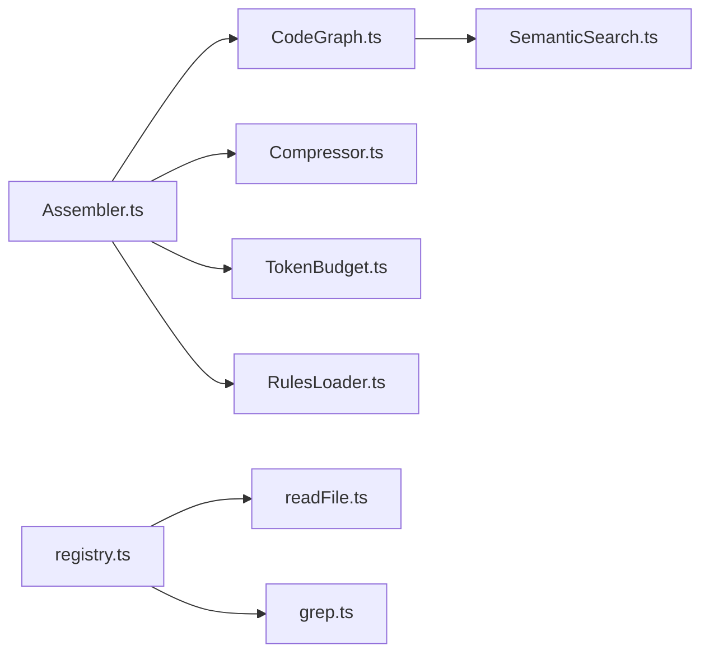

# 代码图谱构建

<cite>
**本文引用的文件**
- [src/context/CodeGraph.ts](file://src/context/CodeGraph.ts)
- [src/context/Assembler.ts](file://src/context/Assembler.ts)
- [src/context/Compressor.ts](file://src/context/Compressor.ts)
- [src/context/TokenBudget.ts](file://src/context/TokenBudget.ts)
- [src/context/SemanticSearch.ts](file://src/context/SemanticSearch.ts)
- [src/context/RulesLoader.ts](file://src/context/RulesLoader.ts)
- [src/tools/registry.ts](file://src/tools/registry.ts)
- [src/tools/readFile.ts](file://src/tools/readFile.ts)
- [src/tools/grep.ts](file://src/tools/grep.ts)
- [DESIGN.md](file://DESIGN.md)
- [README.md](file://README.md)
- [package.json](file://package.json)
</cite>

## 目录
1. [引言](#引言)
2. [项目结构](#项目结构)
3. [核心组件](#核心组件)
4. [架构总览](#架构总览)
5. [详细组件分析](#详细组件分析)
6. [依赖关系分析](#依赖关系分析)
7. [性能考量](#性能考量)
8. [故障排查指南](#故障排查指南)
9. [结论](#结论)
10. [附录](#附录)

## 引言
本文件面向“代码图谱构建器”的实现与使用，系统性阐述代码依赖关系的提取与分析算法、AST 解析策略、符号表构建与依赖图生成流程，并给出跨文件引用追踪方法、质量分析集成点、自定义解析器扩展指南、可视化示例与性能优化建议。当前仓库中代码图谱模块以接口与占位实现为主，为后续引入 tree-sitter 与 Go 引擎预留了清晰的迁移路径。

## 项目结构
围绕代码图谱与上下文工程的相关模块主要位于 src/context 与工具层 src/tools：
- CodeGraph.ts：定义图谱数据结构、引擎接口与默认 TypeScript 实现（空图谱 fallback），并提供便捷函数用于构建与增量更新。
- Assembler.ts：三层上下文组装（L1/L2/L3），负责系统提示、规则注入、Git 状态、项目骨架树等静态上下文拼装。
- Compressor.ts：对话历史压缩策略，按角色与工具类型分级压缩，控制 token 预算。
- TokenBudget.ts：token 估算与预算分配，支持切换模型时动态调整上下文窗口。
- SemanticSearch.ts：语义检索占位实现，预留本地 embedding + SQLite 索引方案。
- RulesLoader.ts：加载 .nexus/rules.toml 结构化规则，格式化入 system prompt。
- tools/*：MCP 工具注册与实现（read_file、grep 等），为图谱构建提供文件读取与搜索能力。

图表来源
- [src/context/Assembler.ts](file://src/context/Assembler.ts)
- [src/context/CodeGraph.ts](file://src/context/CodeGraph.ts)
- [src/context/Compressor.ts](file://src/context/Compressor.ts)
- [src/context/TokenBudget.ts](file://src/context/TokenBudget.ts)
- [src/context/SemanticSearch.ts](file://src/context/SemanticSearch.ts)
- [src/context/RulesLoader.ts](file://src/context/RulesLoader.ts)
- [src/tools/registry.ts](file://src/tools/registry.ts)
- [src/tools/readFile.ts](file://src/tools/readFile.ts)
- [src/tools/grep.ts](file://src/tools/grep.ts)

章节来源
- [README.md:134-146](file://README.md#L134-L146)
- [DESIGN.md:284-324](file://DESIGN.md#L284-L324)

## 核心组件
- 代码图谱引擎接口与默认实现
  - GraphEngine 接口定义了 buildGraph、querySymbol、getDependencies、updateGraph、isAvailable、name 等方法，屏蔽具体实现差异。
  - TypeScriptGraphEngine 当前返回空图谱，作为 Go 引擎不可用时的 fallback；v2 将替换为 GoGraphEngine（通过 IPC/gRPC 调用后台索引服务）。
  - 便捷函数 createGraphEngine/buildCodeGraph/updateCodeGraph 封装引擎选择与调用。

- 上下文组装器
  - ContextAssembler 负责 L1 静态上下文拼装（system prompt、规则、Git 状态、项目骨架树）、消息组装与压缩策略执行。

- 压缩与预算
  - Compressor 对早期历史进行摘要化压缩，对不同工具结果采用差异化压缩策略。
  - TokenBudget 提供 token 估算、预算分配与溢出计算，支持模型切换时更新上下文窗口。

- 语义检索（占位）
  - SemanticSearchEngine 预留本地 embedding + SQLite 索引方案，提供 search/reindex/stats 接口，Phase 4 落地。

- 规则加载
  - RulesLoader 从 .nexus/rules.toml 加载结构化规则，格式化入 system prompt，并输出 always_include 路径列表。

章节来源
- [src/context/CodeGraph.ts:75-136](file://src/context/CodeGraph.ts#L75-L136)
- [src/context/Assembler.ts:48-116](file://src/context/Assembler.ts#L48-L116)
- [src/context/Compressor.ts:25-97](file://src/context/Compressor.ts#L25-L97)
- [src/context/TokenBudget.ts:31-78](file://src/context/TokenBudget.ts#L31-L78)
- [src/context/SemanticSearch.ts:31-74](file://src/context/SemanticSearch.ts#L31-L74)
- [src/context/RulesLoader.ts:29-84](file://src/context/RulesLoader.ts#L29-L84)

## 架构总览
下图展示代码图谱在整体系统中的位置与交互：Agent 编排层通过 ContextAssembler 获取 L1 静态上下文（包含代码地图），并通过 GraphEngine 接口访问代码图谱；未来 v2 可无缝切换到 Go 引擎。

图表来源
- [src/context/Assembler.ts:55-90](file://src/context/Assembler.ts#L55-L90)
- [src/context/CodeGraph.ts:141-144](file://src/context/CodeGraph.ts#L141-L144)
- [src/context/RulesLoader.ts:29-58](file://src/context/RulesLoader.ts#L29-L58)
- [src/tools/registry.ts:86-93](file://src/tools/registry.ts#L86-L93)

## 详细组件分析

### 代码图谱引擎与数据结构
- 数据结构
  - CodeSymbol：描述符号名称、种类、文件路径、起止行、签名、文档字符串、是否导出。
  - FileSkeleton：文件级骨架，包含 symbols、imports、lineCount。
  - CodeGraph：全局图谱，维护 files(symbolIndex)、symbolIndex(name→symbols)、dependencyGraph(file→deps)。

- 引擎接口与默认实现
  - GraphEngine：统一抽象，buildGraph/querySymbol/getDependencies/updateGraph/isAvailable/name。
  - TypeScriptGraphEngine：当前返回空图谱，预留 Phase 4 的 WASM tree-sitter 解析入口。
  - createGraphEngine：工厂函数，未来检测 Go 引擎可用性并切换。

- 便捷函数
  - buildCodeGraph：委托引擎构建全量图谱。
  - updateCodeGraph：增量更新仅重算变化文件。
  - formatGraphForContext：将图谱格式化为 L1 上下文片段（代码地图）。

图表来源
- [src/context/CodeGraph.ts:10-34](file://src/context/CodeGraph.ts#L10-L34)
- [src/context/CodeGraph.ts:75-136](file://src/context/CodeGraph.ts#L75-L136)

章节来源
- [src/context/CodeGraph.ts:10-34](file://src/context/CodeGraph.ts#L10-L34)
- [src/context/CodeGraph.ts:75-136](file://src/context/CodeGraph.ts#L75-L136)
- [src/context/CodeGraph.ts:141-174](file://src/context/CodeGraph.ts#L141-L174)

### AST 解析与符号表构建（规划与扩展）
- 当前状态
  - TypeScriptGraphEngine.buildGraph 为占位实现，返回空图谱；注释标注 Phase 4 使用 tree-sitter (WASM) 实现本地 AST 解析。
  - 设计文档指出 v2 引入 Go 引擎后，由 Go 端运行 tree-sitter 后台索引服务，TypeScript 侧通过 IPC/gRPC 调用。

- 目标算法（基于设计文档与接口约定）
  - AST 解析：对每个文件使用 tree-sitter 解析，提取函数/类/方法/接口/类型/变量等节点，收集签名与 docstring。
  - 符号表构建：将符号信息聚合到 symbolIndex（name → CodeSymbol[]），同时记录 filePath、起止行、exports 标记。
  - 依赖图生成：解析 import/export 语句，建立 dependencyGraph（file → deps[]），支持相对路径与别名映射。
  - 增量更新：监听文件变更，仅重算受影响文件的符号与依赖，合并到现有 CodeGraph。

- 扩展指南（自定义解析器）
  - 新增语言：实现新的 LanguageParser（如 Python/Go），提供 extractSymbols(filePath) → CodeSymbol[] 与 extractImports(filePath) → string[]。
  - 接入引擎：在 createGraphEngine 中根据 projectRoot 的语言配置选择对应解析器；或扩展 GraphEngine 接口增加 setLanguage(lang)。
  - 测试覆盖：为每种语言编写单元测试，验证符号识别准确率与依赖解析正确性。

章节来源
- [src/context/CodeGraph.ts:105-125](file://src/context/CodeGraph.ts#L105-L125)
- [DESIGN.md:312-324](file://DESIGN.md#L312-L324)

### 依赖关系提取与跨文件引用追踪
- 提取策略
  - 语法级：通过 AST 解析 import/export/require/using 等语句，规范化路径（处理相对路径、别名、索引文件）。
  - 语义级：结合符号名匹配，识别跨文件引用（如类名、函数名、类型名），解决同名冲突与作用域问题。
  - 运行时辅助：对动态导入（import()、require()）进行静态启发式分析，标注不确定性。

- 跨文件追踪
  - 构建 symbolIndex 与 dependencyGraph，支持 querySymbol(name) 返回所有定义位置。
  - 支持 getDependencies(filePath) 返回直接依赖集合，并可递归展开间接依赖。

- 错误处理与边界
  - 解析失败：记录日志并跳过该文件，保证整体构建不中断。
  - 循环依赖：检测并标记，避免无限递归；在 UI 中提示潜在风险。
  - 未解析引用：保留占位节点，供后续补全或人工修正。

章节来源
- [DESIGN.md:312-324](file://DESIGN.md#L312-L324)

### 上下文组装与代码地图注入
- L1 静态上下文
  - System Prompt：角色、原则、工具说明、输出规范。
  - 项目规则：从 .nexus/rules.toml 加载并格式化。
  - Git 状态：工作区变更、分支信息。
  - 项目骨架树：git ls-files 生成的目录结构。
  - 代码地图：formatGraphForContext 输出的文件级符号摘要。

- 消息组装与压缩
  - assembleMessages：整合 systemPrompt、压缩后的 history、userInput。
  - compressHistory：早期历史摘要化，工具结果分级压缩，确保长会话不爆窗口。

图表来源
- [src/context/Assembler.ts:55-116](file://src/context/Assembler.ts#L55-L116)
- [src/context/Compressor.ts:25-97](file://src/context/Compressor.ts#L25-L97)
- [src/context/RulesLoader.ts:29-84](file://src/context/RulesLoader.ts#L29-L84)
- [src/context/CodeGraph.ts:150-163](file://src/context/CodeGraph.ts#L150-L163)

章节来源
- [src/context/Assembler.ts:55-116](file://src/context/Assembler.ts#L55-L116)
- [src/context/Compressor.ts:25-97](file://src/context/Compressor.ts#L25-L97)
- [src/context/RulesLoader.ts:29-84](file://src/context/RulesLoader.ts#L29-L84)
- [src/context/CodeGraph.ts:150-163](file://src/context/CodeGraph.ts#L150-L163)

### 语义检索（占位实现与未来规划）
- 当前状态
  - SemanticSearchEngine.init/search/reindex/stats 均为占位，预留 transformers.js 本地 embedding 与 SQLite 索引。
  - semanticSearchToolDefinition 定义工具输入 schema，Phase 4 注册到工具层。

- 未来实现要点
  - 分块策略：按函数/类粒度切分代码块，保留上下文行。
  - Embedding：使用轻量模型（如 all-MiniLM-L6-v2）本地计算向量。
  - 存储：SQLite 存储 embedding 与元数据，支持余弦相似度查询。
  - 增量索引：监听文件变更，仅重算变化块的 embedding。

章节来源
- [src/context/SemanticSearch.ts:31-101](file://src/context/SemanticSearch.ts#L31-L101)

### 工具层与图谱构建的集成点
- 文件读取与搜索
  - readFileTool：安全读取文件（路径校验、二进制检测、行数截断），为图谱构建提供原始内容。
  - grepTool：封装 ripgrep，支持正则、文件过滤、上下文行，辅助快速定位相关代码。

- 工具注册与调度
  - ToolRegistry：集中管理工具定义、阶段权限、审批需求、AI SDK 兼容转换。
  - 创建默认注册表：内置 read/edit/bash/grep 四个工具。

章节来源
- [src/tools/readFile.ts:11-149](file://src/tools/readFile.ts#L11-L149)
- [src/tools/grep.ts:11-178](file://src/tools/grep.ts#L11-L178)
- [src/tools/registry.ts:25-93](file://src/tools/registry.ts#L25-L93)

## 依赖关系分析
- 组件耦合
  - Assembler 依赖 CodeGraph、Compressor、TokenBudget、RulesLoader，形成上下文工程核心。
  - CodeGraph 依赖 GraphEngine 接口，解耦具体实现（TS/Go）。
  - Tools 通过 registry 统一管理，Assembler 可通过 registry 获取工具列表用于 system prompt。

- 外部依赖
  - package.json 声明 AI SDK、MCP SDK、SQLite、Ink、React 等依赖。
  - DESIGN.md 明确技术栈选型与迁移信号（何时引入 Go 引擎）。

图表来源
- [package.json:19-31](file://package.json#L19-L31)
- [DESIGN.md:101-113](file://DESIGN.md#L101-L113)

章节来源
- [package.json:19-31](file://package.json#L19-L31)
- [DESIGN.md:101-113](file://DESIGN.md#L101-L113)

## 性能考量
- 解析性能
  - 优先使用 tree-sitter 的增量解析能力，避免全量重析。
  - 对大文件进行分块解析，限制单次解析的内存占用。

- 索引与查询
  - 使用 SQLite 的 FTS/向量扩展加速语义检索。
  - 缓存热点符号与依赖关系，减少重复计算。

- 上下文压缩
  - 早期历史摘要化，工具结果分级压缩，确保长会话稳定。
  - Token 预算动态调整，超限时优先丢弃 L3（检索上下文）。

- 并发与异步
  - 并行解析多文件，利用 Node/Bun 的并发能力。
  - 异步 I/O 与流式处理，避免阻塞主线程。

[本节为通用指导，无需特定文件来源]

## 故障排查指南
- 图谱为空
  - 检查 TypeScriptGraphEngine 是否为 fallback（预期行为），确认是否已切换到 Go 引擎。
  - 验证 projectRoot 路径是否正确，文件是否存在且可读。

- 符号缺失或依赖错误
  - 检查 AST 解析器是否支持目标语言，import/export 语法是否被正确识别。
  - 查看日志中的解析失败记录，定位问题文件。

- 语义检索无结果
  - 确认 SemanticSearchEngine 是否已初始化（init），embedding 模型是否加载成功。
  - 检查 SQLite 索引是否建立，查询参数是否合理。

- 上下文爆炸
  - 调整 TokenBudget 的 contextWindow 与 budgetRatio，启用更激进的压缩策略。
  - 减少 always_include 文件数量，限制 read_file 的最大行数。

章节来源
- [src/context/CodeGraph.ts:105-125](file://src/context/CodeGraph.ts#L105-L125)
- [src/context/SemanticSearch.ts:39-59](file://src/context/SemanticSearch.ts#L39-L59)
- [src/context/Compressor.ts:25-97](file://src/context/Compressor.ts#L25-L97)
- [src/context/TokenBudget.ts:31-78](file://src/context/TokenBudget.ts#L31-L78)

## 结论
当前代码图谱模块以接口与占位实现为主，为后续引入 tree-sitter 与 Go 引擎预留了清晰路径。通过 GraphEngine 抽象，可在不改动 Agent loop 的前提下平滑迁移。结合上下文工程（规则加载、历史压缩、Token 预算）与工具层（read/grep），可逐步构建完整的代码依赖分析与语义检索能力。建议在 Phase 4 优先落地 AST 解析与本地 embedding，再评估是否需要 Go 引擎以提升性能与安全性。

[本节为总结，无需特定文件来源]

## 附录
- 可视化示例
  - 代码地图：formatGraphForContext 输出的文件级符号摘要，便于 LLM 快速了解库结构。
  - 依赖图：dependencyGraph 可用于生成文件间依赖关系图，辅助重构与影响分析。

- 扩展清单
  - 新增语言解析器：实现 extractSymbols/extractImports，注册到 createGraphEngine。
  - 增强依赖分析：支持动态导入、条件导入、模块别名解析。
  - 集成质量分析：在图谱构建后运行 lint/test，将结果注入 system prompt 或单独报告。

[本节为补充信息，无需特定文件来源]