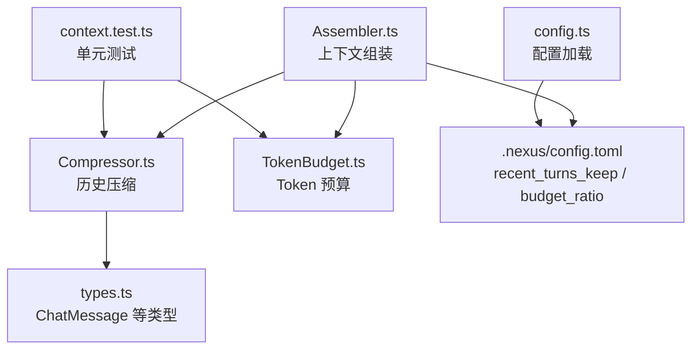
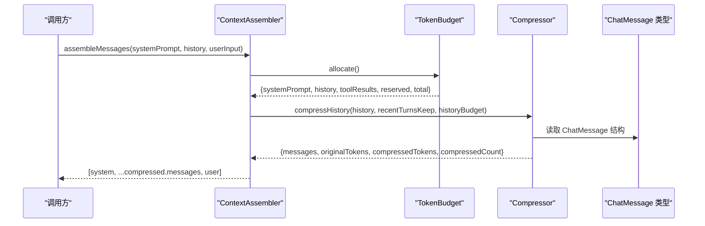
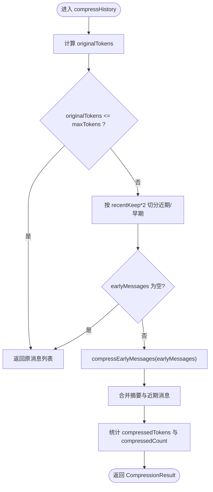
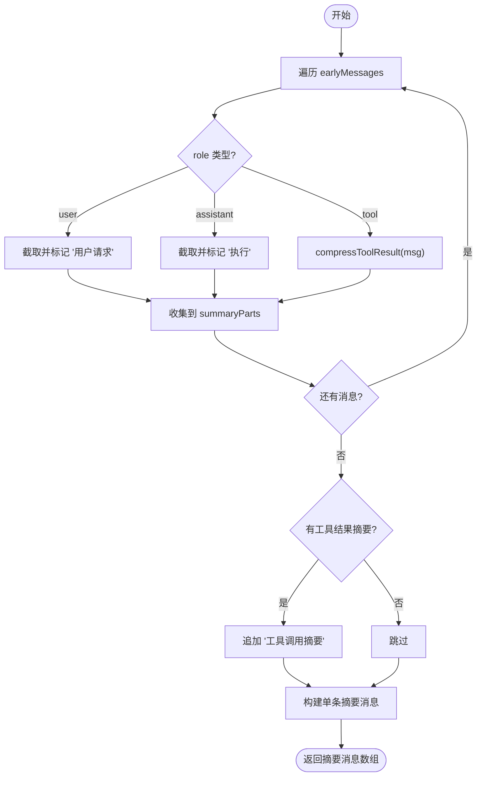
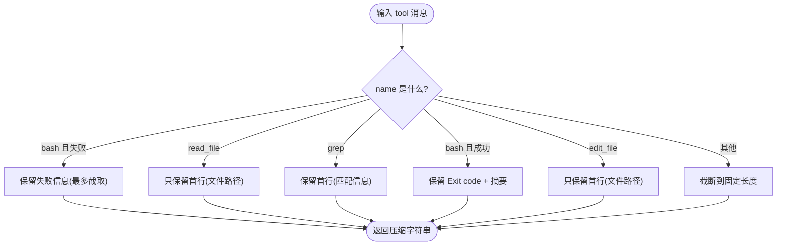
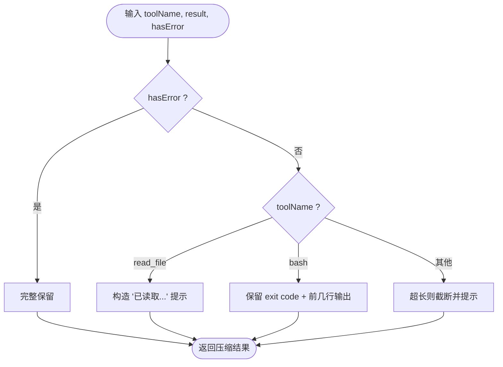
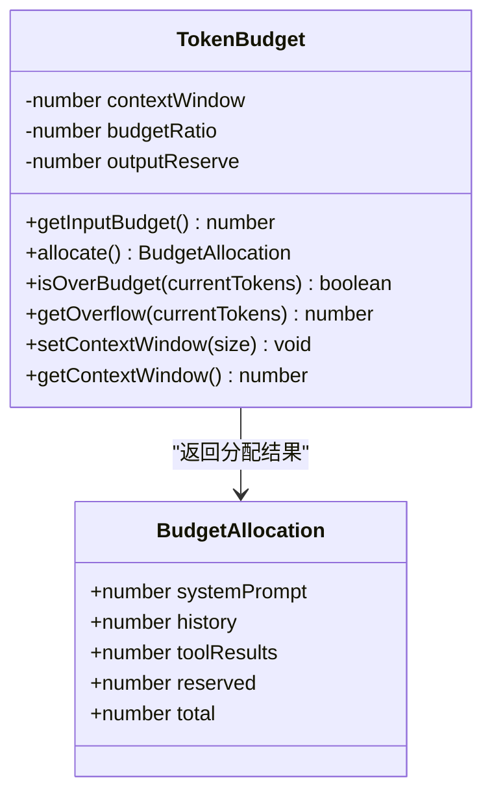
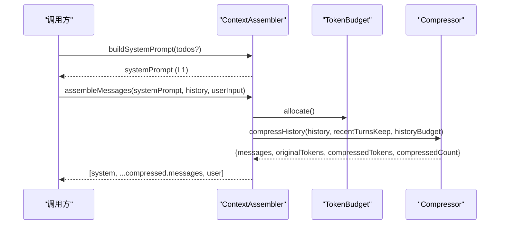
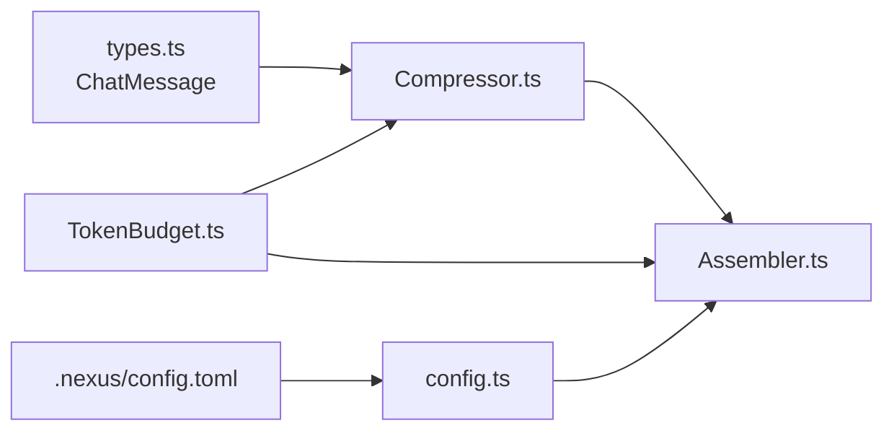

# 历史压缩器

<cite>
**本文引用的文件**
- [Compressor.ts](file://src/context/Compressor.ts)
- [Assembler.ts](file://src/context/Assembler.ts)
- [TokenBudget.ts](file://src/context/TokenBudget.ts)
- [types.ts](file://src/agent/types.ts)
- [config.ts](file://src/config.ts)
- [context.test.ts](file://tests/unit/context.test.ts)
- [.nexus/config.toml](file://.nexus/config.toml)
- [DESIGN.md](file://DESIGN.md)
</cite>

## 目录
1. [简介](#简介)
2. [项目结构](#项目结构)
3. [核心组件](#核心组件)
4. [架构总览](#架构总览)
5. [详细组件分析](#详细组件分析)
6. [依赖关系分析](#依赖关系分析)
7. [性能考量](#性能考量)
8. [故障排查指南](#故障排查指南)
9. [结论](#结论)
10. [附录](#附录)

## 简介
本文件面向“历史压缩器”的完整技术文档，聚焦对话历史的压缩算法与策略。内容涵盖：
- 重要性评估与信息保留策略（近期完整保留、早期摘要）
- 冗余去除机制（工具结果分级压缩、文本截断）
- 压缩阈值设置与最近轮次保持策略
- 不同压缩模式（激进/保守）的适用场景
- 压缩效果评估方法与自定义压缩器的扩展接口
- 压缩前后对比示例与性能基准测试建议

该能力是上下文工程的关键一环，确保长会话不爆窗口，同时尽量保留关键决策与错误信息，保障模型推理质量与调试可追溯性。

## 项目结构
历史压缩器位于上下文工程层，主要涉及以下文件：
- Compressor.ts：实现历史压缩、早期消息摘要、工具结果分级压缩、单条工具结果实时压缩
- Assembler.ts：组装系统提示、历史与用户输入，并在组装前进行 Token 预算检查与调用压缩
- TokenBudget.ts：估算 token、分配各层预算、判断是否超预算
- types.ts：定义 ChatMessage、AssembledContext 等核心类型
- config.ts 与 .nexus/config.toml：加载配置项 recentTurnsKeep、budgetRatio 等
- context.test.ts：对 TokenBudget 与 Compressor 的单元测试

**图表来源**
- [Assembler.ts:92-116](file://src/context/Assembler.ts#L92-L116)
- [Compressor.ts:25-56](file://src/context/Compressor.ts#L25-L56)
- [TokenBudget.ts:31-57](file://src/context/TokenBudget.ts#L31-L57)
- [types.ts:125-130](file://src/agent/types.ts#L125-L130)
- [.nexus/config.toml:51-55](file://.nexus/config.toml#L51-L55)
- [config.ts:116-121](file://src/config.ts#L116-L121)
- [context.test.ts:70-92](file://tests/unit/context.test.ts#L70-L92)

**章节来源**
- [Assembler.ts:92-116](file://src/context/Assembler.ts#L92-L116)
- [Compressor.ts:25-56](file://src/context/Compressor.ts#L25-L56)
- [TokenBudget.ts:31-57](file://src/context/TokenBudget.ts#L31-L57)
- [types.ts:125-130](file://src/agent/types.ts#L125-L130)
- [.nexus/config.toml:51-55](file://.nexus/config.toml#L51-L55)
- [config.ts:116-121](file://src/config.ts#L116-L121)
- [context.test.ts:70-92](file://tests/unit/context.test.ts#L70-L92)

## 核心组件
- 压缩入口函数 compressHistory：根据最近轮数与目标 token 上限，分离近期与早期消息，生成早期摘要并拼接返回
- 早期消息摘要 compressEarlyMessages：按角色聚合用户请求、助手执行要点与工具结果摘要，合并为一条摘要消息
- 工具结果分级压缩 compressToolResult：针对 bash/read_file/grep/edit_file 等不同工具输出，采用差异化压缩策略
- 单条工具结果实时压缩 compressSingleToolResult：在工具执行后即时压缩成功结果，错误结果完整保留
- Token 预算 TokenBudget：估算 token、分配 system/history/toolResults 预算、判断溢出
- 上下文组装 ContextAssembler.assembleMessages：组装 system + 压缩后的 history + user input，并基于预算控制

**章节来源**
- [Compressor.ts:25-56](file://src/context/Compressor.ts#L25-L56)
- [Compressor.ts:59-97](file://src/context/Compressor.ts#L59-L97)
- [Compressor.ts:100-136](file://src/context/Compressor.ts#L100-L136)
- [Compressor.ts:139-158](file://src/context/Compressor.ts#L139-L158)
- [TokenBudget.ts:31-57](file://src/context/TokenBudget.ts#L31-L57)
- [Assembler.ts:92-116](file://src/context/Assembler.ts#L92-L116)

## 架构总览
历史压缩器在上下文组装流程中扮演“预算内裁剪与摘要”的角色。整体数据流如下：

**图表来源**
- [Assembler.ts:92-116](file://src/context/Assembler.ts#L92-L116)
- [TokenBudget.ts:48-57](file://src/context/TokenBudget.ts#L48-L57)
- [Compressor.ts:25-56](file://src/context/Compressor.ts#L25-L56)
- [types.ts:125-130](file://src/agent/types.ts#L125-L130)

## 详细组件分析

### 压缩入口与策略：compressHistory
- 计算原始 token 总量，若未超过 maxTokens，直接返回原消息列表
- 将消息按“每轮约两条（user + assistant）”切分为近期与早期
- 对早期消息生成摘要，并与近期消息拼接
- 统计压缩后的 token 数量与压缩条目数

**图表来源**
- [Compressor.ts:25-56](file://src/context/Compressor.ts#L25-L56)

**章节来源**
- [Compressor.ts:25-56](file://src/context/Compressor.ts#L25-L56)

### 早期消息摘要：compressEarlyMessages
- 遍历早期消息，按角色提取要点：
  - user：截取至固定长度并标注“用户请求”
  - assistant：截取关键执行要点并标注“执行”
  - tool：通过 compressToolResult 进行分级压缩
- 将工具结果摘要合并为一段
- 最终生成一条包含“历史摘要”的 user 消息

**图表来源**
- [Compressor.ts:59-97](file://src/context/Compressor.ts#L59-L97)

**章节来源**
- [Compressor.ts:59-97](file://src/context/Compressor.ts#L59-L97)

### 工具结果分级压缩：compressToolResult
- bash 失败输出：完整保留（便于调试），最多截取一定长度
- read_file：仅保留首行（文件路径）
- grep：保留匹配数或首行
- bash 成功输出：保留 exit code 行与摘要
- edit_file：仅保留首行（文件路径）
- 其他工具：统一截断到固定长度

**图表来源**
- [Compressor.ts:100-136](file://src/context/Compressor.ts#L100-L136)

**章节来源**
- [Compressor.ts:100-136](file://src/context/Compressor.ts#L100-L136)

### 单条工具结果实时压缩：compressSingleToolResult
- 错误结果：完整保留
- read_file 成功：替换为“已读取某文件”的提示
- bash 成功：保留 exit code 与部分输出，超出则截断
- 其他：超长时截断并提示

**图表来源**
- [Compressor.ts:139-158](file://src/context/Compressor.ts#L139-L158)

**章节来源**
- [Compressor.ts:139-158](file://src/context/Compressor.ts#L139-L158)

### Token 预算与分配：TokenBudget
- estimateTokens：粗略估算 token 数（ASCII 与非 ASCII 字符分别估算）
- allocate：按比例分配 systemPrompt/history/toolResults 预算，并预留输出空间
- isOverBudget/getOverflow：判断是否超预算与溢出量

**图表来源**
- [TokenBudget.ts:31-57](file://src/context/TokenBudget.ts#L31-L57)
- [TokenBudget.ts:7-21](file://src/context/TokenBudget.ts#L7-L21)

**章节来源**
- [TokenBudget.ts:7-21](file://src/context/TokenBudget.ts#L7-L21)
- [TokenBudget.ts:31-57](file://src/context/TokenBudget.ts#L31-L57)

### 上下文组装与压缩集成：ContextAssembler
- buildSystemPrompt：构建 L1 静态上下文（系统提示、规则、工具说明、Git 状态、项目树、Todos）
- assembleMessages：计算 system 与 history 的 token，调用 compressHistory 压缩历史，再拼装最终消息

**图表来源**
- [Assembler.ts:55-90](file://src/context/Assembler.ts#L55-L90)
- [Assembler.ts:92-116](file://src/context/Assembler.ts#L92-L116)
- [TokenBudget.ts:48-57](file://src/context/TokenBudget.ts#L48-L57)
- [Compressor.ts:25-56](file://src/context/Compressor.ts#L25-L56)

**章节来源**
- [Assembler.ts:55-90](file://src/context/Assembler.ts#L55-L90)
- [Assembler.ts:92-116](file://src/context/Assembler.ts#L92-L116)

### 配置与参数
- recentTurnsKeep：控制“近期完整保留”的轮数，默认来自配置文件
- budgetRatio：控制输入预算占上下文窗口的比例
- 这些参数影响压缩阈值与历史预算分配

**章节来源**
- [.nexus/config.toml:51-55](file://.nexus/config.toml#L51-L55)
- [config.ts:116-121](file://src/config.ts#L116-L121)

## 依赖关系分析
- Compressor 依赖 types.ChatMessage 与 TokenBudget.estimateTokens
- Assembler 依赖 TokenBudget.allocate 与 Compressor.compressHistory
- 配置由 config.ts 加载 .nexus/config.toml 中的 context.recent_turns_keep 与 budget_ratio

**图表来源**
- [Compressor.ts:9-10](file://src/context/Compressor.ts#L9-L10)
- [Assembler.ts:12-14](file://src/context/Assembler.ts#L12-L14)
- [config.ts:116-121](file://src/config.ts#L116-L121)

**章节来源**
- [Compressor.ts:9-10](file://src/context/Compressor.ts#L9-L10)
- [Assembler.ts:12-14](file://src/context/Assembler.ts#L12-L14)
- [config.ts:116-121](file://src/config.ts#L116-L121)

## 性能考量
- 时间复杂度
  - compressHistory：O(N) 遍历消息，N 为早期消息数量
  - compressEarlyMessages：O(N) 逐条处理，工具结果压缩 O(1) 或 O(L)（L 为行数）
  - estimateTokens：O(M) 扫描字符，M 为文本长度
- 空间复杂度
  - 摘要消息与工具结果摘要数组，线性于早期消息规模
- 优化建议
  - 合理设置 recentTurnsKeep，避免过多早期消息导致摘要过长
  - 对超大工具输出，优先使用 compressSingleToolResult 在工具执行后即时压缩
  - 调整 budgetRatio 与 outputReserve，平衡历史与工具结果预算

[本节为通用指导，不直接分析具体文件]

## 故障排查指南
- 症状：历史未压缩
  - 可能原因：originalTokens <= maxTokens；earlyMessages 为空
  - 排查：检查 messages 长度与 content 大小；确认 recentTurnsKeep 与 historyBudget
- 症状：摘要丢失关键信息
  - 可能原因：工具结果被过度压缩；assistant 内容被截断
  - 排查：查看 compressToolResult 分支逻辑；适当提高摘要长度限制
- 症状：bash 错误信息缺失
  - 可能原因：错误结果未被完整保留
  - 排查：确认 compressSingleToolResult 的错误分支；确保 hasError 正确传递

**章节来源**
- [Compressor.ts:25-56](file://src/context/Compressor.ts#L25-L56)
- [Compressor.ts:100-136](file://src/context/Compressor.ts#L100-L136)
- [Compressor.ts:139-158](file://src/context/Compressor.ts#L139-L158)

## 结论
历史压缩器通过“近期完整保留 + 早期摘要 + 工具结果分级压缩”的策略，在保证长会话不爆窗口的前提下，尽可能保留关键决策与错误信息。配合 Token 预算管理与配置化参数，可在不同场景下灵活切换激进与保守压缩模式。单元测试覆盖了核心行为，可作为扩展与优化的基础。

[本节为总结，不直接分析具体文件]

## 附录

### 压缩阈值与最近轮次保持策略
- 阈值来源：historyBudget = allocate().history
- 最近轮次：recentTurnsKeep * 2（每轮约 user + assistant 两条）
- 当 originalTokens > maxTokens 时触发压缩；否则直接返回

**章节来源**
- [Assembler.ts:92-116](file://src/context/Assembler.ts#L92-L116)
- [Compressor.ts:25-56](file://src/context/Compressor.ts#L25-L56)
- [TokenBudget.ts:48-57](file://src/context/TokenBudget.ts#L48-L57)

### 不同压缩模式的适用场景
- 激进压缩：适合超长会话、成本敏感场景；提高压缩强度（更短摘要、更强截断）
- 保守压缩：适合需要高保真度的调试与分析场景；降低压缩强度（更长摘要、更少截断）
- 选择依据：budgetRatio、recentTurnsKeep、工具结果压缩策略

[本节为概念性说明，不直接分析具体文件]

### 压缩效果评估方法
- 指标
  - 压缩率：(originalTokens - compressedTokens) / originalTokens
  - 压缩条目数：compressedCount
  - 关键信息保留度：人工抽检摘要是否覆盖关键决策与错误
- 方法
  - 使用 context.test.ts 中的用例作为基线
  - 构造不同长度的历史与工具输出，测量压缩前后 token 变化
  - 结合业务场景（如 bash 失败、read_file 大文件）验证保留度

**章节来源**
- [context.test.ts:70-92](file://tests/unit/context.test.ts#L70-L92)
- [context.test.ts:94-114](file://tests/unit/context.test.ts#L94-L114)

### 自定义压缩器的扩展接口
- 扩展点
  - 替换 compressEarlyMessages 的摘要生成逻辑
  - 新增 compressToolResult 的工具分支
  - 定制 compressSingleToolResult 的实时压缩策略
- 集成方式
  - 在 Assembler.assembleMessages 中注入新的压缩函数
  - 通过配置项控制压缩强度（recentTurnsKeep、budgetRatio）

[本节为概念性说明，不直接分析具体文件]

### 压缩前后对比示例
- 短历史：不触发压缩，返回原消息列表
- 长历史：早期消息被压缩为一条摘要，近期消息完整保留
- 工具结果：bash 失败完整保留；read_file/grep/edit_file 仅保留路径或匹配信息；bash 成功保留 exit code 与摘要

**章节来源**
- [context.test.ts:70-92](file://tests/unit/context.test.ts#L70-L92)
- [context.test.ts:94-114](file://tests/unit/context.test.ts#L94-L114)
- [Compressor.ts:100-136](file://src/context/Compressor.ts#L100-L136)
- [Compressor.ts:139-158](file://src/context/Compressor.ts#L139-L158)

### 性能基准测试建议
- 基准场景
  - 不同历史长度（10/30/100 轮）
  - 不同工具输出规模（小/中/大文件）
  - 不同 budgetRatio（0.6/0.8/1.0）
- 指标采集
  - 压缩耗时、token 估算耗时
  - 压缩率、compressedCount
  - 关键信息保留度（抽样评分）
- 工具
  - 复用 context.test.ts 的测试框架，扩展压测用例

[本节为通用指导，不直接分析具体文件]

### 设计参考
- 上下文工程层的压缩策略与设计哲学详见 DESIGN.md

**章节来源**
- [DESIGN.md:325-336](file://DESIGN.md#L325-L336)